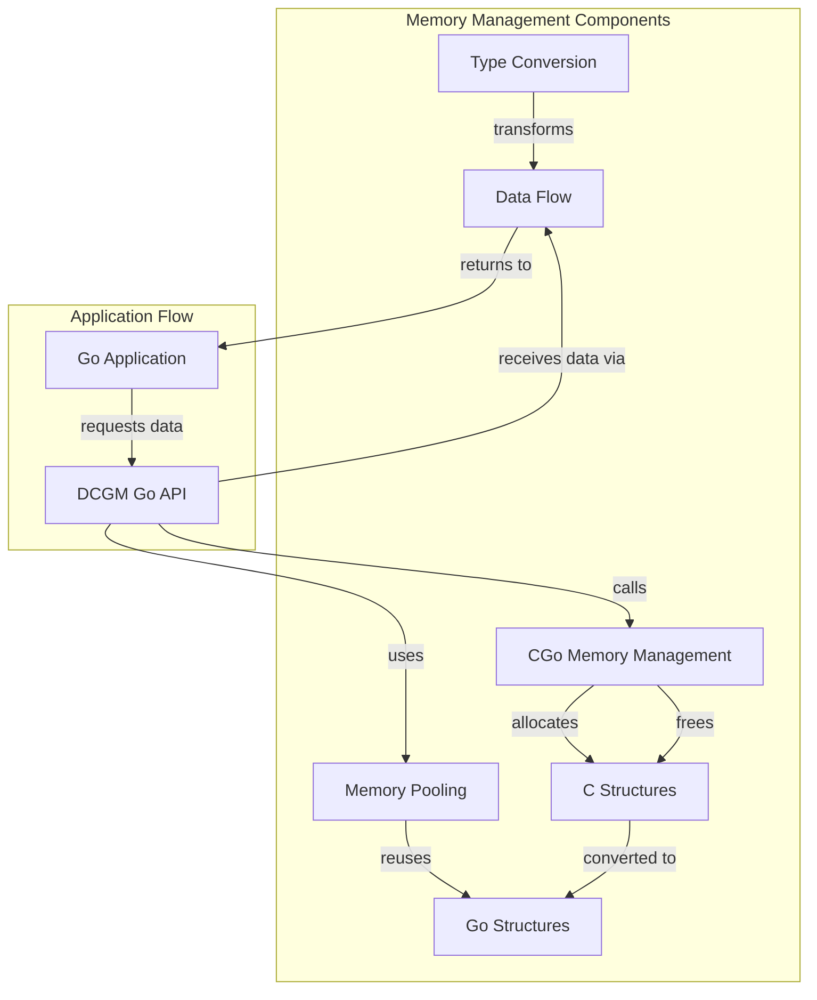
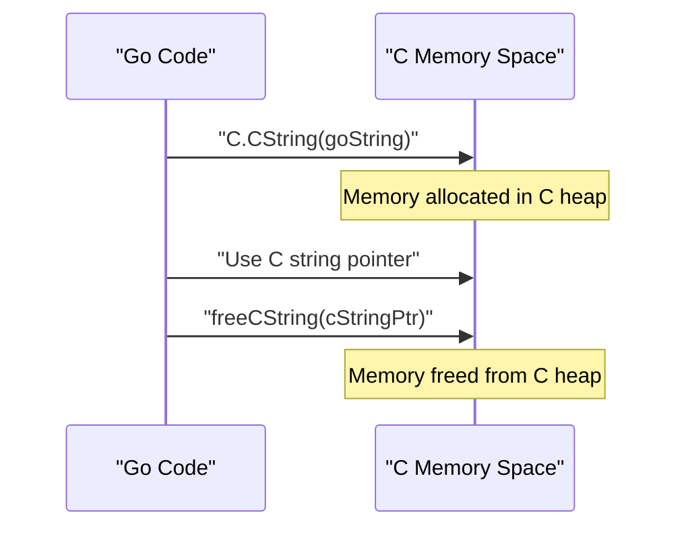
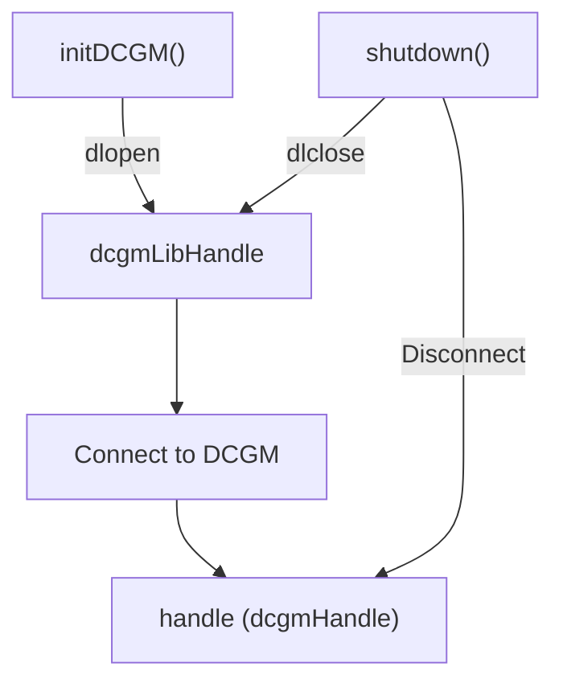
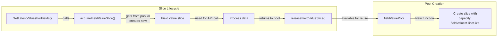
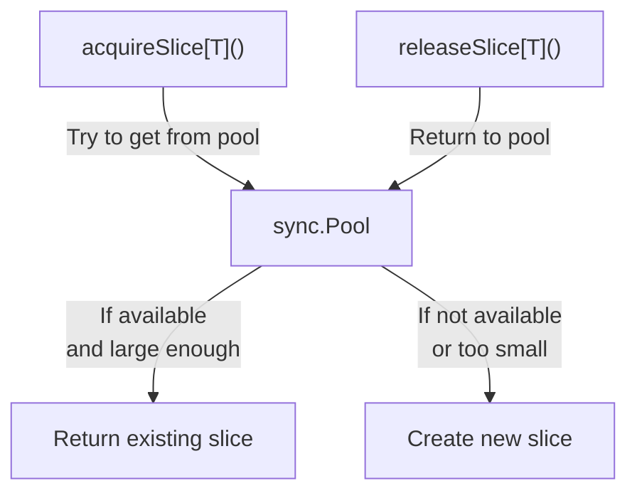
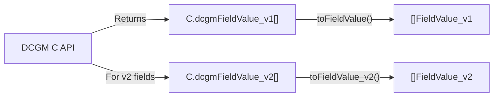
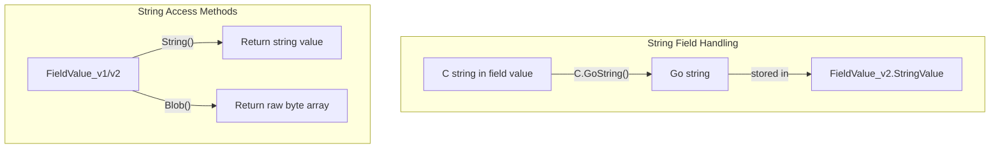
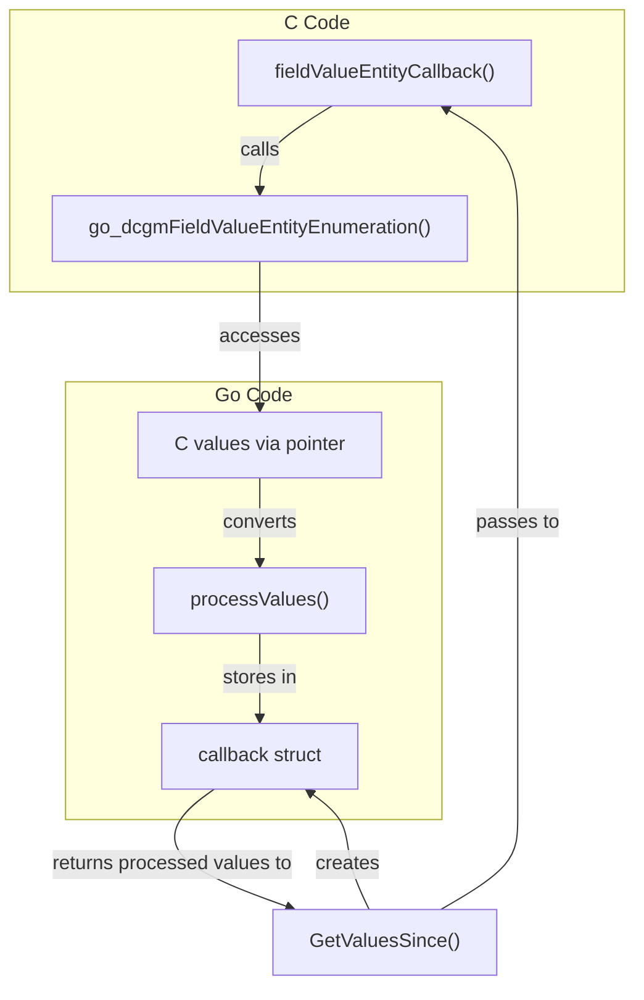
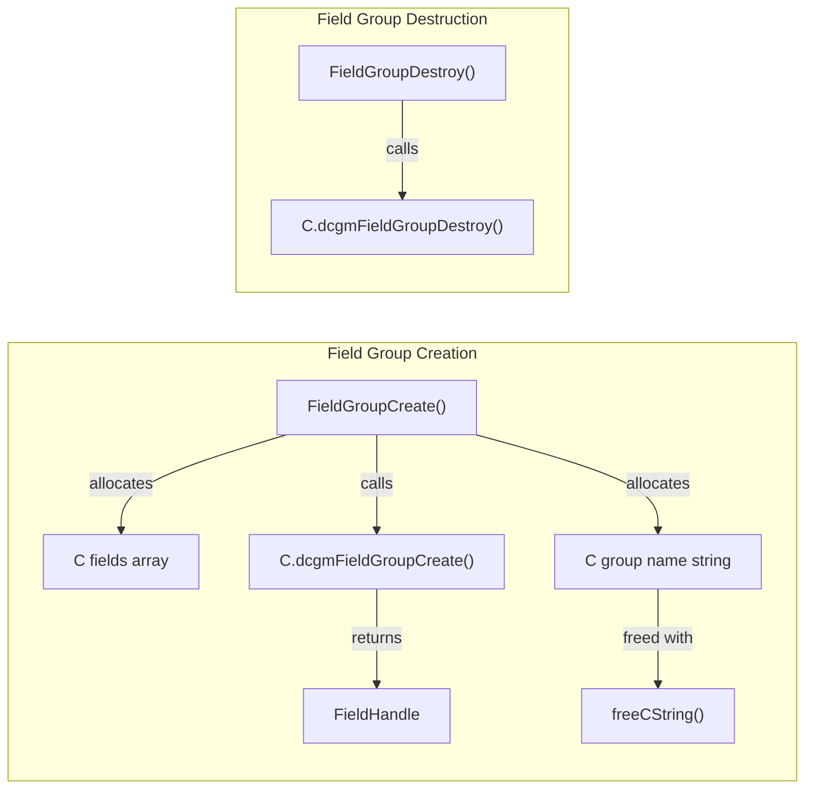
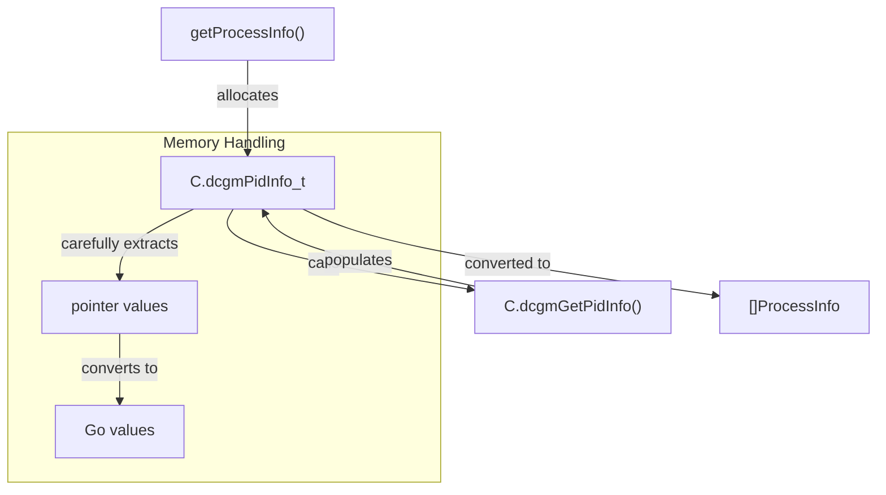

<!-- source: DeepWiki mcp.deepwiki.com · repo NVIDIA/go-dcgm · page 3.2 Memory Management · fetched 2026-10-26 -->

# Memory Management

Relevant source files

The following files were used as context for generating this wiki page:

- [pkg/dcgm/admin.go](pkg/dcgm/admin.go)
- [pkg/dcgm/diag.go](pkg/dcgm/diag.go)
- [pkg/dcgm/field_values.go](pkg/dcgm/field_values.go)
- [pkg/dcgm/field_values_cb.c](pkg/dcgm/field_values_cb.c)
- [pkg/dcgm/field_values_cb.h](pkg/dcgm/field_values_cb.h)
- [pkg/dcgm/field_values_test.go](pkg/dcgm/field_values_test.go)
- [pkg/dcgm/fields.go](pkg/dcgm/fields.go)
- [pkg/dcgm/health.go](pkg/dcgm/health.go)
- [pkg/dcgm/process_info.go](pkg/dcgm/process_info.go)
- [pkg/dcgm/utils.go](pkg/dcgm/utils.go)

This page documents the memory management strategies implemented in the go-dcgm library. It covers how the library efficiently handles memory allocation, particularly when interfacing between Go and C via CGo, and the techniques used to optimize performance when dealing with large datasets from GPU monitoring.

## Overview

The go-dcgm library faces unique memory management challenges due to its nature as a Go wrapper around NVIDIA's C-based DCGM library. The primary concerns addressed by its memory management system include:

1. Safely managing memory allocated by C code
2. Efficiently handling large arrays of field values during GPU monitoring
3. Minimizing garbage collection overhead during high-frequency monitoring operations
4. Ensuring proper conversion between Go and C data structures

Sources: [pkg/dcgm/fields.go:151-163](), [pkg/dcgm/utils.go:66-68](), [pkg/dcgm/admin.go:63-68]()

## CGo Memory Management

When using CGo to interface with the DCGM C library, memory allocations made in C code are not automatically managed by Go's garbage collector. The go-dcgm library implements careful memory handling to prevent leaks.

### C String Handling

C strings allocated in Go code must be explicitly freed after use:

The library consistently uses a pattern of allocating C strings followed by deferred cleanup:

Sources: [pkg/dcgm/utils.go:66-68](), [pkg/dcgm/admin.go:63-64](), [pkg/dcgm/fields.go:70-71]()

### Library Handle Management

The DCGM library handle itself requires proper initialization and cleanup:

Sources: [pkg/dcgm/admin.go:59-98]()

## Memory Pooling System

To reduce garbage collection pressure and improve performance, go-dcgm implements memory pooling using `sync.Pool` for frequently allocated structures, particularly for field value slices that are used when retrieving GPU metrics.

### Field Value Pooling

Two main pools are maintained:
- `fieldValuePool` for `dcgmFieldValue_v1` structures
- `fieldValueV2Pool` for `dcgmFieldValue_v2` structures

Sources: [pkg/dcgm/fields.go:151-163](), [pkg/dcgm/fields.go:178-192](), [pkg/dcgm/fields.go:199-200]()

### Pooling Implementation

The pooling system provides generic functions to acquire and release slices:

This pattern is used throughout the codebase to efficiently manage memory for large data structures.

Sources: [pkg/dcgm/fields.go:165-176]()

## Type Conversion and Memory Safety

Converting between Go and C data structures requires careful memory handling to ensure safety and prevent leaks.

### Field Value Conversion

When retrieving field values from DCGM, the C structures must be converted to Go structures:

The conversion functions carefully copy all data to ensure memory safety:

Sources: [pkg/dcgm/fields.go:290-304](), [pkg/dcgm/fields.go:326-357]()

### Handling String Field Values

String field values require special handling to safely convert from C to Go:

Sources: [pkg/dcgm/fields.go:315-319](), [pkg/dcgm/fields.go:339-340](), [pkg/dcgm/fields.go:375-378]()

## Callback Memory Management

For operations that use callbacks, such as `GetValuesSince`, memory management requires careful coordination between Go and C code:

The callback system ensures that C pointers are safely accessed and converted to Go values without causing memory leaks.

Sources: [pkg/dcgm/field_values.go:29-69](), [pkg/dcgm/field_values_cb.c:21-27]()

## Memory Management in Specific Operations

### Field Group Management

When creating and destroying field groups, memory must be carefully managed:

Sources: [pkg/dcgm/fields.go:63-80](), [pkg/dcgm/fields.go:84-91]()

### Process Information Retrieval

When retrieving process information, large structures are allocated and carefully populated:

Memory is carefully handled when dealing with process information to ensure all pointers are safely dereferenced.

Sources: [pkg/dcgm/process_info.go:130-221]()

## Best Practices for Library Users

When using go-dcgm, keep these memory management practices in mind:

1. Always call `Shutdown()` after initialization to properly release resources
2. Use the provided functions for creating and destroying groups/watches
3. Be aware that field values returned by API calls are copies, not references
4. For high-frequency monitoring, consider using a single watch with multiple fields
5. Be mindful of potential memory pressure when requesting data for many fields across many GPUs

Sources: [pkg/dcgm/admin.go:86-98]()

## Related Pages

For more information on field management and how field data is structured and accessed, see [Field Management](#2.4).

For details on the CGo integration and how go-dcgm interfaces with the C library, see [Interaction with C Library](#3.1).

For error handling strategies that relate to memory management, see [Error Handling](#3.3).

---

