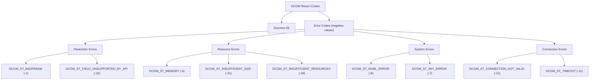
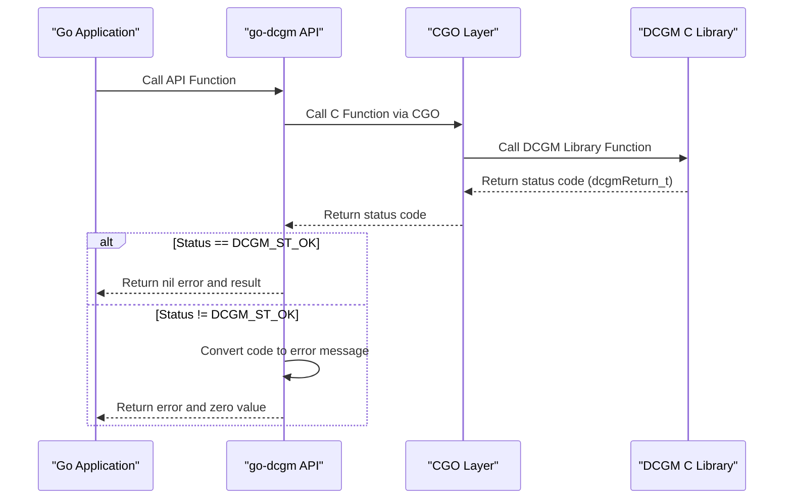
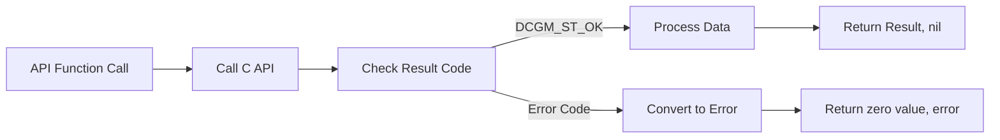
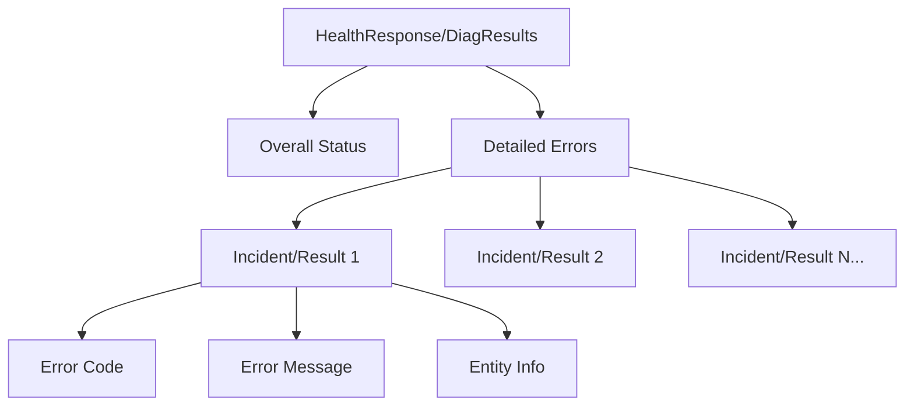
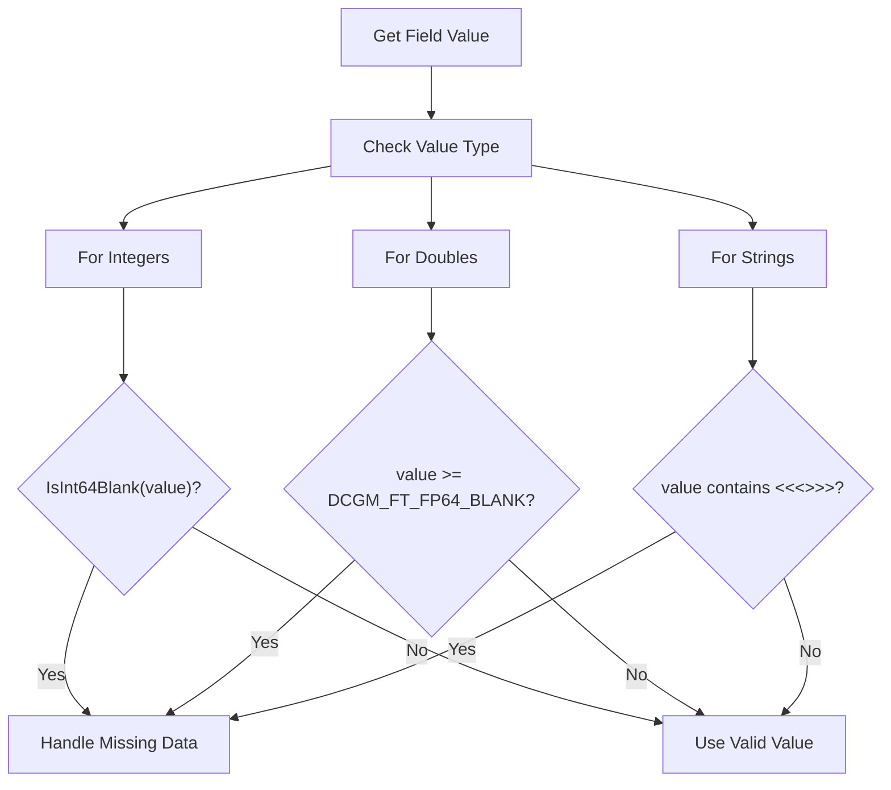
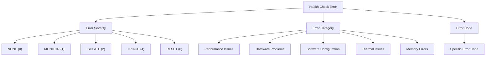

<!-- source: DeepWiki mcp.deepwiki.com · repo NVIDIA/go-dcgm · page 3.3 Error Handling · fetched 2026-10-26 -->

# Error Handling

<details>
<summary>Relevant source files</summary>

The following files were used as context for generating this wiki page:

- [pkg/dcgm/admin.go](pkg/dcgm/admin.go)
- [pkg/dcgm/api.go](pkg/dcgm/api.go)
- [pkg/dcgm/const.go](pkg/dcgm/const.go)
- [pkg/dcgm/dcgm_agent.h](pkg/dcgm/dcgm_agent.h)
- [pkg/dcgm/dcgm_errors.h](pkg/dcgm/dcgm_errors.h)
- [pkg/dcgm/dcgm_fields.h](pkg/dcgm/dcgm_fields.h)
- [pkg/dcgm/dcgm_structs.h](pkg/dcgm/dcgm_structs.h)
- [pkg/dcgm/diag.go](pkg/dcgm/diag.go)
- [pkg/dcgm/health.go](pkg/dcgm/health.go)
- [pkg/dcgm/profile.go](pkg/dcgm/profile.go)
- [pkg/dcgm/utils.go](pkg/dcgm/utils.go)

</details>


This page describes how errors are represented, propagated, and handled in the NVIDIA DCGM Go bindings. We'll cover the core error handling mechanisms, different types of errors you may encounter, and best practices for error handling when using the go-dcgm library.

For information about memory management, see [Memory Management](#3.2). For details about initialization and shutdown procedures, see [Initialization and Shutdown](#2.1).

## Error Representation

The go-dcgm library uses multiple mechanisms to represent errors, depending on the context:

1. Go-style errors using the standard `error` interface
2. DCGM-specific error codes defined as constants
3. "Blank" or sentinel values to indicate missing or invalid field data
4. Specialized error structures for health checks and diagnostics

### Error Type

The primary Go error type is defined in the utils.go file:

```mermaid
classDiagram
    class "Error" {
        +string msg
        +C.dcgmReturn_t Code
        +Error() string
    }
    "Error" --|> "error"
```

The `Error` struct implements the standard Go `error` interface, while also preserving the original DCGM return code for more detailed error handling.

Sources: [pkg/dcgm/utils.go:51-56]()

### DCGM Return Codes

DCGM operations can return numerous status codes, which are defined as constants:



These status codes are returned by the underlying DCGM C library and converted to Go errors via the `errorString` function.

Sources: [pkg/dcgm/const.go:79-192](), [pkg/dcgm/dcgm_structs.h:320-383](), [pkg/dcgm/utils.go:58-65]()

### Field Value Status Indicators

When retrieving field values (metrics, device info, etc.), DCGM uses special "blank" values to indicate various error conditions:

| Data Type | Blank Value | Not Found | Not Supported | Not Permissioned |
|-----------|-------------|-----------|---------------|------------------|
| INT32     | 0x7ffffff0  | 0x7ffffff1| 0x7ffffff2    | 0x7ffffff3       |
| INT64     | 0x7ffffffffffffff0 | 0x7ffffffffffffff1 | 0x7ffffffffffffff2 | 0x7ffffffffffffff3 |
| FP64 (Double) | 140737488355328.0 | +1.0 | +2.0 | +3.0 |
| String | "<<<NULL>>>" | "<<<NOT_FOUND>>>" | "<<<NOT_SUPPORTED>>>" | "<<<NOT_PERMISSIONED>>>" |

These special values indicate that field data couldn't be retrieved for various reasons, so applications can check for these values instead of handling errors.

Sources: [pkg/dcgm/const.go:47-77](), [pkg/dcgm/dcgm_structs.h:44-159]()

## Error Propagation

The go-dcgm library propagates errors from the underlying C library to Go in a consistent pattern:



This pattern is consistent across the API, making error handling predictable for users.

Sources: [pkg/dcgm/utils.go:58-65](), [pkg/dcgm/api.go:18-47](), [pkg/dcgm/health.go:154-166]()

### Error Conversion Function

The primary function for converting DCGM status codes to Go errors is `errorString`:

```go
func errorString(result C.dcgmReturn_t) error {
    if result == C.DCGM_ST_OK {
        return nil
    }
    err := C.GoString(C.errorString(result))
    return fmt.Errorf("%v", err)
}
```

This function invokes the C library's `errorString` function to get a human-readable error message, then wraps it in a Go error.

Sources: [pkg/dcgm/utils.go:58-65](), [pkg/dcgm/dcgm_agent.h:247-256]()

## Error Handling Patterns

### Standard API Error Handling

Most API functions follow this pattern for error handling:



Example from `GetDeviceStatus`:

```go
func GetDeviceStatus(gpuID uint) (DeviceStatus, error) {
    return latestValuesForDevice(gpuID)
}

func latestValuesForDevice(gpuID uint) (DeviceStatus, error) {
    // ...
    result := C.dcgmGetLatestValues_v2(handle.handle, C.uint(gpuID), &fieldGroup.handle, &fieldsArray[0], C.uint(len(fields)), &values[0])
    if err := errorString(result); err != nil {
        return DeviceStatus{}, fmt.Errorf("error getting latest values: %v", err)
    }
    // Process and return data...
}
```

Sources: [pkg/dcgm/api.go:88-91]()

### Specialized Error Handling

Some operations, like health checks and diagnostics, return specialized error structures:



For these APIs, errors are returned both as Go errors (for API failures) and within result structures (for operational issues).

Sources: [pkg/dcgm/health.go:92-148](), [pkg/dcgm/diag.go:35-47]()

## Error Checking and Field Values

When retrieving field values, you should check for special sentinel values that indicate different error conditions:



The library provides utility functions to check for these sentinel values:

```go
// IsInt32Blank checks if an integer value represents DCGM's "blank" or sentinel value
func IsInt32Blank(value int) bool {
    return value >= dcgmInt32Blank
}

// IsInt64Blank checks if an integer value represents DCGM's "blank" or sentinel value
func IsInt64Blank(value int64) bool {
    return value >= dcgmInt64Blank
}
```

Sources: [pkg/dcgm/utils.go:70-80](), [pkg/dcgm/const.go:47-77]()

## Common Error Categories

DCGM errors typically fall into several categories:

1. **Initialization Errors**: Issues with starting DCGM or connecting to a host engine
2. **API Parameter Errors**: Invalid parameters passed to API functions
3. **Resource Errors**: Memory allocation failures or resource exhaustion
4. **Communication Errors**: Failures in communicating with the DCGM host engine or GPUs
5. **GPU-specific Errors**: Hardware or driver issues with specific GPUs
6. **Field Access Errors**: Problems accessing specific metrics or fields

Each category requires different handling strategies.

Sources: [pkg/dcgm/const.go:79-192](), [pkg/dcgm/dcgm_errors.h:31-193]()

### Health and Diagnostic Errors

For health monitoring and diagnostics, DCGM provides detailed error codes with severity levels:



Each error code provides detailed information about what went wrong and how severe the issue is.

Sources: [pkg/dcgm/dcgm_errors.h:31-193](), [pkg/dcgm/const.go:244-487]()

## Best Practices for Error Handling

1. **Always check Go errors**: All API functions can return errors that should be handled
2. **Check field values**: For retrieved metrics, check for sentinel values
3. **Use appropriate context**: When wrapping errors, include context about what operation failed
4. **Consider specific error codes**: For specialized handling, check the `Code` field of `Error` type
5. **Handle initialization/shutdown correctly**: Proper initialization and cleanup is critical to prevent errors

## Example Error Handling Pattern

Here's a recommended pattern for handling errors in go-dcgm applications:

```go
// Initialize DCGM
cleanup, err := dcgm.Init(dcgm.Embedded)
if err != nil {
    log.Fatalf("Failed to initialize DCGM: %v", err)
}
defer cleanup() // Ensure proper cleanup

// Get GPU information
devices, err := dcgm.GetSupportedDevices()
if err != nil {
    log.Fatalf("Failed to get devices: %v", err)
}

// For each device, get and check field values
for _, device := range devices {
    status, err := dcgm.GetDeviceStatus(device)
    if err != nil {
        log.Printf("Error getting device %d status: %v", device, err)
        continue
    }
    
    // Check for "blank" values
    if dcgm.IsInt64Blank(status.Power) {
        log.Printf("Power information not available for device %d", device)
    } else {
        log.Printf("Device %d power: %d W", device, status.Power)
    }
}
```

Sources: [pkg/dcgm/api.go:18-47](), [pkg/dcgm/utils.go:70-80]()

## Summary

Error handling in go-dcgm involves:

1. **Checking Go errors** returned by API functions
2. **Verifying field values** against sentinel "blank" values
3. **Understanding error categories** to diagnose issues
4. **Properly initializing and shutting down** DCGM

Following these practices will help you build robust applications that gracefully handle errors in GPU management and monitoring.

---

