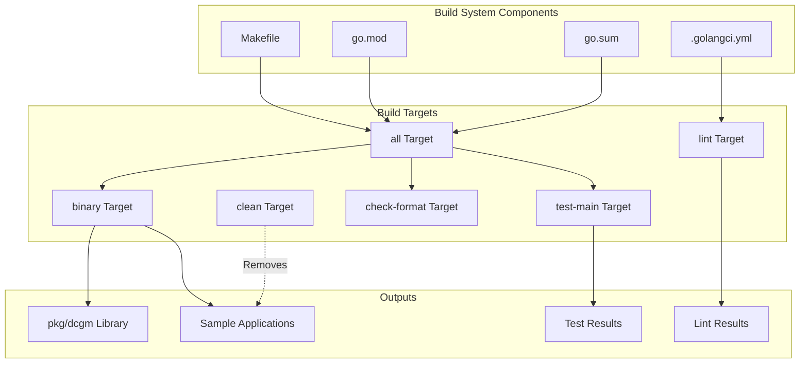
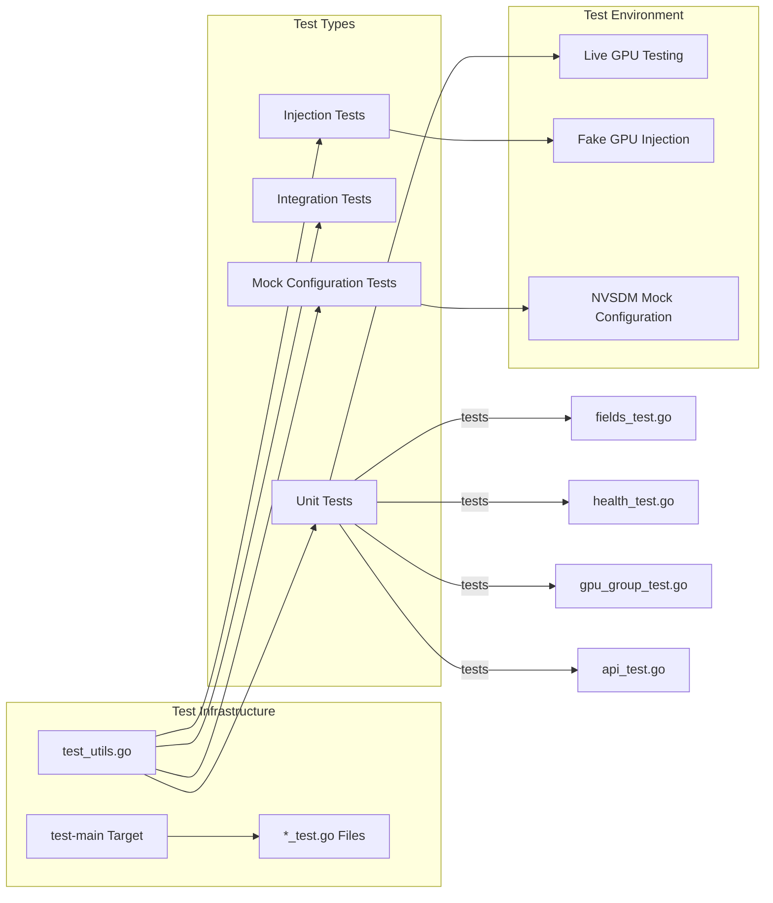
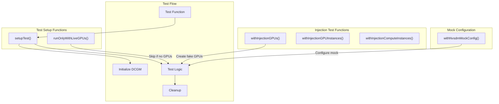

<!-- source: DeepWiki mcp.deepwiki.com · repo NVIDIA/go-dcgm · page 4 Building and Testing · fetched 2026-10-26 -->

# Building and Testing

<details>
<summary>Relevant source files</summary>

The following files were used as context for generating this wiki page:

- [.gitignore](.gitignore)
- [.golangci.yml](.golangci.yml)
- [Makefile](Makefile)
- [go.mod](go.mod)
- [go.sum](go.sum)
- [pkg/dcgm/api_test.go](pkg/dcgm/api_test.go)
- [pkg/dcgm/fields_test.go](pkg/dcgm/fields_test.go)
- [pkg/dcgm/gpu_group_test.go](pkg/dcgm/gpu_group_test.go)
- [pkg/dcgm/health_test.go](pkg/dcgm/health_test.go)
- [pkg/dcgm/test_utils.go](pkg/dcgm/test_utils.go)

</details>


This page provides a comprehensive guide to building the go-dcgm repository and utilizing its testing framework. It covers the build system, test infrastructure, and best practices for development.

For information about specific API usage, see [Core API Reference](#2), and for implementation details, see [Implementation Details](#3).

## Build System Overview

The go-dcgm repository uses a Makefile-based build system to compile the core package and sample applications. The project follows standard Go module conventions with specific accommodations for CGo interfaces to the NVIDIA DCGM C library.



Sources: [Makefile:15-54](), [go.mod:1-16](), [go.sum:1-15](), [.golangci.yml:1-83]()

## Building go-dcgm

### Prerequisites

- Go 1.23 or later
- NVIDIA DCGM library installed on the system
- CGo enabled environment

### Build Commands

The primary build commands available in the repository:

| Command | Description |
|---------|-------------|
| `make all` | Builds binaries, runs tests, and checks formatting |
| `make binary` | Builds only the core library and sample applications |
| `make clean` | Removes built binaries |
| `make lint` | Runs linting on changed files |
| `make lint-full` | Runs linting on all files |

### Building the Core Library and Samples

To build the core library and all sample applications:

```bash
make binary
```

This command compiles:
1. The core DCGM Go binding (`pkg/dcgm`)
2. Sample applications including:
   - deviceInfo
   - dmon
   - health
   - hostengineStatus
   - policy
   - processInfo
   - restApi
   - topology
   - diag

Sources: [Makefile:21-31]()

## Testing Framework

The go-dcgm repository includes a robust testing framework that enables testing with both real and simulated GPU environments. Tests are written using the standard Go testing package with additional utilities specific to DCGM.



Sources: [Makefile:33-34](), [pkg/dcgm/test_utils.go:17-220](), [pkg/dcgm/fields_test.go:1-183](), [pkg/dcgm/health_test.go:1-225](), [pkg/dcgm/gpu_group_test.go:1-97](), [pkg/dcgm/api_test.go:1-43]()

### Running Tests

To run the test suite:

```bash
make test-main
```

This executes tests with race detection enabled to catch potential concurrency issues.

Sources: [Makefile:33-34]()

### Test Utilities

The test utilities in `test_utils.go` provide several important functions for DCGM testing:

1. `setupTest` - Initializes the DCGM environment for testing with appropriate debug settings
2. `runOnlyWithLiveGPUs` - Ensures tests requiring physical GPUs only run when hardware is available
3. `withInjectionGPUs` - Creates fake GPU entities for testing without real hardware
4. `withInjectionGPUInstances` - Creates fake GPU instances for MIG testing
5. `withInjectionComputeInstances` - Creates fake compute instances for MIG testing
6. `withNvsdmMockConfig` - Runs tests with a specified NVSDM mock configuration



Sources: [pkg/dcgm/test_utils.go:37-219]()

## Types of Tests

### Unit Tests

Unit tests focus on testing individual components and functions of the go-dcgm library. Examples include:

- Field handling and management (`fields_test.go`)
- Health monitoring and checking (`health_test.go`)
- GPU group management (`gpu_group_test.go`)

Sources: [pkg/dcgm/fields_test.go:15-182](), [pkg/dcgm/health_test.go:34-224](), [pkg/dcgm/gpu_group_test.go:27-96]()

### Injection Tests

Injection tests utilize the ability to create fake GPU entities and inject field values for testing without requiring real hardware. This enables testing of various scenarios including:

- Error conditions
- Specific hardware configurations
- Edge cases

Example from `health_test.go`:

```
func TestHealthCheckPCIE(t *testing.T) {
    teardownTest := setupTest(t)
    defer teardownTest(t)

    runOnlyWithLiveGPUs(t)
    gpus, err := withInjectionGPUs(t, 1)
    require.NoError(t, err)
    
    // Test continues with injected values...
}
```

Sources: [pkg/dcgm/test_utils.go:81-183](), [pkg/dcgm/health_test.go:55-210]()

### Mock Configuration Tests

For testing components that interact with the NVIDIA System Management Interface (NVSDM), the framework provides a mechanism to use mock configurations defined in YAML files:

```
func TestGetEntityGroupEntities(t *testing.T) {
    withNvsdmMockConfig(t, "testdata/one_switch.yaml", func(t *testing.T) {
        teardownTest := setupTest(t)
        defer teardownTest(t)

        runOnlyWithLiveGPUs(t)

        // Test continues with mock configuration...
    })
}
```

Sources: [pkg/dcgm/test_utils.go:187-219](), [pkg/dcgm/api_test.go:25-42]()

## Testing Best Practices

When developing tests for go-dcgm, consider the following best practices:

1. **Use the test utility functions** - `setupTest`, `runOnlyWithLiveGPUs`, etc. provide consistent environment setup
2. **Handle both live and injection testing** - Test with real hardware when available, but ensure tests can also run with injected entities
3. **Clean up resources** - Use `defer` to ensure resources are properly cleaned up after tests
4. **Use benchmarks for performance-critical code** - Example in `fields_test.go` shows benchmark testing for field value retrieval
5. **Test edge cases** - Use injection to test boundary conditions and error scenarios

## Code Quality Tools

The repository includes configuration for `golangci-lint`, a comprehensive linting tool that enforces code quality standards.

| Command | Description |
|---------|-------------|
| `make lint` | Runs linting on changed files (compared to HEAD~1) |
| `make lint-full` | Runs linting on all files |

The `.golangci.yml` configuration enables numerous linters including:
- errcheck
- gosimple
- govet
- staticcheck
- gofmt
- goimports
- gocritic
- revive
- gosec
- testifylint

Sources: [Makefile:49-53](), [.golangci.yml:1-83]()

## Continuous Integration

The go-dcgm repository is integrated with CI/CD pipeline that automatically runs:
1. Building the core library and samples
2. Executing the test suite
3. Linting for code quality
4. Format checking

This ensures that all changes maintain quality standards and don't introduce regressions.

Sources: [Makefile:19]()

## Additional Resources

- For more information about API usage patterns, see [API Usage Patterns](#5.2)
- For best practices in production environments, see [Best Practices](#5.3)
- For sample applications, see [Sample Applications](#5.1)

---

