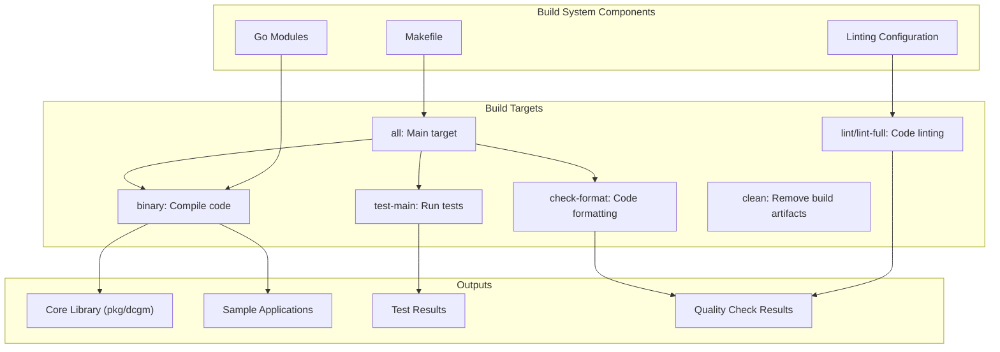
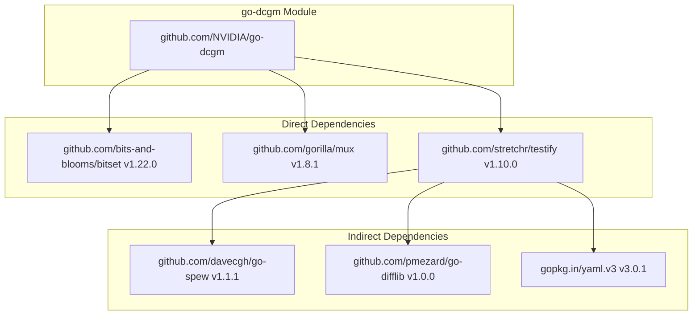
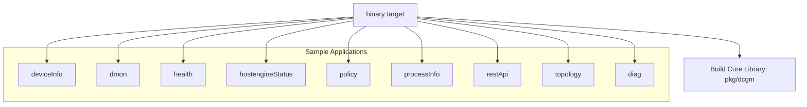
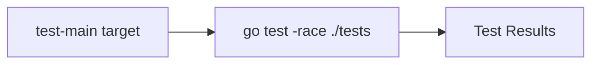
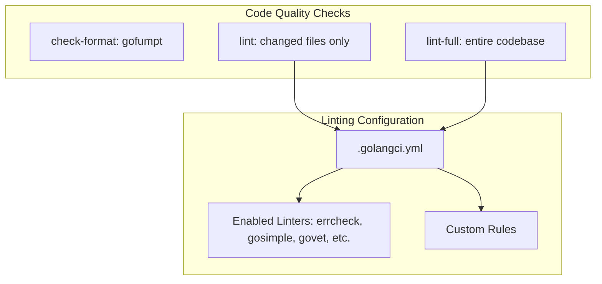
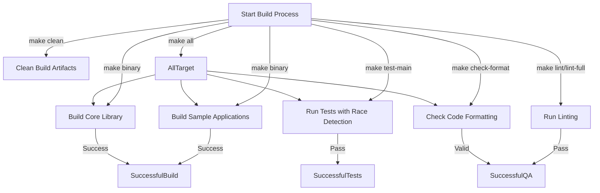

<!-- source: DeepWiki mcp.deepwiki.com · repo NVIDIA/go-dcgm · page 4.1 Build System · fetched 2026-10-26 -->

# Build System

<details>
<summary>Relevant source files</summary>

The following files were used as context for generating this wiki page:

- [.gitignore](.gitignore)
- [.golangci.yml](.golangci.yml)
- [Makefile](Makefile)
- [go.mod](go.mod)
- [go.sum](go.sum)
- [pkg/dcgm/api_test.go](pkg/dcgm/api_test.go)

</details>


This document describes the build system for the NVIDIA Data Center GPU Manager (DCGM) Go Bindings. It explains how to build the go-dcgm library and its sample applications, run tests, and perform code quality checks. For information about testing specifics, see [Testing Framework](#4.2), and for continuous integration details, see [Continuous Integration](#4.3).

## Overview

The go-dcgm build system is based on a combination of standard Go tooling and a Makefile that orchestrates the build, test, and quality assurance processes. The build system provides targets for compiling the core library and sample applications, running tests, and ensuring code quality through formatting and linting.



Sources: [Makefile:15-53](), [go.mod:1-15](), [.golangci.yml:1-83]()

## Go Module and Dependencies

The go-dcgm project uses Go modules for dependency management. The primary module configuration is defined in `go.mod` and includes several key dependencies:

| Dependency | Purpose |
|------------|---------|
| github.com/bits-and-blooms/bitset | Efficient bitset implementation |
| github.com/gorilla/mux | HTTP request router and dispatcher |
| github.com/stretchr/testify | Testing toolkit with assertions |

The project currently requires Go version 1.23 as specified in the `go.mod` file.



Sources: [go.mod:1-15](), [go.sum:1-15]()

## Makefile Structure and Build Targets

The primary build orchestration is managed through a Makefile that defines several important targets:

### Main Targets

| Target | Description |
|--------|-------------|
| `all` | Default target that builds the code, runs tests, and checks formatting |
| `binary` | Builds the core package and all sample applications |
| `test-main` | Runs tests with race detection enabled |
| `check-format` | Verifies code formatting using gofumpt |
| `clean` | Removes all built binary artifacts |
| `lint` | Runs golangci-lint on changes since the last commit |
| `lint-full` | Runs golangci-lint on the entire codebase |

### Binary Build Process

The `binary` target builds both the core DCGM package and all sample applications. The build is performed using standard Go build commands and does not require additional flags for the basic build.



Sources: [Makefile:19-31]()

## Testing Integration

The build system integrates testing through the `test-main` target, which runs tests in the `./tests` directory with race detection enabled. This helps identify potential concurrency issues when accessing the DCGM library.



Sources: [Makefile:33-34]()

## Code Quality Assurance

The build system includes several targets to ensure code quality:

### Code Formatting

The `check-format` target ensures that all Go code is properly formatted according to project standards using gofumpt, which is a stricter variant of the standard gofmt formatter.

### Linting Configuration

Linting is provided through golangci-lint, with two different targets:

1. `lint`: Quick linting of only changed files
2. `lint-full`: Comprehensive linting of the entire codebase

The linting configuration is defined in `.golangci.yml` and includes settings for various linters that check for code quality issues, including:

- Error checking
- Code simplification
- Type checking
- Unused variables and imports
- Security issues
- Performance concerns
- Test correctness



Sources: [Makefile:36-53](), [.golangci.yml:1-83]()

## Building the Project

### Basic Build

To build the entire project including the core library and sample applications:

```
make
```

or

```
make all
```

### Building Only the Binaries

To build only the binary components without running tests or formatting checks:

```
make binary
```

### Cleaning the Build

To remove all built binaries:

```
make clean
```

## Build System Workflow

The complete build system workflow combines compilation, testing, and quality assurance steps:



Sources: [Makefile:19-53]()

## Environment Requirements

To successfully build go-dcgm, you need:

1. Go version 1.23 or compatible (as specified in the go.mod file)
2. DCGM C library and development headers installed in your system
3. Typical build tools (make, etc.)
4. For quality checks: gofumpt and golangci-lint

Sources: [Makefile:15](), [go.mod:3]()

## Continuous Integration Support

The build system is designed to integrate with CI systems, providing specific targets that are typically run in CI environments:

- `test-main`: For running tests in CI
- `check-format`: For validating code formatting
- `lint-full`: For comprehensive code quality checking

For more details on how these targets are used in CI pipelines, see [Continuous Integration](#4.3).

Sources: [Makefile:33-53]()

---

