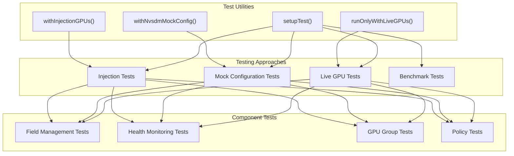
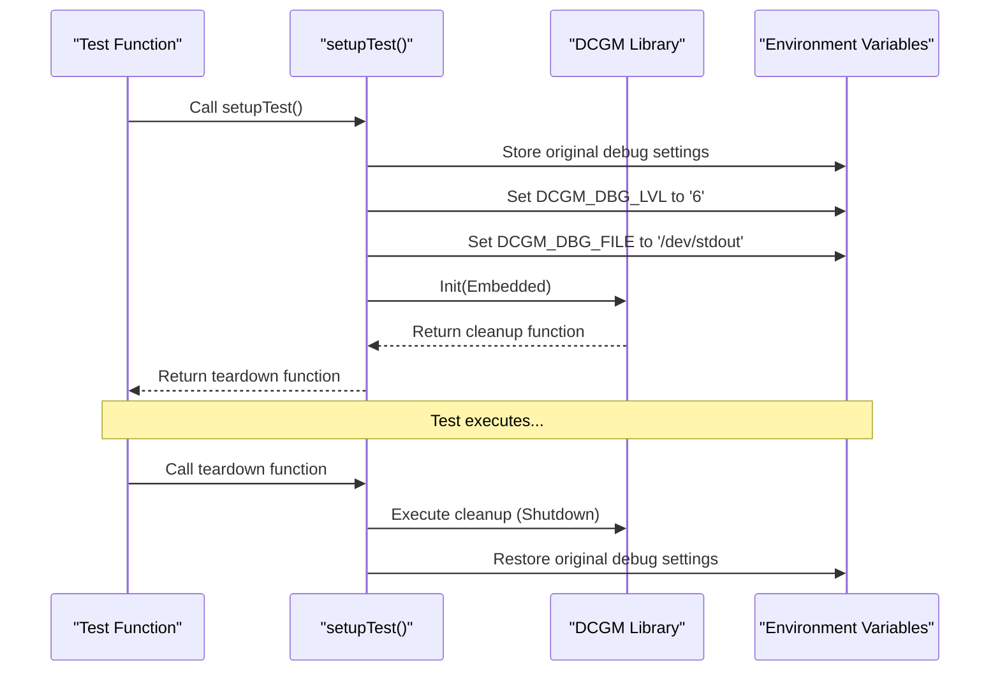
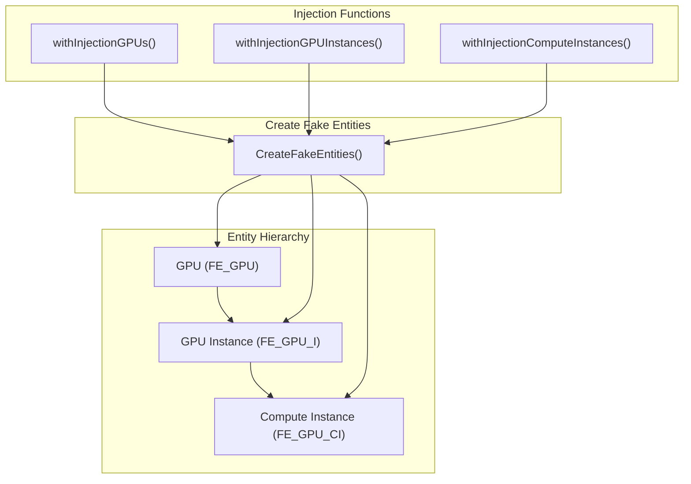
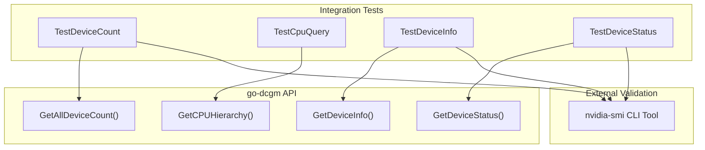
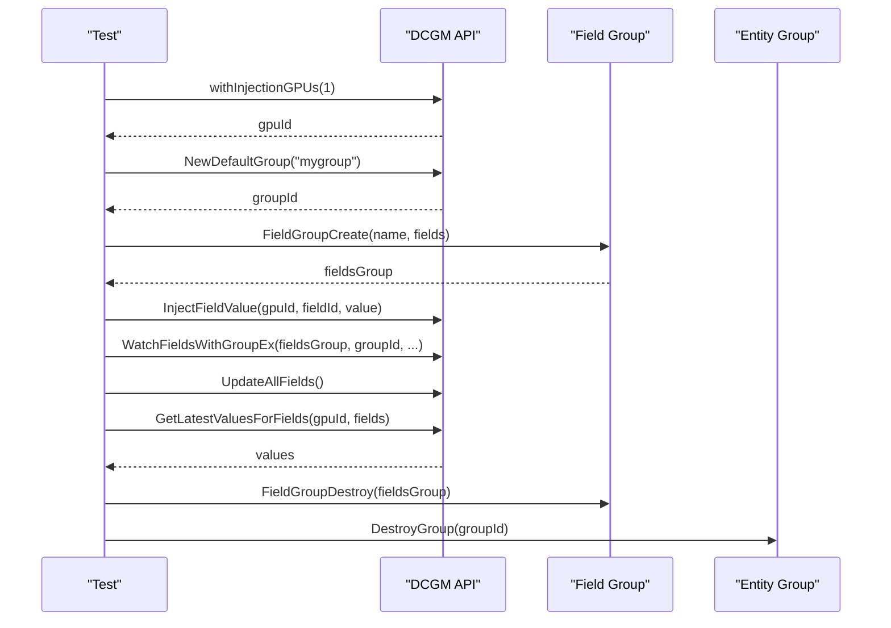

<!-- source: DeepWiki mcp.deepwiki.com · repo NVIDIA/go-dcgm · page 4.2 Testing Framework · fetched 2026-10-26 -->

# Testing Framework

<details>
<summary>Relevant source files</summary>

The following files were used as context for generating this wiki page:

- [pkg/dcgm/cpu.go](pkg/dcgm/cpu.go)
- [pkg/dcgm/fields_test.go](pkg/dcgm/fields_test.go)
- [pkg/dcgm/gpu_group_test.go](pkg/dcgm/gpu_group_test.go)
- [pkg/dcgm/health_test.go](pkg/dcgm/health_test.go)
- [pkg/dcgm/mig.go](pkg/dcgm/mig.go)
- [pkg/dcgm/test_utils.go](pkg/dcgm/test_utils.go)
- [samples/policy/main.go](samples/policy/main.go)
- [tests/dcgm_test.go](tests/dcgm_test.go)
- [tests/nvsmi.go](tests/nvsmi.go)

</details>


This page documents the testing infrastructure for the NVIDIA go-dcgm repository. It covers the utilities, approaches, and patterns used to test the Go bindings for DCGM, with a focus on both unit tests with mock configurations and integration tests with actual GPU hardware. For information about the build system, see [Build System](#4.1), and for continuous integration details, see [Continuous Integration](#4.3).

## Overview

The go-dcgm testing framework provides utilities for testing DCGM functionality in different environments:

1. Testing with real GPUs when hardware is available
2. Testing with injected fake GPU entities when hardware is unavailable
3. Testing with mock configurations for simulating various GPU states
4. Benchmarking performance of key operations



Sources: [pkg/dcgm/test_utils.go:37-68](), [pkg/dcgm/test_utils.go:70-79](), [pkg/dcgm/test_utils.go:81-98](), [pkg/dcgm/test_utils.go:185-219]()

## Test Utilities

The testing framework provides several utility functions that facilitate writing tests for go-dcgm.

### Test Setup and Teardown

The `setupTest` function handles initialization and cleanup of the DCGM environment:



The `setupTest` function:
1. Stores original debug environment variables
2. Sets DCGM debug level to 6 and output to stdout
3. Initializes DCGM in embedded mode
4. Returns a teardown function to clean up after test

Sources: [pkg/dcgm/test_utils.go:37-68]()

### Live GPU Detection

Tests that require actual GPU hardware use the `runOnlyWithLiveGPUs` function to skip tests when no GPUs are available:

```go
func runOnlyWithLiveGPUs(t *testing.T) {
    t.Helper()
    gpus, err := getSupportedDevices()
    require.NoError(t, err)
    if len(gpus) < 1 {
        t.Skip("Skipping test that requires live GPUs. None were found")
    }
}
```

Sources: [pkg/dcgm/test_utils.go:70-79]()

### Mock Configuration

The `withNvsdmMockConfig` function enables testing with predefined mock YAML configurations:

```go
func withNvsdmMockConfig(t *testing.T, configYamlPath string, testFunc func(t *testing.T)) {
    // Sets DCGM_NVSDM_MOCK_YAML environment variable to point to a YAML file
    // Runs the test function
    // Restores original environment
}
```

This function:
1. Sets the `DCGM_NVSDM_MOCK_YAML` environment variable to the provided YAML configuration path
2. Executes the provided test function
3. Restores the original environment variable state after test completion

Sources: [pkg/dcgm/test_utils.go:185-219]()

## Injection Testing

Injection testing is a key feature that allows testing without actual GPU hardware by creating fake GPU entities and injecting field values.

### Entity Injection System

The testing framework can inject fake entities for testing:



The entity injection system supports:

1. **Fake GPUs**: Using `withInjectionGPUs` to create a specified number of fake GPU entities
2. **Fake GPU Instances**: Using `withInjectionGPUInstances` to create instances on a GPU
3. **Fake Compute Instances**: Using `withInjectionComputeInstances` to create compute instances on GPU instances

Each function returns the IDs of the created entities, which can then be used in tests.

Sources: [pkg/dcgm/test_utils.go:81-98](), [pkg/dcgm/test_utils.go:100-133](), [pkg/dcgm/test_utils.go:135-183](), [pkg/dcgm/mig.go:15-61]()

### Field Value Injection

Tests can inject field values to simulate specific GPU states:

```go
InjectFieldValue(gpuID, 
    DCGM_FI_DEV_XID_ERRORS,  // Field ID
    DCGM_FT_INT64,           // Field type
    0,                       // Unused parameter
    timestamp,               // Timestamp for the value
    int64(10))               // Field value
```

Field injection is widely used in tests for:
1. Setting up baseline values for fields
2. Simulating error conditions
3. Testing boundary conditions and edge cases
4. Testing fields that might not be available on all hardware

Sources: [pkg/dcgm/fields_test.go:58-66](), [pkg/dcgm/health_test.go:158-181]()

## Test Types

The go-dcgm testing framework includes several types of tests:

### Unit Tests

Unit tests verify individual components of the API, often using injection or mocking:

| Test Type | Description | Example |
|-----------|-------------|---------|
| Field Management | Tests field groups, watching fields, and retrieving values | `TestGetLatestValuesForFields` |
| Health Monitoring | Tests health checks and error detection | `TestHealthCheckPCIE` |
| Group Management | Tests GPU group operations | `TestGetGroupInfo` |
| Entity Management | Tests handling of different entity types | Various MIG-related tests |

Sources: [pkg/dcgm/fields_test.go:15-89](), [pkg/dcgm/health_test.go:34-224](), [pkg/dcgm/gpu_group_test.go:27-96]()

### Integration Tests

Integration tests verify that the DCGM bindings work correctly with the underlying DCGM library:



These tests often compare results from go-dcgm with external tools like `nvidia-smi` to validate correctness.

Sources: [tests/dcgm_test.go:18-32](), [tests/dcgm_test.go:48-76](), [tests/dcgm_test.go:78-151](), [tests/dcgm_test.go:168-233](), [tests/nvsmi.go:27-42]()

### Benchmark Tests

Benchmark tests measure the performance of key operations:

```go
func BenchmarkDeviceInfo1(b *testing.B) {
    _, _ = dcgm.Init(dcgm.Embedded)
    b.StartTimer()
    for n := 0; n < b.N; n++ {
        // assuming there will be at least 1 GPU attached
        _, _ = dcgm.GetDeviceInfo(uint(0))
    }
    b.StopTimer()
    _ = dcgm.Shutdown()
}
```

Benchmarks are provided for:
1. Device count operations
2. Device information retrieval
3. Field value retrieval with different numbers of fields

Sources: [tests/dcgm_test.go:34-46](), [tests/dcgm_test.go:153-166](), [pkg/dcgm/fields_test.go:91-182]()

## Testing Specific Components

### Field Management Testing

Field management tests verify the ability to create field groups, watch fields, and retrieve field values:



Key test scenarios include:
1. Creating field groups with different field selections
2. Watching fields with different update frequencies
3. Retrieving latest values for specific fields
4. Benchmarking field operations with varying field counts

Sources: [pkg/dcgm/fields_test.go:15-89](), [pkg/dcgm/fields_test.go:91-182]()

### Health Monitoring Testing

Health monitoring tests verify the detection of GPU health issues:

```go
// Example of health monitoring test structure
func TestHealthCheckPCIE(t *testing.T) {
    // Setup DCGM and create fake GPUs
    // Create a group and add the fake GPU
    // Enable PCIe health watching
    // Inject specific PCIe conditions (link gen, width, replay counter)
    // Check if health system correctly identifies issues
}
```

Health tests typically:
1. Create a group of GPUs to monitor
2. Enable specific health watching systems
3. Inject error conditions
4. Verify that health checks correctly identify issues

The testing framework includes extensive tests for PCIe error detection with different PCIe generations, lane counts, and error rates.

Sources: [pkg/dcgm/health_test.go:34-53](), [pkg/dcgm/health_test.go:55-123](), [pkg/dcgm/health_test.go:137-224]()

### GPU Group Testing

GPU group tests verify the management of GPU groups:

```go
func TestGetGroupInfo(t *testing.T) {
    // Setup fake GPU
    // Create group and add GPU
    // Get group info and verify contents
    // Cleanup group
}
```

Group tests cover:
1. Creating and destroying groups
2. Adding entities to groups
3. Retrieving group information
4. Context-based group operations

Sources: [pkg/dcgm/gpu_group_test.go:27-36](), [pkg/dcgm/gpu_group_test.go:38-66](), [pkg/dcgm/gpu_group_test.go:68-96]()

### Policy Testing

The repository includes a sample application demonstrating policy violation monitoring:

```go
// Register for policy violations
c, err := dcgm.ListenForPolicyViolations(ctx, dcgm.DbePolicy, dcgm.XidPolicy)
if err != nil {
    log.Panicln(err)
}

// Handle violations in a loop
for {
    select {
    case pe := <-c:
        log.Printf("PolicyViolation: %v, Timestamp: %v, Data: %v",
            pe.Condition, pe.Timestamp, pe.Data)
    case <-ctx.Done():
        return
    }
}
```

Policy tests verify:
1. Registration for different policy types
2. Detection of policy violations
3. Callback handling for violations

Sources: [samples/policy/main.go:16-58]()

## Best Practices for Testing

When writing tests for the go-dcgm library, consider these best practices:

1. **Use `setupTest` for proper initialization and cleanup**:
   ```go
   teardownTest := setupTest(t)
   defer teardownTest(t)
   ```

2. **Check for live GPUs when needed**:
   ```go
   runOnlyWithLiveGPUs(t)
   ```

3. **Use injection testing for hardware-independent tests**:
   ```go
   gpus, err := withInjectionGPUs(t, 1)
   ```

4. **Create field groups dynamically with unique names**:
   ```go
   n, err := crand.Int(crand.Reader, big.NewInt(1000000))
   fieldGroupName := fmt.Sprintf("fieldGroupName%d", n.Int64())
   ```

5. **Always clean up resources in tests**:
   ```go
   defer func() {
      err := DestroyGroup(groupId)
      require.NoError(t, err)
   }()
   ```

6. **Use benchmark tests for performance-critical paths**:
   ```go
   b.ResetTimer()
   b.ReportAllocs()
   ```

Sources: [pkg/dcgm/fields_test.go:27-56](), [pkg/dcgm/health_test.go:55-133](), [pkg/dcgm/fields_test.go:91-182]()

## Summary

The go-dcgm testing framework provides comprehensive utilities for testing DCGM functionality across different environments. With support for live GPU testing, injection testing, and mock configurations, it enables thorough verification of the go-dcgm bindings. The framework includes utilities for setting up test environments, creating fake GPU entities, injecting field values, and verifying component behavior.

Key components of the testing framework include:
- Test setup and teardown utilities
- Detection of live GPUs for integration tests
- Injection of fake GPUs, GPU instances, and compute instances
- Field value injection for simulating various conditions
- Support for mock configurations

This testing approach ensures that go-dcgm works correctly in various environments, even without physical GPU hardware.

---

