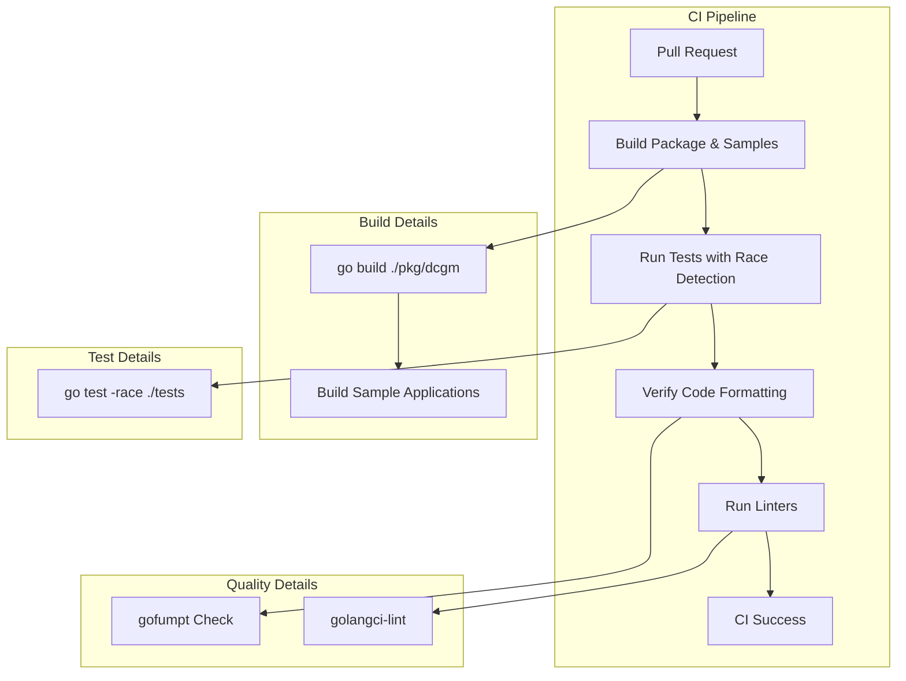
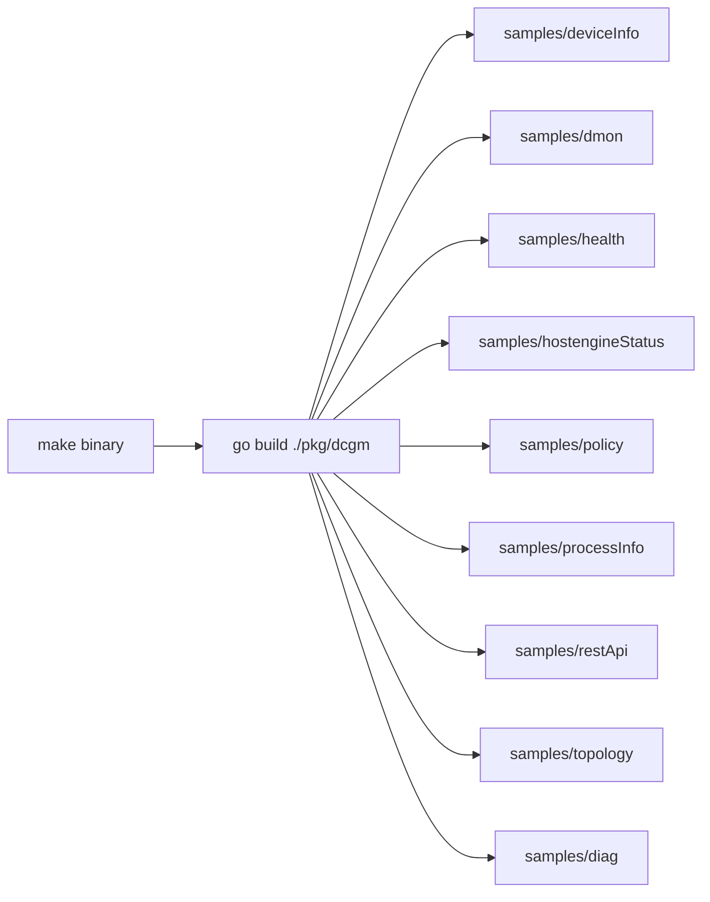
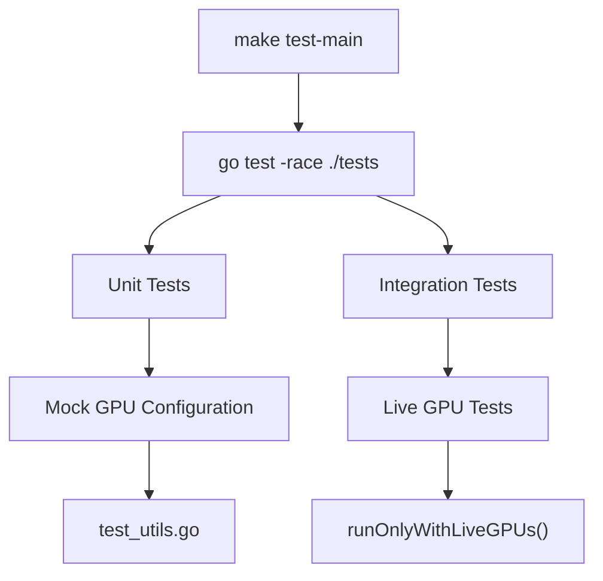
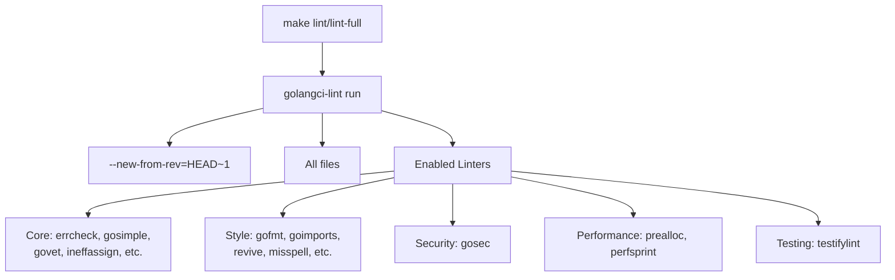
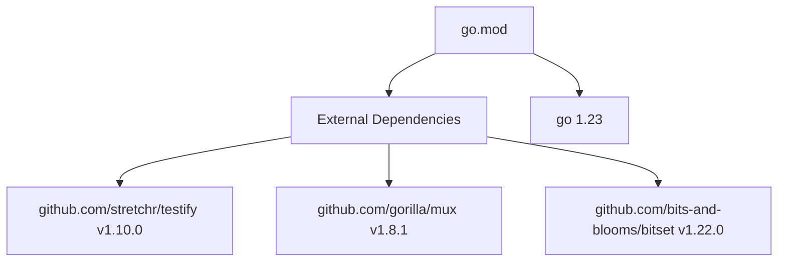

<!-- source: DeepWiki mcp.deepwiki.com · repo NVIDIA/go-dcgm · page 4.3 Continuous Integration · fetched 2026-10-26 -->

# Continuous Integration

<details>
<summary>Relevant source files</summary>

The following files were used as context for generating this wiki page:

- [.gitignore](.gitignore)
- [.golangci.yml](.golangci.yml)
- [Makefile](Makefile)
- [go.mod](go.mod)
- [go.sum](go.sum)
- [pkg/dcgm/api_test.go](pkg/dcgm/api_test.go)
- [pkg/dcgm/dcgm_nvml.h](pkg/dcgm/dcgm_nvml.h)
- [pkg/dcgm/dcgm_test_structs.h](pkg/dcgm/dcgm_test_structs.h)

</details>


This document describes the continuous integration (CI) setup and processes for the go-dcgm repository. It covers the automated build, test, and code quality verification systems that ensure reliability and maintainability of the codebase.

For information on the build system itself, see [Build System](#4.1).
For information on the testing framework, see [Testing Framework](#4.2).

## Overview

The go-dcgm repository employs a CI pipeline that automates building, testing, and code quality verification. The pipeline is designed to catch issues early in the development process and ensure consistent code quality before changes are merged.



Sources: [Makefile:15-53]()

## Build Process

The CI build process compiles the main DCGM package and all sample applications to ensure everything builds successfully before running tests or quality checks.



Sources: [Makefile:21-31]()

The build process ensures that:
- The core DCGM Go API compiles without errors
- All sample applications build successfully
- Dependency compatibility is verified

## Testing Framework

The CI pipeline runs tests with race detection enabled to catch potential concurrency issues:



Sources: [Makefile:33-34](), [pkg/dcgm/api_test.go:26-30]()

Key testing components:
- Race detection identifies potential concurrency issues
- Tests can run with mock configurations for CI environments without GPUs
- Special functions control test execution based on environment (e.g., `runOnlyWithLiveGPUs()`)

## Code Quality Checks

### Formatting Verification

The CI pipeline enforces consistent code formatting using `gofumpt`:

```
make check-format
```

This command verifies that all files match the expected format and fails if any files require formatting changes.

Sources: [Makefile:36-37]()

### Linting Configuration

The project uses `golangci-lint` with an extensive configuration to enforce coding standards:



Sources: [Makefile:49-53](), [.golangci.yml:50-82]()

The linting configuration:
- Enforces core Go coding standards
- Catches common bugs and inefficiencies
- Ensures proper error handling
- Maintains consistent code style
- Identifies security vulnerabilities
- Improves performance in critical areas
- Ensures test best practices

### Configuration Details

The `.golangci.yml` file provides detailed configuration for linting rules:

| Category | Configuration |
|----------|---------------|
| Run timeout | 30 seconds |
| Issue handling | No limit per linter, no duplicate issues |
| Test files | Excluded from certain checks (bodyclose) |
| Enabled linters | 20+ linters including errcheck, govet, staticcheck, gosec |
| Custom rules | Special handling for C/C++ binding style preservation |

Sources: [.golangci.yml:1-83]()

## CI Workflow Integration

The `Makefile` target `all` combines the primary CI steps:

```
make all: binary test-main check-format
```

This target is likely the entry point for the CI pipeline, executing building, testing, and formatting verification in sequence.

Sources: [Makefile:19]()

## Dependency Management

The CI process verifies compatibility with the project's dependencies:



Sources: [go.mod:1-15]()

## Conclusion

The continuous integration setup for go-dcgm provides comprehensive automated verification of build success, test correctness, and code quality. The system is structured around Makefile targets that serve as the entry points for different CI stages.

While the specific CI platform configuration (GitHub Actions, GitLab CI, etc.) is not covered in this documentation, the underlying commands and verification steps are well-defined through the Makefile targets and configuration files.

---

