<!-- source: DeepWiki mcp.deepwiki.com · repo NVIDIA/go-dcgm · page 5 Examples and Usage · fetched 2026-10-26 -->

# Examples and Usage

<details>
<summary>Relevant source files</summary>

The following files were used as context for generating this wiki page:

- [README.md](README.md)
- [pkg/dcgm/cpu.go](pkg/dcgm/cpu.go)
- [pkg/dcgm/mig.go](pkg/dcgm/mig.go)
- [samples/policy/main.go](samples/policy/main.go)
- [samples/processInfo/main.go](samples/processInfo/main.go)
- [samples/restApi/handlers/utils.go](samples/restApi/handlers/utils.go)
- [tests/dcgm_test.go](tests/dcgm_test.go)
- [tests/nvsmi.go](tests/nvsmi.go)

</details>


This page provides practical examples and usage patterns for the NVIDIA Data Center GPU Manager (DCGM) Go bindings. It demonstrates how to use go-dcgm effectively to monitor and manage NVIDIA GPUs in data center environments through code examples, common usage patterns, and sample applications included in the repository. For detailed API reference information, see [Core API Reference](#2), and for implementation details, see [Implementation Details](#3).

## Usage Workflow Overview

The following diagram illustrates the typical workflow when using go-dcgm in applications:

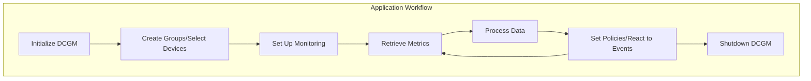

Sources: [pkg/dcgm/dcgm.go](), [samples/processInfo/main.go](), [samples/policy/main.go]()

## Basic Initialization Patterns

All applications using go-dcgm must first initialize the DCGM library. The library supports three operational modes:

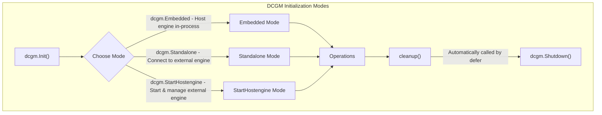

Sources: [pkg/dcgm/dcgm.go]()

### Initialization Example

Here's a basic pattern for initializing DCGM in your application:

```
// Initialize DCGM in embedded mode
cleanup, err := dcgm.Init(dcgm.Embedded)
if err != nil {
    log.Fatalf("Failed to initialize DCGM: %v", err)
}
// Ensure DCGM is properly shut down when the program exits
defer cleanup()

// Your application code here
```

Sources: [samples/processInfo/main.go:57-61](), [samples/policy/main.go:28-32]()

## Sample Applications

The go-dcgm repository includes several sample applications that demonstrate how to use various features of the library:

```mermaid
graph TD
    subgraph "Sample Applications"
        direction TB
        dev["deviceInfo"] --> Core["go-dcgm Core API"]
        mon["dmon"] --> Core
        health["health"] --> Core
        hes["hostengineStatus"] --> Core
        pol["policy"] --> Core
        proc["processInfo"] --> Core
        rest["restApi"] --> Core
        top["topology"] --> Core
        diag["diag"] --> Core
    end
    
    subgraph "Demonstrated Features"
        direction TB
        ginfo["GPU Information"]
        mon_feat["Real-time Monitoring"]
        h_check["Health Checking"]
        eng_stat["Engine Status"]
        pol_mon["Policy Monitoring"]
        proc_track["Process Tracking"]
        api["REST API Endpoints"]
        topo["GPU Topology"]
        diag_test["Diagnostics"]
    end
    
    dev --> ginfo
    mon --> mon_feat
    health --> h_check
    hes --> eng_stat
    pol --> pol_mon
    proc --> proc_track
    rest --> api
    top --> topo
    diag --> diag_test
```

Sources: [samples/processInfo/main.go](), [samples/policy/main.go](), [samples/restApi/handlers/utils.go]()

### Process Information Sample

The Process Information sample demonstrates how to monitor GPU processes and retrieve detailed metrics about their resource utilization:

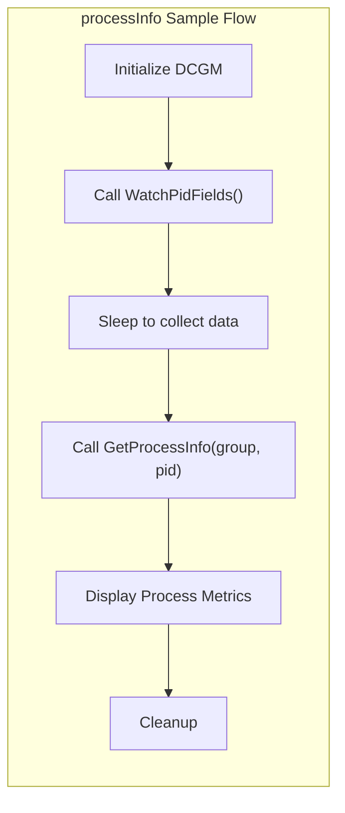

Sources: [samples/processInfo/main.go]()

Key aspects of the Process Information sample:
- Uses `WatchPidFields()` to start monitoring GPU processes
- Retrieves detailed process metrics with `GetProcessInfo()`
- Displays comprehensive information about process resource utilization
- Shows how to monitor metrics like:
  - GPU and memory utilization
  - Energy consumption
  - Clock speeds
  - PCIe bandwidth
  - ECC errors
  - Policy violations

Sources: [samples/processInfo/main.go:64-75]()

### Policy Monitoring Sample

The Policy Monitoring sample demonstrates how to set up policy monitoring and react to policy violations:

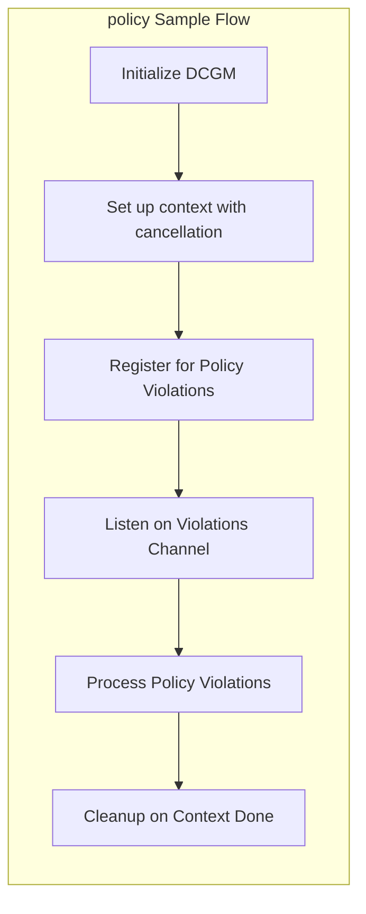

Sources: [samples/policy/main.go]()

Key aspects of the Policy Monitoring sample:
- Uses context for managing the monitoring lifecycle
- Registers for specific policy violation types with `ListenForPolicyViolations()`
- Processes violations from the returned channel
- Demonstrates how to monitor for:
  - Double-bit ECC errors (DbePolicy)
  - PCIe errors (PCIePolicy)
  - Thermal violations (ThermalPolicy)
  - Power violations (PowerPolicy)
  - XID errors (XidPolicy)

Sources: [samples/policy/main.go:36-56]()

### REST API Sample

The REST API sample shows how to expose DCGM capabilities through a web API:

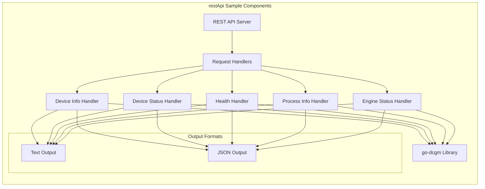

Sources: [samples/restApi/handlers/utils.go]()

Key aspects of the REST API sample:
- Demonstrates how to build HTTP endpoints for DCGM functionalities
- Supports both text and JSON output formats
- Provides utility functions for handling GPU identifiers (by ID or UUID)
- Includes handlers for:
  - Device information
  - Device status
  - Health monitoring
  - Process information
  - Host engine status

Sources: [samples/restApi/handlers/utils.go:98-193]()

## Common Usage Patterns

This section covers the most common usage patterns for go-dcgm.

### Retrieving Device Information

To retrieve information about GPU devices:

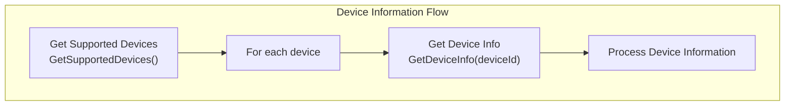

Sources: [tests/dcgm_test.go:78-151]()

Example usage pattern:
```
// Get list of supported devices
gpus, err := dcgm.GetSupportedDevices()
if err != nil {
    log.Fatalf("Failed to get supported devices: %v", err)
}

// Iterate through devices and get information
for _, gpu := range gpus {
    info, err := dcgm.GetDeviceInfo(gpu)
    if err != nil {
        log.Printf("Failed to get info for GPU %d: %v", gpu, err)
        continue
    }
    
    // Process the device information
    log.Printf("GPU %d: %s (UUID: %s)", gpu, info.Identifiers.Model, info.UUID)
}
```

Sources: [tests/dcgm_test.go:94-100]()

### Monitoring Device Status

To monitor the status of GPU devices:

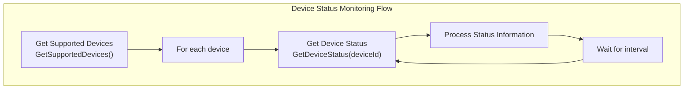

Sources: [tests/dcgm_test.go:168-233]()

Example usage pattern:
```
// Get list of supported devices
gpus, err := dcgm.GetSupportedDevices()
if err != nil {
    log.Fatalf("Failed to get supported devices: %v", err)
}

// Monitor status in a loop
for {
    for _, gpu := range gpus {
        status, err := dcgm.GetDeviceStatus(gpu)
        if err != nil {
            log.Printf("Failed to get status for GPU %d: %v", gpu, err)
            continue
        }
        
        // Process the status information
        log.Printf("GPU %d: Power: %.2fW, Temp: %d°C, Util: %d%%", 
            gpu, status.Power, status.Temperature, status.Utilization.GPU)
    }
    
    // Wait before checking again
    time.Sleep(1 * time.Second)
}
```

Sources: [tests/dcgm_test.go:186-226]()

### Working with Field Groups and Watching Fields

Field groups allow you to monitor specific metrics on GPUs:

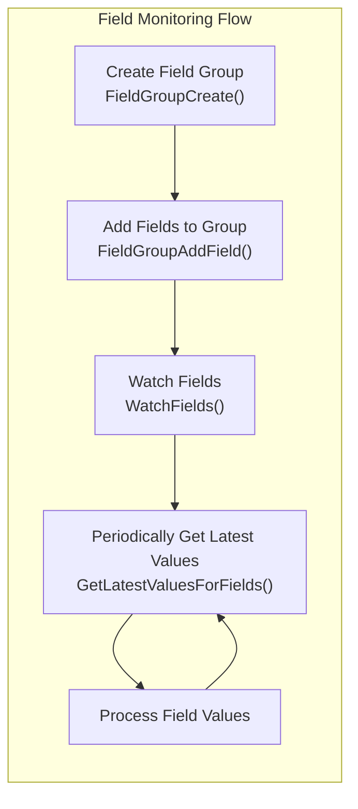

Sources: [samples/processInfo/main.go]()

### Process Monitoring

To monitor GPU processes:

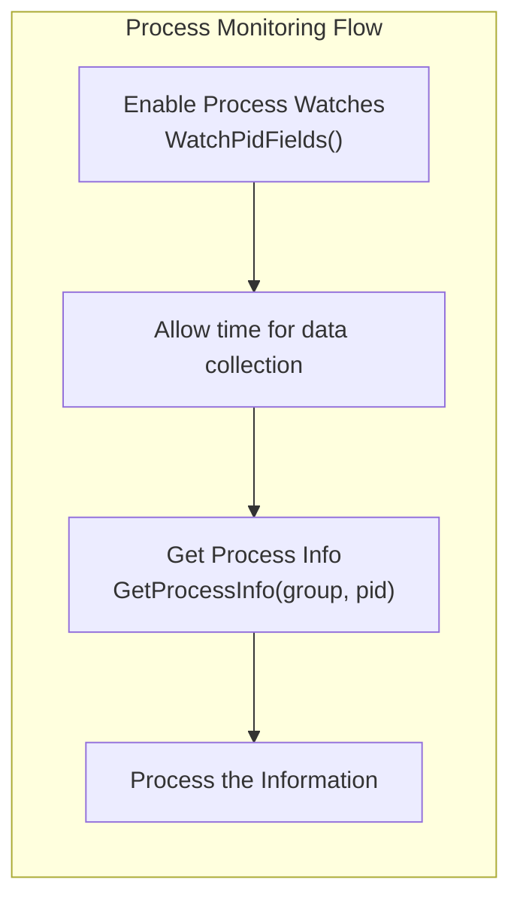

Sources: [samples/processInfo/main.go:64-76]()

Example usage pattern:
```
// Enable process monitoring
group, err := dcgm.WatchPidFields()
if err != nil {
    log.Fatalf("Failed to enable process monitoring: %v", err)
}

// Wait for data collection
time.Sleep(3 * time.Second)

// Get information for a specific process
pid := uint(12345) // Replace with actual process ID
procInfo, err := dcgm.GetProcessInfo(group, pid)
if err != nil {
    log.Fatalf("Failed to get process info: %v", err)
}

// Process the information
for _, info := range procInfo {
    log.Printf("GPU %d, PID %d: Memory used: %d bytes, GPU util: %d%%", 
        info.GPU, info.PID, info.Memory.GlobalUsed, info.GpuUtilization.GPU)
}
```

Sources: [samples/processInfo/main.go:64-85]()

### Policy Monitoring and Violation Handling

To set up policy monitoring and handle violations:

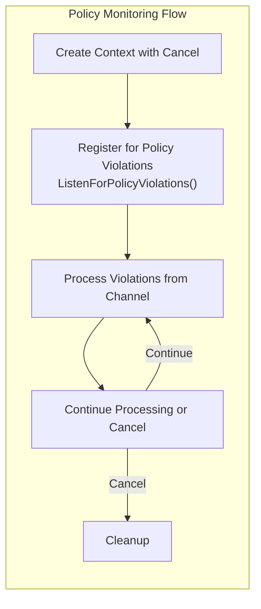

Sources: [samples/policy/main.go:16-58]()

Example usage pattern:
```
// Create context with cancellation
ctx, cancel := context.WithCancel(context.Background())
defer cancel()

// Set up signal handling
sigs := make(chan os.Signal, 1)
signal.Notify(sigs, syscall.SIGINT, syscall.SIGTERM)
go func() {
    <-sigs
    cancel()
}()

// Register for policy violations
violations, err := dcgm.ListenForPolicyViolations(ctx, dcgm.DbePolicy, dcgm.XidPolicy)
if err != nil {
    log.Fatalf("Failed to register for policy violations: %v", err)
}

// Process violations from the channel
for {
    select {
    case violation := <-violations:
        log.Printf("Policy violation detected: %v at %v, Data: %v", 
            violation.Condition, violation.Timestamp, violation.Data)
    case <-ctx.Done():
        return
    }
}
```

Sources: [samples/policy/main.go:17-57]()

### MIG Support

To work with Multi-Instance GPU (MIG) configurations:

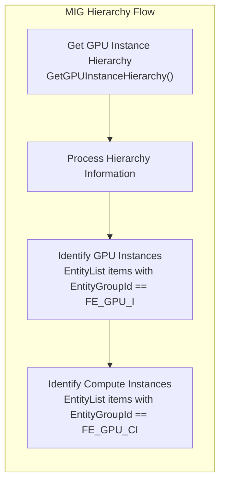

Sources: [pkg/dcgm/mig.go:116-127]()

Example usage pattern:
```
// Get MIG hierarchy
hierarchy, err := dcgm.GetGPUInstanceHierarchy()
if err != nil {
    log.Fatalf("Failed to get MIG hierarchy: %v", err)
}

// Process hierarchy information
for i := uint(0); i < hierarchy.Count; i++ {
    entity := hierarchy.EntityList[i]
    
    // Check entity type
    switch entity.Entity.EntityGroupId {
    case dcgm.FE_GPU_I:
        log.Printf("GPU Instance: ID %d, Parent GPU: %s", 
            entity.Entity.EntityId, entity.Info.GpuUuid)
    case dcgm.FE_GPU_CI:
        log.Printf("Compute Instance: ID %d, Parent Instance: %d, Profile: %d", 
            entity.Entity.EntityId, entity.Parent.EntityId, entity.Info.NvmlMigProfileId)
    }
}
```

Sources: [pkg/dcgm/mig.go:116-149]()

### CPU Monitoring

To retrieve CPU hierarchy information:

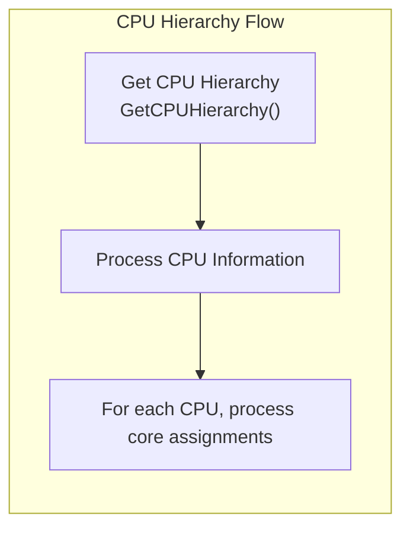

Sources: [pkg/dcgm/cpu.go:54-65]()

Example usage pattern:
```
// Get CPU hierarchy
hierarchy, err := dcgm.GetCPUHierarchy()
if err != nil {
    log.Fatalf("Failed to get CPU hierarchy: %v", err)
}

// Process CPU information
log.Printf("Found %d CPUs", hierarchy.NumCPUs)
for i := uint(0); i < hierarchy.NumCPUs; i++ {
    cpu := hierarchy.CPUs[i]
    log.Printf("CPU %d:", cpu.CPUID)
    
    // Check for owned cores
    for j := uint(0); j < dcgm.MAX_CPU_CORE_BITMASK_COUNT; j++ {
        if cpu.OwnedCores[j] != 0 {
            log.Printf("  Core group %d: 0x%x", j, cpu.OwnedCores[j])
        }
    }
}
```

Sources: [pkg/dcgm/cpu.go:54-85](), [tests/dcgm_test.go:48-76]()

## Best Practices

When using go-dcgm in your applications, consider the following best practices:

### Resource Management

1. **Always defer cleanup**: Always use `defer cleanup()` after initializing DCGM to ensure proper resource cleanup.

```
cleanup, err := dcgm.Init(dcgm.Embedded)
if err != nil {
    log.Fatalf("Failed to initialize DCGM: %v", err)
}
defer cleanup()
```

2. **Use appropriate operational mode**: Choose the appropriate DCGM mode based on your needs:
   - `dcgm.Embedded` - Simplest mode with host engine running in-process
   - `dcgm.Standalone` - Connect to an externally managed host engine
   - `dcgm.StartHostengine` - Start and manage an external host engine

Sources: [samples/processInfo/main.go:57-61](), [samples/policy/main.go:28-32]()

### Monitoring Efficiency

1. **Group related fields**: Create field groups that contain related metrics to reduce the overhead of watching and querying fields.

2. **Use appropriate update frequency**: When watching fields, use an appropriate update frequency based on your application needs. Very high frequency updates can increase overhead.

3. **Process watches for specific PIDs**: When monitoring processes, use `WatchPidFields()` before the process starts to ensure all data is captured.

Sources: [samples/processInfo/main.go:64-71]()

### Error Handling

1. **Check errors for each DCGM call**: DCGM operations can fail due to various reasons (unsupported hardware, insufficient permissions, etc.). Always check error returns.

2. **Verify device support**: Use `GetSupportedDevices()` to get the list of devices supported by DCGM instead of assuming all devices are supported.

```
gpus, err := dcgm.GetSupportedDevices()
if err != nil {
    log.Fatalf("Failed to get supported devices: %v", err)
}
```

Sources: [tests/dcgm_test.go:94-95](), [samples/restApi/handlers/utils.go:147-166]()

### Context Management for Policy Monitoring

Use context management for policy monitoring to properly handle shutdown and cleanup:

```
ctx, cancel := context.WithCancel(context.Background())
defer cancel()

violations, err := dcgm.ListenForPolicyViolations(ctx, dcgm.DbePolicy, dcgm.XidPolicy)
```

Sources: [samples/policy/main.go:17-44]()

### Testing Your Integration

The repository includes test utilities that can help validate your integration with go-dcgm:

1. **Compare with nvidia-smi**: The `tests/nvsmi.go` file provides utilities to compare DCGM values with nvidia-smi output, which can be useful for validation.

2. **Use benchmarks**: The repository includes benchmark tests that can help evaluate the performance impact of your DCGM integration.

Sources: [tests/dcgm_test.go:34-46](), [tests/nvsmi.go:16-68]()

## Sample Application Reference Table

| Sample | Main Features | Use Case | Source File |
|--------|--------------|----------|-------------|
| deviceInfo | Basic device properties | System inventory, hardware details | samples/deviceInfo/main.go |
| dmon | Real-time monitoring | Continuous performance monitoring | samples/dmon/main.go |
| health | Health checks | System health verification | samples/health/main.go |
| hostengineStatus | Engine status | Monitor DCGM engine status | samples/hostengineStatus/main.go |
| policy | Policy monitoring | Detect and react to policy violations | samples/policy/main.go |
| processInfo | Process tracking | Monitor GPU process resource usage | samples/processInfo/main.go |
| restApi | Web API | Expose DCGM data via HTTP | samples/restApi/main.go |
| topology | GPU interconnect | Analyze GPU-to-GPU connectivity | samples/topology/main.go |
| diag | Diagnostics | Run diagnostic tests on GPUs | samples/diag/main.go |

Sources: [samples/processInfo/main.go](), [samples/policy/main.go](), [samples/restApi/handlers/utils.go]()

For more detailed information about specific features, see the referenced sample applications and the API documentation in [Core API Reference](#2).

---

