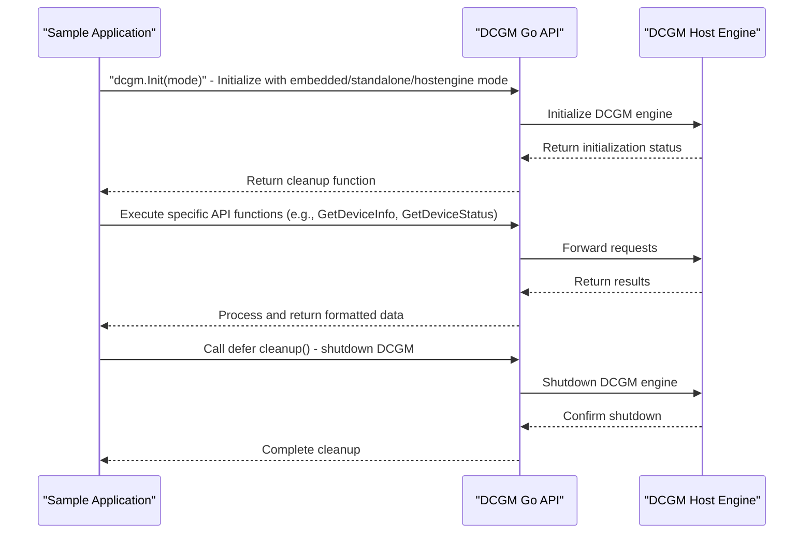
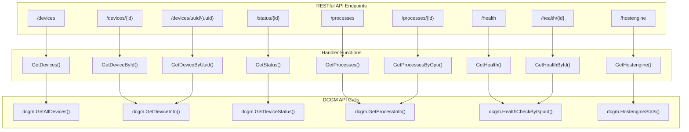

<!-- source: DeepWiki mcp.deepwiki.com · repo NVIDIA/go-dcgm · page 5.1 Sample Applications · fetched 2026-10-26 -->

# Sample Applications

<details>
<summary>Relevant source files</summary>

The following files were used as context for generating this wiki page:

- [Makefile](Makefile)
- [README.md](README.md)
- [go.mod](go.mod)
- [go.sum](go.sum)
- [samples/processInfo/main.go](samples/processInfo/main.go)
- [samples/restApi/handlers/utils.go](samples/restApi/handlers/utils.go)

</details>


## Purpose and Overview

This section provides a comprehensive overview of the sample applications included within the go-dcgm repository. These applications demonstrate practical implementations of the DCGM Go API for monitoring and managing NVIDIA GPUs in data center environments. 

The sample applications serve as both educational examples and practical utilities, showcasing various capabilities of the DCGM API including device information retrieval, health monitoring, process tracking, and policy management. For information about general API usage patterns, see [API Usage Patterns](#5.2).

Sources: [README.md:1-13](), [Makefile:21-31]()

## Sample Applications Overview

The go-dcgm repository includes the following sample applications:

| Application | Purpose |
|-------------|---------|
| deviceInfo | Displays detailed information about GPU devices |
| dmon | Monitors GPU metrics over time (similar to nvidia-smi dmon) |
| health | Checks and reports GPU health status |
| hostengineStatus | Reports DCGM host engine status |
| policy | Demonstrates setting and monitoring policy violations |
| processInfo | Tracks and reports GPU process statistics |
| restApi | Provides a RESTful API for accessing GPU information |
| topology | Shows the interconnect topology between GPUs |
| diag | Runs diagnostic tests on GPUs |

Sources: [Makefile:21-31](), [README.md:1-13]()

## Sample Applications Architecture

The sample applications demonstrate different aspects of the go-dcgm API while following a common architectural pattern:

```mermaid
flowchart TB
    subgraph "Sample Applications"
        deviceInfo["deviceInfo"]
        dmon["dmon"]
        health["health"]
        hostengineStatus["hostengineStatus"]
        policy["policy"]
        processInfo["processInfo"]
        restApi["restApi"]
        topology["topology"]
        diag["diag"]
    end
    
    subgraph "go-dcgm API"
        init["dcgm.Init()"]
        deviceOps["Device Operations"]
        healthOps["Health Operations"]
        fieldOps["Field Operations"]
        policyOps["Policy Operations"]
        processOps["Process Operations"]
        topologyOps["Topology Operations"]
        diagOps["Diagnostic Operations"]
        cleanup["dcgm.Shutdown()"]
    end
    
    deviceInfo --> init
    deviceInfo --> deviceOps
    deviceInfo --> cleanup
    
    dmon --> init
    dmon --> fieldOps
    dmon --> deviceOps
    dmon --> cleanup
    
    health --> init
    health --> healthOps
    health --> cleanup
    
    hostengineStatus --> init
    hostengineStatus --> deviceOps
    hostengineStatus --> cleanup
    
    policy --> init
    policy --> policyOps
    policy --> cleanup
    
    processInfo --> init
    processInfo --> processOps
    processInfo --> fieldOps
    processInfo --> cleanup
    
    restApi --> init
    restApi --> deviceOps
    restApi --> healthOps
    restApi --> processOps
    restApi --> cleanup
    
    topology --> init
    topology --> topologyOps
    topology --> cleanup
    
    diag --> init
    diag --> diagOps
    diag --> cleanup
```



Sources: [Makefile:21-31](), [samples/processInfo/main.go:1-86]()

## Common Implementation Pattern

Most sample applications follow a similar implementation pattern:



Sources: [samples/processInfo/main.go:54-86]()

## Key Sample Applications

### processInfo

The processInfo sample demonstrates how to track and monitor GPU processes using DCGM. It showcases:

1. Initializing DCGM in embedded mode
2. Setting up DCGM field watches for process monitoring
3. Retrieving detailed process statistics
4. Displaying formatted output with process resource utilization

**Usage Example:**
```
sudo dcgmi stats -e  # Enable stats collection (as root)
# Start process to be monitored
./processInfo -pid <PID>
```

**Key Implementation Features:**
- Uses `dcgm.WatchPidFields()` to enable process monitoring
- Retrieves process stats with `dcgm.GetProcessInfo()`
- Formats output using Go templates

Sources: [samples/processInfo/main.go:1-86]()

### restApi

The restApi sample implements a RESTful web service that exposes DCGM functionality through HTTP endpoints. It demonstrates:

1. Integration of DCGM with web services
2. Formatting DCGM data in both human-readable and JSON formats
3. Handling of HTTP requests for various GPU information

**API Endpoints Architecture:**



**Format Handling:**
The restApi sample supports both human-readable text output and JSON responses based on the URL suffix:
- `/devices` - Returns text format
- `/devices/json` - Returns JSON format

The sample uses template strings for formatting text output and JSON encoding for machine-readable outputs.

Sources: [samples/restApi/handlers/utils.go:1-207]()

## Other Sample Applications

### deviceInfo
Displays detailed information about all available GPUs including driver version, UUID, model, memory, power information, and P2P capabilities.

### dmon
Provides continuous monitoring of GPU metrics similar to `nvidia-smi dmon`, showing utilization, memory usage, temperature, and power metrics over time.

### health
Performs health checks on GPUs and reports any issues. Useful for monitoring system health and detecting potential problems.

### hostengineStatus
Displays the status of the DCGM host engine, including memory usage and CPU utilization.

### policy
Demonstrates how to set up monitoring policies for GPU conditions like thermal violations, PCIe errors, or power violations.

### topology
Shows the interconnect topology between GPUs, helping understand the physical connectivity and data transfer capabilities.

### diag
Runs diagnostic tests on GPUs to verify proper functioning and identify issues.

Sources: [Makefile:21-31](), [samples/restApi/handlers/utils.go:15-96]()

## Building and Running Sample Applications

All sample applications can be built using the provided Makefile:

```
# Build all samples
make binary

# Build a specific sample
cd samples/deviceInfo
go build
```

When running the samples, they generally need to connect to a DCGM host engine. Most samples support different operational modes:

1. **Embedded Mode**: DCGM host engine runs within the same process
2. **Standalone Mode**: Connect to an already running DCGM host engine
3. **StartHostengine Mode**: Start and manage an external DCGM host engine

Many of the samples require root privileges to access all GPU information, especially for health monitoring and process statistics.

Sources: [Makefile:21-31](), [samples/processInfo/main.go:48-54]()

## Common Dependencies and Requirements

The sample applications require:

1. NVIDIA DCGM to be installed on the system
2. Access to NVIDIA GPUs with appropriate drivers
3. Go compiler and environment for building
4. Root privileges for certain operations (health checks, process monitoring)

Sources: [go.mod:1-16](), [samples/processInfo/main.go:48-54]()

## Conclusion

The sample applications in the go-dcgm repository provide practical examples of how to use the DCGM Go API for various GPU management and monitoring tasks. They demonstrate common code patterns, API usage, and can serve as starting points for developing custom GPU monitoring solutions.

These examples cover the full range of functionality provided by DCGM, from basic device information to complex health monitoring and process tracking. By studying and extending these samples, developers can quickly implement GPU management features in their Go applications.

---

