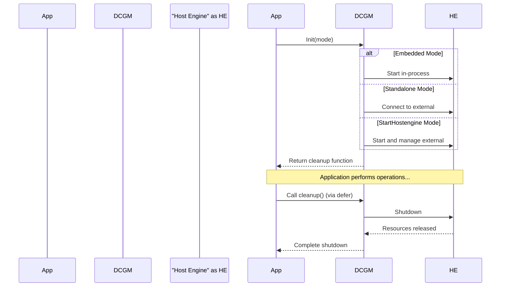
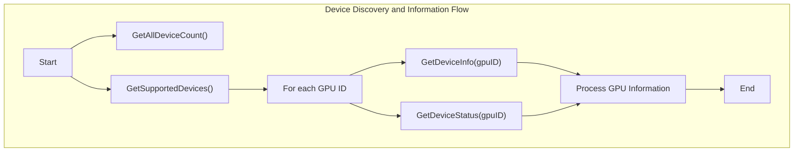
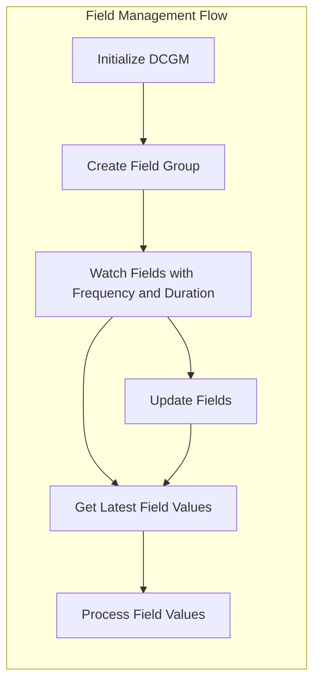
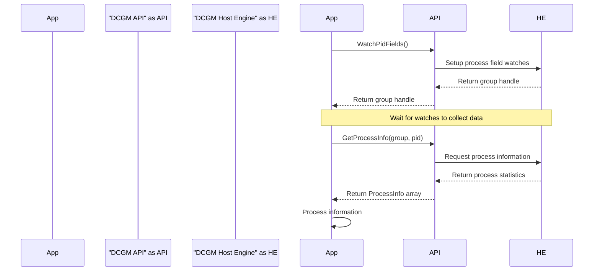
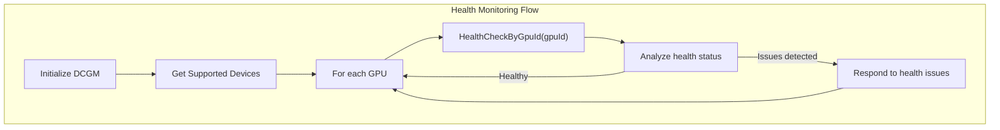
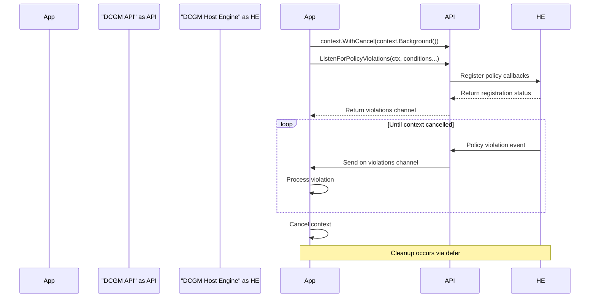
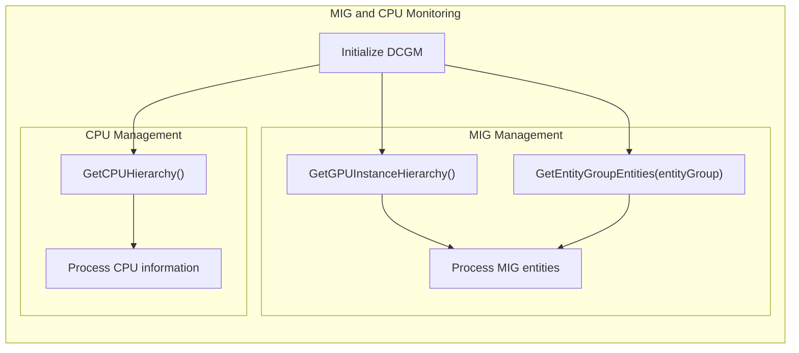
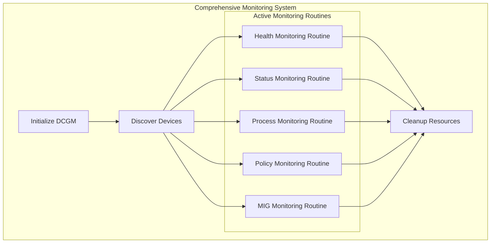
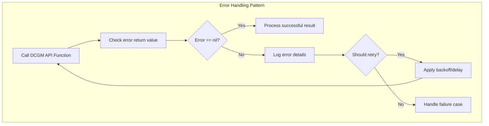

<!-- source: DeepWiki mcp.deepwiki.com · repo NVIDIA/go-dcgm · page 5.2 API Usage Patterns · fetched 2026-10-26 -->

# API Usage Patterns

<details>
<summary>Relevant source files</summary>

The following files were used as context for generating this wiki page:

- [pkg/dcgm/api.go](pkg/dcgm/api.go)
- [pkg/dcgm/cpu.go](pkg/dcgm/cpu.go)
- [pkg/dcgm/mig.go](pkg/dcgm/mig.go)
- [pkg/dcgm/profile.go](pkg/dcgm/profile.go)
- [samples/policy/main.go](samples/policy/main.go)
- [samples/processInfo/main.go](samples/processInfo/main.go)
- [samples/restApi/handlers/utils.go](samples/restApi/handlers/utils.go)
- [tests/dcgm_test.go](tests/dcgm_test.go)
- [tests/nvsmi.go](tests/nvsmi.go)

</details>


This page describes common patterns for effectively using the go-dcgm API to monitor and manage NVIDIA GPUs in data center environments. These patterns demonstrate best practices for initialization, resource cleanup, and various monitoring operations. For implementation details of specific API functions, see [Core API Reference](#2), and for complete sample applications, see [Sample Applications](#5.1).

## Initialization and Cleanup Pattern

The most fundamental pattern in go-dcgm is proper initialization and cleanup. This ensures the DCGM host engine is correctly started and all resources are properly released when your application exits.



The recommended pattern is to initialize DCGM at the start of your program and defer the cleanup:

```go
// Initialize DCGM in embedded mode
cleanup, err := dcgm.Init(dcgm.Embedded)
if err != nil {
    log.Panicln(err)
}
// Ensure DCGM is properly shutdown when the program exits
defer cleanup()
```

Sources: [pkg/dcgm/api.go:24-47](), [samples/processInfo/main.go:57-61](), [samples/policy/main.go:28-32]()

## Device Discovery and Information Pattern

To work with GPUs, you typically need to discover available devices and retrieve their information.



This pattern typically involves:

1. Getting the count of all devices in the system
2. Getting the list of DCGM-supported devices
3. Iterating through devices to get detailed information and status

Example usage:

```go
// Get all supported devices
gpus, err := dcgm.GetSupportedDevices()
if err != nil {
    log.Panicln(err)
}

// Iterate through devices and get information
for _, gpu := range gpus {
    info, err := dcgm.GetDeviceInfo(gpu)
    if err != nil {
        log.Printf("Error getting info for GPU %d: %v", gpu, err)
        continue
    }
    
    status, err := dcgm.GetDeviceStatus(gpu)
    if err != nil {
        log.Printf("Error getting status for GPU %d: %v", gpu, err)
        continue
    }
    
    // Process the device information and status
    // ...
}
```

Sources: [pkg/dcgm/api.go:68-91](), [tests/dcgm_test.go:78-151](), [tests/dcgm_test.go:168-233]()

## Field Management Pattern

Field management is a core pattern for collecting and monitoring specific GPU metrics in DCGM.



The field management pattern involves:

1. Creating a group of related fields to monitor
2. Setting up watches for those fields with a specific frequency and duration
3. Updating field values periodically
4. Retrieving and processing the latest field values

Field groups can be created using predefined groups like in `WatchPidFields()` or custom field groups depending on your monitoring needs.

Sources: [pkg/dcgm/api.go:98-102](), [pkg/dcgm/profile.go:20-53]()

## Process Monitoring Pattern

Monitoring GPU processes requires setting up field watches specifically for process statistics and then querying for process information.



Key steps in this pattern:

1. Call `WatchPidFields()` to set up monitoring of GPU process statistics
2. Allow time for the watches to collect data (typically a few seconds)
3. Call `GetProcessInfo()` with the group handle and the process ID
4. Process the returned information about GPU utilization by that process

Note: Process monitoring must be enabled *before* the process you want to monitor starts running on the GPU.

Example usage from the processInfo sample:

```go
// Request DCGM to start recording stats for GPU process fields
group, err := dcgm.WatchPidFields()
if err != nil {
    log.Panicln(err)
}

// Allow time for watches to collect data
time.Sleep(3000 * time.Millisecond)

// Get process information by PID
pidInfo, err := dcgm.GetProcessInfo(group, pid)
if err != nil {
    log.Panicln(err)
}

// Process the information
// ...
```

Sources: [pkg/dcgm/api.go:98-107](), [samples/processInfo/main.go:54-85]()

## Health Monitoring Pattern

DCGM allows monitoring GPU health to detect and report potential issues.



Health monitoring involves:

1. Performing health checks on GPUs using `HealthCheckByGpuId()`
2. Analyzing the returned health status
3. Taking appropriate action based on the health status

Health checks can verify multiple systems, including PCIe connections, NVLINK, GPU memory, and thermal conditions.

Sources: [pkg/dcgm/api.go:110-112](), [samples/restApi/handlers/utils.go:83-90]()

## Policy Violation Monitoring Pattern

Policy monitoring allows you to receive notifications when certain conditions occur on your GPUs.



The pattern for policy violation monitoring:

1. Create a context with cancellation capability
2. Call `ListenForPolicyViolations()` with the context and desired policy conditions
3. Receive policy violations through the returned channel
4. Process violations as they occur
5. Cancel the context when monitoring should stop

Example usage from the policy sample:

```go
ctx, done := context.WithCancel(context.Background())
// Setup channel for termination signals
// ...

// Listen for specific policy violations
c, err := dcgm.ListenForPolicyViolations(ctx, dcgm.DbePolicy, dcgm.XidPolicy)
if err != nil {
    log.Panicln(err)
}

// Process violations as they occur
for {
    select {
    case pe := <-c:
        log.Printf("PolicyViolation: %v, Timestamp: %v, Data: %v",
            pe.Condition, pe.Timestamp, pe.Data)
    case <-ctx.Done():
        return
    }
}
```

Sources: [pkg/dcgm/api.go:116-125](), [samples/policy/main.go:17-58]()

## MIG and CPU Monitoring Pattern

For systems with Multi-Instance GPUs (MIG) or for monitoring CPU resources alongside GPUs, DCGM offers specialized monitoring patterns.



MIG and CPU monitoring involves:

1. For MIG: Getting the GPU instance hierarchy and processing MIG entities
2. For CPU: Getting the CPU hierarchy and processing CPU information
3. Using entity group functions to work with different types of entities

This pattern is particularly useful in environments with MIG-enabled GPUs (such as A100s) or when you need to monitor both CPU and GPU resources together.

Sources: [pkg/dcgm/mig.go:116-149](), [pkg/dcgm/cpu.go:54-85](), [tests/dcgm_test.go:48-76]()

## Combining Patterns for Complex Monitoring

In real-world applications, you'll often combine multiple patterns to create comprehensive monitoring solutions.



A comprehensive monitoring system might:

1. Initialize DCGM in the appropriate mode
2. Discover available devices
3. Set up multiple concurrent monitoring routines:
   - Regular health checks
   - Status monitoring for performance metrics
   - Process monitoring for application performance
   - Policy monitoring for critical events
   - MIG/CPU monitoring for resource allocation
4. Clean up resources when monitoring ends

This combined approach is often used in production monitoring systems where you need a complete view of GPU health, performance, and utilization.

Sources: [samples/restApi/handlers/utils.go:14-193]()

## Table of Common API Functions by Pattern

| Pattern | Primary Functions | Description |
|---------|------------------|-------------|
| Initialization | `Init()`, `Shutdown()` | Initialize and shut down DCGM |
| Device Discovery | `GetAllDeviceCount()`, `GetSupportedDevices()` | Discover available GPUs |
| Device Information | `GetDeviceInfo()`, `GetDeviceStatus()` | Get static and dynamic device information |
| Field Management | `WatchPidFields()`, `GetSupportedMetricGroups()` | Manage and monitor GPU metrics |
| Process Monitoring | `WatchPidFields()`, `GetProcessInfo()` | Monitor process GPU usage |
| Health Monitoring | `HealthCheckByGpuId()` | Check GPU health status |
| Policy Monitoring | `ListenForPolicyViolations()`, `ListenForPolicyViolationsForGroup()` | Monitor for specific conditions |
| MIG & CPU Management | `GetGPUInstanceHierarchy()`, `GetCPUHierarchy()`, `GetEntityGroupEntities()` | Monitor MIG and CPU resources |

Sources: [pkg/dcgm/api.go:18-140]()

## Error Handling Pattern

Consistent error handling is essential when working with the go-dcgm API.



Best practices for error handling with go-dcgm:

1. Always check error return values from API functions
2. Log detailed error information for troubleshooting
3. Implement appropriate retry mechanisms for transient errors
4. Handle persistent errors gracefully, possibly with degraded functionality

Most API functions in go-dcgm follow Go's standard error pattern, returning both a result and an error value.

Sources: [tests/dcgm_test.go:12-16](), [samples/restApi/handlers/utils.go:125-143]()

---

