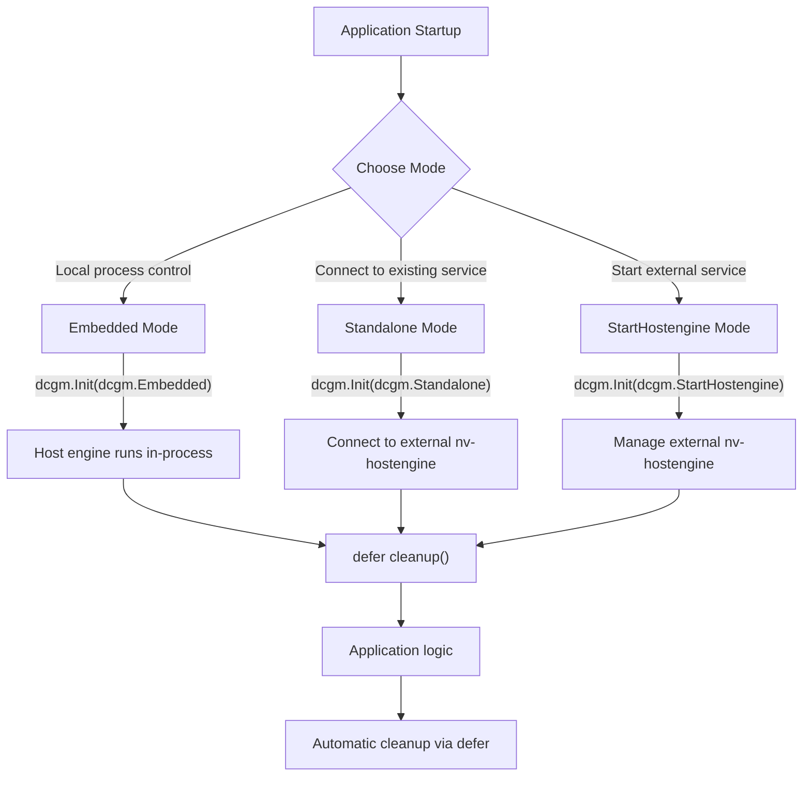
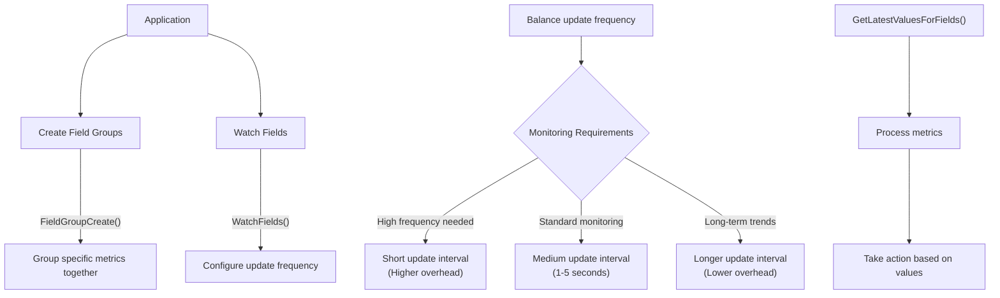
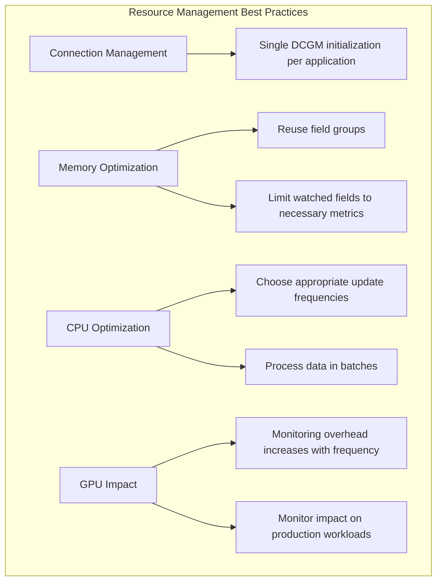
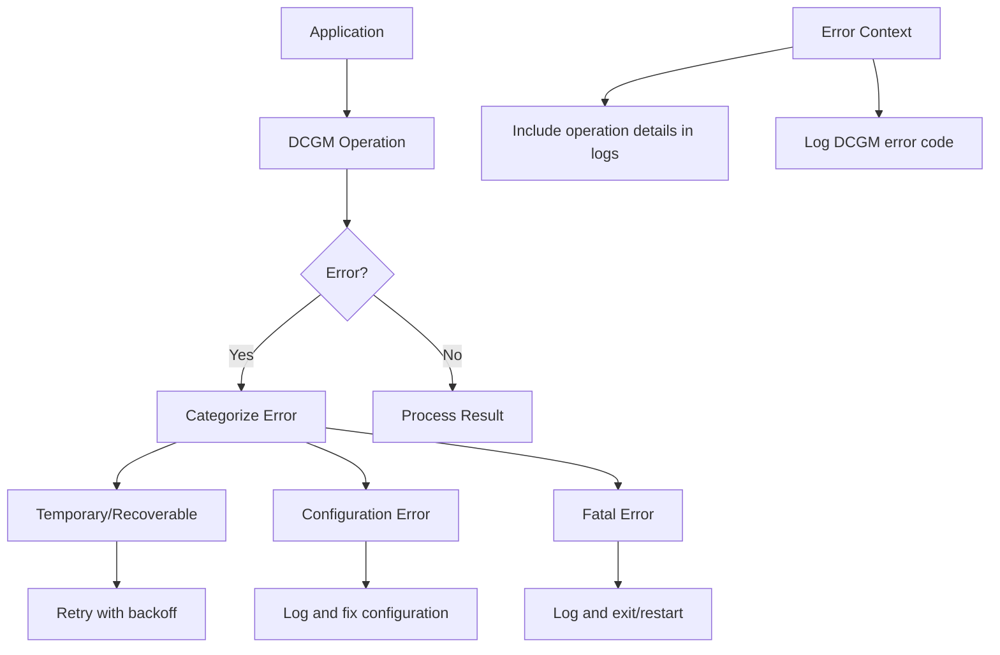
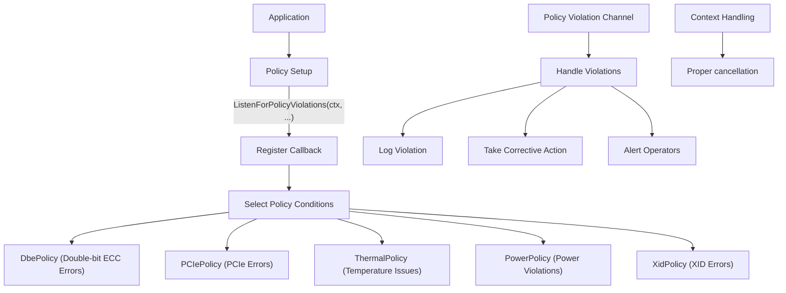
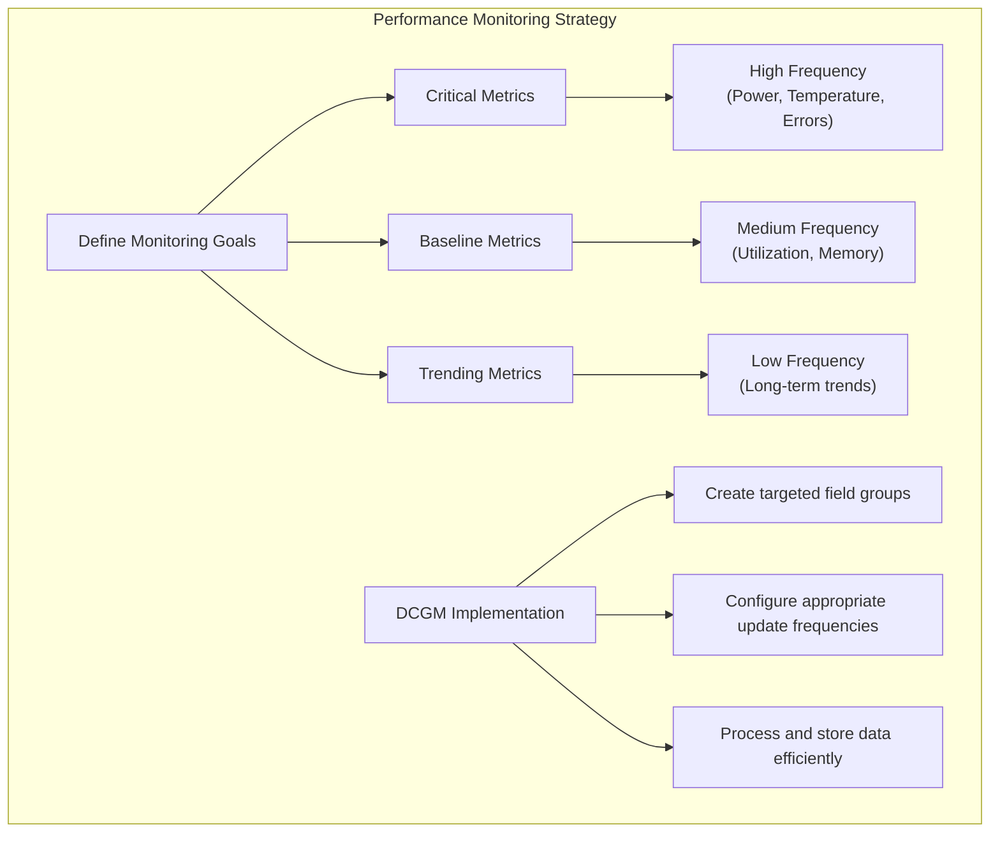
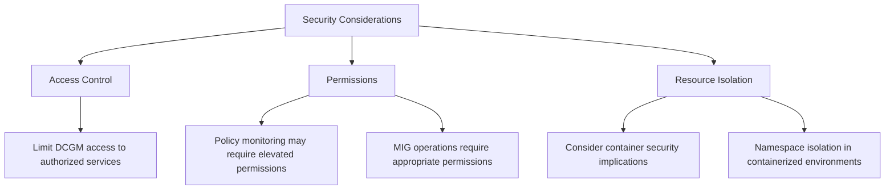
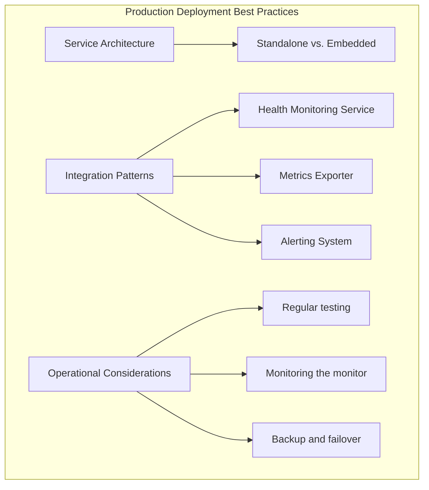
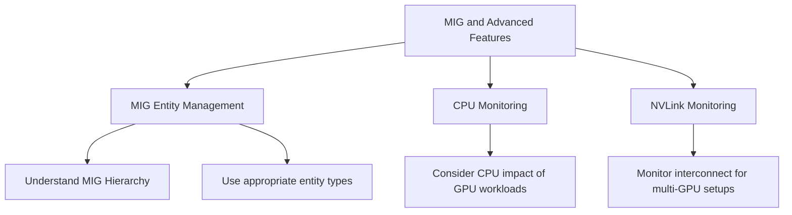

<!-- source: DeepWiki mcp.deepwiki.com · repo NVIDIA/go-dcgm · page 5.3 Best Practices · fetched 2026-10-26 -->

# Best Practices

<details>
<summary>Relevant source files</summary>

The following files were used as context for generating this wiki page:

- [README.md](README.md)
- [pkg/dcgm/api.go](pkg/dcgm/api.go)
- [pkg/dcgm/cpu.go](pkg/dcgm/cpu.go)
- [pkg/dcgm/mig.go](pkg/dcgm/mig.go)
- [pkg/dcgm/profile.go](pkg/dcgm/profile.go)
- [samples/policy/main.go](samples/policy/main.go)
- [tests/dcgm_test.go](tests/dcgm_test.go)
- [tests/nvsmi.go](tests/nvsmi.go)

</details>


This document outlines recommended practices for using the NVIDIA Data Center GPU Manager (DCGM) Go Bindings in production environments. It provides guidance on initialization, monitoring, resource management, and error handling to help you build robust and efficient applications. For information about specific API usage patterns, see [API Usage Patterns](#5.2).

## Initialization and Operation Mode Selection

Selecting the appropriate operational mode is crucial for performance, reliability, and resource utilization.



### Mode Selection Guidelines

| Mode | When to Use | Pros | Cons |
|------|-------------|------|------|
| **Embedded** | Single application, simple deployments | No external dependencies, Simplest setup | Higher memory usage in application process |
| **Standalone** | Multiple applications monitoring same GPUs | Lower per-application overhead, Centralized monitoring | Requires external hostengine management |
| **StartHostengine** | Applications needing lifecycle control | Balance of separation and control | Additional process management complexity |

### Best Practices for Initialization

1. **Always use the cleanup function** from `dcgm.Init()` with `defer`:
   ```go
   cleanup, err := dcgm.Init(dcgm.Embedded)
   if err != nil {
       // Handle error
   }
   defer cleanup()
   ```

2. **Select the appropriate mode** based on your deployment architecture:
   - Use Embedded mode for standalone applications
   - Use Standalone mode when multiple applications monitor the same GPUs
   - Use StartHostengine mode when your application needs lifecycle control over the hostengine

3. **Handle initialization failure** gracefully with proper error checks and logging

Sources: [pkg/dcgm/api.go:18-47](), [samples/policy/main.go:28-32]()

## Field Management and Monitoring

Efficient field management is critical for performance when monitoring GPU metrics.



### Field Management Best Practices

1. **Create field groups by related functionality** rather than watching individual fields
   - Group temperature-related fields together
   - Group utilization-related fields together
   - Group clock-related fields together

2. **Choose appropriate update frequencies** based on monitoring requirements:
   - Critical metrics: 100-500ms
   - Standard monitoring: 1-5 seconds
   - Long-term trends: 10+ seconds

3. **Balance between monitoring overhead and data freshness**:
   - Higher frequency = more overhead
   - Use the minimum frequency needed for your use case

4. **Avoid excessive field updates** by only watching fields you actually need

Sources: [pkg/dcgm/api.go:98-102](), [pkg/dcgm/profile.go:20-53]()

## Resource Management

Proper resource management ensures your application operates efficiently without wasteful resource usage.



### Resource Management Best Practices

1. **Minimize the number of DCGM connections**:
   - Initialize DCGM once per application
   - Share the connection across components

2. **Limit monitoring overhead**:
   - Only watch fields you need
   - Use appropriate update frequencies
   - Consider using the Standalone mode for multiple applications

3. **Monitor the impact of monitoring itself**:
   - High-frequency monitoring creates CPU and memory overhead
   - Verify monitoring doesn't impact GPU workload performance

4. **Consider cleanup and garbage collection**:
   - Properly shut down DCGM to release resources
   - Be aware of CGo memory management considerations

Sources: [pkg/dcgm/api.go:24-47](), [pkg/dcgm/api.go:49-66]()

## Error Handling and Resilience

Robust error handling ensures your applications can recover from failures and operate reliably.



### Error Handling Best Practices

1. **Always check error returns** from DCGM function calls:
   ```go
   value, err := dcgm.GetDeviceInfo(gpuId)
   if err != nil {
       log.Printf("Error getting device info: %v", err)
       // Handle error appropriately
   }
   ```

2. **Categorize errors properly**:
   - Temporary errors: Retry with exponential backoff
   - Configuration errors: Log and potentially fix configuration
   - Fatal errors: Log and potentially restart the application

3. **Include context in error handling**:
   - Log the operation that failed
   - Include relevant parameters
   - Include the DCGM error code and message

4. **Consider implementing watchdog patterns** for long-running monitoring

Sources: [pkg/dcgm/api.go:122-124](), [samples/policy/main.go:44-47](), [tests/dcgm_test.go:12-16]()

## Policy Monitoring and Alerts

Implement effective policy monitoring to detect and respond to GPU issues.



### Policy Monitoring Best Practices

1. **Select appropriate policies** based on your monitoring requirements:
   - Critical hardware errors: DbePolicy, PCIePolicy
   - Operational concerns: ThermalPolicy, PowerPolicy
   - Application errors: XidPolicy

2. **Implement proper context handling**:
   - Use context cancellation for clean shutdown
   - Ensure policy channels are properly drained

3. **Define clear action plans** for different policy violations:
   - Log all violations with sufficient context
   - Implement automatic corrective actions where appropriate
   - Alert operators for critical issues

4. **Test policy violation handling** to ensure proper response:
   - Simulate violations in test environments
   - Verify alerting and correction mechanisms

Sources: [samples/policy/main.go:34-47](), [pkg/dcgm/api.go:116-125]()

## Performance Monitoring

Implement efficient performance monitoring strategies to gain insights without excessive overhead.



### Performance Monitoring Best Practices

1. **Define tiered monitoring strategies**:
   - Critical metrics: High frequency (100-500ms)
   - Baseline metrics: Medium frequency (1-5s)
   - Trending metrics: Low frequency (10s+)

2. **Create separate field groups for different update frequencies**:
   - Group metrics with similar importance and update frequency
   - Avoid putting low-frequency metrics in high-frequency groups

3. **Balance metrics collection with application performance**:
   - Monitor the impact of DCGM on your application
   - Adjust frequencies based on observed overhead

4. **Consider data storage and processing requirements**:
   - High-frequency metrics generate more data
   - Implement appropriate aggregation and retention policies

Sources: [pkg/dcgm/api.go:89-91](), [tests/dcgm_test.go:168-233]()

## Security Considerations



### Security Best Practices

1. **Implement appropriate access control** for DCGM hostengine:
   - Limit access to authorized services and users
   - Consider network isolation for Standalone mode

2. **Be aware of permission requirements**:
   - Some policy monitoring features require root/administrator privileges
   - MIG management operations may require elevated permissions

3. **Consider security in containerized environments**:
   - Proper isolation when monitoring GPUs across containers
   - Appropriate resource sharing and namespace considerations

4. **Validate input parameters** to avoid security issues:
   - Validate GPU IDs before using them
   - Check parameter ranges and values

Sources: [samples/policy/main.go:34-44](), [pkg/dcgm/mig.go:105-127]()

## Production Deployment Considerations



### Production Deployment Best Practices

1. **Choose the appropriate service architecture**:
   - Standalone mode with central hostengine for multi-application environments
   - Embedded mode for single, self-contained applications

2. **Implement comprehensive logging**:
   - Log initialization and shutdown
   - Log errors with context
   - Consider structured logging for machine parsing

3. **Monitor the monitoring system itself**:
   - Implement health checks for your DCGM-based monitoring
   - Set up alerts for monitoring system failures

4. **Test failure scenarios**:
   - GPU removal or failure
   - Network partitions (for Standalone mode)
   - Driver upgrades or changes

5. **Consider integration with existing monitoring infrastructure**:
   - Export metrics to time-series databases
   - Integrate with alerting systems
   - Provide dashboards for operators

Sources: [pkg/dcgm/api.go:18-47](), [samples/policy/main.go:16-58]()

## MIG and Advanced Feature Considerations

When working with Multi-Instance GPU (MIG) and other advanced features, additional considerations apply.



### MIG and Advanced Feature Best Practices

1. **Understand the MIG entity hierarchy** when working with MIG-enabled GPUs:
   - GPU Instances vs. Compute Instances
   - Appropriate entity types for monitoring

2. **Consider both GPU and CPU monitoring** for comprehensive system visibility:
   - CPU impact of GPU workloads
   - CPU bottlenecks affecting GPU performance

3. **For multi-GPU systems, monitor interconnects**:
   - NVLink status and health
   - GPU topology for optimizing multi-GPU workloads

4. **Be aware of feature compatibility**:
   - Not all DCGM features are available for all GPU types
   - MIG-specific monitoring considerations

Sources: [pkg/dcgm/mig.go:115-127](), [pkg/dcgm/cpu.go:53-65](), [pkg/dcgm/api.go:137-140]()