# Page: Overview

# Overview

<details>
<summary>Relevant source files</summary>

The following files were used as context for generating this wiki page:

- [README.md](README.md)
- [pkg/dcgm/api.go](pkg/dcgm/api.go)
- [pkg/dcgm/const.go](pkg/dcgm/const.go)
- [pkg/dcgm/dcgm_agent.h](pkg/dcgm/dcgm_agent.h)
- [pkg/dcgm/dcgm_errors.h](pkg/dcgm/dcgm_errors.h)
- [pkg/dcgm/dcgm_fields.h](pkg/dcgm/dcgm_fields.h)
- [pkg/dcgm/dcgm_structs.h](pkg/dcgm/dcgm_structs.h)
- [pkg/dcgm/profile.go](pkg/dcgm/profile.go)

</details>


The go-dcgm repository provides Go language bindings for NVIDIA's Data Center GPU Manager (DCGM), enabling Go applications to monitor and manage NVIDIA GPUs in data center environments. DCGM is a comprehensive toolkit for low-overhead management of NVIDIA GPUs, providing capabilities for health monitoring, diagnostics, system validation, policy management, and performance metrics collection.

This document serves as an introduction to the go-dcgm repository, explaining its architecture, core components, and operational modes. For detailed API usage patterns, see [API Usage Patterns](#5.2). For information about building and testing, see [Building and Testing](#4).

## Architecture Overview

The go-dcgm repository implements a layered architecture that bridges Go applications with the NVIDIA DCGM C library:

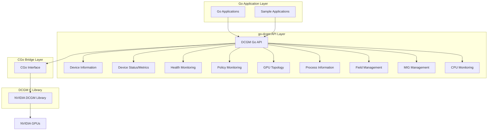

Sources: [pkg/dcgm/api.go:1-141](), [README.md:1-13]()

## Core Operational Modes

The library supports three primary operational modes, allowing flexibility in how DCGM is deployed and managed:

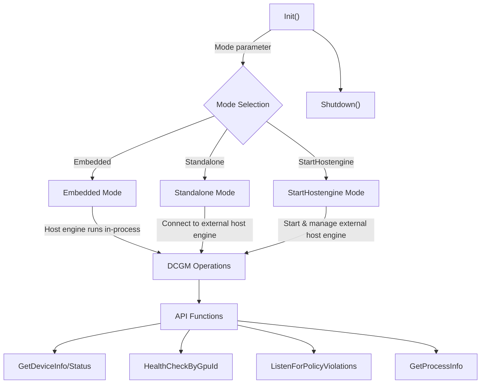

1. **Embedded Mode**: Starts the DCGM host engine within the same process as your application.
2. **Standalone Mode**: Connects to an already running DCGM host engine process.
3. **StartHostengine Mode**: Starts a separate host engine process, connects to it, and manages its lifecycle.

Sources: [pkg/dcgm/api.go:18-66](), [pkg/dcgm/dcgm_agent.h:83-119]()

## Core API Components

The go-dcgm API exposes the following key components:

```mermaid
graph LR
    subgraph "Lifecycle Management"
        Init["Init()"]
        Shutdown["Shutdown()"]
    end
    
    subgraph "Device Discovery"
        GetCount["GetAllDeviceCount()"]
        GetDevices["GetSupportedDevices()"] 
        GetEntities["GetEntityGroupEntities()"]
    end
    
    subgraph "Monitoring & Information"
        GetInfo["GetDeviceInfo()"]
        GetStatus["GetDeviceStatus()"]
        GetTopology["GetDeviceTopology()"]
        HealthCheck["HealthCheckByGpuId()"]
        ProcessInfo["GetProcessInfo()"]
    end
    
    subgraph "Event Handling"
        ListenPolicy["ListenForPolicyViolations()"]
        WatchPid["WatchPidFields()"]
    end
    
    Init --> GetCount
    GetCount --> GetDevices
    GetDevices --> GetInfo
    GetInfo --> GetStatus
    GetStatus --> HealthCheck
    
    Init --> WatchPid
    WatchPid --> ProcessInfo
    
    Init --> ListenPolicy
    
    Monitoring & Information --> Shutdown
    Event Handling --> Shutdown
```

Sources: [pkg/dcgm/api.go:68-140]()

## Field and Metric Management

DCGM operates on the concept of "fields" - individual metrics or properties that can be monitored. Go-dcgm allows grouping and monitoring of these fields:

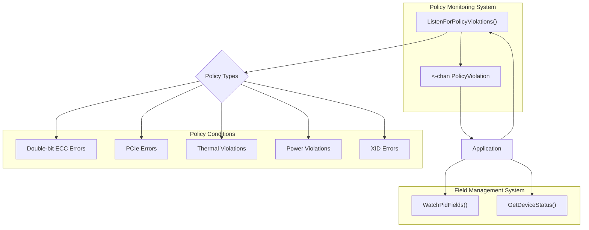

Sources: [pkg/dcgm/api.go:99-125](), [pkg/dcgm/const.go:200-228](), [pkg/dcgm/const.go:244-487]()

## Device Monitoring Capabilities

Go-dcgm provides comprehensive monitoring capabilities for NVIDIA GPUs:

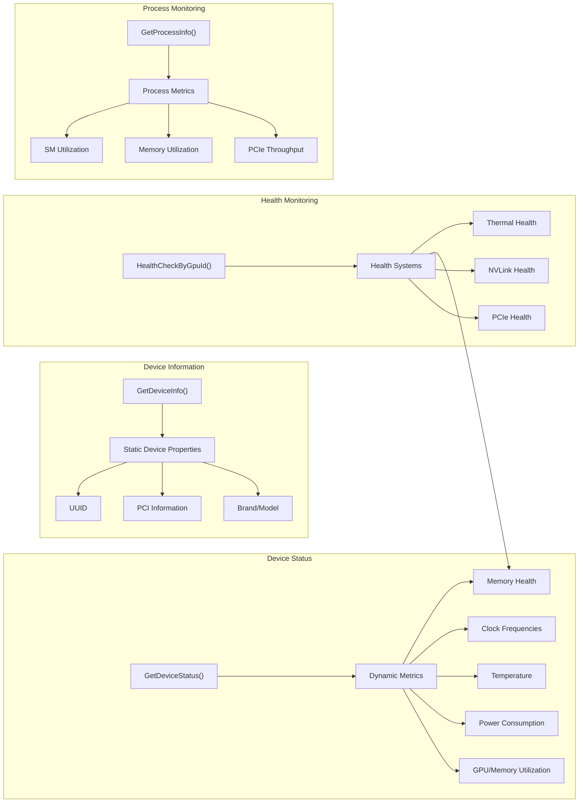

Sources: [pkg/dcgm/api.go:83-112](), [pkg/dcgm/const.go:34-76](), [pkg/dcgm/dcgm_fields.h:100-1185]()

## Data Types and Structures

Go-dcgm provides Go-native representations of DCGM data structures:

| Type Category | Description | Example Types |
|---------------|-------------|--------------|
| Core Types | Basic types for DCGM operations | `Short`, `FieldValue_v1`, `FieldValue_v2` |
| Field Constants | Constants for field identifiers | `DCGM_FI_DEV_NAME`, `DCGM_FI_DEV_GPU_TEMP` |
| Health Systems | Systems monitored for health | `HealthSystem`, `HealthResult`, `HealthCheckErrorCode` |
| Error Codes | Error codes returned by operations | `DCGM_ST_OK`, `DCGM_ST_BADPARAM` |
| Field Types | Data types for field values | `DCGM_FT_BINARY`, `DCGM_FT_DOUBLE`, `DCGM_FT_INT64` |

Sources: [pkg/dcgm/const.go:5-77](), [pkg/dcgm/const.go:200-228](), [pkg/dcgm/dcgm_structs.h:33-489]()

## Error Handling

Go-dcgm provides comprehensive error handling through error codes mapped to Go error types:

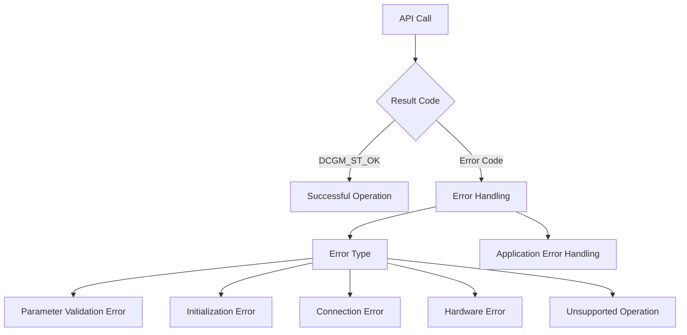

Major error categories include:
- Parameter validation errors (`DCGM_ST_BADPARAM`)
- Initialization errors (`DCGM_ST_INIT_ERROR`)
- Connection errors (`DCGM_ST_CONNECTION_NOT_VALID`)
- Unsupported operations (`DCGM_ST_NOT_SUPPORTED`)
- Hardware-related errors (`DCGM_ST_NVML_ERROR`)

Sources: [pkg/dcgm/dcgm_errors.h:33-159](), [pkg/dcgm/dcgm_structs.h:319-383]()

## Typical Usage Flow

A typical application using go-dcgm follows this pattern:

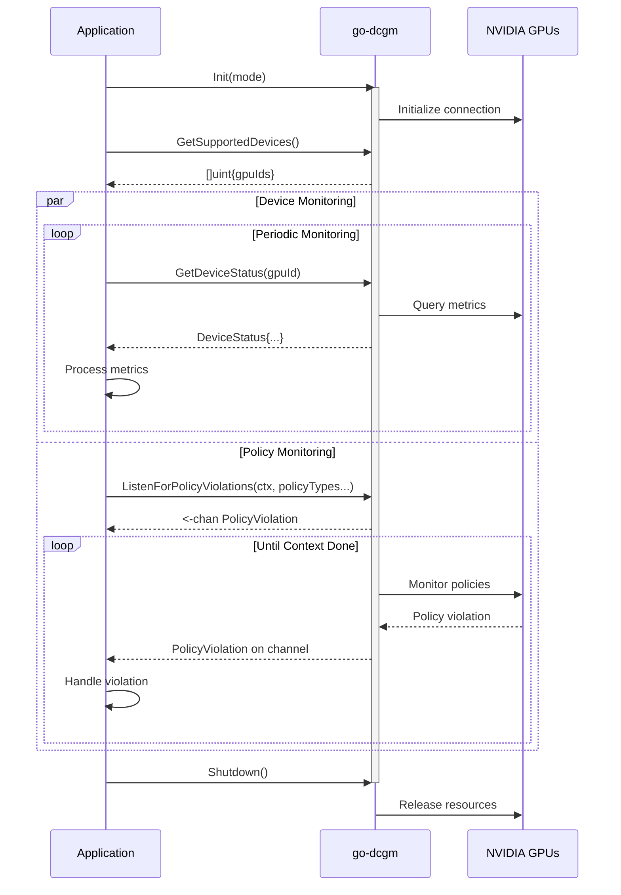

Sources: [pkg/dcgm/api.go:18-67](), [pkg/dcgm/api.go:116-125]()

## Resource Management

Go-dcgm uses a reference counting mechanism for initialization and shutdown to safely manage DCGM resources:

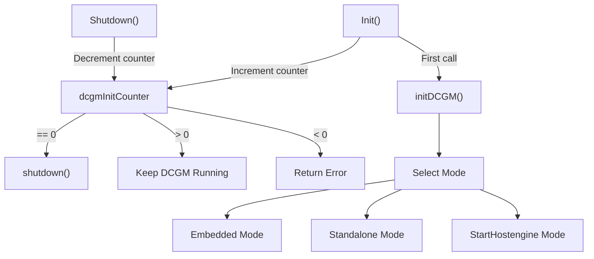

A mutex ensures thread-safe access to the initialization counter, allowing multiple components in an application to safely use DCGM.

Sources: [pkg/dcgm/api.go:13-66]()

## Summary

The go-dcgm library provides a comprehensive Go interface to NVIDIA's DCGM functionality, enabling Go applications to monitor and manage NVIDIA GPUs in data center environments. With support for multiple operational modes, extensive monitoring capabilities, and robust error handling, go-dcgm enables developers to build sophisticated GPU management solutions in Go.

---

# Page: Installation and Setup

# Installation and Setup

<details>
<summary>Relevant source files</summary>

The following files were used as context for generating this wiki page:

- [.gitignore](.gitignore)
- [.golangci.yml](.golangci.yml)
- [Makefile](Makefile)
- [README.md](README.md)
- [go.mod](go.mod)
- [go.sum](go.sum)
- [pkg/dcgm/api_test.go](pkg/dcgm/api_test.go)

</details>


This document provides detailed instructions for installing and setting up the NVIDIA Data Center GPU Manager (DCGM) Go bindings. It covers installation prerequisites, obtaining the source code, building the project, and initial configuration. For information about the overall architecture, see [Architecture Overview](#1.2).

## Prerequisites

Before installing go-dcgm, ensure your system meets the following requirements:

| Requirement | Details |
|-------------|---------|
| Go Programming Language | Version 1.23+ (as specified in [go.mod:3]()) |
| NVIDIA GPUs | Compatible NVIDIA data center GPUs |
| NVIDIA DCGM | DCGM library must be installed on the system |
| Development Tools | For building from source: gcc, make |

Sources: [go.mod](), [Makefile]()

## Installation Methods

### Method 1: Using Go Modules

If you're using go-dcgm as a dependency in your Go project, you can add it to your `go.mod` file and let Go handle the installation:

```bash
go get github.com/NVIDIA/go-dcgm
```

Your `go.mod` file should include a line similar to:

```
require github.com/NVIDIA/go-dcgm v<version>
```

### Method 2: Cloning the Repository

For development or to access sample applications, clone the repository directly:

```bash
git clone https://github.com/NVIDIA/go-dcgm.git
cd go-dcgm
```

Sources: [README.md]()

## Building the Project

Once you've obtained the source code, you can build the library and sample applications using the provided Makefile:

```bash
make binary
```

This will build:
- The core go-dcgm package
- All sample applications (deviceInfo, dmon, health, etc.)

To run tests:

```bash
make test-main
```

Sources: [Makefile:21-31](), [Makefile:33-34]()

## DCGM Setup and Initialization Modes

When using go-dcgm, there are three operational modes for initializing DCGM:

### Initialization Modes Diagram

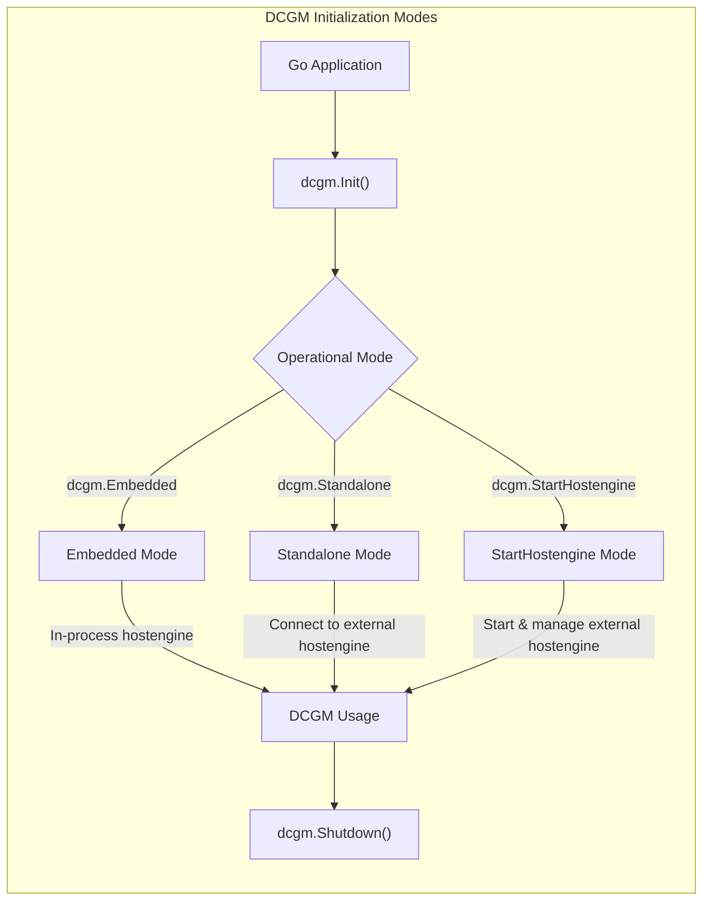

### Mode Details

| Mode | Configuration | Description | Use Case |
|------|---------------|-------------|----------|
| Embedded | `dcgm.Init(dcgm.Embedded)` | Runs the DCGM host engine in the same process as your application | Simplest setup, recommended for standalone applications |
| Standalone | `dcgm.Init(dcgm.Standalone)` | Connects to an already-running DCGM host engine | When a centralized DCGM host engine is already running |
| StartHostengine | `dcgm.Init(dcgm.StartHostengine)` | Starts an external DCGM host engine and connects to it | Recommended for applications that need isolation from the host engine |

Sources: Core Operational Modes diagram

## Typical Setup Flow

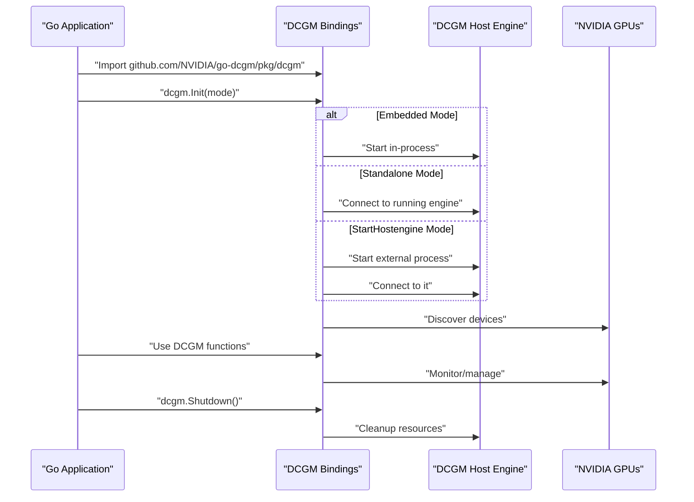

Sources: Core Operational Modes diagram

## Environment Setup

To ensure go-dcgm can find the DCGM library on your system, you may need to set these environment variables:

| Environment Variable | Purpose |
|----------------------|---------|
| `LD_LIBRARY_PATH` | Add the path to DCGM libraries (Linux) |
| `DCGM_HOSTENGINE_PATH` | Path to DCGM hostengine binary (for StartHostengine mode) |

## Verification

After installation and setup, you can verify your configuration by:

1. Building and running one of the sample applications:

```bash
# Build the deviceInfo sample
cd samples/deviceInfo
go build
./deviceInfo
```

2. Or running a simple Go program:

```go
package main

import (
    "fmt"
    "github.com/NVIDIA/go-dcgm/pkg/dcgm"
)

func main() {
    // Initialize DCGM in embedded mode
    err := dcgm.Init(dcgm.Embedded)
    if err != nil {
        fmt.Printf("Error initializing DCGM: %v\n", err)
        return
    }
    defer dcgm.Shutdown()
    
    // Get GPU count
    count, err := dcgm.GetDeviceCount()
    if err != nil {
        fmt.Printf("Error getting device count: %v\n", err)
        return
    }
    
    fmt.Printf("Found %d NVIDIA GPU(s)\n", count)
}
```

Sources: [Makefile:21-31]()

## Sample Applications

The go-dcgm repository includes several sample applications that demonstrate various features of the API:

| Sample | Purpose |
|--------|---------|
| deviceInfo | Display basic GPU information |
| dmon | GPU monitoring tool similar to nvidia-smi dmon |
| health | Check GPU health status |
| hostengineStatus | Show status of DCGM host engine |
| policy | Demonstrate policy management |
| processInfo | Show GPU process information |
| restApi | RESTful API for GPU monitoring |
| topology | Display GPU topology information |
| diag | Run diagnostics on GPUs |

You can build all samples at once using `make binary` or navigate to their directories and build them individually.

Sources: [Makefile:21-31]()

## Troubleshooting Installation

If you encounter issues with installation or setup:

1. Ensure DCGM is properly installed on your system
2. Check that your Go version is compatible (1.23+)
3. Verify that your system has compatible NVIDIA GPUs and drivers
4. Ensure environment variables are correctly set
5. Check for errors in build output

For further assistance, you can file issues on the [GitHub repository](https://github.com/NVIDIA/go-dcgm/issues).

Sources: [README.md:9-12](), [go.mod:3]()

---

# Page: Architecture Overview

# Architecture Overview

<details>
<summary>Relevant source files</summary>

The following files were used as context for generating this wiki page:

- [pkg/dcgm/admin.go](pkg/dcgm/admin.go)
- [pkg/dcgm/api.go](pkg/dcgm/api.go)
- [pkg/dcgm/const.go](pkg/dcgm/const.go)
- [pkg/dcgm/dcgm_agent.h](pkg/dcgm/dcgm_agent.h)
- [pkg/dcgm/dcgm_errors.h](pkg/dcgm/dcgm_errors.h)
- [pkg/dcgm/dcgm_fields.h](pkg/dcgm/dcgm_fields.h)
- [pkg/dcgm/dcgm_structs.h](pkg/dcgm/dcgm_structs.h)
- [pkg/dcgm/diag.go](pkg/dcgm/diag.go)
- [pkg/dcgm/health.go](pkg/dcgm/health.go)
- [pkg/dcgm/profile.go](pkg/dcgm/profile.go)
- [pkg/dcgm/utils.go](pkg/dcgm/utils.go)

</details>


The NVIDIA Data Center GPU Manager (DCGM) Go Bindings provide a Go language interface to NVIDIA's DCGM system, enabling Go applications to monitor and manage NVIDIA GPUs in data center environments. This architecture overview explains the core design of go-dcgm, including its layered structure, operational modes, and integration with the underlying DCGM C library.

For detailed API usage information, see the [Core API Reference](#2) page. For implementation details about how go-dcgm interacts with the C library, see [Interaction with C Library](#3.1).

## Layered Architecture

go-dcgm is structured as a layered system to separate concerns and provide a clean Go API on top of the underlying C library.

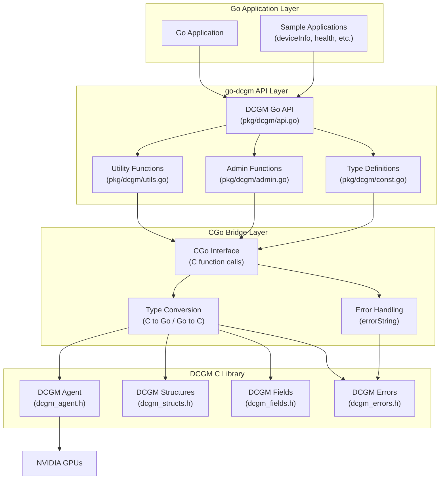

The key components in each layer are:

1. **Go Application Layer**:
   - **User Applications**: Custom applications that use the go-dcgm API
   - **Sample Applications**: Ready-to-use examples like deviceInfo, health, and policy monitors

2. **go-dcgm API Layer**:
   - **DCGM Go API**: Public functions for GPU monitoring and management
   - **Utility Functions**: Helpers for type conversion and error handling
   - **Admin Functions**: Functions for DCGM initialization and management
   - **Type Definitions**: Go types corresponding to DCGM C types

3. **CGo Bridge Layer**:
   - **CGo Interface**: Enables calling C functions from Go
   - **Type Conversion**: Translates between Go and C data types
   - **Error Handling**: Converts C error codes to Go errors

4. **DCGM C Library**:
   - **DCGM Agent**: Core DCGM functionality
   - **DCGM Structures**: Data structures used by DCGM
   - **DCGM Fields**: Metric and attribute definitions
   - **DCGM Errors**: Error codes and handling

Sources: 
- [pkg/dcgm/api.go:1-141]()
- [pkg/dcgm/utils.go:1-119]()
- [pkg/dcgm/admin.go:1-242]()
- [pkg/dcgm/const.go:1-193]()
- [pkg/dcgm/dcgm_agent.h:1-346]()
- [pkg/dcgm/dcgm_structs.h:1-643]()

## Operational Modes

go-dcgm supports three distinct modes for connecting to the DCGM hostengine, each suitable for different deployment scenarios:

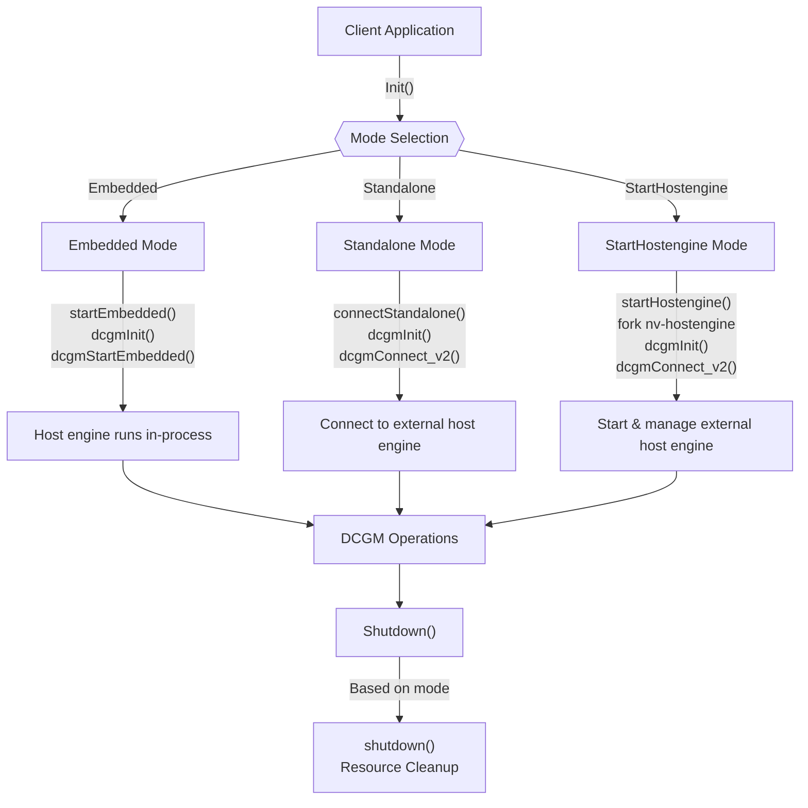

### 1. Embedded Mode

In Embedded mode, the DCGM hostengine runs within the same process as the Go application. This eliminates inter-process communication overhead but ties the hostengine lifecycle to the application process.

- **Initialization**: `startEmbedded()` in [pkg/dcgm/admin.go:100-113]()
  - Calls `dcgmInit()` followed by `dcgmStartEmbedded()`
- **Shutdown**: `stopEmbedded()` in [pkg/dcgm/admin.go:115-126]()
  - Calls `dcgmStopEmbedded()` followed by `dcgmShutdown()`

### 2. Standalone Mode

In Standalone mode, the Go application connects to an already running DCGM hostengine process. This is ideal when the hostengine is managed separately or multiple applications need to access the same hostengine.

- **Initialization**: `connectStandalone()` in [pkg/dcgm/admin.go:128-161]()
  - Calls `dcgmInit()` followed by `dcgmConnect_v2()`
- **Shutdown**: `disconnectStandalone()` in [pkg/dcgm/admin.go:163-174]()
  - Calls `dcgmDisconnect()` followed by `dcgmShutdown()`

### 3. StartHostengine Mode

In StartHostengine mode, the Go application starts a new DCGM hostengine process and connects to it. The hostengine process is terminated when the application shuts down, providing separation while automating lifecycle management.

- **Initialization**: `startHostengine()` in [pkg/dcgm/admin.go:176-225]()
  - Forks a new process for `nv-hostengine`, then calls `dcgmInit()` and `dcgmConnect_v2()`
- **Shutdown**: `stopHostengine()` in [pkg/dcgm/admin.go:227-241]()
  - Calls `disconnectStandalone()` and terminates the `nv-hostengine` process

The mode is selected when calling `Init()` in [pkg/dcgm/api.go:24-47]() and affects how go-dcgm interacts with the hostengine throughout the application lifecycle.

Sources:
- [pkg/dcgm/api.go:24-66]()
- [pkg/dcgm/admin.go:40-241]()

## API Organization

The go-dcgm API is organized into several functional areas, each handling specific aspects of GPU monitoring and management:

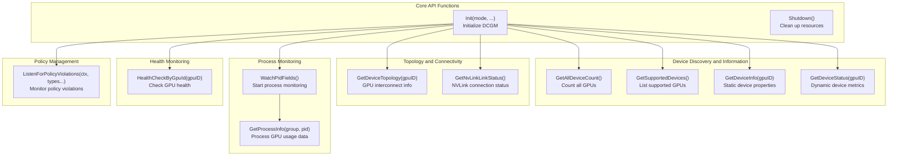

### Key API Areas

1. **Initialization and Shutdown**
   - `Init(mode, args...)`: Start DCGM in the specified mode
   - `Shutdown()`: Clean up resources and shut down DCGM

2. **Device Information**
   - `GetAllDeviceCount()`: Get count of all GPUs 
   - `GetSupportedDevices()`: Get list of DCGM-supported GPUs
   - `GetDeviceInfo()`: Get static device properties
   - `GetDeviceStatus()`: Get dynamic device metrics

3. **Health Monitoring**
   - `HealthCheckByGpuId()`: Check health of specific GPU
   - Functions to set and monitor health watches

4. **Process Monitoring**
   - `WatchPidFields()`: Configure process monitoring
   - `GetProcessInfo()`: Get process GPU usage statistics

5. **Policy Monitoring**
   - `ListenForPolicyViolations()`: Monitor for policy violations
   - `ListenForPolicyViolationsForGroup()`: Monitor specific GPU groups

These APIs are implemented in [pkg/dcgm/api.go]() and build upon the operational mode selected during initialization.

Sources:
- [pkg/dcgm/api.go:1-141]()
- [pkg/dcgm/health.go:1-224]()

## Field Management System

Fields are a fundamental concept in DCGM, representing metrics and attributes that can be monitored. The Field Management System provides mechanisms for defining, watching, and retrieving field values.

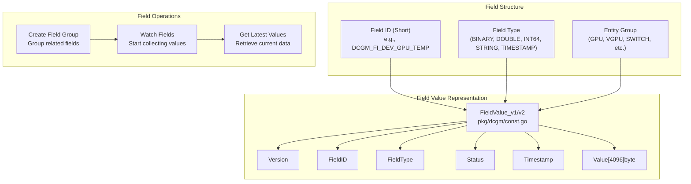

### Field Structure

Fields in DCGM are identified by:

1. **Field ID**: Numeric identifier for a specific metric or attribute
   - Defined in [pkg/dcgm/dcgm_fields.h:248-1260]() as DCGM_FI_* constants
   - Examples: DCGM_FI_DEV_GPU_TEMP (temperature), DCGM_FI_DEV_POWER_USAGE (power)

2. **Field Type**: Data type of the field
   - Defined in [pkg/dcgm/dcgm_fields.h:32-58]()
   - Types include BINARY, DOUBLE, INT64, STRING, TIMESTAMP

3. **Entity Association**: What the field applies to
   - Global scope or specific entity (GPU, VGPU, etc.)
   - Entity groups defined in [pkg/dcgm/dcgm_fields.h:224-238]()

### Field Value Representation

Field values are represented by Go structures defined in [pkg/dcgm/const.go:12-32]():

```go
type FieldValue_v1 struct {
    Version   uint
    FieldID   Short
    FieldType uint
    Status    int
    TS        int64
    Value     [4096]byte
}

type FieldValue_v2 struct {
    Version       uint
    EntityGroupId Field_Entity_Group
    EntityID      uint
    FieldID       Short
    FieldType     uint
    Status        int
    TS            int64
    Value         [4096]byte
    StringValue   *string
}
```

The Field Management System provides a standardized way to access GPU metrics, supporting both polling and event-based monitoring patterns.

Sources:
- [pkg/dcgm/const.go:11-32]()
- [pkg/dcgm/dcgm_fields.h:32-58, 224-238, 248-1260]()

## Error Handling

go-dcgm implements comprehensive error handling to translate DCGM C library error codes into idiomatic Go errors.

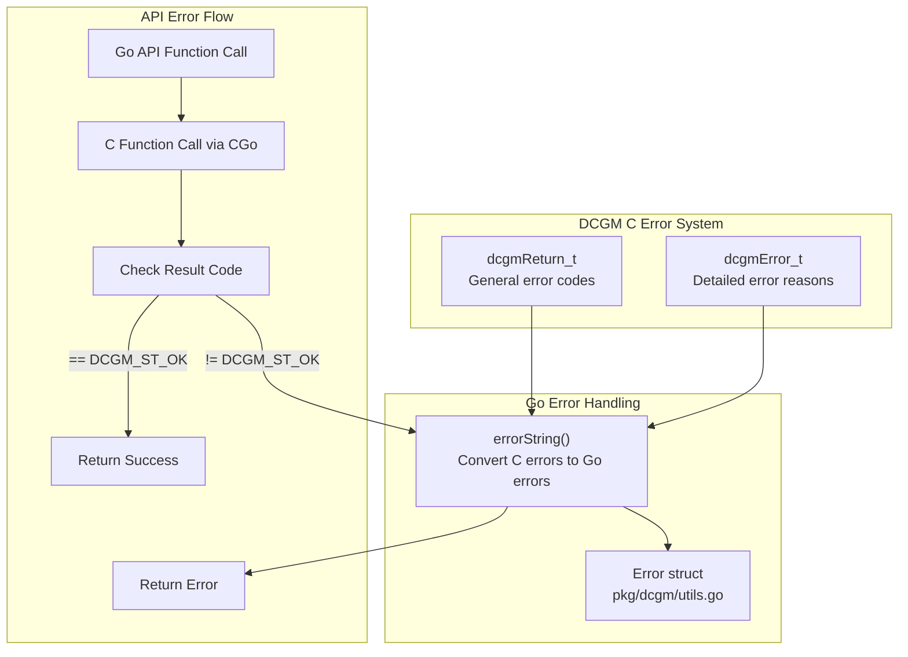

### Error Types

DCGM defines two main categories of error codes:

1. **DCGM Return Codes** (`dcgmReturn_t` in [pkg/dcgm/dcgm_structs.h:320-383]()):
   - General purpose error codes used throughout the API
   - Examples: `DCGM_ST_OK`, `DCGM_ST_BADPARAM`, `DCGM_ST_GENERIC_ERROR`

2. **DCGM Error Codes** (`dcgmError_t` in [pkg/dcgm/dcgm_errors.h:31-160]()):
   - More specific error codes used primarily for diagnostics
   - Examples: `DCGM_FR_OK`, `DCGM_FR_THERMAL_VIOLATIONS`

### Go Error Implementation

go-dcgm wraps these error codes in a Go-friendly way:

1. **Error Type** (`Error` struct in [pkg/dcgm/utils.go:51-54]()):
   ```go
   type Error struct {
       msg  string         // description of error
       Code C.dcgmReturn_t // dcgmReturn_t value of error
   }
   ```

2. **Error Conversion** (`errorString` in [pkg/dcgm/utils.go:58-64]()):
   ```go
   func errorString(result C.dcgmReturn_t) error {
       if result == C.DCGM_ST_OK {
           return nil
       }
       err := C.GoString(C.errorString(result))
       return fmt.Errorf("%v", err)
   }
   ```

This approach enables idiomatic Go error handling while preserving the detailed error information from the DCGM C library.

Sources:
- [pkg/dcgm/utils.go:50-68]()
- [pkg/dcgm/dcgm_structs.h:320-383]()
- [pkg/dcgm/dcgm_errors.h:31-160]()

## CGo Integration

go-dcgm uses CGo to interface with the DCGM C library, enabling Go applications to access the full functionality of DCGM.

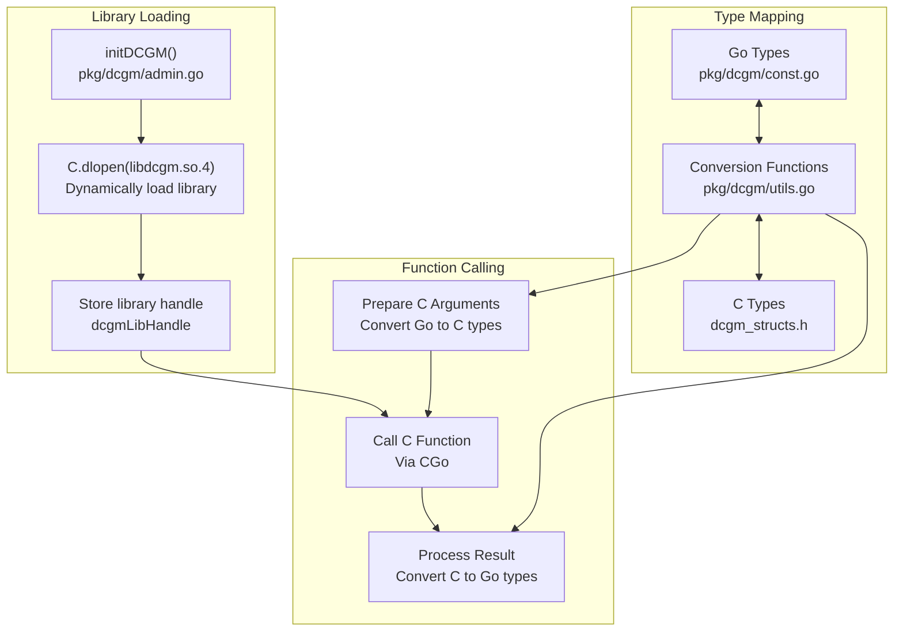

### Library Loading

DCGM C library is loaded dynamically at runtime in [pkg/dcgm/admin.go:66-72]():

```go
dcgmLibHandle = C.dlopen(lib, C.RTLD_LAZY|C.RTLD_GLOBAL)
if dcgmLibHandle == nil {
    return fmt.Errorf("%s not found", dcgmLib)
}
```

This approach allows go-dcgm to be used without requiring the DCGM C library to be present at compile time.

### Type Conversion

go-dcgm defines Go types that correspond to DCGM C types and provides functions to convert between them:

1. **Type Definitions** in [pkg/dcgm/const.go]():
   ```go
   type Short C.ushort
   
   type FieldValue_v1 struct {
       Version   uint
       FieldID   Short
       FieldType uint
       // ... other fields
   }
   ```

2. **Conversion Functions** in [pkg/dcgm/utils.go:20-48]():
   ```go
   func uintPtr(c C.uint) *uint
   func uint64Ptr(c C.longlong) *uint64
   func stringPtr(c *C.char) *string
   // ... other conversions
   ```

### Function Calling

Go functions call DCGM C library functions through CGo, with appropriate type conversions:

```go
// Example from pkg/dcgm/admin.go
var cHandle C.dcgmHandle_t
result = C.dcgmStartEmbedded(C.DCGM_OPERATION_MODE_AUTO, &cHandle)
if err = errorString(result); err != nil {
    return fmt.Errorf("error starting nv-hostengine: %s", err)
}
handle = dcgmHandle{cHandle}
```

This CGo integration provides a seamless bridge between Go and the DCGM C library, allowing for efficient GPU monitoring and management from Go applications.

Sources:
- [pkg/dcgm/admin.go:59-73]()
- [pkg/dcgm/utils.go:20-48]()
- [pkg/dcgm/const.go:5-32]()

## Summary

The go-dcgm architecture provides a well-structured Go interface to NVIDIA's DCGM library, enabling GPU monitoring and management in data center environments. Key architecture aspects include:

1. **Layered Design**: Clear separation between Go API, CGo bridge, and DCGM C library
2. **Flexible Operational Modes**: Support for embedded, standalone, and managed hostengine operation
3. **Comprehensive API**: Functions for device information, monitoring, health checks, and policy management
4. **Field Management**: Standardized system for accessing GPU metrics and attributes
5. **Error Handling**: Idiomatic translation of C errors to Go error values
6. **CGo Integration**: Efficient bridging between Go and C with appropriate type conversions

This architecture enables Go applications to leverage the full power of DCGM while maintaining idiomatic Go code patterns and practices.

Sources:
- [pkg/dcgm/api.go:1-141]()
- [pkg/dcgm/admin.go:1-242]()
- [pkg/dcgm/const.go:1-193]()
- [pkg/dcgm/utils.go:1-119]()

---

# Page: Core API Reference

# Core API Reference

<details>
<summary>Relevant source files</summary>

The following files were used as context for generating this wiki page:

- [README.md](README.md)
- [pkg/dcgm/api.go](pkg/dcgm/api.go)
- [pkg/dcgm/const.go](pkg/dcgm/const.go)
- [pkg/dcgm/dcgm_agent.h](pkg/dcgm/dcgm_agent.h)
- [pkg/dcgm/dcgm_errors.h](pkg/dcgm/dcgm_errors.h)
- [pkg/dcgm/dcgm_fields.h](pkg/dcgm/dcgm_fields.h)
- [pkg/dcgm/dcgm_structs.h](pkg/dcgm/dcgm_structs.h)
- [pkg/dcgm/profile.go](pkg/dcgm/profile.go)

</details>


The Core API Reference provides an overview of the main components and functions of the NVIDIA Data Center GPU Manager (DCGM) Go bindings. This document covers the fundamental API functions that form the foundation for monitoring and managing NVIDIA GPUs in Go applications.

For information about specific implementation details of DCGM, see [Implementation Details](#3). For examples and usage patterns, see [Examples and Usage](#5).

## API Component Overview

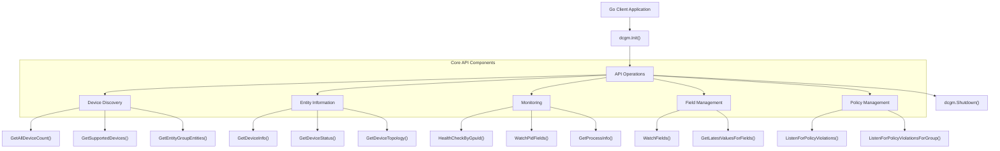

Sources: [pkg/dcgm/api.go:1-141]()

## Initialization and Operational Modes

### Initialization Model

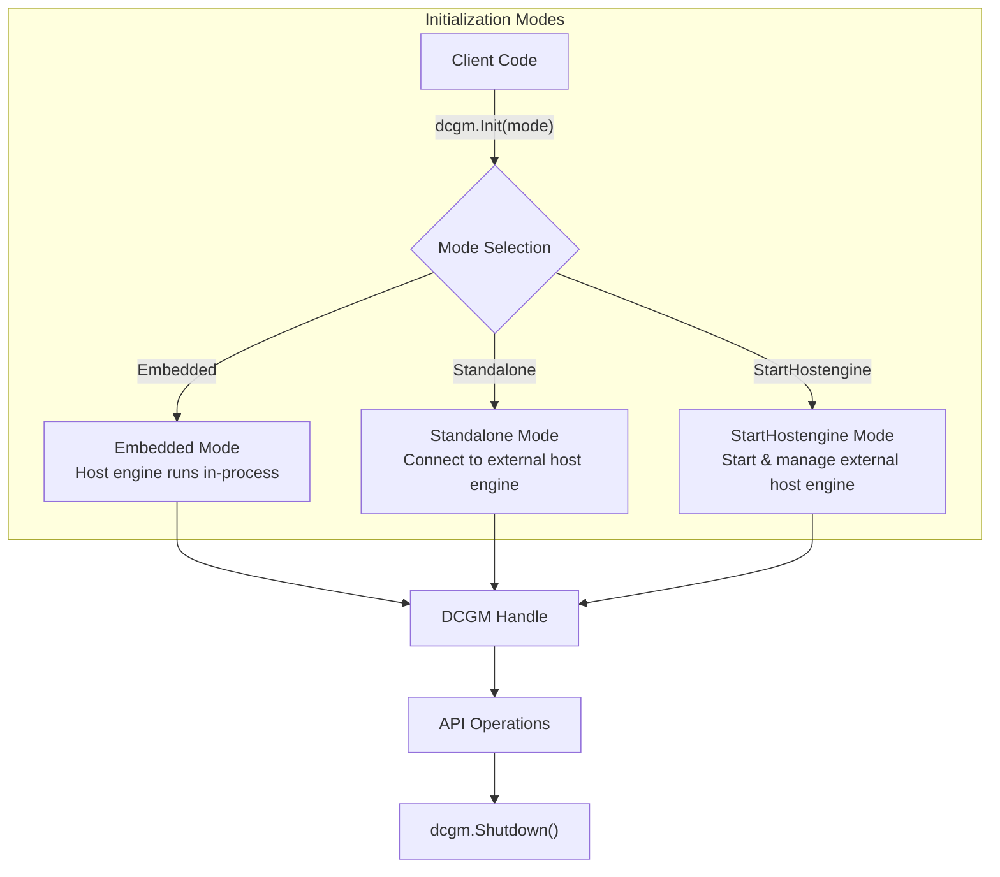

The API must be initialized with one of three operational modes before using any DCGM functionality:

| Mode | Description | Use Case |
|------|-------------|----------|
| Embedded | Host engine runs within your process | Simple applications, maximum performance |
| Standalone | Connects to an already running host engine | Multiple clients, externally managed host engine |
| StartHostengine | Starts a host engine and connects to it | Clean separation, managed lifecycle |

```go
cleanup, err := dcgm.Init(dcgm.Embedded)
if err != nil {
    // Handle error
}
defer cleanup() // Ensures proper shutdown
```

The `Init()` function returns a cleanup function that should be deferred to ensure proper resource cleanup.

Sources: [pkg/dcgm/api.go:18-47]()

## Entity Discovery and Information

### Entity Model

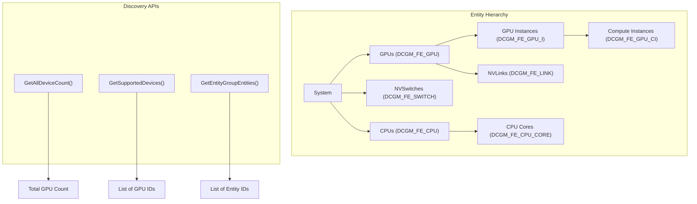

The DCGM API works with different types of entities that can be discovered and monitored:

- **GPUs** - Physical graphics processors
- **GPU Instances** - MIG instances (for multi-instance GPUs)
- **Compute Instances** - Compute instances within MIG instances
- **NVSwitches** - NVIDIA NVSwitch devices
- **NVLinks** - NVIDIA NVLink connections
- **CPUs** - CPU nodes and cores (supported for NVIDIA datacenter CPUs)

### Device Discovery Functions

| Function | Description |
|----------|-------------|
| `GetAllDeviceCount()` | Returns the count of all GPUs in the system |
| `GetSupportedDevices()` | Returns a list of DCGM-supported GPU IDs |
| `GetEntityGroupEntities()` | Returns all entities of a specified group type |
| `GetDeviceInfo()` | Returns detailed information about a specific GPU |
| `GetDeviceStatus()` | Returns current status information for a GPU |
| `GetDeviceTopology()` | Returns connectivity information for a GPU |

Example usage:
```go
// Get list of supported GPUs
gpuIds, err := dcgm.GetSupportedDevices()
if err != nil {
    // Handle error
}

// Get detailed information for each GPU
for _, gpuId := range gpuIds {
    deviceInfo, err := dcgm.GetDeviceInfo(gpuId)
    if err != nil {
        // Handle error
    }
    // Use deviceInfo...
}
```

Sources: [pkg/dcgm/api.go:68-96]()

## Field Management and Monitoring

### Field Management System

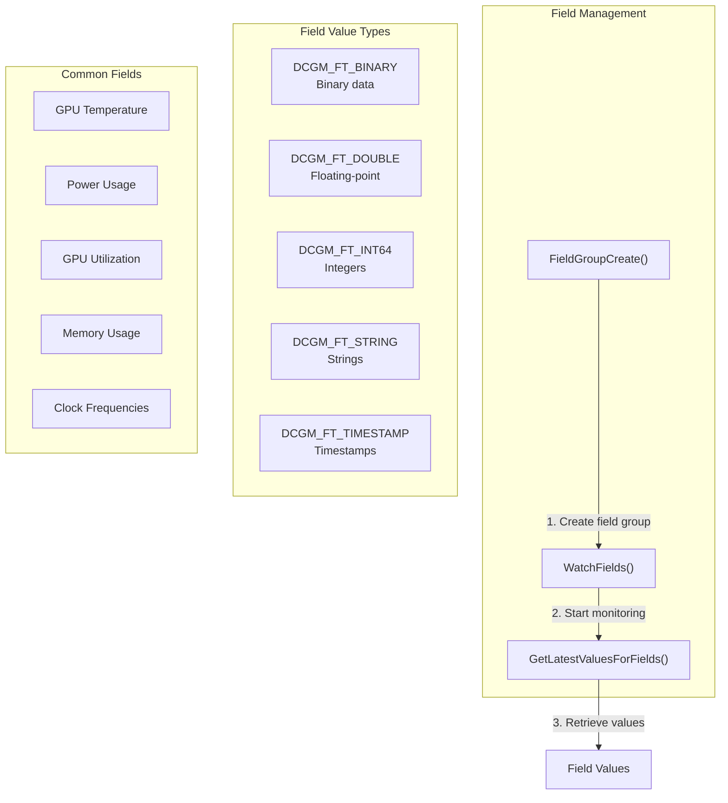

DCGM's field management system is the foundation for monitoring GPU metrics. Fields represent measurable values from the GPU, such as temperature, utilization, or error counts. The field system allows:

1. Creating field groups to define collections of metrics
2. Watching fields to start data collection
3. Retrieving field values on demand

Fields are identified by numeric IDs defined in the DCGM library. Examples include:
- `DCGM_FI_DEV_GPU_TEMP` (150) - GPU temperature
- `DCGM_FI_DEV_POWER_USAGE` (155) - Power consumption in watts
- `DCGM_FI_DEV_GPU_UTIL` (203) - GPU utilization percentage
- `DCGM_FI_DEV_MEM_COPY_UTIL` (204) - Memory utilization percentage

Sources: [pkg/dcgm/const.go:11-77], [pkg/dcgm/dcgm_fields.h:200-1259]()

### Health Monitoring

```mermaid
flowchart TD
    subgraph "Health Monitoring System"
        HealthCheck["HealthCheckByGpuId()"]
        HealthCheck --> Result["HealthResult"]
        Result -->|"DCGM_HEALTH_RESULT_PASS"| Pass["Pass - Normal operation"]
        Result -->|"DCGM_HEALTH_RESULT_WARN"| Warn["Warning - Needs attention"]
        Result -->|"DCGM_HEALTH_RESULT_FAIL"| Fail["Failure - Critical issue"]
    end
    
    subgraph "Health Check Systems"
        PCIE["DCGM_HEALTH_WATCH_PCIE\nPCIe health"]
        NVLINK["DCGM_HEALTH_WATCH_NVLINK\nNVLink health"]
        MEM["DCGM_HEALTH_WATCH_MEM\nMemory health"]
        THERMAL["DCGM_HEALTH_WATCH_THERMAL\nThermal health"]
        POWER["DCGM_HEALTH_WATCH_POWER\nPower health"]
        ALL["DCGM_HEALTH_WATCH_ALL\nAll health checks"]
    end
```

The health monitoring system provides a high-level view of GPU health across several subsystems:

| Health System | Description |
|---------------|-------------|
| `DCGM_HEALTH_WATCH_PCIE` | PCIe connection health |
| `DCGM_HEALTH_WATCH_NVLINK` | NVLink connection health |
| `DCGM_HEALTH_WATCH_MEM` | GPU memory subsystem health |
| `DCGM_HEALTH_WATCH_THERMAL` | Temperature and thermal conditions |
| `DCGM_HEALTH_WATCH_POWER` | Power supply and consumption |
| `DCGM_HEALTH_WATCH_INFOROM` | GPU InfoROM health |

Example usage:
```go
health, err := dcgm.HealthCheckByGpuId(gpuId)
if err != nil {
    // Handle error
}

if health.Status != dcgm.DCGM_HEALTH_RESULT_PASS {
    // Handle health issue
}
```

Sources: [pkg/dcgm/const.go:200-242]()

### Policy Monitoring

```mermaid
flowchart TD
    subgraph "Policy Monitoring"
        Register["ListenForPolicyViolations()"]
        Register --> Channel["<-chan PolicyViolation"]
        Channel --> Handler["Violation Handler"]
    end
    
    subgraph "Policy Conditions"
        PC_DBE["Double-bit ECC Errors"]
        PC_PCIe["PCIe Errors"]
        PC_Thermal["Thermal Violations"]
        PC_Power["Power Violations"]
        PC_NVLINK["NVLink Errors"]
        PC_XID["XID Errors"]
    end
```

Policy monitoring allows setting up listeners for specific GPU conditions:

1. Register for policy violations with `ListenForPolicyViolations()`
2. Receive violations through a Go channel
3. Act on violations as they occur

Example usage:
```go
ctx, cancel := context.WithCancel(context.Background())
defer cancel()

violations, err := dcgm.ListenForPolicyViolations(ctx, 
    dcgm.DbePolicy, dcgm.PCIePolicy, dcgm.ThermalPolicy)
if err != nil {
    // Handle error
}

// Process violations as they arrive
for violation := range violations {
    // Handle violation
}
```

Sources: [pkg/dcgm/api.go:116-125]()

## Core API Function Reference

The table below summarizes the key functions in the DCGM Go bindings Core API:

| Function | Description | Input | Output |
|----------|-------------|-------|--------|
| `Init` | Initializes DCGM in specified mode | Mode, optional args | Cleanup function, error |
| `Shutdown` | Stops DCGM and cleans up resources | None | Error |
| `GetAllDeviceCount` | Returns count of all GPUs | None | Count, error |
| `GetEntityGroupEntities` | Returns entities of specified group | Entity group | Entity list, error |
| `GetSupportedDevices` | Returns supported GPU IDs | None | GPU ID list, error |
| `GetDeviceInfo` | Returns detailed GPU information | GPU ID | Device info, error |
| `GetDeviceStatus` | Returns current GPU status | GPU ID | Device status, error |
| `GetDeviceTopology` | Returns GPU connectivity info | GPU ID | Connection list, error |
| `WatchPidFields` | Configures monitoring for processes | None | Group handle, error |
| `GetProcessInfo` | Returns per-GPU process statistics | Group handle, PID | Process info list, error |
| `HealthCheckByGpuId` | Performs health check on GPU | GPU ID | Health results, error |
| `ListenForPolicyViolations` | Sets up policy monitoring | Context, conditions | Violation channel, error |
| `Introspect` | Returns hostengine statistics | None | Status, error |
| `GetSupportedMetricGroups` | Returns supported metric groups | GPU ID | Metric group list, error |
| `GetNvLinkLinkStatus` | Returns NVLink connection status | None | NVLink status list, error |

Sources: [pkg/dcgm/api.go:1-141]()

## Error Handling

```mermaid
graph TD
    subgraph "Error Flow"
        API["API Call"] --> Check{"Error?"}
        Check -->|"Yes"| ErrorObject["Error Object"]
        Check -->|"No"| Success["Process Result"]
        
        ErrorObject --> Code["Error Code"]
        ErrorObject --> Message["Error Message"]
        Code & Message --> HandleError["Error Handling"]
    end
    
    subgraph "Common Error Categories"
        Unavailable["Resource Unavailable"]
        Parameter["Bad Parameter"]
        Configuration["Configuration Error"]
        Hardware["Hardware Error"]
        Connection["Connection Error"]
    end
```

DCGM functions return Go errors that include DCGM-specific error codes and messages. Common error codes include:

| Error Code | Description |
|------------|-------------|
| `DCGM_ST_OK` | Success (no error) |
| `DCGM_ST_BADPARAM` | Invalid parameter provided |
| `DCGM_ST_NOT_CONFIGURED` | Required configuration missing |
| `DCGM_ST_NOT_SUPPORTED` | Operation not supported on this GPU |
| `DCGM_ST_INIT_ERROR` | Initialization error |
| `DCGM_ST_NVML_ERROR` | Underlying NVML error |
| `DCGM_ST_CONNECTION_NOT_VALID` | Invalid connection to host engine |
| `DCGM_ST_GPU_NOT_SUPPORTED` | GPU not supported by DCGM |

Example error handling:
```go
devices, err := dcgm.GetSupportedDevices()
if err != nil {
    if err.Code == dcgm.DCGM_ST_INIT_ERROR {
        // Handle initialization error
    } else if err.Code == dcgm.DCGM_ST_CONNECTION_NOT_VALID {
        // Handle connection error
    } else {
        // Handle other errors
    }
}
```

Sources: [pkg/dcgm/dcgm_structs.h:320-382]()

This Core API Reference provides a foundation for understanding the DCGM Go bindings. For details on specific functionality, please refer to the relevant sections of this documentation.

---

# Page: Initialization and Shutdown

# Initialization and Shutdown

<details>
<summary>Relevant source files</summary>

The following files were used as context for generating this wiki page:

- [pkg/dcgm/admin.go](pkg/dcgm/admin.go)
- [pkg/dcgm/api.go](pkg/dcgm/api.go)
- [pkg/dcgm/diag.go](pkg/dcgm/diag.go)
- [pkg/dcgm/health.go](pkg/dcgm/health.go)
- [pkg/dcgm/profile.go](pkg/dcgm/profile.go)
- [pkg/dcgm/utils.go](pkg/dcgm/utils.go)

</details>


This document explains how to initialize and shut down the NVIDIA Data Center GPU Manager (DCGM) using the Go bindings. Proper initialization is essential before using any DCGM functionality, and proper shutdown helps prevent resource leaks.

For information on how to use DCGM after initialization, see [Core API Reference](#2) and its sub-pages.

## Initialization Modes Overview

The go-dcgm library supports three distinct operational modes for initialization. Each mode has different characteristics regarding process isolation, lifecycle management, and connection behavior.

```mermaid
flowchart LR
    Client["Go Application"] -->|"Init(mode, args...)"| Modes{{"Initialization Mode"}}
    
    Modes -->|"Embedded"| E["startEmbedded()"]
    Modes -->|"Standalone"| S["connectStandalone(addr, port)"]
    Modes -->|"StartHostengine"| H["startHostengine()"]
    
    E -->|"In-process"| DCGM["DCGM Operations"]
    S -->|"External process"| DCGM
    H -->|"Managed external"| DCGM
    
    DCGM --> SD["Shutdown()"]
```

Sources: [pkg/dcgm/api.go:18-47](). [pkg/dcgm/admin.go:41-48]()

### Mode Descriptions

| Mode | Description | Use Case | Process Model |
|------|-------------|----------|--------------|
| `Embedded` | Runs DCGM host engine within the same process as the application | Simplest setup, self-contained applications | Single process |
| `Standalone` | Connects to an already running DCGM host engine | When a host engine is already running as a system service | Application process + External host engine |
| `StartHostengine` | Starts a new host engine process and manages its lifecycle | More isolation than embedded, but still managed lifecycle | Application process + Child host engine process |

Sources: [pkg/dcgm/admin.go:41-48]()

## Initialization Process

The initialization process creates a connection to DCGM and prepares it for use. The `Init` function handles this process and returns a cleanup function that can be deferred.

```mermaid
sequenceDiagram
    participant App as "Go Application"
    participant API as "DCGM API"
    participant HE as "Host Engine"
    participant GPU as "NVIDIA GPUs"
    
    App->>API: "Init(mode, args...)"
    
    alt mode == Embedded
        API->>API: "initDCGM(Embedded)"
        API->>API: "startEmbedded()"
        API->>HE: "dcgmInit()"
        API->>HE: "dcgmStartEmbedded()"
    else mode == Standalone
        API->>API: "initDCGM(Standalone, args...)"
        API->>API: "connectStandalone(addr, port)"
        API->>HE: "dcgmInit()"
        API->>HE: "dcgmConnect_v2()"
    else mode == StartHostengine
        API->>API: "initDCGM(StartHostengine)"
        API->>API: "startHostengine()"
        API->>HE: "fork/exec nv-hostengine"
        API->>HE: "dcgmInit()"
        API->>HE: "dcgmConnect_v2()"
    end
    
    HE->>GPU: "Initialize connection to GPUs"
    API-->>App: "return cleanup function"
```

Sources: [pkg/dcgm/api.go:18-47](). [pkg/dcgm/admin.go:59-225]()

### Initialization Code Example

To initialize DCGM in your application, use the `Init` function with your desired mode:

```go
// Initialize DCGM in embedded mode
cleanup, err := dcgm.Init(dcgm.Embedded)
if err != nil {
    log.Fatalf("Failed to initialize DCGM: %v", err)
}
defer cleanup() // Important: defer the cleanup function

// Your DCGM code here...
```

Sources: [pkg/dcgm/api.go:18-47]()

### Reference Count Mechanism

The DCGM initialization employs a reference counting mechanism to allow multiple components to safely initialize and shut down DCGM:

```mermaid
flowchart TD
    Start["Application Start"] --> FirstInit["First Init() Call"]
    FirstInit -->|"dcgmInitCounter = 0"| ActualInit["Initialize DCGM\ninitDCGM()"]
    ActualInit -->|"dcgmInitCounter = 1"| Ready["DCGM Ready"]
    
    Ready --> SecondInit["Second Init() Call"]
    SecondInit -->|"dcgmInitCounter = 1"| IncrementOnly["Increment Counter\ndcgmInitCounter = 2"]
    
    Ready --> FirstShutdown["First Shutdown() Call"]
    FirstShutdown -->|"dcgmInitCounter = 1"| DecrementOnly["Decrement Counter\ndcgmInitCounter = 0"]
    
    IncrementOnly --> SecondShutdown["Second Shutdown() Call"]
    SecondShutdown -->|"dcgmInitCounter = 1"| StillRunning["DCGM Still Running"]
    
    StillRunning --> LastShutdown["Last Shutdown() Call"]
    LastShutdown -->|"dcgmInitCounter = 1"| ActualShutdown["Actual Shutdown\nshutdown()"]
    ActualShutdown -->|"dcgmInitCounter = 0"| Stopped["DCGM Stopped"]
```

Sources: [pkg/dcgm/api.go:13-16](). [pkg/dcgm/api.go:18-66]()

## Mode-Specific Initialization Details

### Embedded Mode

In Embedded mode, the DCGM host engine runs within the same process as your application:

1. `dcgmInit()` is called to initialize DCGM
2. `dcgmStartEmbedded()` starts the host engine in embedded mode
3. A handle to the DCGM instance is stored for future operations

Sources: [pkg/dcgm/admin.go:100-113]()

### Standalone Mode

In Standalone mode, your application connects to an already running DCGM host engine:

1. `dcgmInit()` is called to initialize DCGM
2. `dcgmConnect_v2()` establishes a connection to the specified address and port
3. A handle to the DCGM connection is stored for future operations

Required arguments:
- Address of the host engine (e.g., IP address or hostname)
- Socket type indicator (0 for TCP socket, 1 for Unix domain socket)

Sources: [pkg/dcgm/admin.go:128-161]()

### StartHostengine Mode

In StartHostengine mode, your application starts a new DCGM host engine process and manages its lifecycle:

1. Locates the `nv-hostengine` binary in the system PATH
2. Creates a temporary Unix domain socket file
3. Forks and executes `nv-hostengine` with appropriate arguments
4. Connects to the newly started host engine using the socket
5. Stores both the connection handle and the process ID for cleanup

Sources: [pkg/dcgm/admin.go:176-225]()

## Shutdown Process

The shutdown process cleans up DCGM resources and terminates or disconnects from the host engine. Like initialization, it uses a reference counting mechanism to ensure proper cleanup.

```mermaid
sequenceDiagram
    participant App as "Go Application"
    participant API as "DCGM API"
    participant HE as "Host Engine"
    
    App->>API: "Shutdown()"
    API->>API: "Check dcgmInitCounter"
    
    alt dcgmInitCounter > 1
        API->>API: "Decrement dcgmInitCounter"
    else dcgmInitCounter == 1
        API->>API: "shutdown()"
        
        alt Previous mode == Embedded
            API->>HE: "dcgmStopEmbedded()"
            API->>HE: "dcgmShutdown()"
        else Previous mode == Standalone
            API->>HE: "dcgmDisconnect()"
            API->>HE: "dcgmShutdown()"
        else Previous mode == StartHostengine
            API->>HE: "dcgmDisconnect()"
            API->>HE: "dcgmShutdown()"
            API->>HE: "Execute nv-hostengine --term"
            API->>HE: "Kill hostengine process"
        end
        
        API->>API: "Decrement dcgmInitCounter"
    end
    
    API-->>App: "Return any error"
```

Sources: [pkg/dcgm/api.go:49-66](). [pkg/dcgm/admin.go:86-241]()

### Mode-Specific Shutdown Details

#### Embedded Mode Shutdown

1. `dcgmStopEmbedded()` is called to stop the embedded host engine
2. `dcgmShutdown()` is called to clean up DCGM resources

Sources: [pkg/dcgm/admin.go:115-126]()

#### Standalone Mode Shutdown

1. `dcgmDisconnect()` is called to disconnect from the host engine
2. `dcgmShutdown()` is called to clean up DCGM resources

Sources: [pkg/dcgm/admin.go:163-174]()

#### StartHostengine Mode Shutdown

1. `dcgmDisconnect()` is called via `disconnectStandalone()`
2. `dcgmShutdown()` is called to clean up DCGM resources
3. `nv-hostengine --term` command is executed to terminate the host engine
4. The host engine process is forcibly killed to ensure cleanup

Sources: [pkg/dcgm/admin.go:227-241]()

## Error Handling and Best Practices

The DCGM initialization and shutdown processes can encounter several types of errors. Here are common error scenarios and best practices for handling them:

### Common Errors

| Error Scenario | Cause | Solution |
|----------------|-------|----------|
| DCGM library not found | The `libdcgm.so.4` shared library is missing | Ensure DCGM is properly installed |
| Connection failure | The DCGM host engine is not running or inaccessible | Check host engine status and connectivity |
| Shutdown before init | `Shutdown()` called before `Init()` | Always call `Init()` before `Shutdown()` |
| Multiple shutdowns | `Shutdown()` called more times than `Init()` | Balance `Init()` and `Shutdown()` calls |

Sources: [pkg/dcgm/admin.go:59-86](). [pkg/dcgm/api.go:49-66]()

### Best Practices

1. **Always use defer with the cleanup function**:
   ```go
   cleanup, err := dcgm.Init(dcgm.Embedded)
   if err != nil {
       return err
   }
   defer cleanup()
   ```

2. **Check for initialization errors before proceeding**:
   ```go
   if err != nil {
       log.Fatalf("Failed to initialize DCGM: %v", err)
   }
   ```

3. **Use the appropriate mode for your use case**:
   - `Embedded` for simplest self-contained applications
   - `Standalone` when a system-wide host engine is already running
   - `StartHostengine` for isolation with managed lifecycle

4. **Handle multiple components safely**:
   - The reference counting mechanism allows multiple components to call `Init()` and `Shutdown()` safely
   - DCGM will only truly initialize on the first `Init()` call and shut down on the last `Shutdown()` call

Sources: [pkg/dcgm/api.go:18-66]()

## Thread Safety

The DCGM initialization and shutdown functions use a mutex to ensure thread safety:

```mermaid
flowchart TD
    Start["Function Call\nInit() or Shutdown()"] --> LockMutex["Lock Mutex\nmux.Lock()"]
    LockMutex --> Operations["Perform Operations"]
    Operations --> UnlockMutex["Unlock Mutex\nmux.Unlock()"]
    UnlockMutex --> End["Return Result"]
```

This ensures that concurrent initialization or shutdown operations are properly serialized, preventing race conditions.

Sources: [pkg/dcgm/api.go:13-16](). [pkg/dcgm/api.go:24-26](). [pkg/dcgm/api.go:51-53]()

---

# Page: Device Information and Status

# Device Information and Status

<details>
<summary>Relevant source files</summary>

The following files were used as context for generating this wiki page:

- [pkg/dcgm/device_info.go](pkg/dcgm/device_info.go)
- [pkg/dcgm/device_status.go](pkg/dcgm/device_status.go)
- [pkg/dcgm/hostengine_status.go](pkg/dcgm/hostengine_status.go)
- [pkg/dcgm/topology.go](pkg/dcgm/topology.go)

</details>


This page documents how to retrieve both static device information and dynamic status metrics for NVIDIA GPUs using the go-dcgm bindings. It covers the core APIs for discovering GPU devices, querying their properties, and monitoring their real-time performance metrics.

For health-specific monitoring and diagnostics, see [Health Monitoring](#2.3). For information about creating field groups and watching fields, see [Field Management](#2.4).

## Device Discovery and Enumeration

Before retrieving information about specific GPUs, you first need to discover the available devices in your system.

```mermaid
flowchart TD
    subgraph "Device Discovery"
        getAllDeviceCount["getAllDeviceCount()"] --> |"Returns count of all GPUs"| DeviceCount[Device Count]
        getSupportedDevices["getSupportedDevices()"] --> |"Returns IDs of DCGM-supported GPUs"| SupportedDevices[Supported Device IDs]
        getEntityGroupEntities["getEntityGroupEntities(FE_GPU)"] --> |"Returns IDs of entities in specified group"| EntityIDs[Entity IDs]
    end
    
    subgraph "Device Information Retrieval"
        DeviceCount --> |"For each GPU ID"| getDeviceInfo
        SupportedDevices --> |"For each supported ID"| getDeviceInfo
        EntityIDs --> |"For each entity ID"| getDeviceInfo
        getDeviceInfo["getDeviceInfo(gpuID)"] --> |"Returns static device information"| DeviceStruct["Device struct"]
    end
```

Sources: [pkg/dcgm/device_info.go:49-61](), [pkg/dcgm/device_info.go:83-98](), [pkg/dcgm/device_info.go:64-80]()

### Retrieving Device Information

The `getDeviceInfo` function returns comprehensive static information about a GPU device, including its identifiers, capabilities, and hardware properties.

```mermaid
classDiagram
    class Device {
        GPU uint
        DCGMSupported string
        UUID string
        Power uint
        PCI PCIInfo
        Identifiers DeviceIdentifiers
        Topology []P2PLink
        CPUAffinity string
    }
    
    class PCIInfo {
        BusID string
        BAR1 uint
        FBTotal uint
        Bandwidth int64
    }
    
    class DeviceIdentifiers {
        Brand string
        Model string
        Serial string
        Vbios string
        InforomImageVersion string
        DriverVersion string
    }
    
    class P2PLink {
        GPU uint
        BusID string
        Link P2PLinkType
    }
    
    Device --> PCIInfo : "contains"
    Device --> DeviceIdentifiers : "contains"
    Device --> "0..*" P2PLink : "contains"
```

Sources: [pkg/dcgm/device_info.go:207-285](), [pkg/dcgm/device_info.go:18-46]()

The `Device` struct provides the following information:

- **Basic information**: GPU ID, UUID, and DCGM support status
- **Power information**: Default power limit in watts
- **PCI information**: Bus ID, memory sizes, and bandwidth
- **Device identifiers**: Brand, model, serial number, etc.
- **Topology**: Peer-to-peer links to other GPUs
- **CPU affinity**: Which CPU cores the GPU is affiliated with

Example fields of interest in the `Device` struct:

| Field | Type | Description |
|-------|------|-------------|
| GPU | uint | GPU ID used in DCGM |
| DCGMSupported | string | "Yes" or "No" indicating DCGM support |
| UUID | string | Unique device identifier |
| Power | uint | Default power limit in watts |
| PCI.BusID | string | PCI bus identifier |
| PCI.FBTotal | uint | Total framebuffer memory in MB |
| Identifiers.Brand | string | GPU brand name |
| Identifiers.Model | string | GPU model name |
| CPUAffinity | string | BitSet representation of CPU core affinity |

## Device Status Monitoring

While device information provides static properties, device status monitoring allows you to observe the real-time performance metrics and state of GPUs.

```mermaid
flowchart LR
    subgraph "Device Status Retrieval Flow"
        Client["Client Application"] -->|"1. Call"| LatestValues["latestValuesForDevice(gpuId)"]
        LatestValues -->|"2. Create field group"| FieldGroup["FieldGroupCreate()"]
        FieldGroup -->|"3. Watch fields"| WatchFields["WatchFields()"]
        WatchFields -->|"4. Get values"| GetValues["GetLatestValuesForFields()"]
        GetValues -->|"5. Return status"| DeviceStatus["DeviceStatus struct"]
        DeviceStatus -->|"6. Return to client"| Client
    end
```

Sources: [pkg/dcgm/device_status.go:88-194]()

The `latestValuesForDevice` function handles the process of creating field groups, watching fields, and retrieving the latest values for various metrics.

```mermaid
classDiagram
    class DeviceStatus {
        Power float64
        Temperature int64
        Utilization UtilizationInfo
        Memory MemoryInfo
        Clocks ClockInfo
        PCI PCIStatusInfo
        Performance PerfState
        FanSpeed int64
    }
    
    class UtilizationInfo {
        GPU int64
        Memory int64
        Encoder int64
        Decoder int64
    }
    
    class MemoryInfo {
        GlobalUsed int64
        ECCErrors ECCErrorsInfo
    }
    
    class ECCErrorsInfo {
        SingleBit int64
        DoubleBit int64
    }
    
    class ClockInfo {
        Cores int64
        Memory int64
    }
    
    class PCIStatusInfo {
        BAR1Used int64
        Throughput PCIThroughputInfo
        FBUsed int64
    }
    
    class PCIThroughputInfo {
        Rx int64
        Tx int64
        Replays int64
    }
    
    DeviceStatus --> UtilizationInfo : "contains"
    DeviceStatus --> MemoryInfo : "contains"
    DeviceStatus --> ClockInfo : "contains"
    DeviceStatus --> PCIStatusInfo : "contains"
    MemoryInfo --> ECCErrorsInfo : "contains"
    PCIStatusInfo --> PCIThroughputInfo : "contains"
```

Sources: [pkg/dcgm/device_status.go:14-86]()

The `DeviceStatus` struct provides the following real-time metrics:

- **Power consumption**: Current power usage in watts
- **Temperature**: Current GPU temperature in Celsius
- **Utilization**: GPU, memory, encoder, and decoder usage percentages
- **Memory**: Memory usage and ECC error counts
- **Clocks**: Current core and memory clock frequencies
- **PCI**: PCI bus usage and throughput
- **Performance**: Current performance state (P-state)
- **Fan speed**: Current fan speed percentage

Example fields of interest in the `DeviceStatus` struct:

| Field | Type | Unit | Description |
|-------|------|------|-------------|
| Power | float64 | Watts | Current power consumption |
| Temperature | int64 | °C | Current GPU temperature |
| Utilization.GPU | int64 | % | GPU compute utilization percentage |
| Utilization.Memory | int64 | % | Memory copy utilization percentage |
| Memory.ECCErrors.SingleBit | int64 | Count | Single-bit ECC error count |
| Clocks.Cores | int64 | MHz | Current SM clock frequency |
| PCI.Throughput.Rx | int64 | MB | PCI receive throughput |
| Performance | PerfState | - | Current performance state (P0-P15) |

## GPU Topology

GPU topology information is useful for understanding the physical and logical connections between GPUs, which can impact performance for multi-GPU workloads.

```mermaid
flowchart TD
    subgraph "Topology Retrieval"
        getDeviceTopology["getDeviceTopology(gpuID)"] --> |"Returns P2P links"| TopologyLinks["[]P2PLink"]
        getNvLinkLinkStatus["getNvLinkLinkStatus()"] --> |"Returns NVLink status"| NVLinkStatus["[]NvLinkStatus"]
    end
    
    subgraph "Link Types"
        P2PLinkSameBoard["P2PLinkSameBoard (PSB)"]
        P2PLinkSingleSwitch["P2PLinkSingleSwitch (PIX)"]
        P2PLinkMultiSwitch["P2PLinkMultiSwitch (PXB)"]
        P2PLinkHostBridge["P2PLinkHostBridge (PHB)"]
        P2PLinkSameCPU["P2PLinkSameCPU (NODE)"]
        P2PLinkCrossCPU["P2PLinkCrossCPU (SYS)"]
        SingleNVLINKLink["SingleNVLINKLink (NV1)"]
        TwoNVLINKLinks["TwoNVLINKLinks (NV2)"]
        ThreeNVLINKLinks["ThreeNVLINKLinks (NV3)"]
        FourNVLINKLinks["FourNVLINKLinks (NV4)"]
    end
    
    TopologyLinks --> P2PLinkSameBoard & P2PLinkSingleSwitch & P2PLinkMultiSwitch & P2PLinkHostBridge & P2PLinkSameCPU & P2PLinkCrossCPU & SingleNVLINKLink & TwoNVLINKLinks & ThreeNVLINKLinks & FourNVLINKLinks
```

Sources: [pkg/dcgm/topology.go:14-40](), [pkg/dcgm/topology.go:70-139](), [pkg/dcgm/topology.go:142-166]()

The topology information provides details about:

- **Peer-to-peer connections**: How GPUs are connected to each other
- **Connection types**: PCIe or NVLink connections with varying capabilities
- **NVLink status**: The state of NVLink connections between GPUs or NVSwitches

## Usage Examples

### Retrieving Device Information and Status

The following sequence diagram illustrates how to retrieve both device information and status:

```mermaid
sequenceDiagram
    participant App as Application
    participant DCGM as go-dcgm API
    
    App->>DCGM: getSupportedDevices()
    DCGM-->>App: []uint{0, 1, ...} (GPU IDs)
    
    loop For each GPU ID
        App->>DCGM: getDeviceInfo(gpuId)
        DCGM-->>App: Device (static information)
        
        App->>DCGM: latestValuesForDevice(gpuId)
        DCGM-->>App: DeviceStatus (dynamic metrics)
        
        App->>App: Process/display information
    end
```

This approach allows you to gather both static device properties and current performance metrics in a single iteration through your GPUs.

### Key Field Constants for Monitoring

When creating custom field groups for device monitoring, these are the key field constants used in the device status retrieval:

| Field Constant | Description | Used in |
|----------------|-------------|---------|
| DCGM_FI_DEV_POWER_USAGE | Power consumption | DeviceStatus.Power |
| DCGM_FI_DEV_GPU_TEMP | GPU temperature | DeviceStatus.Temperature |
| DCGM_FI_DEV_GPU_UTIL | GPU utilization | DeviceStatus.Utilization.GPU |
| DCGM_FI_DEV_MEM_COPY_UTIL | Memory utilization | DeviceStatus.Utilization.Memory |
| DCGM_FI_DEV_SM_CLOCK | SM clock frequency | DeviceStatus.Clocks.Cores |
| DCGM_FI_DEV_MEM_CLOCK | Memory clock frequency | DeviceStatus.Clocks.Memory |
| DCGM_FI_DEV_ECC_SBE_AGG_TOTAL | Single-bit ECC errors | DeviceStatus.Memory.ECCErrors.SingleBit |
| DCGM_FI_DEV_PSTATE | Performance state | DeviceStatus.Performance |

Source: [pkg/dcgm/device_status.go:110-127]()

## Best Practices

1. **Cache device information**: The static device information rarely changes during runtime, so cache it rather than fetching it repeatedly.

2. **Use field groups efficiently**: When monitoring device status, create field groups once and reuse them rather than creating new groups for each query.

3. **Monitor selectively**: For production monitoring, focus on the most critical metrics (temperature, utilization, memory, and errors) rather than retrieving all fields.

4. **Consider topology for multi-GPU workloads**: Use topology information to optimize workload distribution across GPUs, especially for applications requiring fast GPU-to-GPU communication.

5. **Handle unsupported fields gracefully**: Some fields may not be supported on all GPU models, so check for error conditions and handle them appropriately.

---

# Page: Health Monitoring

# Health Monitoring

<details>
<summary>Relevant source files</summary>

The following files were used as context for generating this wiki page:

- [pkg/dcgm/admin.go](pkg/dcgm/admin.go)
- [pkg/dcgm/diag.go](pkg/dcgm/diag.go)
- [pkg/dcgm/health.go](pkg/dcgm/health.go)
- [pkg/dcgm/utils.go](pkg/dcgm/utils.go)

</details>


## Overview

This document details the health monitoring system provided by the NVIDIA Data Center GPU Manager (DCGM) Go bindings. The health monitoring system enables you to proactively detect and diagnose issues in NVIDIA GPUs by monitoring various hardware subsystems and running diagnostics. For information about running specific diagnostics, see [Building and Testing](#4). For information about policy-based monitoring, see [Policy Monitoring](#2.7).

Sources: [pkg/dcgm/health.go:17-39]()

## Health Monitoring Architecture

The health monitoring system in go-dcgm is built on two core capabilities:

1. **Health Watches** - Continuous monitoring of GPU subsystems for issues
2. **Diagnostics** - On-demand tests that verify GPU functionality

### Health Monitoring System Structure

```mermaid
flowchart TD
    subgraph "Health Monitoring System"
        direction TB
        HealthAPI["HealthSet/HealthGet/HealthCheck API"]
        DiagAPI["RunDiag API"]
        
        HealthAPI --> HealthCheck["HealthCheck()"]
        DiagAPI --> RunDiagnostic["RunDiag()"]
        
        HealthCheck --> WatchSystems["Health Watch Systems"]
        RunDiagnostic --> DiagTests["Diagnostic Tests"]
    end

    subgraph "Health Watch Systems"
        PCIe["PCIe Watches"]
        NVLink["NVLink Watches"]
        PowerMgmt["Power Mgmt Watches"]
        MCU["Microcontroller Watches"]
        Memory["Memory Watches"]
        SM["SM Watches"]
        InfoROM["InfoROM Watches"]
        Temp["Temperature Watches"]
        Power["Power Watches"]
        Driver["Driver Watches"]
    end

    subgraph "Diagnostic Tests"
        DiagQuick["Quick Diagnostics"]
        DiagMedium["Medium Diagnostics"]
        DiagLong["Long Diagnostics"]
        DiagExtended["Extended Diagnostics"]
    end

    subgraph "Response Types"
        HealthResponse["HealthResponse"]
        DiagResults["DiagResults"]
    end

    WatchSystems --- HealthResponse
    DiagTests --- DiagResults
```

Sources: [pkg/dcgm/health.go:32-139](), [pkg/dcgm/diag.go:15-210]()

### Health Monitoring Data Flow

```mermaid
sequenceDiagram
    participant App as "Go Application"
    participant API as "go-dcgm API"
    participant HE as "DCGM Host Engine"
    participant GPU as "NVIDIA GPUs"

    App->>API: Initialize DCGM
    API->>HE: Connect
    App->>API: Create GPU Group
    App->>API: HealthSet(groupID, systems)
    API->>HE: Enable health watches
    HE->>GPU: Monitor health systems
    
    loop Health Monitoring
        App->>API: HealthCheck(groupID)
        API->>HE: Check for health issues
        HE->>GPU: Query health status
        GPU-->>HE: Health data
        HE-->>API: Health incidents
        API-->>App: HealthResponse
    end
    
    Note over App,GPU: On-demand Diagnostics
    
    App->>API: RunDiag(diagType, groupID)
    API->>HE: Run diagnostic tests
    HE->>GPU: Execute test patterns
    GPU-->>HE: Test results
    HE-->>API: Diagnostic data
    API-->>App: DiagResults
    
    App->>API: Shutdown DCGM
```

Sources: [pkg/dcgm/health.go:101-140](), [pkg/dcgm/diag.go:194-210](), [pkg/dcgm/admin.go:59-84]()

## Health Monitoring API

### Key Structures

The health monitoring system uses several key structures:

#### Health Check Structures

| Structure | Description | Key Fields |
|-----------|-------------|------------|
| `SystemWatch` | Represents a single health watch system and its status | `Type`, `Status`, `Error` |
| `DeviceHealth` | Represents the health status of a GPU device | `GPU`, `Status`, `Watches` |
| `HealthResponse` | Contains results of a health check operation | `OverallHealth`, `Incidents` |
| `Incident` | Details about a health check incident | `System`, `Health`, `Error`, `EntityInfo` |
| `DiagErrorDetail` | Detailed information about a health check error | `Message`, `Code` |

Sources: [pkg/dcgm/health.go:32-99]()

#### Diagnostic Structures

| Structure | Description | Key Fields |
|-----------|-------------|------------|
| `DiagResult` | Result of a single diagnostic test | `Status`, `TestName`, `TestOutput`, `ErrorCode`, `ErrorMessage` |
| `DiagResults` | Contains results of all diagnostic tests | `Software` |
| `DiagType` | Enum for diagnostic test types | `DiagQuick`, `DiagMedium`, `DiagLong`, `DiagExtended` |

Sources: [pkg/dcgm/diag.go:16-53]()

### Health System Types

The health monitoring system can monitor various GPU subsystems. These can be enabled individually or together using bitwise operations. The constant `DCGM_HEALTH_WATCH_ALL` enables all health watches.

| Health System | Description |
|---------------|-------------|
| PCIe watches (1) | Monitors PCIe errors and bandwidth |
| NVLINK watches (2) | Monitors NVLINK connections and errors |
| Power Management unit watches (4) | Monitors power management functionality |
| Microcontroller unit watches (8) | Monitors MCU operation |
| Memory watches (16) | Monitors memory errors and utilization |
| Streaming Multiprocessor watches (32) | Monitors SM operation |
| Inforom watches (64) | Monitors Inforom integrity |
| Temperature watches (128) | Monitors temperature thresholds |
| Power watches (256) | Monitors power consumption |
| Driver-related watches (512) | Monitors driver operation |

Sources: [pkg/dcgm/health.go:199-223]()

### Health Status Values

The health monitoring system reports health status using standardized values:

| Status Value | String Representation | Description |
|--------------|------------------------|-------------|
| 0 | "Healthy" | System is functioning normally |
| 10 | "Warning" | Warning condition detected |
| 20 | "Failure" | Failure condition detected |
| Other | "N/A" | Status not available |

Sources: [pkg/dcgm/health.go:187-197]()

### Function Reference

#### Health Monitoring Functions

```mermaid
classDiagram
    class HealthSet {
        +GroupHandle groupID
        +HealthSystem systems
        +error
    }
    
    class HealthGet {
        +GroupHandle groupID
        +HealthSystem, error
    }
    
    class HealthCheck {
        +GroupHandle groupID
        +HealthResponse, error
    }
    
    class RunDiag {
        +DiagType diagType
        +GroupHandle groupID
        +DiagResults, error
    }
    
    HealthSet --> "GPU Group" : Sets watches on
    HealthGet --> "GPU Group" : Gets watches from
    HealthCheck --> "GPU Group" : Checks health of
    RunDiag --> "GPU Group" : Runs diagnostics on
```

Sources: [pkg/dcgm/health.go:53-140](), [pkg/dcgm/diag.go:194-210]()

The health monitoring API includes the following key functions:

#### `HealthSet(groupID GroupHandle, systems HealthSystem) error`

Enables the specified health watch systems for a group of GPUs. The `systems` parameter is a bitmask of the health systems to monitor.

Example:
```go
// Enable PCIe and Memory watches for a group of GPUs
err := dcgm.HealthSet(groupID, dcgm.DCGM_HEALTH_WATCH_PCIE | dcgm.DCGM_HEALTH_WATCH_MEMORY)
```

Sources: [pkg/dcgm/health.go:53-59]()

#### `HealthGet(groupID GroupHandle) (HealthSystem, error)`

Retrieves the currently enabled health watch systems for a group of GPUs.

Example:
```go
// Get currently enabled health watches
systems, err := dcgm.HealthGet(groupID)
```

Sources: [pkg/dcgm/health.go:63-71]()

#### `HealthCheck(groupID GroupHandle) (HealthResponse, error)`

Checks the configured watches for any errors, failures, or warnings that have occurred since the last check. The first call initializes the watches but doesn't return any incidents. Subsequent calls return any incidents that occurred since the last check.

Example:
```go
// Check for health issues
response, err := dcgm.HealthCheck(groupID)
if err == nil && response.OverallHealth != dcgm.DCGM_HEALTH_RESULT_PASS {
    // Handle health issues
    for _, incident := range response.Incidents {
        // Process each incident
    }
}
```

Sources: [pkg/dcgm/health.go:101-140]()

#### `RunDiag(diagType DiagType, groupID GroupHandle) (DiagResults, error)`

Runs diagnostic tests on a group of GPUs with the specified diagnostic level.

Example:
```go
// Run quick diagnostics
results, err := dcgm.RunDiag(dcgm.DiagQuick, groupID)
```

Sources: [pkg/dcgm/diag.go:194-210]()

## Diagnostic System

The diagnostic system complements health monitoring by providing on-demand, comprehensive testing of GPU functionality. Diagnostics can be more intensive and thorough than health watches, making them suitable for periodic health verification or troubleshooting.

### Diagnostic Levels

The diagnostic system offers four levels of testing, with increasing thoroughness and runtime:

1. **Quick (DiagQuick)**: Fast, basic health checks with minimal impact
2. **Medium (DiagMedium)**: More comprehensive checks with moderate runtime
3. **Long (DiagLong)**: Extensive health checks with longer runtime
4. **Extended (DiagExtended)**: The most thorough system checks, longest runtime

Sources: [pkg/dcgm/diag.go:21-33]()

### Diagnostic Tests

The diagnostic system can run various tests. The available software-related tests include:

| Test ID | Test Name | Description |
|---------|-----------|-------------|
| DCGM_SWTEST_DENYLIST | Denylist check | Checks for presence of drivers on the denylist (e.g. nouveau) |
| DCGM_SWTEST_NVML_LIBRARY | NVML library check | Checks for presence and version of NVML library |
| DCGM_SWTEST_CUDA_MAIN_LIBRARY | CUDA library check | Checks for presence and version of CUDA library |
| DCGM_SWTEST_CUDA_RUNTIME_LIBRARY | CUDA RT library check | Checks for presence and version of CUDA runtime library |
| DCGM_SWTEST_PERMISSIONS | Permissions check | Verifies character device permissions |
| DCGM_SWTEST_PERSISTENCE_MODE | Persistence mode check | Verifies persistence mode is enabled |
| DCGM_SWTEST_ENVIRONMENT | Environment check | Checks for CUDA environment variables that may slow tests |
| DCGM_SWTEST_PAGE_RETIREMENT | Page retirement check | Checks for pending frame buffer page retirement |
| DCGM_SWTEST_GRAPHICS_PROCESSES | Graphics processes check | Checks for running graphics processes |
| DCGM_SWTEST_INFOROM | Inforom check | Checks for inforom corruption |

Additionally, hardware tests include memory, PCIe, SM stress, targeted stress, targeted power, memory bandwidth, and more.

Sources: [pkg/dcgm/diag.go:72-97](), [pkg/dcgm/diag.go:99-127]()

### Diagnostic Result Status

Diagnostic tests return one of the following status values:

| Status | Description |
|--------|-------------|
| pass | Test completed successfully |
| skipped | Test was skipped |
| warn | Test completed with warnings |
| fail | Test failed |
| notrun | Test was not run |

Sources: [pkg/dcgm/diag.go:56-70]()

## Example Workflows

### Basic Health Monitoring Workflow

```mermaid
flowchart LR
    subgraph "Health Monitoring Workflow"
        Init["1. Initialize DCGM"]
        Create["2. Create GPU Group"]
        Add["3. Add GPUs to Group"]
        Enable["4. Enable Health Watches"]
        Check["5. Check Health"]
        Process["6. Process Incidents"]
        Cleanup["7. Cleanup"]
        
        Init --> Create
        Create --> Add
        Add --> Enable
        Enable --> Check
        Check --> Process
        Process --> Check
        Process --> Cleanup
    end
```

Sources: [pkg/dcgm/health.go:142-185]()

### Implementation Example

The helper function `healthCheckByGpuId` demonstrates a complete health monitoring workflow for a single GPU:

1. Create a GPU group with a random name
2. Add the specified GPU to the group
3. Enable all health watches
4. Check the health status
5. Process the results
6. Clean up by destroying the group

This pattern can be extended to monitor multiple GPUs or specific health systems.

Sources: [pkg/dcgm/health.go:142-185]()

### Integration with Diagnostic Testing

For comprehensive health verification, combine continuous health monitoring with periodic diagnostic tests:

1. Set up health watches for continuous monitoring
2. Periodically run quick diagnostics during normal operation
3. When health watches detect issues, run more extensive diagnostics to pinpoint problems
4. After maintenance or before critical workloads, run extended diagnostics to verify full system health

This approach provides both real-time issue detection and thorough system verification when needed.

Sources: [pkg/dcgm/health.go:101-140](), [pkg/dcgm/diag.go:194-210]()

## Best Practices

1. **Initialize watches first**: The first call to `HealthCheck` initializes the watches but doesn't return incidents. Make this call early in your application's lifecycle.

2. **Use appropriate watch systems**: Enable only the health watches relevant to your application to minimize overhead.

3. **Consider diagnostic timing**: Quick diagnostics can be run more frequently, while extended diagnostics should be reserved for maintenance windows due to their impact on performance.

4. **Handle transient issues**: Some health incidents may be transient. Consider implementing retry or threshold logic before taking action.

5. **Group related GPUs**: Create logical groups of GPUs for monitoring to organize health management by workload or hardware configuration.

Sources: [pkg/dcgm/health.go:101-105]()

---

# Page: Field Management

# Field Management

<details>
<summary>Relevant source files</summary>

The following files were used as context for generating this wiki page:

- [pkg/dcgm/const.go](pkg/dcgm/const.go)
- [pkg/dcgm/dcgm_agent.h](pkg/dcgm/dcgm_agent.h)
- [pkg/dcgm/dcgm_errors.h](pkg/dcgm/dcgm_errors.h)
- [pkg/dcgm/dcgm_fields.h](pkg/dcgm/dcgm_fields.h)
- [pkg/dcgm/dcgm_structs.h](pkg/dcgm/dcgm_structs.h)
- [pkg/dcgm/field_values.go](pkg/dcgm/field_values.go)
- [pkg/dcgm/field_values_cb.c](pkg/dcgm/field_values_cb.c)
- [pkg/dcgm/field_values_cb.h](pkg/dcgm/field_values_cb.h)
- [pkg/dcgm/field_values_test.go](pkg/dcgm/field_values_test.go)
- [pkg/dcgm/fields.go](pkg/dcgm/fields.go)
- [pkg/dcgm/process_info.go](pkg/dcgm/process_info.go)

</details>


Field Management in DCGM provides the foundation for monitoring and collecting GPU metrics. This system enables applications to define sets of metrics (fields) to monitor, start data collection, and retrieve field values at different timestamps. Field Management serves as the data acquisition pipeline for other DCGM components like [Health Monitoring](#2.3) and [Policy Monitoring](#2.7).

## Overview of Field Management

The Field Management system allows you to:

1. Create groups of related metrics (field groups)
2. Start data collection for these metrics
3. Retrieve current and historical values
4. Process metric data in various formats

```mermaid
flowchart TD
    subgraph "Field Management System"
        direction LR
        FCreate["FieldGroupCreate()"]
        FWatch["WatchFields()"]
        FUpdate["UpdateAllFields()"]
        FGet["GetLatestValuesForFields()"]
        FGetSince["GetValuesSince()"]
        
        FCreate -->|"Create field group"| FWatch
        FWatch -->|"Start monitoring"| FUpdate
        FUpdate -->|"Collect data"| FGet
        FGet -->|"Process values"| App["Application"]
        FUpdate -->|"Historical data"| FGetSince
        FGetSince -->|"Process time series"| App
    end
```

Sources: [pkg/dcgm/fields.go:63-80](), [pkg/dcgm/fields.go:98-117](), [pkg/dcgm/fields.go:194-214](), [pkg/dcgm/fields.go:281-288](), [pkg/dcgm/field_values.go:72-99]()

## Field Types and Structure

DCGM fields are identified by numeric IDs and can contain different data types. The Field Management system handles type conversion automatically when retrieving values.

### Field Data Types

```mermaid
classDiagram
    class FieldDataTypes {
        DCGM_FT_BINARY: 'b'
        DCGM_FT_DOUBLE: 'd'
        DCGM_FT_INT64: 'i'
        DCGM_FT_STRING: 's'
        DCGM_FT_TIMESTAMP: 't'
    }
    
    class FieldValues {
        FieldValue_v1
        FieldValue_v2
    }
    
    class ValueMethods {
        Int64()
        Float64()
        String()
        Blob()
    }
    
    FieldDataTypes --> FieldValues: "defines type of"
    FieldValues --> ValueMethods: "accessed via"
```

Sources: [pkg/dcgm/const.go:36-45](), [pkg/dcgm/const.go:11-32](), [pkg/dcgm/fields.go:307-324](), [pkg/dcgm/fields.go:385-402]()

### Field Value Structures

The DCGM Go bindings provide two main structures for representing field values:

- `FieldValue_v1`: Basic field value structure
- `FieldValue_v2`: Extended structure with entity information

```
FieldValue_v1 {
    Version   uint
    FieldID   Short
    FieldType uint
    Status    int
    TS        int64
    Value     [4096]byte
}

FieldValue_v2 {
    Version       uint
    EntityGroupId Field_Entity_Group
    EntityID      uint
    FieldID       Short
    FieldType     uint
    Status        int
    TS            int64
    Value         [4096]byte
    StringValue   *string
}
```

Sources: [pkg/dcgm/const.go:11-32]()

## Creating and Managing Field Groups

Field groups are collections of related metrics that can be monitored together. Creating a field group is the first step in collecting GPU metrics.

### Field Group Creation

```mermaid
sequenceDiagram
    participant App as Application
    participant FG as FieldGroupCreate()
    participant DCGM as DCGM Engine
    
    App->>FG: "Create field group with field IDs"
    FG->>DCGM: "Call C API dcgmFieldGroupCreate()"
    DCGM-->>FG: "Return field group handle"
    FG-->>App: "Return FieldHandle"
    
    Note over App,DCGM: "Field group now ready for use"
```

Sources: [pkg/dcgm/fields.go:63-80]()

### Example: Creating a Field Group

To create a field group, specify a name and an array of field IDs:

```go
// Create a group of GPU utilization fields
fields := []dcgm.Short{
    dcgm.DCGM_FI_DEV_GPU_UTIL,        // GPU utilization
    dcgm.DCGM_FI_DEV_MEM_COPY_UTIL,   // Memory utilization
    dcgm.DCGM_FI_DEV_POWER_USAGE,     // Power usage
    dcgm.DCGM_FI_DEV_GPU_TEMP         // Temperature
}

fieldGroup, err := dcgm.FieldGroupCreate("utilization_metrics", fields)
if err != nil {
    // Handle error
}
defer dcgm.FieldGroupDestroy(fieldGroup)
```

Sources: [pkg/dcgm/fields.go:63-80](), [pkg/dcgm/fields.go:84-91]()

## Watching Fields

After creating a field group, you need to start data collection by watching the fields for one or more GPUs.

### Starting Data Collection

```mermaid
flowchart TD
    subgraph "Watch Field Process"
        CreateGroup["CreateGroup()"] -->|"Create GPU group"| AddToGroup["AddToGroup()"]
        AddToGroup -->|"Add GPUs to group"| Watch["WatchFields()"]
        Watch -->|"Start monitoring"| Update["UpdateAllFields()"]
        
        subgraph "Main Components"
            WatchFields["WatchFields()"]
            WatchFieldsWithGroup["WatchFieldsWithGroup()"]
            WatchFieldsWithGroupEx["WatchFieldsWithGroupEx()"]
        end
        
        WatchFields -.-> Watch
        WatchFieldsWithGroup -.-> Watch
        WatchFieldsWithGroupEx -.-> Watch
    end
```

Sources: [pkg/dcgm/fields.go:98-117](), [pkg/dcgm/fields.go:126-149]()

### Example: Watching Fields

To watch fields for a GPU:

```go
// Create a group for the GPU
group, err := dcgm.CreateGroup("my_gpu_group")
if err != nil {
    // Handle error
}

// Add GPU 0 to the group
err = dcgm.AddToGroup(group, 0)
if err != nil {
    // Handle error
}

// Start watching the fields for this GPU group
watchHandle, err := dcgm.WatchFields(0, fieldGroup, "watch_handle")
if err != nil {
    // Handle error
}
```

You can also use `WatchFieldsWithGroupEx()` to customize update frequency and other parameters:

```go
// Watch fields with custom update frequency (1 second), 
// keeping 60 seconds of history and up to 60 samples
err := dcgm.WatchFieldsWithGroupEx(
    fieldGroup, 
    group, 
    1000000,  // 1 second in microseconds
    60.0,     // 60 seconds max age
    60        // Max samples to keep
)
```

Sources: [pkg/dcgm/fields.go:98-117](), [pkg/dcgm/fields.go:126-141]()

## Updating and Retrieving Field Values

Field data must be updated periodically and can be retrieved using several methods.

### Updating Field Data

```mermaid
sequenceDiagram
    participant App as Application
    participant DCGM as DCGM Engine
    
    App->>DCGM: "UpdateAllFields()"
    DCGM-->>App: "Fields updated"
    
    App->>DCGM: "GetLatestValuesForFields(gpuId, fields)"
    DCGM-->>App: "Return field values"
    
    App->>DCGM: "EntityGetLatestValues(entityGroup, entityId, fields)"
    DCGM-->>App: "Return field values for entity"
    
    App->>DCGM: "GetValuesSince(group, fieldGroup, timestamp)"
    DCGM-->>App: "Return values since timestamp"
```

Sources: [pkg/dcgm/fields.go:281-288](), [pkg/dcgm/fields.go:194-214](), [pkg/dcgm/fields.go:232-248](), [pkg/dcgm/field_values.go:72-99]()

### Example: Retrieving Field Values

To get the latest field values:

```go
// Update all fields to ensure data is current
err := dcgm.UpdateAllFields()
if err != nil {
    // Handle error
}

// Retrieve the latest values for specific fields
values, err := dcgm.GetLatestValuesForFields(0, fields)
if err != nil {
    // Handle error
}

// Process field values
for _, value := range values {
    switch value.FieldID {
    case dcgm.DCGM_FI_DEV_GPU_UTIL:
        gpuUtil := value.Int64()
        fmt.Printf("GPU Utilization: %d%%\n", gpuUtil)
    case dcgm.DCGM_FI_DEV_GPU_TEMP:
        temp := value.Int64()
        fmt.Printf("GPU Temperature: %d°C\n", temp)
    }
}
```

Sources: [pkg/dcgm/fields.go:281-288](), [pkg/dcgm/fields.go:194-214](), [pkg/dcgm/fields.go:307-324]()

### Time Series Data Retrieval

To retrieve historical data since a specific timestamp:

```go
// Get values since a particular time
values, nextTime, err := dcgm.GetValuesSince(
    dcgm.GroupAllGPUs(),
    fieldGroup,
    startTime
)
if err != nil {
    // Handle error
}

// Process time series data
for _, value := range values {
    timestamp := time.Unix(0, value.TS*1000)
    fmt.Printf("Field %d, Time: %s, Value: %d\n", 
               value.FieldID, timestamp, value.Int64())
}

// Update startTime for next query
startTime = nextTime
```

Sources: [pkg/dcgm/field_values.go:72-99](), [pkg/dcgm/field_values.go:17-69](), [pkg/dcgm/field_values_test.go:40-124]()

## Advanced Field Operations

DCGM provides additional methods for working with different entity types and multiple entities.

```mermaid
flowchart LR
    subgraph "Entity Types"
        GPU["GPU (FE_GPU)"]
        VGPU["vGPU (FE_VGPU)"]
        SWITCH["Switch (FE_SWITCH)"]
        GPUI["GPU Instance (FE_GPU_I)"]
        GPUCI["GPU Compute Instance (FE_GPU_CI)"]
        LINK["NVLink (FE_LINK)"]
    end
    
    subgraph "Advanced Retrieval Methods"
        EntityGet["EntityGetLatestValues()"]
        EntitiesGet["EntitiesGetLatestValues()"]
        LinkGet["LinkGetLatestValues()"]
    end
    
    GPU --> EntityGet
    VGPU --> EntityGet
    SWITCH --> EntityGet
    GPUI --> EntityGet
    GPUCI --> EntityGet
    LINK --> LinkGet
    
    EntityGet --> App["Application"]
    EntitiesGet --> App
    LinkGet --> App
```

Sources: [pkg/dcgm/fields.go:232-248](), [pkg/dcgm/fields.go:254-279](), [pkg/dcgm/fields.go:220-226]()

### Entity-Based Retrieval

For non-GPU entities or multiple entities:

```go
// Get values for an NVLink entity
linkValues, err := dcgm.LinkGetLatestValues(0, switchId, fields)

// Get values for any entity type
values, err := dcgm.EntityGetLatestValues(
    dcgm.FE_GPU_I,  // GPU Instance
    instanceId,
    fields
)

// Get values for multiple entities at once
entityPairs := []dcgm.GroupEntityPair{
    {EntityGroupId: dcgm.FE_GPU, EntityId: 0},
    {EntityGroupId: dcgm.FE_GPU, EntityId: 1},
}
values, err := dcgm.EntitiesGetLatestValues(entityPairs, fields, 0)
```

Sources: [pkg/dcgm/fields.go:220-226](), [pkg/dcgm/fields.go:232-248](), [pkg/dcgm/fields.go:254-279]()

## Field Management Data Flow

The complete data flow for field management is illustrated below:

```mermaid
flowchart TD
    subgraph "Field Management Lifecycle"
        direction LR
        FieldCreate["FieldGroupCreate()"]
        GroupCreate["CreateGroup()"]
        AddGPU["AddToGroup()"]
        Watch["WatchFields() or WatchFieldsWithGroupEx()"]
        Update["UpdateAllFields()"]
        GetValues["GetLatestValuesForFields() or GetValuesSince()"]
        Destroy["FieldGroupDestroy()"]
        
        FieldCreate --> GroupCreate
        GroupCreate --> AddGPU
        AddGPU --> Watch
        Watch --> Update
        Update --> GetValues
        GetValues --> Update
        GetValues -.->|"When done"| Destroy
    end
    
    subgraph "DCGM Engine"
        Cache["Field Value Cache"]
        Update --> Cache
        Cache --> GetValues
    end
```

Sources: [pkg/dcgm/fields.go:63-80](), [pkg/dcgm/fields.go:98-117](), [pkg/dcgm/fields.go:194-214](), [pkg/dcgm/fields.go:281-288](), [pkg/dcgm/fields.go:84-91]()

## Field Management Parameters

Some key parameters when working with field management:

| Parameter | Description | Default |
|-----------|-------------|---------|
| updateFreq | Update frequency in microseconds | 30,000,000 (30 seconds) |
| maxKeepAge | Maximum age to keep samples in seconds | 0 (keep indefinitely) |
| maxKeepSamples | Maximum number of samples to keep | 1 |
| fieldGroupName | User-defined name for the field group | - |
| groupName | User-defined name for the GPU group | - |

Sources: [pkg/dcgm/fields.go:17-29](), [pkg/dcgm/fields.go:98-117](), [pkg/dcgm/fields.go:126-149]()

## Common Field IDs

DCGM provides hundreds of fields for monitoring different aspects of GPUs. Here are some commonly used fields:

| Field ID | Description | Type |
|----------|-------------|------|
| DCGM_FI_DEV_GPU_UTIL | GPU utilization percentage | INT64 |
| DCGM_FI_DEV_MEM_COPY_UTIL | Memory utilization percentage | INT64 |
| DCGM_FI_DEV_GPU_TEMP | GPU temperature (°C) | INT64 |
| DCGM_FI_DEV_POWER_USAGE | Power usage in watts | DOUBLE |
| DCGM_FI_DEV_TOTAL_ENERGY_CONSUMPTION | Total energy consumption in mJ | INT64 |
| DCGM_FI_DEV_PCIE_TX_THROUGHPUT | PCIe TX throughput | INT64 |
| DCGM_FI_DEV_PCIE_RX_THROUGHPUT | PCIe RX throughput | INT64 |
| DCGM_FI_DEV_XID_ERRORS | XID errors | INT64 |
| DCGM_FI_DEV_FB_FREE | Free frame buffer memory | INT64 |
| DCGM_FI_DEV_FB_USED | Used frame buffer memory | INT64 |

Sources: [pkg/dcgm/dcgm_fields.h:250-1060]()

## Best Practices

1. **Optimize Update Frequency**: Set appropriate update frequency based on your monitoring needs. Very frequent updates may impact performance.

2. **Group Related Fields**: Create logical field groups based on monitoring objectives (e.g., thermal metrics, memory metrics).

3. **Clean Up Resources**: Always destroy field groups when no longer needed using `FieldGroupDestroy()`.

4. **Error Handling**: Check return values from all DCGM API calls, especially when retrieving field values.

5. **Historical Data**: Use `GetValuesSince()` for tracking trends over time, rather than storing values yourself.

6. **Default Group**: Use `GroupAllGPUs()` to monitor all GPUs in the system without creating a custom group.

Sources: [pkg/dcgm/fields.go:17-29](), [pkg/dcgm/fields.go:63-80](), [pkg/dcgm/fields.go:84-91](), [pkg/dcgm/field_values.go:72-99]()

## Related Functionality

Field Management is a foundational component of DCGM that supports other high-level features:

- [Health Monitoring](#2.3): Uses field data to detect and report GPU health issues
- [Policy Monitoring](#2.7): Sets up conditions and actions based on field values
- [Process Information](#2.6): Tracks GPU usage by specific processes using field data
- [Device Information and Status](#2.2): Provides current and historical device metrics

---

# Page: Topology Management

# Topology Management

<details>
<summary>Relevant source files</summary>

The following files were used as context for generating this wiki page:

- [pkg/dcgm/const.go](pkg/dcgm/const.go)
- [pkg/dcgm/dcgm_agent.h](pkg/dcgm/dcgm_agent.h)
- [pkg/dcgm/dcgm_errors.h](pkg/dcgm/dcgm_errors.h)
- [pkg/dcgm/dcgm_fields.h](pkg/dcgm/dcgm_fields.h)
- [pkg/dcgm/dcgm_structs.h](pkg/dcgm/dcgm_structs.h)
- [pkg/dcgm/device_info.go](pkg/dcgm/device_info.go)
- [pkg/dcgm/device_status.go](pkg/dcgm/device_status.go)
- [pkg/dcgm/hostengine_status.go](pkg/dcgm/hostengine_status.go)
- [pkg/dcgm/topology.go](pkg/dcgm/topology.go)

</details>


Topology Management in DCGM Go bindings enables users to discover and analyze the interconnect topology between GPUs and other devices in a system. This page covers the APIs for retrieving GPU connectivity information, analyzing link types, and using topology data to optimize applications.

## Introduction to GPU Topology

GPU topology refers to the physical and logical connectivity between GPUs in a system and between GPUs and other components like CPUs. Understanding the topology is crucial for:

- Optimizing multi-GPU workloads by placing related computations on directly connected GPUs
- Determining the best data transfer paths between devices
- Identifying potential bottlenecks in the system architecture

DCGM provides both PCIe and NVLink topology information, allowing applications to make informed decisions about data placement and communication patterns.

Sources: [pkg/dcgm/topology.go:1-214](), [pkg/dcgm/dcgm_fields.h:336-347]()

## Topology Concepts and Components

### Link Types

DCGM categorizes GPU connections using the `P2PLinkType` enumeration:

```mermaid
flowchart TD
    subgraph "DCGM Topology Link Types"
        PCIEConnections["PCIe Connection Types"]
        NVLinkConnections["NVLink Connection Types"]
        
        PCIEConnections --> P2PLinkSameBoard["P2PLinkSameBoard (PSB)\nSame board connection"]
        PCIEConnections --> P2PLinkSingleSwitch["P2PLinkSingleSwitch (PIX)\nSingle PCIe switch"]
        PCIEConnections --> P2PLinkMultiSwitch["P2PLinkMultiSwitch (PXB)\nMultiple PCIe switches"]
        PCIEConnections --> P2PLinkHostBridge["P2PLinkHostBridge (PHB)\nThrough host bridge"]
        PCIEConnections --> P2PLinkSameCPU["P2PLinkSameCPU (NODE)\nSame CPU socket"]
        PCIEConnections --> P2PLinkCrossCPU["P2PLinkCrossCPU (SYS)\nAcross CPU sockets"]
        
        NVLinkConnections --> SingleNVLINKLink["SingleNVLINKLink (NV1)\n1 NVLink connection"]
        NVLinkConnections --> TwoNVLINKLinks["TwoNVLINKLinks (NV2)\n2 NVLink connections"]
        NVLinkConnections --> ThreeNVLINKLinks["ThreeNVLINKLinks (NV3)\n3 NVLink connections"]
        NVLinkConnections --> FourNVLINKLinks["FourNVLINKLinks (NV4)\n4 NVLink connections"]
    end
```

Sources: [pkg/dcgm/topology.go:15-40](), [pkg/dcgm/topology.go:42-68]()

### Link States

For NVLink connections, DCGM tracks the current state using the `Link_State` type:

```mermaid
flowchart LR
    subgraph "NVLink Link States"
        LS_NOT_SUPPORTED["LS_NOT_SUPPORTED\nLink is unsupported"]
        LS_DISABLED["LS_DISABLED\nLink is supported but disabled"]
        LS_DOWN["LS_DOWN\nLink is down (inactive)"]
        LS_UP["LS_UP\nLink is up (active)"]
    end
    
    %% Show typical state progression
    LS_NOT_SUPPORTED -.-> LS_DISABLED
    LS_DISABLED -.-> LS_DOWN
    LS_DOWN -.-> LS_UP
```

Sources: [pkg/dcgm/topology.go:142-154]()

## Topology Data Structures

DCGM Go bindings provide several key structures for handling topology information:

### P2PLink Structure

The `P2PLink` structure represents a peer-to-peer connection between GPUs:

| Field | Type | Description |
|-------|------|-------------|
| GPU | uint | ID of the GPU |
| BusID | string | PCIe bus ID of the GPU |
| Link | P2PLinkType | Type of P2P connection |

### NvLinkStatus Structure

The `NvLinkStatus` structure contains information about an NVLINK connection status:

| Field | Type | Description |
|-------|------|-------------|
| ParentId | uint | ID of the parent entity (GPU or NVSwitch) |
| ParentType | Field_Entity_Group | Type of the parent entity |
| State | Link_State | Current state of the NVLINK |
| Index | uint | Link index number |

Sources: [pkg/dcgm/topology.go:70-78](), [pkg/dcgm/topology.go:156-166]()

## Topology Management API Flow

```mermaid
sequenceDiagram
    participant App as "Go Application"
    participant DCGM as "DCGM Go API"
    participant CGO as "CGO Interface"
    participant CDCGM as "DCGM C Library"
    
    App->>DCGM: Request GPU Topology
    DCGM->>CGO: getDeviceTopology(gpuID)
    CGO->>CDCGM: dcgmGetDeviceTopology()
    CDCGM-->>CGO: Return dcgmDeviceTopology_v1
    CGO->>DCGM: Convert to Go structures
    DCGM-->>App: Return []P2PLink
    
    App->>DCGM: Request NVLink Status
    DCGM->>CGO: getNvLinkLinkStatus()
    CGO->>CDCGM: dcgmGetNvLinkLinkStatus()
    CDCGM-->>CGO: Return dcgmNvLinkStatus_v4
    CGO->>DCGM: Convert to Go structures
    DCGM-->>App: Return []NvLinkStatus
```

Sources: [pkg/dcgm/topology.go:117-140](), [pkg/dcgm/topology.go:168-213](), [pkg/dcgm/dcgm_agent.h:403]()

## Retrieving Topology Information

### Getting GPU Device Topology

The `getDeviceTopology` function retrieves the topology information for a specific GPU:

```go
// Get topology information for a GPU
links, err := getDeviceTopology(gpuID)
if err != nil {
    // Handle error
}

// Process topology links
for _, link := range links {
    fmt.Printf("GPU %d connected to GPU %d via %s\n", 
                gpuID, link.GPU, link.Link.PCIPaths())
}
```

This function first calls the C function `dcgmGetDeviceTopology` and then converts the result into a more Go-friendly format.

### Getting NVLink Status

The `getNvLinkLinkStatus` function retrieves the status of all NVLinks in the system:

```go
// Get status of all NVLinks
links, err := getNvLinkLinkStatus()
if err != nil {
    // Handle error
}

// Process NVLink status
for _, link := range links {
    if link.State == LS_UP {
        fmt.Printf("NVLink %d on %s %d is active\n", 
                  link.Index, link.ParentType, link.ParentId)
    }
}
```

Sources: [pkg/dcgm/topology.go:117-140](), [pkg/dcgm/topology.go:168-213]()

## Internal Implementation Details

### P2P Link Type Conversion

The `getP2PLink` function (in `topology.go`) maps from the C enum values to the Go `P2PLinkType` enum:

```go
func getP2PLink(path uint) P2PLinkType {
    switch path {
    case C.DCGM_TOPOLOGY_BOARD:
        return P2PLinkSameBoard
    case C.DCGM_TOPOLOGY_SINGLE:
        return P2PLinkSingleSwitch
    // ... other cases ...
    }
    return P2PLinkUnknown
}
```

### Bus ID Retrieval

The implementation uses `getBusID` to retrieve the PCIe bus ID for a GPU:

```go
func getBusID(gpuID uint) (string, error) {
    var device C.dcgmDeviceAttributes_v3
    device.version = makeVersion3(unsafe.Sizeof(device))
    
    result := C.dcgmGetDeviceAttributes(handle.handle, C.uint(gpuID), &device)
    if err := errorString(result); err != nil {
        return "", fmt.Errorf("error getting device busid: %s", err)
    }
    return *stringPtr(&device.identifiers.pciBusId[0]), nil
}
```

Sources: [pkg/dcgm/topology.go:80-104](), [pkg/dcgm/topology.go:106-115]()

## Use Cases for Topology Information

```mermaid
graph TD
    subgraph "Topology Management Applications"
        Optimization["Workload Optimization"]
        Placement["GPU Process Placement"]
        Monitoring["System Monitoring"]
        Diagnosis["Troubleshooting"]
    end
    
    Optimization --> HighBW["Identify high-bandwidth\npaths for data transfer"]
    Optimization --> DirectComm["Optimize direct GPU-to-GPU\ncommunication"]
    
    Placement --> Affinity["Set process GPU affinity\nbased on topology"]
    Placement --> Locality["Ensure data locality\nfor multi-GPU tasks"]
    
    Monitoring --> LinkStatus["Monitor NVLink status\nand health"]
    Monitoring --> BandwidthUtil["Track bandwidth\nutilization"]
    
    Diagnosis --> Bottlenecks["Identify communication\nbottlenecks"]
    Diagnosis --> LinkIssues["Detect and isolate\nlink issues"]
```

Sources: [pkg/dcgm/topology.go:1-214](), [pkg/dcgm/device_info.go:245-253]()

## Example: GPU Topology Analysis

Below is an example of how to analyze topology information to find the best GPU pairs for communication:

```go
// Find the best connected GPU pairs
func findBestGPUPairs(gpuIDs []uint) map[uint]uint {
    bestPairs := make(map[uint]uint)
    
    for _, gpu1 := range gpuIDs {
        links, _ := getDeviceTopology(gpu1)
        
        bestLink := P2PLinkUnknown
        bestGPU := uint(0)
        
        for _, link := range links {
            // Skip self-connections
            if link.GPU == gpu1 {
                continue
            }
            
            // Prefer NVLink connections
            if link.Link >= SingleNVLINKLink {
                bestGPU = link.GPU
                bestLink = link.Link
                break
            }
            
            // Otherwise prefer the closest PCIe connection
            if link.Link > bestLink {
                bestGPU = link.GPU
                bestLink = link.Link
            }
        }
        
        if bestGPU != 0 {
            bestPairs[gpu1] = bestGPU
        }
    }
    
    return bestPairs
}
```

## NVLink vs PCIe Performance Considerations

Understanding the topology can significantly impact application performance. Here's a comparison of different link types:

| Link Type | Relative Bandwidth | Typical Use Case |
|-----------|-------------------|------------------|
| NVLink (4 links) | Highest (up to 600 GB/s) | ML training, multi-GPU simulation |
| NVLink (1 link) | High (up to 150 GB/s) | HPC applications |
| PCIe Same Board | Medium-High | Specialized multi-GPU cards |
| PCIe Single Switch | Medium | GPUs in same server |
| PCIe Multi Switch | Medium-Low | GPUs across different parts of system |
| PCIe Host Bridge | Low | Typical server configuration |
| PCIe Cross CPU | Lowest | Multi-socket servers |

## Integration with Device Information

Topology information is also accessible through the Device Info API. When retrieving device information, topology details are included:

```go
deviceInfo, err := getDeviceInfo(gpuID)
if err != nil {
    // Handle error
}

// Access topology information
for _, link := range deviceInfo.Topology {
    fmt.Printf("Connection to GPU %d: %s\n", link.GPU, link.Link.PCIPaths())
}
```

Sources: [pkg/dcgm/device_info.go:245-253]()

## Conclusion

Topology Management in DCGM provides essential capabilities for understanding and optimizing GPU communication paths. By leveraging the topology information provided by these APIs, applications can make informed decisions about workload placement and data movement strategies, leading to better performance in multi-GPU environments.

For related information on device discovery and attributes, see [Device Information and Status](#2.2).

---

# Page: Process Information

# Process Information

<details>
<summary>Relevant source files</summary>

The following files were used as context for generating this wiki page:

- [pkg/dcgm/fields.go](pkg/dcgm/fields.go)
- [pkg/dcgm/process_info.go](pkg/dcgm/process_info.go)
- [samples/processInfo/main.go](samples/processInfo/main.go)
- [samples/restApi/handlers/utils.go](samples/restApi/handlers/utils.go)

</details>


This document describes the process monitoring capabilities provided by the go-dcgm library. It focuses on how to track and monitor GPU processes, retrieve detailed process statistics, and understand process-related resource utilization metrics. For information about general device monitoring, see [Device Information and Status](#2.2). For field management used by process monitoring, see [Field Management](#2.4).

## Overview of Process Monitoring

Process monitoring allows applications to gather detailed metrics about processes utilizing NVIDIA GPUs. This functionality is critical for monitoring resource usage, debugging performance issues, and accounting for GPU resource consumption in multi-process environments.

```mermaid
flowchart LR
    subgraph "Process Monitoring Workflow"
        direction LR
        A["WatchPidFields()"] -->|"Initialize monitoring"| B["Create GPU Group"]
        B --> C["Register fields to watch"]
        C --> D["Wait for data collection"]
        D --> E["GetProcessInfo()"]
        E --> F["Process metrics data"]
    end
```

Sources: [pkg/dcgm/process_info.go:95-128](), [samples/processInfo/main.go:48-85]()

## Key Data Structures

The go-dcgm library provides several structures to represent process information and related metrics. These structures encapsulate various aspects of GPU process utilization.

### ProcessInfo Structure

The `ProcessInfo` structure is the primary container for all process-related information, combining various metric categories for a specific GPU process.

```mermaid
classDiagram
    class ProcessInfo {
        +uint GPU
        +uint PID
        +string Name
        +ProcessUtilInfo ProcessUtilization
        +PCIStatusInfo PCI
        +MemoryInfo Memory
        +UtilizationInfo GpuUtilization
        +ClockInfo Clocks
        +ViolationTime Violations
        +XIDErrorInfo XIDErrors
    }

    ProcessInfo --> ProcessUtilInfo
    ProcessInfo --> PCIStatusInfo
    ProcessInfo --> MemoryInfo
    ProcessInfo --> UtilizationInfo
    ProcessInfo --> ClockInfo
    ProcessInfo --> ViolationTime
    ProcessInfo --> XIDErrorInfo
```

Sources: [pkg/dcgm/process_info.go:70-91]()

### ProcessUtilInfo Structure

The `ProcessUtilInfo` structure provides utilization metrics specific to a process running on a GPU.

```mermaid
classDiagram
    class ProcessUtilInfo {
        +Time StartTime
        +Time EndTime
        +*uint64 EnergyConsumed
        +*float64 SmUtil
        +*float64 MemUtil
    }
```

Sources: [pkg/dcgm/process_info.go:32-43]()

### ViolationTime Structure

The `ViolationTime` structure tracks the duration of various throttling conditions affecting a process.

```mermaid
classDiagram
    class ViolationTime {
        +*uint64 Power
        +*uint64 Thermal
        +*uint64 Reliability
        +*uint64 BoardLimit
        +*uint64 LowUtilization
        +*uint64 SyncBoost
    }
```

Sources: [pkg/dcgm/process_info.go:46-59]()

### XIDErrorInfo Structure

The `XIDErrorInfo` structure contains information about critical XID errors encountered during process execution.

```mermaid
classDiagram
    class XIDErrorInfo {
        +int NumErrors
        +[]uint64 Timestamp
    }
```

Sources: [pkg/dcgm/process_info.go:62-67]()

## Process Monitoring API

### Enabling Process Monitoring

Before you can retrieve process information, you must first enable process monitoring through the `WatchPidFields` or `WatchPidFieldsEx` functions.

```mermaid
sequenceDiagram
    participant App as "Application"
    participant DCGM as "DCGM Go Bindings"
    participant Host as "DCGM Host Engine"
    participant GPU as "NVIDIA GPU"
    
    App->>DCGM: "dcgm.WatchPidFields()"
    activate DCGM
    DCGM->>DCGM: "Create group"
    DCGM->>DCGM: "Add GPUs to group"
    DCGM->>Host: "dcgmWatchPidFields()"
    activate Host
    Host->>GPU: "Enable process monitoring"
    Host-->>DCGM: "Return group handle"
    deactivate Host
    DCGM->>DCGM: "UpdateAllFields()"
    DCGM-->>App: "Return group handle"
    deactivate DCGM
    Note over App,GPU: "Wait for data collection"
    App->>DCGM: "GetProcessInfo(group, pid)"
    activate DCGM
    DCGM->>Host: "dcgmGetPidInfo()"
    activate Host
    Host->>GPU: "Retrieve process data"
    GPU-->>Host: "Process metrics"
    Host-->>DCGM: "Raw process data"
    deactivate Host
    DCGM->>DCGM: "Process name lookup"
    DCGM->>DCGM: "Convert raw data to Go structures"
    DCGM-->>App: "Return ProcessInfo objects"
    deactivate DCGM
```

Sources: [pkg/dcgm/process_info.go:95-128](), [samples/processInfo/main.go:64-71]()

#### WatchPidFields

The `WatchPidFields` function enables monitoring of GPU process-related fields with default parameters:

```go
group, err := dcgm.WatchPidFields()
```

This function internally creates a group containing all supported GPUs and configures field watches with default parameters.

Sources: [pkg/dcgm/process_info.go:95-97]()

#### WatchPidFieldsEx

For more fine-grained control, `WatchPidFieldsEx` allows customization of monitoring parameters:

```go
group, err := dcgm.WatchPidFieldsEx(
    updateFreq,    // Update frequency as time.Duration
    maxKeepAge,    // Maximum age to keep samples as time.Duration
    maxKeepSamples, // Maximum number of samples to keep
    gpus...        // Optional list of specific GPUs to monitor
)
```

This function allows you to specify:
- How frequently metrics should be updated
- How long to keep historical samples
- How many samples to keep
- Which specific GPUs to monitor (default: all supported GPUs)

Sources: [pkg/dcgm/process_info.go:95-97]()

### Retrieving Process Information

Once process monitoring is enabled, you can retrieve process information using the `GetProcessInfo` function:

```go
pidInfo, err := dcgm.GetProcessInfo(group, pid)
```

Where:
- `group` is the group handle returned from `WatchPidFields` or `WatchPidFieldsEx`
- `pid` is the process ID to query

The function returns a slice of `ProcessInfo` structures, one for each GPU the process is using.

Sources: [pkg/dcgm/process_info.go:130-221]()

## Important Implementation Details

### Internal Process Information Collection

The `getProcessInfo` function is the core implementation for retrieving process information:

1. It creates a C structure (`dcgmPidInfo_t`) to hold the process data
2. It calls the DCGM C library function `dcgmGetPidInfo`
3. It retrieves the process name from the `/proc` filesystem
4. It converts the C data structures to Go structures
5. It adjusts units for certain metrics (e.g., energy from mWs to Joules)

Sources: [pkg/dcgm/process_info.go:130-221]()

### Process Name Resolution

The library looks up process names using the Linux `/proc` filesystem:

```go
func processName(pid uint) (string, error) {
    f := fmt.Sprintf("/proc/%d/comm", pid)
    b, err := os.ReadFile(f)
    if err != nil {
        // TOCTOU: process terminated
        if os.IsNotExist(err) {
            return "", nil
        }
        return "", err
    }
    return strings.TrimSuffix(string(b), "\n"), nil
}
```

This means that process name resolution is Linux-specific and relies on the `/proc` filesystem.

Sources: [pkg/dcgm/process_info.go:223-234]()

## Usage Example

Here is a typical usage pattern for monitoring GPU processes:

```mermaid
flowchart TD
    subgraph "Process Monitoring Example"
        direction TD
        A["Initialize DCGM"] --> B["Enable Process Monitoring"]
        B --> C["Wait for Data Collection"]
        C --> D["Retrieve Process Information"]
        D --> E["Parse and Display Metrics"]
    end
```

The following example demonstrates how to monitor a specific process:

1. Initialize DCGM in embedded mode
2. Enable process monitoring with `WatchPidFields`
3. Wait for data collection to occur
4. Retrieve process information for a specific PID
5. Format and display the process metrics

Sources: [samples/processInfo/main.go:54-86]()

## Available Process Metrics

The following table summarizes the key metrics available for monitored processes:

| Metric Category | Specific Metrics | Description |
|-----------------|------------------|-------------|
| Execution Stats | PID, Name, Start Time, End Time | Basic process execution information |
| Performance Stats | Energy Consumed, Memory Used, Clock Speeds, Utilization | Performance-related metrics |
| PCI Stats | PCIe Rx/Tx Bandwidth, PCIe Replays | PCIe bus utilization metrics |
| Memory Stats | Global Memory Used, ECC Errors | Memory usage and error metrics |
| Event Stats | Single/Double Bit ECC Errors, XID Errors | Error and event counters |
| Slowdown Stats | Power, Thermal, Reliability, etc. | Reasons for throttling or slowdowns |
| Process Utilization | SM Utilization, Memory Utilization | Process-specific utilization metrics |

Sources: [samples/processInfo/main.go:14-45](), [samples/restApi/handlers/utils.go:51-82]()

## Important Notes and Considerations

1. **Enabling Watches Before Process Start**: For complete process monitoring, `WatchPidFields` should be called before the target process starts. This ensures all metrics are captured from the beginning of process execution.

2. **Root Privileges**: Some monitoring functions may require root privileges to enable certain health watches.

3. **Data Collection Delay**: After enabling process monitoring, it's recommended to wait a few seconds for DCGM to collect initial data before retrieving process information.

4. **Multiple GPUs**: A single process can use multiple GPUs. The `GetProcessInfo` function returns a slice of `ProcessInfo` structures, one for each GPU the process is using.

5. **Process Termination**: If a process has terminated, the `EndTime` field will have a non-zero value. For running processes, `EndTime` will be 0 and the string representation will show "Running".

Sources: [samples/processInfo/main.go:48-53](), [samples/processInfo/main.go:69-71]()

## Integration with Applications

Process information can be integrated into various application types:

1. **Command-Line Tools**: Similar to the sample application, creating utilities that display process information.

2. **Monitoring Dashboards**: Including process metrics in web-based dashboards or monitoring systems.

3. **Resource Accounting**: Tracking GPU resource usage by process for billing or chargeback.

4. **Application Profiling**: Analyzing process metrics to identify performance bottlenecks or optimization opportunities.

The REST API example shows how process information can be exposed through an HTTP endpoint for integration with web applications or monitoring systems.

Sources: [samples/restApi/handlers/utils.go:51-82](), [samples/restApi/handlers/utils.go:196-206]()

---

# Page: Policy Monitoring

# Policy Monitoring

<details>
<summary>Relevant source files</summary>

The following files were used as context for generating this wiki page:

- [pkg/dcgm/api.go](pkg/dcgm/api.go)
- [pkg/dcgm/internal.go](pkg/dcgm/internal.go)
- [pkg/dcgm/policy.go](pkg/dcgm/policy.go)
- [pkg/dcgm/policy_test.go](pkg/dcgm/policy_test.go)
- [pkg/dcgm/profile.go](pkg/dcgm/profile.go)

</details>


## Purpose and Scope

This document explains the policy monitoring subsystem of the NVIDIA DCGM Go bindings. Policy monitoring allows applications to monitor NVIDIA GPUs for specific conditions that might require intervention, such as hardware errors, temperature or power threshold violations, and more. The policy monitoring system provides a channel-based notification mechanism that applications can use to receive real-time alerts about GPU health and performance issues.

This page focuses on setting up policy monitoring, available policy types, and how to handle policy violation notifications. For information about general health monitoring, see [Health Monitoring](#2.3).

## Policy Monitoring Overview

```mermaid
flowchart TD
    subgraph "Application Layer"
        App["Go Application"]
        App -->|"ctx, PolicyConditions..."| Listen["ListenForPolicyViolations()"]
        App -->|"Receive Violations"| Channel["PolicyViolation Channel"]
    end
    
    subgraph "go-dcgm Policy System"
        Listen --> Register["registerPolicy()"]
        Register --> Set["setPolicy()"]
        Set --> DCGMPolicy["C.dcgmPolicySet()"]
        Register --> RegC["C.dcgmPolicyRegister_v2()"]
        RegC -->|"Callback"| ViolationReg["ViolationRegistration()"]
        ViolationReg --> Channel
    end
    
    subgraph "Policy Conditions"
        PolicyType["policyCondition Types"] --> DBE["DbePolicy"]
        PolicyType --> PCIe["PCIePolicy"]
        PolicyType --> MaxRtPg["MaxRtPgPolicy"]
        PolicyType --> Thermal["ThermalPolicy"]
        PolicyType --> Power["PowerPolicy"]
        PolicyType --> NVLink["NvlinkPolicy"]
        PolicyType --> XID["XidPolicy"]
    end
    
    subgraph "DCGM Native"
        DCGMPolicy
        RegC
        DCGM["DCGM Host Engine"] --> Monitoring["GPU Condition Monitoring"]
        Monitoring -->|"Violation Detected"| Callback["C.violationNotify()"]
        Callback --> ViolationReg
    end
```

Sources: [pkg/dcgm/policy.go:22-46](). [pkg/dcgm/api.go:114-125](). [pkg/dcgm/policy.go:327-409]().

## Policy Condition Types

The go-dcgm library provides several policy condition types that can be monitored:

| Policy Type | Constant | Description | 
|-------------|----------|-------------|
| Double-bit ECC Error | `DbePolicy` | Detects uncorrectable ECC memory errors |
| PCI Error | `PCIePolicy` | Detects PCI bus transmission errors |
| Maximum Retired Pages | `MaxRtPgPolicy` | Alerts when too many GPU memory pages have been retired |
| Thermal Limit | `ThermalPolicy` | Monitors for GPU temperature exceeding a threshold |
| Power Limit | `PowerPolicy` | Detects when GPU power consumption exceeds a threshold |
| NVLink Error | `NvlinkPolicy` | Monitors NVLink interconnect for errors |
| XID Error | `XidPolicy` | Detects GPU driver/hardware errors (XID events) |

Sources: [pkg/dcgm/policy.go:22-46](). 

## Policy Violation Data Structure

When a policy violation occurs, the application receives a `PolicyViolation` structure through a channel. This structure contains:

```mermaid
classDiagram
    class PolicyViolation {
        Condition policyCondition
        Timestamp time.Time
        Data any
    }
    
    PolicyViolation --> DbePolicyCondition : Data can be
    PolicyViolation --> PciPolicyCondition : Data can be
    PolicyViolation --> RetiredPagesPolicyCondition : Data can be
    PolicyViolation --> ThermalPolicyCondition : Data can be
    PolicyViolation --> PowerPolicyCondition : Data can be
    PolicyViolation --> NvlinkPolicyCondition : Data can be
    PolicyViolation --> XidPolicyCondition : Data can be
    
    class DbePolicyCondition {
        Location string
        NumErrors uint
    }
    
    class PciPolicyCondition {
        ReplayCounter uint
    }
    
    class RetiredPagesPolicyCondition {
        SbePages uint
        DbePages uint
    }
    
    class ThermalPolicyCondition {
        ThermalViolation uint
    }
    
    class PowerPolicyCondition {
        PowerViolation uint
    }
    
    class NvlinkPolicyCondition {
        FieldId uint16
        Counter uint
    }
    
    class XidPolicyCondition {
        ErrNum uint
    }
```

Sources: [pkg/dcgm/policy.go:50-122]().

## Setting Up Policy Monitoring

The go-dcgm library provides two main functions for setting up policy monitoring:

1. `ListenForPolicyViolations`: Monitors all GPUs in the system
2. `ListenForPolicyViolationsForGroup`: Monitors a specific group of GPUs

Both functions return a Go channel that delivers `PolicyViolation` notifications.

### Basic Usage Pattern

```mermaid
sequenceDiagram
    participant App as Application
    participant DCGM as DCGM Go API
    participant HE as DCGM Host Engine
    
    App->>DCGM: Init(mode)
    DCGM->>HE: Initialize
    App->>DCGM: ctx = context.WithCancel(context.Background())
    App->>DCGM: channel, err := ListenForPolicyViolations(ctx, ThermalPolicy, PowerPolicy)
    DCGM->>HE: Register policies
    DCGM->>App: Return notification channel
    
    Note over App,HE: Application continues normal operation
    
    HE->>DCGM: Policy violation detected
    DCGM->>App: Send PolicyViolation via channel
    App->>App: Handle violation (e.g., log, alert, throttle)
    
    Note over App,HE: When done monitoring
    
    App->>App: cancel(ctx)
    DCGM->>HE: Unregister policies
    DCGM->>App: Close notification channel
    App->>DCGM: Shutdown()
```

Sources: [pkg/dcgm/api.go:114-125](). [pkg/dcgm/policy.go:327-409]().

### Code Example

The following is a typical pattern for using policy monitoring:

```go
// Initialize DCGM
cleanup, err := dcgm.Init(dcgm.Embedded)
if err != nil {
    log.Fatalf("Failed to initialize DCGM: %v", err)
}
defer cleanup()

// Create a context with cancellation for policy monitoring
ctx, cancel := context.WithCancel(context.Background())
defer cancel()

// Start listening for thermal and power policy violations on all GPUs
violations, err := dcgm.ListenForPolicyViolations(ctx, dcgm.ThermalPolicy, dcgm.PowerPolicy)
if err != nil {
    log.Fatalf("Failed to set up policy monitoring: %v", err)
}

// Handle policy violations
for violation := range violations {
    switch violation.Condition {
    case dcgm.ThermalPolicy:
        data := violation.Data.(dcgm.ThermalPolicyCondition)
        log.Printf("Thermal violation detected: %d°C at %v", data.ThermalViolation, violation.Timestamp)
    case dcgm.PowerPolicy:
        data := violation.Data.(dcgm.PowerPolicyCondition)
        log.Printf("Power violation detected: %dW at %v", data.PowerViolation, violation.Timestamp)
    }
}
```

Sources: [pkg/dcgm/policy_test.go:290-344]().

## Internal Policy Monitoring Workflow

```mermaid
flowchart TD
    subgraph "Go Application"
        ListenFn["ListenForPolicyViolations()"]
        ViolationChan["PolicyViolation Channel"]
    end
    
    subgraph "registerPolicy() Internal Flow"
        MakeChannels["makePolicyChannels()"]
        MakeParmMap["makePolicyParmsMap()"]
        SetPolicy["setPolicy()"]
        Register["C.dcgmPolicyRegister_v2()"]
        GoRoutine["Goroutine"]
        CBChannels["callbacks channels"]
    end
    
    subgraph "Callback Flow"
        CViolNotify["C.violationNotify()"]
        GoCallback["ViolationRegistration()"]
        ConstructViolation["Construct PolicyViolation"]
        SendToChannel["Send to appropriate callback channel"]
    end
    
    ListenFn --> MakeChannels
    ListenFn --> MakeParmMap
    ListenFn --> SetPolicy
    ListenFn --> Register
    ListenFn --> GoRoutine
    GoRoutine -->|"Listen on"| CBChannels
    GoRoutine -->|"Send to"| ViolationChan
    
    Register -->|"Register callback"| CViolNotify
    CViolNotify -->|"C to Go callback"| GoCallback
    GoCallback --> ConstructViolation
    ConstructViolation --> SendToChannel
    SendToChannel -->|"Write to"| CBChannels
```

Sources: [pkg/dcgm/policy.go:327-409](). [pkg/dcgm/policy.go:137-196](). [pkg/dcgm/policy.go:202-287]().

## Policy Parameter Configuration

Each policy type has specific threshold parameters that determine when a violation occurs. The go-dcgm library uses a parameter map to configure these thresholds:

| Policy | Field Type | Default Threshold Value |
|--------|------------|-------------------------|
| DbePolicy | Boolean | 1 (any error triggers a violation) |
| PCIePolicy | Boolean | 1 (any error triggers a violation) |
| MaxRtPgPolicy | Numeric | 10 retired pages |
| ThermalPolicy | Numeric | 100°C |
| PowerPolicy | Numeric | 250W |
| NvlinkPolicy | Boolean | 1 (any error triggers a violation) |
| XidPolicy | Boolean | 1 (any error triggers a violation) |

Sources: [pkg/dcgm/policy.go:150-196]().

## Example Use Cases

### GPU Health Monitoring in a Data Center

For a large-scale GPU deployment, policy monitoring can be used to detect hardware issues before they cause application failures:

```mermaid
flowchart TD
    subgraph "Monitoring Application"
        MonApp["Monitoring Service"]
        DBE["DbePolicy Monitor"]
        PCIe["PCIePolicy Monitor"]
        XID["XidPolicy Monitor"]
        Alert["Alert System"]
    end
    
    subgraph "DCGM"
        API["go-dcgm API"]
        HE["DCGM Host Engine"]
    end
    
    subgraph "Infrastructure"
        GPUs["GPU Cluster"]
        Metrics["Metrics Database"]
        Dashboard["Admin Dashboard"]
    end
    
    MonApp --> API
    DBE & PCIe & XID --> API
    API --> HE
    HE --> GPUs
    
    API -->|"PolicyViolation"| Alert
    Alert -->|"Log"| Metrics
    Alert -->|"Notify"| Dashboard
```

Sources: [pkg/dcgm/policy.go:22-46](). [pkg/dcgm/api.go:114-125]().

### Thermal Management for ML Training

For machine learning workloads that may cause GPUs to heat up, thermal policy monitoring can help implement proactive cooling or workload throttling:

```mermaid
flowchart TD
    subgraph "ML Training Application"
        Training["Training Job"]
        ThermalMon["Thermal Monitor"]
        PowerMon["Power Monitor"]
        ThrottleCtrl["Throttling Controller"]
    end
    
    subgraph "DCGM"
        API["go-dcgm API"]
        PolicySys["Policy Monitoring System"]
    end
    
    subgraph "GPU Resources"
        GPUs["Training GPUs"]
        Cooling["Cooling System"]
    end
    
    Training --> API
    ThermalMon & PowerMon --> API
    API --> PolicySys
    PolicySys --> GPUs
    
    ThermalMon -->|"Temperature Violation"| ThrottleCtrl
    PowerMon -->|"Power Violation"| ThrottleCtrl
    ThrottleCtrl -->|"Reduce Model Size/Batch"| Training
    ThrottleCtrl -->|"Increase Cooling"| Cooling
```

Sources: [pkg/dcgm/policy.go:22-46](). [pkg/dcgm/policy.go:232-246]().

## Best Practices

1. **Context Management**: Always use a context with cancellation to properly clean up policy monitoring resources.

2. **Error Handling**: Policy violations should be handled gracefully by your application. Consider implementing appropriate error handling and recovery mechanisms.

3. **Multiple Policy Types**: You can monitor multiple policy types simultaneously by passing multiple policy conditions to the `ListenForPolicyViolations` function.

4. **Resource Cleanup**: Make sure to cancel the context when done to properly unregister policies and free resources.

5. **Policy Thresholds**: The default thresholds may need adjustment for your specific hardware and workload. Consider testing to determine appropriate values.

Sources: [pkg/dcgm/policy.go:327-409](). [pkg/dcgm/policy_test.go:290-344]().

## Limitations

- Policy monitoring requires the DCGM host engine to be running.
- Some policy types may only be applicable to certain GPU models.
- There may be a slight delay between a condition occurring and the violation being reported.

Sources: [pkg/dcgm/policy.go:289-325]().

---

# Page: GPU Group Management

# GPU Group Management

<details>
<summary>Relevant source files</summary>

The following files were used as context for generating this wiki page:

- [pkg/dcgm/api.go](pkg/dcgm/api.go)
- [pkg/dcgm/gpu_group.go](pkg/dcgm/gpu_group.go)
- [pkg/dcgm/profile.go](pkg/dcgm/profile.go)

</details>


## Purpose and Scope

This document describes how to create and manage groups of GPUs using the NVIDIA Data Center GPU Manager (DCGM) Go bindings. GPU Groups provide a way to organize and collectively manage multiple GPUs as a single logical unit. This is particularly useful for operations that need to be performed on specific subsets of GPUs in a system, such as monitoring, policy enforcement, and field management.

For information about monitoring fields across GPU groups, see [Field Management](#2.4). For policy monitoring across groups, see [Policy Monitoring](#2.7).

## Group Concepts

GPU Groups in DCGM are collections of GPU devices and other entities that can be managed together. Each group is represented by a `GroupHandle`, which serves as a reference to the group in DCGM operations.

```mermaid
flowchart LR
    subgraph "Group Types"
        AG["All GPUs Group<br>(Built-in)"]
        DG["Default Group<br>(System-supported GPUs)"]
        EG["Empty Group<br>(User-populated)"]
        CG["Custom Group<br>(User-defined)"]
    end
    
    subgraph "Group Contents"
        GPUs["GPU Devices"]
        Links["NVLink Entities"]
        OtherEntities["Other Entities"]
    end
    
    AG --> GPUs
    DG --> GPUs
    EG -..-> GPUs & Links & OtherEntities
    CG --> GPUs & Links & OtherEntities
```

Sources: [pkg/dcgm/gpu_group.go:15-37]()

DCGM supports several types of GPU groups:

1. **All GPUs Group**: A pre-defined group that includes all GPUs in the system
2. **Default Group**: Contains all GPUs supported by DCGM
3. **Empty Group**: A user-created group with no initial members
4. **Custom Group**: A user-populated group with specific entities

The maximum number of entities allowed in a group is defined by the constant `DCGM_GROUP_MAX_ENTITIES`.

Sources: [pkg/dcgm/gpu_group.go:15-37]()

## Group Handle

The `GroupHandle` struct is the primary data structure used to reference and manage GPU groups. It encapsulates a C-level DCGM group handle and provides Go-friendly methods for group management.

```mermaid
classDiagram
    class GroupHandle {
        handle dcgmGpuGrp_t
        SetHandle(val uintptr)
        GetHandle() uintptr
    }
    
    class GroupInfo {
        Version uint32
        GroupName string
        EntityList []GroupEntityPair
    }
    
    GroupHandle -- GroupInfo : describes >
```

Sources: [pkg/dcgm/gpu_group.go:21-31](), [pkg/dcgm/gpu_group.go:110-114]()

## Creating GPU Groups

DCGM provides multiple ways to create GPU groups depending on your needs:

```mermaid
flowchart TB
    Start["Start"] --> Decision{"What type of<br>group do you need?"}
    
    Decision -->|"All GPUs"| AG["GroupAllGPUs()"]
    Decision -->|"Default GPUs"| DG["NewDefaultGroup(name)"]
    Decision -->|"Empty Group"| EG["CreateGroup(name)"]
    Decision -->|"With Context"| CG["CreateGroupWithContext(ctx, name)"]
    
    AG --> Handle["GroupHandle"]
    DG --> Handle
    EG --> Handle
    CG --> Handle
    
    Handle --> Use["Use group in DCGM operations"]
```

Sources: [pkg/dcgm/gpu_group.go:34-66](), [pkg/dcgm/gpu_group.go:142-149]()

### Creating a Group for All GPUs

To obtain a group that includes all GPUs in the system:

```go
allGPUsGroup := dcgm.GroupAllGPUs()
```

This returns a pre-defined group that represents all GPUs and can be used immediately with DCGM functions.

Sources: [pkg/dcgm/gpu_group.go:34-36]()

### Creating a Default Group

To create a group containing all DCGM-supported GPUs:

```go
defaultGroup, err := dcgm.NewDefaultGroup("MyDefaultGroup")
if err != nil {
    // Handle error
}
```

Sources: [pkg/dcgm/gpu_group.go:54-66]()

### Creating an Empty Group

To create an empty group that you can populate with specific GPUs:

```go
emptyGroup, err := dcgm.CreateGroup("MyCustomGroup")
if err != nil {
    // Handle error
}
```

Sources: [pkg/dcgm/gpu_group.go:38-51]()

### Creating a Group with Context

For operations that need to respect context cancellation:

```go
ctx, cancel := context.WithTimeout(context.Background(), 5*time.Second)
defer cancel()

groupWithContext, err := dcgm.CreateGroupWithContext(ctx, "ContextAwareGroup")
if err != nil {
    // Handle error (including context timeout)
}
```

Sources: [pkg/dcgm/gpu_group.go:142-149]()

## Managing Group Membership

After creating a group, you can add various entities to it:

```mermaid
flowchart LR
    subgraph "Group Operations"
        direction TB
        Create["Create Group"] --> Add["Add Entities"]
        Add --> Use["Use Group"]
        Use --> Destroy["Destroy Group"]
    end
    
    subgraph "Entity Types"
        GPU["GPU Devices"]
        Link["NVLink Entities"]
        Entity["Generic Entities"]
    end
    
    Add --> |"AddToGroup()"| GPU
    Add --> |"AddLinkEntityToGroup()"| Link
    Add --> |"AddEntityToGroup()"| Entity
```

Sources: [pkg/dcgm/gpu_group.go:69-97]()

### Adding GPUs to a Group

To add a specific GPU to a group:

```go
gpuId := uint(0)  // ID of the GPU to add
err := dcgm.AddToGroup(myGroup, gpuId)
if err != nil {
    // Handle error
}
```

Sources: [pkg/dcgm/gpu_group.go:69-76]()

### Adding Link Entities

For NVLink topology management:

```go
index := uint(1)     // Link index
parentId := uint(0)  // Parent device ID
err := dcgm.AddLinkEntityToGroup(myGroup, index, parentId)
if err != nil {
    // Handle error
}
```

Sources: [pkg/dcgm/gpu_group.go:79-86]()

### Adding Generic Entities

For other entity types:

```go
entityGroupId := dcgm.FE_GPU  // Entity group type
entityId := uint(0)           // Entity ID within that group
err := dcgm.AddEntityToGroup(myGroup, entityGroupId, entityId)
if err != nil {
    // Handle error
}
```

Sources: [pkg/dcgm/gpu_group.go:89-97]()

## Getting Group Information

You can retrieve information about a group using `GetGroupInfo`:

```go
groupInfo, err := dcgm.GetGroupInfo(myGroup)
if err != nil {
    // Handle error
}

fmt.Printf("Group name: %s\n", groupInfo.GroupName)
fmt.Printf("Entity count: %d\n", len(groupInfo.EntityList))

// List entities in the group
for _, entity := range groupInfo.EntityList {
    fmt.Printf("Entity: Group=%v, ID=%d\n", entity.EntityGroupId, entity.EntityId)
}
```

The `GroupInfo` struct provides details about the group:

| Field | Type | Description |
|-------|------|-------------|
| Version | uint32 | Version information for the struct |
| GroupName | string | Name of the group |
| EntityList | []GroupEntityPair | List of entities in the group |

Sources: [pkg/dcgm/gpu_group.go:110-139]()

## Using Groups with Other DCGM Functions

GPU groups can be used with various DCGM functions to perform operations on multiple GPUs at once. Here are some common use cases:

```mermaid
flowchart TD
    Group["GroupHandle"] --> Operations

    subgraph "Operations"
        Fields["Field Management"]
        Policy["Policy Monitoring"]
        Health["Health Checking"]
        Config["Configuration"]
    end
    
    Fields -->|"WatchFields()"| FieldData["Field Data Collection"]
    Policy -->|"ListenForPolicyViolationsForGroup()"| Violations["Policy Violation Monitoring"]
    Health -->|"Health Checks"| HealthStatus["GPU Health Status"]
    Config -->|"Configuration Changes"| GroupConfig["Group-wide Configuration"]
```

Sources: [pkg/dcgm/api.go:120-125]()

### Policy Monitoring for a Group

To monitor policy violations for a specific group:

```go
ctx := context.Background()
violations, err := dcgm.ListenForPolicyViolationsForGroup(
    ctx, 
    myGroup, 
    dcgm.PolicyCondition_Thermal, 
    dcgm.PolicyCondition_Power
)
if err != nil {
    // Handle error
}

// Process violations as they occur
for violation := range violations {
    fmt.Printf("Policy violation: %+v\n", violation)
}
```

Sources: [pkg/dcgm/api.go:122-125]()

## Group Lifecycle Management

Proper group lifecycle management is important to avoid resource leaks:

```mermaid
sequenceDiagram
    participant App as "Application"
    participant DCGM as "DCGM Library"
    
    App->>DCGM: Init(Mode)
    activate DCGM
    
    App->>DCGM: CreateGroup("MyGroup")
    DCGM-->>App: GroupHandle
    
    App->>DCGM: AddToGroup(GroupHandle, gpuId)
    
    App->>DCGM: Use group for operations
    
    App->>DCGM: DestroyGroup(GroupHandle)
    
    App->>DCGM: Shutdown()
    deactivate DCGM
```

Sources: [pkg/dcgm/api.go:18-66](), [pkg/dcgm/gpu_group.go:38-51](), [pkg/dcgm/gpu_group.go:100-107]()

### Destroying Groups

When you're done with a group, you should destroy it to free resources:

```go
err := dcgm.DestroyGroup(myGroup)
if err != nil {
    // Handle error
}
```

Note that the pre-defined "All GPUs" group cannot be destroyed as it's managed by DCGM internally.

Sources: [pkg/dcgm/gpu_group.go:100-107]()

## Best Practices

When working with GPU groups in DCGM, consider the following best practices:

1. **Group Selection**:
   - Use `GroupAllGPUs()` for operations that should apply to all GPUs
   - Use custom groups for operations specific to a subset of GPUs
   - Use `NewDefaultGroup()` for operations on DCGM-supported GPUs only

2. **Resource Management**:
   - Always destroy custom groups when no longer needed
   - Be aware of the `DCGM_GROUP_MAX_ENTITIES` limit for group size

3. **Context Awareness**:
   - Use `CreateGroupWithContext()` for operations that should respect context cancellation

4. **Error Handling**:
   - Check return errors from all group operations
   - Handle potential failure cases such as trying to add a non-existent GPU

5. **Performance Considerations**:
   - Creating many small groups may be less efficient than using filters with larger groups
   - Group operations have some overhead, so reuse groups when possible

Sources: [pkg/dcgm/gpu_group.go:34-149]()

---

# Page: MIG and CPU Support

# MIG and CPU Support

<details>
<summary>Relevant source files</summary>

The following files were used as context for generating this wiki page:

- [pkg/dcgm/cpu.go](pkg/dcgm/cpu.go)
- [pkg/dcgm/mig.go](pkg/dcgm/mig.go)
- [samples/policy/main.go](samples/policy/main.go)
- [tests/dcgm_test.go](tests/dcgm_test.go)
- [tests/nvsmi.go](tests/nvsmi.go)

</details>


This page explains how to work with Multi-Instance GPU (MIG) capabilities and retrieve CPU information using the go-dcgm library. The DCGM Go bindings provide comprehensive support for both MIG configuration monitoring and basic CPU metrics collection, enabling applications to gather a complete view of the system's compute resources.

## Multi-Instance GPU (MIG) Support

NVIDIA's Multi-Instance GPU (MIG) feature allows a single GPU to be partitioned into multiple GPU instances, each with dedicated compute resources, memory, and bandwidth. The go-dcgm library provides structures and functions to retrieve information about the MIG configuration on supported GPUs.

### MIG Entity Types

The library defines several entity types that represent different components in a MIG-enabled system:

```mermaid
flowchart TD
    subgraph "DCGM Entity Types"
        FE_GPU["FE_GPU\n(Physical GPU)"]
        FE_GPU_I["FE_GPU_I\n(GPU Instance)"]
        FE_GPU_CI["FE_GPU_CI\n(Compute Instance)"]
        
        FE_GPU --> FE_GPU_I
        FE_GPU_I --> FE_GPU_CI
    end
```

Sources: [pkg/dcgm/mig.go:14-61](). These entity types are defined in the `Field_Entity_Group` enum.

### Key MIG Structures

The go-dcgm library provides several structures to represent MIG entities and their relationships:

```mermaid
classDiagram
    class GroupEntityPair {
        +EntityGroupId Field_Entity_Group
        +EntityId uint
    }
    
    class MigEntityInfo {
        +GpuUuid string
        +NvmlGpuIndex uint
        +NvmlInstanceId uint
        +NvmlComputeInstanceId uint
        +NvmlMigProfileId uint
        +NvmlProfileSlices uint
    }
    
    class MigHierarchyInfo_v2 {
        +Entity GroupEntityPair
        +Parent GroupEntityPair
        +Info MigEntityInfo
    }
    
    class MigHierarchy_v2 {
        +Version uint
        +Count uint
        +EntityList [MAX_HIERARCHY_INFO]MigHierarchyInfo_v2
    }
    
    MigHierarchy_v2 *-- MigHierarchyInfo_v2
    MigHierarchyInfo_v2 o-- GroupEntityPair : Entity
    MigHierarchyInfo_v2 o-- GroupEntityPair : Parent
    MigHierarchyInfo_v2 o-- MigEntityInfo : Info
```

Sources: [pkg/dcgm/mig.go:63-113]()

The key structures are:

1. `GroupEntityPair` - Represents a DCGM entity with its type and ID
2. `MigEntityInfo` - Contains detailed information about a MIG entity, including its parent GPU, instance IDs, and profile information
3. `MigHierarchyInfo_v2` - Connects MIG entities to their parents in the hierarchy
4. `MigHierarchy_v2` - The top-level structure containing the complete MIG hierarchy

### Retrieving MIG Hierarchy Information

To retrieve the complete MIG hierarchy information, use the `GetGPUInstanceHierarchy()` function:

```mermaid
sequenceDiagram
    participant App as "Go Application"
    participant DCGM as "go-dcgm API"
    participant CGO as "CGo Interface"
    participant DCGM_C as "DCGM C Library"
    
    App->>DCGM: GetGPUInstanceHierarchy()
    DCGM->>CGO: dcgmGetGpuInstanceHierarchy()
    CGO->>DCGM_C: C.dcgmGetGpuInstanceHierarchy()
    DCGM_C-->>CGO: Return hierarchy data
    CGO-->>DCGM: Convert C structures to Go
    DCGM-->>App: Return MigHierarchy_v2
```

Sources: [pkg/dcgm/mig.go:116-127](), [pkg/dcgm/mig.go:129-149]()

The function returns a `MigHierarchy_v2` structure containing information about all MIG entities in the system. If there's an error retrieving the information, it returns the error along with any partial data that was collected.

### Example Usage

Here's how you might retrieve and iterate through the MIG hierarchy:

```go
// Initialize DCGM
cleanup, err := dcgm.Init(dcgm.Embedded)
if err != nil {
    // Handle error
}
defer cleanup()

// Get MIG hierarchy
hierarchy, err := dcgm.GetGPUInstanceHierarchy()
if err != nil {
    // Handle error
}

// Iterate through MIG entities
for i := uint(0); i < hierarchy.Count; i++ {
    entity := hierarchy.EntityList[i]
    
    // Process based on entity type
    switch entity.Entity.EntityGroupId {
    case dcgm.FE_GPU:
        // Process physical GPU
    case dcgm.FE_GPU_I:
        // Process GPU instance
    case dcgm.FE_GPU_CI:
        // Process compute instance
    }
}
```

## CPU Support

In addition to GPU monitoring, go-dcgm provides functions to retrieve information about the CPU hierarchy in the system.

### CPU Hierarchy Structures

The go-dcgm library defines structures to represent CPUs and their cores:

```mermaid
classDiagram
    class CPUHierarchyCPU_v1 {
        +CPUID uint
        +OwnedCores []uint64
    }
    
    class CPUHierarchy_v1 {
        +Version uint
        +NumCPUs uint
        +CPUs [MAX_NUM_CPUS]CPUHierarchyCPU_v1
    }
    
    CPUHierarchy_v1 *-- CPUHierarchyCPU_v1
```

Sources: [pkg/dcgm/cpu.go:35-51]()

The key structures are:

1. `CPUHierarchyCPU_v1` - Contains information about a single CPU, including its ID and a bitmask of owned cores
2. `CPUHierarchy_v1` - The top-level structure containing information about all CPUs in the system

### CPU Constants

The library defines several constants related to CPU support:

| Constant | Value | Description |
|----------|-------|-------------|
| `MAX_NUM_CPU_CORES` | 1024 | Maximum number of CPU cores supported |
| `MAX_NUM_CPUS` | 64 | Maximum number of CPUs supported |
| `MAX_CPU_CORE_BITMASK_COUNT` | 16 | Maximum count of CPU core bitmasks |

Sources: [pkg/dcgm/cpu.go:22-32]()

### Retrieving CPU Hierarchy Information

To retrieve information about CPUs and their cores, use the `GetCPUHierarchy()` function:

```mermaid
sequenceDiagram
    participant App as "Go Application"
    participant DCGM as "go-dcgm API"
    participant CGO as "CGo Interface"
    participant DCGM_C as "DCGM C Library"
    
    App->>DCGM: GetCPUHierarchy()
    DCGM->>CGO: dcgmGetCpuHierarchy()
    CGO->>DCGM_C: C.dcgmGetCpuHierarchy()
    DCGM_C-->>CGO: Return hierarchy data
    CGO-->>DCGM: Convert C structures to Go
    DCGM-->>App: Return CPUHierarchy_v1
```

Sources: [pkg/dcgm/cpu.go:54-65](), [pkg/dcgm/cpu.go:67-85]()

The function returns a `CPUHierarchy_v1` structure containing information about all CPUs in the system. If there's an error retrieving the information, it returns the error along with any partial data that was collected.

### Example Usage

Here's how you might retrieve and analyze the CPU hierarchy:

```go
// In some environments, you may need to set this environment variable
// to skip hardware checks that might otherwise prevent CPU data collection
os.Setenv("DCGM_SKIP_SYSMON_HARDWARE_CHECK", "1")

// Initialize DCGM
cleanup, err := dcgm.Init(dcgm.Embedded)
if err != nil {
    // Handle error
}
defer cleanup()

// Get CPU hierarchy
hierarchy, err := dcgm.GetCPUHierarchy()
if err != nil {
    // Handle error
}

// Iterate through CPUs
for i := uint(0); i < hierarchy.NumCPUs; i++ {
    cpu := hierarchy.CPUs[i]
    
    // Count cores owned by this CPU
    coreCount := 0
    for j := uint(0); j < dcgm.MAX_CPU_CORE_BITMASK_COUNT; j++ {
        // Count set bits in the bitmask
        bitmask := cpu.OwnedCores[j]
        for bitmask > 0 {
            if bitmask & 1 == 1 {
                coreCount++
            }
            bitmask >>= 1
        }
    }
    
    fmt.Printf("CPU %d has %d cores\n", cpu.CPUID, coreCount)
}
```

Sources: [tests/dcgm_test.go:48-76]()

## Integration with Field System

Both MIG entities and CPUs can be monitored using the DCGM field system. When working with fields, you'll need to specify the entity group and entity ID to identify the target of the monitoring.

```mermaid
flowchart TD
    subgraph "Entity System"
        FE_GPU["FE_GPU (Physical GPU)"]
        FE_GPU_I["FE_GPU_I (GPU Instance)"]
        FE_GPU_CI["FE_GPU_CI (Compute Instance)"]
        FE_CPU["FE_CPU (CPU)"]
        FE_CPU_CORE["FE_CPU_CORE (CPU Core)"]
    end
    
    subgraph "Field System"
        FieldGroup["Field Group"]
        WatchFields["WatchFields()"]
        GetLatestValues["GetLatestValuesForFields()"]
    end
    
    FE_GPU & FE_GPU_I & FE_GPU_CI & FE_CPU & FE_CPU_CORE -->|"Entity + ID"| FieldGroup
    FieldGroup --> WatchFields
    WatchFields --> GetLatestValues
```

Sources: [pkg/dcgm/mig.go:14-38]()

## Best Practices

1. **Error Handling**: Always check for errors when calling MIG and CPU functions, as these features may not be available on all systems or configurations.

2. **Environment Variables**: When working with CPU monitoring, you may need to set the `DCGM_SKIP_SYSMON_HARDWARE_CHECK` environment variable to bypass hardware checks that might otherwise prevent CPU data collection.

3. **Performance Considerations**: Retrieving the complete MIG and CPU hierarchies can be resource-intensive. Cache this information when appropriate rather than making repeated calls.

4. **Testing**: When writing tests for MIG or CPU functionality, consider using conditional tests that only run when the appropriate hardware is available, or mock the hardware for testing purposes.

---

# Page: Implementation Details

# Implementation Details

<details>
<summary>Relevant source files</summary>

The following files were used as context for generating this wiki page:

- [pkg/dcgm/admin.go](pkg/dcgm/admin.go)
- [pkg/dcgm/const.go](pkg/dcgm/const.go)
- [pkg/dcgm/dcgm_agent.h](pkg/dcgm/dcgm_agent.h)
- [pkg/dcgm/dcgm_errors.h](pkg/dcgm/dcgm_errors.h)
- [pkg/dcgm/dcgm_fields.h](pkg/dcgm/dcgm_fields.h)
- [pkg/dcgm/dcgm_structs.h](pkg/dcgm/dcgm_structs.h)
- [pkg/dcgm/dcgm_structs_internal.h](pkg/dcgm/dcgm_structs_internal.h)
- [pkg/dcgm/dcgm_test_apis.h](pkg/dcgm/dcgm_test_apis.h)
- [pkg/dcgm/diag.go](pkg/dcgm/diag.go)
- [pkg/dcgm/health.go](pkg/dcgm/health.go)
- [pkg/dcgm/nvml.h](pkg/dcgm/nvml.h)
- [pkg/dcgm/utils.go](pkg/dcgm/utils.go)

</details>


This document provides a technical overview of the internal implementation of the NVIDIA Data Center GPU Manager (DCGM) Go bindings. It focuses on how the Go bindings interface with the underlying C library, the memory management approach, and the core architectural design patterns used in the codebase.

## CGo Bridge Architecture

The primary mechanism enabling Go to interact with NVIDIA's DCGM C library is CGo, which allows Go code to call C code directly. This interface forms the foundation of the entire implementation.

```mermaid
flowchart TD
    subgraph "Go Application Layer"
        App["Go Application"]
    end
    
    subgraph "go-dcgm Implementation"
        GoAPI["Go API Types/Functions"]
        CGOBridge["CGo Bridge Layer"]
        MemMgmt["Memory Management"]
        ErrHandling["Error Handling"]
    end
    
    subgraph "C Library Layer"
        CDCGM["DCGM C Library (libdcgm.so)"]
    end
    
    App --> GoAPI
    GoAPI --> CGOBridge
    CGOBridge <--> MemMgmt
    CGOBridge <--> ErrHandling
    CGOBridge --> CDCGM
```

The CGo bridge creates a thin layer between Go and C, handling type conversions, memory management, and error propagation. Each Go function that interfaces with DCGM translates to one or more C function calls through this bridge.

Sources: [pkg/dcgm/admin.go:17-28](). [pkg/dcgm/utils.go:1-18]().

### Type Mapping System

The Go binding establishes a systematic mapping between Go types and DCGM C types.

```mermaid
classDiagram
    class "C Types" {
        C.ushort
        C.longlong
        C.char*
        C.dcgmReturn_t
    }
    
    class "Go Types" {
        Short
        int64
        string
        Error struct
    }
    
    class "Conversion Utilities" {
        uintPtr()
        uint64Ptr()
        int64Ptr()
        stringPtr()
        errorString()
    }
    
    "Go Types" <-- "Conversion Utilities"
    "C Types" --> "Conversion Utilities"
```

For example, the `Short` type in Go is defined to map directly to the C type `ushort`, which is fundamental for DCGM field identifiers.

Sources: [pkg/dcgm/const.go:1-9](). [pkg/dcgm/utils.go:20-49]().

## Memory Management

Managing memory correctly across the Go/C boundary is crucial for the stability of the bindings. The implementation uses careful allocation and deallocation strategies to prevent memory leaks.

```mermaid
sequenceDiagram
    participant Go as Go Code
    participant Bridge as CGo Bridge
    participant C as C Library
    
    Go->>Bridge: Call function with string parameter
    Bridge->>C: Convert string to C.char*
    C->>Bridge: Return result
    Bridge->>Go: Convert result to Go type
    Bridge->>Bridge: Free C memory (freeCString)
```

Key aspects of memory management include:

1. **C String Handling**: Go strings passed to C functions are converted to C-style strings and then properly freed after use
2. **Pointer Conversion**: Utilities to safely convert between Go and C pointer types
3. **Structured Memory Release**: Systematic approach to ensure all C-allocated memory is released

Sources: [pkg/dcgm/utils.go:66-68](). [pkg/dcgm/admin.go:96-97]().

## Data Types and Constants

The binding provides Go equivalents for DCGM data types, constants, and error codes.

### Type Definitions

The implementation defines many Go types that mirror DCGM C types:

| Go Type | C Type | Purpose |
|---------|--------|---------|
| `Short` | `C.ushort` | Used for field IDs |
| `FieldValue_v1` | `dcgmFieldValue_v1` | Represents field values (v1) |
| `FieldValue_v2` | `dcgmFieldValue_v2` | Represents field values (v2) |
| `Error` | - | Wraps DCGM error codes |
| `HealthSystem` | `dcgmHealthSystems_t` | Health system identifiers |
| `HealthResult` | - | Health check results |

### Special Values Handling

DCGM uses special "blank" values to indicate missing or unavailable data. The Go binding implements functions to detect these values:

```go
// IsInt32Blank checks if an integer value represents DCGM's "blank" value (0x7ffffff0)
func IsInt32Blank(value int) bool {
    return value >= dcgmInt32Blank
}

// IsInt64Blank checks if an integer value represents DCGM's "blank" value (0x7ffffffffffffff0)
func IsInt64Blank(value int64) bool {
    return value >= dcgmInt64Blank
}
```

Sources: [pkg/dcgm/const.go:11-78](). [pkg/dcgm/utils.go:70-80]().

## Error Handling System

The binding implements a comprehensive error handling system that converts C-style error codes to idiomatic Go errors.

```mermaid
flowchart LR
    CCalls["C API Call"] --> ReturnCode["C Return Code (dcgmReturn_t)"]
    ReturnCode --> ErrorCheck{"OK?"}
    
    ErrorCheck -->|Yes| GoSuccess["Return nil error"]
    ErrorCheck -->|No| ErrorConversion["Convert to Go error"]
    ErrorConversion --> GoError["Return typed error"]
```

The central mechanism is the `Error` struct which encapsulates both the error message and DCGM return code:

```go
// Error represents an error returned by the DCGM library
type Error struct {
    msg  string         // description of error
    Code C.dcgmReturn_t // dcgmReturn_t value of error
}

func (e *Error) Error() string { return e.msg }
```

Most functions in the binding follow a pattern of calling the C function, checking the return code, and converting any error to a Go error object.

Sources: [pkg/dcgm/utils.go:50-64](). [pkg/dcgm/dcgm_errors.h:31-161]().

## Operational Modes

The DCGM Go binding supports three operational modes, each with different initialization and connection patterns.

```mermaid
flowchart TD
    subgraph "Initialization Options"
        Init["initDCGM()"]
        Init --> Mode{"Mode?"}
        
        Mode -->|"Embedded"| E["startEmbedded()"]
        Mode -->|"Standalone"| S["connectStandalone()"]
        Mode -->|"StartHostengine"| H["startHostengine()"]
    end
    
    subgraph "Shutdown"
        ShutDown["shutdown()"]
        ShutDown --> ShutMode{"Mode?"}
        
        ShutMode -->|"Embedded"| SE["stopEmbedded()"]
        ShutMode -->|"Standalone"| SS["disconnectStandalone()"]
        ShutMode -->|"StartHostengine"| SH["stopHostengine()"]
    end
    
    E --> GoBind["Go API Bindings"]
    S --> GoBind
    H --> GoBind
    
    GoBind --> ShutDown
```

1. **Embedded Mode**: Runs the DCGM engine within the same process as the Go application
2. **Standalone Mode**: Connects to an already running DCGM host engine
3. **StartHostengine Mode**: Starts a new DCGM host engine process and connects to it

Each mode has specific initialization and shutdown procedures:

| Mode | Initialization | Shutdown |
|------|----------------|----------|
| Embedded | `dcgmInit()` + `dcgmStartEmbedded()` | `dcgmStopEmbedded()` + `dcgmShutdown()` |
| Standalone | `dcgmInit()` + `dcgmConnect_v2()` | `dcgmDisconnect()` + `dcgmShutdown()` |
| StartHostengine | Start process + `dcgmInit()` + `dcgmConnect_v2()` | `disconnectStandalone()` + terminate process |

Sources: [pkg/dcgm/admin.go:40-241](). [pkg/dcgm/dcgm_agent.h:55-178]().

## Versioning Strategy

DCGM uses versioned structs to maintain backward compatibility. The Go binding implements this through version helper functions:

```mermaid
flowchart TD
    StartStructDef["Start Struct Definition"] --> VersionField["First field: version uint"]
    VersionField --> VersionHelper["Call makeVersionX()"]
    VersionHelper --> StructSize["Calculate struct size"]
    StructSize --> VersionEncoding["Encode version and size"]
    VersionEncoding --> CStructInit["Initialize C struct"]
```

The versioning helpers encode both the struct size and version number into a single field:

```go
func makeVersion1(struct_type uintptr) C.uint {
    version := C.uint(struct_type | 1<<24)
    return version
}

func makeVersion2(struct_type uintptr) C.uint {
    version := C.uint(struct_type | 2<<24)
    return version
}

// Additional version helpers...
```

When making API calls, the struct version is always set before passing the struct to the C function. This ensures backward compatibility as the DCGM library evolves.

Sources: [pkg/dcgm/utils.go:82-118](). [pkg/dcgm/health.go:105-107](). [pkg/dcgm/diag.go:195-196]().

## Field Management

Field management is fundamental to DCGM operations. The Go binding provides a type system to represent field IDs, values, and metadata.

```mermaid
classDiagram
    class "FieldValue_v1" {
        Version uint
        FieldID Short
        FieldType uint
        Status int
        TS int64
        Value [4096]byte
    }
    
    class "FieldValue_v2" {
        Version uint
        EntityGroupId Field_Entity_Group
        EntityID uint
        FieldID Short
        FieldType uint
        Status int
        TS int64
        Value [4096]byte
        StringValue *string
    }
    
    class "Field Type Constants" {
        DCGM_FT_BINARY
        DCGM_FT_DOUBLE
        DCGM_FT_INT64
        DCGM_FT_STRING
        DCGM_FT_TIMESTAMP
    }
    
    "FieldValue_v1" <-- "Field Type Constants"
    "FieldValue_v2" <-- "Field Type Constants"
```

DCGM fields have specific types (binary, double, integer, string, timestamp) and the binding ensures correct type handling. Special constants represent "blank" or error values for each data type.

Sources: [pkg/dcgm/const.go:11-78](). [pkg/dcgm/dcgm_fields.h:32-59]().

## Health and Diagnostics Implementation

The health monitoring and diagnostics systems demonstrate how the binding interfaces with more complex DCGM functionality.

### Health Monitoring

```mermaid
flowchart TD
    HealthSet["HealthSet()"] --> CGOHealthSet["C.dcgmHealthSet()"]
    HealthGet["HealthGet()"] --> CGOHealthGet["C.dcgmHealthGet()"]
    HealthCheck["HealthCheck()"] --> CGOHealthCheck["C.dcgmHealthCheck()"] 
    CGOHealthCheck --> ProcessResults["Process Results"]
    ProcessResults --> BuildResponse["Build HealthResponse struct"]
    
    subgraph "Response Processing"
        BuildResponse --> OverallHealth["Set OverallHealth"]
        BuildResponse --> ProcessIncidents["Process Incidents"]
        ProcessIncidents --> IncidentSystem["Map System"]
        ProcessIncidents --> IncidentHealth["Map Health Result"]
        ProcessIncidents --> IncidentError["Map Error Details"]
    end
```

The health system converts between Go representation of health watches, results, and error details to their C counterparts.

Sources: [pkg/dcgm/health.go:52-182](). [pkg/dcgm/const.go:200-488]().

### Diagnostics

```mermaid
flowchart TD
    RunDiag["RunDiag()"] --> SetVersion["Set diagResults.version"]
    SetVersion --> CallDiagnostic["Call C.dcgmRunDiagnostic()"]
    CallDiagnostic --> ProcessResults["Process diagnostic results"]
    ProcessResults --> BuildResultStruct["Build DiagResults struct"]
    BuildResultStruct --> MapStatus["Map result status codes"]
    BuildResultStruct --> ExtractErrors["Extract error messages"]
    BuildResultStruct --> FormatOutput["Format test output"]
```

The diagnostic system demonstrates conversion between complex C structs and more idiomatic Go structures, with careful handling of status codes, test names, and error messages.

Sources: [pkg/dcgm/diag.go:56-210]().

## Conclusion

The go-dcgm implementation creates a robust, idiomatic Go interface to the DCGM C library through careful type mapping, memory management, and error handling. The CGo bridge is central to this design, allowing seamless integration between Go and C while maintaining memory safety and type correctness.

By following design patterns like versioned structs, proper cleanup of C resources, and consistent error handling, the binding delivers DCGM's powerful GPU management capabilities to Go applications in a way that feels native to the language.

---

# Page: Interaction with C Library

# Interaction with C Library

<details>
<summary>Relevant source files</summary>

The following files were used as context for generating this wiki page:

- [pkg/dcgm/admin.go](pkg/dcgm/admin.go)
- [pkg/dcgm/dcgm_structs_internal.h](pkg/dcgm/dcgm_structs_internal.h)
- [pkg/dcgm/dcgm_test_apis.h](pkg/dcgm/dcgm_test_apis.h)
- [pkg/dcgm/diag.go](pkg/dcgm/diag.go)
- [pkg/dcgm/field_values.go](pkg/dcgm/field_values.go)
- [pkg/dcgm/field_values_cb.c](pkg/dcgm/field_values_cb.c)
- [pkg/dcgm/field_values_cb.h](pkg/dcgm/field_values_cb.h)
- [pkg/dcgm/field_values_test.go](pkg/dcgm/field_values_test.go)
- [pkg/dcgm/health.go](pkg/dcgm/health.go)
- [pkg/dcgm/nvml.h](pkg/dcgm/nvml.h)
- [pkg/dcgm/utils.go](pkg/dcgm/utils.go)

</details>


This document describes how the go-dcgm package interfaces with NVIDIA's Data Center GPU Manager (DCGM) C library using CGo. It covers the bridging mechanisms, memory management, type conversions, error handling, and callback systems that make the native C library accessible through Go code.

## Overview of the CGo Bridge Layer

The go-dcgm package uses CGo to access the DCGM C library functions. CGo is a feature of Go that allows Go programs to call C code. This bridge layer is essential for allowing Go applications to utilize the NVIDIA DCGM library's GPU monitoring and management capabilities without requiring C code from the application developers.

```mermaid
flowchart TD
    subgraph "Go Application Layer"
        GoApp["Go Application"]
    end
    
    subgraph "go-dcgm API Layer"
        GoAPI["Go API Functions"]
        GoTypes["Go Type Definitions"]
        GoErrors["Go Error Types"]
    end
    
    subgraph "CGo Bridge Layer"
        CGODecl["CGo Declarations"]
        TypeConv["Type Conversions"]
        MemMgmt["Memory Management"]
        ErrTranslation["Error Translation"]
        Callbacks["C-to-Go Callbacks"]
    end
    
    subgraph "DCGM C Library"
        CDCGM["libdcgm.so.4"]
        CStructs["C Structs/Types"]
        CFuncs["C Library Functions"]
    end
    
    GoApp --> GoAPI
    GoAPI --> CGODecl
    GoTypes --> TypeConv
    CGODecl --> CFuncs
    TypeConv <--> CStructs
    CFuncs --> ErrTranslation --> GoErrors
    CFuncs <--> Callbacks --> GoAPI
    MemMgmt <--> CDCGM
```

Sources: [pkg/dcgm/admin.go:19-28](), [pkg/dcgm/utils.go:3-7]()

## Library Loading and Initialization

The go-dcgm package dynamically loads the DCGM C library at runtime rather than being statically linked.

### Dynamic Library Loading

The library is loaded using the `dlopen` C function, which is accessed through CGo. This approach allows for runtime loading of the library and error handling if the library is not available.

```mermaid
sequenceDiagram
    participant App as "Go Application"
    participant DCGM as "go-dcgm Package"
    participant CGo as "CGo Bridge"
    participant Lib as "libdcgm.so.4"
    
    App->>DCGM: Initialize
    DCGM->>DCGM: initDCGM()
    DCGM->>CGo: dlopen("libdcgm.so.4")
    CGo->>Lib: Load Library
    
    alt Library Found
        Lib-->>CGo: Handle to Library
        CGo-->>DCGM: Library Handle
        
        DCGM->>DCGM: Select Mode (Embedded/Standalone/StartHostengine)
        
        alt Embedded Mode
            DCGM->>CGo: dcgmInit()
            CGo->>Lib: Call dcgmInit()
            Lib-->>CGo: Return Status
            DCGM->>CGo: dcgmStartEmbedded()
            CGo->>Lib: Call dcgmStartEmbedded()
            Lib-->>CGo: Return Handle
        else Standalone Mode
            DCGM->>CGo: dcgmInit()
            CGo->>Lib: Call dcgmInit()
            Lib-->>CGo: Return Status
            DCGM->>CGo: dcgmConnect_v2()
            CGo->>Lib: Call dcgmConnect_v2()
            Lib-->>CGo: Return Handle
        else StartHostengine Mode
            DCGM->>DCGM: Fork nv-hostengine Process
            DCGM->>CGo: dcgmInit()
            CGo->>Lib: Call dcgmInit()
            Lib-->>CGo: Return Status
            DCGM->>CGo: dcgmConnect_v2()
            CGo->>Lib: Call dcgmConnect_v2()
            Lib-->>CGo: Return Handle
        end
        
        CGo-->>DCGM: Status and Handle
        DCGM-->>App: Success
    else Library Not Found
        Lib-->>CGo: NULL
        CGo-->>DCGM: Error
        DCGM-->>App: Error - Library Not Found
    end
```

Sources: [pkg/dcgm/admin.go:59-84](), [pkg/dcgm/admin.go:100-241]()

### Operational Modes

The go-dcgm package supports three operational modes for interacting with the DCGM library:

1. **Embedded Mode**: DCGM host engine runs in-process with the Go application
2. **Standalone Mode**: Connect to an already running external DCGM host engine
3. **StartHostengine Mode**: Start a new external DCGM host engine and connect to it

Each mode has different initialization and cleanup requirements, but they all operate through the same CGo interface.

```mermaid
graph TD
    subgraph "initDCGM"
        Init["initDCGM(mode)"]
        Init --> LoadLib["Load libdcgm.so.4"]
        LoadLib --> ModeSelect{"Select Mode"}
        
        ModeSelect --> |"Embedded"| E["startEmbedded()"]
        ModeSelect --> |"Standalone"| S["connectStandalone()"]
        ModeSelect --> |"StartHostengine"| H["startHostengine()"]
        
        E --> EInit["dcgmInit() + dcgmStartEmbedded()"]
        S --> SInit["dcgmInit() + dcgmConnect_v2()"]
        H --> HInit["Create Socket + Fork nv-hostengine + dcgmInit() + dcgmConnect_v2()"]
    end
    
    subgraph "shutdown"
        Shut["shutdown()"]
        Shut --> ModeCheck{"Check stopMode"}
        
        ModeCheck --> |"Embedded"| EShut["stopEmbedded()"]
        ModeCheck --> |"Standalone"| SShut["disconnectStandalone()"]
        ModeCheck --> |"StartHostengine"| HShut["stopHostengine()"]
        
        EShut --> EClean["dcgmStopEmbedded() + dcgmShutdown()"]
        SShut --> SClean["dcgmDisconnect() + dcgmShutdown()"]
        HShut --> HClean["dcgmDisconnect() + dcgmShutdown() + terminate nv-hostengine"]
        
        EClean & SClean & HClean --> Unload["dlclose(dcgmLibHandle)"]
    end
```

Sources: [pkg/dcgm/admin.go:41-48]()), [pkg/dcgm/admin.go:59-241]()

## Type Conversion and Memory Management

### Type Conversions

Go-dcgm implements various utility functions to convert between Go and C types. These functions handle the different type systems and ensure correct data representation across the language boundary.

```mermaid
graph LR
    subgraph "Go Types"
        GInt["int/uint"]
        GInt64["int64/uint64"]
        GFloat["float64"]
        GString["string"]
        GStruct["Go structs"]
    end
    
    subgraph "Conversion Functions"
        CvInt["uintPtr()/int64Ptr()"]
        CvInt64["uint64Ptr()/toInt64()"]
        CvFloat["dblToFloat()"]
        CvString["stringPtr()"]
        CvStruct["Type-specific conversions"]
    end
    
    subgraph "C Types"
        CInt["C.uint"]
        CInt64["C.longlong"]
        CFloat["C.double"]
        CString["C.char*"]
        CStruct["C structs"]
    end
    
    GInt <--> CvInt <--> CInt
    GInt64 <--> CvInt64 <--> CInt64
    GFloat <--> CvFloat <--> CFloat
    GString <--> CvString <--> CString
    GStruct <--> CvStruct <--> CStruct
```

Sources: [pkg/dcgm/utils.go:20-48]()

### Memory Management

Memory must be carefully managed when interfacing with C code. The go-dcgm package uses several strategies:

1. **Garbage Collection**: Go's garbage collector handles Go memory
2. **Manual Cleanup**: C memory must be manually freed
3. **Version Management**: Handles C struct versioning by using helper functions like `makeVersion1`

```mermaid
sequenceDiagram
    participant Go as "Go Code"
    participant Bridge as "CGo Bridge"
    participant C as "C Library"
    
    Go->>Bridge: Call Bridge Function
    
    Bridge->>Bridge: Allocate C structs
    
    Bridge->>Bridge: Set version fields with makeVersion*()
    Note over Bridge: Set appropriate struct version
    
    Bridge->>C: Call C Library Function
    C-->>Bridge: Return with results
    
    Bridge->>Bridge: Convert C types to Go
    Bridge->>Bridge: Free C memory with freeCString()
    
    Bridge-->>Go: Return Go objects
```

Sources: [pkg/dcgm/utils.go:66-68]()), [pkg/dcgm/utils.go:82-110]()

## Error Handling

The DCGM C library returns error codes that need to be translated into Go errors. The go-dcgm package provides the mechanisms to perform this translation.

### Error Translation

The package defines an `Error` struct that represents DCGM errors and implements the Go `error` interface. The `errorString` function translates C library error codes into Go errors.

```mermaid
flowchart LR
    subgraph "C Library"
        CFunc["C Library Function"]
        CError["C.dcgmReturn_t Error Code"]
    end
    
    subgraph "CGo Bridge"
        CheckErr["Check error code"]
        TransErr["errorString() function"]
    end
    
    subgraph "Go Code"
        GoError["Go error value"]
        ErrorStruct["Error struct"]
    end
    
    CFunc --> CError
    CError --> CheckErr
    
    CheckErr -->|"if result == C.DCGM_ST_OK"| NoErr["return nil"]
    CheckErr -->|"if result != C.DCGM_ST_OK"| TransErr
    
    TransErr -->|"Get error message"| CtoGo["C.GoString(C.errorString(result))"]
    CtoGo --> FormatErr["fmt.Errorf wrap"]
    FormatErr --> GoError
    
    TransErr -->|"For specialized errors"| ErrorStruct
    ErrorStruct -->|"Implements error interface"| GoError
```

Sources: [pkg/dcgm/utils.go:50-64]()

## Callback Mechanisms

The DCGM C library uses callbacks for certain operations. Go-dcgm implements a system to allow C code to call back into Go code.

### C-to-Go Callbacks

For features that require callbacks from C to Go, the package uses an exported Go function with a C wrapper. The Go function is registered through CGo and called by the C library through the wrapper.

```mermaid
sequenceDiagram
    participant GA as "Go Application"
    participant GD as "Go DCGM Package"
    participant CB as "CGo Callback Bridge"
    participant CL as "C DCGM Library"
    
    GA->>GD: Call function requiring callback
    GD->>CB: Register Go callback function
    GD->>CL: Call C function with C callback wrapper
    
    CL->>CL: Process data
    CL->>CB: Call C callback wrapper
    CB->>GD: Invoke exported Go callback function
    
    GD->>GD: Process callback data
    GD->>GA: Return results
```

A specific example of this mechanism can be seen in the field values callback system:

```mermaid
graph TD
    subgraph "Go Layer"
        GetValuesSince["GetValuesSince()"]
        GoCallback["go_dcgmFieldValueEntityEnumeration()"]
        Processor["callback.processValues()"]
    end
    
    subgraph "C Bridge Layer"
        CFuncCall["C.dcgmGetValuesSince_v2()"]
        CCallback["fieldValueEntityCallback()"]
    end
    
    subgraph "C Library"
        DCGMFunc["dcgmGetValuesSince_v2()"]
    end
    
    GetValuesSince --> |"1. Call with Go callback pointer"| CFuncCall
    CFuncCall --> |"2. Pass C callback wrapper"| DCGMFunc
    DCGMFunc --> |"3. Invoke with field values"| CCallback
    CCallback --> |"4. Call exported Go function"| GoCallback
    GoCallback --> |"5. Process values"| Processor
    Processor --> |"6. Store results"| GetValuesSince
```

Sources: [pkg/dcgm/field_values.go:20-28](), [pkg/dcgm/field_values.go:51-69](), [pkg/dcgm/field_values_cb.c:21-27]()

## Common Interaction Patterns

The go-dcgm package follows several common patterns when interacting with the C library.

### Struct Versioning

DCGM C structs have versioned fields to support backward compatibility. The go-dcgm package handles this with helper functions:

1. `makeVersion1`, `makeVersion2`, etc. functions set the version field of C structs
2. These versions tell the C library which fields are valid in the struct

```mermaid
graph LR
    subgraph "Go Code"
        GoStruct["Go Function"]
        VersionFunc["makeVersion* functions"]
    end
    
    subgraph "C Struct"
        Version["version field"]
        Fields["struct fields"]
    end
    
    subgraph "C Library"
        CheckVersion["Check version field"]
        UseFields["Use appropriate fields"]
    end
    
    GoStruct --> VersionFunc
    VersionFunc --> Version
    Version --> CheckVersion
    CheckVersion --> UseFields
    Fields --> UseFields
```

Sources: [pkg/dcgm/utils.go:82-110]()

### Function Call Pattern

Most go-dcgm functions follow a similar pattern when interacting with the C library:

1. Prepare Go input parameters
2. Convert Go parameters to C parameters
3. Initialize C struct with appropriate version
4. Call C function via CGo
5. Check for errors
6. Convert C results back to Go
7. Clean up C memory
8. Return Go results

```mermaid
sequenceDiagram
    participant Go as "Go Function"
    participant CGo as "CGo Bridge"
    participant C as "C Library"
    
    Go->>Go: Prepare Go parameters
    Go->>CGo: Convert Go parameters to C
    Go->>CGo: Initialize C struct with version
    Go->>CGo: Call C function
    CGo->>C: Execute C function
    C-->>CGo: Return C results
    
    CGo->>Go: Check for errors
    CGo->>Go: Convert C results to Go
    CGo->>CGo: Clean up C memory
    
    Go->>Go: Return Go results
```

An example of this pattern can be seen in the `HealthCheck` function:

```mermaid
flowchart TD
    subgraph "HealthCheck Function Flow"
        Start["HealthCheck(groupID)"]
        Init["Initialize C struct with version"]
        Call["Call C.dcgmHealthCheck"]
        Check["Check for errors"]
        Convert["Convert C results to Go"]
        Return["Return Go results"]
        
        Start --> Init
        Init --> Call
        Call --> Check
        Check -->|"Error"| ReturnErr["Return error"]
        Check -->|"Success"| Convert
        Convert --> Return
    end
```

Sources: [pkg/dcgm/health.go:101-140]()

## Summary

The go-dcgm package's interaction with the DCGM C library is characterized by:

1. **CGo Bridge**: Uses CGo to call C functions from Go
2. **Dynamic Loading**: Loads the DCGM C library at runtime
3. **Type Conversion**: Converts between Go and C types
4. **Memory Management**: Carefully manages C memory allocations
5. **Error Handling**: Translates C error codes to Go errors
6. **Callbacks**: Implements a system for C code to call back into Go code
7. **Versioning**: Handles C struct versioning for backward compatibility

These mechanisms work together to provide a Go-friendly API for the DCGM library while handling the complexities of cross-language interaction.

---

# Page: Memory Management

# Memory Management

<details>
<summary>Relevant source files</summary>

The following files were used as context for generating this wiki page:

- [pkg/dcgm/admin.go](pkg/dcgm/admin.go)
- [pkg/dcgm/diag.go](pkg/dcgm/diag.go)
- [pkg/dcgm/field_values.go](pkg/dcgm/field_values.go)
- [pkg/dcgm/field_values_cb.c](pkg/dcgm/field_values_cb.c)
- [pkg/dcgm/field_values_cb.h](pkg/dcgm/field_values_cb.h)
- [pkg/dcgm/field_values_test.go](pkg/dcgm/field_values_test.go)
- [pkg/dcgm/fields.go](pkg/dcgm/fields.go)
- [pkg/dcgm/health.go](pkg/dcgm/health.go)
- [pkg/dcgm/process_info.go](pkg/dcgm/process_info.go)
- [pkg/dcgm/utils.go](pkg/dcgm/utils.go)

</details>


This page documents the memory management strategies implemented in the go-dcgm library. It covers how the library efficiently handles memory allocation, particularly when interfacing between Go and C via CGo, and the techniques used to optimize performance when dealing with large datasets from GPU monitoring.

## Overview

The go-dcgm library faces unique memory management challenges due to its nature as a Go wrapper around NVIDIA's C-based DCGM library. The primary concerns addressed by its memory management system include:

1. Safely managing memory allocated by C code
2. Efficiently handling large arrays of field values during GPU monitoring
3. Minimizing garbage collection overhead during high-frequency monitoring operations
4. Ensuring proper conversion between Go and C data structures

```mermaid
flowchart TD
    subgraph "Memory Management Components"
        direction LR
        CGO["CGo Memory Management"] --> |"allocates"| CStructs["C Structures"]
        CGO --> |"frees"| CStructs
        MemPool["Memory Pooling"] --> |"reuses"| GoStructs["Go Structures"]
        Convert["Type Conversion"] --> |"transforms"| DataFlow
        CStructs --> |"converted to"| GoStructs
    end
    
    subgraph "Application Flow"
        direction TB
        App["Go Application"] --> |"requests data"| API["DCGM Go API"]
        API --> |"calls"| CGO
        API --> |"uses"| MemPool
        API --> |"receives data via"| DataFlow["Data Flow"]
        DataFlow --> |"returns to"| App
    end
```

Sources: [pkg/dcgm/fields.go:151-163](), [pkg/dcgm/utils.go:66-68](), [pkg/dcgm/admin.go:63-68]()

## CGo Memory Management

When using CGo to interface with the DCGM C library, memory allocations made in C code are not automatically managed by Go's garbage collector. The go-dcgm library implements careful memory handling to prevent leaks.

### C String Handling

C strings allocated in Go code must be explicitly freed after use:

```mermaid
sequenceDiagram
    participant GoCode as "Go Code"
    participant CMemory as "C Memory Space"
    
    GoCode->>CMemory: "C.CString(goString)"
    Note over CMemory: Memory allocated in C heap
    GoCode->>CMemory: "Use C string pointer"
    GoCode->>CMemory: "freeCString(cStringPtr)"
    Note over CMemory: Memory freed from C heap
```

The library consistently uses a pattern of allocating C strings followed by deferred cleanup:

Sources: [pkg/dcgm/utils.go:66-68](), [pkg/dcgm/admin.go:63-64](), [pkg/dcgm/fields.go:70-71]()

### Library Handle Management

The DCGM library handle itself requires proper initialization and cleanup:

```mermaid
flowchart TB
    Init["initDCGM()"] -->|"dlopen"| LibHandle["dcgmLibHandle"]
    LibHandle --> Connect["Connect to DCGM"]
    Connect --> DCGMHandle["handle (dcgmHandle)"]
    
    Shutdown["shutdown()"] -->|"Disconnect"| DCGMHandle
    Shutdown -->|"dlclose"| LibHandle
```

Sources: [pkg/dcgm/admin.go:59-98]()

## Memory Pooling System

To reduce garbage collection pressure and improve performance, go-dcgm implements memory pooling using `sync.Pool` for frequently allocated structures, particularly for field value slices that are used when retrieving GPU metrics.

### Field Value Pooling

```mermaid
flowchart LR
    subgraph "Pool Creation"
        direction TB
        FieldValuePool["fieldValuePool"] --> |"New function"| CreateSlice["Create slice with\ncapacity fieldValuesSliceSize"]
    end
    
    subgraph "Slice Lifecycle"
        direction TB
        Request["GetLatestValuesForFields()"] --> |"calls"| Acquire["acquireFieldValueSlice()"]
        Acquire --> |"gets from pool or\ncreates new"| Slice["Field value slice"]
        Slice --> |"used for API call"| Processing["Process data"]
        Processing --> |"returns to pool"| Release["releaseFieldValueSlice()"]
        Release --> |"available for reuse"| FieldValuePool
    end
```

Two main pools are maintained:
- `fieldValuePool` for `dcgmFieldValue_v1` structures
- `fieldValueV2Pool` for `dcgmFieldValue_v2` structures

Sources: [pkg/dcgm/fields.go:151-163](), [pkg/dcgm/fields.go:178-192](), [pkg/dcgm/fields.go:199-200]()

### Pooling Implementation

The pooling system provides generic functions to acquire and release slices:

```mermaid
flowchart TD
    acquireSlice["acquireSlice[T]()"] -->|"Try to get from pool"| Pool["sync.Pool"]
    Pool -->|"If available\nand large enough"| ReturnExisting["Return existing slice"]
    Pool -->|"If not available\nor too small"| CreateNew["Create new slice"]
    
    releaseSlice["releaseSlice[T]()"] -->|"Return to pool"| Pool
```

This pattern is used throughout the codebase to efficiently manage memory for large data structures.

Sources: [pkg/dcgm/fields.go:165-176]()

## Type Conversion and Memory Safety

Converting between Go and C data structures requires careful memory handling to ensure safety and prevent leaks.

### Field Value Conversion

When retrieving field values from DCGM, the C structures must be converted to Go structures:

```mermaid
flowchart LR
    CAPI["DCGM C API"] -->|"Returns"| CValues["C.dcgmFieldValue_v1[]"]
    CValues -->|"toFieldValue()"| GoValues["[]FieldValue_v1"]
    
    CAPI -->|"For v2 fields"| CValuesV2["C.dcgmFieldValue_v2[]"]
    CValuesV2 -->|"toFieldValue_v2()"| GoValuesV2["[]FieldValue_v2"]
```

The conversion functions carefully copy all data to ensure memory safety:

Sources: [pkg/dcgm/fields.go:290-304](), [pkg/dcgm/fields.go:326-357]()

### Handling String Field Values

String field values require special handling to safely convert from C to Go:

```mermaid
flowchart TD
    subgraph "String Field Handling"
        CString["C string in field value"] -->|"C.GoString()"| GoString["Go string"]
        GoString -->|"stored in"| StringValue["FieldValue_v2.StringValue"]
    end
    
    subgraph "String Access Methods"
        FV["FieldValue_v1/v2"] -->|"String()"| ReturnString["Return string value"]
        FV -->|"Blob()"| ReturnBlob["Return raw byte array"]
    end
```

Sources: [pkg/dcgm/fields.go:315-319](), [pkg/dcgm/fields.go:339-340](), [pkg/dcgm/fields.go:375-378]()

## Callback Memory Management

For operations that use callbacks, such as `GetValuesSince`, memory management requires careful coordination between Go and C code:

```mermaid
flowchart TD
    subgraph "C Code"
        CCallback["fieldValueEntityCallback()"] -->|"calls"| GoCallback["go_dcgmFieldValueEntityEnumeration()"]
    end
    
    subgraph "Go Code"
        GoCallback -->|"accesses"| Values["C values via pointer"]
        Values -->|"converts"| GoValues["processValues()"]
        GoValues -->|"stores in"| CB["callback struct"]
    end
    
    Client["GetValuesSince()"] -->|"creates"| CB
    Client -->|"passes to"| CCallback
    CB -->|"returns processed values to"| Client
```

The callback system ensures that C pointers are safely accessed and converted to Go values without causing memory leaks.

Sources: [pkg/dcgm/field_values.go:29-69](), [pkg/dcgm/field_values_cb.c:21-27]()

## Memory Management in Specific Operations

### Field Group Management

When creating and destroying field groups, memory must be carefully managed:

```mermaid
flowchart LR
    subgraph "Field Group Creation"
        CreateGroup["FieldGroupCreate()"] -->|"allocates"| CFields["C fields array"]
        CreateGroup -->|"allocates"| GroupName["C group name string"]
        CreateGroup -->|"calls"| CAPI["C.dcgmFieldGroupCreate()"]
        CAPI -->|"returns"| FieldGroup["FieldHandle"]
        GroupName -->|"freed with"| FreeCString["freeCString()"]
    end
    
    subgraph "Field Group Destruction"
        DestroyGroup["FieldGroupDestroy()"] -->|"calls"| DestroyAPI["C.dcgmFieldGroupDestroy()"]
    end
```

Sources: [pkg/dcgm/fields.go:63-80](), [pkg/dcgm/fields.go:84-91]()

### Process Information Retrieval

When retrieving process information, large structures are allocated and carefully populated:

```mermaid
flowchart TD
    GetProcInfo["getProcessInfo()"] -->|"allocates"| PidInfo["C.dcgmPidInfo_t"]
    PidInfo -->|"calls"| CAPI["C.dcgmGetPidInfo()"]
    CAPI -->|"populates"| PidInfo
    PidInfo -->|"converted to"| ProcessInfo["[]ProcessInfo"]
    
    subgraph "Memory Handling"
        PidInfo -->|"carefully extracts"| PtrValues["pointer values"]
        PtrValues -->|"converts to"| GoValues["Go values"]
    end
```

Memory is carefully handled when dealing with process information to ensure all pointers are safely dereferenced.

Sources: [pkg/dcgm/process_info.go:130-221]()

## Best Practices for Library Users

When using go-dcgm, keep these memory management practices in mind:

1. Always call `Shutdown()` after initialization to properly release resources
2. Use the provided functions for creating and destroying groups/watches
3. Be aware that field values returned by API calls are copies, not references
4. For high-frequency monitoring, consider using a single watch with multiple fields
5. Be mindful of potential memory pressure when requesting data for many fields across many GPUs

Sources: [pkg/dcgm/admin.go:86-98]()

## Related Pages

For more information on field management and how field data is structured and accessed, see [Field Management](#2.4).

For details on the CGo integration and how go-dcgm interfaces with the C library, see [Interaction with C Library](#3.1).

For error handling strategies that relate to memory management, see [Error Handling](#3.3).

---

# Page: Error Handling

# Error Handling

<details>
<summary>Relevant source files</summary>

The following files were used as context for generating this wiki page:

- [pkg/dcgm/admin.go](pkg/dcgm/admin.go)
- [pkg/dcgm/api.go](pkg/dcgm/api.go)
- [pkg/dcgm/const.go](pkg/dcgm/const.go)
- [pkg/dcgm/dcgm_agent.h](pkg/dcgm/dcgm_agent.h)
- [pkg/dcgm/dcgm_errors.h](pkg/dcgm/dcgm_errors.h)
- [pkg/dcgm/dcgm_fields.h](pkg/dcgm/dcgm_fields.h)
- [pkg/dcgm/dcgm_structs.h](pkg/dcgm/dcgm_structs.h)
- [pkg/dcgm/diag.go](pkg/dcgm/diag.go)
- [pkg/dcgm/health.go](pkg/dcgm/health.go)
- [pkg/dcgm/profile.go](pkg/dcgm/profile.go)
- [pkg/dcgm/utils.go](pkg/dcgm/utils.go)

</details>


This page describes how errors are represented, propagated, and handled in the NVIDIA DCGM Go bindings. We'll cover the core error handling mechanisms, different types of errors you may encounter, and best practices for error handling when using the go-dcgm library.

For information about memory management, see [Memory Management](#3.2). For details about initialization and shutdown procedures, see [Initialization and Shutdown](#2.1).

## Error Representation

The go-dcgm library uses multiple mechanisms to represent errors, depending on the context:

1. Go-style errors using the standard `error` interface
2. DCGM-specific error codes defined as constants
3. "Blank" or sentinel values to indicate missing or invalid field data
4. Specialized error structures for health checks and diagnostics

### Error Type

The primary Go error type is defined in the utils.go file:

```mermaid
classDiagram
    class "Error" {
        +string msg
        +C.dcgmReturn_t Code
        +Error() string
    }
    "Error" --|> "error"
```

The `Error` struct implements the standard Go `error` interface, while also preserving the original DCGM return code for more detailed error handling.

Sources: [pkg/dcgm/utils.go:51-56]()

### DCGM Return Codes

DCGM operations can return numerous status codes, which are defined as constants:

```mermaid
flowchart TD
    Root["DCGM Return Codes"] --> Success["Success (0)"]
    Root --> Errors["Error Codes (negative values)"]
    
    Errors --> Param["Parameter Errors"]
    Errors --> Resource["Resource Errors"] 
    Errors --> System["System Errors"]
    Errors --> Connection["Connection Errors"]
    
    Param --> BADPARAM["DCGM_ST_BADPARAM (-1)"]
    Param --> FIELD_UNSUPPORTED["DCGM_ST_FIELD_UNSUPPORTED_BY_API (-32)"]
    
    Resource --> MEMORY["DCGM_ST_MEMORY (-4)"]
    Resource --> INSUFFICIENT_SIZE["DCGM_ST_INSUFFICIENT_SIZE (-31)"]
    Resource --> INSUFFICIENT_RESOURCES["DCGM_ST_INSUFFICIENT_RESOURCES (-49)"]
    
    System --> NVML_ERROR["DCGM_ST_NVML_ERROR (-8)"]
    System --> INIT_ERROR["DCGM_ST_INIT_ERROR (-7)"]
    
    Connection --> CONNECTION_NOT_VALID["DCGM_ST_CONNECTION_NOT_VALID (-21)"]
    Connection --> TIMEOUT["DCGM_ST_TIMEOUT (-11)"]
```

These status codes are returned by the underlying DCGM C library and converted to Go errors via the `errorString` function.

Sources: [pkg/dcgm/const.go:79-192](), [pkg/dcgm/dcgm_structs.h:320-383](), [pkg/dcgm/utils.go:58-65]()

### Field Value Status Indicators

When retrieving field values (metrics, device info, etc.), DCGM uses special "blank" values to indicate various error conditions:

| Data Type | Blank Value | Not Found | Not Supported | Not Permissioned |
|-----------|-------------|-----------|---------------|------------------|
| INT32     | 0x7ffffff0  | 0x7ffffff1| 0x7ffffff2    | 0x7ffffff3       |
| INT64     | 0x7ffffffffffffff0 | 0x7ffffffffffffff1 | 0x7ffffffffffffff2 | 0x7ffffffffffffff3 |
| FP64 (Double) | 140737488355328.0 | +1.0 | +2.0 | +3.0 |
| String | "<<<NULL>>>" | "<<<NOT_FOUND>>>" | "<<<NOT_SUPPORTED>>>" | "<<<NOT_PERMISSIONED>>>" |

These special values indicate that field data couldn't be retrieved for various reasons, so applications can check for these values instead of handling errors.

Sources: [pkg/dcgm/const.go:47-77](), [pkg/dcgm/dcgm_structs.h:44-159]()

## Error Propagation

The go-dcgm library propagates errors from the underlying C library to Go in a consistent pattern:

```mermaid
sequenceDiagram
    participant App as "Go Application"
    participant API as "go-dcgm API"
    participant CGO as "CGO Layer"
    participant DCGM as "DCGM C Library"
    
    App->>API: Call API Function
    API->>CGO: Call C Function via CGO
    CGO->>DCGM: Call DCGM Library Function
    DCGM-->>CGO: Return status code (dcgmReturn_t)
    CGO-->>API: Return status code
    
    alt Status == DCGM_ST_OK
        API-->>App: Return nil error and result
    else Status != DCGM_ST_OK
        API->>API: Convert code to error message
        API-->>App: Return error and zero value
    end
```

This pattern is consistent across the API, making error handling predictable for users.

Sources: [pkg/dcgm/utils.go:58-65](), [pkg/dcgm/api.go:18-47](), [pkg/dcgm/health.go:154-166]()

### Error Conversion Function

The primary function for converting DCGM status codes to Go errors is `errorString`:

```go
func errorString(result C.dcgmReturn_t) error {
    if result == C.DCGM_ST_OK {
        return nil
    }
    err := C.GoString(C.errorString(result))
    return fmt.Errorf("%v", err)
}
```

This function invokes the C library's `errorString` function to get a human-readable error message, then wraps it in a Go error.

Sources: [pkg/dcgm/utils.go:58-65](), [pkg/dcgm/dcgm_agent.h:247-256]()

## Error Handling Patterns

### Standard API Error Handling

Most API functions follow this pattern for error handling:

```mermaid
flowchart LR
    Start["API Function Call"] --> CallCAPI["Call C API"]
    CallCAPI --> CheckResult["Check Result Code"]
    
    CheckResult -- "DCGM_ST_OK" --> ProcessData["Process Data"]
    ProcessData --> ReturnResult["Return Result, nil"]
    
    CheckResult -- "Error Code" --> ConvertError["Convert to Error"]
    ConvertError --> ReturnError["Return zero value, error"]
```

Example from `GetDeviceStatus`:

```go
func GetDeviceStatus(gpuID uint) (DeviceStatus, error) {
    return latestValuesForDevice(gpuID)
}

func latestValuesForDevice(gpuID uint) (DeviceStatus, error) {
    // ...
    result := C.dcgmGetLatestValues_v2(handle.handle, C.uint(gpuID), &fieldGroup.handle, &fieldsArray[0], C.uint(len(fields)), &values[0])
    if err := errorString(result); err != nil {
        return DeviceStatus{}, fmt.Errorf("error getting latest values: %v", err)
    }
    // Process and return data...
}
```

Sources: [pkg/dcgm/api.go:88-91]()

### Specialized Error Handling

Some operations, like health checks and diagnostics, return specialized error structures:

```mermaid
flowchart TD
    Response["HealthResponse/DiagResults"]
    Response --> Overall["Overall Status"]
    Response --> Details["Detailed Errors"]
    
    Details --> Incident1["Incident/Result 1"]
    Details --> Incident2["Incident/Result 2"]
    Details --> IncidentN["Incident/Result N..."]
    
    Incident1 --> ErrorCode1["Error Code"]
    Incident1 --> ErrorMsg1["Error Message"]
    Incident1 --> EntityInfo1["Entity Info"]
```

For these APIs, errors are returned both as Go errors (for API failures) and within result structures (for operational issues).

Sources: [pkg/dcgm/health.go:92-148](), [pkg/dcgm/diag.go:35-47]()

## Error Checking and Field Values

When retrieving field values, you should check for special sentinel values that indicate different error conditions:

```mermaid
flowchart TD
    GetField["Get Field Value"] --> CheckType["Check Value Type"]
    
    CheckType --> IntCheck["For Integers"]
    CheckType --> DoubleCheck["For Doubles"]
    CheckType --> StringCheck["For Strings"]
    
    IntCheck --> IsInt64Blank{"IsInt64Blank(value)?"}
    IsInt64Blank -- "Yes" --> HandleBlank["Handle Missing Data"]
    IsInt64Blank -- "No" --> UseValue["Use Valid Value"]
    
    DoubleCheck --> IsDoubleBlank{"value >= DCGM_FT_FP64_BLANK?"}
    IsDoubleBlank -- "Yes" --> HandleBlank
    IsDoubleBlank -- "No" --> UseValue
    
    StringCheck --> IsStringBlank{"value contains <<<>>>?"}
    IsStringBlank -- "Yes" --> HandleBlank
    IsStringBlank -- "No" --> UseValue
```

The library provides utility functions to check for these sentinel values:

```go
// IsInt32Blank checks if an integer value represents DCGM's "blank" or sentinel value
func IsInt32Blank(value int) bool {
    return value >= dcgmInt32Blank
}

// IsInt64Blank checks if an integer value represents DCGM's "blank" or sentinel value
func IsInt64Blank(value int64) bool {
    return value >= dcgmInt64Blank
}
```

Sources: [pkg/dcgm/utils.go:70-80](), [pkg/dcgm/const.go:47-77]()

## Common Error Categories

DCGM errors typically fall into several categories:

1. **Initialization Errors**: Issues with starting DCGM or connecting to a host engine
2. **API Parameter Errors**: Invalid parameters passed to API functions
3. **Resource Errors**: Memory allocation failures or resource exhaustion
4. **Communication Errors**: Failures in communicating with the DCGM host engine or GPUs
5. **GPU-specific Errors**: Hardware or driver issues with specific GPUs
6. **Field Access Errors**: Problems accessing specific metrics or fields

Each category requires different handling strategies.

Sources: [pkg/dcgm/const.go:79-192](), [pkg/dcgm/dcgm_errors.h:31-193]()

### Health and Diagnostic Errors

For health monitoring and diagnostics, DCGM provides detailed error codes with severity levels:

```mermaid
flowchart TD
    HealthError["Health Check Error"] --> Severity["Error Severity"]
    HealthError --> Category["Error Category"]
    HealthError --> Code["Error Code"]
    
    Severity --> None["NONE (0)"]
    Severity --> Monitor["MONITOR (1)"]
    Severity --> Isolate["ISOLATE (2)"]
    Severity --> Triage["TRIAGE (4)"]
    Severity --> Reset["RESET (6)"]
    
    Category --> Performance["Performance Issues"]
    Category --> Hardware["Hardware Problems"]
    Category --> Software["Software Configuration"]
    Category --> Thermal["Thermal Issues"]
    Category --> Memory["Memory Errors"]
    
    Code --> Specific["Specific Error Code"]
```

Each error code provides detailed information about what went wrong and how severe the issue is.

Sources: [pkg/dcgm/dcgm_errors.h:31-193](), [pkg/dcgm/const.go:244-487]()

## Best Practices for Error Handling

1. **Always check Go errors**: All API functions can return errors that should be handled
2. **Check field values**: For retrieved metrics, check for sentinel values
3. **Use appropriate context**: When wrapping errors, include context about what operation failed
4. **Consider specific error codes**: For specialized handling, check the `Code` field of `Error` type
5. **Handle initialization/shutdown correctly**: Proper initialization and cleanup is critical to prevent errors

## Example Error Handling Pattern

Here's a recommended pattern for handling errors in go-dcgm applications:

```go
// Initialize DCGM
cleanup, err := dcgm.Init(dcgm.Embedded)
if err != nil {
    log.Fatalf("Failed to initialize DCGM: %v", err)
}
defer cleanup() // Ensure proper cleanup

// Get GPU information
devices, err := dcgm.GetSupportedDevices()
if err != nil {
    log.Fatalf("Failed to get devices: %v", err)
}

// For each device, get and check field values
for _, device := range devices {
    status, err := dcgm.GetDeviceStatus(device)
    if err != nil {
        log.Printf("Error getting device %d status: %v", device, err)
        continue
    }
    
    // Check for "blank" values
    if dcgm.IsInt64Blank(status.Power) {
        log.Printf("Power information not available for device %d", device)
    } else {
        log.Printf("Device %d power: %d W", device, status.Power)
    }
}
```

Sources: [pkg/dcgm/api.go:18-47](), [pkg/dcgm/utils.go:70-80]()

## Summary

Error handling in go-dcgm involves:

1. **Checking Go errors** returned by API functions
2. **Verifying field values** against sentinel "blank" values
3. **Understanding error categories** to diagnose issues
4. **Properly initializing and shutting down** DCGM

Following these practices will help you build robust applications that gracefully handle errors in GPU management and monitoring.

---

# Page: Building and Testing

# Building and Testing

<details>
<summary>Relevant source files</summary>

The following files were used as context for generating this wiki page:

- [.gitignore](.gitignore)
- [.golangci.yml](.golangci.yml)
- [Makefile](Makefile)
- [go.mod](go.mod)
- [go.sum](go.sum)
- [pkg/dcgm/api_test.go](pkg/dcgm/api_test.go)
- [pkg/dcgm/fields_test.go](pkg/dcgm/fields_test.go)
- [pkg/dcgm/gpu_group_test.go](pkg/dcgm/gpu_group_test.go)
- [pkg/dcgm/health_test.go](pkg/dcgm/health_test.go)
- [pkg/dcgm/test_utils.go](pkg/dcgm/test_utils.go)

</details>


This page provides a comprehensive guide to building the go-dcgm repository and utilizing its testing framework. It covers the build system, test infrastructure, and best practices for development.

For information about specific API usage, see [Core API Reference](#2), and for implementation details, see [Implementation Details](#3).

## Build System Overview

The go-dcgm repository uses a Makefile-based build system to compile the core package and sample applications. The project follows standard Go module conventions with specific accommodations for CGo interfaces to the NVIDIA DCGM C library.

```mermaid
flowchart TD
    subgraph "Build System Components"
        Makefile["Makefile"]
        GoMod["go.mod"]
        GoSum["go.sum"]
        GolangCI[".golangci.yml"]
    end
    
    subgraph "Build Targets"
        All["all Target"]
        Binary["binary Target"]
        Test["test-main Target"]
        Format["check-format Target"]
        Clean["clean Target"]
        Lint["lint Target"]
    end
    
    subgraph "Outputs"
        CoreLib["pkg/dcgm Library"]
        Samples["Sample Applications"]
        TestResults["Test Results"]
        LintResults["Lint Results"]
    end
    
    Makefile --> All
    GoMod --> All
    GoSum --> All
    GolangCI --> Lint
    
    All --> Binary & Test & Format
    
    Binary --> CoreLib
    Binary --> Samples
    Test --> TestResults
    Lint --> LintResults
    
    Clean -.-> |"Removes"| Samples
```

Sources: [Makefile:15-54](), [go.mod:1-16](), [go.sum:1-15](), [.golangci.yml:1-83]()

## Building go-dcgm

### Prerequisites

- Go 1.23 or later
- NVIDIA DCGM library installed on the system
- CGo enabled environment

### Build Commands

The primary build commands available in the repository:

| Command | Description |
|---------|-------------|
| `make all` | Builds binaries, runs tests, and checks formatting |
| `make binary` | Builds only the core library and sample applications |
| `make clean` | Removes built binaries |
| `make lint` | Runs linting on changed files |
| `make lint-full` | Runs linting on all files |

### Building the Core Library and Samples

To build the core library and all sample applications:

```bash
make binary
```

This command compiles:
1. The core DCGM Go binding (`pkg/dcgm`)
2. Sample applications including:
   - deviceInfo
   - dmon
   - health
   - hostengineStatus
   - policy
   - processInfo
   - restApi
   - topology
   - diag

Sources: [Makefile:21-31]()

## Testing Framework

The go-dcgm repository includes a robust testing framework that enables testing with both real and simulated GPU environments. Tests are written using the standard Go testing package with additional utilities specific to DCGM.

```mermaid
flowchart LR
    subgraph "Test Infrastructure"
        TestMain["test-main Target"]
        TestUtils["test_utils.go"]
        TestFiles["*_test.go Files"]
    end
    
    subgraph "Test Types"
        UnitTests["Unit Tests"]
        IntegrationTests["Integration Tests"]
        InjectionTests["Injection Tests"]
        MockTests["Mock Configuration Tests"]
    end
    
    subgraph "Test Environment"
        LiveGPUs["Live GPU Testing"]
        FakeGPUs["Fake GPU Injection"]
        MockConfig["NVSDM Mock Configuration"]
    end
    
    TestMain --> TestFiles
    TestUtils --> UnitTests & IntegrationTests & InjectionTests & MockTests
    UnitTests --> LiveGPUs
    InjectionTests --> FakeGPUs
    MockTests --> MockConfig
    
    UnitTests --> |"tests"| FieldsTest["fields_test.go"]
    UnitTests --> |"tests"| HealthTest["health_test.go"]
    UnitTests --> |"tests"| GroupTest["gpu_group_test.go"]
    UnitTests --> |"tests"| ApiTest["api_test.go"]
```

Sources: [Makefile:33-34](), [pkg/dcgm/test_utils.go:17-220](), [pkg/dcgm/fields_test.go:1-183](), [pkg/dcgm/health_test.go:1-225](), [pkg/dcgm/gpu_group_test.go:1-97](), [pkg/dcgm/api_test.go:1-43]()

### Running Tests

To run the test suite:

```bash
make test-main
```

This executes tests with race detection enabled to catch potential concurrency issues.

Sources: [Makefile:33-34]()

### Test Utilities

The test utilities in `test_utils.go` provide several important functions for DCGM testing:

1. `setupTest` - Initializes the DCGM environment for testing with appropriate debug settings
2. `runOnlyWithLiveGPUs` - Ensures tests requiring physical GPUs only run when hardware is available
3. `withInjectionGPUs` - Creates fake GPU entities for testing without real hardware
4. `withInjectionGPUInstances` - Creates fake GPU instances for MIG testing
5. `withInjectionComputeInstances` - Creates fake compute instances for MIG testing
6. `withNvsdmMockConfig` - Runs tests with a specified NVSDM mock configuration

```mermaid
flowchart TD
    subgraph "Test Setup Functions"
        setupTest["setupTest()"]
        runOnlyWithLiveGPUs["runOnlyWithLiveGPUs()"]
    end
    
    subgraph "Injection Test Functions"
        withInjectionGPUs["withInjectionGPUs()"]
        withInjectionGPUInstances["withInjectionGPUInstances()"]
        withInjectionComputeInstances["withInjectionComputeInstances()"]
    end
    
    subgraph "Mock Configuration"
        withNvsdmMockConfig["withNvsdmMockConfig()"]
    end
    
    subgraph "Test Flow"
        Test["Test Function"]
        Init["Initialize DCGM"]
        TestBody["Test Logic"]
        Cleanup["Cleanup"]
    end
    
    Test --> setupTest
    setupTest --> Init
    setupTest --> TestBody
    runOnlyWithLiveGPUs --> |"Skip if no GPUs"| TestBody
    withInjectionGPUs --> |"Create fake GPUs"| TestBody
    withNvsdmMockConfig --> |"Configure mock"| TestBody
    TestBody --> Cleanup
```

Sources: [pkg/dcgm/test_utils.go:37-219]()

## Types of Tests

### Unit Tests

Unit tests focus on testing individual components and functions of the go-dcgm library. Examples include:

- Field handling and management (`fields_test.go`)
- Health monitoring and checking (`health_test.go`)
- GPU group management (`gpu_group_test.go`)

Sources: [pkg/dcgm/fields_test.go:15-182](), [pkg/dcgm/health_test.go:34-224](), [pkg/dcgm/gpu_group_test.go:27-96]()

### Injection Tests

Injection tests utilize the ability to create fake GPU entities and inject field values for testing without requiring real hardware. This enables testing of various scenarios including:

- Error conditions
- Specific hardware configurations
- Edge cases

Example from `health_test.go`:

```
func TestHealthCheckPCIE(t *testing.T) {
    teardownTest := setupTest(t)
    defer teardownTest(t)

    runOnlyWithLiveGPUs(t)
    gpus, err := withInjectionGPUs(t, 1)
    require.NoError(t, err)
    
    // Test continues with injected values...
}
```

Sources: [pkg/dcgm/test_utils.go:81-183](), [pkg/dcgm/health_test.go:55-210]()

### Mock Configuration Tests

For testing components that interact with the NVIDIA System Management Interface (NVSDM), the framework provides a mechanism to use mock configurations defined in YAML files:

```
func TestGetEntityGroupEntities(t *testing.T) {
    withNvsdmMockConfig(t, "testdata/one_switch.yaml", func(t *testing.T) {
        teardownTest := setupTest(t)
        defer teardownTest(t)

        runOnlyWithLiveGPUs(t)

        // Test continues with mock configuration...
    })
}
```

Sources: [pkg/dcgm/test_utils.go:187-219](), [pkg/dcgm/api_test.go:25-42]()

## Testing Best Practices

When developing tests for go-dcgm, consider the following best practices:

1. **Use the test utility functions** - `setupTest`, `runOnlyWithLiveGPUs`, etc. provide consistent environment setup
2. **Handle both live and injection testing** - Test with real hardware when available, but ensure tests can also run with injected entities
3. **Clean up resources** - Use `defer` to ensure resources are properly cleaned up after tests
4. **Use benchmarks for performance-critical code** - Example in `fields_test.go` shows benchmark testing for field value retrieval
5. **Test edge cases** - Use injection to test boundary conditions and error scenarios

## Code Quality Tools

The repository includes configuration for `golangci-lint`, a comprehensive linting tool that enforces code quality standards.

| Command | Description |
|---------|-------------|
| `make lint` | Runs linting on changed files (compared to HEAD~1) |
| `make lint-full` | Runs linting on all files |

The `.golangci.yml` configuration enables numerous linters including:
- errcheck
- gosimple
- govet
- staticcheck
- gofmt
- goimports
- gocritic
- revive
- gosec
- testifylint

Sources: [Makefile:49-53](), [.golangci.yml:1-83]()

## Continuous Integration

The go-dcgm repository is integrated with CI/CD pipeline that automatically runs:
1. Building the core library and samples
2. Executing the test suite
3. Linting for code quality
4. Format checking

This ensures that all changes maintain quality standards and don't introduce regressions.

Sources: [Makefile:19]()

## Additional Resources

- For more information about API usage patterns, see [API Usage Patterns](#5.2)
- For best practices in production environments, see [Best Practices](#5.3)
- For sample applications, see [Sample Applications](#5.1)

---

# Page: Build System

# Build System

<details>
<summary>Relevant source files</summary>

The following files were used as context for generating this wiki page:

- [.gitignore](.gitignore)
- [.golangci.yml](.golangci.yml)
- [Makefile](Makefile)
- [go.mod](go.mod)
- [go.sum](go.sum)
- [pkg/dcgm/api_test.go](pkg/dcgm/api_test.go)

</details>


This document describes the build system for the NVIDIA Data Center GPU Manager (DCGM) Go Bindings. It explains how to build the go-dcgm library and its sample applications, run tests, and perform code quality checks. For information about testing specifics, see [Testing Framework](#4.2), and for continuous integration details, see [Continuous Integration](#4.3).

## Overview

The go-dcgm build system is based on a combination of standard Go tooling and a Makefile that orchestrates the build, test, and quality assurance processes. The build system provides targets for compiling the core library and sample applications, running tests, and ensuring code quality through formatting and linting.

```mermaid
flowchart TD
    subgraph "Build System Components"
        Make["Makefile"]
        GoMod["Go Modules"]
        GoLint["Linting Configuration"]
    end

    subgraph "Build Targets"
        All["all: Main target"]
        Binary["binary: Compile code"]
        Test["test-main: Run tests"]
        Format["check-format: Code formatting"]
        Lint["lint/lint-full: Code linting"]
        Clean["clean: Remove build artifacts"]
    end

    Make --> All
    All --> Binary & Test & Format
    GoMod --> Binary
    GoLint --> Lint

    subgraph "Outputs"
        CoreLib["Core Library (pkg/dcgm)"]
        Samples["Sample Applications"]
        TestResults["Test Results"]
        QualityChecks["Quality Check Results"]
    end

    Binary --> CoreLib & Samples
    Test --> TestResults
    Format --> QualityChecks
    Lint --> QualityChecks
```

Sources: [Makefile:15-53](), [go.mod:1-15](), [.golangci.yml:1-83]()

## Go Module and Dependencies

The go-dcgm project uses Go modules for dependency management. The primary module configuration is defined in `go.mod` and includes several key dependencies:

| Dependency | Purpose |
|------------|---------|
| github.com/bits-and-blooms/bitset | Efficient bitset implementation |
| github.com/gorilla/mux | HTTP request router and dispatcher |
| github.com/stretchr/testify | Testing toolkit with assertions |

The project currently requires Go version 1.23 as specified in the `go.mod` file.

```mermaid
graph TD
    subgraph "go-dcgm Module"
        Core["github.com/NVIDIA/go-dcgm"]
    end

    subgraph "Direct Dependencies"
        Bitset["github.com/bits-and-blooms/bitset v1.22.0"]
        Mux["github.com/gorilla/mux v1.8.1"]
        Testify["github.com/stretchr/testify v1.10.0"]
    end

    subgraph "Indirect Dependencies"
        Spew["github.com/davecgh/go-spew v1.1.1"]
        Difflib["github.com/pmezard/go-difflib v1.0.0"]
        Yaml["gopkg.in/yaml.v3 v3.0.1"]
    end

    Core --> Bitset
    Core --> Mux
    Core --> Testify
    Testify --> Spew
    Testify --> Difflib
    Testify --> Yaml
```

Sources: [go.mod:1-15](), [go.sum:1-15]()

## Makefile Structure and Build Targets

The primary build orchestration is managed through a Makefile that defines several important targets:

### Main Targets

| Target | Description |
|--------|-------------|
| `all` | Default target that builds the code, runs tests, and checks formatting |
| `binary` | Builds the core package and all sample applications |
| `test-main` | Runs tests with race detection enabled |
| `check-format` | Verifies code formatting using gofumpt |
| `clean` | Removes all built binary artifacts |
| `lint` | Runs golangci-lint on changes since the last commit |
| `lint-full` | Runs golangci-lint on the entire codebase |

### Binary Build Process

The `binary` target builds both the core DCGM package and all sample applications. The build is performed using standard Go build commands and does not require additional flags for the basic build.

```mermaid
flowchart TD
    BinaryTarget["binary target"]
    CoreLib["Build Core Library: pkg/dcgm"]
    
    subgraph "Sample Applications"
        DeviceInfo["deviceInfo"]
        Dmon["dmon"]
        Health["health"]
        HostengineStatus["hostengineStatus"]
        Policy["policy"]
        ProcessInfo["processInfo"]
        RestApi["restApi"]
        Topology["topology"]
        Diag["diag"]
    end
    
    BinaryTarget --> CoreLib
    BinaryTarget --> DeviceInfo
    BinaryTarget --> Dmon
    BinaryTarget --> Health
    BinaryTarget --> HostengineStatus
    BinaryTarget --> Policy
    BinaryTarget --> ProcessInfo
    BinaryTarget --> RestApi
    BinaryTarget --> Topology
    BinaryTarget --> Diag
```

Sources: [Makefile:19-31]()

## Testing Integration

The build system integrates testing through the `test-main` target, which runs tests in the `./tests` directory with race detection enabled. This helps identify potential concurrency issues when accessing the DCGM library.

```mermaid
flowchart LR
    TestMain["test-main target"]
    GoTest["go test -race ./tests"]
    TestResults["Test Results"]
    
    TestMain --> GoTest
    GoTest --> TestResults
```

Sources: [Makefile:33-34]()

## Code Quality Assurance

The build system includes several targets to ensure code quality:

### Code Formatting

The `check-format` target ensures that all Go code is properly formatted according to project standards using gofumpt, which is a stricter variant of the standard gofmt formatter.

### Linting Configuration

Linting is provided through golangci-lint, with two different targets:

1. `lint`: Quick linting of only changed files
2. `lint-full`: Comprehensive linting of the entire codebase

The linting configuration is defined in `.golangci.yml` and includes settings for various linters that check for code quality issues, including:

- Error checking
- Code simplification
- Type checking
- Unused variables and imports
- Security issues
- Performance concerns
- Test correctness

```mermaid
flowchart TD
    subgraph "Code Quality Checks"
        Format["check-format: gofumpt"]
        LintQuick["lint: changed files only"]
        LintFull["lint-full: entire codebase"]
    end
    
    subgraph "Linting Configuration"
        Config[".golangci.yml"]
        Enabled["Enabled Linters: errcheck, gosimple, govet, etc."]
        Rules["Custom Rules"]
    end
    
    LintQuick --> Config
    LintFull --> Config
    Config --> Enabled
    Config --> Rules
```

Sources: [Makefile:36-53](), [.golangci.yml:1-83]()

## Building the Project

### Basic Build

To build the entire project including the core library and sample applications:

```
make
```

or

```
make all
```

### Building Only the Binaries

To build only the binary components without running tests or formatting checks:

```
make binary
```

### Cleaning the Build

To remove all built binaries:

```
make clean
```

## Build System Workflow

The complete build system workflow combines compilation, testing, and quality assurance steps:

```mermaid
flowchart TD
    Start["Start Build Process"]
    BuildCore["Build Core Library"]
    BuildSamples["Build Sample Applications"]
    RunTests["Run Tests with Race Detection"]
    CheckFormat["Check Code Formatting"]
    CleanArtifacts["Clean Build Artifacts"]
    RunLint["Run Linting"]
    
    Start --> |"make all"| AllTarget
    AllTarget --> BuildCore
    AllTarget --> BuildSamples
    AllTarget --> RunTests
    AllTarget --> CheckFormat
    
    Start --> |"make binary"| BuildCore
    Start --> |"make binary"| BuildSamples
    Start --> |"make test-main"| RunTests
    Start --> |"make check-format"| CheckFormat
    Start --> |"make clean"| CleanArtifacts
    Start --> |"make lint/lint-full"| RunLint
    
    BuildCore --> |"Success"| SuccessfulBuild
    BuildSamples --> |"Success"| SuccessfulBuild
    RunTests --> |"Pass"| SuccessfulTests
    CheckFormat --> |"Valid"| SuccessfulQA
    RunLint --> |"Pass"| SuccessfulQA
```

Sources: [Makefile:19-53]()

## Environment Requirements

To successfully build go-dcgm, you need:

1. Go version 1.23 or compatible (as specified in the go.mod file)
2. DCGM C library and development headers installed in your system
3. Typical build tools (make, etc.)
4. For quality checks: gofumpt and golangci-lint

Sources: [Makefile:15](), [go.mod:3]()

## Continuous Integration Support

The build system is designed to integrate with CI systems, providing specific targets that are typically run in CI environments:

- `test-main`: For running tests in CI
- `check-format`: For validating code formatting
- `lint-full`: For comprehensive code quality checking

For more details on how these targets are used in CI pipelines, see [Continuous Integration](#4.3).

Sources: [Makefile:33-53]()

---

# Page: Testing Framework

# Testing Framework

<details>
<summary>Relevant source files</summary>

The following files were used as context for generating this wiki page:

- [pkg/dcgm/cpu.go](pkg/dcgm/cpu.go)
- [pkg/dcgm/fields_test.go](pkg/dcgm/fields_test.go)
- [pkg/dcgm/gpu_group_test.go](pkg/dcgm/gpu_group_test.go)
- [pkg/dcgm/health_test.go](pkg/dcgm/health_test.go)
- [pkg/dcgm/mig.go](pkg/dcgm/mig.go)
- [pkg/dcgm/test_utils.go](pkg/dcgm/test_utils.go)
- [samples/policy/main.go](samples/policy/main.go)
- [tests/dcgm_test.go](tests/dcgm_test.go)
- [tests/nvsmi.go](tests/nvsmi.go)

</details>


This page documents the testing infrastructure for the NVIDIA go-dcgm repository. It covers the utilities, approaches, and patterns used to test the Go bindings for DCGM, with a focus on both unit tests with mock configurations and integration tests with actual GPU hardware. For information about the build system, see [Build System](#4.1), and for continuous integration details, see [Continuous Integration](#4.3).

## Overview

The go-dcgm testing framework provides utilities for testing DCGM functionality in different environments:

1. Testing with real GPUs when hardware is available
2. Testing with injected fake GPU entities when hardware is unavailable
3. Testing with mock configurations for simulating various GPU states
4. Benchmarking performance of key operations

```mermaid
flowchart TB
    subgraph "Testing Approaches"
        LiveTests["Live GPU Tests"]
        MockTests["Mock Configuration Tests"]
        InjectionTests["Injection Tests"]
        BenchmarkTests["Benchmark Tests"]
    end

    subgraph "Test Utilities"
        setupTest["setupTest()"]
        runOnlyWithLiveGPUs["runOnlyWithLiveGPUs()"]
        withInjectionGPUs["withInjectionGPUs()"]
        withNvsdmMockConfig["withNvsdmMockConfig()"]
    end

    subgraph "Component Tests"
        FieldsTest["Field Management Tests"]
        HealthTest["Health Monitoring Tests"]
        GroupTest["GPU Group Tests"]
        PolicyTest["Policy Tests"]
    end

    setupTest --> LiveTests & MockTests & InjectionTests & BenchmarkTests
    runOnlyWithLiveGPUs --> LiveTests
    withInjectionGPUs --> InjectionTests
    withNvsdmMockConfig --> MockTests

    LiveTests & MockTests & InjectionTests --> FieldsTest & HealthTest & GroupTest & PolicyTest
```

Sources: [pkg/dcgm/test_utils.go:37-68](), [pkg/dcgm/test_utils.go:70-79](), [pkg/dcgm/test_utils.go:81-98](), [pkg/dcgm/test_utils.go:185-219]()

## Test Utilities

The testing framework provides several utility functions that facilitate writing tests for go-dcgm.

### Test Setup and Teardown

The `setupTest` function handles initialization and cleanup of the DCGM environment:

```mermaid
sequenceDiagram
    participant Test as "Test Function"
    participant Setup as "setupTest()"
    participant DCGM as "DCGM Library"
    participant Env as "Environment Variables"
    
    Test->>Setup: Call setupTest()
    Setup->>Env: Store original debug settings
    Setup->>Env: Set DCGM_DBG_LVL to '6'
    Setup->>Env: Set DCGM_DBG_FILE to '/dev/stdout'
    Setup->>DCGM: Init(Embedded)
    DCGM-->>Setup: Return cleanup function
    Setup-->>Test: Return teardown function
    
    Note over Test,Env: Test executes...
    
    Test->>Setup: Call teardown function
    Setup->>DCGM: Execute cleanup (Shutdown)
    Setup->>Env: Restore original debug settings
```

The `setupTest` function:
1. Stores original debug environment variables
2. Sets DCGM debug level to 6 and output to stdout
3. Initializes DCGM in embedded mode
4. Returns a teardown function to clean up after test

Sources: [pkg/dcgm/test_utils.go:37-68]()

### Live GPU Detection

Tests that require actual GPU hardware use the `runOnlyWithLiveGPUs` function to skip tests when no GPUs are available:

```go
func runOnlyWithLiveGPUs(t *testing.T) {
    t.Helper()
    gpus, err := getSupportedDevices()
    require.NoError(t, err)
    if len(gpus) < 1 {
        t.Skip("Skipping test that requires live GPUs. None were found")
    }
}
```

Sources: [pkg/dcgm/test_utils.go:70-79]()

### Mock Configuration

The `withNvsdmMockConfig` function enables testing with predefined mock YAML configurations:

```go
func withNvsdmMockConfig(t *testing.T, configYamlPath string, testFunc func(t *testing.T)) {
    // Sets DCGM_NVSDM_MOCK_YAML environment variable to point to a YAML file
    // Runs the test function
    // Restores original environment
}
```

This function:
1. Sets the `DCGM_NVSDM_MOCK_YAML` environment variable to the provided YAML configuration path
2. Executes the provided test function
3. Restores the original environment variable state after test completion

Sources: [pkg/dcgm/test_utils.go:185-219]()

## Injection Testing

Injection testing is a key feature that allows testing without actual GPU hardware by creating fake GPU entities and injecting field values.

### Entity Injection System

The testing framework can inject fake entities for testing:

```mermaid
flowchart TB
    subgraph "Injection Functions"
        withInjectionGPUs["withInjectionGPUs()"]
        withInjectionGPUInstances["withInjectionGPUInstances()"]
        withInjectionComputeInstances["withInjectionComputeInstances()"]
    end

    subgraph "Create Fake Entities"
        CreateFakeEntities["CreateFakeEntities()"]
    end

    subgraph "Entity Hierarchy"
        GPU["GPU (FE_GPU)"]
        GPU_I["GPU Instance (FE_GPU_I)"]
        GPU_CI["Compute Instance (FE_GPU_CI)"]
        
        GPU --> GPU_I
        GPU_I --> GPU_CI
    end

    withInjectionGPUs --> CreateFakeEntities
    withInjectionGPUInstances --> CreateFakeEntities
    withInjectionComputeInstances --> CreateFakeEntities
    
    CreateFakeEntities --> GPU
    CreateFakeEntities --> GPU_I
    CreateFakeEntities --> GPU_CI
```

The entity injection system supports:

1. **Fake GPUs**: Using `withInjectionGPUs` to create a specified number of fake GPU entities
2. **Fake GPU Instances**: Using `withInjectionGPUInstances` to create instances on a GPU
3. **Fake Compute Instances**: Using `withInjectionComputeInstances` to create compute instances on GPU instances

Each function returns the IDs of the created entities, which can then be used in tests.

Sources: [pkg/dcgm/test_utils.go:81-98](), [pkg/dcgm/test_utils.go:100-133](), [pkg/dcgm/test_utils.go:135-183](), [pkg/dcgm/mig.go:15-61]()

### Field Value Injection

Tests can inject field values to simulate specific GPU states:

```go
InjectFieldValue(gpuID, 
    DCGM_FI_DEV_XID_ERRORS,  // Field ID
    DCGM_FT_INT64,           // Field type
    0,                       // Unused parameter
    timestamp,               // Timestamp for the value
    int64(10))               // Field value
```

Field injection is widely used in tests for:
1. Setting up baseline values for fields
2. Simulating error conditions
3. Testing boundary conditions and edge cases
4. Testing fields that might not be available on all hardware

Sources: [pkg/dcgm/fields_test.go:58-66](), [pkg/dcgm/health_test.go:158-181]()

## Test Types

The go-dcgm testing framework includes several types of tests:

### Unit Tests

Unit tests verify individual components of the API, often using injection or mocking:

| Test Type | Description | Example |
|-----------|-------------|---------|
| Field Management | Tests field groups, watching fields, and retrieving values | `TestGetLatestValuesForFields` |
| Health Monitoring | Tests health checks and error detection | `TestHealthCheckPCIE` |
| Group Management | Tests GPU group operations | `TestGetGroupInfo` |
| Entity Management | Tests handling of different entity types | Various MIG-related tests |

Sources: [pkg/dcgm/fields_test.go:15-89](), [pkg/dcgm/health_test.go:34-224](), [pkg/dcgm/gpu_group_test.go:27-96]()

### Integration Tests

Integration tests verify that the DCGM bindings work correctly with the underlying DCGM library:

```mermaid
flowchart TB
    subgraph "Integration Tests"
        direction LR
        TestDeviceCount["TestDeviceCount"]
        TestCpuQuery["TestCpuQuery"]
        TestDeviceInfo["TestDeviceInfo"]
        TestDeviceStatus["TestDeviceStatus"]
    end

    subgraph "go-dcgm API"
        GetAllDeviceCount["GetAllDeviceCount()"]
        GetCPUHierarchy["GetCPUHierarchy()"]
        GetDeviceInfo["GetDeviceInfo()"]
        GetDeviceStatus["GetDeviceStatus()"]
    end

    subgraph "External Validation"
        NvidiaSmi["nvidia-smi CLI Tool"]
    end

    TestDeviceCount --> GetAllDeviceCount
    TestCpuQuery --> GetCPUHierarchy
    TestDeviceInfo --> GetDeviceInfo
    TestDeviceStatus --> GetDeviceStatus
    
    TestDeviceCount --> NvidiaSmi
    TestDeviceInfo --> NvidiaSmi
    TestDeviceStatus --> NvidiaSmi
```

These tests often compare results from go-dcgm with external tools like `nvidia-smi` to validate correctness.

Sources: [tests/dcgm_test.go:18-32](), [tests/dcgm_test.go:48-76](), [tests/dcgm_test.go:78-151](), [tests/dcgm_test.go:168-233](), [tests/nvsmi.go:27-42]()

### Benchmark Tests

Benchmark tests measure the performance of key operations:

```go
func BenchmarkDeviceInfo1(b *testing.B) {
    _, _ = dcgm.Init(dcgm.Embedded)
    b.StartTimer()
    for n := 0; n < b.N; n++ {
        // assuming there will be at least 1 GPU attached
        _, _ = dcgm.GetDeviceInfo(uint(0))
    }
    b.StopTimer()
    _ = dcgm.Shutdown()
}
```

Benchmarks are provided for:
1. Device count operations
2. Device information retrieval
3. Field value retrieval with different numbers of fields

Sources: [tests/dcgm_test.go:34-46](), [tests/dcgm_test.go:153-166](), [pkg/dcgm/fields_test.go:91-182]()

## Testing Specific Components

### Field Management Testing

Field management tests verify the ability to create field groups, watch fields, and retrieve field values:

```mermaid
sequenceDiagram
    participant Test as "Test"
    participant DCGM as "DCGM API"
    participant FieldGroup as "Field Group"
    participant EntityGroup as "Entity Group"
    
    Test->>DCGM: withInjectionGPUs(1)
    DCGM-->>Test: gpuId
    
    Test->>DCGM: NewDefaultGroup("mygroup")
    DCGM-->>Test: groupId
    
    Test->>FieldGroup: FieldGroupCreate(name, fields)
    FieldGroup-->>Test: fieldsGroup
    
    Test->>DCGM: InjectFieldValue(gpuId, fieldId, value)
    
    Test->>DCGM: WatchFieldsWithGroupEx(fieldsGroup, groupId, ...)
    Test->>DCGM: UpdateAllFields()
    
    Test->>DCGM: GetLatestValuesForFields(gpuId, fields)
    DCGM-->>Test: values
    
    Test->>FieldGroup: FieldGroupDestroy(fieldsGroup)
    Test->>EntityGroup: DestroyGroup(groupId)
```

Key test scenarios include:
1. Creating field groups with different field selections
2. Watching fields with different update frequencies
3. Retrieving latest values for specific fields
4. Benchmarking field operations with varying field counts

Sources: [pkg/dcgm/fields_test.go:15-89](), [pkg/dcgm/fields_test.go:91-182]()

### Health Monitoring Testing

Health monitoring tests verify the detection of GPU health issues:

```go
// Example of health monitoring test structure
func TestHealthCheckPCIE(t *testing.T) {
    // Setup DCGM and create fake GPUs
    // Create a group and add the fake GPU
    // Enable PCIe health watching
    // Inject specific PCIe conditions (link gen, width, replay counter)
    // Check if health system correctly identifies issues
}
```

Health tests typically:
1. Create a group of GPUs to monitor
2. Enable specific health watching systems
3. Inject error conditions
4. Verify that health checks correctly identify issues

The testing framework includes extensive tests for PCIe error detection with different PCIe generations, lane counts, and error rates.

Sources: [pkg/dcgm/health_test.go:34-53](), [pkg/dcgm/health_test.go:55-123](), [pkg/dcgm/health_test.go:137-224]()

### GPU Group Testing

GPU group tests verify the management of GPU groups:

```go
func TestGetGroupInfo(t *testing.T) {
    // Setup fake GPU
    // Create group and add GPU
    // Get group info and verify contents
    // Cleanup group
}
```

Group tests cover:
1. Creating and destroying groups
2. Adding entities to groups
3. Retrieving group information
4. Context-based group operations

Sources: [pkg/dcgm/gpu_group_test.go:27-36](), [pkg/dcgm/gpu_group_test.go:38-66](), [pkg/dcgm/gpu_group_test.go:68-96]()

### Policy Testing

The repository includes a sample application demonstrating policy violation monitoring:

```go
// Register for policy violations
c, err := dcgm.ListenForPolicyViolations(ctx, dcgm.DbePolicy, dcgm.XidPolicy)
if err != nil {
    log.Panicln(err)
}

// Handle violations in a loop
for {
    select {
    case pe := <-c:
        log.Printf("PolicyViolation: %v, Timestamp: %v, Data: %v",
            pe.Condition, pe.Timestamp, pe.Data)
    case <-ctx.Done():
        return
    }
}
```

Policy tests verify:
1. Registration for different policy types
2. Detection of policy violations
3. Callback handling for violations

Sources: [samples/policy/main.go:16-58]()

## Best Practices for Testing

When writing tests for the go-dcgm library, consider these best practices:

1. **Use `setupTest` for proper initialization and cleanup**:
   ```go
   teardownTest := setupTest(t)
   defer teardownTest(t)
   ```

2. **Check for live GPUs when needed**:
   ```go
   runOnlyWithLiveGPUs(t)
   ```

3. **Use injection testing for hardware-independent tests**:
   ```go
   gpus, err := withInjectionGPUs(t, 1)
   ```

4. **Create field groups dynamically with unique names**:
   ```go
   n, err := crand.Int(crand.Reader, big.NewInt(1000000))
   fieldGroupName := fmt.Sprintf("fieldGroupName%d", n.Int64())
   ```

5. **Always clean up resources in tests**:
   ```go
   defer func() {
      err := DestroyGroup(groupId)
      require.NoError(t, err)
   }()
   ```

6. **Use benchmark tests for performance-critical paths**:
   ```go
   b.ResetTimer()
   b.ReportAllocs()
   ```

Sources: [pkg/dcgm/fields_test.go:27-56](), [pkg/dcgm/health_test.go:55-133](), [pkg/dcgm/fields_test.go:91-182]()

## Summary

The go-dcgm testing framework provides comprehensive utilities for testing DCGM functionality across different environments. With support for live GPU testing, injection testing, and mock configurations, it enables thorough verification of the go-dcgm bindings. The framework includes utilities for setting up test environments, creating fake GPU entities, injecting field values, and verifying component behavior.

Key components of the testing framework include:
- Test setup and teardown utilities
- Detection of live GPUs for integration tests
- Injection of fake GPUs, GPU instances, and compute instances
- Field value injection for simulating various conditions
- Support for mock configurations

This testing approach ensures that go-dcgm works correctly in various environments, even without physical GPU hardware.

---

# Page: Continuous Integration

# Continuous Integration

<details>
<summary>Relevant source files</summary>

The following files were used as context for generating this wiki page:

- [.gitignore](.gitignore)
- [.golangci.yml](.golangci.yml)
- [Makefile](Makefile)
- [go.mod](go.mod)
- [go.sum](go.sum)
- [pkg/dcgm/api_test.go](pkg/dcgm/api_test.go)
- [pkg/dcgm/dcgm_nvml.h](pkg/dcgm/dcgm_nvml.h)
- [pkg/dcgm/dcgm_test_structs.h](pkg/dcgm/dcgm_test_structs.h)

</details>


This document describes the continuous integration (CI) setup and processes for the go-dcgm repository. It covers the automated build, test, and code quality verification systems that ensure reliability and maintainability of the codebase.

For information on the build system itself, see [Build System](#4.1).
For information on the testing framework, see [Testing Framework](#4.2).

## Overview

The go-dcgm repository employs a CI pipeline that automates building, testing, and code quality verification. The pipeline is designed to catch issues early in the development process and ensure consistent code quality before changes are merged.

```mermaid
flowchart TD
    subgraph "CI Pipeline"
        direction TB
        PR["Pull Request"] --> Build["Build Package & Samples"]
        Build --> Test["Run Tests with Race Detection"]
        Test --> Format["Verify Code Formatting"]
        Format --> Lint["Run Linters"]
        Lint --> Success["CI Success"]
    end
    
    subgraph "Build Details"
        BuildMain["go build ./pkg/dcgm"] --> BuildSamples["Build Sample Applications"]
    end
    
    subgraph "Test Details"
        TestMain["go test -race ./tests"]
    end
    
    subgraph "Quality Details"
        Gofumpt["gofumpt Check"] 
        GolangciLint["golangci-lint"]
    end
    
    Build --> BuildMain
    Test --> TestMain
    Format --> Gofumpt
    Lint --> GolangciLint
```

Sources: [Makefile:15-53]()

## Build Process

The CI build process compiles the main DCGM package and all sample applications to ensure everything builds successfully before running tests or quality checks.

```mermaid
flowchart LR
    BuildTarget["make binary"] --> MainPackage["go build ./pkg/dcgm"]
    
    MainPackage --> DeviceInfo["samples/deviceInfo"]
    MainPackage --> Dmon["samples/dmon"]
    MainPackage --> Health["samples/health"]
    MainPackage --> HostStatus["samples/hostengineStatus"]
    MainPackage --> Policy["samples/policy"]
    MainPackage --> ProcInfo["samples/processInfo"]
    MainPackage --> RestApi["samples/restApi"]
    MainPackage --> Topology["samples/topology"]
    MainPackage --> Diag["samples/diag"]
```

Sources: [Makefile:21-31]()

The build process ensures that:
- The core DCGM Go API compiles without errors
- All sample applications build successfully
- Dependency compatibility is verified

## Testing Framework

The CI pipeline runs tests with race detection enabled to catch potential concurrency issues:

```mermaid
flowchart TD
    TestTarget["make test-main"] --> TestCommand["go test -race ./tests"]
    
    TestCommand --> UnitTests["Unit Tests"]
    TestCommand --> IntegrationTests["Integration Tests"]
    
    UnitTests --> MockConfig["Mock GPU Configuration"]
    IntegrationTests --> LiveGPUs["Live GPU Tests"]
    
    MockConfig --> TestUtils["test_utils.go"]
    LiveGPUs --> RunOnlyWithLiveGPUs["runOnlyWithLiveGPUs()"]
```

Sources: [Makefile:33-34](), [pkg/dcgm/api_test.go:26-30]()

Key testing components:
- Race detection identifies potential concurrency issues
- Tests can run with mock configurations for CI environments without GPUs
- Special functions control test execution based on environment (e.g., `runOnlyWithLiveGPUs()`)

## Code Quality Checks

### Formatting Verification

The CI pipeline enforces consistent code formatting using `gofumpt`:

```
make check-format
```

This command verifies that all files match the expected format and fails if any files require formatting changes.

Sources: [Makefile:36-37]()

### Linting Configuration

The project uses `golangci-lint` with an extensive configuration to enforce coding standards:

```mermaid
flowchart TD
    LintTarget["make lint/lint-full"] --> GolangciLint["golangci-lint run"]
    
    GolangciLint --> IncrementalLint["--new-from-rev=HEAD~1"] 
    GolangciLint --> FullLint["All files"]
    
    GolangciLint --> EnabledLinters["Enabled Linters"]
    
    EnabledLinters --> CoreLinters["Core: errcheck, gosimple, \ngovet, ineffassign, etc."]
    EnabledLinters --> StyleLinters["Style: gofmt, goimports, \nrevive, misspell, etc."]
    EnabledLinters --> SecurityLinters["Security: gosec"]
    EnabledLinters --> PerformanceLinters["Performance: prealloc, perfsprint"]
    EnabledLinters --> TestLinters["Testing: testifylint"]
```

Sources: [Makefile:49-53](), [.golangci.yml:50-82]()

The linting configuration:
- Enforces core Go coding standards
- Catches common bugs and inefficiencies
- Ensures proper error handling
- Maintains consistent code style
- Identifies security vulnerabilities
- Improves performance in critical areas
- Ensures test best practices

### Configuration Details

The `.golangci.yml` file provides detailed configuration for linting rules:

| Category | Configuration |
|----------|---------------|
| Run timeout | 30 seconds |
| Issue handling | No limit per linter, no duplicate issues |
| Test files | Excluded from certain checks (bodyclose) |
| Enabled linters | 20+ linters including errcheck, govet, staticcheck, gosec |
| Custom rules | Special handling for C/C++ binding style preservation |

Sources: [.golangci.yml:1-83]()

## CI Workflow Integration

The `Makefile` target `all` combines the primary CI steps:

```
make all: binary test-main check-format
```

This target is likely the entry point for the CI pipeline, executing building, testing, and formatting verification in sequence.

Sources: [Makefile:19]()

## Dependency Management

The CI process verifies compatibility with the project's dependencies:

```mermaid
flowchart TD
    GoMod["go.mod"] --> Dependencies["External Dependencies"]
    
    Dependencies --> TestFramework["github.com/stretchr/testify v1.10.0"]
    Dependencies --> WebFramework["github.com/gorilla/mux v1.8.1"]
    Dependencies --> BitsetLib["github.com/bits-and-blooms/bitset v1.22.0"]
    
    GoMod --> GoVersion["go 1.23"]
```

Sources: [go.mod:1-15]()

## Conclusion

The continuous integration setup for go-dcgm provides comprehensive automated verification of build success, test correctness, and code quality. The system is structured around Makefile targets that serve as the entry points for different CI stages.

While the specific CI platform configuration (GitHub Actions, GitLab CI, etc.) is not covered in this documentation, the underlying commands and verification steps are well-defined through the Makefile targets and configuration files.

---

# Page: Examples and Usage

# Examples and Usage

<details>
<summary>Relevant source files</summary>

The following files were used as context for generating this wiki page:

- [README.md](README.md)
- [pkg/dcgm/cpu.go](pkg/dcgm/cpu.go)
- [pkg/dcgm/mig.go](pkg/dcgm/mig.go)
- [samples/policy/main.go](samples/policy/main.go)
- [samples/processInfo/main.go](samples/processInfo/main.go)
- [samples/restApi/handlers/utils.go](samples/restApi/handlers/utils.go)
- [tests/dcgm_test.go](tests/dcgm_test.go)
- [tests/nvsmi.go](tests/nvsmi.go)

</details>


This page provides practical examples and usage patterns for the NVIDIA Data Center GPU Manager (DCGM) Go bindings. It demonstrates how to use go-dcgm effectively to monitor and manage NVIDIA GPUs in data center environments through code examples, common usage patterns, and sample applications included in the repository. For detailed API reference information, see [Core API Reference](#2), and for implementation details, see [Implementation Details](#3).

## Usage Workflow Overview

The following diagram illustrates the typical workflow when using go-dcgm in applications:

```mermaid
flowchart LR
    subgraph "Application Workflow"
        direction LR
        A["Initialize DCGM"] --> B["Create Groups/Select Devices"]
        B --> C["Set Up Monitoring"]
        C --> D["Retrieve Metrics"]
        D --> E["Process Data"]
        E --> F["Set Policies/React to Events"]
        F --> D
        F --> G["Shutdown DCGM"]
    end
```

Sources: [pkg/dcgm/dcgm.go](), [samples/processInfo/main.go](), [samples/policy/main.go]()

## Basic Initialization Patterns

All applications using go-dcgm must first initialize the DCGM library. The library supports three operational modes:

```mermaid
graph TD
    subgraph "DCGM Initialization Modes"
        I["dcgm.Init()"] --> M{"Choose Mode"}
        M -->|"dcgm.Embedded" - Host engine in-process| E["Embedded Mode"]
        M -->|"dcgm.Standalone - Connect to external engine"| S["Standalone Mode"]
        M -->|"dcgm.StartHostengine - Start & manage external engine"| H["StartHostengine Mode"]
        
        E --> OP["Operations"]
        S --> OP
        H --> OP
        
        OP --> C["cleanup()"]
        
        C -->|"Automatically called by defer"| SD["dcgm.Shutdown()"]
    end
```

Sources: [pkg/dcgm/dcgm.go]()

### Initialization Example

Here's a basic pattern for initializing DCGM in your application:

```
// Initialize DCGM in embedded mode
cleanup, err := dcgm.Init(dcgm.Embedded)
if err != nil {
    log.Fatalf("Failed to initialize DCGM: %v", err)
}
// Ensure DCGM is properly shut down when the program exits
defer cleanup()

// Your application code here
```

Sources: [samples/processInfo/main.go:57-61](), [samples/policy/main.go:28-32]()

## Sample Applications

The go-dcgm repository includes several sample applications that demonstrate how to use various features of the library:

```mermaid
graph TD
    subgraph "Sample Applications"
        direction TB
        dev["deviceInfo"] --> Core["go-dcgm Core API"]
        mon["dmon"] --> Core
        health["health"] --> Core
        hes["hostengineStatus"] --> Core
        pol["policy"] --> Core
        proc["processInfo"] --> Core
        rest["restApi"] --> Core
        top["topology"] --> Core
        diag["diag"] --> Core
    end
    
    subgraph "Demonstrated Features"
        direction TB
        ginfo["GPU Information"]
        mon_feat["Real-time Monitoring"]
        h_check["Health Checking"]
        eng_stat["Engine Status"]
        pol_mon["Policy Monitoring"]
        proc_track["Process Tracking"]
        api["REST API Endpoints"]
        topo["GPU Topology"]
        diag_test["Diagnostics"]
    end
    
    dev --> ginfo
    mon --> mon_feat
    health --> h_check
    hes --> eng_stat
    pol --> pol_mon
    proc --> proc_track
    rest --> api
    top --> topo
    diag --> diag_test
```

Sources: [samples/processInfo/main.go](), [samples/policy/main.go](), [samples/restApi/handlers/utils.go]()

### Process Information Sample

The Process Information sample demonstrates how to monitor GPU processes and retrieve detailed metrics about their resource utilization:

```mermaid
flowchart TB
    subgraph "processInfo Sample Flow"
        direction TB
        A["Initialize DCGM"] --> B["Call WatchPidFields()"]
        B --> C["Sleep to collect data"]
        C --> D["Call GetProcessInfo(group, pid)"]
        D --> E["Display Process Metrics"]
        E --> F["Cleanup"]
    end
```

Sources: [samples/processInfo/main.go]()

Key aspects of the Process Information sample:
- Uses `WatchPidFields()` to start monitoring GPU processes
- Retrieves detailed process metrics with `GetProcessInfo()`
- Displays comprehensive information about process resource utilization
- Shows how to monitor metrics like:
  - GPU and memory utilization
  - Energy consumption
  - Clock speeds
  - PCIe bandwidth
  - ECC errors
  - Policy violations

Sources: [samples/processInfo/main.go:64-75]()

### Policy Monitoring Sample

The Policy Monitoring sample demonstrates how to set up policy monitoring and react to policy violations:

```mermaid
flowchart TB
    subgraph "policy Sample Flow"
        direction TB
        A["Initialize DCGM"] --> B["Set up context with cancellation"]
        B --> C["Register for Policy Violations"]
        C --> D["Listen on Violations Channel"]
        D --> E["Process Policy Violations"]
        E --> F["Cleanup on Context Done"]
    end
```

Sources: [samples/policy/main.go]()

Key aspects of the Policy Monitoring sample:
- Uses context for managing the monitoring lifecycle
- Registers for specific policy violation types with `ListenForPolicyViolations()`
- Processes violations from the returned channel
- Demonstrates how to monitor for:
  - Double-bit ECC errors (DbePolicy)
  - PCIe errors (PCIePolicy)
  - Thermal violations (ThermalPolicy)
  - Power violations (PowerPolicy)
  - XID errors (XidPolicy)

Sources: [samples/policy/main.go:36-56]()

### REST API Sample

The REST API sample shows how to expose DCGM capabilities through a web API:

```mermaid
flowchart TB
    subgraph "restApi Sample Components"
        direction TB
        A["REST API Server"] --> B["Request Handlers"]
        B --> C1["Device Info Handler"]
        B --> C2["Device Status Handler"]
        B --> C3["Health Handler"]
        B --> C4["Process Info Handler"]
        B --> C5["Engine Status Handler"]
        
        C1 & C2 & C3 & C4 & C5 --> D["go-dcgm Library"]
        
        subgraph "Output Formats"
            direction LR
            F1["Text Output"]
            F2["JSON Output"]
        end
        
        C1 & C2 & C3 & C4 & C5 --> F1
        C1 & C2 & C3 & C4 & C5 --> F2
    end
```

Sources: [samples/restApi/handlers/utils.go]()

Key aspects of the REST API sample:
- Demonstrates how to build HTTP endpoints for DCGM functionalities
- Supports both text and JSON output formats
- Provides utility functions for handling GPU identifiers (by ID or UUID)
- Includes handlers for:
  - Device information
  - Device status
  - Health monitoring
  - Process information
  - Host engine status

Sources: [samples/restApi/handlers/utils.go:98-193]()

## Common Usage Patterns

This section covers the most common usage patterns for go-dcgm.

### Retrieving Device Information

To retrieve information about GPU devices:

```mermaid
flowchart LR
    subgraph "Device Information Flow"
        direction LR
        A["Get Supported Devices\nGetSupportedDevices()"] --> B["For each device"]
        B --> C["Get Device Info\nGetDeviceInfo(deviceId)"]
        C --> D["Process Device Information"]
    end
```

Sources: [tests/dcgm_test.go:78-151]()

Example usage pattern:
```
// Get list of supported devices
gpus, err := dcgm.GetSupportedDevices()
if err != nil {
    log.Fatalf("Failed to get supported devices: %v", err)
}

// Iterate through devices and get information
for _, gpu := range gpus {
    info, err := dcgm.GetDeviceInfo(gpu)
    if err != nil {
        log.Printf("Failed to get info for GPU %d: %v", gpu, err)
        continue
    }
    
    // Process the device information
    log.Printf("GPU %d: %s (UUID: %s)", gpu, info.Identifiers.Model, info.UUID)
}
```

Sources: [tests/dcgm_test.go:94-100]()

### Monitoring Device Status

To monitor the status of GPU devices:

```mermaid
flowchart LR
    subgraph "Device Status Monitoring Flow"
        direction LR
        A["Get Supported Devices\nGetSupportedDevices()"] --> B["For each device"]
        B --> C["Get Device Status\nGetDeviceStatus(deviceId)"]
        C --> D["Process Status Information"]
        D --> E["Wait for interval"]
        E --> C
    end
```

Sources: [tests/dcgm_test.go:168-233]()

Example usage pattern:
```
// Get list of supported devices
gpus, err := dcgm.GetSupportedDevices()
if err != nil {
    log.Fatalf("Failed to get supported devices: %v", err)
}

// Monitor status in a loop
for {
    for _, gpu := range gpus {
        status, err := dcgm.GetDeviceStatus(gpu)
        if err != nil {
            log.Printf("Failed to get status for GPU %d: %v", gpu, err)
            continue
        }
        
        // Process the status information
        log.Printf("GPU %d: Power: %.2fW, Temp: %d°C, Util: %d%%", 
            gpu, status.Power, status.Temperature, status.Utilization.GPU)
    }
    
    // Wait before checking again
    time.Sleep(1 * time.Second)
}
```

Sources: [tests/dcgm_test.go:186-226]()

### Working with Field Groups and Watching Fields

Field groups allow you to monitor specific metrics on GPUs:

```mermaid
flowchart TB
    subgraph "Field Monitoring Flow"
        direction TB
        A["Create Field Group\nFieldGroupCreate()"] --> B["Add Fields to Group\nFieldGroupAddField()"]
        B --> C["Watch Fields\nWatchFields()"]
        C --> D["Periodically Get Latest Values\nGetLatestValuesForFields()"]
        D --> E["Process Field Values"]
        E --> D
    end
```

Sources: [samples/processInfo/main.go]()

### Process Monitoring

To monitor GPU processes:

```mermaid
flowchart TB
    subgraph "Process Monitoring Flow"
        direction TB
        A["Enable Process Watches\nWatchPidFields()"] --> B["Allow time for data collection"]
        B --> C["Get Process Info\nGetProcessInfo(group, pid)"]
        C --> D["Process the Information"]
    end
```

Sources: [samples/processInfo/main.go:64-76]()

Example usage pattern:
```
// Enable process monitoring
group, err := dcgm.WatchPidFields()
if err != nil {
    log.Fatalf("Failed to enable process monitoring: %v", err)
}

// Wait for data collection
time.Sleep(3 * time.Second)

// Get information for a specific process
pid := uint(12345) // Replace with actual process ID
procInfo, err := dcgm.GetProcessInfo(group, pid)
if err != nil {
    log.Fatalf("Failed to get process info: %v", err)
}

// Process the information
for _, info := range procInfo {
    log.Printf("GPU %d, PID %d: Memory used: %d bytes, GPU util: %d%%", 
        info.GPU, info.PID, info.Memory.GlobalUsed, info.GpuUtilization.GPU)
}
```

Sources: [samples/processInfo/main.go:64-85]()

### Policy Monitoring and Violation Handling

To set up policy monitoring and handle violations:

```mermaid
flowchart TB
    subgraph "Policy Monitoring Flow"
        direction TB
        A["Create Context with Cancel"] --> B["Register for Policy Violations\nListenForPolicyViolations()"]
        B --> C["Process Violations from Channel"]
        C --> D["Continue Processing or Cancel"]
        D -->|"Continue"| C
        D -->|"Cancel"| E["Cleanup"]
    end
```

Sources: [samples/policy/main.go:16-58]()

Example usage pattern:
```
// Create context with cancellation
ctx, cancel := context.WithCancel(context.Background())
defer cancel()

// Set up signal handling
sigs := make(chan os.Signal, 1)
signal.Notify(sigs, syscall.SIGINT, syscall.SIGTERM)
go func() {
    <-sigs
    cancel()
}()

// Register for policy violations
violations, err := dcgm.ListenForPolicyViolations(ctx, dcgm.DbePolicy, dcgm.XidPolicy)
if err != nil {
    log.Fatalf("Failed to register for policy violations: %v", err)
}

// Process violations from the channel
for {
    select {
    case violation := <-violations:
        log.Printf("Policy violation detected: %v at %v, Data: %v", 
            violation.Condition, violation.Timestamp, violation.Data)
    case <-ctx.Done():
        return
    }
}
```

Sources: [samples/policy/main.go:17-57]()

### MIG Support

To work with Multi-Instance GPU (MIG) configurations:

```mermaid
flowchart TB
    subgraph "MIG Hierarchy Flow"
        direction TB
        A["Get GPU Instance Hierarchy\nGetGPUInstanceHierarchy()"] --> B["Process Hierarchy Information"]
        B --> C["Identify GPU Instances\nEntityList items with EntityGroupId == FE_GPU_I"]
        C --> D["Identify Compute Instances\nEntityList items with EntityGroupId == FE_GPU_CI"]
    end
```

Sources: [pkg/dcgm/mig.go:116-127]()

Example usage pattern:
```
// Get MIG hierarchy
hierarchy, err := dcgm.GetGPUInstanceHierarchy()
if err != nil {
    log.Fatalf("Failed to get MIG hierarchy: %v", err)
}

// Process hierarchy information
for i := uint(0); i < hierarchy.Count; i++ {
    entity := hierarchy.EntityList[i]
    
    // Check entity type
    switch entity.Entity.EntityGroupId {
    case dcgm.FE_GPU_I:
        log.Printf("GPU Instance: ID %d, Parent GPU: %s", 
            entity.Entity.EntityId, entity.Info.GpuUuid)
    case dcgm.FE_GPU_CI:
        log.Printf("Compute Instance: ID %d, Parent Instance: %d, Profile: %d", 
            entity.Entity.EntityId, entity.Parent.EntityId, entity.Info.NvmlMigProfileId)
    }
}
```

Sources: [pkg/dcgm/mig.go:116-149]()

### CPU Monitoring

To retrieve CPU hierarchy information:

```mermaid
flowchart TB
    subgraph "CPU Hierarchy Flow"
        direction TB
        A["Get CPU Hierarchy\nGetCPUHierarchy()"] --> B["Process CPU Information"]
        B --> C["For each CPU, process core assignments"]
    end
```

Sources: [pkg/dcgm/cpu.go:54-65]()

Example usage pattern:
```
// Get CPU hierarchy
hierarchy, err := dcgm.GetCPUHierarchy()
if err != nil {
    log.Fatalf("Failed to get CPU hierarchy: %v", err)
}

// Process CPU information
log.Printf("Found %d CPUs", hierarchy.NumCPUs)
for i := uint(0); i < hierarchy.NumCPUs; i++ {
    cpu := hierarchy.CPUs[i]
    log.Printf("CPU %d:", cpu.CPUID)
    
    // Check for owned cores
    for j := uint(0); j < dcgm.MAX_CPU_CORE_BITMASK_COUNT; j++ {
        if cpu.OwnedCores[j] != 0 {
            log.Printf("  Core group %d: 0x%x", j, cpu.OwnedCores[j])
        }
    }
}
```

Sources: [pkg/dcgm/cpu.go:54-85](), [tests/dcgm_test.go:48-76]()

## Best Practices

When using go-dcgm in your applications, consider the following best practices:

### Resource Management

1. **Always defer cleanup**: Always use `defer cleanup()` after initializing DCGM to ensure proper resource cleanup.

```
cleanup, err := dcgm.Init(dcgm.Embedded)
if err != nil {
    log.Fatalf("Failed to initialize DCGM: %v", err)
}
defer cleanup()
```

2. **Use appropriate operational mode**: Choose the appropriate DCGM mode based on your needs:
   - `dcgm.Embedded` - Simplest mode with host engine running in-process
   - `dcgm.Standalone` - Connect to an externally managed host engine
   - `dcgm.StartHostengine` - Start and manage an external host engine

Sources: [samples/processInfo/main.go:57-61](), [samples/policy/main.go:28-32]()

### Monitoring Efficiency

1. **Group related fields**: Create field groups that contain related metrics to reduce the overhead of watching and querying fields.

2. **Use appropriate update frequency**: When watching fields, use an appropriate update frequency based on your application needs. Very high frequency updates can increase overhead.

3. **Process watches for specific PIDs**: When monitoring processes, use `WatchPidFields()` before the process starts to ensure all data is captured.

Sources: [samples/processInfo/main.go:64-71]()

### Error Handling

1. **Check errors for each DCGM call**: DCGM operations can fail due to various reasons (unsupported hardware, insufficient permissions, etc.). Always check error returns.

2. **Verify device support**: Use `GetSupportedDevices()` to get the list of devices supported by DCGM instead of assuming all devices are supported.

```
gpus, err := dcgm.GetSupportedDevices()
if err != nil {
    log.Fatalf("Failed to get supported devices: %v", err)
}
```

Sources: [tests/dcgm_test.go:94-95](), [samples/restApi/handlers/utils.go:147-166]()

### Context Management for Policy Monitoring

Use context management for policy monitoring to properly handle shutdown and cleanup:

```
ctx, cancel := context.WithCancel(context.Background())
defer cancel()

violations, err := dcgm.ListenForPolicyViolations(ctx, dcgm.DbePolicy, dcgm.XidPolicy)
```

Sources: [samples/policy/main.go:17-44]()

### Testing Your Integration

The repository includes test utilities that can help validate your integration with go-dcgm:

1. **Compare with nvidia-smi**: The `tests/nvsmi.go` file provides utilities to compare DCGM values with nvidia-smi output, which can be useful for validation.

2. **Use benchmarks**: The repository includes benchmark tests that can help evaluate the performance impact of your DCGM integration.

Sources: [tests/dcgm_test.go:34-46](), [tests/nvsmi.go:16-68]()

## Sample Application Reference Table

| Sample | Main Features | Use Case | Source File |
|--------|--------------|----------|-------------|
| deviceInfo | Basic device properties | System inventory, hardware details | samples/deviceInfo/main.go |
| dmon | Real-time monitoring | Continuous performance monitoring | samples/dmon/main.go |
| health | Health checks | System health verification | samples/health/main.go |
| hostengineStatus | Engine status | Monitor DCGM engine status | samples/hostengineStatus/main.go |
| policy | Policy monitoring | Detect and react to policy violations | samples/policy/main.go |
| processInfo | Process tracking | Monitor GPU process resource usage | samples/processInfo/main.go |
| restApi | Web API | Expose DCGM data via HTTP | samples/restApi/main.go |
| topology | GPU interconnect | Analyze GPU-to-GPU connectivity | samples/topology/main.go |
| diag | Diagnostics | Run diagnostic tests on GPUs | samples/diag/main.go |

Sources: [samples/processInfo/main.go](), [samples/policy/main.go](), [samples/restApi/handlers/utils.go]()

For more detailed information about specific features, see the referenced sample applications and the API documentation in [Core API Reference](#2).

---

# Page: Sample Applications

# Sample Applications

<details>
<summary>Relevant source files</summary>

The following files were used as context for generating this wiki page:

- [Makefile](Makefile)
- [README.md](README.md)
- [go.mod](go.mod)
- [go.sum](go.sum)
- [samples/processInfo/main.go](samples/processInfo/main.go)
- [samples/restApi/handlers/utils.go](samples/restApi/handlers/utils.go)

</details>


## Purpose and Overview

This section provides a comprehensive overview of the sample applications included within the go-dcgm repository. These applications demonstrate practical implementations of the DCGM Go API for monitoring and managing NVIDIA GPUs in data center environments. 

The sample applications serve as both educational examples and practical utilities, showcasing various capabilities of the DCGM API including device information retrieval, health monitoring, process tracking, and policy management. For information about general API usage patterns, see [API Usage Patterns](#5.2).

Sources: [README.md:1-13](), [Makefile:21-31]()

## Sample Applications Overview

The go-dcgm repository includes the following sample applications:

| Application | Purpose |
|-------------|---------|
| deviceInfo | Displays detailed information about GPU devices |
| dmon | Monitors GPU metrics over time (similar to nvidia-smi dmon) |
| health | Checks and reports GPU health status |
| hostengineStatus | Reports DCGM host engine status |
| policy | Demonstrates setting and monitoring policy violations |
| processInfo | Tracks and reports GPU process statistics |
| restApi | Provides a RESTful API for accessing GPU information |
| topology | Shows the interconnect topology between GPUs |
| diag | Runs diagnostic tests on GPUs |

Sources: [Makefile:21-31](), [README.md:1-13]()

## Sample Applications Architecture

The sample applications demonstrate different aspects of the go-dcgm API while following a common architectural pattern:

```mermaid
flowchart TB
    subgraph "Sample Applications"
        deviceInfo["deviceInfo"]
        dmon["dmon"]
        health["health"]
        hostengineStatus["hostengineStatus"]
        policy["policy"]
        processInfo["processInfo"]
        restApi["restApi"]
        topology["topology"]
        diag["diag"]
    end
    
    subgraph "go-dcgm API"
        init["dcgm.Init()"]
        deviceOps["Device Operations"]
        healthOps["Health Operations"]
        fieldOps["Field Operations"]
        policyOps["Policy Operations"]
        processOps["Process Operations"]
        topologyOps["Topology Operations"]
        diagOps["Diagnostic Operations"]
        cleanup["dcgm.Shutdown()"]
    end
    
    deviceInfo --> init
    deviceInfo --> deviceOps
    deviceInfo --> cleanup
    
    dmon --> init
    dmon --> fieldOps
    dmon --> deviceOps
    dmon --> cleanup
    
    health --> init
    health --> healthOps
    health --> cleanup
    
    hostengineStatus --> init
    hostengineStatus --> deviceOps
    hostengineStatus --> cleanup
    
    policy --> init
    policy --> policyOps
    policy --> cleanup
    
    processInfo --> init
    processInfo --> processOps
    processInfo --> fieldOps
    processInfo --> cleanup
    
    restApi --> init
    restApi --> deviceOps
    restApi --> healthOps
    restApi --> processOps
    restApi --> cleanup
    
    topology --> init
    topology --> topologyOps
    topology --> cleanup
    
    diag --> init
    diag --> diagOps
    diag --> cleanup
```

Sources: [Makefile:21-31](), [samples/processInfo/main.go:1-86]()

## Common Implementation Pattern

Most sample applications follow a similar implementation pattern:

```mermaid
sequenceDiagram
    participant App as "Sample Application"
    participant DCGM as "DCGM Go API"
    participant Engine as "DCGM Host Engine"
    
    App->>DCGM: "dcgm.Init(mode)" - Initialize with embedded/standalone/hostengine mode
    DCGM->>Engine: Initialize DCGM engine
    Engine-->>DCGM: Return initialization status
    DCGM-->>App: Return cleanup function
    
    App->>DCGM: Execute specific API functions (e.g., GetDeviceInfo, GetDeviceStatus)
    DCGM->>Engine: Forward requests
    Engine-->>DCGM: Return results
    DCGM-->>App: Process and return formatted data
    
    App->>DCGM: Call defer cleanup() - shutdown DCGM
    DCGM->>Engine: Shutdown DCGM engine
    Engine-->>DCGM: Confirm shutdown
    DCGM-->>App: Complete cleanup
```

Sources: [samples/processInfo/main.go:54-86]()

## Key Sample Applications

### processInfo

The processInfo sample demonstrates how to track and monitor GPU processes using DCGM. It showcases:

1. Initializing DCGM in embedded mode
2. Setting up DCGM field watches for process monitoring
3. Retrieving detailed process statistics
4. Displaying formatted output with process resource utilization

**Usage Example:**
```
sudo dcgmi stats -e  # Enable stats collection (as root)
# Start process to be monitored
./processInfo -pid <PID>
```

**Key Implementation Features:**
- Uses `dcgm.WatchPidFields()` to enable process monitoring
- Retrieves process stats with `dcgm.GetProcessInfo()`
- Formats output using Go templates

Sources: [samples/processInfo/main.go:1-86]()

### restApi

The restApi sample implements a RESTful web service that exposes DCGM functionality through HTTP endpoints. It demonstrates:

1. Integration of DCGM with web services
2. Formatting DCGM data in both human-readable and JSON formats
3. Handling of HTTP requests for various GPU information

**API Endpoints Architecture:**

```mermaid
flowchart TD
    subgraph "RESTful API Endpoints"
        devices["/devices"]
        deviceById["/devices/{id}"]
        deviceByUuid["/devices/uuid/{uuid}"]
        status["/status/{id}"]
        processes["/processes"]
        processesByGpu["/processes/{id}"]
        health["/health"]
        healthById["/health/{id}"]
        hostengine["/hostengine"]
    end
    
    subgraph "Handler Functions"
        getDevices["GetDevices()"]
        getDeviceById["GetDeviceById()"]
        getDeviceByUuid["GetDeviceByUuid()"]
        getStatus["GetStatus()"]
        getProcesses["GetProcesses()"]
        getProcessesByGpu["GetProcessesByGpu()"]
        getHealth["GetHealth()"]
        getHealthById["GetHealthById()"]
        getHostengine["GetHostengine()"]
    end
    
    subgraph "DCGM API Calls"
        dcgmGetDevices["dcgm.GetAllDevices()"]
        dcgmGetDeviceInfo["dcgm.GetDeviceInfo()"]
        dcgmGetStatus["dcgm.GetDeviceStatus()"]
        dcgmGetProcessInfo["dcgm.GetProcessInfo()"]
        dcgmGetHealth["dcgm.HealthCheckByGpuId()"]
        dcgmGetHostengine["dcgm.HostengineStats()"]
    end
    
    devices --> getDevices --> dcgmGetDevices
    deviceById --> getDeviceById --> dcgmGetDeviceInfo
    deviceByUuid --> getDeviceByUuid --> dcgmGetDeviceInfo
    status --> getStatus --> dcgmGetStatus
    processes --> getProcesses --> dcgmGetProcessInfo
    processesByGpu --> getProcessesByGpu --> dcgmGetProcessInfo
    health --> getHealth --> dcgmGetHealth
    healthById --> getHealthById --> dcgmGetHealth
    hostengine --> getHostengine --> dcgmGetHostengine
```

**Format Handling:**
The restApi sample supports both human-readable text output and JSON responses based on the URL suffix:
- `/devices` - Returns text format
- `/devices/json` - Returns JSON format

The sample uses template strings for formatting text output and JSON encoding for machine-readable outputs.

Sources: [samples/restApi/handlers/utils.go:1-207]()

## Other Sample Applications

### deviceInfo
Displays detailed information about all available GPUs including driver version, UUID, model, memory, power information, and P2P capabilities.

### dmon
Provides continuous monitoring of GPU metrics similar to `nvidia-smi dmon`, showing utilization, memory usage, temperature, and power metrics over time.

### health
Performs health checks on GPUs and reports any issues. Useful for monitoring system health and detecting potential problems.

### hostengineStatus
Displays the status of the DCGM host engine, including memory usage and CPU utilization.

### policy
Demonstrates how to set up monitoring policies for GPU conditions like thermal violations, PCIe errors, or power violations.

### topology
Shows the interconnect topology between GPUs, helping understand the physical connectivity and data transfer capabilities.

### diag
Runs diagnostic tests on GPUs to verify proper functioning and identify issues.

Sources: [Makefile:21-31](), [samples/restApi/handlers/utils.go:15-96]()

## Building and Running Sample Applications

All sample applications can be built using the provided Makefile:

```
# Build all samples
make binary

# Build a specific sample
cd samples/deviceInfo
go build
```

When running the samples, they generally need to connect to a DCGM host engine. Most samples support different operational modes:

1. **Embedded Mode**: DCGM host engine runs within the same process
2. **Standalone Mode**: Connect to an already running DCGM host engine
3. **StartHostengine Mode**: Start and manage an external DCGM host engine

Many of the samples require root privileges to access all GPU information, especially for health monitoring and process statistics.

Sources: [Makefile:21-31](), [samples/processInfo/main.go:48-54]()

## Common Dependencies and Requirements

The sample applications require:

1. NVIDIA DCGM to be installed on the system
2. Access to NVIDIA GPUs with appropriate drivers
3. Go compiler and environment for building
4. Root privileges for certain operations (health checks, process monitoring)

Sources: [go.mod:1-16](), [samples/processInfo/main.go:48-54]()

## Conclusion

The sample applications in the go-dcgm repository provide practical examples of how to use the DCGM Go API for various GPU management and monitoring tasks. They demonstrate common code patterns, API usage, and can serve as starting points for developing custom GPU monitoring solutions.

These examples cover the full range of functionality provided by DCGM, from basic device information to complex health monitoring and process tracking. By studying and extending these samples, developers can quickly implement GPU management features in their Go applications.

---

# Page: API Usage Patterns

# API Usage Patterns

<details>
<summary>Relevant source files</summary>

The following files were used as context for generating this wiki page:

- [pkg/dcgm/api.go](pkg/dcgm/api.go)
- [pkg/dcgm/cpu.go](pkg/dcgm/cpu.go)
- [pkg/dcgm/mig.go](pkg/dcgm/mig.go)
- [pkg/dcgm/profile.go](pkg/dcgm/profile.go)
- [samples/policy/main.go](samples/policy/main.go)
- [samples/processInfo/main.go](samples/processInfo/main.go)
- [samples/restApi/handlers/utils.go](samples/restApi/handlers/utils.go)
- [tests/dcgm_test.go](tests/dcgm_test.go)
- [tests/nvsmi.go](tests/nvsmi.go)

</details>


This page describes common patterns for effectively using the go-dcgm API to monitor and manage NVIDIA GPUs in data center environments. These patterns demonstrate best practices for initialization, resource cleanup, and various monitoring operations. For implementation details of specific API functions, see [Core API Reference](#2), and for complete sample applications, see [Sample Applications](#5.1).

## Initialization and Cleanup Pattern

The most fundamental pattern in go-dcgm is proper initialization and cleanup. This ensures the DCGM host engine is correctly started and all resources are properly released when your application exits.

```mermaid
sequenceDiagram
    participant "Application" as App
    participant "DCGM" as DCGM
    participant "Host Engine" as HE
    
    App->>DCGM: Init(mode)
    alt Embedded Mode
        DCGM->>HE: Start in-process
    else Standalone Mode
        DCGM->>HE: Connect to external
    else StartHostengine Mode
        DCGM->>HE: Start and manage external
    end
    DCGM-->>App: Return cleanup function
    
    Note over App,HE: Application performs operations...
    
    App->>DCGM: Call cleanup() (via defer)
    DCGM->>HE: Shutdown
    HE-->>DCGM: Resources released
    DCGM-->>App: Complete shutdown
```

The recommended pattern is to initialize DCGM at the start of your program and defer the cleanup:

```go
// Initialize DCGM in embedded mode
cleanup, err := dcgm.Init(dcgm.Embedded)
if err != nil {
    log.Panicln(err)
}
// Ensure DCGM is properly shutdown when the program exits
defer cleanup()
```

Sources: [pkg/dcgm/api.go:24-47](), [samples/processInfo/main.go:57-61](), [samples/policy/main.go:28-32]()

## Device Discovery and Information Pattern

To work with GPUs, you typically need to discover available devices and retrieve their information.

```mermaid
flowchart TD
    subgraph "Device Discovery and Information Flow"
        Start["Start"]
        Count["GetAllDeviceCount()"]
        Supported["GetSupportedDevices()"]
        Loop["For each GPU ID"]
        Info["GetDeviceInfo(gpuID)"]
        Status["GetDeviceStatus(gpuID)"]
        Process["Process GPU Information"]
        End["End"]
        
        Start --> Count
        Start --> Supported
        Supported --> Loop
        Loop --> Info
        Loop --> Status
        Info --> Process
        Status --> Process
        Process --> End
    end
```

This pattern typically involves:

1. Getting the count of all devices in the system
2. Getting the list of DCGM-supported devices
3. Iterating through devices to get detailed information and status

Example usage:

```go
// Get all supported devices
gpus, err := dcgm.GetSupportedDevices()
if err != nil {
    log.Panicln(err)
}

// Iterate through devices and get information
for _, gpu := range gpus {
    info, err := dcgm.GetDeviceInfo(gpu)
    if err != nil {
        log.Printf("Error getting info for GPU %d: %v", gpu, err)
        continue
    }
    
    status, err := dcgm.GetDeviceStatus(gpu)
    if err != nil {
        log.Printf("Error getting status for GPU %d: %v", gpu, err)
        continue
    }
    
    // Process the device information and status
    // ...
}
```

Sources: [pkg/dcgm/api.go:68-91](), [tests/dcgm_test.go:78-151](), [tests/dcgm_test.go:168-233]()

## Field Management Pattern

Field management is a core pattern for collecting and monitoring specific GPU metrics in DCGM.

```mermaid
flowchart LR
    subgraph "Field Management Flow"
        direction TB
        Init["Initialize DCGM"]
        Create["Create Field Group"]
        Watch["Watch Fields with Frequency and Duration"]
        Update["Update Fields"]
        Get["Get Latest Field Values"]
        Process["Process Field Values"]
        
        Init --> Create
        Create --> Watch
        Watch --> Update
        Watch --> Get
        Update --> Get
        Get --> Process
    end
```

The field management pattern involves:

1. Creating a group of related fields to monitor
2. Setting up watches for those fields with a specific frequency and duration
3. Updating field values periodically
4. Retrieving and processing the latest field values

Field groups can be created using predefined groups like in `WatchPidFields()` or custom field groups depending on your monitoring needs.

Sources: [pkg/dcgm/api.go:98-102](), [pkg/dcgm/profile.go:20-53]()

## Process Monitoring Pattern

Monitoring GPU processes requires setting up field watches specifically for process statistics and then querying for process information.

```mermaid
sequenceDiagram
    participant "Application" as App
    participant "DCGM API" as API
    participant "DCGM Host Engine" as HE
    
    App->>API: WatchPidFields()
    API->>HE: Setup process field watches
    HE-->>API: Return group handle
    API-->>App: Return group handle
    
    Note over App,HE: Wait for watches to collect data
    
    App->>API: GetProcessInfo(group, pid)
    API->>HE: Request process information
    HE-->>API: Return process statistics
    API-->>App: Return ProcessInfo array
    
    App->>App: Process information
```

Key steps in this pattern:

1. Call `WatchPidFields()` to set up monitoring of GPU process statistics
2. Allow time for the watches to collect data (typically a few seconds)
3. Call `GetProcessInfo()` with the group handle and the process ID
4. Process the returned information about GPU utilization by that process

Note: Process monitoring must be enabled *before* the process you want to monitor starts running on the GPU.

Example usage from the processInfo sample:

```go
// Request DCGM to start recording stats for GPU process fields
group, err := dcgm.WatchPidFields()
if err != nil {
    log.Panicln(err)
}

// Allow time for watches to collect data
time.Sleep(3000 * time.Millisecond)

// Get process information by PID
pidInfo, err := dcgm.GetProcessInfo(group, pid)
if err != nil {
    log.Panicln(err)
}

// Process the information
// ...
```

Sources: [pkg/dcgm/api.go:98-107](), [samples/processInfo/main.go:54-85]()

## Health Monitoring Pattern

DCGM allows monitoring GPU health to detect and report potential issues.

```mermaid
flowchart TD
    subgraph "Health Monitoring Flow"
        Init["Initialize DCGM"]
        GetDevices["Get Supported Devices"]
        Loop["For each GPU"]
        Check["HealthCheckByGpuId(gpuId)"]
        Analyze["Analyze health status"]
        Response["Respond to health issues"]
        
        Init --> GetDevices
        GetDevices --> Loop
        Loop --> Check
        Check --> Analyze
        Analyze -->|"Healthy"| Loop
        Analyze -->|"Issues detected"| Response
        Response --> Loop
    end
```

Health monitoring involves:

1. Performing health checks on GPUs using `HealthCheckByGpuId()`
2. Analyzing the returned health status
3. Taking appropriate action based on the health status

Health checks can verify multiple systems, including PCIe connections, NVLINK, GPU memory, and thermal conditions.

Sources: [pkg/dcgm/api.go:110-112](), [samples/restApi/handlers/utils.go:83-90]()

## Policy Violation Monitoring Pattern

Policy monitoring allows you to receive notifications when certain conditions occur on your GPUs.

```mermaid
sequenceDiagram
    participant "Application" as App
    participant "DCGM API" as API
    participant "DCGM Host Engine" as HE
    
    App->>API: context.WithCancel(context.Background())
    App->>API: ListenForPolicyViolations(ctx, conditions...)
    API->>HE: Register policy callbacks
    HE-->>API: Return registration status
    API-->>App: Return violations channel
    
    loop Until context cancelled
        HE->>API: Policy violation event
        API->>App: Send on violations channel
        App->>App: Process violation
    end
    
    App->>App: Cancel context
    Note over App,HE: Cleanup occurs via defer
```

The pattern for policy violation monitoring:

1. Create a context with cancellation capability
2. Call `ListenForPolicyViolations()` with the context and desired policy conditions
3. Receive policy violations through the returned channel
4. Process violations as they occur
5. Cancel the context when monitoring should stop

Example usage from the policy sample:

```go
ctx, done := context.WithCancel(context.Background())
// Setup channel for termination signals
// ...

// Listen for specific policy violations
c, err := dcgm.ListenForPolicyViolations(ctx, dcgm.DbePolicy, dcgm.XidPolicy)
if err != nil {
    log.Panicln(err)
}

// Process violations as they occur
for {
    select {
    case pe := <-c:
        log.Printf("PolicyViolation: %v, Timestamp: %v, Data: %v",
            pe.Condition, pe.Timestamp, pe.Data)
    case <-ctx.Done():
        return
    }
}
```

Sources: [pkg/dcgm/api.go:116-125](), [samples/policy/main.go:17-58]()

## MIG and CPU Monitoring Pattern

For systems with Multi-Instance GPUs (MIG) or for monitoring CPU resources alongside GPUs, DCGM offers specialized monitoring patterns.

```mermaid
flowchart LR
    subgraph "MIG and CPU Monitoring"
        Init["Initialize DCGM"]
        
        subgraph "MIG Management"
            GetMIG["GetGPUInstanceHierarchy()"]
            ProcessMIG["Process MIG entities"]
            GetEntities["GetEntityGroupEntities(entityGroup)"]
        end
        
        subgraph "CPU Management"
            GetCPU["GetCPUHierarchy()"]
            ProcessCPU["Process CPU information"]
        end
        
        Init --> GetMIG
        GetMIG --> ProcessMIG
        Init --> GetEntities
        GetEntities --> ProcessMIG
        
        Init --> GetCPU
        GetCPU --> ProcessCPU
    end
```

MIG and CPU monitoring involves:

1. For MIG: Getting the GPU instance hierarchy and processing MIG entities
2. For CPU: Getting the CPU hierarchy and processing CPU information
3. Using entity group functions to work with different types of entities

This pattern is particularly useful in environments with MIG-enabled GPUs (such as A100s) or when you need to monitor both CPU and GPU resources together.

Sources: [pkg/dcgm/mig.go:116-149](), [pkg/dcgm/cpu.go:54-85](), [tests/dcgm_test.go:48-76]()

## Combining Patterns for Complex Monitoring

In real-world applications, you'll often combine multiple patterns to create comprehensive monitoring solutions.

```mermaid
flowchart TD
    subgraph "Comprehensive Monitoring System"
        Start["Initialize DCGM"]
        Discovery["Discover Devices"]
        
        subgraph "Active Monitoring Routines"
            direction LR
            HealthMon["Health Monitoring Routine"]
            StatusMon["Status Monitoring Routine"]
            ProcessMon["Process Monitoring Routine"]
            PolicyMon["Policy Monitoring Routine"]
            MigMon["MIG Monitoring Routine"]
        end
        
        Cleanup["Cleanup Resources"]
        
        Start --> Discovery
        Discovery --> HealthMon & StatusMon & ProcessMon & PolicyMon & MigMon
        HealthMon & StatusMon & ProcessMon & PolicyMon & MigMon --> Cleanup
    end
```

A comprehensive monitoring system might:

1. Initialize DCGM in the appropriate mode
2. Discover available devices
3. Set up multiple concurrent monitoring routines:
   - Regular health checks
   - Status monitoring for performance metrics
   - Process monitoring for application performance
   - Policy monitoring for critical events
   - MIG/CPU monitoring for resource allocation
4. Clean up resources when monitoring ends

This combined approach is often used in production monitoring systems where you need a complete view of GPU health, performance, and utilization.

Sources: [samples/restApi/handlers/utils.go:14-193]()

## Table of Common API Functions by Pattern

| Pattern | Primary Functions | Description |
|---------|------------------|-------------|
| Initialization | `Init()`, `Shutdown()` | Initialize and shut down DCGM |
| Device Discovery | `GetAllDeviceCount()`, `GetSupportedDevices()` | Discover available GPUs |
| Device Information | `GetDeviceInfo()`, `GetDeviceStatus()` | Get static and dynamic device information |
| Field Management | `WatchPidFields()`, `GetSupportedMetricGroups()` | Manage and monitor GPU metrics |
| Process Monitoring | `WatchPidFields()`, `GetProcessInfo()` | Monitor process GPU usage |
| Health Monitoring | `HealthCheckByGpuId()` | Check GPU health status |
| Policy Monitoring | `ListenForPolicyViolations()`, `ListenForPolicyViolationsForGroup()` | Monitor for specific conditions |
| MIG & CPU Management | `GetGPUInstanceHierarchy()`, `GetCPUHierarchy()`, `GetEntityGroupEntities()` | Monitor MIG and CPU resources |

Sources: [pkg/dcgm/api.go:18-140]()

## Error Handling Pattern

Consistent error handling is essential when working with the go-dcgm API.

```mermaid
flowchart TD
    subgraph "Error Handling Pattern"
        Call["Call DCGM API Function"]
        Check["Check error return value"]
        Handle{"Error == nil?"}
        Success["Process successful result"]
        Retry{"Should retry?"}
        LogError["Log error details"]
        Backoff["Apply backoff/delay"]
        Fail["Handle failure case"]
        
        Call --> Check
        Check --> Handle
        Handle -->|"Yes"| Success
        Handle -->|"No"| LogError
        LogError --> Retry
        Retry -->|"Yes"| Backoff
        Backoff --> Call
        Retry -->|"No"| Fail
    end
```

Best practices for error handling with go-dcgm:

1. Always check error return values from API functions
2. Log detailed error information for troubleshooting
3. Implement appropriate retry mechanisms for transient errors
4. Handle persistent errors gracefully, possibly with degraded functionality

Most API functions in go-dcgm follow Go's standard error pattern, returning both a result and an error value.

Sources: [tests/dcgm_test.go:12-16](), [samples/restApi/handlers/utils.go:125-143]()

---

# Page: Best Practices

# Best Practices

<details>
<summary>Relevant source files</summary>

The following files were used as context for generating this wiki page:

- [README.md](README.md)
- [pkg/dcgm/api.go](pkg/dcgm/api.go)
- [pkg/dcgm/cpu.go](pkg/dcgm/cpu.go)
- [pkg/dcgm/mig.go](pkg/dcgm/mig.go)
- [pkg/dcgm/profile.go](pkg/dcgm/profile.go)
- [samples/policy/main.go](samples/policy/main.go)
- [tests/dcgm_test.go](tests/dcgm_test.go)
- [tests/nvsmi.go](tests/nvsmi.go)

</details>


This document outlines recommended practices for using the NVIDIA Data Center GPU Manager (DCGM) Go Bindings in production environments. It provides guidance on initialization, monitoring, resource management, and error handling to help you build robust and efficient applications. For information about specific API usage patterns, see [API Usage Patterns](#5.2).

## Initialization and Operation Mode Selection

Selecting the appropriate operational mode is crucial for performance, reliability, and resource utilization.

```mermaid
flowchart TD
    A["Application Startup"] --> B{"Choose Mode"}
    B -->|"Local process control"| C["Embedded Mode"]
    B -->|"Connect to existing service"| D["Standalone Mode"]
    B -->|"Start external service"| E["StartHostengine Mode"]
    
    C -->|"dcgm.Init(dcgm.Embedded)"| F["Host engine runs in-process"]
    D -->|"dcgm.Init(dcgm.Standalone)"| G["Connect to external nv-hostengine"]
    E -->|"dcgm.Init(dcgm.StartHostengine)"| H["Manage external nv-hostengine"]
    
    F --> I["defer cleanup()"]
    G --> I
    H --> I
    
    I --> J["Application logic"]
    J --> K["Automatic cleanup via defer"]
```

### Mode Selection Guidelines

| Mode | When to Use | Pros | Cons |
|------|-------------|------|------|
| **Embedded** | Single application, simple deployments | No external dependencies, Simplest setup | Higher memory usage in application process |
| **Standalone** | Multiple applications monitoring same GPUs | Lower per-application overhead, Centralized monitoring | Requires external hostengine management |
| **StartHostengine** | Applications needing lifecycle control | Balance of separation and control | Additional process management complexity |

### Best Practices for Initialization

1. **Always use the cleanup function** from `dcgm.Init()` with `defer`:
   ```go
   cleanup, err := dcgm.Init(dcgm.Embedded)
   if err != nil {
       // Handle error
   }
   defer cleanup()
   ```

2. **Select the appropriate mode** based on your deployment architecture:
   - Use Embedded mode for standalone applications
   - Use Standalone mode when multiple applications monitor the same GPUs
   - Use StartHostengine mode when your application needs lifecycle control over the hostengine

3. **Handle initialization failure** gracefully with proper error checks and logging

Sources: [pkg/dcgm/api.go:18-47](), [samples/policy/main.go:28-32]()

## Field Management and Monitoring

Efficient field management is critical for performance when monitoring GPU metrics.

```mermaid
flowchart TB
    A["Application"] --> B["Create Field Groups"]
    B -->|"FieldGroupCreate()"| C["Group specific metrics together"]
    
    A --> D["Watch Fields"]
    D -->|"WatchFields()"| E["Configure update frequency"]
    
    F["Balance update frequency"] --> G{"Monitoring Requirements"}
    G -->|"High frequency needed"| H["Short update interval\n(Higher overhead)"]
    G -->|"Standard monitoring"| I["Medium update interval\n(1-5 seconds)"]
    G -->|"Long-term trends"| J["Longer update interval\n(Lower overhead)"]
    
    K["GetLatestValuesForFields()"] --> L["Process metrics"]
    L --> M["Take action based on values"]
```

### Field Management Best Practices

1. **Create field groups by related functionality** rather than watching individual fields
   - Group temperature-related fields together
   - Group utilization-related fields together
   - Group clock-related fields together

2. **Choose appropriate update frequencies** based on monitoring requirements:
   - Critical metrics: 100-500ms
   - Standard monitoring: 1-5 seconds
   - Long-term trends: 10+ seconds

3. **Balance between monitoring overhead and data freshness**:
   - Higher frequency = more overhead
   - Use the minimum frequency needed for your use case

4. **Avoid excessive field updates** by only watching fields you actually need

Sources: [pkg/dcgm/api.go:98-102](), [pkg/dcgm/profile.go:20-53]()

## Resource Management

Proper resource management ensures your application operates efficiently without wasteful resource usage.

```mermaid
graph TD
    subgraph "Resource Management Best Practices"
        A["Connection Management"] --> B["Single DCGM initialization per application"]
        
        C["Memory Optimization"] --> D["Reuse field groups"]
        C --> E["Limit watched fields to necessary metrics"]
        
        F["CPU Optimization"] --> G["Choose appropriate update frequencies"]
        F --> H["Process data in batches"]
        
        I["GPU Impact"] --> J["Monitoring overhead increases with frequency"]
        I --> K["Monitor impact on production workloads"]
    end
```

### Resource Management Best Practices

1. **Minimize the number of DCGM connections**:
   - Initialize DCGM once per application
   - Share the connection across components

2. **Limit monitoring overhead**:
   - Only watch fields you need
   - Use appropriate update frequencies
   - Consider using the Standalone mode for multiple applications

3. **Monitor the impact of monitoring itself**:
   - High-frequency monitoring creates CPU and memory overhead
   - Verify monitoring doesn't impact GPU workload performance

4. **Consider cleanup and garbage collection**:
   - Properly shut down DCGM to release resources
   - Be aware of CGo memory management considerations

Sources: [pkg/dcgm/api.go:24-47](), [pkg/dcgm/api.go:49-66]()

## Error Handling and Resilience

Robust error handling ensures your applications can recover from failures and operate reliably.

```mermaid
flowchart TD
    A["Application"] --> B["DCGM Operation"]
    
    B --> C{"Error?"}
    C -->|"Yes"| D["Categorize Error"]
    C -->|"No"| E["Process Result"]
    
    D --> F["Temporary/Recoverable"]
    D --> G["Configuration Error"]
    D --> H["Fatal Error"]
    
    F --> I["Retry with backoff"]
    G --> J["Log and fix configuration"]
    H --> K["Log and exit/restart"]
    
    L["Error Context"] --> M["Include operation details in logs"]
    L --> N["Log DCGM error code"]
```

### Error Handling Best Practices

1. **Always check error returns** from DCGM function calls:
   ```go
   value, err := dcgm.GetDeviceInfo(gpuId)
   if err != nil {
       log.Printf("Error getting device info: %v", err)
       // Handle error appropriately
   }
   ```

2. **Categorize errors properly**:
   - Temporary errors: Retry with exponential backoff
   - Configuration errors: Log and potentially fix configuration
   - Fatal errors: Log and potentially restart the application

3. **Include context in error handling**:
   - Log the operation that failed
   - Include relevant parameters
   - Include the DCGM error code and message

4. **Consider implementing watchdog patterns** for long-running monitoring

Sources: [pkg/dcgm/api.go:122-124](), [samples/policy/main.go:44-47](), [tests/dcgm_test.go:12-16]()

## Policy Monitoring and Alerts

Implement effective policy monitoring to detect and respond to GPU issues.

```mermaid
flowchart TD
    A["Application"] --> B["Policy Setup"]
    B -->|"ListenForPolicyViolations(ctx, ...)"| C["Register Callback"]
    
    C --> D["Select Policy Conditions"]
    D --> E["DbePolicy (Double-bit ECC Errors)"]
    D --> F["PCIePolicy (PCIe Errors)"]
    D --> G["ThermalPolicy (Temperature Issues)"]
    D --> H["PowerPolicy (Power Violations)"]
    D --> I["XidPolicy (XID Errors)"]
    
    J["Policy Violation Channel"] --> K["Handle Violations"]
    K --> L["Log Violation"]
    K --> M["Take Corrective Action"]
    K --> N["Alert Operators"]
    
    O["Context Handling"] --> P["Proper cancellation"]
```

### Policy Monitoring Best Practices

1. **Select appropriate policies** based on your monitoring requirements:
   - Critical hardware errors: DbePolicy, PCIePolicy
   - Operational concerns: ThermalPolicy, PowerPolicy
   - Application errors: XidPolicy

2. **Implement proper context handling**:
   - Use context cancellation for clean shutdown
   - Ensure policy channels are properly drained

3. **Define clear action plans** for different policy violations:
   - Log all violations with sufficient context
   - Implement automatic corrective actions where appropriate
   - Alert operators for critical issues

4. **Test policy violation handling** to ensure proper response:
   - Simulate violations in test environments
   - Verify alerting and correction mechanisms

Sources: [samples/policy/main.go:34-47](), [pkg/dcgm/api.go:116-125]()

## Performance Monitoring

Implement efficient performance monitoring strategies to gain insights without excessive overhead.

```mermaid
graph TD
    subgraph "Performance Monitoring Strategy"
        A["Define Monitoring Goals"] --> B["Critical Metrics"]
        A --> C["Baseline Metrics"]
        A --> D["Trending Metrics"]
        
        B --> E["High Frequency\n(Power, Temperature, Errors)"]
        C --> F["Medium Frequency\n(Utilization, Memory)"]
        D --> G["Low Frequency\n(Long-term trends)"]
        
        H["DCGM Implementation"] --> I["Create targeted field groups"]
        H --> J["Configure appropriate update frequencies"]
        H --> K["Process and store data efficiently"]
    end
```

### Performance Monitoring Best Practices

1. **Define tiered monitoring strategies**:
   - Critical metrics: High frequency (100-500ms)
   - Baseline metrics: Medium frequency (1-5s)
   - Trending metrics: Low frequency (10s+)

2. **Create separate field groups for different update frequencies**:
   - Group metrics with similar importance and update frequency
   - Avoid putting low-frequency metrics in high-frequency groups

3. **Balance metrics collection with application performance**:
   - Monitor the impact of DCGM on your application
   - Adjust frequencies based on observed overhead

4. **Consider data storage and processing requirements**:
   - High-frequency metrics generate more data
   - Implement appropriate aggregation and retention policies

Sources: [pkg/dcgm/api.go:89-91](), [tests/dcgm_test.go:168-233]()

## Security Considerations

```mermaid
flowchart TD
    A["Security Considerations"] --> B["Access Control"]
    A --> C["Permissions"]
    A --> D["Resource Isolation"]
    
    B --> E["Limit DCGM access to authorized services"]
    
    C --> F["Policy monitoring may require elevated permissions"]
    C --> G["MIG operations require appropriate permissions"]
    
    D --> H["Consider container security implications"]
    D --> I["Namespace isolation in containerized environments"]
```

### Security Best Practices

1. **Implement appropriate access control** for DCGM hostengine:
   - Limit access to authorized services and users
   - Consider network isolation for Standalone mode

2. **Be aware of permission requirements**:
   - Some policy monitoring features require root/administrator privileges
   - MIG management operations may require elevated permissions

3. **Consider security in containerized environments**:
   - Proper isolation when monitoring GPUs across containers
   - Appropriate resource sharing and namespace considerations

4. **Validate input parameters** to avoid security issues:
   - Validate GPU IDs before using them
   - Check parameter ranges and values

Sources: [samples/policy/main.go:34-44](), [pkg/dcgm/mig.go:105-127]()

## Production Deployment Considerations

```mermaid
graph TD
    subgraph "Production Deployment Best Practices"
        A["Service Architecture"] --> B["Standalone vs. Embedded"]
        
        C["Integration Patterns"] --> D["Health Monitoring Service"]
        C --> E["Metrics Exporter"]
        C --> F["Alerting System"]
        
        G["Operational Considerations"] --> H["Regular testing"]
        G --> I["Monitoring the monitor"]
        G --> J["Backup and failover"]
    end
```

### Production Deployment Best Practices

1. **Choose the appropriate service architecture**:
   - Standalone mode with central hostengine for multi-application environments
   - Embedded mode for single, self-contained applications

2. **Implement comprehensive logging**:
   - Log initialization and shutdown
   - Log errors with context
   - Consider structured logging for machine parsing

3. **Monitor the monitoring system itself**:
   - Implement health checks for your DCGM-based monitoring
   - Set up alerts for monitoring system failures

4. **Test failure scenarios**:
   - GPU removal or failure
   - Network partitions (for Standalone mode)
   - Driver upgrades or changes

5. **Consider integration with existing monitoring infrastructure**:
   - Export metrics to time-series databases
   - Integrate with alerting systems
   - Provide dashboards for operators

Sources: [pkg/dcgm/api.go:18-47](), [samples/policy/main.go:16-58]()

## MIG and Advanced Feature Considerations

When working with Multi-Instance GPU (MIG) and other advanced features, additional considerations apply.

```mermaid
flowchart TD
    A["MIG and Advanced Features"] --> B["MIG Entity Management"]
    A --> C["CPU Monitoring"]
    A --> D["NVLink Monitoring"]
    
    B --> E["Understand MIG Hierarchy"]
    B --> F["Use appropriate entity types"]
    
    C --> G["Consider CPU impact of GPU workloads"]
    
    D --> H["Monitor interconnect for multi-GPU setups"]
```

### MIG and Advanced Feature Best Practices

1. **Understand the MIG entity hierarchy** when working with MIG-enabled GPUs:
   - GPU Instances vs. Compute Instances
   - Appropriate entity types for monitoring

2. **Consider both GPU and CPU monitoring** for comprehensive system visibility:
   - CPU impact of GPU workloads
   - CPU bottlenecks affecting GPU performance

3. **For multi-GPU systems, monitor interconnects**:
   - NVLink status and health
   - GPU topology for optimizing multi-GPU workloads

4. **Be aware of feature compatibility**:
   - Not all DCGM features are available for all GPU types
   - MIG-specific monitoring considerations

Sources: [pkg/dcgm/mig.go:115-127](), [pkg/dcgm/cpu.go:53-65](), [pkg/dcgm/api.go:137-140]()