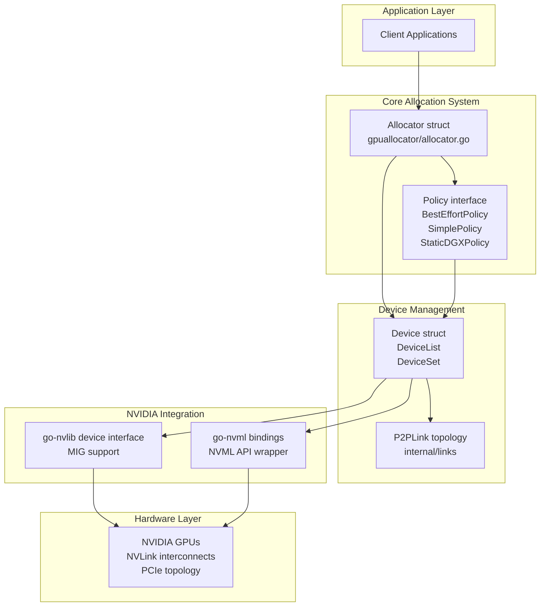
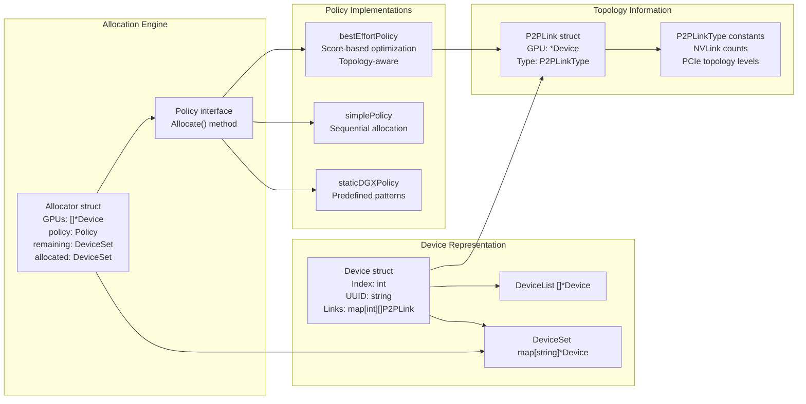
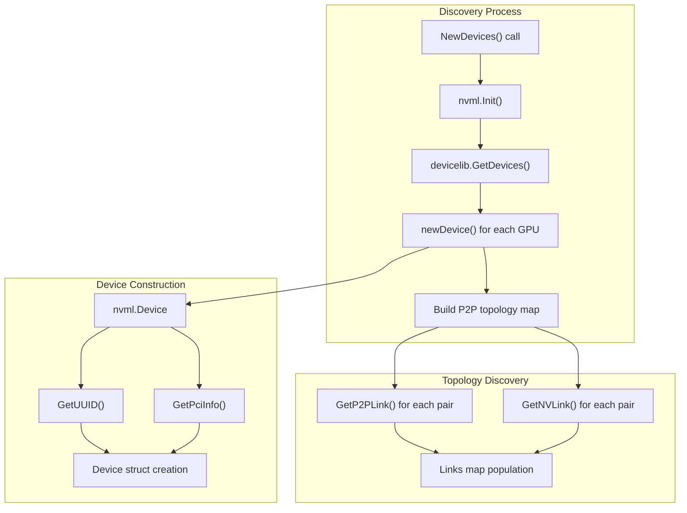
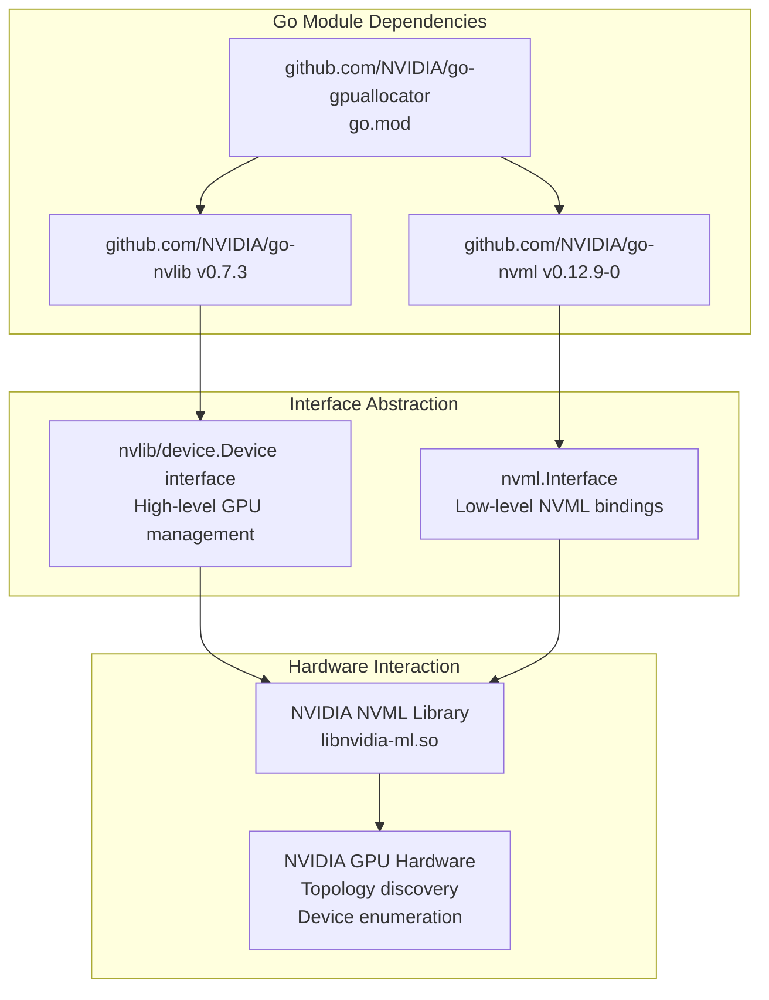

<!-- source: DeepWiki mcp.deepwiki.com · repo NVIDIA/go-gpuallocator · page 1 Overview · fetched 2026-10-26 -->

# Overview

Relevant source files

The following files were used as context for generating this wiki page:

- [go.mod](go.mod)
- [gpuallocator/allocator.go](gpuallocator/allocator.go)
- [gpuallocator/besteffort_policy.go](gpuallocator/besteffort_policy.go)
- [gpuallocator/device.go](gpuallocator/device.go)
- [internal/links/device.go](internal/links/device.go)

The go-gpuallocator repository provides an intelligent GPU resource allocation system designed for NVIDIA GPU environments. It implements topology-aware allocation policies that consider NVLink connectivity, PCIe hierarchy, and peer-to-peer communication capabilities to optimize GPU assignments for multi-GPU workloads.

This document covers the high-level system architecture and core components. For detailed information about specific subsystems, see [Device Discovery and Management](#2.1), [Allocation Policies](#2.2), [NVIDIA Integration Layer](#3), and [API Reference](#6).

## System Architecture

The go-gpuallocator system follows a layered architecture that abstracts hardware discovery through NVIDIA's NVML library and provides pluggable allocation policies:

Sources: [gpuallocator/allocator.go:1-123](), [gpuallocator/device.go:1-259](), [gpuallocator/besteffort_policy.go:1-399](), [internal/links/device.go:1-229]()

## Core Components

The system is built around several key components that work together to provide intelligent GPU allocation:

Sources: [gpuallocator/device.go:16-73](), [gpuallocator/allocator.go:12-32](), [gpuallocator/besteffort_policy.go:13-18](), [internal/links/device.go:26-57]()

## Device Discovery and Topology Mapping

The system discovers GPUs and maps their interconnect topology through NVIDIA's NVML library:

Sources: [gpuallocator/device.go:75-137](), [internal/links/device.go:115-201]()

## Allocation Workflow

The allocation process follows a clear workflow from request to GPU assignment:

| Stage | Component | Function | Purpose |
|-------|-----------|----------|---------|
| 1. Request | `Allocator` | `Allocate(num int)` | Client requests N GPUs |
| 2. Policy Selection | `Policy` interface | `Allocate(available, required, size)` | Apply allocation strategy |
| 3. Device Selection | Policy implementation | Score calculation/selection logic | Choose optimal GPU set |
| 4. State Update | `Allocator` | `AllocateSpecific()` | Move GPUs from remaining to allocated |
| 5. Return | `Allocator` | Return `[]*Device` | Provide allocated GPU list |

Sources: [gpuallocator/allocator.go:83-116]()

## Integration with NVIDIA Ecosystem

The system integrates with NVIDIA's software stack through well-defined interfaces:

Sources: [go.mod:1-17](), [gpuallocator/device.go:10-14]()

## Key Features

The go-gpuallocator system provides several important capabilities:

- **Topology-Aware Allocation**: Uses NVLink and PCIe topology information to optimize GPU selections for communication efficiency
- **Pluggable Policies**: Supports multiple allocation strategies through the `Policy` interface
- **Device State Management**: Tracks available and allocated GPUs through `DeviceSet` collections  
- **P2P Link Discovery**: Automatically discovers and maps inter-GPU communication links
- **NVML Integration**: Leverages NVIDIA's official management library for hardware interaction

For implementation details of these features, see [Core GPU Allocation System](#2), [NVIDIA Integration Layer](#3), and [API Reference](#6).

Sources: [gpuallocator/allocator.go:12-32](), [gpuallocator/besteffort_policy.go:20-95](), [internal/links/device.go:26-139]()

---

