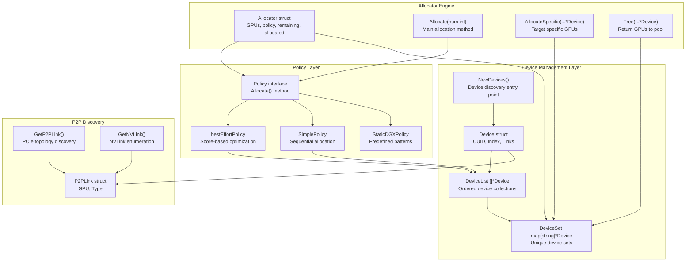
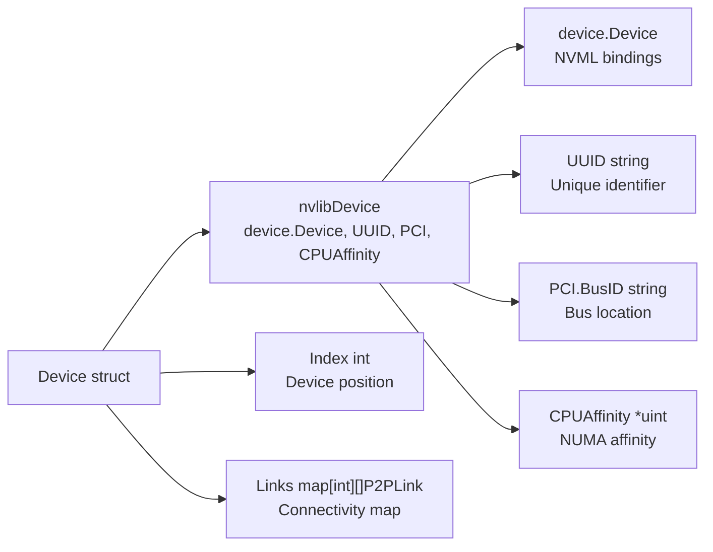
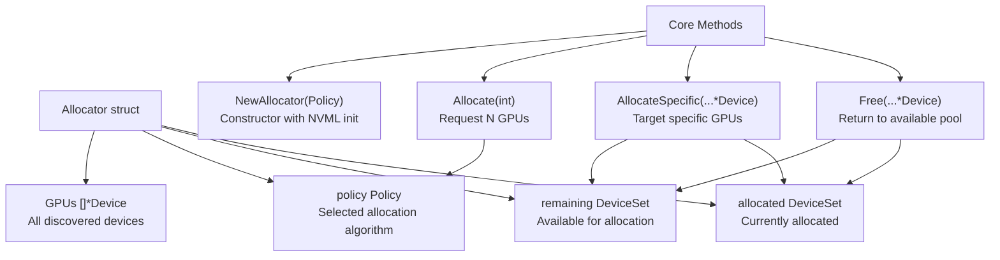
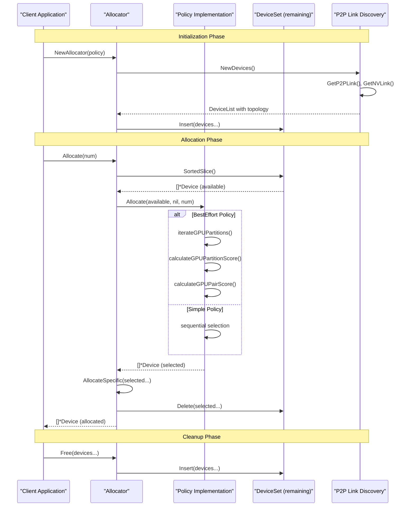

<!-- source: DeepWiki mcp.deepwiki.com · repo NVIDIA/go-gpuallocator · page 2 Core GPU Allocation System · fetched 2026-10-26 -->

# Core GPU Allocation System

Relevant source files

The following files were used as context for generating this wiki page:

- [gpuallocator/allocator.go](gpuallocator/allocator.go)
- [gpuallocator/besteffort_policy.go](gpuallocator/besteffort_policy.go)
- [gpuallocator/device.go](gpuallocator/device.go)
- [internal/links/device.go](internal/links/device.go)

This document covers the core components of the go-gpuallocator system that handle GPU device discovery, allocation policies, and resource management. The system provides intelligent NVIDIA GPU allocation based on topology-aware policies that consider P2P links, NVLinks, and GPU interconnectivity.

For NVIDIA integration details, see [NVIDIA Integration Layer](#3). For testing infrastructure, see [Testing Framework](#4). For public APIs, see [API Reference](#6).

## System Architecture

The Core GPU Allocation System consists of three primary components that work together to provide intelligent GPU resource allocation:

**Sources:** [gpuallocator/device.go:16-22](), [gpuallocator/device.go:69-73](), [gpuallocator/allocator.go:12-20](), [gpuallocator/allocator.go:22-32](), [gpuallocator/besteffort_policy.go:13-17](), [internal/links/device.go:64-67]()

## Core Components Overview

### Device Representation

The system uses a structured approach to represent GPU devices and their relationships:

| Component | Type | Purpose |
|-----------|------|---------|
| `Device` | `struct` | Individual GPU with P2P links and metadata |
| `DeviceList` | `[]*Device` | Ordered collections for iteration and filtering |
| `DeviceSet` | `map[string]*Device` | Set operations using UUID keys |
| `P2PLink` | `struct` | Point-to-point connectivity information |

The `Device` struct embeds an `nvlibDevice` which provides NVML integration while adding allocation-specific fields:

**Sources:** [gpuallocator/device.go:16-34](), [gpuallocator/device.go:64-67]()

### Policy System

The allocation system uses a pluggable policy architecture where different algorithms can be selected based on workload requirements:

| Policy | Implementation | Algorithm |
|--------|---------------|-----------|
| `Policy` | `interface` | Common allocation contract |
| `bestEffortPolicy` | Score-based | Optimizes total partition score |
| `SimplePolicy` | Sequential | First-available allocation |
| `StaticDGXPolicy` | Pattern-based | Predefined optimal configurations |

The `Policy` interface defines the allocation contract:
- `Allocate(available []*Device, required []*Device, size int) []*Device`

**Sources:** [gpuallocator/allocator.go:22-32](), [gpuallocator/besteffort_policy.go:13-17]()

### Allocator Engine

The `Allocator` struct maintains allocation state and coordinates between policies and device management:

**Sources:** [gpuallocator/allocator.go:12-20](), [gpuallocator/allocator.go:46-68](), [gpuallocator/allocator.go:83-122]()

## Allocation Data Flow

The following diagram shows how GPU allocation requests flow through the system components:

**Sources:** [gpuallocator/allocator.go:83-95](), [gpuallocator/allocator.go:97-116](), [gpuallocator/besteffort_policy.go:36-95](), [gpuallocator/device.go:75-136]()

## P2P Link Discovery System

The system discovers and categorizes GPU interconnectivity to enable topology-aware allocation:

```mermaid
graph TB
    subgraph "Link Types"
        P2PTypes["P2PLinkType enum"]
        CrossCPU["P2PLinkCrossCPU<br/>Score: 10"]
        SameCPU["P2PLinkSameCPU<br/>Score: 20"] 
        HostBridge["P2PLinkHostBridge<br/>Score: 30"]
        MultiSwitch["P2PLinkMultiSwitch<br/>Score: 40"]
        SingleSwitch["P2PLinkSingleSwitch<br/>Score: 50"]
        SameBoard["P2PLinkSameBoard<br/>Score: 60"]
    end
    
    subgraph "NVLink Types"
        NVLinkTypes["NVLink Link Counts"]
        Single["SingleNVLINKLink<br/>Score: 100"]
        Two["TwoNVLINKLinks<br/>Score: 200"]
        Multiple["...up to EighteenNVLINKLinks<br/>Score: 1800"]
    end
    
    subgraph "Discovery Functions"
        GetP2P["GetP2PLink(dev1, dev2)<br/>PCIe topology analysis"]
        GetNV["GetNVLink(dev1, dev2)<br/>NVLink enumeration"]
        CommonAncestor["GetTopologyCommonAncestor()<br/>NVML topology query"]
        NVLinkState["GetNvLinkState(linkId)<br/>Per-link status check"]
    end
    
    GetP2P --> CommonAncestor
    GetP2P --> CrossCPU
    GetP2P --> SameCPU
    GetP2P --> HostBridge
    GetNV --> NVLinkState
    GetNV --> Single
    GetNV --> Two
    GetNV --> Multiple
```

**Sources:** [internal/links/device.go:26-57](), [internal/links/device.go:115-139](), [internal/links/device.go:141-201](), [gpuallocator/besteffort_policy.go:298-374]()

## Integration Points

The Core GPU Allocation System integrates with several external components:

| Integration | Interface | Purpose |
|-------------|-----------|---------|
| NVML Library | `nvml.Interface` | Hardware device enumeration |
| go-nvlib | `device.Device` | High-level device operations |
| P2P Discovery | `links.GetP2PLink()` | Topology information |
| Testing Framework | Mock interfaces | Development and testing |

The system uses dependency injection through the `Option` pattern in `NewDevices()` to allow for flexible integration and testing scenarios.

**Sources:** [gpuallocator/device.go:75-89](), [gpuallocator/allocator.go:46-67](), [internal/links/device.go:115-139]()

---

