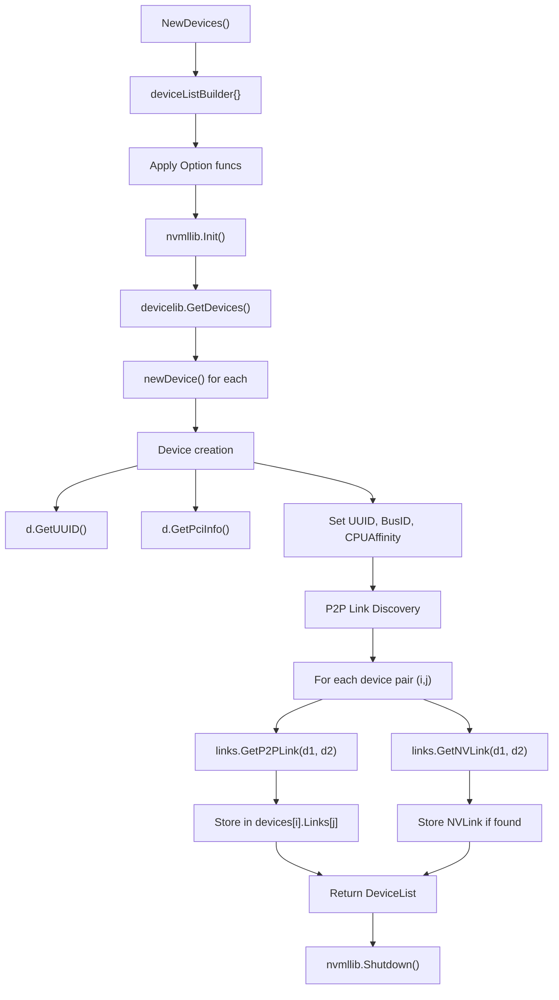
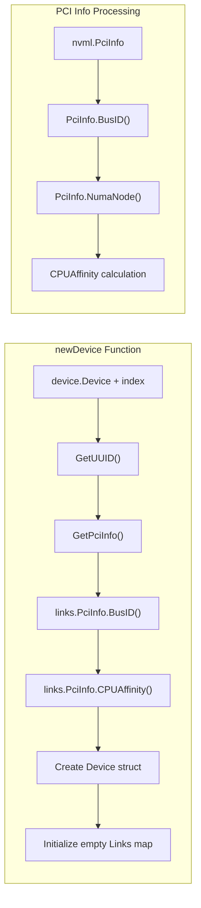
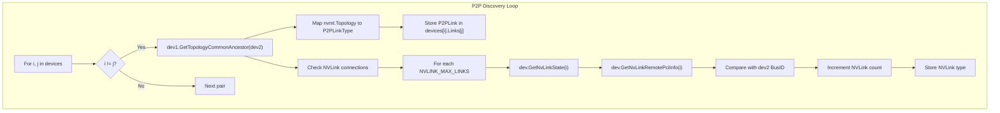
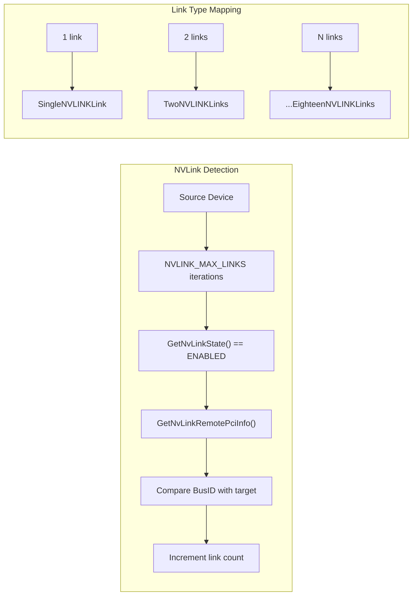
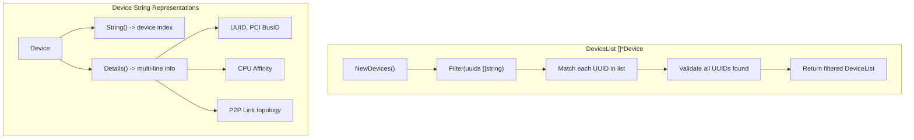
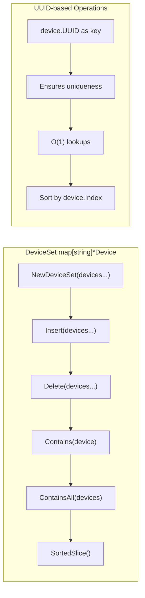
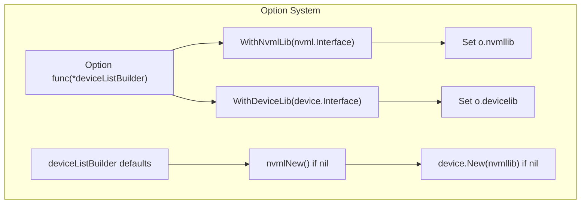
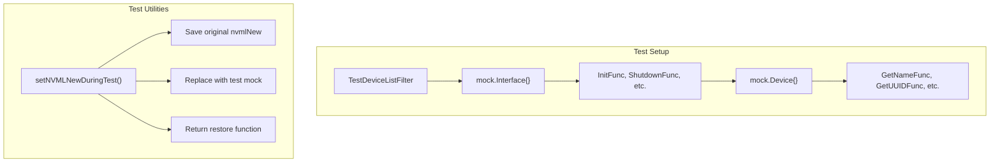

<!-- source: DeepWiki mcp.deepwiki.com · repo NVIDIA/go-gpuallocator · page 2.1 Device Discovery and Management · fetched 2026-10-26 -->

# Device Discovery and Management

<details>
<summary>Relevant source files</summary>

The following files were used as context for generating this wiki page:

- [gpuallocator/device.go](gpuallocator/device.go)
- [gpuallocator/device_test.go](gpuallocator/device_test.go)
- [gpuallocator/options.go](gpuallocator/options.go)
- [internal/links/device.go](internal/links/device.go)
- [internal/links/pciinfo.go](internal/links/pciinfo.go)

</details>


This document covers the GPU device discovery and management system within the go-gpuallocator codebase. It explains how the system enumerates NVIDIA GPUs, discovers their interconnection topology, and provides abstractions for device manipulation and filtering. The material focuses on the core device representation, discovery algorithms, and P2P link detection mechanisms.

For information about allocation policies that operate on discovered devices, see [Allocation Policies](#2.2). For details about the NVML integration layer, see [NVML Bindings](#3.1).

## Device Representation

The system represents GPU devices through a hierarchical structure that combines NVIDIA device information with topology data.

### Core Device Structure

```mermaid
graph TB
    Device["`Device`<br/>gpuallocator/device.go:18-22"] --> nvlibDevice["`nvlibDevice`<br/>Embedded struct"]
    Device --> Index["Index int<br/>Device position"]
    Device --> Links["Links map[int][]P2PLink<br/>P2P connections"]
    
    nvlibDevice --> NVLIBDevice["device.Device<br/>NVLIB interface"]
    nvlibDevice --> UUID["UUID string<br/>Cached device UUID"]
    nvlibDevice --> PCI["PCI struct<br/>BusID information"]
    nvlibDevice --> CPUAffinity["CPUAffinity *uint<br/>NUMA node affinity"]
    
    Links --> P2PLink["`P2PLink`<br/>gpuallocator/device.go:64-67"]
    P2PLink --> GPU["GPU *Device<br/>Target device"]
    P2PLink --> Type["Type links.P2PLinkType<br/>Connection type"]
```

The `Device` struct serves as the primary representation of a GPU device, embedding an `nvlibDevice` that wraps the NVLIB device interface along with cached properties for performance optimization.

**Sources:** [gpuallocator/device.go:16-34]()

### P2P Link Types

The system categorizes inter-GPU connections using a comprehensive enumeration of link types:

| Link Type | Description | NVML Mapping |
|-----------|-------------|--------------|
| `P2PLinkCrossCPU` | Cross-CPU connection | `nvml.TOPOLOGY_SYSTEM` |
| `P2PLinkSameCPU` | Same CPU, different sockets | `nvml.TOPOLOGY_NODE` |
| `P2PLinkHostBridge` | Connected via host bridge | `nvml.TOPOLOGY_HOSTBRIDGE` |
| `P2PLinkMultiSwitch` | Multiple PCIe switches | `nvml.TOPOLOGY_MULTIPLE` |
| `P2PLinkSingleSwitch` | Single PCIe switch | `nvml.TOPOLOGY_SINGLE` |
| `P2PLinkSameBoard` | Same board connection | `nvml.TOPOLOGY_INTERNAL` |
| `SingleNVLINKLink` to `EighteenNVLINKLinks` | NVLink connections (1-18) | NVLink enumeration |

**Sources:** [internal/links/device.go:26-57](), [internal/links/device.go:115-139]()

## Device Discovery Process

The device discovery system follows a multi-stage process to enumerate GPUs and build their connectivity graph.

### Discovery Flow



The `NewDevices` function orchestrates device discovery through the `deviceListBuilder.build()` method, which performs NVML initialization, device enumeration, and comprehensive P2P link discovery.

**Sources:** [gpuallocator/device.go:75-89](), [gpuallocator/device.go:92-137]()

### Device Construction



Each device undergoes construction through `newDevice`, which extracts essential properties from the NVML device handle and prepares the P2P link storage structure.

**Sources:** [gpuallocator/device.go:36-59](), [internal/links/pciinfo.go:32-74]()

## P2P Topology Discovery

The system performs comprehensive topology discovery to map inter-GPU connectivity patterns essential for optimal allocation decisions.

### Link Discovery Algorithm



The P2P discovery process operates on all device pairs, utilizing NVML's topology discovery APIs and NVLink enumeration to build a comprehensive connectivity graph.

**Sources:** [gpuallocator/device.go:114-134](), [internal/links/device.go:115-201]()

### NVLink Enumeration Details

The NVLink discovery process examines each possible NVLink connection and aggregates them into connection strength categories:



**Sources:** [internal/links/device.go:141-201](), [internal/links/device.go:203-228]()

## Device Management Collections

The system provides multiple collection types for different device management scenarios.

### DeviceList Operations



**Sources:** [gpuallocator/device.go:151-191]()

### DeviceSet Operations



`DeviceSet` provides UUID-based device management with fast lookup operations and guaranteed uniqueness, while maintaining the ability to produce sorted slices ordered by device index.

**Sources:** [gpuallocator/device.go:193-253]()

## Configuration and Options

The device discovery system supports configuration through functional options that control the underlying NVML and device library implementations.

### Option Pattern Implementation



The options pattern allows for dependency injection of NVML and device library implementations, enabling testing with mock interfaces and potential future library alternatives.

**Sources:** [gpuallocator/options.go:24-45](), [gpuallocator/device.go:255-258]()

## Testing Infrastructure

The device management system includes comprehensive testing infrastructure with mock NVML interfaces and device simulation capabilities.

### Mock Implementation Structure



**Sources:** [gpuallocator/device_test.go:27-93]()

The testing system provides comprehensive mocking capabilities that allow device discovery testing without physical GPU hardware, ensuring reliable unit tests for device enumeration and filtering operations.

---

