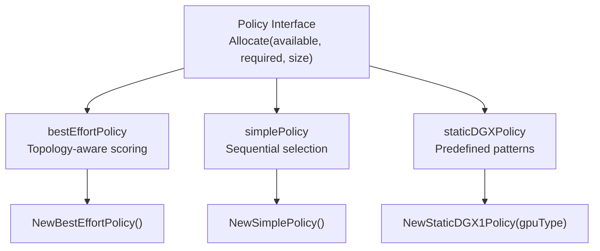
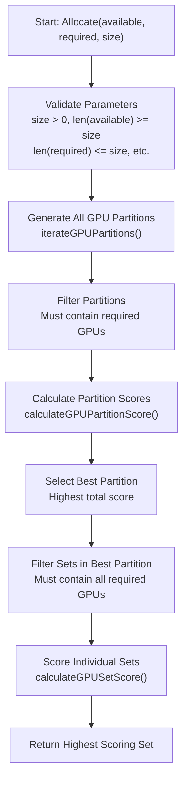
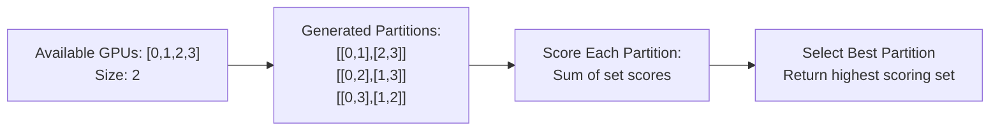
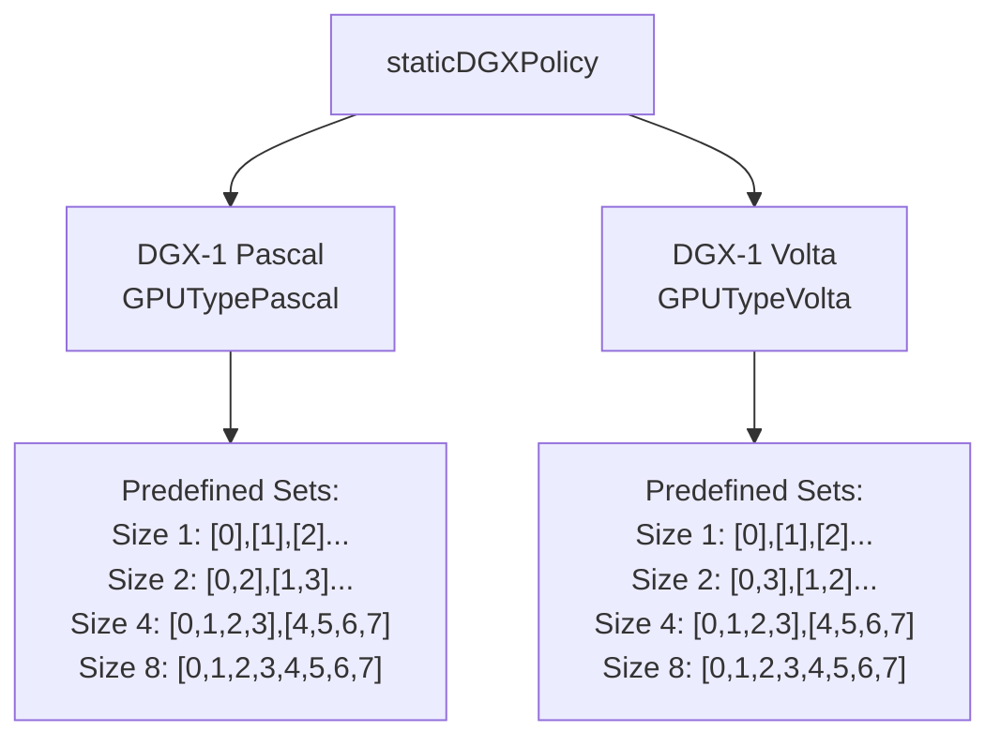
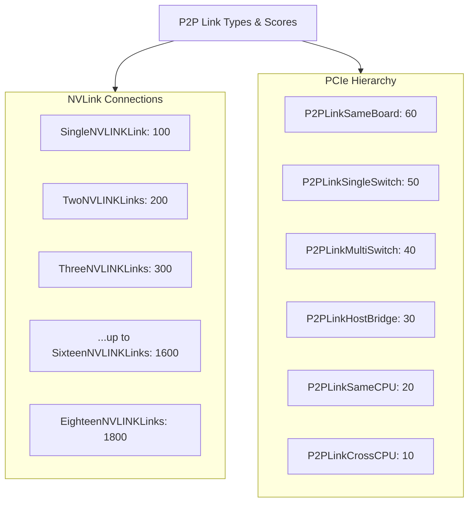
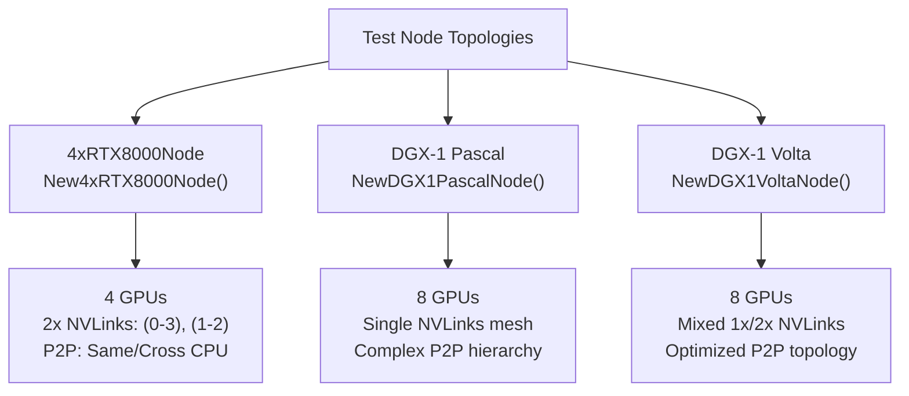

<!-- source: DeepWiki mcp.deepwiki.com · repo NVIDIA/go-gpuallocator · page 2.2 Allocation Policies · fetched 2026-10-26 -->

# Allocation Policies

Relevant source files

The following files were used as context for generating this wiki page:

- [gpuallocator/besteffort_policy.go](gpuallocator/besteffort_policy.go)
- [gpuallocator/besteffort_test.go](gpuallocator/besteffort_test.go)
- [gpuallocator/common_test.go](gpuallocator/common_test.go)
- [gpuallocator/simple_test.go](gpuallocator/simple_test.go)
- [gpuallocator/staticdgx_test.go](gpuallocator/staticdgx_test.go)

This document describes the GPU allocation policies implemented in the go-gpuallocator system. These policies determine how GPUs are selected from available devices when fulfilling allocation requests. The system provides three distinct allocation strategies: BestEffort (topology-aware optimization), Simple (sequential allocation), and StaticDGX (predefined patterns for DGX systems).

For information about device discovery and topology detection, see [Device Discovery and Management](#2.1). For details on the allocator engine that uses these policies, see [Allocator Engine](#2.3).

## Policy Interface

All allocation policies implement a common `Policy` interface that defines the contract for GPU selection algorithms.

**Sources:** [gpuallocator/besteffort_policy.go:16-18](), [gpuallocator/besteffort_test.go:30](), [gpuallocator/simple_test.go:11](), [gpuallocator/staticdgx_test.go:9]()

The `Policy` interface requires a single method:

| Method | Parameters | Return | Description |
|--------|------------|--------|-------------|
| `Allocate` | `available []*Device` `required []*Device` `size int` | `[]*Device` | Selects optimal GPU set from available devices |

## BestEffort Policy

The `bestEffortPolicy` implements a sophisticated topology-aware allocation algorithm that considers P2P connectivity, NVLinks, and PCIe hierarchy to optimize GPU placement for maximum inter-GPU communication bandwidth.

### Algorithm Overview

**Sources:** [gpuallocator/besteffort_policy.go:36-95]()

### Core Algorithm Functions

The BestEffort policy uses several key algorithmic components:

| Function | Purpose | Location |
|----------|---------|----------|
| `iterateGPUSets` | Generates all possible GPU combinations of specified size | [gpuallocator/besteffort_policy.go:161-210]() |
| `iterateGPUPartitions` | Partitions available GPUs into sets of specified size | [gpuallocator/besteffort_policy.go:215-296]() |
| `calculateGPUPairScore` | Computes link score between two GPUs | [gpuallocator/besteffort_policy.go:304-374]() |
| `calculateGPUSetScore` | Sums pairwise scores for entire GPU set | [gpuallocator/besteffort_policy.go:378-386]() |
| `calculateGPUPartitionScore` | Totals scores for all sets in partition | [gpuallocator/besteffort_policy.go:390-398]() |

### Partition Generation Strategy

The algorithm considers all possible ways to divide available GPUs into sets of the requested size. This ensures optimal global allocation rather than greedy local optimization.

**Sources:** [gpuallocator/besteffort_policy.go:25-35](), [gpuallocator/besteffort_policy.go:215-296]()

## Simple Policy

The Simple policy implements straightforward sequential allocation from available devices. It selects GPUs in order of their indices, ensuring required devices are included first.

### Simple Algorithm Behavior

| Scenario | Available | Required | Size | Result |
|----------|-----------|----------|------|--------|
| Basic allocation | `[0,1,2,3,4,5,6,7]` | `[]` | `4` | `[0,1,2,3]` |
| With required GPU | `[0,1,2,3,4,5,6,7]` | `[4]` | `2` | `[4,0]` |
| Required subset | `[0,1,2,3,4,5,6,7]` | `[0,2,4,6]` | `4` | `[0,2,4,6]` |

**Sources:** [gpuallocator/simple_test.go:9-129]()

## StaticDGX Policy

The StaticDGX policy implements predefined allocation patterns optimized for specific DGX system configurations. It supports different GPU types and uses hardcoded optimal sets.

### DGX Configuration Support

**Sources:** [gpuallocator/staticdgx_test.go:7-231]()

### Static DGX Allocation Patterns

The StaticDGX policy only supports specific allocation sizes and returns predefined optimal sets:

| GPU Type | Valid Sizes | Pattern Description |
|----------|-------------|---------------------|
| Pascal | 1, 2, 4, 8 | NVLink-optimized pairs and quads |
| Volta | 1, 2, 4, 8 | Enhanced NVLink topology awareness |
| Invalid | 0, 3, 5, 6, 7, 9+ | Returns empty allocation |

**Sources:** [gpuallocator/staticdgx_test.go:136-151](), [gpuallocator/staticdgx_test.go:216-231]()

## Link Scoring System

The BestEffort policy uses a comprehensive scoring system to evaluate GPU connectivity quality. Higher scores indicate better communication bandwidth and lower latency.

### P2P Link Type Scoring

**Sources:** [gpuallocator/besteffort_policy.go:320-371]()

### Scoring Calculation Process

The scoring system evaluates all pairwise connections within a GPU set:

| Component | Function | Calculation |
|-----------|----------|-------------|
| GPU Pair Score | `calculateGPUPairScore` | Sum of all link scores between two GPUs |
| GPU Set Score | `calculateGPUSetScore` | Sum of all pairwise scores in the set |
| Partition Score | `calculateGPUPartitionScore` | Sum of all set scores in partition |

**Sources:** [gpuallocator/besteffort_policy.go:304-398]()

## Test Infrastructure and Validation

The allocation policies are validated using comprehensive test topologies that simulate real hardware configurations.

### Test Node Configurations

**Sources:** [gpuallocator/common_test.go:141-408]()

### Policy Testing Framework

The system provides standardized test functions for validating policy behavior:

| Test Function | Purpose | Parameters |
|---------------|---------|------------|
| `RunPolicyAllocTests` | Tests policy allocation logic | `Policy`, `[]PolicyAllocTest` |
| `RunAllocTests` | Tests allocator with policy | `*Allocator`, `[]AllocTest` |
| `PolicyAllocTest` | Test case structure | `description`, `devices`, `available`, `required`, `size`, `result` |

**Sources:** [gpuallocator/common_test.go:25-32](), [gpuallocator/common_test.go:87-111](), [gpuallocator/common_test.go:63-85]()

---

