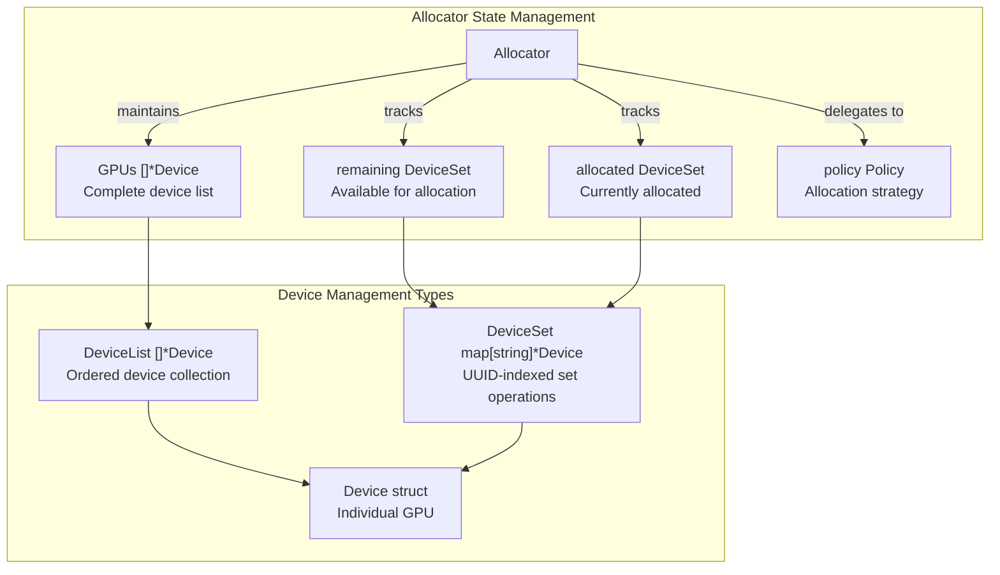
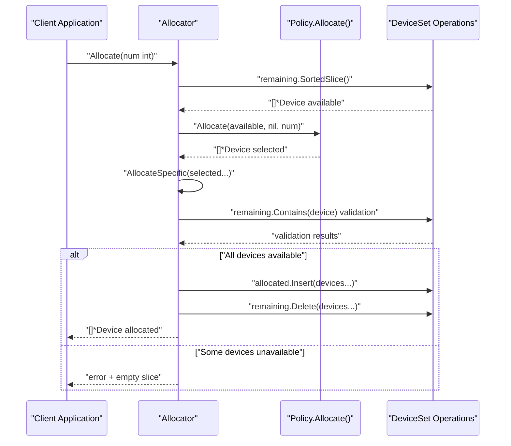
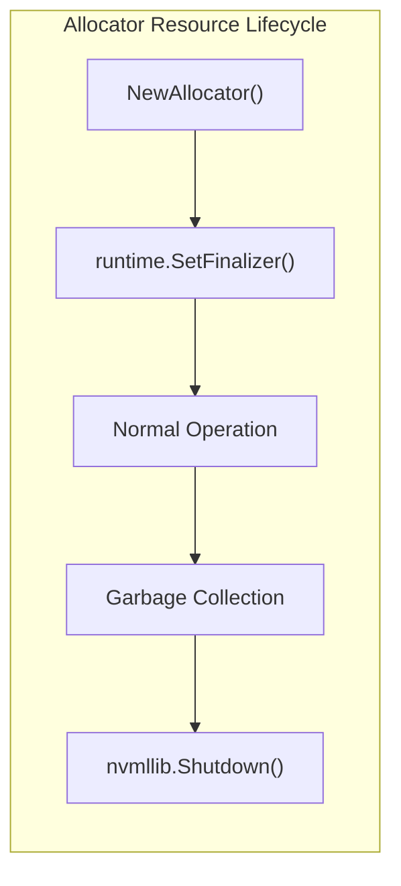

<!-- source: DeepWiki mcp.deepwiki.com · repo NVIDIA/go-gpuallocator · page 2.3 Allocator Engine · fetched 2026-10-26 -->

# Allocator Engine

<details>
<summary>Relevant source files</summary>

The following files were used as context for generating this wiki page:

- [gpuallocator/allocator.go](gpuallocator/allocator.go)
- [gpuallocator/device.go](gpuallocator/device.go)
- [internal/links/device.go](internal/links/device.go)

</details>


The Allocator Engine serves as the central orchestrator for GPU resource allocation within the go-gpuallocator system. It maintains state about available and allocated GPU devices, implements allocation and deallocation workflows, and provides a pluggable interface for different allocation policies. This component acts as the primary entry point for applications requesting GPU resources and coordinates with the device discovery system and allocation policies to fulfill those requests.

For information about GPU device discovery and topology management, see [Device Discovery and Management](#2.1). For details about specific allocation algorithms, see [Allocation Policies](#2.2).

## Core Architecture

The Allocator Engine is built around the `Allocator` struct which maintains GPU device state and coordinates allocation requests through a pluggable `Policy` interface.

### Allocator State Management



Sources: [gpuallocator/allocator.go:12-21](), [gpuallocator/device.go:69-73]()

The `Allocator` struct maintains three key collections:
- `GPUs`: Complete list of available GPU devices on the system
- `remaining`: Set of devices currently available for allocation
- `allocated`: Set of devices currently allocated to applications

### Policy Interface Architecture

```mermaid
graph TB
    subgraph PolicyInterface["Policy Interface"]
        P["Policy interface"] -->|"requires"| Allocate["Allocate(available, required, size)<br/>Returns []*Device"]
    end
    
    subgraph PolicyImplementations["Policy Implementations"]
        Simple["Simple Policy<br/>Sequential allocation"]
        BestEffort["BestEffort Policy<br/>Topology-aware scoring"]
        StaticDGX["StaticDGX Policy<br/>Predefined patterns"]
    end
    
    subgraph AllocatorConstructors["Allocator Constructors"]  
        NewSimpleAllocator["NewSimpleAllocator()"]
        NewBestEffortAllocator["NewBestEffortAllocator()"]
        NewAllocator["NewAllocator(policy)"]
    end
    
    P --> Simple
    P --> BestEffort  
    P --> StaticDGX
    
    NewSimpleAllocator --> Simple
    NewBestEffortAllocator --> BestEffort
    NewAllocator --> P
```

Sources: [gpuallocator/allocator.go:22-32](), [gpuallocator/allocator.go:34-47]()

## Allocation Workflow

The allocation process follows a well-defined sequence involving policy delegation, state validation, and atomic state updates.

### Allocation Process Flow



Sources: [gpuallocator/allocator.go:83-95](), [gpuallocator/allocator.go:97-116]()

### Deallocation Process

```mermaid
graph LR
    subgraph DeallocationFlow["Free(devices...)""]
        F1["Validate devices"] --> F2["remaining.Insert(devices...)"]
        F2 --> F3["allocated.Delete(devices...)"] 
        F3 --> F4["State updated atomically"]
    end
```

Sources: [gpuallocator/allocator.go:118-122]()

## Constructor Patterns and Initialization

The Allocator Engine provides multiple constructor patterns to support different initialization scenarios and policy configurations.

### Constructor Architecture

| Constructor | Purpose | Policy | NVML Management |
|------------|---------|---------|-----------------|
| `NewSimpleAllocator()` | Quick setup with sequential allocation | `Simple` | Automatic |
| `NewBestEffortAllocator()` | Topology-aware allocation | `BestEffort` | Automatic |  
| `NewAllocator(policy)` | Custom policy injection | User-provided | Automatic |
| `newAllocatorFrom(devices, policy)` | Testing with mock devices | User-provided | External |

Sources: [gpuallocator/allocator.go:34-47](), [gpuallocator/allocator.go:70-81]()

### Initialization Sequence

```mermaid
graph TB
    subgraph InitSequence["NewAllocator Initialization"]
        N1["nvml.New()"] --> N2["nvmllib.Init()"]
        N2 --> N3["NewDevices(WithNvmlLib)"]
        N3 --> N4["newAllocatorFrom(devices, policy)"]
        N4 --> N5["runtime.SetFinalizer(allocator)"]
    end
    
    subgraph StateSetup["newAllocatorFrom Setup"]  
        S1["Create Allocator struct"] --> S2["Initialize remaining DeviceSet"]
        S2 --> S3["Initialize allocated DeviceSet"]
        S3 --> S4["remaining.Insert(all devices)"]
    end
    
    N4 --> S1
```

Sources: [gpuallocator/allocator.go:47-68](), [gpuallocator/allocator.go:70-81]()

## Memory Management and Lifecycle

The Allocator Engine implements proper resource cleanup through Go's finalizer mechanism to ensure NVML library resources are properly released.

### Resource Management



Sources: [gpuallocator/allocator.go:62-66]()

The finalizer ensures that even if applications fail to properly clean up Allocator instances, the underlying NVML library resources will be released when the garbage collector runs.

## State Consistency Guarantees

The Allocator Engine maintains strict state consistency through atomic operations on `DeviceSet` collections and validation checks.

### State Invariants

- **Partitioning**: Every device in `GPUs` exists in exactly one of `remaining` or `allocated` sets
- **UUID Uniqueness**: `DeviceSet` operations use UUID keys to prevent duplicate device tracking
- **Allocation Atomicity**: `AllocateSpecific` either succeeds completely or fails with no state changes
- **Validation**: All allocation requests validate device availability before state modification

Sources: [gpuallocator/allocator.go:99-116](), [gpuallocator/device.go:194-237]()

The engine's design ensures that concurrent access patterns and error conditions cannot corrupt the internal state or lead to double-allocation of GPU resources.

---

