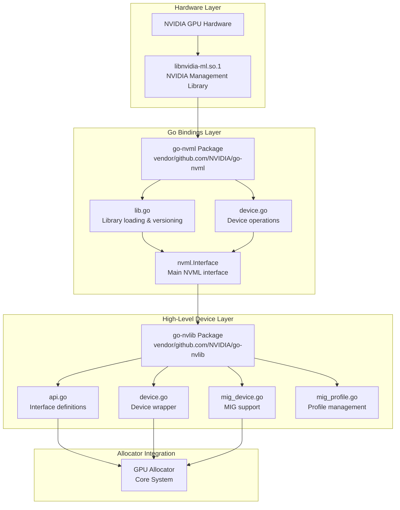
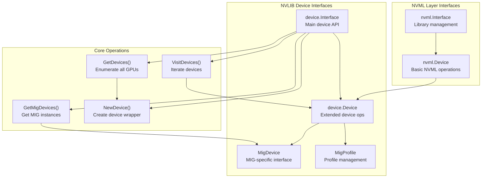
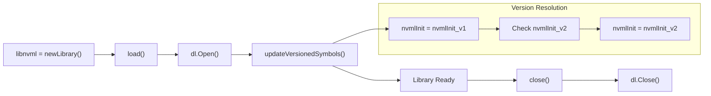
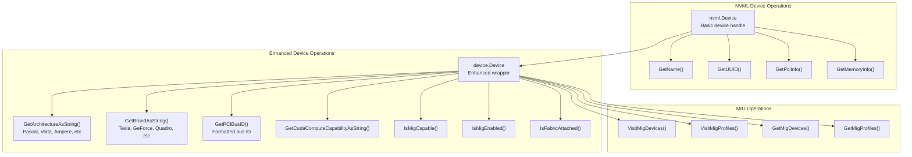
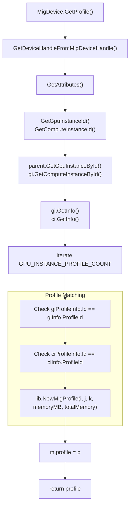
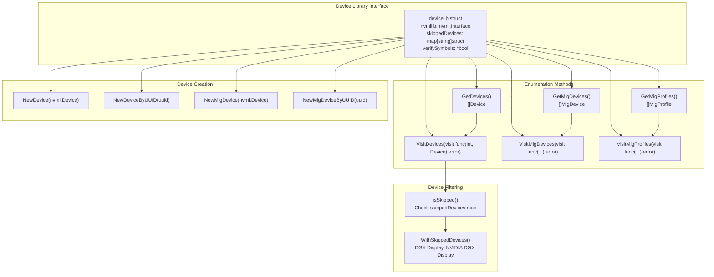

<!-- source: DeepWiki mcp.deepwiki.com · repo NVIDIA/go-gpuallocator · page 3 NVIDIA Integration Layer · fetched 2026-10-26 -->

# NVIDIA Integration Layer

Relevant source files

The following files were used as context for generating this wiki page:

- [vendor/github.com/NVIDIA/go-nvlib/pkg/nvlib/device/api.go](vendor/github.com/NVIDIA/go-nvlib/pkg/nvlib/device/api.go)
- [vendor/github.com/NVIDIA/go-nvlib/pkg/nvlib/device/device.go](vendor/github.com/NVIDIA/go-nvlib/pkg/nvlib/device/device.go)
- [vendor/github.com/NVIDIA/go-nvlib/pkg/nvlib/device/mig_device.go](vendor/github.com/NVIDIA/go-nvlib/pkg/nvlib/device/mig_device.go)
- [vendor/github.com/NVIDIA/go-nvlib/pkg/nvlib/device/mig_profile.go](vendor/github.com/NVIDIA/go-nvlib/pkg/nvlib/device/mig_profile.go)
- [vendor/github.com/NVIDIA/go-nvml/pkg/nvml/device.go](vendor/github.com/NVIDIA/go-nvml/pkg/nvml/device.go)
- [vendor/github.com/NVIDIA/go-nvml/pkg/nvml/lib.go](vendor/github.com/NVIDIA/go-nvml/pkg/nvml/lib.go)

The NVIDIA Integration Layer provides the essential bridge between the go-gpuallocator system and NVIDIA's hardware management libraries. This layer abstracts NVIDIA's low-level NVML (NVIDIA Management Library) and provides high-level device interfaces for GPU enumeration, topology discovery, and Multi-Instance GPU (MIG) management.

For information about how devices are discovered and managed by the allocator, see [Device Discovery and Management](#2.1). For details about the testing infrastructure that mocks these interfaces, see [Mock System](#3.4).

## Architecture Overview

The NVIDIA Integration Layer consists of two primary abstraction levels that work together to provide seamless hardware interaction:

**Integration Layer Architecture**

Sources: [vendor/github.com/NVIDIA/go-nvml/pkg/nvml/lib.go:1-297](), [vendor/github.com/NVIDIA/go-nvml/pkg/nvml/device.go:1-100](), [vendor/github.com/NVIDIA/go-nvlib/pkg/nvlib/device/api.go:1-91]()

## Core Interface Hierarchy

The integration layer exposes device functionality through a well-defined interface hierarchy that progressively adds capabilities:

**Device Interface Relationships**

Sources: [vendor/github.com/NVIDIA/go-nvlib/pkg/nvlib/device/api.go:23-38](), [vendor/github.com/NVIDIA/go-nvlib/pkg/nvlib/device/device.go:26-40](), [vendor/github.com/NVIDIA/go-nvlib/pkg/nvlib/device/mig_device.go:25-29]()

## Library Loading and Version Management

The NVML library loading system handles dynamic library management and API versioning through a sophisticated abstraction:

| Component | Responsibility | Key Types |
|-----------|---------------|-----------|
| `library` struct | Library lifecycle management | `path`, `refcount`, `dl` |
| `dynamicLibrary` interface | Library loading abstraction | `Open()`, `Close()`, `Lookup()` |
| Version symbol resolution | API compatibility | `updateVersionedSymbols()` |

**Library Loading Flow**

Sources: [vendor/github.com/NVIDIA/go-nvml/pkg/nvml/lib.go:58-86](), [vendor/github.com/NVIDIA/go-nvml/pkg/nvml/lib.go:103-123](), [vendor/github.com/NVIDIA/go-nvml/pkg/nvml/lib.go:201-296]()

## Device Abstraction and Enhancement

The `nvlib` layer wraps NVML devices with additional functionality for GPU allocation use cases:

**Device Wrapper Architecture**

Sources: [vendor/github.com/NVIDIA/go-nvlib/pkg/nvlib/device/device.go:42-66](), [vendor/github.com/NVIDIA/go-nvlib/pkg/nvlib/device/device.go:69-100](), [vendor/github.com/NVIDIA/go-nvlib/pkg/nvlib/device/device.go:182-261]()

## MIG (Multi-Instance GPU) Support

The integration layer provides comprehensive MIG support through specialized interfaces for managing GPU partitioning:

| MIG Component | Purpose | Key Methods |
|--------------|---------|-------------|
| `MigDevice` | Individual MIG instance management | `GetProfile()`, NVML device operations |
| `MigProfile` | MIG configuration profiles | `String()`, `Matches()`, `GetInfo()` |
| `MigProfileInfo` | Profile specifications | `C`, `G`, `GB`, `Attributes` |

**MIG Profile Resolution Process**

Sources: [vendor/github.com/NVIDIA/go-nvlib/pkg/nvlib/device/mig_device.go:60-157](), [vendor/github.com/NVIDIA/go-nvlib/pkg/nvlib/device/mig_profile.go:34-41](), [vendor/github.com/NVIDIA/go-nvlib/pkg/nvlib/device/mig_profile.go:57-120]()

## Device Discovery and Enumeration

The integration layer provides multiple patterns for device access, supporting both individual device operations and bulk enumeration:

**Device Enumeration Patterns**

Sources: [vendor/github.com/NVIDIA/go-nvlib/pkg/nvlib/device/api.go:40-68](), [vendor/github.com/NVIDIA/go-nvlib/pkg/nvlib/device/device.go:412-505](), [vendor/github.com/NVIDIA/go-nvlib/pkg/nvlib/device/device.go:398-410]()

## Symbol Verification and Error Handling

The integration layer includes robust error handling and optional symbol verification for improved compatibility across different NVIDIA driver versions:

| Feature | Implementation | Purpose |
|---------|---------------|---------|
| Symbol lookup | `LookupSymbol(name string)` | Verify API availability before use |
| Symbol verification | `hasSymbol(symbol string)` | Check function existence |
| Error handling | NVML return codes | Consistent error propagation |
| Version handling | `updateVersionedSymbols()` | API version compatibility |

The `devicelib` can be configured with `WithVerifySymbols(false)` to skip symbol verification in environments where all symbols are assumed to exist.

Sources: [vendor/github.com/NVIDIA/go-nvml/pkg/nvml/lib.go:92-99](), [vendor/github.com/NVIDIA/go-nvlib/pkg/nvlib/device/device.go:542-551](), [vendor/github.com/NVIDIA/go-nvlib/pkg/nvlib/device/api.go:70-75]()

---

