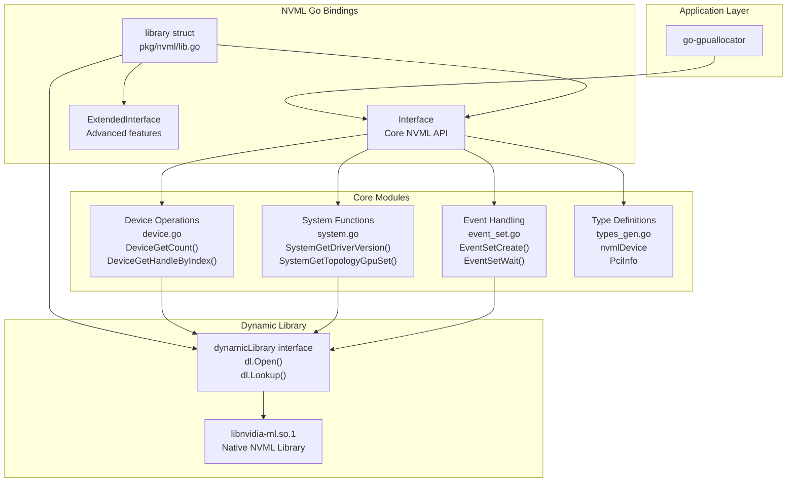
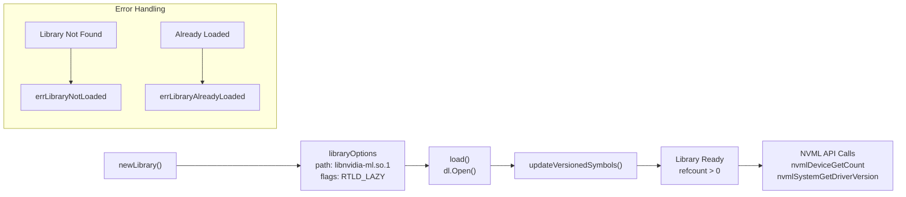
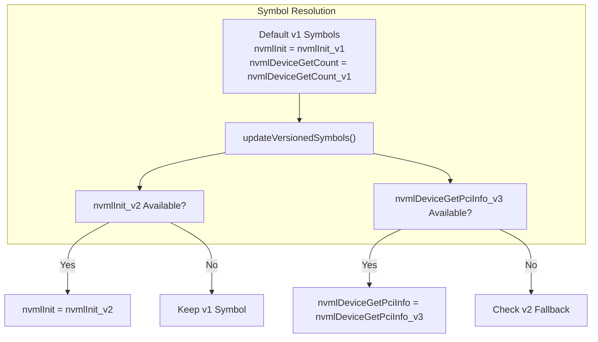
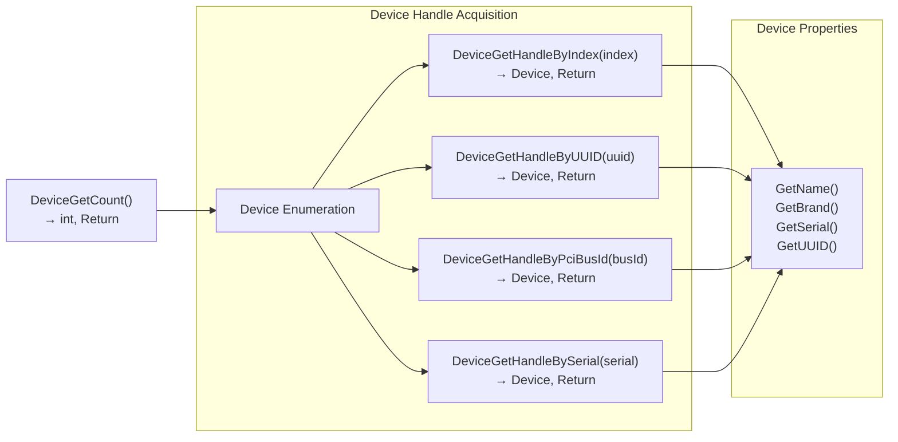
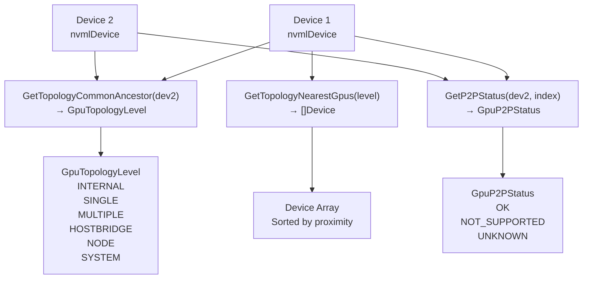
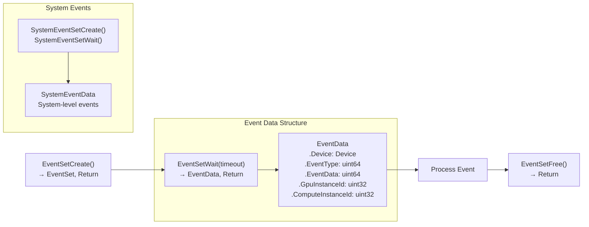
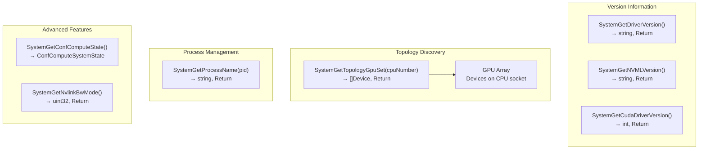
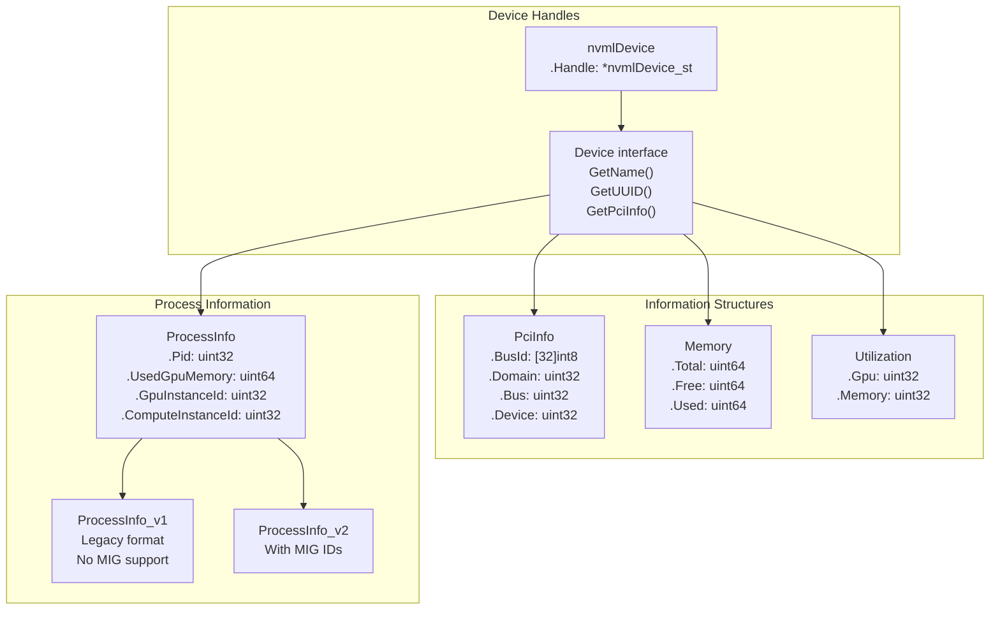
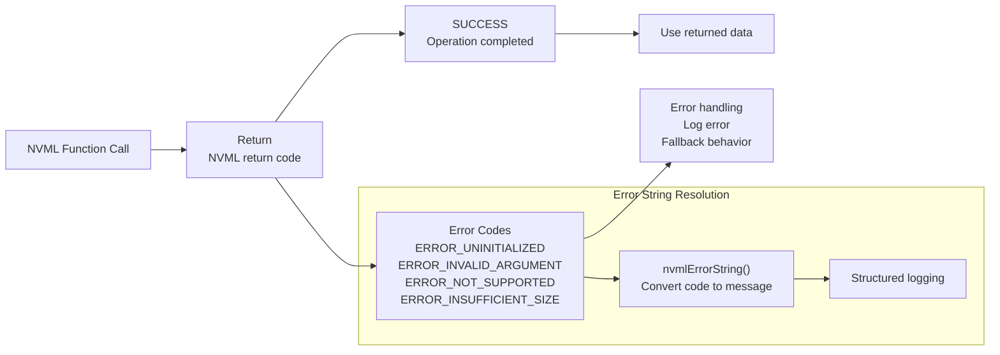

<!-- source: DeepWiki mcp.deepwiki.com · repo NVIDIA/go-gpuallocator · page 3.1 NVML Bindings · fetched 2026-10-26 -->

# NVML Bindings

Relevant source files

The following files were used as context for generating this wiki page:

- [vendor/github.com/NVIDIA/go-nvml/pkg/nvml/device.go](vendor/github.com/NVIDIA/go-nvml/pkg/nvml/device.go)
- [vendor/github.com/NVIDIA/go-nvml/pkg/nvml/event_set.go](vendor/github.com/NVIDIA/go-nvml/pkg/nvml/event_set.go)
- [vendor/github.com/NVIDIA/go-nvml/pkg/nvml/lib.go](vendor/github.com/NVIDIA/go-nvml/pkg/nvml/lib.go)
- [vendor/github.com/NVIDIA/go-nvml/pkg/nvml/nvml.go](vendor/github.com/NVIDIA/go-nvml/pkg/nvml/nvml.go)
- [vendor/github.com/NVIDIA/go-nvml/pkg/nvml/system.go](vendor/github.com/NVIDIA/go-nvml/pkg/nvml/system.go)
- [vendor/github.com/NVIDIA/go-nvml/pkg/nvml/types_gen.go](vendor/github.com/NVIDIA/go-nvml/pkg/nvml/types_gen.go)

This page documents the low-level NVIDIA Management Library (NVML) Go bindings that provide direct access to NVIDIA GPU hardware and driver functionality. These bindings form the foundation layer for GPU discovery, monitoring, and management operations within the go-gpuallocator system.

For high-level device interfaces and MIG support, see [NVLIB Device Interface](#3.2). For specialized GPU performance monitoring and error handling features, see [Advanced NVML Features](#3.3).

## Library Architecture

The NVML bindings provide a Go wrapper around NVIDIA's native NVML C library through dynamic loading and CGo interfaces. The architecture consists of several key components that handle library lifecycle, device operations, and event management.

**Sources**: [vendor/github.com/NVIDIA/go-nvml/pkg/nvml/lib.go:40-90](), [vendor/github.com/NVIDIA/go-nvml/pkg/nvml/device.go:1-50](), [vendor/github.com/NVIDIA/go-nvml/pkg/nvml/system.go:1-30](), [vendor/github.com/NVIDIA/go-nvml/pkg/nvml/event_set.go:1-40]()

## Dynamic Library Management

The NVML bindings use dynamic library loading to interface with the native NVIDIA libraries. The `library` struct manages the lifecycle and provides versioned symbol resolution for backward compatibility.

### Library Loading Process

**Core Library Structure**:

| Component | Purpose | Key Functions |
|-----------|---------|---------------|
| `library` struct | Main library wrapper | `load()`, `close()`, `LookupSymbol()` |
| `dynamicLibrary` interface | Abstract library operations | `Open()`, `Close()`, `Lookup()` |
| `refcount` | Reference counting | `IncOnNoError()`, `DecOnNoError()` |

**Sources**: [vendor/github.com/NVIDIA/go-nvml/pkg/nvml/lib.go:47-86](), [vendor/github.com/NVIDIA/go-nvml/pkg/nvml/lib.go:103-145]()

### Versioned Symbol Management

The NVML library handles multiple API versions through dynamic symbol resolution. This enables compatibility across different NVIDIA driver versions.

**Key Versioned Functions**:
- `nvmlInit`: v1, v2
- `nvmlDeviceGetPciInfo`: v1, v2, v3  
- `nvmlDeviceGetCount`: v1, v2
- `nvmlEventSetWait`: v1, v2
- `nvmlComputeInstanceGetInfo`: v1, v2

**Sources**: [vendor/github.com/NVIDIA/go-nvml/pkg/nvml/lib.go:147-296](), [vendor/github.com/NVIDIA/go-nvml/pkg/nvml/lib.go:201-295]()

## Device Management

The device module provides comprehensive GPU device discovery, property querying, and management capabilities. All device operations are accessed through the `Device` interface.

### Device Discovery and Enumeration

**Core Device Operations**:

| Function | Purpose | Return Type |
|----------|---------|-------------|
| `DeviceGetCount()` | Get total GPU count | `int, Return` |
| `DeviceGetHandleByIndex()` | Get device by index | `Device, Return` |
| `DeviceGetName()` | Get device name | `string, Return` |
| `DeviceGetUUID()` | Get device UUID | `string, Return` |
| `DeviceGetPciInfo()` | Get PCI information | `PciInfo, Return` |

**Sources**: [vendor/github.com/NVIDIA/go-nvml/pkg/nvml/device.go:102-141](), [vendor/github.com/NVIDIA/go-nvml/pkg/nvml/device.go:144-294]()

### Device Topology and P2P Discovery

The NVML bindings provide topology discovery capabilities essential for GPU allocation decisions.

**Sources**: [vendor/github.com/NVIDIA/go-nvml/pkg/nvml/device.go:241-283](), [vendor/github.com/NVIDIA/go-nvml/pkg/nvml/device.go:255-272]()

## Event Handling

The NVML event system provides asynchronous notification of GPU state changes, errors, and thermal events.

### Event Set Management

**Event Types Include**:
- Single bit ECC errors
- Double bit ECC errors  
- PCIe replay counter errors
- Critical thermal events
- Power limit violations
- Clock changes

**Sources**: [vendor/github.com/NVIDIA/go-nvml/pkg/nvml/event_set.go:37-82](), [vendor/github.com/NVIDIA/go-nvml/pkg/nvml/event_set.go:17-35]()

## System Functions

System-level NVML functions provide driver and system-wide GPU information required for allocation decisions.

### System Information API

**Key System Functions**:

| Function | Purpose | Return |
|----------|---------|--------|
| `SystemGetDriverVersion()` | Get NVIDIA driver version | `string, Return` |
| `SystemGetTopologyGpuSet()` | Get GPUs for CPU socket | `[]Device, Return` |
| `SystemGetProcessName()` | Get process name by PID | `string, Return` |
| `SystemGetConfComputeState()` | Get confidential compute state | `ConfComputeSystemState, Return` |

**Sources**: [vendor/github.com/NVIDIA/go-nvml/pkg/nvml/system.go:17-149](), [vendor/github.com/NVIDIA/go-nvml/pkg/nvml/system.go:68-88]()

## Type System

The NVML bindings define comprehensive type structures for GPU information, generated from the native NVML headers.

### Core Device Types

**Key Type Categories**:

| Category | Core Types | Purpose |
|----------|------------|---------|
| Device Handles | `nvmlDevice`, `Device` | GPU device references |
| Hardware Info | `PciInfo`, `Memory`, `Utilization` | Hardware properties |
| Process Info | `ProcessInfo`, `ProcessInfo_v1/_v2` | Process monitoring |
| Events | `EventData`, `EventSet` | Event handling |
| System Info | `ConfComputeSystemState`, `HwbcEntry` | System-level data |

**Sources**: [vendor/github.com/NVIDIA/go-nvml/pkg/nvml/types_gen.go:8-100](), [vendor/github.com/NVIDIA/go-nvml/pkg/nvml/types_gen.go:40-99](), [vendor/github.com/NVIDIA/go-nvml/pkg/nvml/device.go:63-99]()

## Library Integration Patterns

The NVML bindings integrate with the broader go-gpuallocator system through well-defined patterns for error handling, resource management, and concurrent access.

### Error Handling and Return Codes

**Common Return Codes**:
- `SUCCESS`: Operation completed successfully
- `ERROR_UNINITIALIZED`: NVML not initialized
- `ERROR_INVALID_ARGUMENT`: Invalid parameter
- `ERROR_NOT_SUPPORTED`: Feature not supported
- `ERROR_INSUFFICIENT_SIZE`: Buffer too small

**Sources**: [vendor/github.com/NVIDIA/go-nvml/pkg/nvml/lib.go:116-122](), [vendor/github.com/NVIDIA/go-nvml/pkg/nvml/lib.go:141-144]()

---

