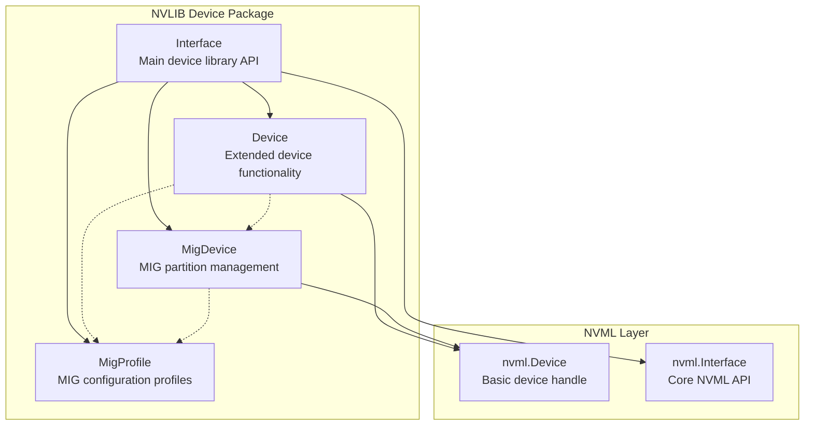
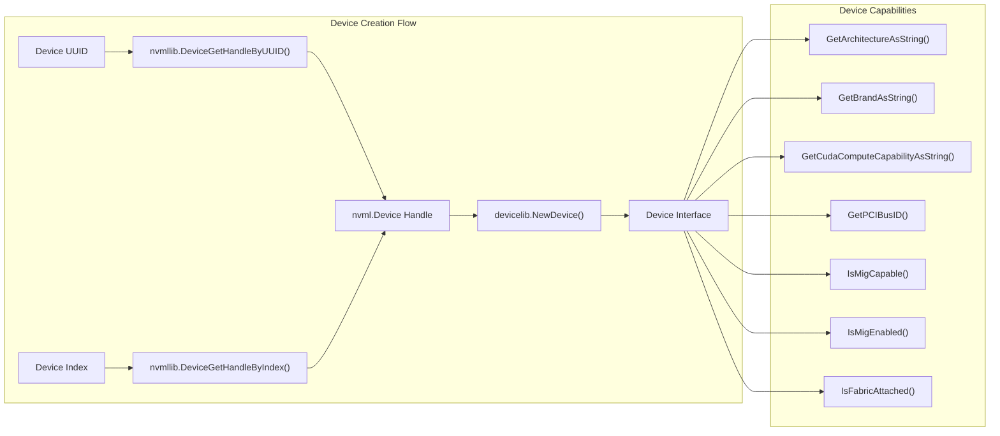
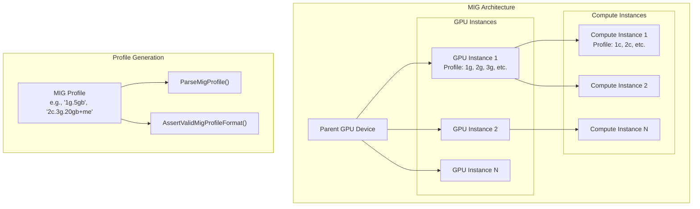
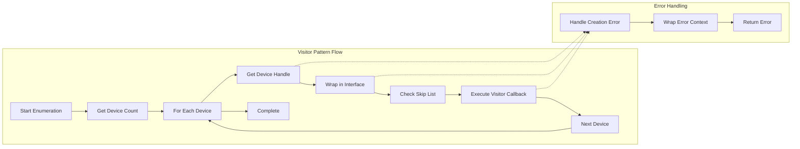

<!-- source: DeepWiki mcp.deepwiki.com · repo NVIDIA/go-gpuallocator · page 3.2 NVLIB Device Interface · fetched 2026-10-26 -->

# NVLIB Device Interface

Relevant source files

The following files were used as context for generating this wiki page:

- [vendor/github.com/NVIDIA/go-nvlib/pkg/nvlib/device/api.go](vendor/github.com/NVIDIA/go-nvlib/pkg/nvlib/device/api.go)
- [vendor/github.com/NVIDIA/go-nvlib/pkg/nvlib/device/device.go](vendor/github.com/NVIDIA/go-nvlib/pkg/nvlib/device/device.go)
- [vendor/github.com/NVIDIA/go-nvlib/pkg/nvlib/device/mig_device.go](vendor/github.com/NVIDIA/go-nvlib/pkg/nvlib/device/mig_device.go)
- [vendor/github.com/NVIDIA/go-nvlib/pkg/nvlib/device/mig_profile.go](vendor/github.com/NVIDIA/go-nvlib/pkg/nvlib/device/mig_profile.go)
- [vendor/github.com/NVIDIA/go-nvml/pkg/dl/dl.go](vendor/github.com/NVIDIA/go-nvml/pkg/dl/dl.go)
- [vendor/github.com/NVIDIA/go-nvml/pkg/nvml/api.go](vendor/github.com/NVIDIA/go-nvml/pkg/nvml/api.go)
- [vendor/github.com/NVIDIA/go-nvml/pkg/nvml/return.go](vendor/github.com/NVIDIA/go-nvml/pkg/nvml/return.go)

The NVLIB Device Interface provides a high-level abstraction layer over NVIDIA's NVML library for GPU device management. This interface extends basic NVML functionality with enhanced device enumeration, MIG (Multi-Instance GPU) support, profile management, and convenience methods for common GPU operations.

For low-level NVML bindings and direct hardware interaction, see [NVML Bindings](#3.1). For mock implementations used in testing, see [Mock System](#3.4).

## Overview

The NVLIB device interface is built around a layered architecture that provides progressively higher-level abstractions over raw NVML functionality. The system centers on three main interface types: `Interface` for library-level operations, `Device` for individual GPU management, and `MigDevice` for MIG partition handling.

**Core Interface Relationships**
Sources: [vendor/github.com/NVIDIA/go-nvlib/pkg/nvlib/device/api.go:23-38](), [vendor/github.com/NVIDIA/go-nvlib/pkg/nvlib/device/device.go:26-40](), [vendor/github.com/NVIDIA/go-nvlib/pkg/nvlib/device/mig_device.go:25-29]()

## Main Device Interface

The `Interface` type serves as the primary entry point for all device operations. It provides factory methods for creating device objects, enumeration functions, and visitor patterns for processing multiple devices.

| Method Category | Methods | Purpose |
|---|---|---|
| Device Creation | `NewDevice()`, `NewDeviceByUUID()` | Create `Device` objects from NVML handles or UUIDs |
| MIG Device Creation | `NewMigDevice()`, `NewMigDeviceByUUID()` | Create `MigDevice` objects for MIG partitions |
| Enumeration | `GetDevices()`, `GetMigDevices()`, `GetMigProfiles()` | Retrieve collections of devices and profiles |
| Visitor Patterns | `VisitDevices()`, `VisitMigDevices()`, `VisitMigProfiles()` | Process devices with callback functions |
| Profile Management | `NewMigProfile()`, `ParseMigProfile()`, `AssertValidMigProfileFormat()` | Create and validate MIG profiles |

**Library Configuration Options**

The device library supports configuration through functional options:

- `WithVerifySymbols(bool)`: Controls whether to verify NVML symbols exist before calling them
- `WithSkippedDevices(...string)`: Specifies device model names to skip during enumeration

Sources: [vendor/github.com/NVIDIA/go-nvlib/pkg/nvlib/device/api.go:70-87]()

## Device Management

The `Device` interface extends `nvml.Device` with additional functionality for device information retrieval, MIG management, and topology awareness.

**Device Information Retrieval**
Sources: [vendor/github.com/NVIDIA/go-nvlib/pkg/nvlib/device/device.go:413-443](), [vendor/github.com/NVIDIA/go-nvlib/pkg/nvlib/device/device.go:50-67]()

### Extended Device Properties

The `Device` interface provides string-based accessors for common device properties:

**Architecture Mapping**: Converts NVML architecture constants to human-readable strings including "Kepler", "Maxwell", "Pascal", "Volta", "Turing", "Ampere", "Ada Lovelace", "Hopper", "Blackwell", and "Orin".

**Brand Mapping**: Translates device brands such as "GeForce", "Tesla", "Quadro", "RTX", and various virtualization brands.

**PCI Bus ID Processing**: Extracts and formats PCI bus identifiers, handling domain prefixes and case normalization.

Sources: [vendor/github.com/NVIDIA/go-nvlib/pkg/nvlib/device/device.go:69-100](), [vendor/github.com/NVIDIA/go-nvlib/pkg/nvlib/device/device.go:102-148](), [vendor/github.com/NVIDIA/go-nvlib/pkg/nvlib/device/device.go:150-171]()

## MIG Support

Multi-Instance GPU (MIG) functionality provides partitioning capabilities for supported NVIDIA GPUs. The interface includes MIG device enumeration, profile management, and validation.

**MIG Profile Management**
Sources: [vendor/github.com/NVIDIA/go-nvlib/pkg/nvlib/device/mig_profile.go:122-142](), [vendor/github.com/NVIDIA/go-nvlib/pkg/nvlib/device/mig_profile.go:34-41]()

### MIG Device Operations

The `MigDevice` interface extends basic device functionality with MIG-specific operations:

**Profile Retrieval**: The `GetProfile()` method performs complex profile resolution by querying parent device information, GPU Instance and Compute Instance details, and matching against available profile configurations.

**Profile Matching**: Profiles are matched by iterating through GPU Instance profile counts (`nvml.GPU_INSTANCE_PROFILE_COUNT`) and Compute Instance configurations to find matching IDs.

Sources: [vendor/github.com/NVIDIA/go-nvlib/pkg/nvlib/device/mig_device.go:60-157]()

### MIG Profile Format

MIG profiles follow a structured naming convention:
- Basic format: `{G}g.{GB}gb` (e.g., "1g.5gb", "3g.20gb")  
- Compute-specific: `{C}c.{G}g.{GB}gb` (e.g., "2c.3g.20gb")
- With attributes: `{profile}+{attr1},{attr2}` (e.g., "1g.5gb+me")

The profile parser validates format correctness, attribute uniqueness, and field constraints through `parseMigProfile()`, `parseMigProfileFields()`, and `parseMigProfileAttributes()`.

Sources: [vendor/github.com/NVIDIA/go-nvlib/pkg/nvlib/device/mig_profile.go:213-240](), [vendor/github.com/NVIDIA/go-nvlib/pkg/nvlib/device/mig_profile.go:242-321]()

## API Patterns

The NVLIB device interface employs consistent patterns for device interaction and error handling.

### Visitor Pattern Implementation

The visitor pattern enables safe iteration over device collections with callback-based processing:

**Visitor Methods**:
- `VisitDevices()`: Processes all enumerated devices
- `VisitMigDevices()`: Processes MIG devices across all parent devices  
- `VisitMigProfiles()`: Processes unique MIG profiles with deduplication

Sources: [vendor/github.com/NVIDIA/go-nvlib/pkg/nvlib/device/device.go:412-443](), [vendor/github.com/NVIDIA/go-nvlib/pkg/nvlib/device/device.go:445-464](), [vendor/github.com/NVIDIA/go-nvlib/pkg/nvlib/device/device.go:466-492]()

### Device Filtering

The library supports device filtering through a skip list mechanism. Devices matching specified model names are automatically excluded from enumeration:

**Default Skipped Devices**: "DGX Display", "NVIDIA DGX Display" - display-only GPUs on DGX systems

**Skip Check Implementation**: The `isSkipped()` method queries device names and compares against the configured skip list.

Sources: [vendor/github.com/NVIDIA/go-nvlib/pkg/nvlib/device/api.go:62-67](), [vendor/github.com/NVIDIA/go-nvlib/pkg/nvlib/device/device.go:398-410]()

### Symbol Verification

The interface includes optional NVML symbol verification to handle different NVML library versions gracefully:

**Symbol Checking**: The `hasSymbol()` method uses `nvmllib.Extensions().LookupSymbol()` to verify function availability before calling NVML functions.

**Feature Detection**: Methods like `IsMigCapable()` and `IsFabricAttached()` use symbol verification to determine feature availability rather than relying on error codes alone.

Sources: [vendor/github.com/NVIDIA/go-nvlib/pkg/nvlib/device/device.go:542-550](), [vendor/github.com/NVIDIA/go-nvlib/pkg/nvlib/device/device.go:182-197](), [vendor/github.com/NVIDIA/go-nvlib/pkg/nvlib/device/device.go:216-261]()

---

