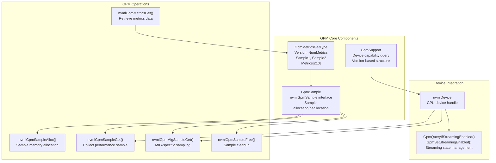
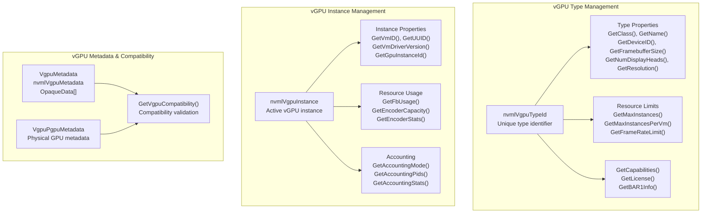
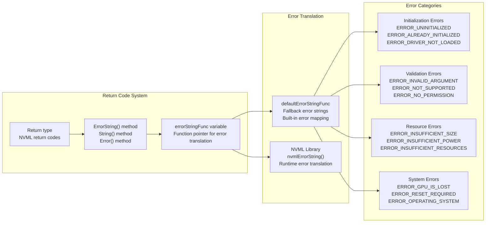
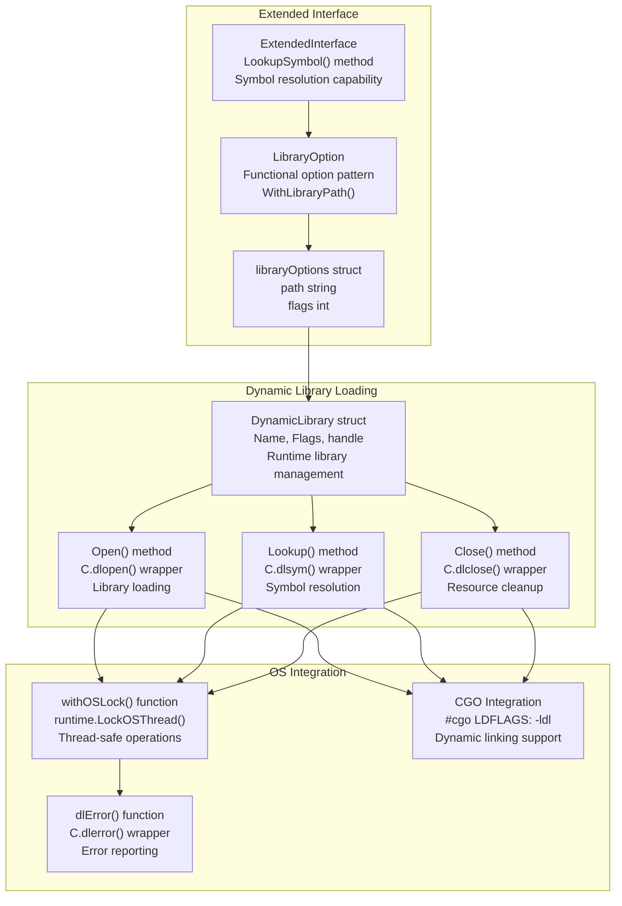

<!-- source: DeepWiki mcp.deepwiki.com · repo NVIDIA/go-gpuallocator · page 3.3 Advanced NVML Features · fetched 2026-10-26 -->

# Advanced NVML Features

Relevant source files

The following files were used as context for generating this wiki page:

- [vendor/github.com/NVIDIA/go-nvml/pkg/dl/dl.go](vendor/github.com/NVIDIA/go-nvml/pkg/dl/dl.go)
- [vendor/github.com/NVIDIA/go-nvml/pkg/nvml/api.go](vendor/github.com/NVIDIA/go-nvml/pkg/nvml/api.go)
- [vendor/github.com/NVIDIA/go-nvml/pkg/nvml/gpm.go](vendor/github.com/NVIDIA/go-nvml/pkg/nvml/gpm.go)
- [vendor/github.com/NVIDIA/go-nvml/pkg/nvml/return.go](vendor/github.com/NVIDIA/go-nvml/pkg/nvml/return.go)
- [vendor/github.com/NVIDIA/go-nvml/pkg/nvml/vgpu.go](vendor/github.com/NVIDIA/go-nvml/pkg/nvml/vgpu.go)

This document covers specialized NVIDIA Management Library (NVML) features beyond basic device management, including GPU Performance Monitoring (GPM), virtual GPU (vGPU) management, advanced error handling, and dynamic library loading mechanisms. For basic NVML bindings, see [NVML Bindings](#3.1). For high-level device interfaces, see [NVLIB Device Interface](#3.2).

## GPU Performance Monitoring (GPM)

The GPM subsystem provides advanced performance metrics collection and streaming capabilities for NVIDIA GPUs. This system enables real-time monitoring of GPU performance characteristics with support for both standard and MIG (Multi-Instance GPU) configurations.

### GPM Architecture

Sources: [vendor/github.com/NVIDIA/go-nvml/pkg/nvml/gpm.go:17-77](), [vendor/github.com/NVIDIA/go-nvml/pkg/nvml/gpm.go:88-106](), [vendor/github.com/NVIDIA/go-nvml/pkg/nvml/gpm.go:152-170]()

### GPM Sample Management

The GPM system uses a sample-based approach to collect performance metrics:

| Function | Purpose | Key Parameters |
|----------|---------|----------------|
| `GpmSampleAlloc()` | Allocate sample buffer | Returns `GpmSample`, `Return` |
| `GpmSampleGet()` | Collect device sample | `Device`, `GpmSample` |
| `GpmMigSampleGet()` | Collect MIG instance sample | `Device`, `gpuInstanceId`, `GpmSample` |
| `GpmSampleFree()` | Release sample buffer | `GpmSample` |

The `GpmMetricsGetType` structure supports up to 210 simultaneous metrics with dual sampling capability through `Sample1` and `Sample2` fields.

Sources: [vendor/github.com/NVIDIA/go-nvml/pkg/nvml/gpm.go:88-106](), [vendor/github.com/NVIDIA/go-nvml/pkg/nvml/gpm.go:139-150]()

## vGPU Management

The vGPU subsystem provides comprehensive virtual GPU management capabilities, including type management, instance lifecycle, and resource monitoring.

### vGPU Type System

Sources: [vendor/github.com/NVIDIA/go-nvml/pkg/nvml/vgpu.go:33-77](), [vendor/github.com/NVIDIA/go-nvml/pkg/nvml/vgpu.go:160-236](), [vendor/github.com/NVIDIA/go-nvml/vgpu.go:425-441]()

### vGPU Instance Lifecycle

The vGPU management system provides comprehensive instance monitoring and control:

| Category | Functions | Description |
|----------|-----------|-------------|
| **Identity** | `GetVmID()`, `GetUUID()`, `GetMdevUUID()` | Instance identification |
| **Resources** | `GetFbUsage()`, `GetEncoderCapacity()`, `SetEncoderCapacity()` | Resource allocation and usage |
| **Encoding** | `GetEncoderStats()`, `GetEncoderSessions()`, `GetFBCStats()` | Video encoding monitoring |
| **Accounting** | `GetAccountingPids()`, `GetAccountingStats()`, `ClearAccountingPids()` | Process accounting |
| **Metadata** | `GetMetadata()`, `GetRuntimeStateSize()` | Instance metadata and state |

Sources: [vendor/github.com/NVIDIA/go-nvml/pkg/nvml/vgpu.go:194-424](), [vendor/github.com/NVIDIA/go-nvml/pkg/nvml/vgpu.go:494-509]()

## Error Handling and Return Codes

The NVML error handling system provides comprehensive error reporting with fallback mechanisms for when the NVML library is unavailable.

### Error Handling Architecture

Sources: [vendor/github.com/NVIDIA/go-nvml/pkg/nvml/return.go:21-103]()

### Error Code Categories

The system provides detailed error categorization with 20+ distinct error types:

| Category | Error Codes | Usage Context |
|----------|-------------|---------------|
| **Initialization** | `ERROR_UNINITIALIZED`, `ERROR_ALREADY_INITIALIZED` | Library lifecycle |
| **Validation** | `ERROR_INVALID_ARGUMENT`, `ERROR_NOT_SUPPORTED` | Parameter validation |
| **Resources** | `ERROR_INSUFFICIENT_SIZE`, `ERROR_INSUFFICIENT_POWER` | Resource allocation |
| **System** | `ERROR_GPU_IS_LOST`, `ERROR_RESET_REQUIRED` | Hardware state |
| **vGPU** | `ERROR_VGPU_ECC_NOT_SUPPORTED` | vGPU-specific errors |

The `defaultErrorStringFunc` provides built-in error translation that works even when the NVML library is not available, ensuring consistent error reporting across different deployment scenarios.

Sources: [vendor/github.com/NVIDIA/go-nvml/pkg/nvml/return.go:42-103]()

## Extended Interface and Dynamic Library Loading

The extended interface system provides runtime library loading and symbol resolution capabilities for flexible NVML integration.

### Dynamic Library Architecture

Sources: [vendor/github.com/NVIDIA/go-nvml/pkg/nvml/api.go:19-56](), [vendor/github.com/NVIDIA/go-nvml/pkg/dl/dl.go:38-117]()

### Library Configuration Options

The library option system supports flexible NVML library configuration:

| Function | Purpose | Parameters |
|----------|---------|------------|
| `WithLibraryPath()` | Set custom library path | `path string` |
| `SetLibraryOptions()` | Apply configuration options | `...LibraryOption` |
| `LookupSymbol()` | Resolve library symbols | `string` symbol name |

The `DynamicLibrary` type provides thread-safe library operations with proper OS-level locking through `runtime.LockOSThread()` to ensure safe CGO interactions.

Sources: [vendor/github.com/NVIDIA/go-nvml/pkg/nvml/api.go:30-56](), [vendor/github.com/NVIDIA/go-nvml/pkg/dl/dl.go:52-117]()

The dynamic loading system uses standard POSIX `dlopen()` flags including `RTLD_LAZY`, `RTLD_NOW`, `RTLD_GLOBAL`, `RTLD_LOCAL`, `RTLD_NODELETE`, and `RTLD_NOLOAD` for precise control over library loading behavior.

Sources: [vendor/github.com/NVIDIA/go-nvml/pkg/dl/dl.go:29-36]()

---

