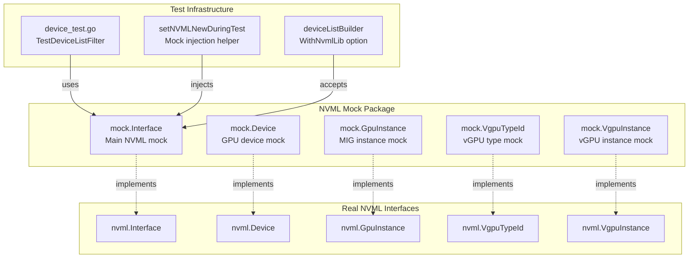
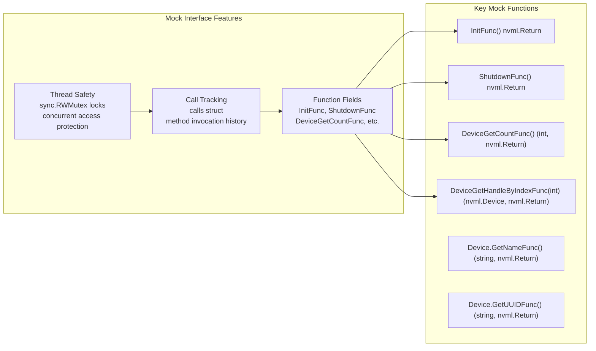
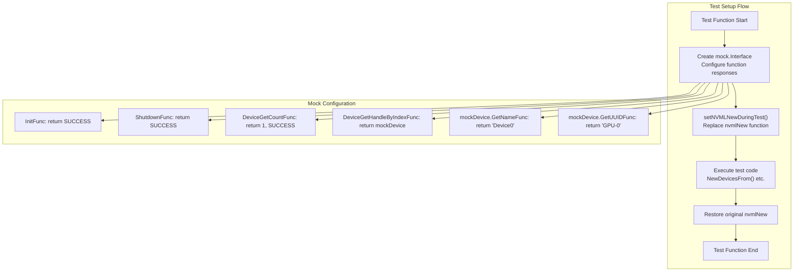
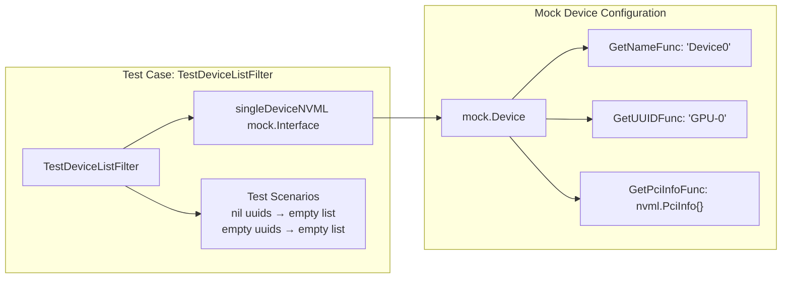
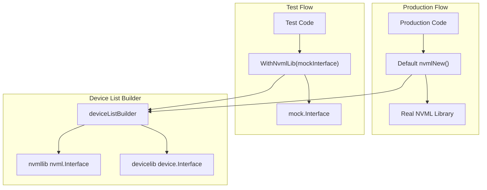

<!-- source: DeepWiki mcp.deepwiki.com · repo NVIDIA/go-gpuallocator · page 3.4 Mock System · fetched 2026-10-26 -->

# Mock System

Relevant source files

The following files were used as context for generating this wiki page:

- [gpuallocator/device_test.go](gpuallocator/device_test.go)
- [gpuallocator/options.go](gpuallocator/options.go)
- [internal/links/pciinfo.go](internal/links/pciinfo.go)
- [vendor/github.com/NVIDIA/go-nvml/pkg/nvml/mock/device.go](vendor/github.com/NVIDIA/go-nvml/pkg/nvml/mock/device.go)
- [vendor/github.com/NVIDIA/go-nvml/pkg/nvml/mock/gpuinstance.go](vendor/github.com/NVIDIA/go-nvml/pkg/nvml/mock/gpuinstance.go)
- [vendor/github.com/NVIDIA/go-nvml/pkg/nvml/mock/interface.go](vendor/github.com/NVIDIA/go-nvml/pkg/nvml/mock/interface.go)
- [vendor/github.com/NVIDIA/go-nvml/pkg/nvml/mock/vgpuinstance.go](vendor/github.com/NVIDIA/go-nvml/pkg/nvml/mock/vgpuinstance.go)
- [vendor/github.com/NVIDIA/go-nvml/pkg/nvml/mock/vgputypeid.go](vendor/github.com/NVIDIA/go-nvml/pkg/nvml/mock/vgputypeid.go)

This document describes the mock NVML interface system that provides testing infrastructure for GPU allocation functionality without requiring physical NVIDIA hardware. The mock system enables comprehensive unit testing, development environment setup, and integration testing by simulating NVIDIA Management Library (NVML) responses and device configurations.

For information about the actual NVML bindings, see [NVML Bindings](#3.1). For high-level device interface details, see [NVLIB Device Interface](#3.2).

## Architecture Overview

The mock system is built around code-generated mock implementations of NVML interfaces that allow complete control over GPU device simulation and API responses during testing.

### Mock Interface Hierarchy

Sources: [vendor/github.com/NVIDIA/go-nvml/pkg/nvml/mock/interface.go:13-14](), [vendor/github.com/NVIDIA/go-nvml/pkg/nvml/mock/device.go:13-14](), [gpuallocator/device_test.go:84-93]()

## Mock Interface Structure

### Core Mock Components

The mock system provides comprehensive implementations of all NVML interfaces with configurable function behaviors and call tracking capabilities.

Sources: [vendor/github.com/NVIDIA/go-nvml/pkg/nvml/mock/interface.go:20-146](), [vendor/github.com/NVIDIA/go-nvml/pkg/nvml/mock/device.go:777-1000]()

### Device Mock Implementation

The mock device implementation provides controllable responses for all GPU device operations including device identification, memory information, and P2P capabilities.

| Mock Function Category | Key Functions | Purpose |
|------------------------|---------------|---------|
| Device Identity | `GetNameFunc`, `GetUUIDFunc`, `GetIndexFunc` | Simulate device identification |
| Device Info | `GetPciInfoFunc`, `GetMemoryInfoFunc`, `GetArchitectureFunc` | Provide hardware details |
| P2P Operations | `GetP2PStatusFunc`, `GetTopologyCommonAncestorFunc` | Mock inter-GPU communication |
| MIG Support | `GetGpuInstancesFunc`, `CreateGpuInstanceFunc` | Simulate Multi-Instance GPU |
| vGPU Support | `GetActiveVgpusFunc`, `GetSupportedVgpusFunc` | Mock virtual GPU functionality |

Sources: [vendor/github.com/NVIDIA/go-nvml/pkg/nvml/mock/device.go:372-600](), [vendor/github.com/NVIDIA/go-nvml/pkg/nvml/mock/device.go:1200-1800]()

## Test Integration Patterns

### Mock Injection Mechanism

The test infrastructure uses dependency injection to replace real NVML interfaces with mock implementations during testing.

Sources: [gpuallocator/device_test.go:28-52](), [gpuallocator/device_test.go:84-93]()

### Example Test Configuration

The following shows how mock interfaces are configured for specific test scenarios:

Sources: [gpuallocator/device_test.go:27-82]()

## Mock System Usage

### Options-Based Mock Injection

The mock system integrates with the options pattern to allow runtime configuration of NVML interfaces for testing and development scenarios.

Sources: [gpuallocator/options.go:24-45]()

### Mock Function Call Tracking

All mock interfaces provide comprehensive call tracking for test verification, enabling assertions about which functions were called and with what parameters.

| Mock Type | Call Tracking Features | Usage Pattern |
|-----------|------------------------|---------------|
| `mock.Interface` | Tracks all NVML library calls | Verify initialization, device enumeration |
| `mock.Device` | Tracks device-specific operations | Verify device queries, property access |
| `mock.GpuInstance` | Tracks MIG instance operations | Verify MIG management, compute instances |
| `mock.VgpuInstance` | Tracks vGPU operations | Verify virtual GPU lifecycle, licensing |

Each mock provides methods like `InitCalls()`, `DeviceGetCountCalls()`, etc., that return slices of call information structures containing the parameters passed to each invocation.

Sources: [vendor/github.com/NVIDIA/go-nvml/pkg/nvml/mock/interface.go:1-100](), [vendor/github.com/NVIDIA/go-nvml/pkg/nvml/mock/device.go:1-100]()

## Mock Configuration Scenarios

The mock system supports various GPU topology configurations for comprehensive testing of allocation policies and device discovery logic.

Common mock configurations include:
- Single GPU systems for basic functionality testing
- Multi-GPU configurations with NVLink connectivity simulation
- MIG-enabled systems with multiple GPU instances
- vGPU environments with virtual device management
- Error condition simulation for failure mode testing

Sources: [gpuallocator/device_test.go:54-82](), [vendor/github.com/NVIDIA/go-nvml/pkg/nvml/mock/interface.go:20-50]()

---

