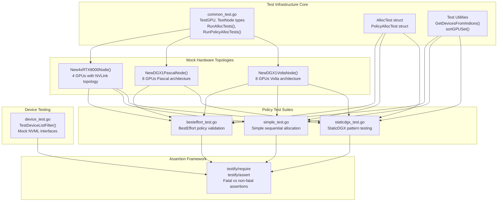
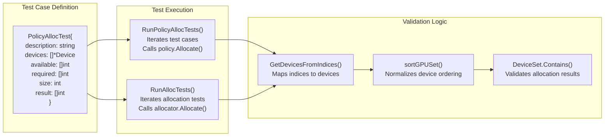
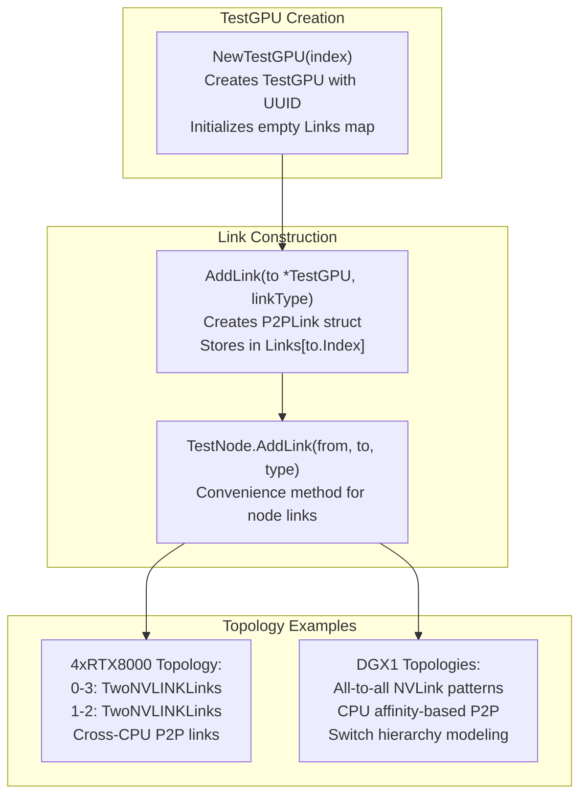
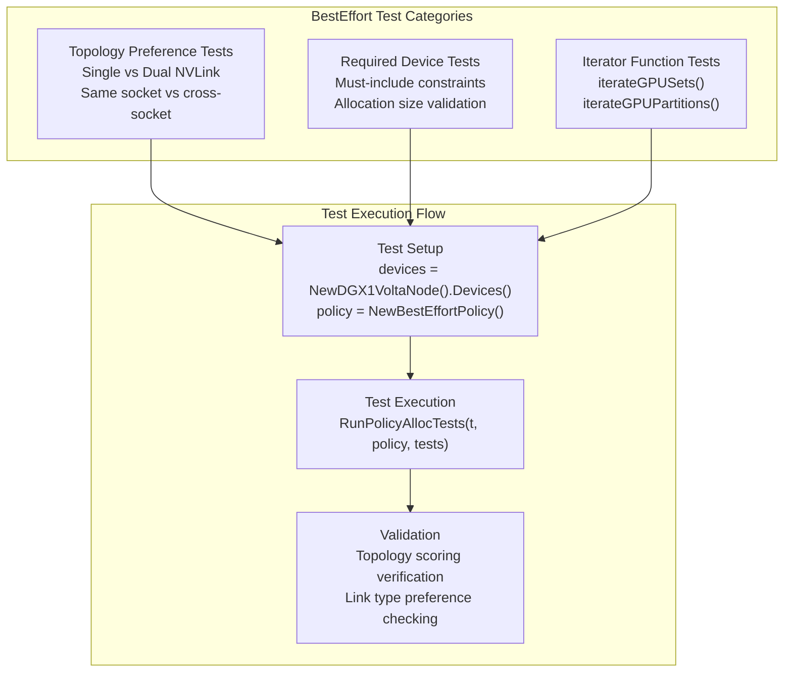
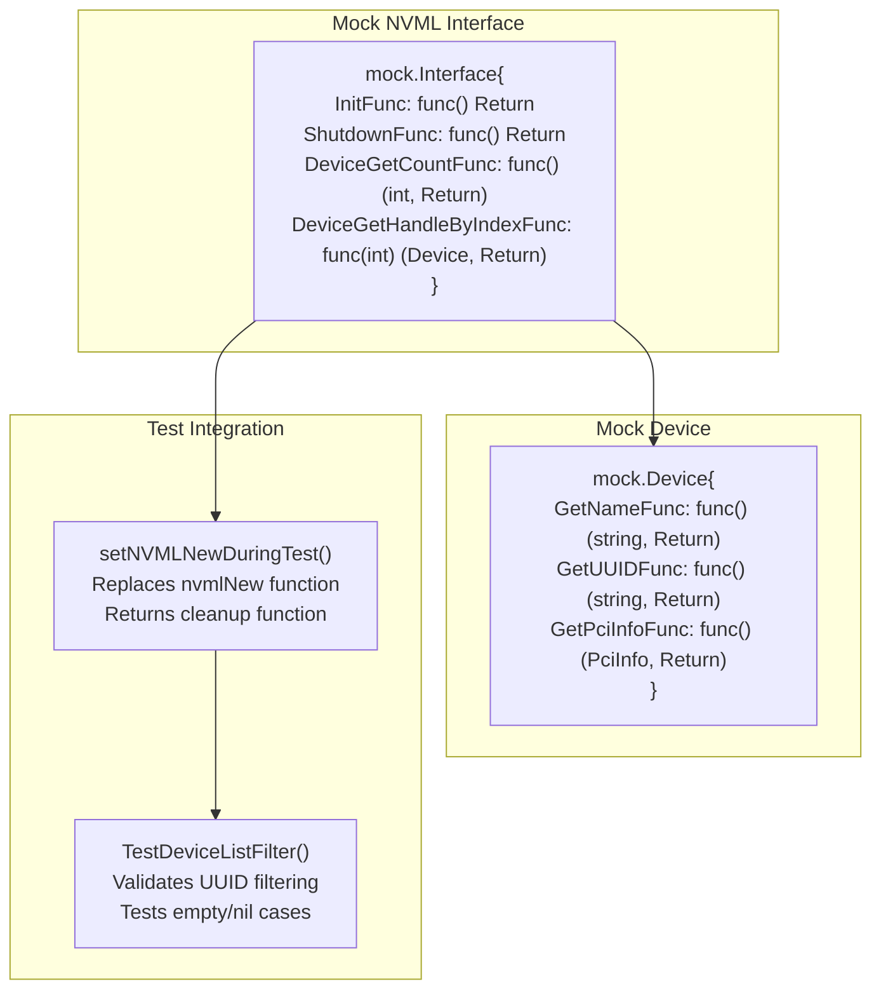
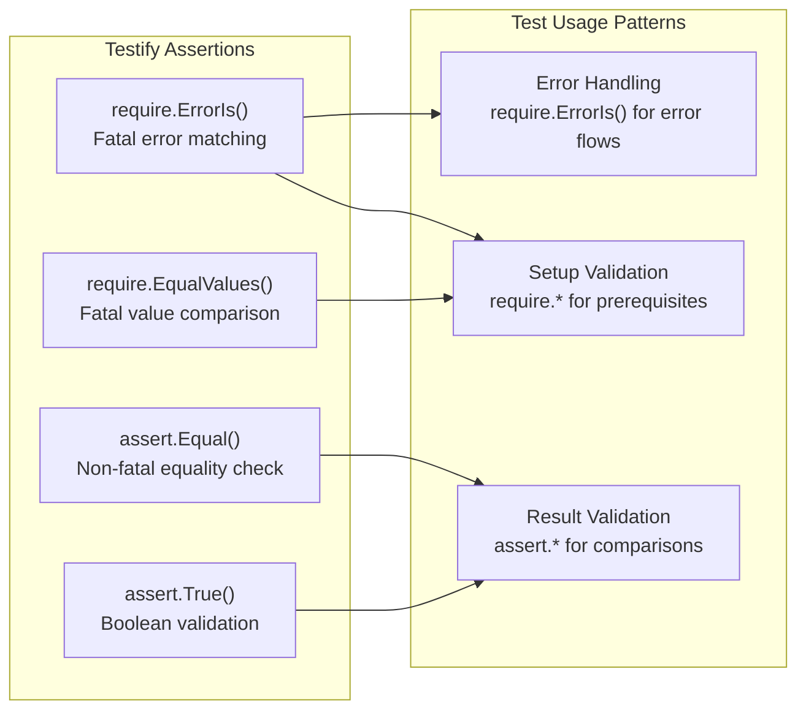

<!-- source: DeepWiki mcp.deepwiki.com · repo NVIDIA/go-gpuallocator · page 4 Testing Framework · fetched 2026-10-26 -->

# Testing Framework

<details>
<summary>Relevant source files</summary>

The following files were used as context for generating this wiki page:

- [gpuallocator/besteffort_test.go](gpuallocator/besteffort_test.go)
- [gpuallocator/common_test.go](gpuallocator/common_test.go)
- [gpuallocator/device_test.go](gpuallocator/device_test.go)
- [gpuallocator/options.go](gpuallocator/options.go)
- [gpuallocator/simple_test.go](gpuallocator/simple_test.go)
- [gpuallocator/staticdgx_test.go](gpuallocator/staticdgx_test.go)
- [internal/links/pciinfo.go](internal/links/pciinfo.go)
- [vendor/github.com/stretchr/testify/assert/assertion_forward.go](vendor/github.com/stretchr/testify/assert/assertion_forward.go)
- [vendor/github.com/stretchr/testify/assert/assertions.go](vendor/github.com/stretchr/testify/assert/assertions.go)
- [vendor/github.com/stretchr/testify/require/require.go](vendor/github.com/stretchr/testify/require/require.go)
- [vendor/github.com/stretchr/testify/require/require_forward.go](vendor/github.com/stretchr/testify/require/require_forward.go)

</details>


The Testing Framework provides comprehensive validation infrastructure for the go-gpuallocator system, enabling development and testing without requiring physical GPU hardware. The framework includes mock GPU topologies, policy validation utilities, device simulation capabilities, and structured test execution patterns.

For information about the build and CI system that orchestrates these tests, see [Development Environment](#5). For details about the core allocation policies being tested, see [Allocation Policies](#2.2).

## Test Infrastructure Architecture

The testing framework is built around a modular architecture that separates test utilities, mock hardware simulation, and assertion frameworks.



Sources: [gpuallocator/common_test.go:1-413](), [gpuallocator/besteffort_test.go:1-513](), [gpuallocator/simple_test.go:1-130](), [gpuallocator/staticdgx_test.go:1-232](), [gpuallocator/device_test.go:1-94]()

## Common Test Infrastructure

The common testing infrastructure provides foundational types and utilities for creating consistent test scenarios across all GPU allocation policies.

### Core Test Types

| Type | Purpose | Key Fields |
|------|---------|------------|
| `TestGPU` | Mock GPU device representation | Alias for `Device` with test-specific methods |
| `TestNode` | Collection of mock GPUs | Slice of `*TestGPU` with topology methods |
| `AllocTest` | Simple allocation test case | `size int`, `result []int` |
| `PolicyAllocTest` | Advanced policy test case | `devices`, `available`, `required`, `size`, `result` |

Sources: [gpuallocator/common_test.go:17-32]()

### Test Execution Framework

The framework provides standardized test runners that validate allocation behavior across different scenarios:



The `RunPolicyAllocTests()` function at [gpuallocator/common_test.go:87-111]() executes each test case by:
1. Converting device indices to actual device objects
2. Calling the policy's `Allocate()` method
3. Sorting and comparing results
4. Validating that allocated devices match expected results

Sources: [gpuallocator/common_test.go:63-111](), [gpuallocator/common_test.go:34-61]()

## Mock Hardware Topologies

The framework includes pre-built mock hardware topologies that simulate real GPU configurations with authentic P2P link patterns.

### Topology Builders

| Function | Configuration | GPU Count | Link Types |
|----------|---------------|-----------|------------|
| `New4xRTX8000Node()` | RTX 8000 workstation | 4 | NVLink + P2P over PCIe |
| `NewDGX1PascalNode()` | DGX-1 Pascal system | 8 | Single NVLink + P2P patterns |
| `NewDGX1VoltaNode()` | DGX-1 Volta system | 8 | Dual NVLink + P2P patterns |

### Mock GPU Creation and Linking



The `NewTestGPU()` function at [gpuallocator/common_test.go:113-122]() creates mock GPUs with:
- Unique index-based UUIDs (`GPU-{index}`)
- PCI bus ID matching the UUID
- Empty P2P link map for topology construction

Sources: [gpuallocator/common_test.go:113-139](), [gpuallocator/common_test.go:141-408]()

## Policy Test Validation

Each allocation policy has dedicated test suites that validate specific allocation behaviors and edge cases.

### BestEffort Policy Testing

The BestEffort policy tests focus on topology-aware allocation with scoring algorithms:



Key test scenarios in [gpuallocator/besteffort_test.go:28-124]() include:
- **Link Preference**: Tests prioritizing dual NVLink over single NVLink connections
- **Socket Affinity**: Validates preference for same-socket allocations
- **Must-Include Logic**: Ensures required devices are included in allocations
- **Error Conditions**: Tests scenarios where valid allocation is impossible

### Simple and StaticDGX Policy Testing

Simple policy tests validate sequential allocation behavior, while StaticDGX tests ensure predefined allocation patterns are followed:

| Policy | Key Test Focus | Example Test Case |
|--------|----------------|-------------------|
| Simple | Sequential device selection | Allocate 4 → devices [0,1,2,3] |
| StaticDGX | Predefined valid sets | Volta 4-GPU → [0,1,2,3] or [4,5,6,7] |

Sources: [gpuallocator/besteffort_test.go:1-513](), [gpuallocator/simple_test.go:1-130](), [gpuallocator/staticdgx_test.go:1-232]()

## Mock NVML System

Device testing utilizes mock NVML interfaces to simulate GPU enumeration and filtering without requiring physical hardware.

### Mock Interface Structure



The mock system at [gpuallocator/device_test.go:28-52]() provides:
- Configurable device count responses
- Controllable device properties (name, UUID, PCI info)
- Success/failure simulation for NVML operations

The `setNVMLNewDuringTest()` function at [gpuallocator/device_test.go:84-93]() temporarily replaces the global `nvmlNew` function, enabling dependency injection for testing.

Sources: [gpuallocator/device_test.go:1-94]()

## Assertion Framework Integration

The framework integrates the testify assertion library, providing both fatal and non-fatal assertion capabilities.

### Assertion Types

| Package | Behavior | Use Case |
|---------|----------|----------|
| `require` | Fatal - stops test execution | Critical validations, setup verification |
| `assert` | Non-fatal - continues execution | Multiple condition checking |

Key assertion functions used throughout the test suite:



Example usage in [gpuallocator/device_test.go:78-79]():
```go
require.ErrorIs(t, tc.expectedError, err)
require.EqualValues(t, tc.expectedDeviceList, deviceList)
```

Sources: [vendor/github.com/stretchr/testify/require/require.go:1-3000](), [vendor/github.com/stretchr/testify/assert/assertions.go:1-2000](), [gpuallocator/device_test.go:78-79]()

---

