<!-- source: DeepWiki mcp.deepwiki.com · repo NVIDIA/go-gpuallocator · page 4.1 Test Infrastructure · fetched 2026-10-26 -->

# Test Infrastructure

Relevant source files

The following files were used as context for generating this wiki page:

- [gpuallocator/besteffort_test.go](gpuallocator/besteffort_test.go)
- [gpuallocator/common_test.go](gpuallocator/common_test.go)
- [gpuallocator/device_test.go](gpuallocator/device_test.go)
- [gpuallocator/options.go](gpuallocator/options.go)
- [gpuallocator/simple_test.go](gpuallocator/simple_test.go)
- [gpuallocator/staticdgx_test.go](gpuallocator/staticdgx_test.go)
- [internal/links/pciinfo.go](internal/links/pciinfo.go)

This document covers the core testing utilities and frameworks that enable comprehensive validation of GPU allocation algorithms, device management, and policy implementations. The test infrastructure provides mock GPU topologies, standardized test execution patterns, and device simulation capabilities that allow testing without physical hardware.

For information about the assertion libraries and testing frameworks used, see [Assertion Libraries](#4.2). For details about the mock NVML system, see [Mock System](#3.4).

## Purpose and Architecture

The test infrastructure serves three primary functions:

1. **Hardware Simulation**: Creating realistic GPU topologies with P2P links and NVLink connections
2. **Test Execution**: Standardized frameworks for running allocation and policy tests
3. **Device Management Testing**: Validation of device discovery, filtering, and enumeration

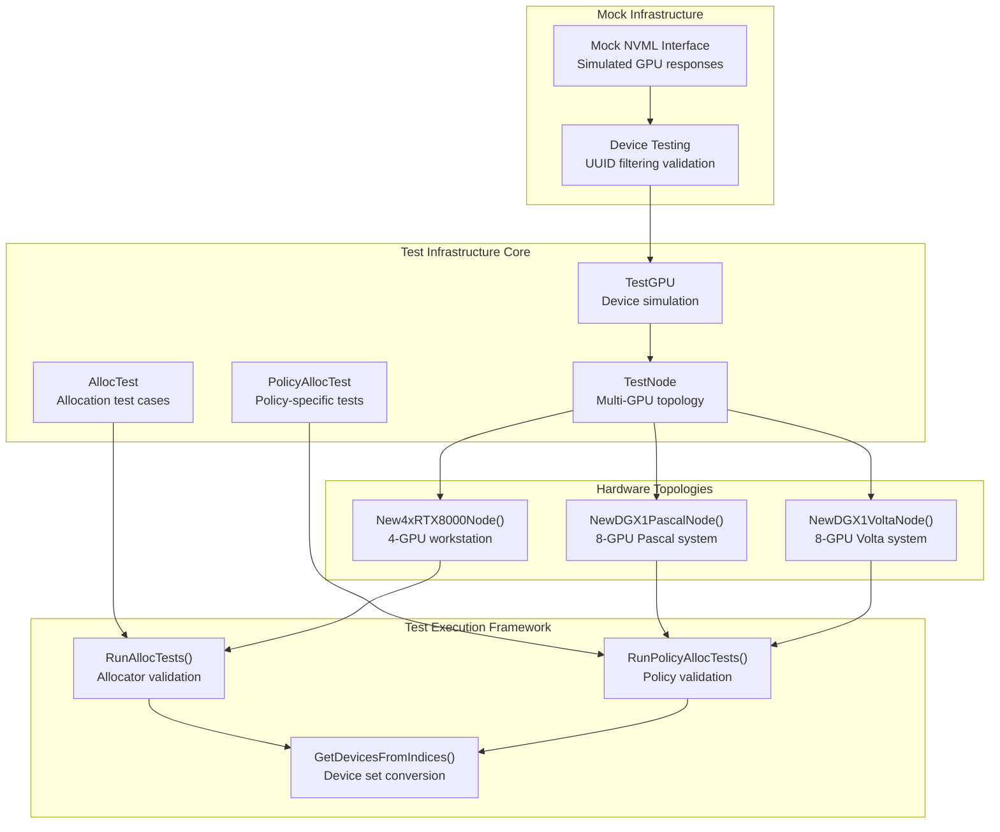

Sources: [gpuallocator/common_test.go:15-140](), [gpuallocator/device_test.go:27-94]()

## Core Test Types

### TestGPU and TestNode

The foundation of the test infrastructure consists of `TestGPU` and `TestNode` types that simulate GPU hardware and multi-GPU systems:

| Type | Purpose | Key Fields |
|------|---------|------------|
| `TestGPU` | Individual GPU simulation | UUID, Index, Links map |
| `TestNode` | Multi-GPU topology | Array of TestGPU pointers |

The `TestGPU` type extends the base `Device` structure with link management capabilities:

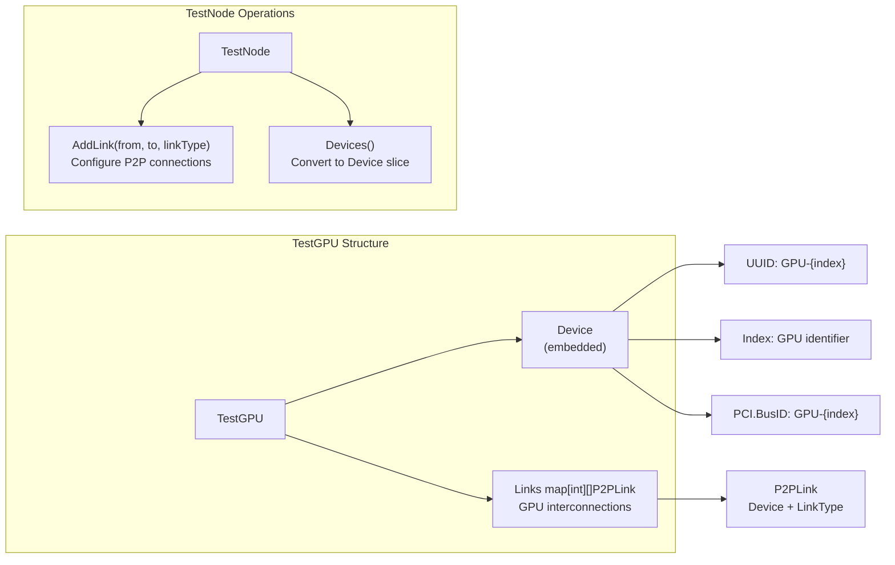

Sources: [gpuallocator/common_test.go:17-139]()

### Test Case Structures

Two primary test case structures standardize test execution across different allocation strategies:

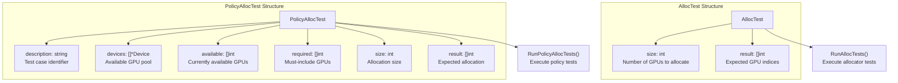

Sources: [gpuallocator/common_test.go:20-32]()

## Predefined Hardware Topologies

The test infrastructure includes several realistic GPU topologies that mirror actual NVIDIA hardware configurations:

### 4x RTX8000 Workstation

This topology simulates a typical high-end workstation with NVLink and P2P connections:

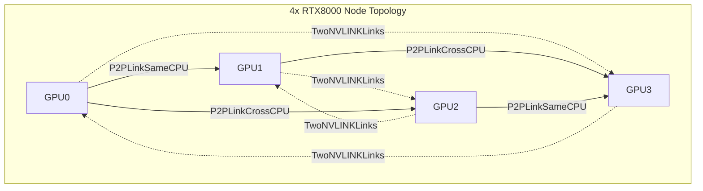

Sources: [gpuallocator/common_test.go:141-166]()

### DGX1 Pascal Configuration

The DGX1 Pascal topology represents an 8-GPU system with comprehensive NVLink mesh:

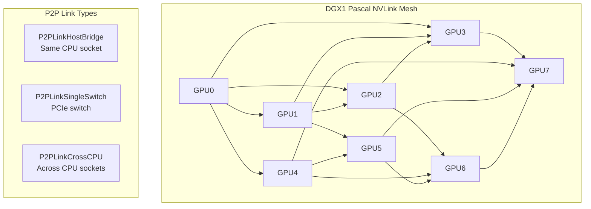

Sources: [gpuallocator/common_test.go:168-287]()

### DGX1 Volta Configuration

The Volta configuration features enhanced NVLink connectivity with dual-link connections:

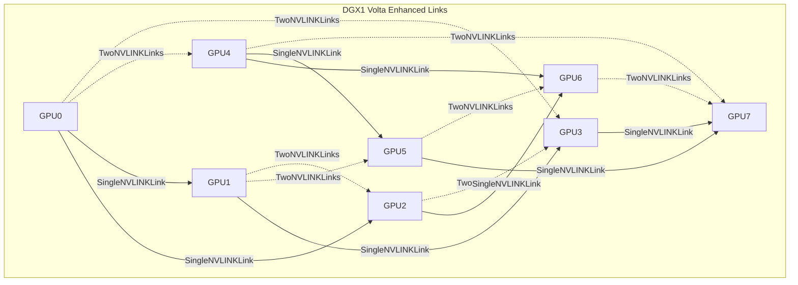

Sources: [gpuallocator/common_test.go:289-408]()

## Test Execution Framework

### RunAllocTests Function

The `RunAllocTests` function provides standardized execution for allocator testing:

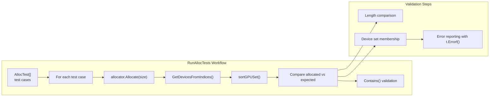

Sources: [gpuallocator/common_test.go:63-85]()

### RunPolicyAllocTests Function

Policy-specific testing uses `RunPolicyAllocTests` for more complex validation scenarios:

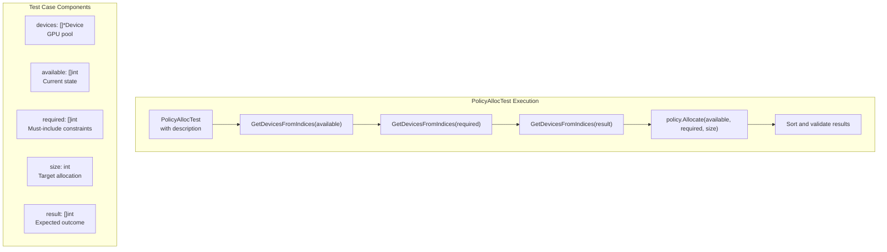

Sources: [gpuallocator/common_test.go:87-111]()

## Device Testing Infrastructure

### Mock NVML Interface

Device-level testing uses mock NVML interfaces to simulate hardware responses:

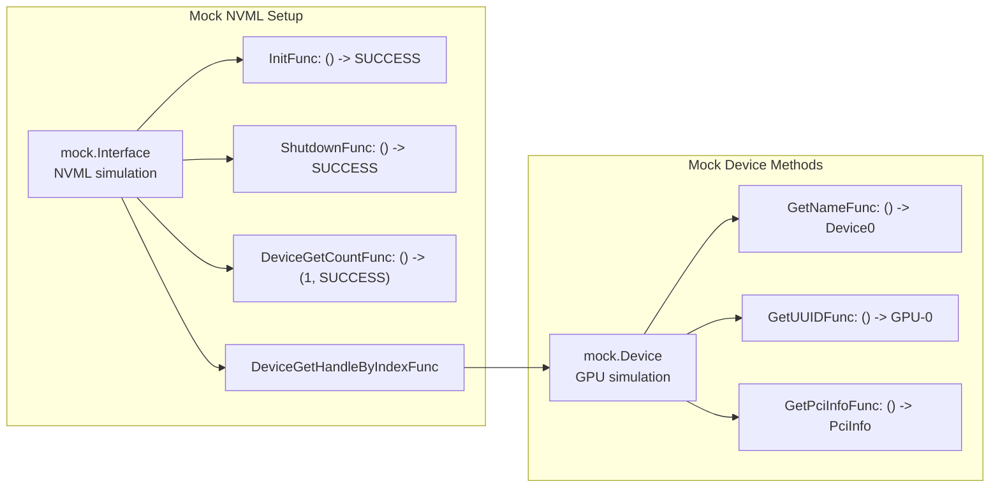

Sources: [gpuallocator/device_test.go:28-52]()

### Test Utility Functions

Several utility functions support device testing operations:

| Function | Purpose | Parameters |
|----------|---------|------------|
| `setNVMLNewDuringTest()` | Mock NVML interface injection | `nvml.Interface` |
| `GetDevicesFromIndices()` | Convert indices to Device slices | `[]*Device, []int` |
| `sortGPUSet()` | Normalize device ordering | `[]*Device` |
| `NewTestGPU()` | Create individual test GPU | `int` (index) |

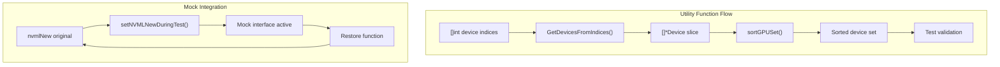

Sources: [gpuallocator/common_test.go:34-49](), [gpuallocator/common_test.go:51-61](), [gpuallocator/device_test.go:84-94]()

## Integration with Policy Testing

The test infrastructure integrates with all three allocation policies, providing consistent validation patterns:

### Policy Test Coverage

```mermaid
graph TB
    subgraph "BestEffort Policy Tests"
        BEAllocate["TestBestEffortAllocate<br/>Core allocation logic"]
        BEIterate["TestBestEffortIterateGPUSets<br/>Combination generation"]
        BEPartition["TestBestEffortIterateGPUPartitions<br/>Partition algorithms"]
        BETopology["Topology-specific tests<br/>4xRTX8000, DGX1 variants"]
    end
    
    subgraph "Simple Policy Tests"
        SimpleAllocate["TestSimpleAllocate<br/>Sequential allocation"]
        SimpleConstraints["Must-include constraints<br/>Required device handling"]
    end
    
    subgraph "StaticDGX Policy Tests"
        StaticVolta["TestStaticDGX1VoltaAllocate<br/>Volta-specific patterns"]
        StaticPascal["StaticDGX1 Pascal tests<br/>Pascal allocation patterns"]
        StaticInvalid["Invalid allocation tests<br/>Error condition handling"]
    end
    
    BEAllocate --> RunPolicyAllocTests
    SimpleAllocate --> RunPolicyAllocTests
    StaticVolta --> RunPolicyAllocTests
    
    BETopology --> RunAllocTests
    StaticPascal --> RunAllocTests
```

Sources: [gpuallocator/besteffort_test.go:28-512](), [gpuallocator/simple_test.go:9-129](), [gpuallocator/staticdgx_test.go:7-231]()

---

