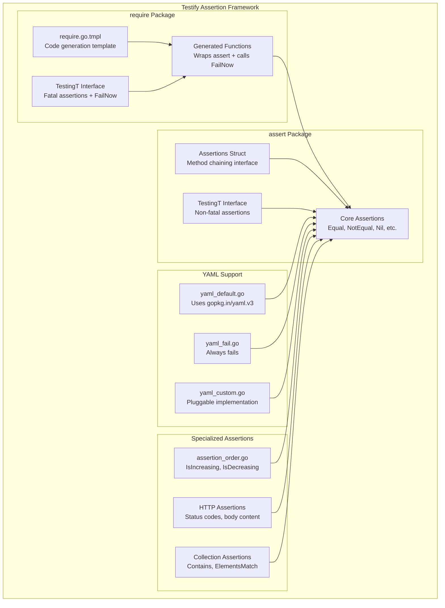
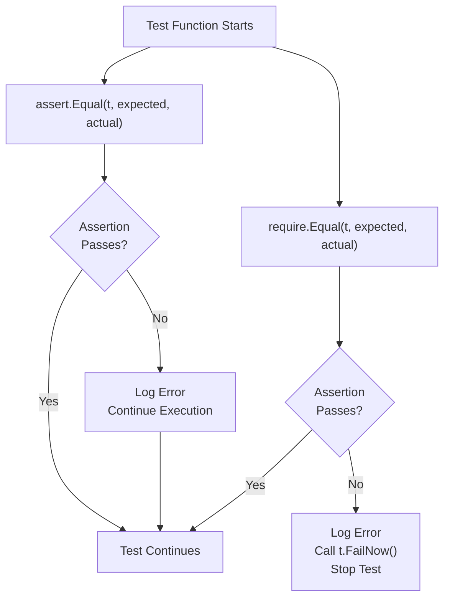
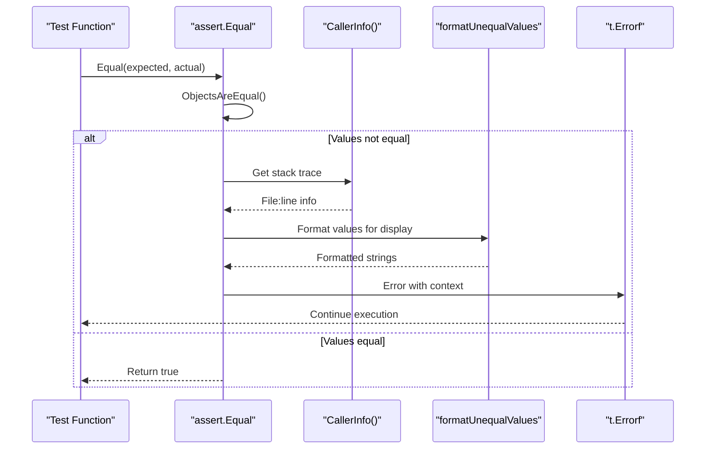
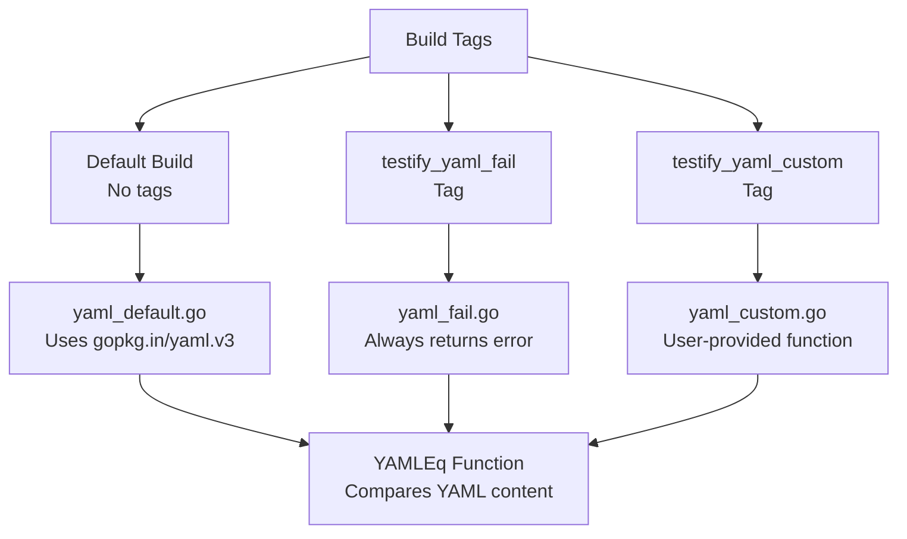
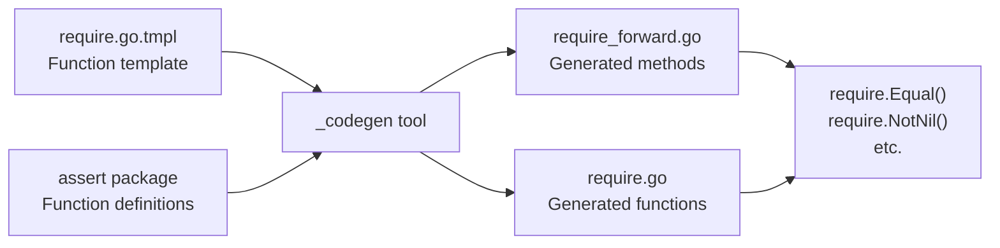

<!-- source: DeepWiki mcp.deepwiki.com · repo NVIDIA/go-gpuallocator · page 4.2 Assertion Libraries · fetched 2026-10-26 -->

# Assertion Libraries

<details>
<summary>Relevant source files</summary>

The following files were used as context for generating this wiki page:

- [vendor/github.com/stretchr/testify/assert/assertion_forward.go](vendor/github.com/stretchr/testify/assert/assertion_forward.go)
- [vendor/github.com/stretchr/testify/assert/assertion_order.go](vendor/github.com/stretchr/testify/assert/assertion_order.go)
- [vendor/github.com/stretchr/testify/assert/assertions.go](vendor/github.com/stretchr/testify/assert/assertions.go)
- [vendor/github.com/stretchr/testify/assert/yaml/yaml_custom.go](vendor/github.com/stretchr/testify/assert/yaml/yaml_custom.go)
- [vendor/github.com/stretchr/testify/assert/yaml/yaml_default.go](vendor/github.com/stretchr/testify/assert/yaml/yaml_default.go)
- [vendor/github.com/stretchr/testify/assert/yaml/yaml_fail.go](vendor/github.com/stretchr/testify/assert/yaml/yaml_fail.go)
- [vendor/github.com/stretchr/testify/require/require.go](vendor/github.com/stretchr/testify/require/require.go)
- [vendor/github.com/stretchr/testify/require/require.go.tmpl](vendor/github.com/stretchr/testify/require/require.go.tmpl)
- [vendor/github.com/stretchr/testify/require/require_forward.go](vendor/github.com/stretchr/testify/require/require_forward.go)
- [vendor/github.com/stretchr/testify/require/requirements.go](vendor/github.com/stretchr/testify/require/requirements.go)

</details>


This section documents the testify assertion framework used throughout the go-gpuallocator testing infrastructure. The assertion libraries provide comprehensive testing utilities for validating GPU allocation logic, device management, and policy implementations. This covers the vendored testify packages including `assert`, `require`, and YAML testing capabilities.

For information about test execution patterns and common test utilities, see [Test Infrastructure](#4.1).

## Package Architecture

The assertion framework consists of two complementary packages that provide different failure behaviors and a flexible YAML testing system.



**Sources:** [vendor/github.com/stretchr/testify/assert/assertions.go:1-400](), [vendor/github.com/stretchr/testify/require/require.go:1-100](), [vendor/github.com/stretchr/testify/require/requirements.go:1-30]()

### Assert vs Require Behavior

The key architectural difference lies in failure handling behavior:

| Package | Behavior on Failure | Use Case |
|---------|-------------------|----------|
| `assert` | Logs error, continues test | Multiple validations, collecting all failures |
| `require` | Logs error, calls `FailNow()` | Critical preconditions, preventing panic |



**Sources:** [vendor/github.com/stretchr/testify/require/require.go.tmpl:1-7](), [vendor/github.com/stretchr/testify/assert/assertions.go:327-345]()

## Core Assertion Types

The framework provides a comprehensive set of assertion functions organized by validation category.

### Primary Interfaces

```mermaid
classDiagram
    class TestingT {
        <<interface>>
        +Errorf(format string, args ...interface{})
    }
    
    class RequireTestingT {
        <<interface>>
        +Errorf(format string, args ...interface{})
        +FailNow()
    }
    
    class Assertions {
        -t TestingT
        +Equal(expected, actual interface{}) bool
        +NotEqual(expected, actual interface{}) bool
        +Nil(object interface{}) bool
        +True(value bool) bool
        +Error(err error) bool
    }
    
    class AssertionFunc {
        <<type>>
        ComparisonAssertionFunc
        ValueAssertionFunc  
        BoolAssertionFunc
        ErrorAssertionFunc
    }
    
    TestingT <|-- RequireTestingT
    TestingT <-- Assertions
    AssertionFunc ..> TestingT : uses
```

**Sources:** [vendor/github.com/stretchr/testify/assert/assertions.go:29-52](), [vendor/github.com/stretchr/testify/require/requirements.go:4-27]()

### Assertion Categories

The assertion functions are organized into logical categories:

| Category | Functions | Purpose |
|----------|-----------|---------|
| **Equality** | `Equal`, `NotEqual`, `EqualValues`, `Exactly` | Value comparison with different strictness levels |
| **Existence** | `Nil`, `NotNil`, `Empty`, `NotEmpty` | Null/empty state validation |
| **Boolean** | `True`, `False` | Boolean value assertions |
| **Error Handling** | `Error`, `NoError`, `ErrorIs`, `ErrorAs` | Error state and type validation |
| **Collections** | `Contains`, `NotContains`, `ElementsMatch`, `Len` | Slice, array, map validations |
| **Numeric** | `Greater`, `Less`, `InDelta`, `InEpsilon` | Numeric comparisons with tolerance |
| **Type** | `IsType`, `Implements` | Type system validations |

**Sources:** [vendor/github.com/stretchr/testify/assert/assertions.go:453-479](), [vendor/github.com/stretchr/testify/assert/assertions.go:921-965](), [vendor/github.com/stretchr/testify/assert/assertion_order.go:47-81]()

### Error Handling and Debugging

The framework provides sophisticated error reporting with caller information and formatted output:



**Sources:** [vendor/github.com/stretchr/testify/assert/assertions.go:212-269](), [vendor/github.com/stretchr/testify/assert/assertions.go:570-593](), [vendor/github.com/stretchr/testify/assert/assertions.go:348-372]()

## YAML Testing Capabilities

The framework provides flexible YAML assertion support through build-time configuration options.

### Build Tag Architecture



**Sources:** [vendor/github.com/stretchr/testify/assert/yaml/yaml_default.go:1-37](), [vendor/github.com/stretchr/testify/assert/yaml/yaml_fail.go:1-18](), [vendor/github.com/stretchr/testify/assert/yaml/yaml_custom.go:1-25]()

### YAML Implementation Options

| Build Configuration | File | Behavior | Use Case |
|---------------------|------|----------|----------|
| **Default** | `yaml_default.go` | Uses `gopkg.in/yaml.v3` | Standard YAML testing |
| **Fail** | `yaml_fail.go` | Always returns `errNotImplemented` | Avoid YAML dependencies |
| **Custom** | `yaml_custom.go` | User-provided `Unmarshal` variable | Alternative YAML libraries |

The custom implementation allows runtime dependency injection:

```go
// In test package init()
import assertYaml "github.com/stretchr/testify/assert/yaml"

func init() {
    assertYaml.Unmarshal = func(in []byte, out interface{}) error {
        // Custom YAML implementation
        return customYAMLLibrary.Parse(in, out)
    }
}
```

**Sources:** [vendor/github.com/stretchr/testify/assert/yaml/yaml_custom.go:13-25]()

## Code Generation System

The require package uses code generation to maintain consistency between assert and require interfaces:



The template structure ensures every assert function has a corresponding require function:

```go
// Template pattern from require.go.tmpl
func {{.DocInfo.Name}}(t TestingT, {{.Params}}) {
    if h, ok := t.(tHelper); ok { h.Helper() }
    if assert.{{.DocInfo.Name}}(t, {{.ForwardedParams}}) { return }
    t.FailNow()
}
```

**Sources:** [vendor/github.com/stretchr/testify/require/require.go.tmpl:1-7](), [vendor/github.com/stretchr/testify/require/requirements.go:29]()

## Usage Patterns in GPU Allocator Testing

The assertion libraries integrate with the GPU allocator testing framework to provide robust validation of allocation behavior:

### Common Assertion Patterns

| Pattern | Assert Usage | Require Usage |
|---------|-------------|---------------|
| **Device Validation** | `assert.NotNil(t, device)` | `require.NotNil(t, devices)` |
| **Allocation Results** | `assert.Equal(t, expected, result)` | `require.NoError(t, err)` |
| **Collection Checks** | `assert.Contains(t, devices, target)` | `require.Len(t, devices, count)` |
| **Error Conditions** | `assert.Error(t, err)` | `require.ErrorIs(t, err, ErrNoDevices)` |

### Integration with Test Infrastructure

The assertion libraries work seamlessly with the common test framework patterns documented in [Test Infrastructure](#4.1):

- **TestGPU creation**: Uses `require` for critical device setup validation
- **Policy testing**: Uses `assert` for allocation result validation to collect multiple failures  
- **Device filtering**: Uses both packages depending on whether the test can continue after validation failures

**Sources:** Based on testing patterns referenced in the provided architecture diagrams and the comprehensive assertion API provided by the testify framework.

---

