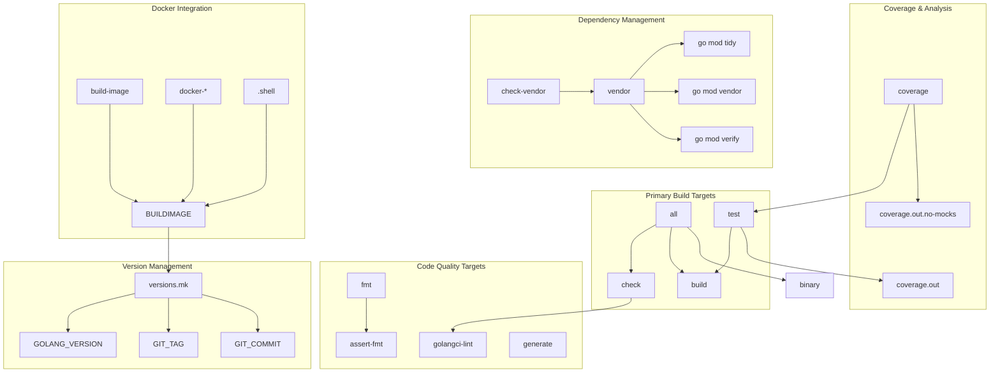
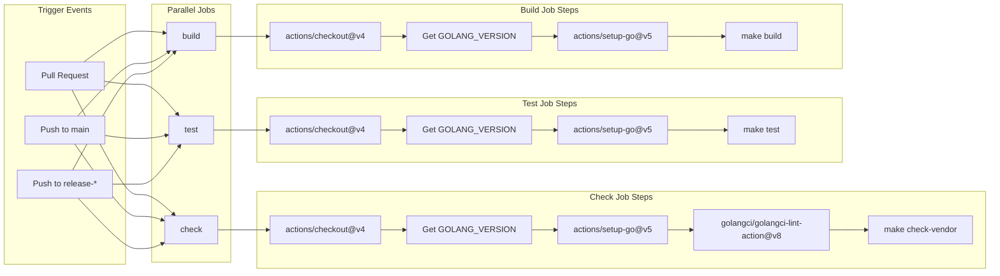
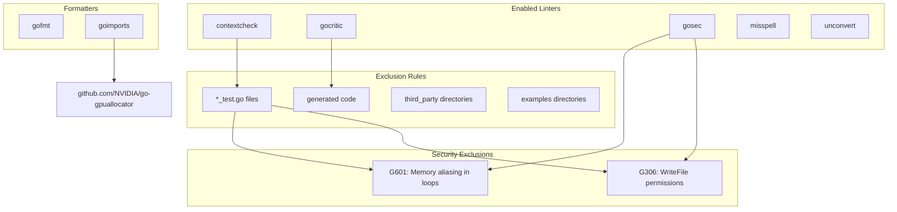

<!-- source: DeepWiki mcp.deepwiki.com · repo NVIDIA/go-gpuallocator · page 5 Development Environment · fetched 2026-10-26 -->

# Development Environment

Relevant source files

The following files were used as context for generating this wiki page:

- [.github/workflows/golang.yml](.github/workflows/golang.yml)
- [.golangci.yml](.golangci.yml)
- [Makefile](Makefile)
- [go.mod](go.mod)
- [versions.mk](versions.mk)

This document covers the development environment infrastructure for the go-gpuallocator project, including the build system, CI/CD pipeline, dependency management, and development workflows. This encompasses the tools and processes used to build, test, lint, and deploy the GPU allocation system.

For information about the testing infrastructure and mock systems, see [Testing Framework](#4). For details about build outputs and deployment artifacts, see [Build System](#5.1).

## Build System Architecture

The go-gpuallocator project uses a comprehensive Makefile-based build system that supports both local development and containerized builds. The build system provides standardized targets for compilation, testing, code quality checks, and dependency management.

The build system supports parallel execution through Docker targets, where any primary target can be executed in a containerized environment by prefixing it with `docker-`. This ensures consistent build environments across different development machines.

**Sources:** [Makefile:22-109](), [versions.mk:15-28]()

## CI/CD Pipeline Architecture

The GitHub Actions workflow provides automated quality assurance through parallel job execution. The pipeline enforces code quality, dependency integrity, and build verification on every pull request and push to main branches.

All jobs dynamically extract the Go version from `versions.mk` using shell parameter expansion to ensure version consistency across the development environment and CI pipeline.

**Sources:** [.github/workflows/golang.yml:27-81](), [versions.mk:24]()

## Dependency Management

The project uses Go modules for dependency management with additional integrity verification and vendoring capabilities. Dependencies are organized into direct requirements and indirect transitive dependencies.

| Dependency | Version | Purpose |
|------------|---------|---------|
| `github.com/NVIDIA/go-nvlib` | v0.7.3 | High-level NVIDIA GPU device management |
| `github.com/NVIDIA/go-nvml` | v0.12.9-0 | Low-level NVIDIA Management Library bindings |
| `github.com/stretchr/testify` | v1.10.0 | Testing framework with assertions |
| `github.com/google/uuid` | v1.6.0 | UUID generation (indirect) |
| `gopkg.in/yaml.v3` | v3.0.1 | YAML parsing support (indirect) |

The `vendor` target in the Makefile performs a complete dependency refresh cycle:

1. `go mod tidy` - Updates go.mod and go.sum files
2. `go mod vendor` - Downloads dependencies to vendor directory  
3. `go mod verify` - Cryptographic verification of dependency integrity

The `check-vendor` target ensures the vendor directory and module files are synchronized with the current repository state, preventing dependency drift in CI environments.

**Sources:** [go.mod:1-17](), [Makefile:65-72]()

## Code Quality Enforcement

The development environment enforces code quality through multiple automated tools configured in `.golangci.yml`. The linting configuration enables specific linters while providing targeted exclusions for test files and generated code.

The formatter configuration includes `goimports` with local prefix settings to ensure consistent import ordering, prioritizing internal package imports over external dependencies.

**Sources:** [.golangci.yml:1-43](), [Makefile:54-55]()

## Docker Development Integration

The development environment provides containerized development capabilities through Docker integration. The system supports both automated builds and interactive development sessions.

The Docker development workflow centers around the `BUILDIMAGE` environment, which is constructed from version-controlled tool specifications:

- Base image: `golang:1.24.4-bookworm` (from `GOLANG_VERSION` in `versions.mk`)
- Development tools: golangci-lint, moq, client-gen, controller-gen
- Cache optimization: Separate GOCACHE and GOMODCACHE volumes

Interactive development is supported through the `.shell` target, which launches a containerized shell with the complete development toolchain and mounted source code directory.

**Sources:** [Makefile:73-109](), [versions.mk:24-28]()

## Development Workflow Integration

The build system integrates all development activities into a cohesive workflow:

1. **Local Development**: Direct execution of `make` targets for rapid iteration
2. **Containerized Development**: `docker-*` prefixed targets for environment consistency  
3. **Quality Gates**: Automated formatting, linting, and test execution
4. **Dependency Verification**: Integrity checking and vendor synchronization
5. **CI Integration**: GitHub Actions executes the same `make` targets used locally

The `all` target provides a complete build verification cycle by executing `check`, `build`, and `binary` targets in sequence, ensuring both code quality and successful compilation before considering changes complete.

**Sources:** [Makefile:31-32](), [.github/workflows/golang.yml:48-50,65,80]()

---

