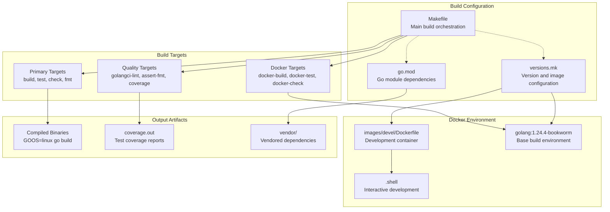
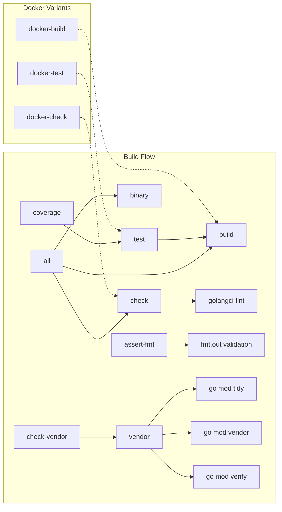
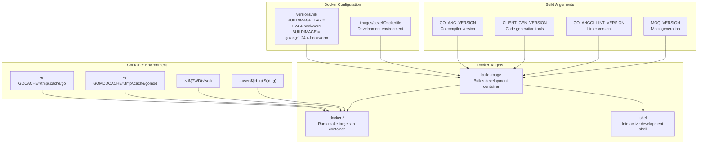
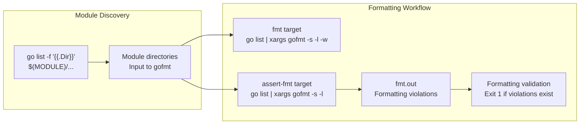

<!-- source: DeepWiki mcp.deepwiki.com · repo NVIDIA/go-gpuallocator · page 5.1 Build System · fetched 2026-10-26 -->

# Build System

<details>
<summary>Relevant source files</summary>

The following files were used as context for generating this wiki page:

- [Makefile](Makefile)
- [go.mod](go.mod)
- [versions.mk](versions.mk)

</details>


## Purpose and Scope

The go-gpuallocator build system provides a comprehensive development workflow built around GNU Make and Docker containerization. This system automates code building, testing, formatting, linting, and quality assurance processes to ensure consistent development practices across different environments.

For information about CI/CD automation that builds upon this system, see [CI/CD Pipeline](#5.2). For details about Go module dependencies managed by this build system, see [Dependency Management](#5.3).

## Build System Architecture

The build system consists of three primary components working together to provide a complete development environment:

### Build System Components



**Sources:** [Makefile:1-109](), [versions.mk:1-28](), [go.mod:1-17]()

## Build Targets and Workflow

The Makefile defines a comprehensive set of build targets organized into logical groups:

### Primary Build Targets

| Target | Purpose | Dependencies |
|--------|---------|-------------|
| `build` | Compiles Go packages for Linux | None |
| `all` | Complete build workflow | `check`, `build`, `binary` |
| `check` | Code quality verification | `golangci-lint` |
| `test` | Executes test suite with coverage | `build` |

### Code Quality Targets

| Target | Purpose | Output |
|--------|---------|---------|
| `fmt` | Applies `gofmt` formatting | Modified source files |
| `assert-fmt` | Verifies code formatting | `fmt.out` file or error |
| `golangci-lint` | Runs comprehensive linting | Linting report |
| `coverage` | Generates test coverage report | `coverage.out.no-mocks` |

### Build Target Dependencies



**Sources:** [Makefile:22-24](), [Makefile:28-32](), [Makefile:54-69]()

## Docker Integration

The build system provides comprehensive Docker integration for consistent development environments across different platforms.

### Docker Build Environment



**Sources:** [Makefile:73-84](), [Makefile:85-96](), [versions.mk:24-28]()

### Docker Target Pattern

The build system automatically generates Docker variants for all primary targets using pattern rules:

```makefile
DOCKER_TARGETS := $(patsubst %, docker-%, $(TARGETS))
```

Each Docker target executes the corresponding native target within the containerized environment with consistent cache directories and user permissions.

**Sources:** [Makefile:23](), [Makefile:85-96]()

## Version Management

Version configuration is centralized in `versions.mk` and provides consistent version pinning across the entire build system:

### Version Configuration Structure

| Variable | Purpose | Default Value |
|----------|---------|---------------|
| `GIT_TAG` | Current Git tag version | `$(shell git describe --tags)` |
| `GIT_COMMIT` | Current Git commit hash | 40-character commit hash |
| `GOLANG_VERSION` | Go compiler version | `1.24.4` |
| `BUILDIMAGE_TAG` | Docker base image tag | `1.24.4-bookworm` |

### Build Image Configuration

The system uses a standardized Go development image:

```makefile
BUILDIMAGE ?= golang:$(BUILDIMAGE_TAG)
```

This ensures all developers and CI systems use identical Go toolchain versions, eliminating environment-specific build issues.

**Sources:** [versions.mk:15-28]()

## Quality Assurance Integration

The build system integrates multiple quality assurance tools to maintain code standards:

### Code Formatting Pipeline



**Sources:** [Makefile:34-49]()

### Test Coverage Analysis

The build system provides detailed test coverage analysis with mock file filtering:

```bash
go test -v -coverprofile=$(COVERAGE_FILE) $(MODULE)/...
cat $(COVERAGE_FILE) | grep -v "_mock.go" > $(COVERAGE_FILE).no-mocks
go tool cover -func=$(COVERAGE_FILE).no-mocks
```

This approach ensures coverage metrics reflect actual implementation code rather than generated mock interfaces.

**Sources:** [Makefile:57-64]()

### Dependency Integrity Verification

The `vendor` and `check-vendor` targets ensure dependency integrity:

```makefile
vendor:
	go mod tidy
	go mod vendor
	go mod verify

check-vendor: vendor
	git diff --quiet HEAD -- go.mod go.sum vendor
```

This workflow verifies that vendored dependencies match the module requirements and detects any uncommitted dependency changes.

**Sources:** [Makefile:65-72]()

---

