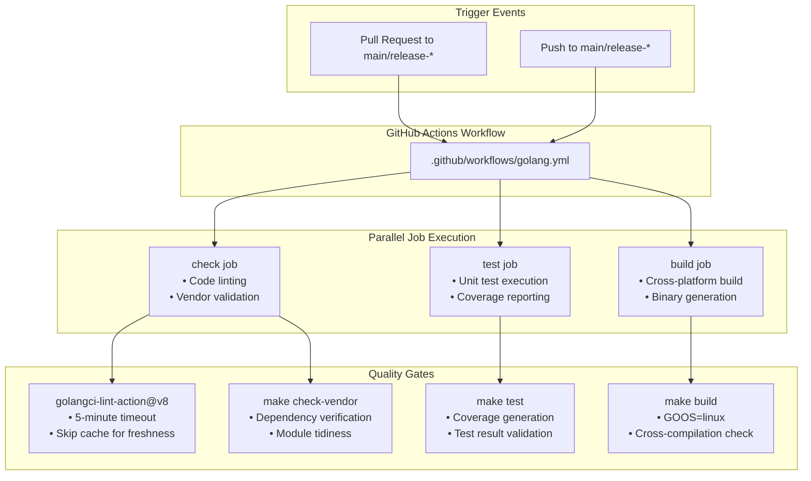
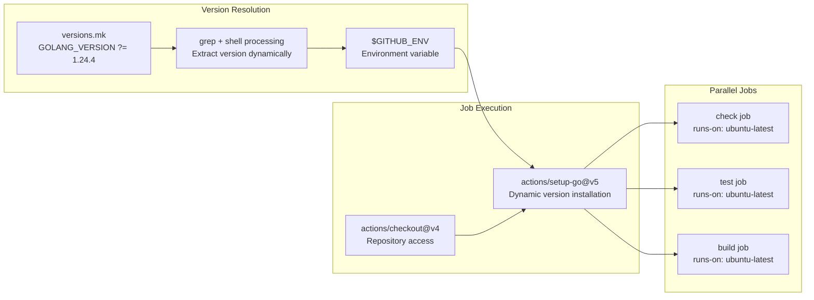
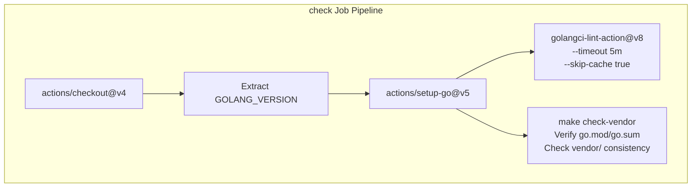
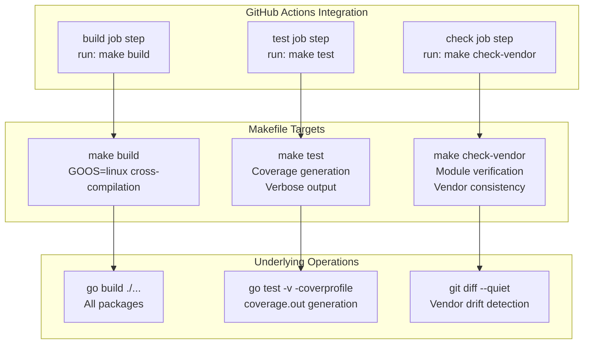
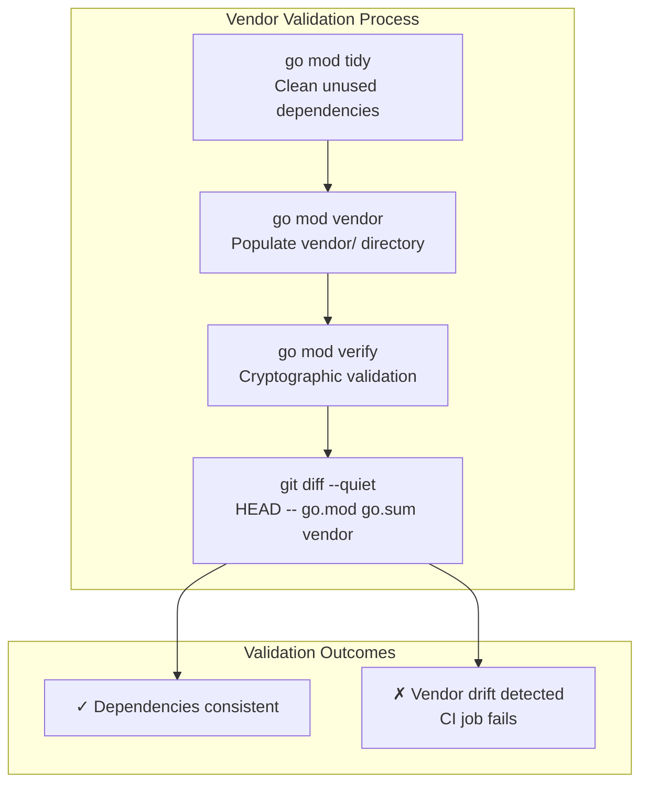
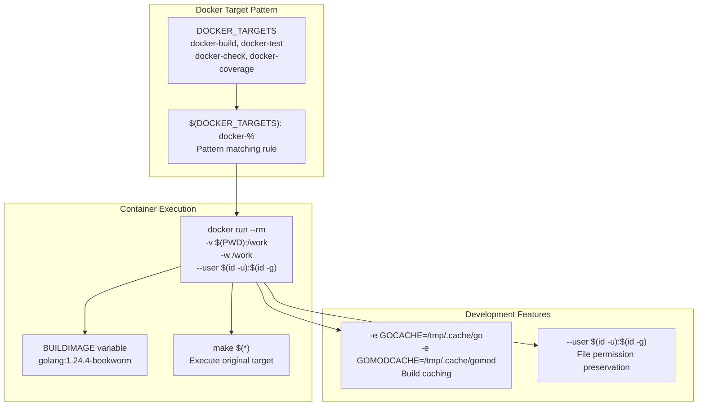
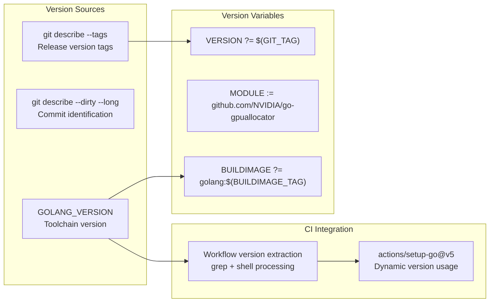
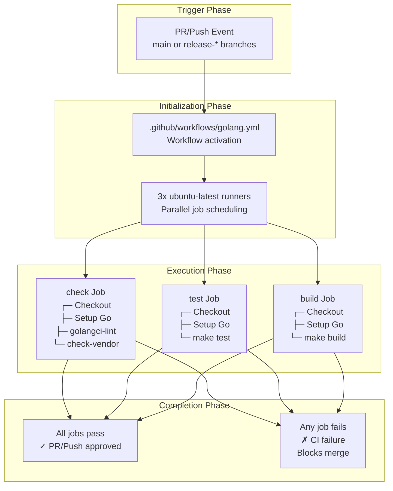

<!-- source: DeepWiki mcp.deepwiki.com · repo NVIDIA/go-gpuallocator · page 5.2 CI/CD Pipeline · fetched 2026-10-26 -->

# CI/CD Pipeline

<details>
<summary>Relevant source files</summary>

The following files were used as context for generating this wiki page:

- [.github/workflows/golang.yml](.github/workflows/golang.yml)
- [.golangci.yml](.golangci.yml)
- [Makefile](Makefile)
- [versions.mk](versions.mk)

</details>


## Purpose and Scope

This document covers the automated testing, building, and code quality enforcement system for the go-gpuallocator project. The CI/CD pipeline ensures code quality through automated linting, testing, and build verification on every pull request and push to main branches.

For information about the local development build system, see [Build System](#5.1). For dependency management details, see [Dependency Management](#5.3).

## CI/CD Architecture Overview

The CI/CD pipeline is built around GitHub Actions with three parallel execution paths that validate different aspects of the codebase:



Sources: [.github/workflows/golang.yml:15-81](), [Makefile:31-32]()

## GitHub Actions Workflow Configuration

The main workflow orchestrates three independent jobs that run in parallel to maximize efficiency:

### Job Matrix and Go Version Management



The workflow dynamically extracts the Go version from `versions.mk` using shell commands:
```bash
GOLANG_VERSION=$( grep "GOLANG_VERSION ?=" versions.mk )
echo "GOLANG_VERSION=${GOLANG_VERSION##GOLANG_VERSION ?= }" >> $GITHUB_ENV
```

Sources: [.github/workflows/golang.yml:33-41](), [.github/workflows/golang.yml:56-64](), [.github/workflows/golang.yml:72-79](), [versions.mk:24]()

### Code Quality Enforcement Jobs

| Job Name | Primary Function | Key Actions | Failure Conditions |
|----------|-----------------|-------------|-------------------|
| `check` | Code quality validation | `golangci-lint-action@v8`, `make check-vendor` | Linting errors, vendor inconsistencies |
| `test` | Unit test execution | `make test` | Test failures, insufficient coverage |
| `build` | Build verification | `make build` | Compilation errors, cross-platform issues |

The `check` job implements comprehensive code quality gates:



Sources: [.github/workflows/golang.yml:28-49]()

## Build System Integration

The CI/CD pipeline leverages the local build system through standardized `make` targets, ensuring consistency between local development and automated testing:

### Make Target Integration



The build target enforces Linux cross-compilation to ensure deployment compatibility:
- `GOOS=linux` environment variable set in [Makefile:26]()
- All package building via `go build ./...` in [Makefile:29]()

Sources: [.github/workflows/golang.yml:65](), [.github/workflows/golang.yml:80](), [.github/workflows/golang.yml:49](), [Makefile:28-29](), [Makefile:58-59](), [Makefile:70-71]()

## Code Quality Enforcement

The pipeline implements multi-layered code quality enforcement through linting configuration and automated checks:

### Linting Configuration

The `.golangci.yml` configuration enables specific linters with security and code quality focus:

| Linter Category | Enabled Linters | Purpose |
|----------------|----------------|---------|
| Context handling | `contextcheck` | Context usage validation |
| Code review | `gocritic` | Style and performance suggestions |
| Security | `gosec` | Security vulnerability detection |
| Basic quality | `misspell`, `unconvert` | Typos and unnecessary conversions |

### Test File Exception Handling

The linting system includes specialized rules for test files to accommodate testing patterns:

```yaml
rules:
  - linters: [gosec]
    path: .*_test.go
    text: 'G601: Implicit memory aliasing in for loop'
  - linters: [gosec] 
    path: .*_test.go
    text: 'G306: Expect WriteFile permissions to be 0600 or less'
```

Sources: [.golangci.yml:1-42](), [.github/workflows/golang.yml:42-47]()

### Vendor Dependency Validation

The `check-vendor` target ensures dependency integrity through a multi-step verification process:



This process detects "vendor drift" where the `vendor/` directory doesn't match declared dependencies, preventing deployment of inconsistent dependency states.

Sources: [Makefile:65-71]()

## Docker Development Environment

While the CI/CD pipeline runs directly on Ubuntu runners, the build system provides Docker integration for consistent development environments:

### Docker Build Integration

The `docker-*` targets in the Makefile enable containerized execution of any build target:



The Docker integration provides cache optimization and user permission handling for seamless development workflow.

Sources: [Makefile:15](), [Makefile:23](), [Makefile:85-95](), [versions.mk:26-27]()

## Version Management and Release Integration

The CI/CD system integrates with Git-based version management through the `versions.mk` configuration:

### Version Resolution System



The system supports release branch workflows through branch trigger patterns:
- `main` branch for primary development
- `release-*` pattern for release maintenance branches

Sources: [versions.mk:15-27](), [.github/workflows/golang.yml:17-25]()

## Pipeline Execution Flow

The complete CI/CD execution follows this flow for every triggered event:



The parallel execution model provides fast feedback while ensuring comprehensive validation across code quality, functionality, and build integrity dimensions.

Sources: [.github/workflows/golang.yml:27-81]()

---

