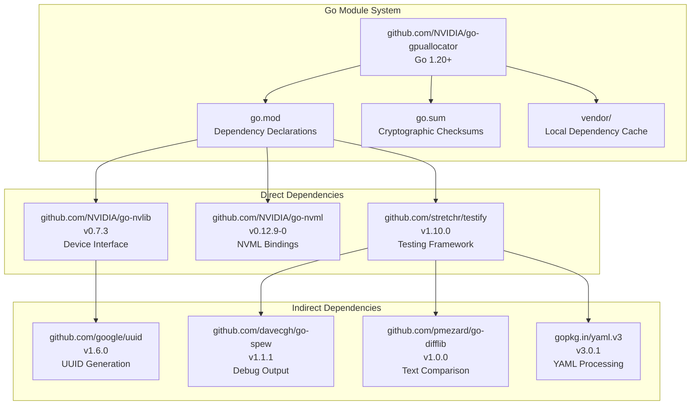
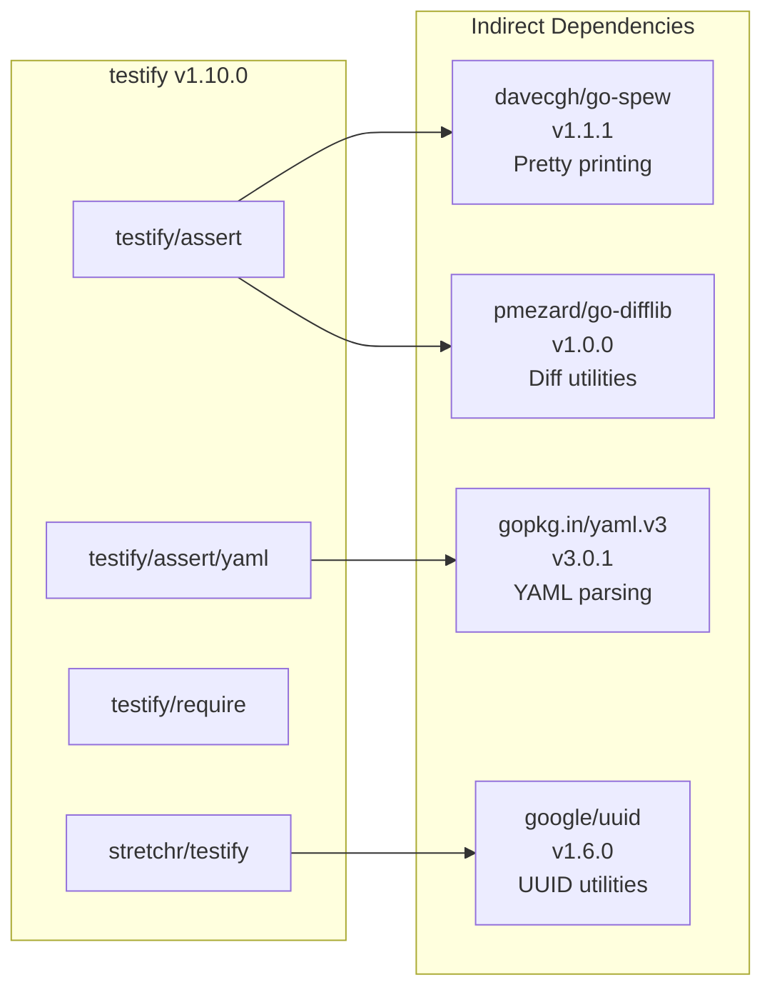
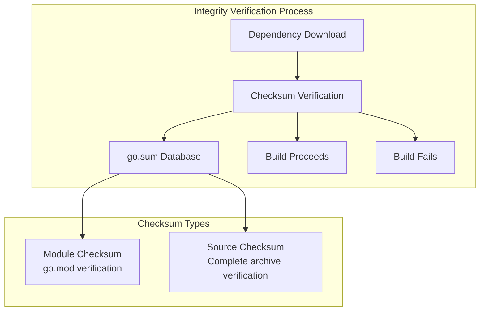

<!-- source: DeepWiki mcp.deepwiki.com · repo NVIDIA/go-gpuallocator · page 5.3 Dependency Management · fetched 2026-10-26 -->

# Dependency Management

<details>
<summary>Relevant source files</summary>

The following files were used as context for generating this wiki page:

- [go.mod](go.mod)
- [go.sum](go.sum)
- [vendor/modules.txt](vendor/modules.txt)

</details>


## Purpose and Scope

This document covers the dependency management system for the go-gpuallocator project, including Go module configuration, integrity verification, and vendored dependency management. This system ensures reproducible builds and supply chain security through cryptographic verification of all external dependencies.

For information about the build system that utilizes these dependencies, see [Build System](#5.1). For CI/CD integration with dependency management, see [CI/CD Pipeline](#5.2).

## Go Module System Overview

The go-gpuallocator project uses Go's standard module system for dependency management. The module is defined with the identifier `github.com/NVIDIA/go-gpuallocator` and requires Go version 1.20 or later.



**Dependency Hierarchy Overview**

Sources: [go.mod:1-16](), [vendor/modules.txt:1-26]()

## Direct Dependencies

The project declares three direct dependencies in its `require` section, each serving a specific architectural purpose:

| Dependency | Version | Purpose | Go Version Requirement |
|------------|---------|---------|----------------------|
| `github.com/NVIDIA/go-nvlib` | v0.7.3 | High-level NVIDIA device interface | Go 1.20 |
| `github.com/NVIDIA/go-nvml` | v0.12.9-0 | Low-level NVML API bindings | Go 1.20 |
| `github.com/stretchr/testify` | v1.10.0 | Testing framework and assertions | Go 1.17 |

### NVIDIA Integration Dependencies

The two NVIDIA libraries provide the core hardware integration capabilities:

- **go-nvlib**: Provides the high-level `device` package for GPU management and MIG support
- **go-nvml**: Provides low-level NVML bindings including `dl`, `nvml`, and `mock` packages

### Testing Infrastructure Dependency

The `testify` library provides the complete testing infrastructure used throughout the project, including assertion libraries and YAML testing capabilities.

Sources: [go.mod:5-9](), [vendor/modules.txt:1-8](), [vendor/modules.txt:18-22]()

## Indirect Dependencies

The project automatically includes four indirect dependencies that are required by the direct dependencies:



**Indirect Dependency Graph**

These indirect dependencies provide supporting functionality:

- **go-spew**: Deep pretty-printing for Go data structures in test assertions
- **go-difflib**: Text diffing utilities for test failure reporting
- **yaml.v3**: YAML parsing and serialization for configuration testing
- **google/uuid**: UUID generation utilities used by NVIDIA libraries

Sources: [go.mod:11-16](), [vendor/modules.txt:9-25]()

## Integrity Verification System

The `go.sum` file provides cryptographic integrity verification for all dependencies using SHA-256 checksums. Each dependency has two checksum entries:

1. **Module checksum**: Verifies the module's `go.mod` file
2. **Source checksum**: Verifies the complete source code archive



**Dependency Integrity Verification Workflow**

### Checksum Format

Each dependency has entries in the following format:
```
github.com/NVIDIA/go-nvlib v0.7.3 h1:kXc8PkWUlrwedSpM4fR8xT/DAq1NKy8HqhpgteFcGAw=
github.com/NVIDIA/go-nvlib v0.7.3/go.mod h1:i95Je7GinMy/+BDs++DAdbPmT2TubjNP8i8joC7DD7I=
```

The first line verifies the complete module source, while the second verifies only the `go.mod` file.

Sources: [go.sum:1-16]()

## Vendored Dependencies

The project uses Go's vendoring mechanism to store all dependencies locally in the `vendor/` directory. The `vendor/modules.txt` file serves as a manifest listing all vendored packages and their metadata.

### Vendor Manifest Structure

Each vendored dependency is documented with:
- Module path and version
- Explicit/implicit marking
- Go version requirements  
- Individual package listings

Example entry:
```
# github.com/NVIDIA/go-nvlib v0.7.3
## explicit; go 1.20
github.com/NVIDIA/go-nvlib/pkg/nvlib/device
```

### Package-Level Vendoring

The vendoring system includes specific packages rather than entire modules:

| Module | Vendored Packages |
|--------|------------------|
| go-nvlib | `pkg/nvlib/device` |
| go-nvml | `pkg/dl`, `pkg/nvml`, `pkg/nvml/mock` |
| testify | `assert`, `assert/yaml`, `require` |
| go-spew | `spew` |
| go-difflib | `difflib` |
| uuid | `(root package)` |
| yaml.v3 | `(root package)` |

This selective approach reduces vendor directory size by including only the packages actually used by the project.

Sources: [vendor/modules.txt:1-26]()

## Dependency Categories

The project's dependencies fall into three functional categories:

### Hardware Integration Layer
- **go-nvlib**: High-level GPU device management
- **go-nvml**: Low-level NVML API access
- **google/uuid**: UUID utilities for device identification

### Testing Infrastructure
- **testify**: Core testing framework with assertions
- **go-spew**: Debug output formatting for test failures
- **go-difflib**: Text comparison for test assertions  
- **yaml.v3**: Configuration parsing in tests

### Build System Integration
All dependencies integrate with the Go module system and are automatically managed during:
- Local development builds
- Docker container builds
- CI/CD pipeline execution
- Vendor directory synchronization

Sources: [go.mod:1-16](), [vendor/modules.txt:1-26](), [go.sum:1-16]()

---

