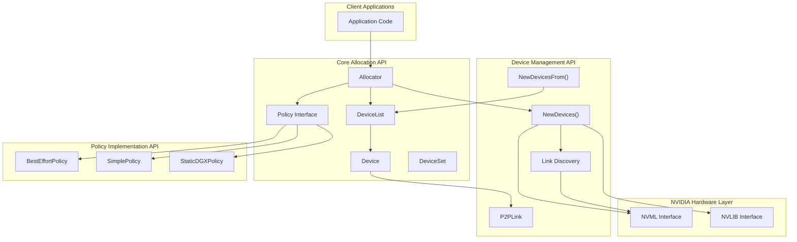
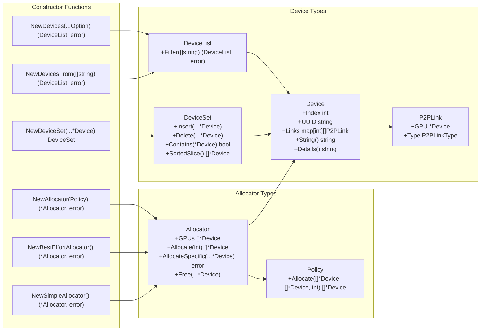
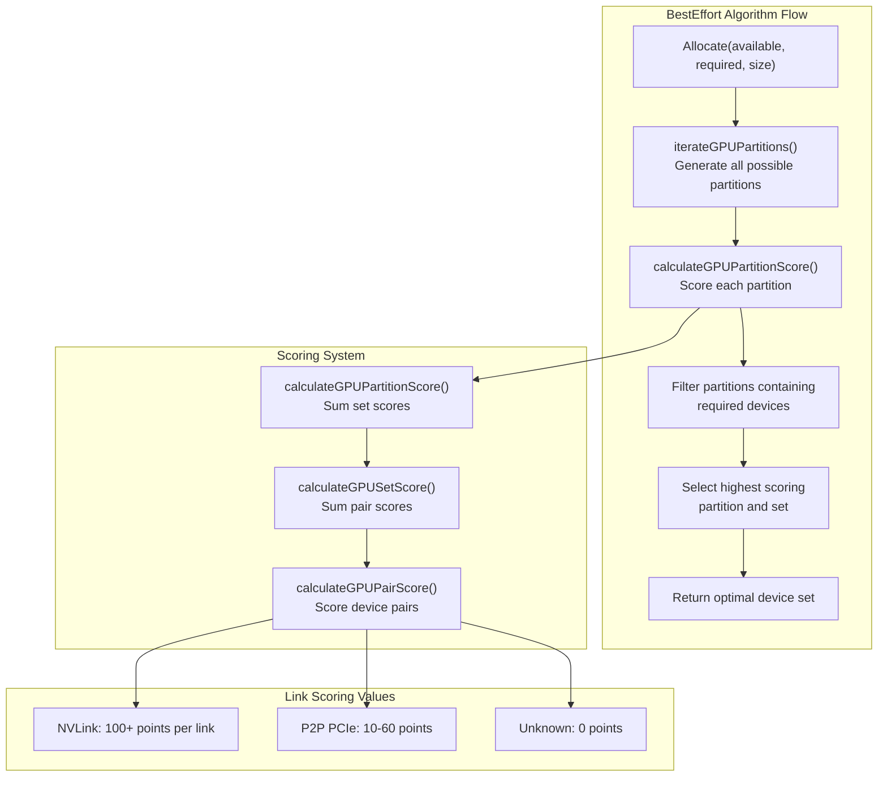
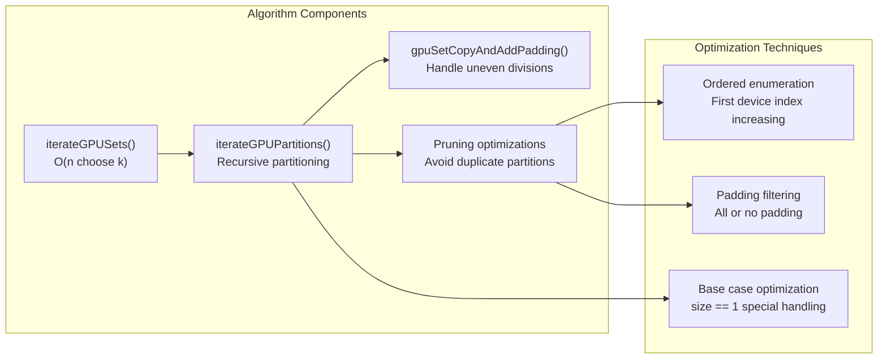

<!-- source: DeepWiki mcp.deepwiki.com · repo NVIDIA/go-gpuallocator · page 6 API Reference · fetched 2026-10-26 -->

# API Reference

<details>
<summary>Relevant source files</summary>

The following files were used as context for generating this wiki page:

- [gpuallocator/allocator.go](gpuallocator/allocator.go)
- [gpuallocator/besteffort_policy.go](gpuallocator/besteffort_policy.go)
- [gpuallocator/device.go](gpuallocator/device.go)
- [internal/links/device.go](internal/links/device.go)

</details>


This document provides comprehensive reference documentation for all public interfaces, types, and functions exposed by the go-gpuallocator system. This includes the core allocation APIs, device management interfaces, and policy implementations for intelligent GPU resource allocation.

For implementation details of specific allocation algorithms, see [Allocation Policies](#2.2). For details about the underlying NVIDIA integration layer, see [NVIDIA Integration Layer](#3).

## API Architecture Overview

The go-gpuallocator API is structured around three main interface layers that work together to provide intelligent GPU allocation:



Sources: [gpuallocator/allocator.go:1-123](), [gpuallocator/device.go:1-259](), [gpuallocator/besteffort_policy.go:1-399]()

## Core Type Relationships

The following diagram shows the relationships between the main types and their key methods:



Sources: [gpuallocator/allocator.go:12-32](), [gpuallocator/device.go:16-73]()

## Allocator Interface

### Core Allocator Type

The `Allocator` struct is the primary interface for GPU resource management, providing methods to allocate and free GPU devices based on configurable policies.

| Method | Signature | Description |
|--------|-----------|-------------|
| `Allocate` | `(num int) []*Device` | Allocate `num` GPUs using the configured policy |
| `AllocateSpecific` | `(devices ...*Device) error` | Allocate specific GPU devices |
| `Free` | `(devices ...*Device)` | Free GPU devices back to the available pool |

**Fields:**
- `GPUs []*Device` - All GPU devices managed by this allocator
- `policy Policy` - The allocation policy to use (private)
- `remaining DeviceSet` - Currently available devices (private) 
- `allocated DeviceSet` - Currently allocated devices (private)

Sources: [gpuallocator/allocator.go:12-21](), [gpuallocator/allocator.go:83-122]()

### Allocator Constructors

| Constructor | Signature | Description |
|-------------|-----------|-------------|
| `NewAllocator` | `(policy Policy) (*Allocator, error)` | Create allocator with custom policy |
| `NewSimpleAllocator` | `() (*Allocator, error)` | Create allocator with Simple policy |
| `NewBestEffortAllocator` | `() (*Allocator, error)` | Create allocator with BestEffort policy |

All constructors automatically discover available GPU devices using NVML and initialize the allocator state.

Sources: [gpuallocator/allocator.go:34-68]()

### Policy Interface

The `Policy` interface enables pluggable allocation strategies:

```go
type Policy interface {
    Allocate(available []*Device, required []*Device, size int) []*Device
}
```

**Parameters:**
- `available` - Devices available for allocation
- `required` - Devices that must be included in the allocation
- `size` - Number of devices to allocate

**Returns:** Slice of allocated devices, or empty slice if allocation fails

Sources: [gpuallocator/allocator.go:22-32]()

## Device Management API

### Device Type

The `Device` struct represents a single GPU device with its properties and interconnect topology:

**Fields:**
| Field | Type | Description |
|-------|------|-------------|
| `Index` | `int` | Device index in the system |
| `UUID` | `string` | Unique device identifier |
| `PCI.BusID` | `string` | PCI bus identifier |
| `CPUAffinity` | `*uint` | CPU socket affinity |
| `Links` | `map[int][]P2PLink` | P2P links to other devices |

**Methods:**
- `String() string` - Returns device index as string
- `Details() string` - Returns detailed device information including topology

Sources: [gpuallocator/device.go:16-34](), [gpuallocator/device.go:171-191]()

### Device Discovery Functions

| Function | Signature | Description |
|----------|-----------|-------------|
| `NewDevices` | `(opts ...Option) (DeviceList, error)` | Discover all available GPU devices |
| `NewDevicesFrom` | `(uuids []string) (DeviceList, error)` | Create devices from specific UUIDs |

The `NewDevices` function supports configuration options for customizing device discovery behavior.

Sources: [gpuallocator/device.go:75-89](), [gpuallocator/device.go:139-149]()

### P2P Link Information

The `P2PLink` struct represents connectivity between GPU devices:

```go
type P2PLink struct {
    GPU  *Device
    Type P2PLinkType
}
```

**P2PLinkType Constants:**
- `P2PLinkCrossCPU` - Cross-CPU connection
- `P2PLinkSameCPU` - Same CPU connection  
- `P2PLinkHostBridge` - Host bridge connection
- `P2PLinkSingleSwitch` - Single PCIe switch
- `P2PLinkSameBoard` - Same board connection
- `SingleNVLINKLink` through `EighteenNVLINKLinks` - NVLink connections

Sources: [gpuallocator/device.go:61-67](), [internal/links/device.go:26-57]()

### Device Collections

#### DeviceList

`DeviceList` is a slice type `[]*Device` with additional methods:

| Method | Signature | Description |
|--------|-----------|-------------|
| `Filter` | `(uuids []string) (DeviceList, error)` | Filter devices by UUID list |

Sources: [gpuallocator/device.go:69-70](), [gpuallocator/device.go:151-168]()

#### DeviceSet  

`DeviceSet` is a map type `map[string]*Device` for managing unique device collections:

| Method | Signature | Description |
|--------|-----------|-------------|
| `Insert` | `(devices ...*Device)` | Add devices to the set |
| `Delete` | `(devices ...*Device)` | Remove devices from the set |
| `Contains` | `(device *Device) bool` | Check if device exists in set |
| `ContainsAll` | `(devices []*Device) bool` | Check if all devices exist in set |
| `SortedSlice` | `() []*Device` | Return sorted slice by device index |

**Constructor:**
- `NewDeviceSet(devices ...*Device) DeviceSet`

Sources: [gpuallocator/device.go:72-73](), [gpuallocator/device.go:193-253]()

## Policy Implementation API

### BestEffort Policy

The BestEffort policy implements topology-aware allocation using connectivity scoring:



**Constructor:**
- `NewBestEffortPolicy() Policy`

**Key Features:**
- Considers all possible GPU combinations
- Optimizes for maximum total system score
- Prefers NVLink connections (100+ points per link)
- Falls back to PCIe hierarchy scoring (10-60 points)

Sources: [gpuallocator/besteffort_policy.go:13-18](), [gpuallocator/besteffort_policy.go:36-95](), [gpuallocator/besteffort_policy.go:298-374]()

### Link Scoring Algorithm

The BestEffort policy uses the following scoring system for device pairs:

| Link Type | Score | Description |
|-----------|-------|-------------|
| P2PLinkCrossCPU | 10 | Cross-CPU socket |
| P2PLinkSameCPU | 20 | Same CPU socket |
| P2PLinkHostBridge | 30 | Host bridge |
| P2PLinkMultiSwitch | 40 | Multiple PCIe switches |
| P2PLinkSingleSwitch | 50 | Single PCIe switch |
| P2PLinkSameBoard | 60 | Same board |
| SingleNVLINKLink | 100 | One NVLink connection |
| TwoNVLINKLinks | 200 | Two NVLink connections |
| ... | ... | Up to 18 NVLinks (1800 points) |

Sources: [gpuallocator/besteffort_policy.go:320-371]()

### Policy Algorithm Complexity

The BestEffort policy implements sophisticated algorithms for optimal allocation:



Sources: [gpuallocator/besteffort_policy.go:159-296]()

---

