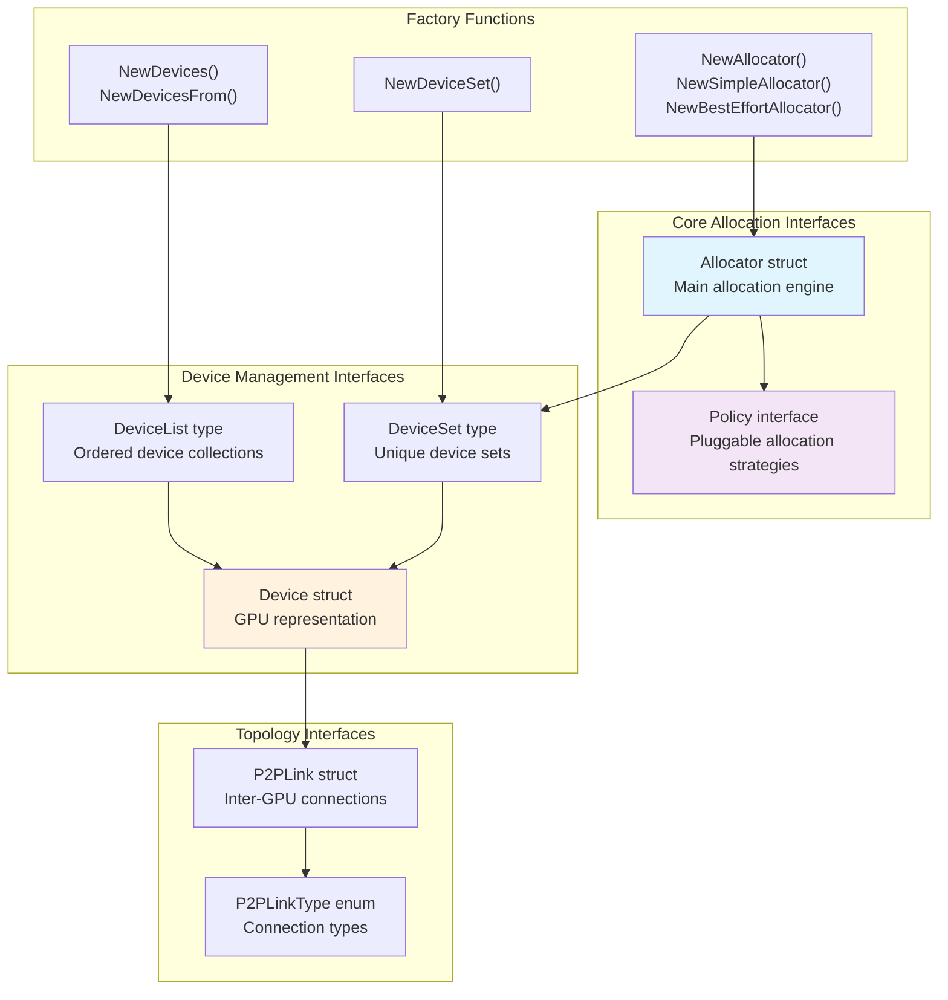
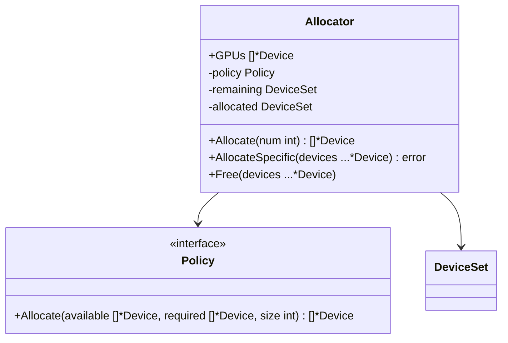
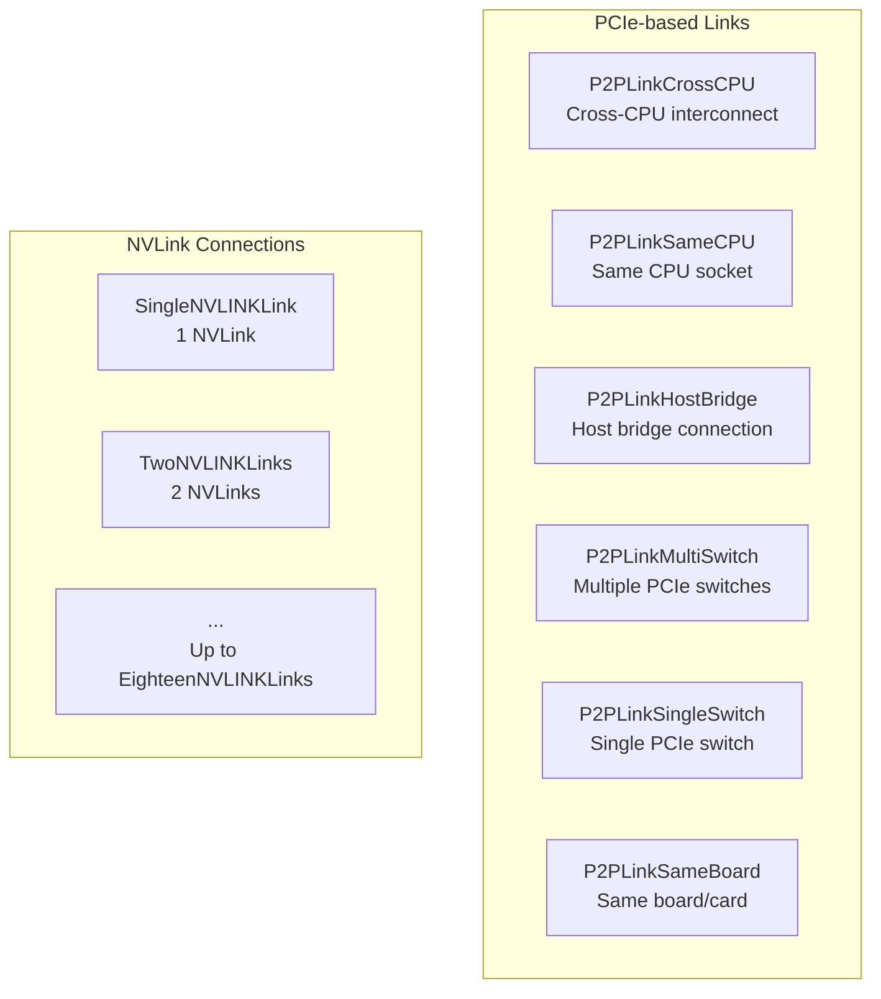
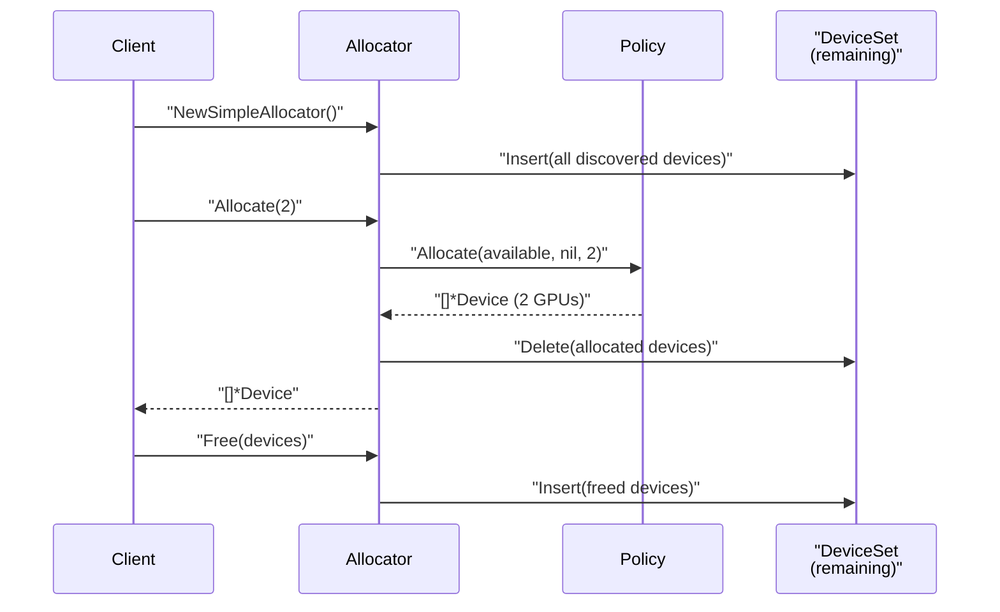
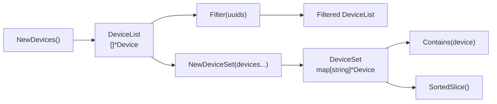

<!-- source: DeepWiki mcp.deepwiki.com · repo NVIDIA/go-gpuallocator · page 6.1 Core Interfaces · fetched 2026-10-26 -->

# Core Interfaces

<details>
<summary>Relevant source files</summary>

The following files were used as context for generating this wiki page:

- [gpuallocator/allocator.go](gpuallocator/allocator.go)
- [gpuallocator/device.go](gpuallocator/device.go)
- [internal/links/device.go](internal/links/device.go)

</details>


This document covers the primary public APIs and interfaces exposed by the go-gpuallocator system. These interfaces provide the main entry points for GPU allocation, device management, and topology discovery functionality.

For details about allocation policy implementations, see [Policy APIs](#6.3). For device discovery and management internals, see [Device Management APIs](#6.2).

## Interface Architecture Overview

The go-gpuallocator system exposes several key interfaces that work together to provide intelligent GPU allocation capabilities:



**Sources:** [gpuallocator/allocator.go:14-32](), [gpuallocator/device.go:18-73](), [internal/links/device.go:26-67]()

## Allocator Interface

The `Allocator` struct provides the primary interface for GPU resource management, maintaining state about available and allocated devices.

### Core Structure



**Sources:** [gpuallocator/allocator.go:14-20]()

### Constructor Functions

| Function | Purpose | Usage |
|----------|---------|-------|
| `NewAllocator(policy Policy)` | Creates allocator with custom policy | For implementing custom allocation strategies |
| `NewSimpleAllocator()` | Creates allocator with simple sequential policy | For basic GPU allocation needs |
| `NewBestEffortAllocator()` | Creates allocator with topology-aware policy | For performance-optimized allocations |

**Sources:** [gpuallocator/allocator.go:36-44](), [gpuallocator/allocator.go:47-68]()

### Allocation Methods

The allocator provides two primary allocation patterns:

- **`Allocate(num int) []*Device`**: Requests `num` GPUs using the configured policy algorithm
- **`AllocateSpecific(devices ...*Device) error`**: Allocates specific GPUs by reference, returning error if unavailable

**Sources:** [gpuallocator/allocator.go:85-95](), [gpuallocator/allocator.go:99-116]()

## Policy Interface

The `Policy` interface enables pluggable allocation strategies through a single method:

```go
type Policy interface {
    Allocate(available []*Device, required []*Device, size int) []*Device
}
```

### Method Parameters

| Parameter | Type | Description |
|-----------|------|-------------|
| `available` | `[]*Device` | Pool of unallocated devices to choose from |
| `required` | `[]*Device` | Previously allocated devices that influence selection |
| `size` | `int` | Number of devices to allocate |

**Return Value**: Subset of `available` devices of length `size`, or empty slice if allocation fails.

**Sources:** [gpuallocator/allocator.go:24-32]()

## Device Management Interfaces

### Device Structure

The `Device` struct represents a single GPU with its properties and topology information:

```mermaid
classDiagram
    class Device {
        +Index int
        +Links map[int][]P2PLink
        +UUID string
        +PCI struct{BusID string}
        +CPUAffinity *uint
        +String() string
        +Details() string
    }
    
    class P2PLink {
        +GPU *Device
        +Type P2PLinkType
    }
    
    Device --> P2PLink
```

**Sources:** [gpuallocator/device.go:18-34]()

### Collection Types

The system provides two collection types for managing sets of devices:

#### DeviceList
- **Type**: `[]*Device` (slice alias)
- **Purpose**: Ordered collections with index-based access
- **Key Method**: `Filter(uuids []string) (DeviceList, error)` - filters devices by UUID

#### DeviceSet  
- **Type**: `map[string]*Device` (map alias)
- **Purpose**: Unique collections with fast membership testing
- **Key Methods**:
  - `Insert(devices ...*Device)` - adds devices to set
  - `Delete(devices ...*Device)` - removes devices from set
  - `Contains(device *Device) bool` - membership test
  - `ContainsAll(devices []*Device) bool` - subset test
  - `SortedSlice() []*Device` - converts to ordered slice

**Sources:** [gpuallocator/device.go:70-73](), [gpuallocator/device.go:153-167](), [gpuallocator/device.go:201-253]()

### Device Discovery Functions

| Function | Return Type | Purpose |
|----------|-------------|---------|
| `NewDevices(opts ...Option)` | `DeviceList, error` | Discovers all available GPUs with P2P topology |
| `NewDevicesFrom(uuids []string)` | `DeviceList, error` | Creates devices from specific GPU UUIDs |

**Sources:** [gpuallocator/device.go:76-89](), [gpuallocator/device.go:140-149]()

## P2P Link Interface

The system represents inter-GPU connectivity through the `P2PLink` structure and `P2PLinkType` enumeration:

### Link Types



**Sources:** [internal/links/device.go:32-57]()

### Discovery Functions

The link discovery system provides two primary functions:

- **`GetP2PLink(dev1, dev2 device.Device) (P2PLinkType, error)`**: Discovers PCIe topology relationships
- **`GetNVLink(dev1, dev2 device.Device) (P2PLinkType, error)`**: Counts NVLink connections between devices

**Sources:** [internal/links/device.go:116-139](), [internal/links/device.go:142-201]()

## Usage Patterns

### Basic GPU Allocation



**Sources:** [gpuallocator/allocator.go:36-38](), [gpuallocator/allocator.go:85-95](), [gpuallocator/allocator.go:119-122]()

### Device Filtering and Selection



**Sources:** [gpuallocator/device.go:76-89](), [gpuallocator/device.go:153-167](), [gpuallocator/device.go:194-253]()

---

