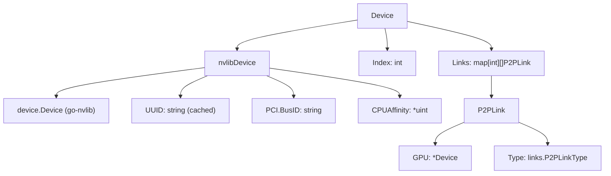
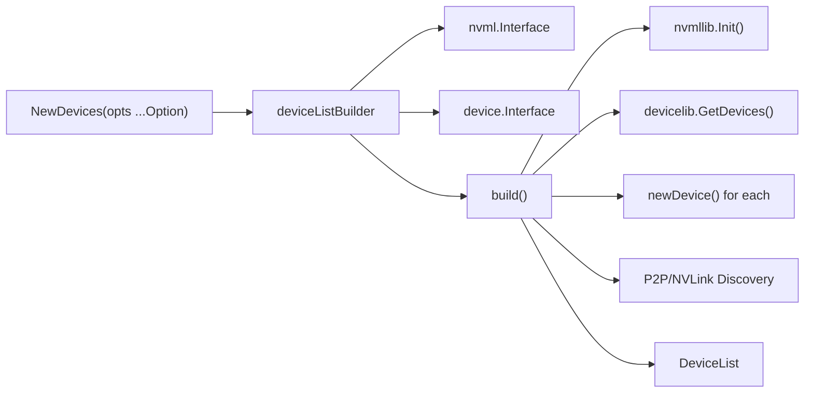
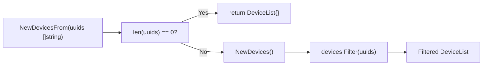
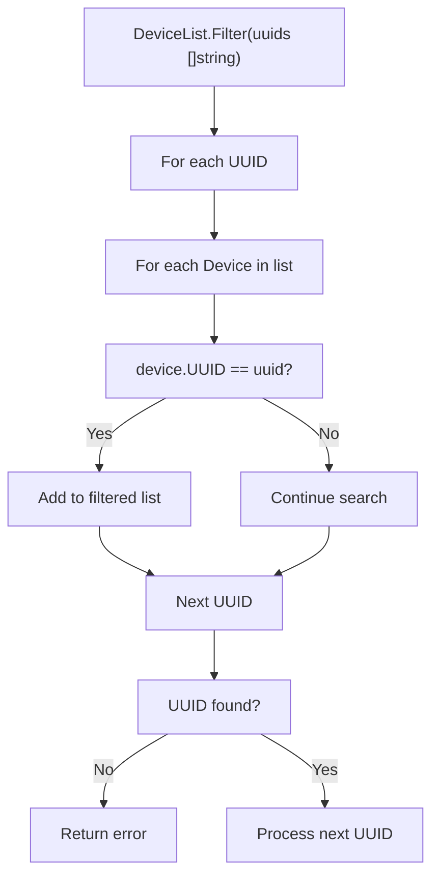
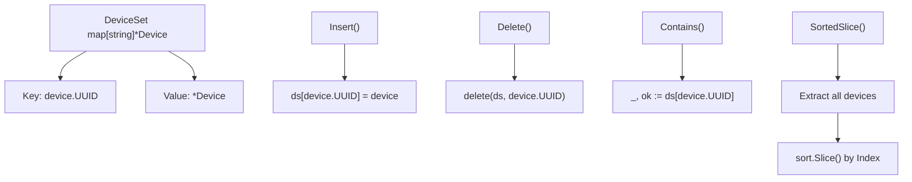
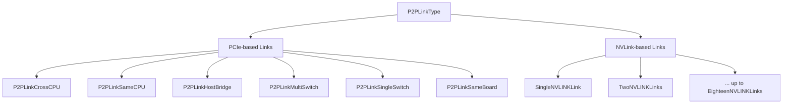
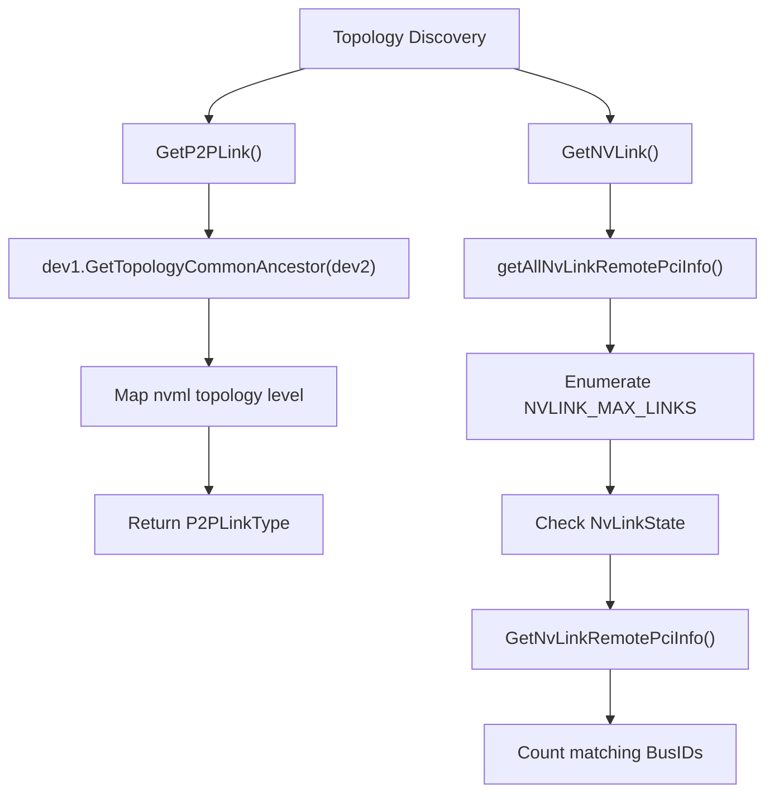
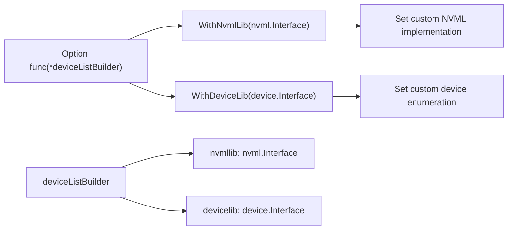

<!-- source: DeepWiki mcp.deepwiki.com · repo NVIDIA/go-gpuallocator · page 6.2 Device Management APIs · fetched 2026-10-26 -->

# Device Management APIs

Relevant source files

The following files were used as context for generating this wiki page:

- [gpuallocator/device.go](gpuallocator/device.go)
- [gpuallocator/device_test.go](gpuallocator/device_test.go)
- [gpuallocator/options.go](gpuallocator/options.go)
- [internal/links/device.go](internal/links/device.go)
- [internal/links/pciinfo.go](internal/links/pciinfo.go)

This document covers the device discovery, filtering, and topology APIs provided by the go-gpuallocator system. These APIs enable applications to enumerate NVIDIA GPU devices, discover their interconnect topology, and create filtered collections of devices for allocation purposes.

For information about allocation policies that operate on these devices, see [Policy APIs](#6.3). For the main allocator interfaces that consume device lists, see [Core Interfaces](#6.1).

## Core Device Types

The device management system provides several fundamental types for representing and organizing GPU devices:

### Device Structure

The `Device` struct represents a single GPU device with its hardware properties and P2P connectivity information:

**Sources:** [gpuallocator/device.go:16-34]()

### Collection Types

The system provides two collection types for organizing devices:

| Type | Description | Use Case |
|------|-------------|----------|
| `DeviceList` | Ordered slice of devices | Sequential operations, filtering |
| `DeviceSet` | Map-based unique device collection | Fast lookups, set operations |

**Sources:** [gpuallocator/device.go:69-73]()

## Device Discovery APIs

### Primary Discovery Function

The `NewDevices` function serves as the main entry point for device discovery:

The discovery process follows these steps:

1. **NVML Initialization** - Initialize the NVIDIA Management Library
2. **Device Enumeration** - Retrieve all available GPU devices
3. **Device Construction** - Create `Device` structs with properties
4. **Topology Discovery** - Build P2P and NVLink connectivity maps
5. **Cleanup** - Shutdown NVML and return device list

**Sources:** [gpuallocator/device.go:75-137]()

### UUID-Based Discovery

The `NewDevicesFrom` function creates device lists from specific device UUIDs:

**Sources:** [gpuallocator/device.go:139-149]()

## Device Filtering and Selection

### Filter Operation

The `Filter` method on `DeviceList` enables UUID-based device selection:

The filter operation ensures all requested UUIDs exist in the device list, returning an error if any UUID is not found.

**Sources:** [gpuallocator/device.go:151-168]()

## Device Sets and Collections

### DeviceSet Operations

`DeviceSet` provides set-based operations for device collections:

| Operation | Function | Description |
|-----------|----------|-------------|
| Create | `NewDeviceSet(devices ...*Device)` | Create new set with optional initial devices |
| Insert | `Insert(devices ...*Device)` | Add devices to set |
| Delete | `Delete(devices ...*Device)` | Remove devices from set |
| Contains | `Contains(device *Device)` | Check device membership |
| ContainsAll | `ContainsAll(devices []*Device)` | Check if all devices present |
| Sort | `SortedSlice()` | Return sorted slice by device index |

**Sources:** [gpuallocator/device.go:193-253]()

### Set Implementation Details

**Sources:** [gpuallocator/device.go:200-252]()

## P2P Topology and Links

### Link Type Hierarchy

The system categorizes device interconnects using `P2PLinkType`:

**Sources:** [internal/links/device.go:26-57]()

### Topology Discovery Process

P2P link discovery uses both NVML topology queries and NVLink enumeration:

**Sources:** [internal/links/device.go:115-201]()

### PCI Information Utilities

The `PciInfo` type provides utilities for PCI device information:

| Method | Purpose |
|--------|---------|
| `BusID()` | Convert PCI bus ID to string format |
| `CPUAffinity()` | Get CPU/NUMA node affinity |
| `NumaNode()` | Read NUMA node from sysfs |

**Sources:** [internal/links/pciinfo.go:29-74]()

## Configuration Options

### Device List Builder Options

The `Option` type enables configuration of device discovery:

This options pattern allows for dependency injection, particularly useful for testing with mock implementations.

**Sources:** [gpuallocator/options.go:24-45]()

### Default Behavior

When no options are specified, the system uses default implementations:
- `nvml.New()` for NVML interface
- `device.New(nvmllib)` for device enumeration

The `nvmlNew` variable can be overridden for testing purposes.

**Sources:** [gpuallocator/device.go:255-258](), [gpuallocator/device_test.go:84-93]()

---

