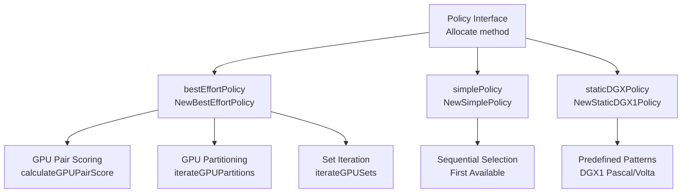
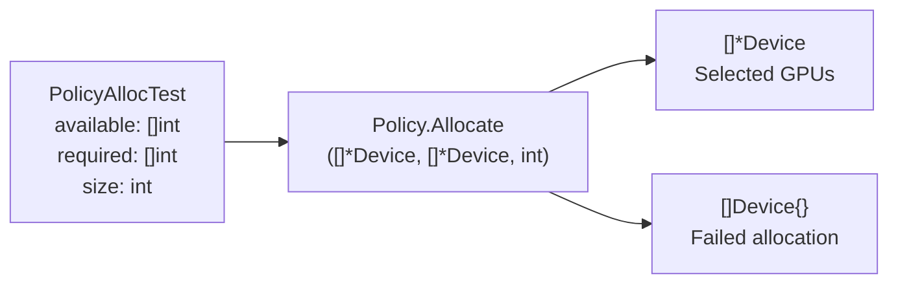
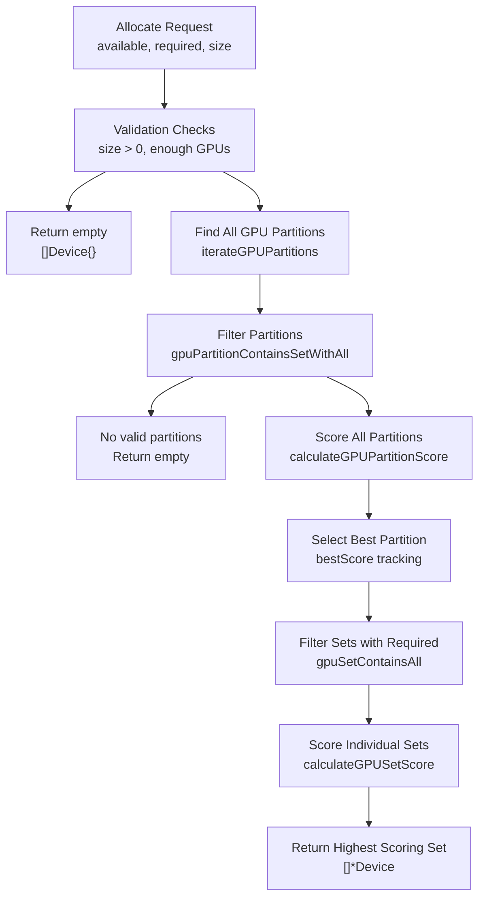
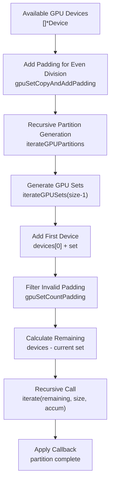
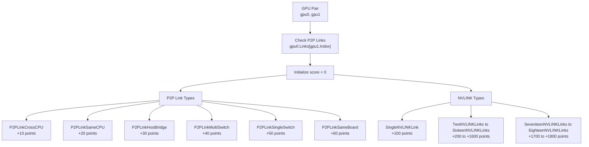
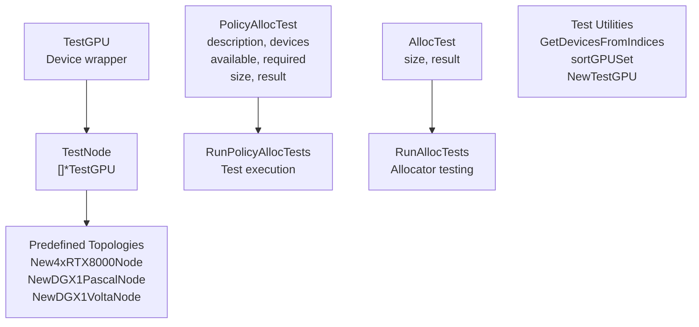

<!-- source: DeepWiki mcp.deepwiki.com · repo NVIDIA/go-gpuallocator · page 6.3 Policy APIs · fetched 2026-10-26 -->

# Policy APIs

Relevant source files

The following files were used as context for generating this wiki page:

- [gpuallocator/besteffort_policy.go](gpuallocator/besteffort_policy.go)
- [gpuallocator/besteffort_test.go](gpuallocator/besteffort_test.go)
- [gpuallocator/common_test.go](gpuallocator/common_test.go)
- [gpuallocator/simple_test.go](gpuallocator/simple_test.go)
- [gpuallocator/staticdgx_test.go](gpuallocator/staticdgx_test.go)

This page documents the allocation policy APIs that determine how GPUs are selected and assigned when requested. Policy APIs provide the core algorithms for intelligent GPU allocation based on topology, interconnect quality, and user requirements. For information about the main allocator engine that uses these policies, see [Allocator Engine](#2.3). For device management and topology discovery, see [Device Discovery and Management](#2.1).

## Policy Interface Overview

The go-gpuallocator system implements a pluggable policy architecture where different allocation strategies can be selected based on workload requirements. All policies implement the `Policy` interface with a single `Allocate` method.

**Sources:** [gpuallocator/besteffort_policy.go:13-18](), [gpuallocator/simple_test.go:9-12](), [gpuallocator/staticdgx_test.go:7-9]()

## Policy Allocation Interface

All policies implement the same allocation signature that takes available devices, required devices, and allocation size. The method signature provides flexibility for constraining allocations to include specific GPUs while optimizing the remaining selections.

| Parameter | Type | Description |
|-----------|------|-------------|
| `available` | `[]*Device` | Pool of GPUs available for allocation |
| `required` | `[]*Device` | GPUs that must be included in allocation |
| `size` | `int` | Total number of GPUs to allocate |
| **Returns** | `[]*Device` | Selected GPU allocation or empty if impossible |

**Sources:** [gpuallocator/besteffort_policy.go:36-47](), [gpuallocator/common_test.go:25-32]()

## BestEffort Policy Implementation

The `bestEffortPolicy` implements a sophisticated allocation algorithm that considers all possible GPU combinations and selects the optimal set based on interconnect quality. The algorithm optimizes for maximum total score across all GPU partitions, not just the greedy best single set.

### Core Algorithm Flow

**Sources:** [gpuallocator/besteffort_policy.go:36-95](), [gpuallocator/besteffort_policy.go:56-67]()

### GPU Partition Generation

The BestEffort policy uses sophisticated algorithms to generate all possible ways to partition available GPUs into sets of the requested size. This ensures optimal global allocation rather than greedy local optimization.

**Sources:** [gpuallocator/besteffort_policy.go:215-296](), [gpuallocator/besteffort_policy.go:133-144]()

## Link Scoring System

The BestEffort policy uses a hierarchical scoring system that assigns points to GPU pairs based on their interconnect quality. Higher scores indicate better communication paths between GPUs.

### GPU Pair Score Calculation

**Sources:** [gpuallocator/besteffort_policy.go:298-374](), [gpuallocator/besteffort_policy.go:320-370]()

### Link Type Priority Hierarchy

| Link Type | Score Range | Description |
|-----------|-------------|-------------|
| NVLINK | 100-1800 | Direct GPU-to-GPU high bandwidth links |
| P2PLinkSameBoard | 60 | GPUs on same physical board |
| P2PLinkSingleSwitch | 50 | Connected via single PCIe switch |
| P2PLinkMultiSwitch | 40 | Multiple PCIe switches in path |
| P2PLinkHostBridge | 30 | Connected via host bridge |
| P2PLinkSameCPU | 20 | Same CPU socket |
| P2PLinkCrossCPU | 10 | Cross CPU socket communication |

**Sources:** [gpuallocator/besteffort_policy.go:321-370]()

## Policy Testing Infrastructure

The testing system provides comprehensive validation of policy behavior using predefined GPU topologies and test cases. The infrastructure supports both unit testing of individual policies and integration testing with the allocator.

### Test Structures and Utilities

**Sources:** [gpuallocator/common_test.go:17-32](), [gpuallocator/common_test.go:113-122](), [gpuallocator/common_test.go:141-408]()

### Predefined Test Topologies

The test infrastructure includes several predefined GPU topologies that represent common hardware configurations:

| Topology | GPUs | Description | Link Configuration |
|----------|------|-------------|-------------------|
| `New4xRTX8000Node` | 4 | Workstation setup | NVLink pairs: 0↔3, 1↔2 |
| `NewDGX1PascalNode` | 8 | DGX-1 Pascal | Full mesh NVLINK, dual socket |
| `NewDGX1VoltaNode` | 8 | DGX-1 Volta | Optimized NVLINK topology |

**Sources:** [gpuallocator/common_test.go:141-408]()

## Policy Comparison and Usage

Different policies are optimized for different use cases and performance characteristics:

### BestEffort Policy
- **Use Case:** Multi-GPU workloads requiring optimal communication
- **Algorithm:** Global optimization considering all GPU combinations  
- **Complexity:** High computational cost for large GPU counts
- **Best For:** Training large models, HPC applications

### Simple Policy  
- **Use Case:** Basic allocation without topology optimization
- **Algorithm:** Sequential selection from available GPUs
- **Complexity:** O(n) linear selection
- **Best For:** Development, testing, simple workloads

### StaticDGX Policy
- **Use Case:** Predefined optimal patterns for DGX systems
- **Algorithm:** Fixed allocation patterns per GPU count
- **Complexity:** O(1) lookup
- **Best For:** Production DGX deployments with known workloads

**Sources:** [gpuallocator/besteffort_test.go:28-124](), [gpuallocator/simple_test.go:9-129](), [gpuallocator/staticdgx_test.go:7-71]()