# Page: Overview

# Overview

<details>
<summary>Relevant source files</summary>

The following files were used as context for generating this wiki page:

- [go.mod](go.mod)
- [gpuallocator/allocator.go](gpuallocator/allocator.go)
- [gpuallocator/besteffort_policy.go](gpuallocator/besteffort_policy.go)
- [gpuallocator/device.go](gpuallocator/device.go)
- [internal/links/device.go](internal/links/device.go)

</details>


The go-gpuallocator repository provides an intelligent GPU resource allocation system designed for NVIDIA GPU environments. It implements topology-aware allocation policies that consider NVLink connectivity, PCIe hierarchy, and peer-to-peer communication capabilities to optimize GPU assignments for multi-GPU workloads.

This document covers the high-level system architecture and core components. For detailed information about specific subsystems, see [Device Discovery and Management](#2.1), [Allocation Policies](#2.2), [NVIDIA Integration Layer](#3), and [API Reference](#6).

## System Architecture

The go-gpuallocator system follows a layered architecture that abstracts hardware discovery through NVIDIA's NVML library and provides pluggable allocation policies:

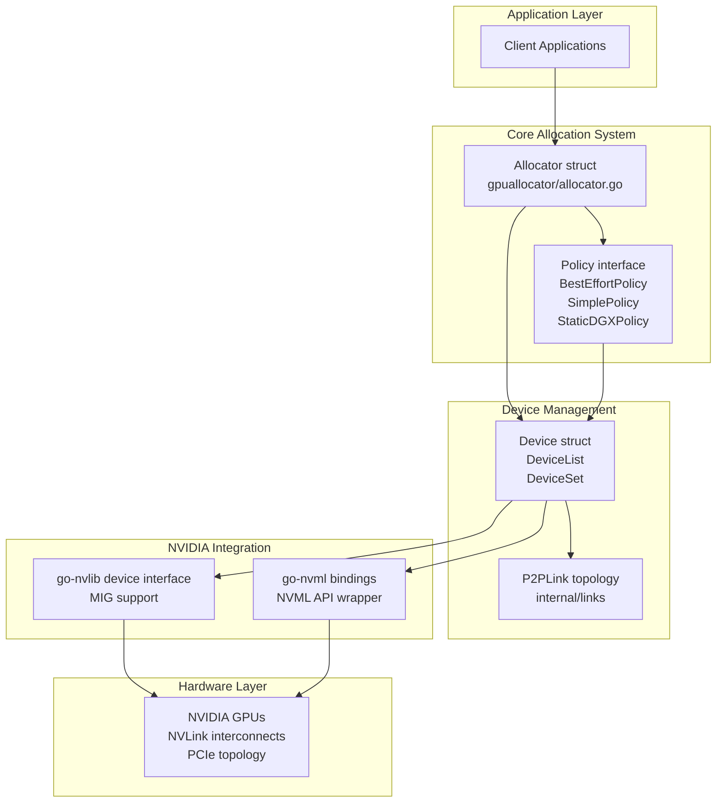

Sources: [gpuallocator/allocator.go:1-123](), [gpuallocator/device.go:1-259](), [gpuallocator/besteffort_policy.go:1-399](), [internal/links/device.go:1-229]()

## Core Components

The system is built around several key components that work together to provide intelligent GPU allocation:

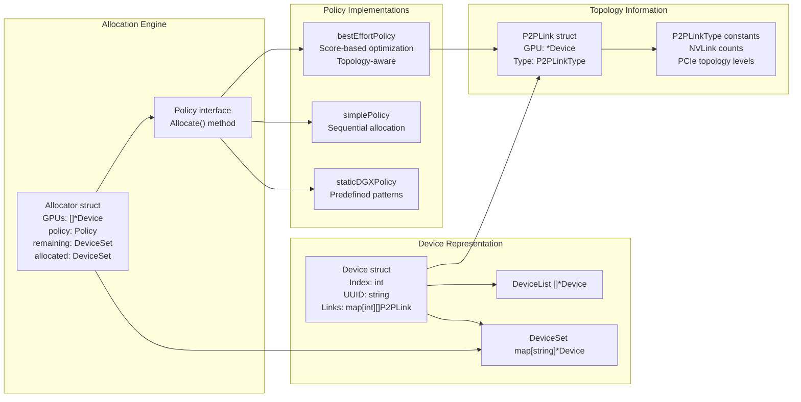

Sources: [gpuallocator/device.go:16-73](), [gpuallocator/allocator.go:12-32](), [gpuallocator/besteffort_policy.go:13-18](), [internal/links/device.go:26-57]()

## Device Discovery and Topology Mapping

The system discovers GPUs and maps their interconnect topology through NVIDIA's NVML library:

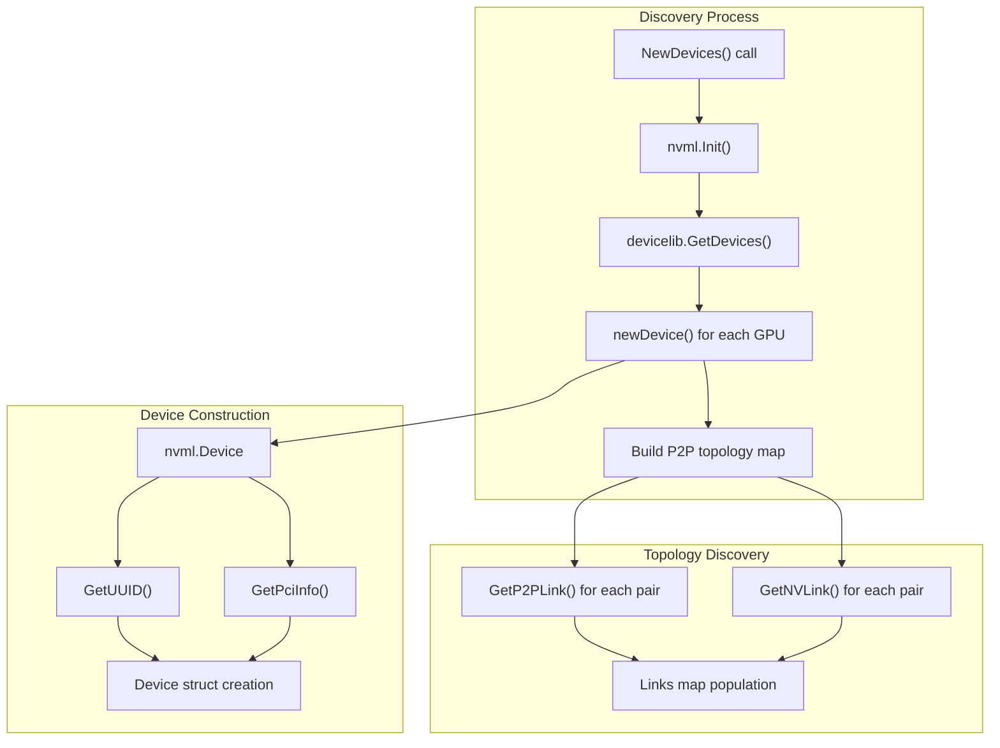

Sources: [gpuallocator/device.go:75-137](), [internal/links/device.go:115-201]()

## Allocation Workflow

The allocation process follows a clear workflow from request to GPU assignment:

| Stage | Component | Function | Purpose |
|-------|-----------|----------|---------|
| 1. Request | `Allocator` | `Allocate(num int)` | Client requests N GPUs |
| 2. Policy Selection | `Policy` interface | `Allocate(available, required, size)` | Apply allocation strategy |
| 3. Device Selection | Policy implementation | Score calculation/selection logic | Choose optimal GPU set |
| 4. State Update | `Allocator` | `AllocateSpecific()` | Move GPUs from remaining to allocated |
| 5. Return | `Allocator` | Return `[]*Device` | Provide allocated GPU list |

Sources: [gpuallocator/allocator.go:83-116]()

## Integration with NVIDIA Ecosystem

The system integrates with NVIDIA's software stack through well-defined interfaces:

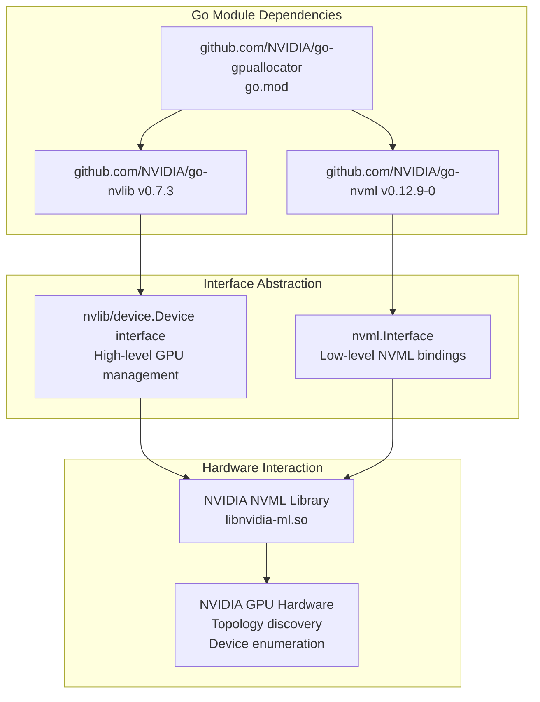

Sources: [go.mod:1-17](), [gpuallocator/device.go:10-14]()

## Key Features

The go-gpuallocator system provides several important capabilities:

- **Topology-Aware Allocation**: Uses NVLink and PCIe topology information to optimize GPU selections for communication efficiency
- **Pluggable Policies**: Supports multiple allocation strategies through the `Policy` interface
- **Device State Management**: Tracks available and allocated GPUs through `DeviceSet` collections  
- **P2P Link Discovery**: Automatically discovers and maps inter-GPU communication links
- **NVML Integration**: Leverages NVIDIA's official management library for hardware interaction

For implementation details of these features, see [Core GPU Allocation System](#2), [NVIDIA Integration Layer](#3), and [API Reference](#6).

Sources: [gpuallocator/allocator.go:12-32](), [gpuallocator/besteffort_policy.go:20-95](), [internal/links/device.go:26-139]()

---

# Page: Core GPU Allocation System

# Core GPU Allocation System

<details>
<summary>Relevant source files</summary>

The following files were used as context for generating this wiki page:

- [gpuallocator/allocator.go](gpuallocator/allocator.go)
- [gpuallocator/besteffort_policy.go](gpuallocator/besteffort_policy.go)
- [gpuallocator/device.go](gpuallocator/device.go)
- [internal/links/device.go](internal/links/device.go)

</details>


This document covers the core components of the go-gpuallocator system that handle GPU device discovery, allocation policies, and resource management. The system provides intelligent NVIDIA GPU allocation based on topology-aware policies that consider P2P links, NVLinks, and GPU interconnectivity.

For NVIDIA integration details, see [NVIDIA Integration Layer](#3). For testing infrastructure, see [Testing Framework](#4). For public APIs, see [API Reference](#6).

## System Architecture

The Core GPU Allocation System consists of three primary components that work together to provide intelligent GPU resource allocation:

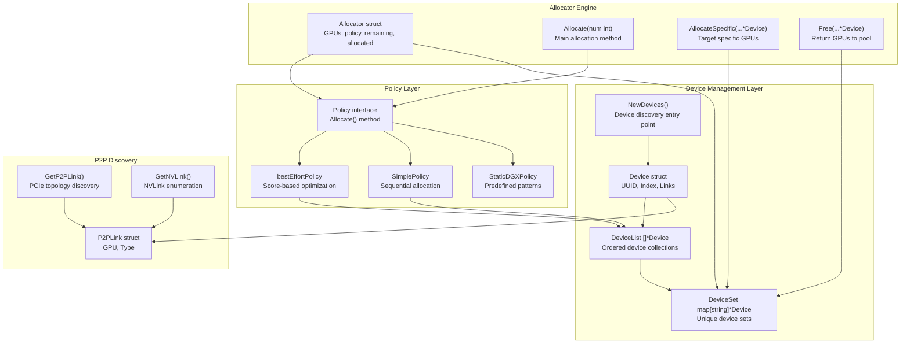

**Sources:** [gpuallocator/device.go:16-22](), [gpuallocator/device.go:69-73](), [gpuallocator/allocator.go:12-20](), [gpuallocator/allocator.go:22-32](), [gpuallocator/besteffort_policy.go:13-17](), [internal/links/device.go:64-67]()

## Core Components Overview

### Device Representation

The system uses a structured approach to represent GPU devices and their relationships:

| Component | Type | Purpose |
|-----------|------|---------|
| `Device` | `struct` | Individual GPU with P2P links and metadata |
| `DeviceList` | `[]*Device` | Ordered collections for iteration and filtering |
| `DeviceSet` | `map[string]*Device` | Set operations using UUID keys |
| `P2PLink` | `struct` | Point-to-point connectivity information |

The `Device` struct embeds an `nvlibDevice` which provides NVML integration while adding allocation-specific fields:

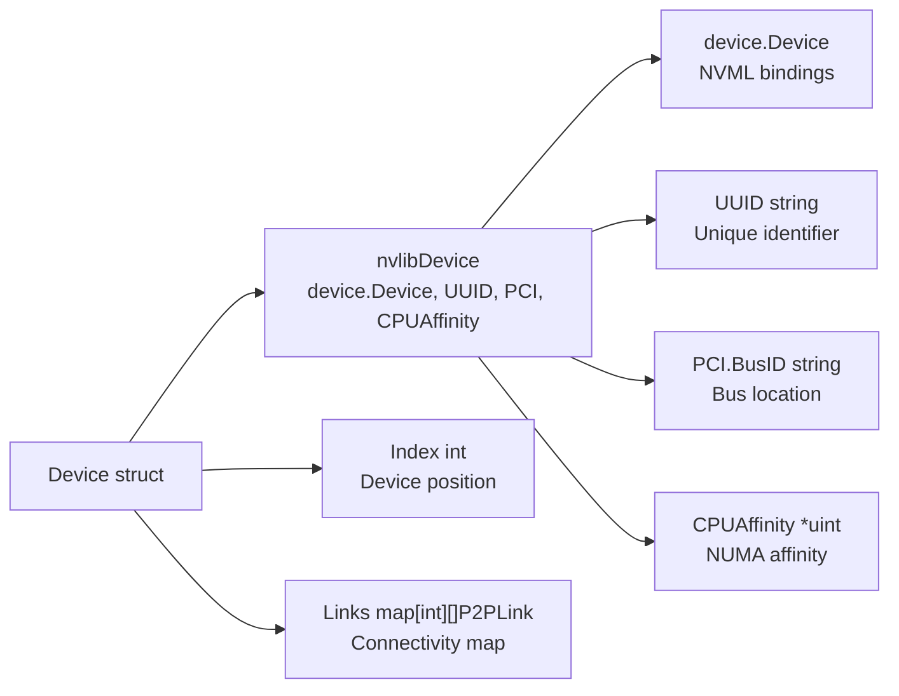

**Sources:** [gpuallocator/device.go:16-34](), [gpuallocator/device.go:64-67]()

### Policy System

The allocation system uses a pluggable policy architecture where different algorithms can be selected based on workload requirements:

| Policy | Implementation | Algorithm |
|--------|---------------|-----------|
| `Policy` | `interface` | Common allocation contract |
| `bestEffortPolicy` | Score-based | Optimizes total partition score |
| `SimplePolicy` | Sequential | First-available allocation |
| `StaticDGXPolicy` | Pattern-based | Predefined optimal configurations |

The `Policy` interface defines the allocation contract:
- `Allocate(available []*Device, required []*Device, size int) []*Device`

**Sources:** [gpuallocator/allocator.go:22-32](), [gpuallocator/besteffort_policy.go:13-17]()

### Allocator Engine

The `Allocator` struct maintains allocation state and coordinates between policies and device management:

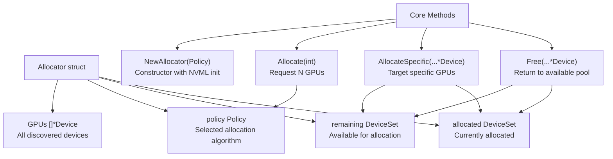

**Sources:** [gpuallocator/allocator.go:12-20](), [gpuallocator/allocator.go:46-68](), [gpuallocator/allocator.go:83-122]()

## Allocation Data Flow

The following diagram shows how GPU allocation requests flow through the system components:

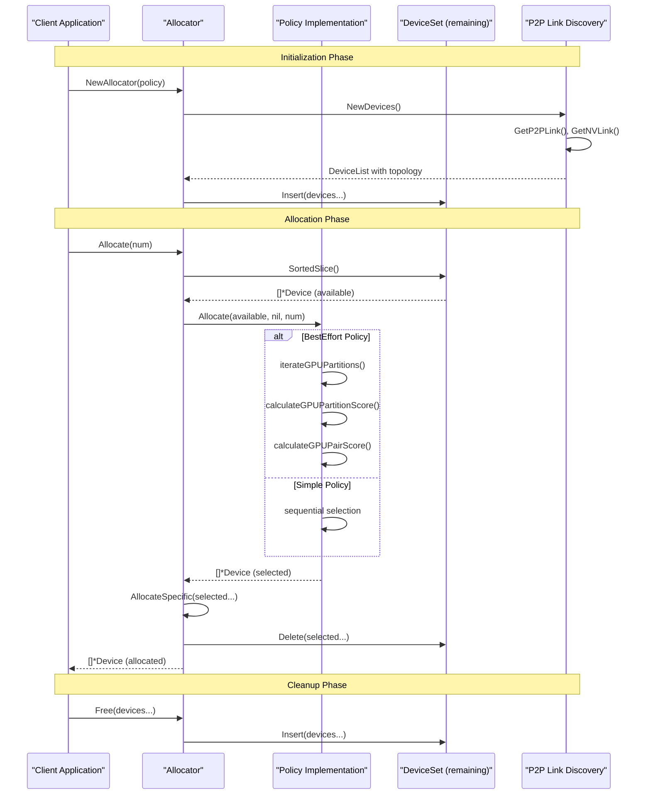

**Sources:** [gpuallocator/allocator.go:83-95](), [gpuallocator/allocator.go:97-116](), [gpuallocator/besteffort_policy.go:36-95](), [gpuallocator/device.go:75-136]()

## P2P Link Discovery System

The system discovers and categorizes GPU interconnectivity to enable topology-aware allocation:

```mermaid
graph TB
    subgraph "Link Types"
        P2PTypes["P2PLinkType enum"]
        CrossCPU["P2PLinkCrossCPU<br/>Score: 10"]
        SameCPU["P2PLinkSameCPU<br/>Score: 20"] 
        HostBridge["P2PLinkHostBridge<br/>Score: 30"]
        MultiSwitch["P2PLinkMultiSwitch<br/>Score: 40"]
        SingleSwitch["P2PLinkSingleSwitch<br/>Score: 50"]
        SameBoard["P2PLinkSameBoard<br/>Score: 60"]
    end
    
    subgraph "NVLink Types"
        NVLinkTypes["NVLink Link Counts"]
        Single["SingleNVLINKLink<br/>Score: 100"]
        Two["TwoNVLINKLinks<br/>Score: 200"]
        Multiple["...up to EighteenNVLINKLinks<br/>Score: 1800"]
    end
    
    subgraph "Discovery Functions"
        GetP2P["GetP2PLink(dev1, dev2)<br/>PCIe topology analysis"]
        GetNV["GetNVLink(dev1, dev2)<br/>NVLink enumeration"]
        CommonAncestor["GetTopologyCommonAncestor()<br/>NVML topology query"]
        NVLinkState["GetNvLinkState(linkId)<br/>Per-link status check"]
    end
    
    GetP2P --> CommonAncestor
    GetP2P --> CrossCPU
    GetP2P --> SameCPU
    GetP2P --> HostBridge
    GetNV --> NVLinkState
    GetNV --> Single
    GetNV --> Two
    GetNV --> Multiple
```

**Sources:** [internal/links/device.go:26-57](), [internal/links/device.go:115-139](), [internal/links/device.go:141-201](), [gpuallocator/besteffort_policy.go:298-374]()

## Integration Points

The Core GPU Allocation System integrates with several external components:

| Integration | Interface | Purpose |
|-------------|-----------|---------|
| NVML Library | `nvml.Interface` | Hardware device enumeration |
| go-nvlib | `device.Device` | High-level device operations |
| P2P Discovery | `links.GetP2PLink()` | Topology information |
| Testing Framework | Mock interfaces | Development and testing |

The system uses dependency injection through the `Option` pattern in `NewDevices()` to allow for flexible integration and testing scenarios.

**Sources:** [gpuallocator/device.go:75-89](), [gpuallocator/allocator.go:46-67](), [internal/links/device.go:115-139]()

---

# Page: Device Discovery and Management

# Device Discovery and Management

<details>
<summary>Relevant source files</summary>

The following files were used as context for generating this wiki page:

- [gpuallocator/device.go](gpuallocator/device.go)
- [gpuallocator/device_test.go](gpuallocator/device_test.go)
- [gpuallocator/options.go](gpuallocator/options.go)
- [internal/links/device.go](internal/links/device.go)
- [internal/links/pciinfo.go](internal/links/pciinfo.go)

</details>


This document covers the GPU device discovery and management system within the go-gpuallocator codebase. It explains how the system enumerates NVIDIA GPUs, discovers their interconnection topology, and provides abstractions for device manipulation and filtering. The material focuses on the core device representation, discovery algorithms, and P2P link detection mechanisms.

For information about allocation policies that operate on discovered devices, see [Allocation Policies](#2.2). For details about the NVML integration layer, see [NVML Bindings](#3.1).

## Device Representation

The system represents GPU devices through a hierarchical structure that combines NVIDIA device information with topology data.

### Core Device Structure

```mermaid
graph TB
    Device["`Device`<br/>gpuallocator/device.go:18-22"] --> nvlibDevice["`nvlibDevice`<br/>Embedded struct"]
    Device --> Index["Index int<br/>Device position"]
    Device --> Links["Links map[int][]P2PLink<br/>P2P connections"]
    
    nvlibDevice --> NVLIBDevice["device.Device<br/>NVLIB interface"]
    nvlibDevice --> UUID["UUID string<br/>Cached device UUID"]
    nvlibDevice --> PCI["PCI struct<br/>BusID information"]
    nvlibDevice --> CPUAffinity["CPUAffinity *uint<br/>NUMA node affinity"]
    
    Links --> P2PLink["`P2PLink`<br/>gpuallocator/device.go:64-67"]
    P2PLink --> GPU["GPU *Device<br/>Target device"]
    P2PLink --> Type["Type links.P2PLinkType<br/>Connection type"]
```

The `Device` struct serves as the primary representation of a GPU device, embedding an `nvlibDevice` that wraps the NVLIB device interface along with cached properties for performance optimization.

**Sources:** [gpuallocator/device.go:16-34]()

### P2P Link Types

The system categorizes inter-GPU connections using a comprehensive enumeration of link types:

| Link Type | Description | NVML Mapping |
|-----------|-------------|--------------|
| `P2PLinkCrossCPU` | Cross-CPU connection | `nvml.TOPOLOGY_SYSTEM` |
| `P2PLinkSameCPU` | Same CPU, different sockets | `nvml.TOPOLOGY_NODE` |
| `P2PLinkHostBridge` | Connected via host bridge | `nvml.TOPOLOGY_HOSTBRIDGE` |
| `P2PLinkMultiSwitch` | Multiple PCIe switches | `nvml.TOPOLOGY_MULTIPLE` |
| `P2PLinkSingleSwitch` | Single PCIe switch | `nvml.TOPOLOGY_SINGLE` |
| `P2PLinkSameBoard` | Same board connection | `nvml.TOPOLOGY_INTERNAL` |
| `SingleNVLINKLink` to `EighteenNVLINKLinks` | NVLink connections (1-18) | NVLink enumeration |

**Sources:** [internal/links/device.go:26-57](), [internal/links/device.go:115-139]()

## Device Discovery Process

The device discovery system follows a multi-stage process to enumerate GPUs and build their connectivity graph.

### Discovery Flow

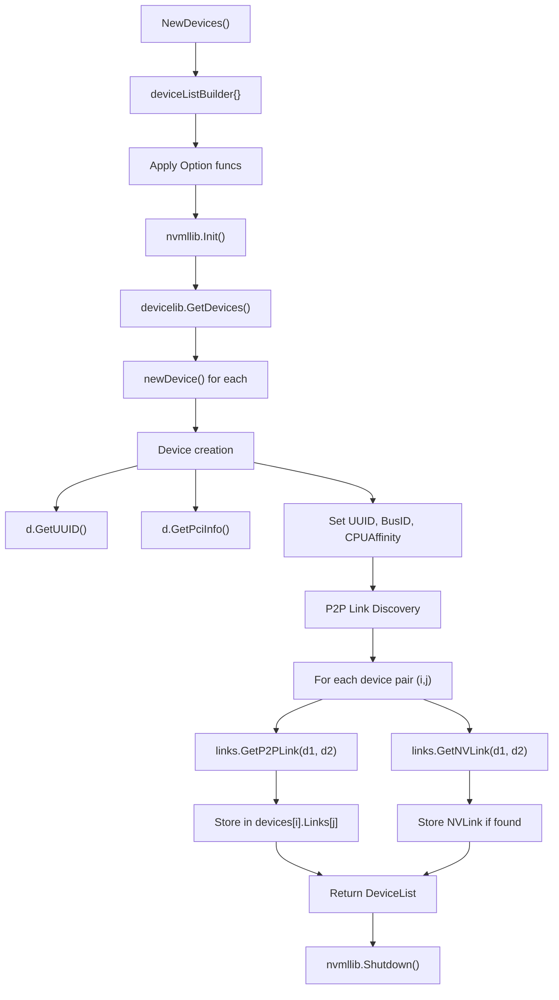

The `NewDevices` function orchestrates device discovery through the `deviceListBuilder.build()` method, which performs NVML initialization, device enumeration, and comprehensive P2P link discovery.

**Sources:** [gpuallocator/device.go:75-89](), [gpuallocator/device.go:92-137]()

### Device Construction

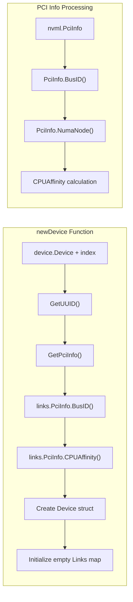

Each device undergoes construction through `newDevice`, which extracts essential properties from the NVML device handle and prepares the P2P link storage structure.

**Sources:** [gpuallocator/device.go:36-59](), [internal/links/pciinfo.go:32-74]()

## P2P Topology Discovery

The system performs comprehensive topology discovery to map inter-GPU connectivity patterns essential for optimal allocation decisions.

### Link Discovery Algorithm

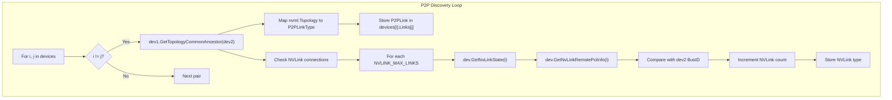

The P2P discovery process operates on all device pairs, utilizing NVML's topology discovery APIs and NVLink enumeration to build a comprehensive connectivity graph.

**Sources:** [gpuallocator/device.go:114-134](), [internal/links/device.go:115-201]()

### NVLink Enumeration Details

The NVLink discovery process examines each possible NVLink connection and aggregates them into connection strength categories:

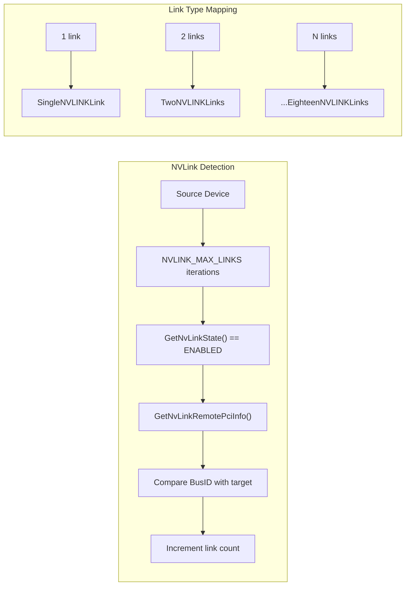

**Sources:** [internal/links/device.go:141-201](), [internal/links/device.go:203-228]()

## Device Management Collections

The system provides multiple collection types for different device management scenarios.

### DeviceList Operations

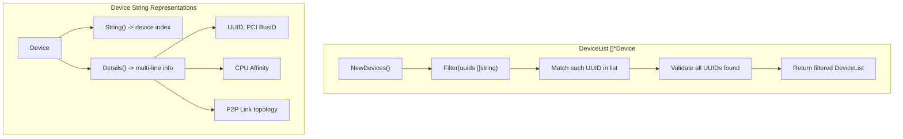

**Sources:** [gpuallocator/device.go:151-191]()

### DeviceSet Operations

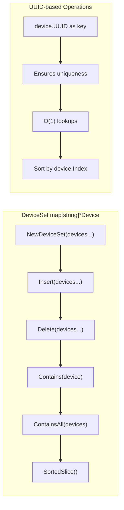

`DeviceSet` provides UUID-based device management with fast lookup operations and guaranteed uniqueness, while maintaining the ability to produce sorted slices ordered by device index.

**Sources:** [gpuallocator/device.go:193-253]()

## Configuration and Options

The device discovery system supports configuration through functional options that control the underlying NVML and device library implementations.

### Option Pattern Implementation

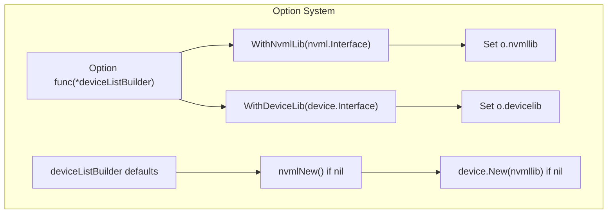

The options pattern allows for dependency injection of NVML and device library implementations, enabling testing with mock interfaces and potential future library alternatives.

**Sources:** [gpuallocator/options.go:24-45](), [gpuallocator/device.go:255-258]()

## Testing Infrastructure

The device management system includes comprehensive testing infrastructure with mock NVML interfaces and device simulation capabilities.

### Mock Implementation Structure

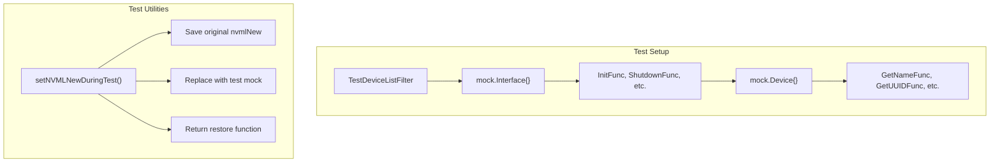

**Sources:** [gpuallocator/device_test.go:27-93]()

The testing system provides comprehensive mocking capabilities that allow device discovery testing without physical GPU hardware, ensuring reliable unit tests for device enumeration and filtering operations.

---

# Page: Allocation Policies

# Allocation Policies

<details>
<summary>Relevant source files</summary>

The following files were used as context for generating this wiki page:

- [gpuallocator/besteffort_policy.go](gpuallocator/besteffort_policy.go)
- [gpuallocator/besteffort_test.go](gpuallocator/besteffort_test.go)
- [gpuallocator/common_test.go](gpuallocator/common_test.go)
- [gpuallocator/simple_test.go](gpuallocator/simple_test.go)
- [gpuallocator/staticdgx_test.go](gpuallocator/staticdgx_test.go)

</details>


This document describes the GPU allocation policies implemented in the go-gpuallocator system. These policies determine how GPUs are selected from available devices when fulfilling allocation requests. The system provides three distinct allocation strategies: BestEffort (topology-aware optimization), Simple (sequential allocation), and StaticDGX (predefined patterns for DGX systems).

For information about device discovery and topology detection, see [Device Discovery and Management](#2.1). For details on the allocator engine that uses these policies, see [Allocator Engine](#2.3).

## Policy Interface

All allocation policies implement a common `Policy` interface that defines the contract for GPU selection algorithms.

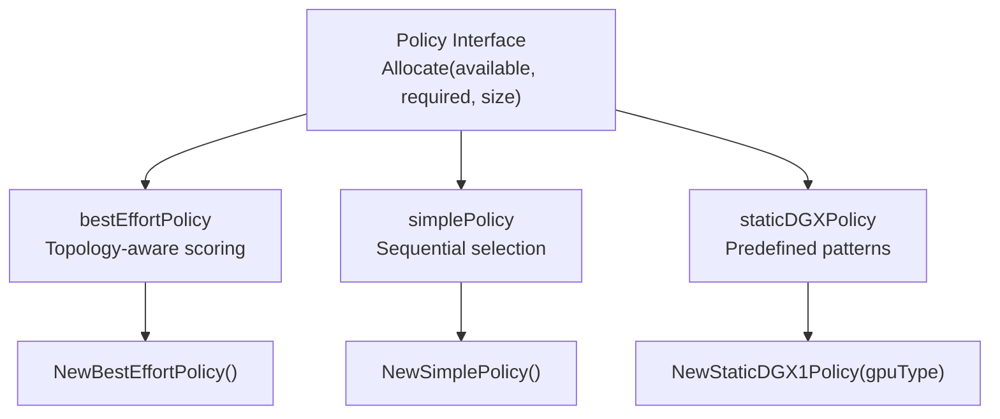

**Sources:** [gpuallocator/besteffort_policy.go:16-18](), [gpuallocator/besteffort_test.go:30](), [gpuallocator/simple_test.go:11](), [gpuallocator/staticdgx_test.go:9]()

The `Policy` interface requires a single method:

| Method | Parameters | Return | Description |
|--------|------------|--------|-------------|
| `Allocate` | `available []*Device`<br/>`required []*Device`<br/>`size int` | `[]*Device` | Selects optimal GPU set from available devices |

## BestEffort Policy

The `bestEffortPolicy` implements a sophisticated topology-aware allocation algorithm that considers P2P connectivity, NVLinks, and PCIe hierarchy to optimize GPU placement for maximum inter-GPU communication bandwidth.

### Algorithm Overview

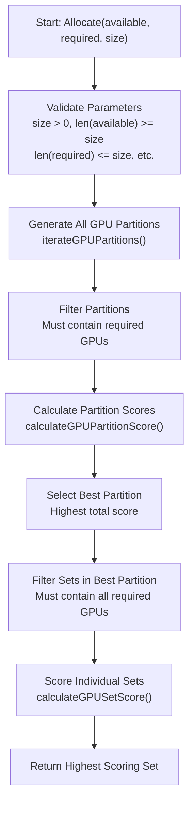

**Sources:** [gpuallocator/besteffort_policy.go:36-95]()

### Core Algorithm Functions

The BestEffort policy uses several key algorithmic components:

| Function | Purpose | Location |
|----------|---------|----------|
| `iterateGPUSets` | Generates all possible GPU combinations of specified size | [gpuallocator/besteffort_policy.go:161-210]() |
| `iterateGPUPartitions` | Partitions available GPUs into sets of specified size | [gpuallocator/besteffort_policy.go:215-296]() |
| `calculateGPUPairScore` | Computes link score between two GPUs | [gpuallocator/besteffort_policy.go:304-374]() |
| `calculateGPUSetScore` | Sums pairwise scores for entire GPU set | [gpuallocator/besteffort_policy.go:378-386]() |
| `calculateGPUPartitionScore` | Totals scores for all sets in partition | [gpuallocator/besteffort_policy.go:390-398]() |

### Partition Generation Strategy

The algorithm considers all possible ways to divide available GPUs into sets of the requested size. This ensures optimal global allocation rather than greedy local optimization.

```mermaid
graph LR
    Input["Available GPUs: [0,1,2,3]<br/>Size: 2"]
    Partitions["Generated Partitions:<br/>[[0,1],[2,3]]<br/>[[0,2],[1,3]]<br/>[[0,3],[1,2]]"]
    Scoring["Score Each Partition:<br/>Sum of set scores"]
    Selection["Select Best Partition<br/>Return highest scoring set"]
    
    Input --> Partitions
    Partitions --> Scoring
    Scoring --> Selection
```

**Sources:** [gpuallocator/besteffort_policy.go:25-35](), [gpuallocator/besteffort_policy.go:215-296]()

## Simple Policy

The Simple policy implements straightforward sequential allocation from available devices. It selects GPUs in order of their indices, ensuring required devices are included first.

### Simple Algorithm Behavior

| Scenario | Available | Required | Size | Result |
|----------|-----------|----------|------|--------|
| Basic allocation | `[0,1,2,3,4,5,6,7]` | `[]` | `4` | `[0,1,2,3]` |
| With required GPU | `[0,1,2,3,4,5,6,7]` | `[4]` | `2` | `[4,0]` |
| Required subset | `[0,1,2,3,4,5,6,7]` | `[0,2,4,6]` | `4` | `[0,2,4,6]` |

**Sources:** [gpuallocator/simple_test.go:9-129]()

## StaticDGX Policy

The StaticDGX policy implements predefined allocation patterns optimized for specific DGX system configurations. It supports different GPU types and uses hardcoded optimal sets.

### DGX Configuration Support

```mermaid
graph TB
    StaticDGX["staticDGXPolicy"]
    Pascal["DGX-1 Pascal<br/>GPUTypePascal"]
    Volta["DGX-1 Volta<br/>GPUTypeVolta"]
    
    StaticDGX --> Pascal
    StaticDGX --> Volta
    
    Pascal --> PascalSets["Predefined Sets:<br/>Size 1: [0],[1],[2]...<br/>Size 2: [0,2],[1,3]...<br/>Size 4: [0,1,2,3],[4,5,6,7]<br/>Size 8: [0,1,2,3,4,5,6,7]"]
    
    Volta --> VoltaSets["Predefined Sets:<br/>Size 1: [0],[1],[2]...<br/>Size 2: [0,3],[1,2]...<br/>Size 4: [0,1,2,3],[4,5,6,7]<br/>Size 8: [0,1,2,3,4,5,6,7]"]
```

**Sources:** [gpuallocator/staticdgx_test.go:7-231]()

### Static DGX Allocation Patterns

The StaticDGX policy only supports specific allocation sizes and returns predefined optimal sets:

| GPU Type | Valid Sizes | Pattern Description |
|----------|-------------|---------------------|
| Pascal | 1, 2, 4, 8 | NVLink-optimized pairs and quads |
| Volta | 1, 2, 4, 8 | Enhanced NVLink topology awareness |
| Invalid | 0, 3, 5, 6, 7, 9+ | Returns empty allocation |

**Sources:** [gpuallocator/staticdgx_test.go:136-151](), [gpuallocator/staticdgx_test.go:216-231]()

## Link Scoring System

The BestEffort policy uses a comprehensive scoring system to evaluate GPU connectivity quality. Higher scores indicate better communication bandwidth and lower latency.

### P2P Link Type Scoring

```mermaid
graph TB
    LinkTypes["P2P Link Types & Scores"]
    
    subgraph NVLinks["NVLink Connections"]
        NV1["SingleNVLINKLink: 100"]
        NV2["TwoNVLINKLinks: 200"]
        NV3["ThreeNVLINKLinks: 300"]
        NVX["...up to SixteenNVLINKLinks: 1600"]
        NV18["EighteenNVLINKLinks: 1800"]
    end
    
    subgraph PCIeLinks["PCIe Hierarchy"]
        SameBoard["P2PLinkSameBoard: 60"]
        SingleSwitch["P2PLinkSingleSwitch: 50"]
        MultiSwitch["P2PLinkMultiSwitch: 40"]
        HostBridge["P2PLinkHostBridge: 30"]
        SameCPU["P2PLinkSameCPU: 20"]
        CrossCPU["P2PLinkCrossCPU: 10"]
    end
    
    LinkTypes --> NVLinks
    LinkTypes --> PCIeLinks
```

**Sources:** [gpuallocator/besteffort_policy.go:320-371]()

### Scoring Calculation Process

The scoring system evaluates all pairwise connections within a GPU set:

| Component | Function | Calculation |
|-----------|----------|-------------|
| GPU Pair Score | `calculateGPUPairScore` | Sum of all link scores between two GPUs |
| GPU Set Score | `calculateGPUSetScore` | Sum of all pairwise scores in the set |
| Partition Score | `calculateGPUPartitionScore` | Sum of all set scores in partition |

**Sources:** [gpuallocator/besteffort_policy.go:304-398]()

## Test Infrastructure and Validation

The allocation policies are validated using comprehensive test topologies that simulate real hardware configurations.

### Test Node Configurations

```mermaid
graph TB
    TestNodes["Test Node Topologies"]
    
    RTX8000["4xRTX8000Node<br/>New4xRTX8000Node()"]
    DGX1Pascal["DGX-1 Pascal<br/>NewDGX1PascalNode()"]
    DGX1Volta["DGX-1 Volta<br/>NewDGX1VoltaNode()"]
    
    TestNodes --> RTX8000
    TestNodes --> DGX1Pascal  
    TestNodes --> DGX1Volta
    
    RTX8000 --> RTX8000Config["4 GPUs<br/>2x NVLinks: (0-3), (1-2)<br/>P2P: Same/Cross CPU"]
    DGX1Pascal --> PascalConfig["8 GPUs<br/>Single NVLinks mesh<br/>Complex P2P hierarchy"]
    DGX1Volta --> VoltaConfig["8 GPUs<br/>Mixed 1x/2x NVLinks<br/>Optimized P2P topology"]
```

**Sources:** [gpuallocator/common_test.go:141-408]()

### Policy Testing Framework

The system provides standardized test functions for validating policy behavior:

| Test Function | Purpose | Parameters |
|---------------|---------|------------|
| `RunPolicyAllocTests` | Tests policy allocation logic | `Policy`, `[]PolicyAllocTest` |
| `RunAllocTests` | Tests allocator with policy | `*Allocator`, `[]AllocTest` |
| `PolicyAllocTest` | Test case structure | `description`, `devices`, `available`, `required`, `size`, `result` |

**Sources:** [gpuallocator/common_test.go:25-32](), [gpuallocator/common_test.go:87-111](), [gpuallocator/common_test.go:63-85]()

---

# Page: Allocator Engine

# Allocator Engine

<details>
<summary>Relevant source files</summary>

The following files were used as context for generating this wiki page:

- [gpuallocator/allocator.go](gpuallocator/allocator.go)
- [gpuallocator/device.go](gpuallocator/device.go)
- [internal/links/device.go](internal/links/device.go)

</details>


The Allocator Engine serves as the central orchestrator for GPU resource allocation within the go-gpuallocator system. It maintains state about available and allocated GPU devices, implements allocation and deallocation workflows, and provides a pluggable interface for different allocation policies. This component acts as the primary entry point for applications requesting GPU resources and coordinates with the device discovery system and allocation policies to fulfill those requests.

For information about GPU device discovery and topology management, see [Device Discovery and Management](#2.1). For details about specific allocation algorithms, see [Allocation Policies](#2.2).

## Core Architecture

The Allocator Engine is built around the `Allocator` struct which maintains GPU device state and coordinates allocation requests through a pluggable `Policy` interface.

### Allocator State Management

```mermaid
graph TB
    subgraph AllocatorState["Allocator State Management"]
        A[Allocator] -->|"maintains"| GPUs["GPUs []*Device<br/>Complete device list"]
        A -->|"tracks"| remaining["remaining DeviceSet<br/>Available for allocation"]  
        A -->|"tracks"| allocated["allocated DeviceSet<br/>Currently allocated"]
        A -->|"delegates to"| policy["policy Policy<br/>Allocation strategy"]
    end
    
    subgraph DeviceTypes["Device Management Types"]
        Device["Device struct<br/>Individual GPU"]
        DeviceList["DeviceList []*Device<br/>Ordered device collection"]
        DeviceSet["DeviceSet map[string]*Device<br/>UUID-indexed set operations"]
    end
    
    GPUs --> DeviceList
    remaining --> DeviceSet  
    allocated --> DeviceSet
    DeviceList --> Device
    DeviceSet --> Device
```

Sources: [gpuallocator/allocator.go:12-21](), [gpuallocator/device.go:69-73]()

The `Allocator` struct maintains three key collections:
- `GPUs`: Complete list of available GPU devices on the system
- `remaining`: Set of devices currently available for allocation
- `allocated`: Set of devices currently allocated to applications

### Policy Interface Architecture

```mermaid
graph TB
    subgraph PolicyInterface["Policy Interface"]
        P["Policy interface"] -->|"requires"| Allocate["Allocate(available, required, size)<br/>Returns []*Device"]
    end
    
    subgraph PolicyImplementations["Policy Implementations"]
        Simple["Simple Policy<br/>Sequential allocation"]
        BestEffort["BestEffort Policy<br/>Topology-aware scoring"]
        StaticDGX["StaticDGX Policy<br/>Predefined patterns"]
    end
    
    subgraph AllocatorConstructors["Allocator Constructors"]  
        NewSimpleAllocator["NewSimpleAllocator()"]
        NewBestEffortAllocator["NewBestEffortAllocator()"]
        NewAllocator["NewAllocator(policy)"]
    end
    
    P --> Simple
    P --> BestEffort  
    P --> StaticDGX
    
    NewSimpleAllocator --> Simple
    NewBestEffortAllocator --> BestEffort
    NewAllocator --> P
```

Sources: [gpuallocator/allocator.go:22-32](), [gpuallocator/allocator.go:34-47]()

## Allocation Workflow

The allocation process follows a well-defined sequence involving policy delegation, state validation, and atomic state updates.

### Allocation Process Flow

```mermaid
sequenceDiagram
    participant Client as "Client Application"
    participant Allocator as "Allocator"
    participant Policy as "Policy.Allocate()"
    participant DeviceSet as "DeviceSet Operations"
    
    Client->>Allocator: "Allocate(num int)"
    Allocator->>DeviceSet: "remaining.SortedSlice()"
    DeviceSet-->>Allocator: "[]*Device available"
    Allocator->>Policy: "Allocate(available, nil, num)"
    Policy-->>Allocator: "[]*Device selected"
    Allocator->>Allocator: "AllocateSpecific(selected...)"
    Allocator->>DeviceSet: "remaining.Contains(device) validation"
    DeviceSet-->>Allocator: "validation results"
    alt "All devices available"
        Allocator->>DeviceSet: "allocated.Insert(devices...)"
        Allocator->>DeviceSet: "remaining.Delete(devices...)"
        Allocator-->>Client: "[]*Device allocated"
    else "Some devices unavailable"
        Allocator-->>Client: "error + empty slice"
    end
```

Sources: [gpuallocator/allocator.go:83-95](), [gpuallocator/allocator.go:97-116]()

### Deallocation Process

```mermaid
graph LR
    subgraph DeallocationFlow["Free(devices...)""]
        F1["Validate devices"] --> F2["remaining.Insert(devices...)"]
        F2 --> F3["allocated.Delete(devices...)"] 
        F3 --> F4["State updated atomically"]
    end
```

Sources: [gpuallocator/allocator.go:118-122]()

## Constructor Patterns and Initialization

The Allocator Engine provides multiple constructor patterns to support different initialization scenarios and policy configurations.

### Constructor Architecture

| Constructor | Purpose | Policy | NVML Management |
|------------|---------|---------|-----------------|
| `NewSimpleAllocator()` | Quick setup with sequential allocation | `Simple` | Automatic |
| `NewBestEffortAllocator()` | Topology-aware allocation | `BestEffort` | Automatic |  
| `NewAllocator(policy)` | Custom policy injection | User-provided | Automatic |
| `newAllocatorFrom(devices, policy)` | Testing with mock devices | User-provided | External |

Sources: [gpuallocator/allocator.go:34-47](), [gpuallocator/allocator.go:70-81]()

### Initialization Sequence

```mermaid
graph TB
    subgraph InitSequence["NewAllocator Initialization"]
        N1["nvml.New()"] --> N2["nvmllib.Init()"]
        N2 --> N3["NewDevices(WithNvmlLib)"]
        N3 --> N4["newAllocatorFrom(devices, policy)"]
        N4 --> N5["runtime.SetFinalizer(allocator)"]
    end
    
    subgraph StateSetup["newAllocatorFrom Setup"]  
        S1["Create Allocator struct"] --> S2["Initialize remaining DeviceSet"]
        S2 --> S3["Initialize allocated DeviceSet"]
        S3 --> S4["remaining.Insert(all devices)"]
    end
    
    N4 --> S1
```

Sources: [gpuallocator/allocator.go:47-68](), [gpuallocator/allocator.go:70-81]()

## Memory Management and Lifecycle

The Allocator Engine implements proper resource cleanup through Go's finalizer mechanism to ensure NVML library resources are properly released.

### Resource Management

```mermaid
graph LR
    subgraph ResourceLifecycle["Allocator Resource Lifecycle"]
        Create["NewAllocator()"] --> SetFinalizer["runtime.SetFinalizer()"]
        SetFinalizer --> Normal["Normal Operation"]
        Normal --> GC["Garbage Collection"]
        GC --> Finalizer["nvmllib.Shutdown()"]
    end
```

Sources: [gpuallocator/allocator.go:62-66]()

The finalizer ensures that even if applications fail to properly clean up Allocator instances, the underlying NVML library resources will be released when the garbage collector runs.

## State Consistency Guarantees

The Allocator Engine maintains strict state consistency through atomic operations on `DeviceSet` collections and validation checks.

### State Invariants

- **Partitioning**: Every device in `GPUs` exists in exactly one of `remaining` or `allocated` sets
- **UUID Uniqueness**: `DeviceSet` operations use UUID keys to prevent duplicate device tracking
- **Allocation Atomicity**: `AllocateSpecific` either succeeds completely or fails with no state changes
- **Validation**: All allocation requests validate device availability before state modification

Sources: [gpuallocator/allocator.go:99-116](), [gpuallocator/device.go:194-237]()

The engine's design ensures that concurrent access patterns and error conditions cannot corrupt the internal state or lead to double-allocation of GPU resources.

---

# Page: NVIDIA Integration Layer

# NVIDIA Integration Layer

<details>
<summary>Relevant source files</summary>

The following files were used as context for generating this wiki page:

- [vendor/github.com/NVIDIA/go-nvlib/pkg/nvlib/device/api.go](vendor/github.com/NVIDIA/go-nvlib/pkg/nvlib/device/api.go)
- [vendor/github.com/NVIDIA/go-nvlib/pkg/nvlib/device/device.go](vendor/github.com/NVIDIA/go-nvlib/pkg/nvlib/device/device.go)
- [vendor/github.com/NVIDIA/go-nvlib/pkg/nvlib/device/mig_device.go](vendor/github.com/NVIDIA/go-nvlib/pkg/nvlib/device/mig_device.go)
- [vendor/github.com/NVIDIA/go-nvlib/pkg/nvlib/device/mig_profile.go](vendor/github.com/NVIDIA/go-nvlib/pkg/nvlib/device/mig_profile.go)
- [vendor/github.com/NVIDIA/go-nvml/pkg/nvml/device.go](vendor/github.com/NVIDIA/go-nvml/pkg/nvml/device.go)
- [vendor/github.com/NVIDIA/go-nvml/pkg/nvml/lib.go](vendor/github.com/NVIDIA/go-nvml/pkg/nvml/lib.go)

</details>


The NVIDIA Integration Layer provides the essential bridge between the go-gpuallocator system and NVIDIA's hardware management libraries. This layer abstracts NVIDIA's low-level NVML (NVIDIA Management Library) and provides high-level device interfaces for GPU enumeration, topology discovery, and Multi-Instance GPU (MIG) management.

For information about how devices are discovered and managed by the allocator, see [Device Discovery and Management](#2.1). For details about the testing infrastructure that mocks these interfaces, see [Mock System](#3.4).

## Architecture Overview

The NVIDIA Integration Layer consists of two primary abstraction levels that work together to provide seamless hardware interaction:

**Integration Layer Architecture**

```mermaid
graph TB
    subgraph "Hardware Layer"
        HW["NVIDIA GPU Hardware"]
        NVML_LIB["libnvidia-ml.so.1<br/>NVIDIA Management Library"]
    end
    
    subgraph "Go Bindings Layer"
        NVML_PKG["go-nvml Package<br/>vendor/github.com/NVIDIA/go-nvml"]
        LIB_GO["lib.go<br/>Library loading & versioning"]
        DEVICE_GO["device.go<br/>Device operations"]
        INTERFACE["nvml.Interface<br/>Main NVML interface"]
    end
    
    subgraph "High-Level Device Layer"
        NVLIB_PKG["go-nvlib Package<br/>vendor/github.com/NVIDIA/go-nvlib"]
        API_GO["api.go<br/>Interface definitions"]
        DEVICE_LIB["device.go<br/>Device wrapper"]
        MIG_DEVICE["mig_device.go<br/>MIG support"]
        MIG_PROFILE["mig_profile.go<br/>Profile management"]
    end
    
    subgraph "Allocator Integration"
        GPU_ALLOC["GPU Allocator<br/>Core System"]
    end
    
    HW --> NVML_LIB
    NVML_LIB --> NVML_PKG
    NVML_PKG --> LIB_GO
    NVML_PKG --> DEVICE_GO
    LIB_GO --> INTERFACE
    DEVICE_GO --> INTERFACE
    
    INTERFACE --> NVLIB_PKG
    NVLIB_PKG --> API_GO
    NVLIB_PKG --> DEVICE_LIB
    NVLIB_PKG --> MIG_DEVICE
    NVLIB_PKG --> MIG_PROFILE
    
    API_GO --> GPU_ALLOC
    DEVICE_LIB --> GPU_ALLOC
    MIG_DEVICE --> GPU_ALLOC
```

Sources: [vendor/github.com/NVIDIA/go-nvml/pkg/nvml/lib.go:1-297](), [vendor/github.com/NVIDIA/go-nvml/pkg/nvml/device.go:1-100](), [vendor/github.com/NVIDIA/go-nvlib/pkg/nvlib/device/api.go:1-91]()

## Core Interface Hierarchy

The integration layer exposes device functionality through a well-defined interface hierarchy that progressively adds capabilities:

**Device Interface Relationships**

```mermaid
graph TB
    subgraph "NVML Layer Interfaces"
        NVML_DEVICE["nvml.Device<br/>Basic NVML operations"]
        NVML_LIB["nvml.Interface<br/>Library management"]
    end
    
    subgraph "NVLIB Device Interfaces"
        DEVICE_IFACE["device.Interface<br/>Main device API"]
        DEVICE_IMPL["device.Device<br/>Extended device ops"]
        MIG_DEVICE_IFACE["MigDevice<br/>MIG-specific interface"]
        MIG_PROFILE_IFACE["MigProfile<br/>Profile management"]
    end
    
    subgraph "Core Operations"
        GET_DEVICES["GetDevices()<br/>Enumerate all GPUs"]
        GET_MIG_DEVICES["GetMigDevices()<br/>Get MIG instances"]
        NEW_DEVICE["NewDevice()<br/>Create device wrapper"]
        VISIT_DEVICES["VisitDevices()<br/>Iterate devices"]
    end
    
    NVML_LIB --> NVML_DEVICE
    NVML_DEVICE --> DEVICE_IMPL
    DEVICE_IFACE --> DEVICE_IMPL
    DEVICE_IMPL --> MIG_DEVICE_IFACE
    DEVICE_IMPL --> MIG_PROFILE_IFACE
    
    DEVICE_IFACE --> GET_DEVICES
    DEVICE_IFACE --> GET_MIG_DEVICES
    DEVICE_IFACE --> NEW_DEVICE
    DEVICE_IFACE --> VISIT_DEVICES
    
    GET_DEVICES --> NEW_DEVICE
    GET_MIG_DEVICES --> MIG_DEVICE_IFACE
    VISIT_DEVICES --> DEVICE_IMPL
```

Sources: [vendor/github.com/NVIDIA/go-nvlib/pkg/nvlib/device/api.go:23-38](), [vendor/github.com/NVIDIA/go-nvlib/pkg/nvlib/device/device.go:26-40](), [vendor/github.com/NVIDIA/go-nvlib/pkg/nvlib/device/mig_device.go:25-29]()

## Library Loading and Version Management

The NVML library loading system handles dynamic library management and API versioning through a sophisticated abstraction:

| Component | Responsibility | Key Types |
|-----------|---------------|-----------|
| `library` struct | Library lifecycle management | `path`, `refcount`, `dl` |
| `dynamicLibrary` interface | Library loading abstraction | `Open()`, `Close()`, `Lookup()` |
| Version symbol resolution | API compatibility | `updateVersionedSymbols()` |

**Library Loading Flow**

```mermaid
graph LR
    INIT["libnvml = newLibrary()"] --> LOAD["load()"]
    LOAD --> OPEN["dl.Open()"]
    OPEN --> UPDATE["updateVersionedSymbols()"]
    UPDATE --> READY["Library Ready"]
    
    subgraph "Version Resolution"
        V1["nvmlInit = nvmlInit_v1"]
        V2["Check nvmlInit_v2"]
        V2_UPDATE["nvmlInit = nvmlInit_v2"]
        V1 --> V2
        V2 --> V2_UPDATE
    end
    
    UPDATE --> V1
    READY --> CLOSE["close()"]
    CLOSE --> DL_CLOSE["dl.Close()"]
```

Sources: [vendor/github.com/NVIDIA/go-nvml/pkg/nvml/lib.go:58-86](), [vendor/github.com/NVIDIA/go-nvml/pkg/nvml/lib.go:103-123](), [vendor/github.com/NVIDIA/go-nvml/pkg/nvml/lib.go:201-296]()

## Device Abstraction and Enhancement

The `nvlib` layer wraps NVML devices with additional functionality for GPU allocation use cases:

**Device Wrapper Architecture**

```mermaid
graph TB
    subgraph "NVML Device Operations"
        NVML_DEV["nvml.Device<br/>Basic device handle"]
        GET_NAME["GetName()"]
        GET_UUID["GetUUID()"]
        GET_PCI["GetPciInfo()"]
        GET_MEMORY["GetMemoryInfo()"]
    end
    
    subgraph "Enhanced Device Operations"
        DEVICE["device.Device<br/>Enhanced wrapper"]
        GET_ARCH["GetArchitectureAsString()<br/>Pascal, Volta, Ampere, etc"]
        GET_BRAND["GetBrandAsString()<br/>Tesla, GeForce, Quadro, etc"]
        GET_PCI_BUS["GetPCIBusID()<br/>Formatted bus ID"]
        GET_CUDA_CAP["GetCudaComputeCapabilityAsString()"]
        IS_MIG_CAPABLE["IsMigCapable()"]
        IS_MIG_ENABLED["IsMigEnabled()"]
        IS_FABRIC["IsFabricAttached()"]
    end
    
    subgraph "MIG Operations"
        VISIT_MIG["VisitMigDevices()"]
        VISIT_PROFILES["VisitMigProfiles()"]
        GET_MIG_DEVS["GetMigDevices()"]
        GET_MIG_PROFS["GetMigProfiles()"]
    end
    
    NVML_DEV --> GET_NAME
    NVML_DEV --> GET_UUID
    NVML_DEV --> GET_PCI
    NVML_DEV --> GET_MEMORY
    
    DEVICE --> GET_ARCH
    DEVICE --> GET_BRAND
    DEVICE --> GET_PCI_BUS
    DEVICE --> GET_CUDA_CAP
    DEVICE --> IS_MIG_CAPABLE
    DEVICE --> IS_MIG_ENABLED
    DEVICE --> IS_FABRIC
    
    DEVICE --> VISIT_MIG
    DEVICE --> VISIT_PROFILES
    DEVICE --> GET_MIG_DEVS
    DEVICE --> GET_MIG_PROFS
    
    NVML_DEV --> DEVICE
```

Sources: [vendor/github.com/NVIDIA/go-nvlib/pkg/nvlib/device/device.go:42-66](), [vendor/github.com/NVIDIA/go-nvlib/pkg/nvlib/device/device.go:69-100](), [vendor/github.com/NVIDIA/go-nvlib/pkg/nvlib/device/device.go:182-261]()

## MIG (Multi-Instance GPU) Support

The integration layer provides comprehensive MIG support through specialized interfaces for managing GPU partitioning:

| MIG Component | Purpose | Key Methods |
|--------------|---------|-------------|
| `MigDevice` | Individual MIG instance management | `GetProfile()`, NVML device operations |
| `MigProfile` | MIG configuration profiles | `String()`, `Matches()`, `GetInfo()` |
| `MigProfileInfo` | Profile specifications | `C`, `G`, `GB`, `Attributes` |

**MIG Profile Resolution Process**

```mermaid
graph TD
    START["MigDevice.GetProfile()"] --> GET_PARENT["GetDeviceHandleFromMigDeviceHandle()"]
    GET_PARENT --> GET_ATTRS["GetAttributes()"]
    GET_ATTRS --> GET_IDS["GetGpuInstanceId()<br/>GetComputeInstanceId()"]
    GET_IDS --> GET_INSTANCES["parent.GetGpuInstanceById()<br/>gi.GetComputeInstanceById()"]
    GET_INSTANCES --> GET_INFO["gi.GetInfo()<br/>ci.GetInfo()"]
    GET_INFO --> ITERATE_PROFILES["Iterate GPU_INSTANCE_PROFILE_COUNT"]
    
    subgraph "Profile Matching"
        CHECK_GI["Check giProfileInfo.Id == giInfo.ProfileId"]
        CHECK_CI["Check ciProfileInfo.Id == ciInfo.ProfileId"]
        CREATE_PROFILE["lib.NewMigProfile(i, j, k, memoryMB, totalMemory)"]
        CHECK_GI --> CHECK_CI
        CHECK_CI --> CREATE_PROFILE
    end
    
    ITERATE_PROFILES --> CHECK_GI
    CREATE_PROFILE --> CACHE["m.profile = p"]
    CACHE --> RETURN["return profile"]
```

Sources: [vendor/github.com/NVIDIA/go-nvlib/pkg/nvlib/device/mig_device.go:60-157](), [vendor/github.com/NVIDIA/go-nvlib/pkg/nvlib/device/mig_profile.go:34-41](), [vendor/github.com/NVIDIA/go-nvlib/pkg/nvlib/device/mig_profile.go:57-120]()

## Device Discovery and Enumeration

The integration layer provides multiple patterns for device access, supporting both individual device operations and bulk enumeration:

**Device Enumeration Patterns**

```mermaid
graph TB
    subgraph "Device Library Interface"
        DEVICELIB["devicelib struct<br/>nvmllib: nvml.Interface<br/>skippedDevices: map[string]struct<br/>verifySymbols: *bool"]
    end
    
    subgraph "Enumeration Methods"
        GET_DEVICES["GetDevices()<br/>[]Device"]
        VISIT_DEVICES["VisitDevices(visit func(int, Device) error)"]
        GET_MIG_DEVICES["GetMigDevices()<br/>[]MigDevice"]
        VISIT_MIG_DEVICES["VisitMigDevices(visit func(...) error)"]
        GET_MIG_PROFILES["GetMigProfiles()<br/>[]MigProfile"]
        VISIT_MIG_PROFILES["VisitMigProfiles(visit func(...) error)"]
    end
    
    subgraph "Device Creation"
        NEW_DEVICE["NewDevice(nvml.Device)"]
        NEW_BY_UUID["NewDeviceByUUID(uuid)"]
        NEW_MIG_DEVICE["NewMigDevice(nvml.Device)"]
        NEW_MIG_BY_UUID["NewMigDeviceByUUID(uuid)"]
    end
    
    subgraph "Device Filtering"
        IS_SKIPPED["isSkipped()<br/>Check skippedDevices map"]
        SKIP_CONFIG["WithSkippedDevices()<br/>DGX Display, NVIDIA DGX Display"]
    end
    
    DEVICELIB --> GET_DEVICES
    DEVICELIB --> VISIT_DEVICES
    DEVICELIB --> GET_MIG_DEVICES
    DEVICELIB --> VISIT_MIG_DEVICES
    DEVICELIB --> GET_MIG_PROFILES
    DEVICELIB --> VISIT_MIG_PROFILES
    
    DEVICELIB --> NEW_DEVICE
    DEVICELIB --> NEW_BY_UUID
    DEVICELIB --> NEW_MIG_DEVICE
    DEVICELIB --> NEW_MIG_BY_UUID
    
    VISIT_DEVICES --> IS_SKIPPED
    IS_SKIPPED --> SKIP_CONFIG
    
    GET_DEVICES --> VISIT_DEVICES
    GET_MIG_DEVICES --> VISIT_MIG_DEVICES
    GET_MIG_PROFILES --> VISIT_MIG_PROFILES
```

Sources: [vendor/github.com/NVIDIA/go-nvlib/pkg/nvlib/device/api.go:40-68](), [vendor/github.com/NVIDIA/go-nvlib/pkg/nvlib/device/device.go:412-505](), [vendor/github.com/NVIDIA/go-nvlib/pkg/nvlib/device/device.go:398-410]()

## Symbol Verification and Error Handling

The integration layer includes robust error handling and optional symbol verification for improved compatibility across different NVIDIA driver versions:

| Feature | Implementation | Purpose |
|---------|---------------|---------|
| Symbol lookup | `LookupSymbol(name string)` | Verify API availability before use |
| Symbol verification | `hasSymbol(symbol string)` | Check function existence |
| Error handling | NVML return codes | Consistent error propagation |
| Version handling | `updateVersionedSymbols()` | API version compatibility |

The `devicelib` can be configured with `WithVerifySymbols(false)` to skip symbol verification in environments where all symbols are assumed to exist.

Sources: [vendor/github.com/NVIDIA/go-nvml/pkg/nvml/lib.go:92-99](), [vendor/github.com/NVIDIA/go-nvlib/pkg/nvlib/device/device.go:542-551](), [vendor/github.com/NVIDIA/go-nvlib/pkg/nvlib/device/api.go:70-75]()

---

# Page: NVML Bindings

# NVML Bindings

<details>
<summary>Relevant source files</summary>

The following files were used as context for generating this wiki page:

- [vendor/github.com/NVIDIA/go-nvml/pkg/nvml/device.go](vendor/github.com/NVIDIA/go-nvml/pkg/nvml/device.go)
- [vendor/github.com/NVIDIA/go-nvml/pkg/nvml/event_set.go](vendor/github.com/NVIDIA/go-nvml/pkg/nvml/event_set.go)
- [vendor/github.com/NVIDIA/go-nvml/pkg/nvml/lib.go](vendor/github.com/NVIDIA/go-nvml/pkg/nvml/lib.go)
- [vendor/github.com/NVIDIA/go-nvml/pkg/nvml/nvml.go](vendor/github.com/NVIDIA/go-nvml/pkg/nvml/nvml.go)
- [vendor/github.com/NVIDIA/go-nvml/pkg/nvml/system.go](vendor/github.com/NVIDIA/go-nvml/pkg/nvml/system.go)
- [vendor/github.com/NVIDIA/go-nvml/pkg/nvml/types_gen.go](vendor/github.com/NVIDIA/go-nvml/pkg/nvml/types_gen.go)

</details>


This page documents the low-level NVIDIA Management Library (NVML) Go bindings that provide direct access to NVIDIA GPU hardware and driver functionality. These bindings form the foundation layer for GPU discovery, monitoring, and management operations within the go-gpuallocator system.

For high-level device interfaces and MIG support, see [NVLIB Device Interface](#3.2). For specialized GPU performance monitoring and error handling features, see [Advanced NVML Features](#3.3).

## Library Architecture

The NVML bindings provide a Go wrapper around NVIDIA's native NVML C library through dynamic loading and CGo interfaces. The architecture consists of several key components that handle library lifecycle, device operations, and event management.

```mermaid
graph TB
    subgraph "Application Layer"
        APP["go-gpuallocator"]
    end
    
    subgraph "NVML Go Bindings"
        LIB["library struct<br/>pkg/nvml/lib.go"]
        IFACE["Interface<br/>Core NVML API"]
        EXT["ExtendedInterface<br/>Advanced features"]
    end
    
    subgraph "Core Modules"
        DEV["Device Operations<br/>device.go<br/>DeviceGetCount()<br/>DeviceGetHandleByIndex()"]
        SYS["System Functions<br/>system.go<br/>SystemGetDriverVersion()<br/>SystemGetTopologyGpuSet()"]
        EVENT["Event Handling<br/>event_set.go<br/>EventSetCreate()<br/>EventSetWait()"]
        TYPES["Type Definitions<br/>types_gen.go<br/>nvmlDevice<br/>PciInfo"]
    end
    
    subgraph "Dynamic Library"
        DL["dynamicLibrary interface<br/>dl.Open()<br/>dl.Lookup()"]
        NVML["libnvidia-ml.so.1<br/>Native NVML Library"]
    end
    
    APP --> IFACE
    LIB --> IFACE
    LIB --> EXT
    IFACE --> DEV
    IFACE --> SYS
    IFACE --> EVENT
    IFACE --> TYPES
    LIB --> DL
    DL --> NVML
    
    DEV --> DL
    SYS --> DL
    EVENT --> DL
```

**Sources**: [vendor/github.com/NVIDIA/go-nvml/pkg/nvml/lib.go:40-90](), [vendor/github.com/NVIDIA/go-nvml/pkg/nvml/device.go:1-50](), [vendor/github.com/NVIDIA/go-nvml/pkg/nvml/system.go:1-30](), [vendor/github.com/NVIDIA/go-nvml/pkg/nvml/event_set.go:1-40]()

## Dynamic Library Management

The NVML bindings use dynamic library loading to interface with the native NVIDIA libraries. The `library` struct manages the lifecycle and provides versioned symbol resolution for backward compatibility.

### Library Loading Process

```mermaid
graph LR
    INIT["newLibrary()"] --> CONFIG["libraryOptions<br/>path: libnvidia-ml.so.1<br/>flags: RTLD_LAZY"]
    CONFIG --> LOAD["load()<br/>dl.Open()"]
    LOAD --> SYMBOLS["updateVersionedSymbols()"]
    SYMBOLS --> READY["Library Ready<br/>refcount > 0"]
    
    READY --> API["NVML API Calls<br/>nvmlDeviceGetCount<br/>nvmlSystemGetDriverVersion"]
    
    subgraph "Error Handling"
        NOTFOUND["Library Not Found"] --> ERR["errLibraryNotLoaded"]
        ALREADY["Already Loaded"] --> ERR2["errLibraryAlreadyLoaded"]
    end
```

**Core Library Structure**:

| Component | Purpose | Key Functions |
|-----------|---------|---------------|
| `library` struct | Main library wrapper | `load()`, `close()`, `LookupSymbol()` |
| `dynamicLibrary` interface | Abstract library operations | `Open()`, `Close()`, `Lookup()` |
| `refcount` | Reference counting | `IncOnNoError()`, `DecOnNoError()` |

**Sources**: [vendor/github.com/NVIDIA/go-nvml/pkg/nvml/lib.go:47-86](), [vendor/github.com/NVIDIA/go-nvml/pkg/nvml/lib.go:103-145]()

### Versioned Symbol Management

The NVML library handles multiple API versions through dynamic symbol resolution. This enables compatibility across different NVIDIA driver versions.

```mermaid
graph TB
    subgraph "Symbol Resolution"
        DEFAULT["Default v1 Symbols<br/>nvmlInit = nvmlInit_v1<br/>nvmlDeviceGetCount = nvmlDeviceGetCount_v1"]
        LOOKUP["updateVersionedSymbols()"]
        V2["nvmlInit_v2 Available?"] 
        V3["nvmlDeviceGetPciInfo_v3 Available?"]
    end
    
    DEFAULT --> LOOKUP
    LOOKUP --> V2
    V2 -->|Yes| UPDATE2["nvmlInit = nvmlInit_v2"]
    V2 -->|No| KEEP1["Keep v1 Symbol"]
    
    LOOKUP --> V3
    V3 -->|Yes| UPDATE3["nvmlDeviceGetPciInfo = nvmlDeviceGetPciInfo_v3"]
    V3 -->|No| CHECKV2["Check v2 Fallback"]
```

**Key Versioned Functions**:
- `nvmlInit`: v1, v2
- `nvmlDeviceGetPciInfo`: v1, v2, v3  
- `nvmlDeviceGetCount`: v1, v2
- `nvmlEventSetWait`: v1, v2
- `nvmlComputeInstanceGetInfo`: v1, v2

**Sources**: [vendor/github.com/NVIDIA/go-nvml/pkg/nvml/lib.go:147-296](), [vendor/github.com/NVIDIA/go-nvml/pkg/nvml/lib.go:201-295]()

## Device Management

The device module provides comprehensive GPU device discovery, property querying, and management capabilities. All device operations are accessed through the `Device` interface.

### Device Discovery and Enumeration

```mermaid
graph LR
    COUNT["DeviceGetCount()<br/>→ int, Return"] --> ENUM["Device Enumeration"]
    
    subgraph "Device Handle Acquisition"
        ENUM --> IDX["DeviceGetHandleByIndex(index)<br/>→ Device, Return"]
        ENUM --> UUID["DeviceGetHandleByUUID(uuid)<br/>→ Device, Return"] 
        ENUM --> PCI["DeviceGetHandleByPciBusId(busId)<br/>→ Device, Return"]
        ENUM --> SERIAL["DeviceGetHandleBySerial(serial)<br/>→ Device, Return"]
    end
    
    subgraph "Device Properties"
        IDX --> PROPS["GetName()<br/>GetBrand()<br/>GetSerial()<br/>GetUUID()"]
        UUID --> PROPS
        PCI --> PROPS
        SERIAL --> PROPS
    end
```

**Core Device Operations**:

| Function | Purpose | Return Type |
|----------|---------|-------------|
| `DeviceGetCount()` | Get total GPU count | `int, Return` |
| `DeviceGetHandleByIndex()` | Get device by index | `Device, Return` |
| `DeviceGetName()` | Get device name | `string, Return` |
| `DeviceGetUUID()` | Get device UUID | `string, Return` |
| `DeviceGetPciInfo()` | Get PCI information | `PciInfo, Return` |

**Sources**: [vendor/github.com/NVIDIA/go-nvml/pkg/nvml/device.go:102-141](), [vendor/github.com/NVIDIA/go-nvml/pkg/nvml/device.go:144-294]()

### Device Topology and P2P Discovery

The NVML bindings provide topology discovery capabilities essential for GPU allocation decisions.

```mermaid
graph TB
    DEV1["Device 1<br/>nvmlDevice"] --> TOPO["GetTopologyCommonAncestor(dev2)<br/>→ GpuTopologyLevel"]
    DEV2["Device 2<br/>nvmlDevice"] --> TOPO
    
    TOPO --> LEVEL["GpuTopologyLevel<br/>INTERNAL<br/>SINGLE<br/>MULTIPLE<br/>HOSTBRIDGE<br/>NODE<br/>SYSTEM"]
    
    DEV1 --> P2P["GetP2PStatus(dev2, index)<br/>→ GpuP2PStatus"]
    DEV2 --> P2P
    
    P2P --> STATUS["GpuP2PStatus<br/>OK<br/>NOT_SUPPORTED<br/>UNKNOWN"]
    
    DEV1 --> NEAREST["GetTopologyNearestGpus(level)<br/>→ []Device"]
    NEAREST --> DEVLIST["Device Array<br/>Sorted by proximity"]
```

**Sources**: [vendor/github.com/NVIDIA/go-nvml/pkg/nvml/device.go:241-283](), [vendor/github.com/NVIDIA/go-nvml/pkg/nvml/device.go:255-272]()

## Event Handling

The NVML event system provides asynchronous notification of GPU state changes, errors, and thermal events.

### Event Set Management

```mermaid
graph LR
    CREATE["EventSetCreate()<br/>→ EventSet, Return"] --> WAIT["EventSetWait(timeout)<br/>→ EventData, Return"]
    
    subgraph "Event Data Structure"
        WAIT --> DATA["EventData<br/>.Device: Device<br/>.EventType: uint64<br/>.EventData: uint64<br/>.GpuInstanceId: uint32<br/>.ComputeInstanceId: uint32"]
    end
    
    DATA --> PROCESS["Process Event"]
    PROCESS --> FREE["EventSetFree()<br/>→ Return"]
    
    subgraph "System Events"
        SYSCREATE["SystemEventSetCreate()<br/>SystemEventSetWait()"] --> SYSDATA["SystemEventData<br/>System-level events"]
    end
```

**Event Types Include**:
- Single bit ECC errors
- Double bit ECC errors  
- PCIe replay counter errors
- Critical thermal events
- Power limit violations
- Clock changes

**Sources**: [vendor/github.com/NVIDIA/go-nvml/pkg/nvml/event_set.go:37-82](), [vendor/github.com/NVIDIA/go-nvml/pkg/nvml/event_set.go:17-35]()

## System Functions

System-level NVML functions provide driver and system-wide GPU information required for allocation decisions.

### System Information API

```mermaid
graph TB
    subgraph "Version Information"
        DRIVER["SystemGetDriverVersion()<br/>→ string, Return"]
        NVML["SystemGetNVMLVersion()<br/>→ string, Return"] 
        CUDA["SystemGetCudaDriverVersion()<br/>→ int, Return"]
    end
    
    subgraph "Topology Discovery"
        TOPO["SystemGetTopologyGpuSet(cpuNumber)<br/>→ []Device, Return"]
        TOPO --> DEVS["GPU Array<br/>Devices on CPU socket"]
    end
    
    subgraph "Process Management"  
        PROC["SystemGetProcessName(pid)<br/>→ string, Return"]
    end
    
    subgraph "Advanced Features"
        CONF["SystemGetConfComputeState()<br/>→ ConfComputeSystemState"]
        NVLINK["SystemGetNvlinkBwMode()<br/>→ uint32, Return"]
    end
```

**Key System Functions**:

| Function | Purpose | Return |
|----------|---------|--------|
| `SystemGetDriverVersion()` | Get NVIDIA driver version | `string, Return` |
| `SystemGetTopologyGpuSet()` | Get GPUs for CPU socket | `[]Device, Return` |
| `SystemGetProcessName()` | Get process name by PID | `string, Return` |
| `SystemGetConfComputeState()` | Get confidential compute state | `ConfComputeSystemState, Return` |

**Sources**: [vendor/github.com/NVIDIA/go-nvml/pkg/nvml/system.go:17-149](), [vendor/github.com/NVIDIA/go-nvml/pkg/nvml/system.go:68-88]()

## Type System

The NVML bindings define comprehensive type structures for GPU information, generated from the native NVML headers.

### Core Device Types

```mermaid
graph TB
    subgraph "Device Handles"
        NVMLDEV["nvmlDevice<br/>.Handle: *nvmlDevice_st"]
        DEVICE["Device interface<br/>GetName()<br/>GetUUID()<br/>GetPciInfo()"]
    end
    
    subgraph "Information Structures"
        PCI["PciInfo<br/>.BusId: [32]int8<br/>.Domain: uint32<br/>.Bus: uint32<br/>.Device: uint32"]
        
        MEM["Memory<br/>.Total: uint64<br/>.Free: uint64<br/>.Used: uint64"]
        
        UTIL["Utilization<br/>.Gpu: uint32<br/>.Memory: uint32"]
    end
    
    subgraph "Process Information"
        PROC["ProcessInfo<br/>.Pid: uint32<br/>.UsedGpuMemory: uint64<br/>.GpuInstanceId: uint32<br/>.ComputeInstanceId: uint32"]
        
        PROCV1["ProcessInfo_v1<br/>Legacy format<br/>No MIG support"]
        PROCV2["ProcessInfo_v2<br/>With MIG IDs"]
    end
    
    NVMLDEV --> DEVICE
    DEVICE --> PCI
    DEVICE --> MEM
    DEVICE --> UTIL
    DEVICE --> PROC
    PROC --> PROCV1
    PROC --> PROCV2
```

**Key Type Categories**:

| Category | Core Types | Purpose |
|----------|------------|---------|
| Device Handles | `nvmlDevice`, `Device` | GPU device references |
| Hardware Info | `PciInfo`, `Memory`, `Utilization` | Hardware properties |
| Process Info | `ProcessInfo`, `ProcessInfo_v1/_v2` | Process monitoring |
| Events | `EventData`, `EventSet` | Event handling |
| System Info | `ConfComputeSystemState`, `HwbcEntry` | System-level data |

**Sources**: [vendor/github.com/NVIDIA/go-nvml/pkg/nvml/types_gen.go:8-100](), [vendor/github.com/NVIDIA/go-nvml/pkg/nvml/types_gen.go:40-99](), [vendor/github.com/NVIDIA/go-nvml/pkg/nvml/device.go:63-99]()

## Library Integration Patterns

The NVML bindings integrate with the broader go-gpuallocator system through well-defined patterns for error handling, resource management, and concurrent access.

### Error Handling and Return Codes

```mermaid
graph LR
    CALL["NVML Function Call"] --> RET["Return<br/>NVML return code"]
    
    RET --> SUCCESS["SUCCESS<br/>Operation completed"]
    RET --> ERROR["Error Codes<br/>ERROR_UNINITIALIZED<br/>ERROR_INVALID_ARGUMENT<br/>ERROR_NOT_SUPPORTED<br/>ERROR_INSUFFICIENT_SIZE"]
    
    SUCCESS --> RESULT["Use returned data"]
    ERROR --> HANDLE["Error handling<br/>Log error<br/>Fallback behavior"]
    
    subgraph "Error String Resolution"
        ERROR --> ERRSTR["nvmlErrorString()<br/>Convert code to message"]
        ERRSTR --> LOG["Structured logging"]
    end
```

**Common Return Codes**:
- `SUCCESS`: Operation completed successfully
- `ERROR_UNINITIALIZED`: NVML not initialized
- `ERROR_INVALID_ARGUMENT`: Invalid parameter
- `ERROR_NOT_SUPPORTED`: Feature not supported
- `ERROR_INSUFFICIENT_SIZE`: Buffer too small

**Sources**: [vendor/github.com/NVIDIA/go-nvml/pkg/nvml/lib.go:116-122](), [vendor/github.com/NVIDIA/go-nvml/pkg/nvml/lib.go:141-144]()

---

# Page: NVLIB Device Interface

# NVLIB Device Interface

<details>
<summary>Relevant source files</summary>

The following files were used as context for generating this wiki page:

- [vendor/github.com/NVIDIA/go-nvlib/pkg/nvlib/device/api.go](vendor/github.com/NVIDIA/go-nvlib/pkg/nvlib/device/api.go)
- [vendor/github.com/NVIDIA/go-nvlib/pkg/nvlib/device/device.go](vendor/github.com/NVIDIA/go-nvlib/pkg/nvlib/device/device.go)
- [vendor/github.com/NVIDIA/go-nvlib/pkg/nvlib/device/mig_device.go](vendor/github.com/NVIDIA/go-nvlib/pkg/nvlib/device/mig_device.go)
- [vendor/github.com/NVIDIA/go-nvlib/pkg/nvlib/device/mig_profile.go](vendor/github.com/NVIDIA/go-nvlib/pkg/nvlib/device/mig_profile.go)
- [vendor/github.com/NVIDIA/go-nvml/pkg/dl/dl.go](vendor/github.com/NVIDIA/go-nvml/pkg/dl/dl.go)
- [vendor/github.com/NVIDIA/go-nvml/pkg/nvml/api.go](vendor/github.com/NVIDIA/go-nvml/pkg/nvml/api.go)
- [vendor/github.com/NVIDIA/go-nvml/pkg/nvml/return.go](vendor/github.com/NVIDIA/go-nvml/pkg/nvml/return.go)

</details>


The NVLIB Device Interface provides a high-level abstraction layer over NVIDIA's NVML library for GPU device management. This interface extends basic NVML functionality with enhanced device enumeration, MIG (Multi-Instance GPU) support, profile management, and convenience methods for common GPU operations.

For low-level NVML bindings and direct hardware interaction, see [NVML Bindings](#3.1). For mock implementations used in testing, see [Mock System](#3.4).

## Overview

The NVLIB device interface is built around a layered architecture that provides progressively higher-level abstractions over raw NVML functionality. The system centers on three main interface types: `Interface` for library-level operations, `Device` for individual GPU management, and `MigDevice` for MIG partition handling.

```mermaid
graph TB
    subgraph "NVLIB Device Package"
        API["Interface<br/>Main device library API"]
        DEV["Device<br/>Extended device functionality"]
        MIG["MigDevice<br/>MIG partition management"]
        PROF["MigProfile<br/>MIG configuration profiles"]
    end
    
    subgraph "NVML Layer"
        NVML_DEV["nvml.Device<br/>Basic device handle"]
        NVML_LIB["nvml.Interface<br/>Core NVML API"]
    end
    
    API --> DEV
    API --> MIG
    API --> PROF
    DEV --> NVML_DEV
    MIG --> NVML_DEV
    API --> NVML_LIB
    
    DEV -.-> MIG
    DEV -.-> PROF
    MIG -.-> PROF
```

**Core Interface Relationships**
Sources: [vendor/github.com/NVIDIA/go-nvlib/pkg/nvlib/device/api.go:23-38](), [vendor/github.com/NVIDIA/go-nvlib/pkg/nvlib/device/device.go:26-40](), [vendor/github.com/NVIDIA/go-nvlib/pkg/nvlib/device/mig_device.go:25-29]()

## Main Device Interface

The `Interface` type serves as the primary entry point for all device operations. It provides factory methods for creating device objects, enumeration functions, and visitor patterns for processing multiple devices.

| Method Category | Methods | Purpose |
|---|---|---|
| Device Creation | `NewDevice()`, `NewDeviceByUUID()` | Create `Device` objects from NVML handles or UUIDs |
| MIG Device Creation | `NewMigDevice()`, `NewMigDeviceByUUID()` | Create `MigDevice` objects for MIG partitions |
| Enumeration | `GetDevices()`, `GetMigDevices()`, `GetMigProfiles()` | Retrieve collections of devices and profiles |
| Visitor Patterns | `VisitDevices()`, `VisitMigDevices()`, `VisitMigProfiles()` | Process devices with callback functions |
| Profile Management | `NewMigProfile()`, `ParseMigProfile()`, `AssertValidMigProfileFormat()` | Create and validate MIG profiles |

**Library Configuration Options**

The device library supports configuration through functional options:

- `WithVerifySymbols(bool)`: Controls whether to verify NVML symbols exist before calling them
- `WithSkippedDevices(...string)`: Specifies device model names to skip during enumeration

Sources: [vendor/github.com/NVIDIA/go-nvlib/pkg/nvlib/device/api.go:70-87]()

## Device Management

The `Device` interface extends `nvml.Device` with additional functionality for device information retrieval, MIG management, and topology awareness.

```mermaid
graph LR
    subgraph "Device Creation Flow"
        UUID["Device UUID"] --> GET_HANDLE["nvmllib.DeviceGetHandleByUUID()"]
        INDEX["Device Index"] --> GET_BY_INDEX["nvmllib.DeviceGetHandleByIndex()"]
        NVML_DEV["nvml.Device Handle"]
        
        GET_HANDLE --> NVML_DEV
        GET_BY_INDEX --> NVML_DEV
        NVML_DEV --> NEW_DEV["devicelib.NewDevice()"]
        NEW_DEV --> DEVICE["Device Interface"]
    end
    
    subgraph "Device Capabilities"
        DEVICE --> ARCH["GetArchitectureAsString()"]
        DEVICE --> BRAND["GetBrandAsString()"]
        DEVICE --> CUDA["GetCudaComputeCapabilityAsString()"]
        DEVICE --> PCI["GetPCIBusID()"]
        DEVICE --> MIG_CAP["IsMigCapable()"]
        DEVICE --> MIG_EN["IsMigEnabled()"]
        DEVICE --> FABRIC["IsFabricAttached()"]
    end
```

**Device Information Retrieval**
Sources: [vendor/github.com/NVIDIA/go-nvlib/pkg/nvlib/device/device.go:413-443](), [vendor/github.com/NVIDIA/go-nvlib/pkg/nvlib/device/device.go:50-67]()

### Extended Device Properties

The `Device` interface provides string-based accessors for common device properties:

**Architecture Mapping**: Converts NVML architecture constants to human-readable strings including "Kepler", "Maxwell", "Pascal", "Volta", "Turing", "Ampere", "Ada Lovelace", "Hopper", "Blackwell", and "Orin".

**Brand Mapping**: Translates device brands such as "GeForce", "Tesla", "Quadro", "RTX", and various virtualization brands.

**PCI Bus ID Processing**: Extracts and formats PCI bus identifiers, handling domain prefixes and case normalization.

Sources: [vendor/github.com/NVIDIA/go-nvlib/pkg/nvlib/device/device.go:69-100](), [vendor/github.com/NVIDIA/go-nvlib/pkg/nvlib/device/device.go:102-148](), [vendor/github.com/NVIDIA/go-nvlib/pkg/nvlib/device/device.go:150-171]()

## MIG Support

Multi-Instance GPU (MIG) functionality provides partitioning capabilities for supported NVIDIA GPUs. The interface includes MIG device enumeration, profile management, and validation.

```mermaid
graph TB
    subgraph "MIG Architecture"
        PARENT["Parent GPU Device"]
        
        subgraph "GPU Instances"
            GI1["GPU Instance 1<br/>Profile: 1g, 2g, 3g, etc."]
            GI2["GPU Instance 2"]
            GIN["GPU Instance N"]
        end
        
        subgraph "Compute Instances"
            CI1["Compute Instance 1<br/>Profile: 1c, 2c, etc."]
            CI2["Compute Instance 2"]
            CIN["Compute Instance N"]
        end
        
        PARENT --> GI1
        PARENT --> GI2
        PARENT --> GIN
        
        GI1 --> CI1
        GI1 --> CI2
        GI2 --> CIN
    end
    
    subgraph "Profile Generation"
        PROFILES["MIG Profile<br/>e.g., '1g.5gb', '2c.3g.20gb+me'"]
        PARSE["ParseMigProfile()"]
        VALIDATE["AssertValidMigProfileFormat()"]
        
        PROFILES --> PARSE
        PROFILES --> VALIDATE
    end
```

**MIG Profile Management**
Sources: [vendor/github.com/NVIDIA/go-nvlib/pkg/nvlib/device/mig_profile.go:122-142](), [vendor/github.com/NVIDIA/go-nvlib/pkg/nvlib/device/mig_profile.go:34-41]()

### MIG Device Operations

The `MigDevice` interface extends basic device functionality with MIG-specific operations:

**Profile Retrieval**: The `GetProfile()` method performs complex profile resolution by querying parent device information, GPU Instance and Compute Instance details, and matching against available profile configurations.

**Profile Matching**: Profiles are matched by iterating through GPU Instance profile counts (`nvml.GPU_INSTANCE_PROFILE_COUNT`) and Compute Instance configurations to find matching IDs.

Sources: [vendor/github.com/NVIDIA/go-nvlib/pkg/nvlib/device/mig_device.go:60-157]()

### MIG Profile Format

MIG profiles follow a structured naming convention:
- Basic format: `{G}g.{GB}gb` (e.g., "1g.5gb", "3g.20gb")  
- Compute-specific: `{C}c.{G}g.{GB}gb` (e.g., "2c.3g.20gb")
- With attributes: `{profile}+{attr1},{attr2}` (e.g., "1g.5gb+me")

The profile parser validates format correctness, attribute uniqueness, and field constraints through `parseMigProfile()`, `parseMigProfileFields()`, and `parseMigProfileAttributes()`.

Sources: [vendor/github.com/NVIDIA/go-nvlib/pkg/nvlib/device/mig_profile.go:213-240](), [vendor/github.com/NVIDIA/go-nvlib/pkg/nvlib/device/mig_profile.go:242-321]()

## API Patterns

The NVLIB device interface employs consistent patterns for device interaction and error handling.

### Visitor Pattern Implementation

The visitor pattern enables safe iteration over device collections with callback-based processing:

```mermaid
graph LR
    subgraph "Visitor Pattern Flow"
        START["Start Enumeration"] --> COUNT["Get Device Count"]
        COUNT --> LOOP["For Each Device"]
        LOOP --> GET["Get Device Handle"]
        GET --> WRAP["Wrap in Interface"]
        WRAP --> SKIP["Check Skip List"]
        SKIP --> CALLBACK["Execute Visitor Callback"]
        CALLBACK --> NEXT["Next Device"]
        NEXT --> LOOP
        LOOP --> END["Complete"]
    end
    
    subgraph "Error Handling"
        ERR_GET["Handle Creation Error"] --> ERR_WRAP["Wrap Error Context"]
        ERR_WRAP --> RETURN["Return Error"]
    end
    
    GET -.-> ERR_GET
    WRAP -.-> ERR_GET
    CALLBACK -.-> ERR_GET
```

**Visitor Methods**:
- `VisitDevices()`: Processes all enumerated devices
- `VisitMigDevices()`: Processes MIG devices across all parent devices  
- `VisitMigProfiles()`: Processes unique MIG profiles with deduplication

Sources: [vendor/github.com/NVIDIA/go-nvlib/pkg/nvlib/device/device.go:412-443](), [vendor/github.com/NVIDIA/go-nvlib/pkg/nvlib/device/device.go:445-464](), [vendor/github.com/NVIDIA/go-nvlib/pkg/nvlib/device/device.go:466-492]()

### Device Filtering

The library supports device filtering through a skip list mechanism. Devices matching specified model names are automatically excluded from enumeration:

**Default Skipped Devices**: "DGX Display", "NVIDIA DGX Display" - display-only GPUs on DGX systems

**Skip Check Implementation**: The `isSkipped()` method queries device names and compares against the configured skip list.

Sources: [vendor/github.com/NVIDIA/go-nvlib/pkg/nvlib/device/api.go:62-67](), [vendor/github.com/NVIDIA/go-nvlib/pkg/nvlib/device/device.go:398-410]()

### Symbol Verification

The interface includes optional NVML symbol verification to handle different NVML library versions gracefully:

**Symbol Checking**: The `hasSymbol()` method uses `nvmllib.Extensions().LookupSymbol()` to verify function availability before calling NVML functions.

**Feature Detection**: Methods like `IsMigCapable()` and `IsFabricAttached()` use symbol verification to determine feature availability rather than relying on error codes alone.

Sources: [vendor/github.com/NVIDIA/go-nvlib/pkg/nvlib/device/device.go:542-550](), [vendor/github.com/NVIDIA/go-nvlib/pkg/nvlib/device/device.go:182-197](), [vendor/github.com/NVIDIA/go-nvlib/pkg/nvlib/device/device.go:216-261]()

---

# Page: Advanced NVML Features

# Advanced NVML Features

<details>
<summary>Relevant source files</summary>

The following files were used as context for generating this wiki page:

- [vendor/github.com/NVIDIA/go-nvml/pkg/dl/dl.go](vendor/github.com/NVIDIA/go-nvml/pkg/dl/dl.go)
- [vendor/github.com/NVIDIA/go-nvml/pkg/nvml/api.go](vendor/github.com/NVIDIA/go-nvml/pkg/nvml/api.go)
- [vendor/github.com/NVIDIA/go-nvml/pkg/nvml/gpm.go](vendor/github.com/NVIDIA/go-nvml/pkg/nvml/gpm.go)
- [vendor/github.com/NVIDIA/go-nvml/pkg/nvml/return.go](vendor/github.com/NVIDIA/go-nvml/pkg/nvml/return.go)
- [vendor/github.com/NVIDIA/go-nvml/pkg/nvml/vgpu.go](vendor/github.com/NVIDIA/go-nvml/pkg/nvml/vgpu.go)

</details>


This document covers specialized NVIDIA Management Library (NVML) features beyond basic device management, including GPU Performance Monitoring (GPM), virtual GPU (vGPU) management, advanced error handling, and dynamic library loading mechanisms. For basic NVML bindings, see [NVML Bindings](#3.1). For high-level device interfaces, see [NVLIB Device Interface](#3.2).

## GPU Performance Monitoring (GPM)

The GPM subsystem provides advanced performance metrics collection and streaming capabilities for NVIDIA GPUs. This system enables real-time monitoring of GPU performance characteristics with support for both standard and MIG (Multi-Instance GPU) configurations.

### GPM Architecture

```mermaid
graph TB
    subgraph "GPM Core Components"
        GpmMetricsGetType["GpmMetricsGetType<br/>Version, NumMetrics<br/>Sample1, Sample2<br/>Metrics[210]"]
        GpmSample["GpmSample<br/>nvmlGpmSample interface<br/>Sample allocation/deallocation"]
        GpmSupport["GpmSupport<br/>Device capability query<br/>Version-based structure"]
    end
    
    subgraph "GPM Operations"
        GpmSampleAlloc["nvmlGpmSampleAlloc()<br/>Sample memory allocation"]
        GpmSampleGet["nvmlGpmSampleGet()<br/>Collect performance sample"]
        GpmMigSampleGet["nvmlGpmMigSampleGet()<br/>MIG-specific sampling"]
        GpmMetricsGet["nvmlGpmMetricsGet()<br/>Retrieve metrics data"]
        GpmSampleFree["nvmlGpmSampleFree()<br/>Sample cleanup"]
    end
    
    subgraph "Device Integration"
        nvmlDevice["nvmlDevice<br/>GPU device handle"]
        StreamingControl["GpmQueryIfStreamingEnabled()<br/>GpmSetStreamingEnabled()<br/>Streaming state management"]
    end
    
    GpmMetricsGetType --> GpmSample
    GpmSample --> GpmSampleAlloc
    GpmSample --> GpmSampleGet
    GpmSample --> GpmMigSampleGet
    GpmSample --> GpmSampleFree
    
    nvmlDevice --> GpmSampleGet
    nvmlDevice --> GpmMigSampleGet
    nvmlDevice --> StreamingControl
    
    GpmSupport --> nvmlDevice
    GpmMetricsGet --> GpmMetricsGetType
```

Sources: [vendor/github.com/NVIDIA/go-nvml/pkg/nvml/gpm.go:17-77](), [vendor/github.com/NVIDIA/go-nvml/pkg/nvml/gpm.go:88-106](), [vendor/github.com/NVIDIA/go-nvml/pkg/nvml/gpm.go:152-170]()

### GPM Sample Management

The GPM system uses a sample-based approach to collect performance metrics:

| Function | Purpose | Key Parameters |
|----------|---------|----------------|
| `GpmSampleAlloc()` | Allocate sample buffer | Returns `GpmSample`, `Return` |
| `GpmSampleGet()` | Collect device sample | `Device`, `GpmSample` |
| `GpmMigSampleGet()` | Collect MIG instance sample | `Device`, `gpuInstanceId`, `GpmSample` |
| `GpmSampleFree()` | Release sample buffer | `GpmSample` |

The `GpmMetricsGetType` structure supports up to 210 simultaneous metrics with dual sampling capability through `Sample1` and `Sample2` fields.

Sources: [vendor/github.com/NVIDIA/go-nvml/pkg/nvml/gpm.go:88-106](), [vendor/github.com/NVIDIA/go-nvml/pkg/nvml/gpm.go:139-150]()

## vGPU Management

The vGPU subsystem provides comprehensive virtual GPU management capabilities, including type management, instance lifecycle, and resource monitoring.

### vGPU Type System

```mermaid
graph TB
    subgraph "vGPU Type Management"
        VgpuTypeId["nvmlVgpuTypeId<br/>Unique type identifier"]
        VgpuTypeProperties["Type Properties<br/>GetClass(), GetName()<br/>GetDeviceID(), GetFramebufferSize()<br/>GetNumDisplayHeads(), GetResolution()"]
        VgpuTypeLimits["Resource Limits<br/>GetMaxInstances()<br/>GetMaxInstancesPerVm()<br/>GetFrameRateLimit()"]
        VgpuTypeCapabilities["GetCapabilities()<br/>GetLicense()<br/>GetBAR1Info()"]
    end
    
    subgraph "vGPU Instance Management"
        VgpuInstance["nvmlVgpuInstance<br/>Active vGPU instance"]
        InstanceProperties["Instance Properties<br/>GetVmID(), GetUUID()<br/>GetVmDriverVersion()<br/>GetGpuInstanceId()"]
        InstanceResources["Resource Usage<br/>GetFbUsage()<br/>GetEncoderCapacity()<br/>GetEncoderStats()"]
        InstanceAccounting["Accounting<br/>GetAccountingMode()<br/>GetAccountingPids()<br/>GetAccountingStats()"]
    end
    
    subgraph "vGPU Metadata & Compatibility"
        VgpuMetadata["VgpuMetadata<br/>nvmlVgpuMetadata<br/>OpaqueData[]"]
        VgpuPgpuMetadata["VgpuPgpuMetadata<br/>Physical GPU metadata"]
        VgpuCompatibility["GetVgpuCompatibility()<br/>Compatibility validation"]
    end
    
    VgpuTypeId --> VgpuTypeProperties
    VgpuTypeId --> VgpuTypeLimits
    VgpuTypeId --> VgpuTypeCapabilities
    
    VgpuInstance --> InstanceProperties
    VgpuInstance --> InstanceResources
    VgpuInstance --> InstanceAccounting
    
    VgpuMetadata --> VgpuCompatibility
    VgpuPgpuMetadata --> VgpuCompatibility
```

Sources: [vendor/github.com/NVIDIA/go-nvml/pkg/nvml/vgpu.go:33-77](), [vendor/github.com/NVIDIA/go-nvml/pkg/nvml/vgpu.go:160-236](), [vendor/github.com/NVIDIA/go-nvml/vgpu.go:425-441]()

### vGPU Instance Lifecycle

The vGPU management system provides comprehensive instance monitoring and control:

| Category | Functions | Description |
|----------|-----------|-------------|
| **Identity** | `GetVmID()`, `GetUUID()`, `GetMdevUUID()` | Instance identification |
| **Resources** | `GetFbUsage()`, `GetEncoderCapacity()`, `SetEncoderCapacity()` | Resource allocation and usage |
| **Encoding** | `GetEncoderStats()`, `GetEncoderSessions()`, `GetFBCStats()` | Video encoding monitoring |
| **Accounting** | `GetAccountingPids()`, `GetAccountingStats()`, `ClearAccountingPids()` | Process accounting |
| **Metadata** | `GetMetadata()`, `GetRuntimeStateSize()` | Instance metadata and state |

Sources: [vendor/github.com/NVIDIA/go-nvml/pkg/nvml/vgpu.go:194-424](), [vendor/github.com/NVIDIA/go-nvml/pkg/nvml/vgpu.go:494-509]()

## Error Handling and Return Codes

The NVML error handling system provides comprehensive error reporting with fallback mechanisms for when the NVML library is unavailable.

### Error Handling Architecture

```mermaid
graph LR
    subgraph "Return Code System"
        Return["Return type<br/>NVML return codes"]
        ErrorString["ErrorString() method<br/>String() method<br/>Error() method"]
        errorStringFunc["errorStringFunc variable<br/>Function pointer for error translation"]
    end
    
    subgraph "Error Translation"
        defaultErrorStringFunc["defaultErrorStringFunc<br/>Fallback error strings<br/>Built-in error mapping"]
        NVMLErrorString["NVML Library<br/>nvmlErrorString()<br/>Runtime error translation"]
    end
    
    subgraph "Error Categories"
        InitErrors["Initialization Errors<br/>ERROR_UNINITIALIZED<br/>ERROR_ALREADY_INITIALIZED<br/>ERROR_DRIVER_NOT_LOADED"]
        ValidationErrors["Validation Errors<br/>ERROR_INVALID_ARGUMENT<br/>ERROR_NOT_SUPPORTED<br/>ERROR_NO_PERMISSION"]
        ResourceErrors["Resource Errors<br/>ERROR_INSUFFICIENT_SIZE<br/>ERROR_INSUFFICIENT_POWER<br/>ERROR_INSUFFICIENT_RESOURCES"]
        SystemErrors["System Errors<br/>ERROR_GPU_IS_LOST<br/>ERROR_RESET_REQUIRED<br/>ERROR_OPERATING_SYSTEM"]
    end
    
    Return --> ErrorString
    ErrorString --> errorStringFunc
    errorStringFunc --> defaultErrorStringFunc
    errorStringFunc --> NVMLErrorString
    
    defaultErrorStringFunc --> InitErrors
    defaultErrorStringFunc --> ValidationErrors
    defaultErrorStringFunc --> ResourceErrors
    defaultErrorStringFunc --> SystemErrors
```

Sources: [vendor/github.com/NVIDIA/go-nvml/pkg/nvml/return.go:21-103]()

### Error Code Categories

The system provides detailed error categorization with 20+ distinct error types:

| Category | Error Codes | Usage Context |
|----------|-------------|---------------|
| **Initialization** | `ERROR_UNINITIALIZED`, `ERROR_ALREADY_INITIALIZED` | Library lifecycle |
| **Validation** | `ERROR_INVALID_ARGUMENT`, `ERROR_NOT_SUPPORTED` | Parameter validation |
| **Resources** | `ERROR_INSUFFICIENT_SIZE`, `ERROR_INSUFFICIENT_POWER` | Resource allocation |
| **System** | `ERROR_GPU_IS_LOST`, `ERROR_RESET_REQUIRED` | Hardware state |
| **vGPU** | `ERROR_VGPU_ECC_NOT_SUPPORTED` | vGPU-specific errors |

The `defaultErrorStringFunc` provides built-in error translation that works even when the NVML library is not available, ensuring consistent error reporting across different deployment scenarios.

Sources: [vendor/github.com/NVIDIA/go-nvml/pkg/nvml/return.go:42-103]()

## Extended Interface and Dynamic Library Loading

The extended interface system provides runtime library loading and symbol resolution capabilities for flexible NVML integration.

### Dynamic Library Architecture

```mermaid
graph TB
    subgraph "Extended Interface"
        ExtendedInterface["ExtendedInterface<br/>LookupSymbol() method<br/>Symbol resolution capability"]
        libraryOptions["libraryOptions struct<br/>path string<br/>flags int"]
        LibraryOption["LibraryOption<br/>Functional option pattern<br/>WithLibraryPath()"]
    end
    
    subgraph "Dynamic Library Loading"
        DynamicLibrary["DynamicLibrary struct<br/>Name, Flags, handle<br/>Runtime library management"]
        dlopen["Open() method<br/>C.dlopen() wrapper<br/>Library loading"]
        dlsym["Lookup() method<br/>C.dlsym() wrapper<br/>Symbol resolution"]
        dlclose["Close() method<br/>C.dlclose() wrapper<br/>Resource cleanup"]
    end
    
    subgraph "OS Integration"
        withOSLock["withOSLock() function<br/>runtime.LockOSThread()<br/>Thread-safe operations"]
        dlError["dlError() function<br/>C.dlerror() wrapper<br/>Error reporting"]
        CGO["CGO Integration<br/>#cgo LDFLAGS: -ldl<br/>Dynamic linking support"]
    end
    
    ExtendedInterface --> LibraryOption
    LibraryOption --> libraryOptions
    libraryOptions --> DynamicLibrary
    
    DynamicLibrary --> dlopen
    DynamicLibrary --> dlsym
    DynamicLibrary --> dlclose
    
    dlopen --> withOSLock
    dlsym --> withOSLock
    dlclose --> withOSLock
    withOSLock --> dlError
    
    dlopen --> CGO
    dlsym --> CGO
    dlclose --> CGO
```

Sources: [vendor/github.com/NVIDIA/go-nvml/pkg/nvml/api.go:19-56](), [vendor/github.com/NVIDIA/go-nvml/pkg/dl/dl.go:38-117]()

### Library Configuration Options

The library option system supports flexible NVML library configuration:

| Function | Purpose | Parameters |
|----------|---------|------------|
| `WithLibraryPath()` | Set custom library path | `path string` |
| `SetLibraryOptions()` | Apply configuration options | `...LibraryOption` |
| `LookupSymbol()` | Resolve library symbols | `string` symbol name |

The `DynamicLibrary` type provides thread-safe library operations with proper OS-level locking through `runtime.LockOSThread()` to ensure safe CGO interactions.

Sources: [vendor/github.com/NVIDIA/go-nvml/pkg/nvml/api.go:30-56](), [vendor/github.com/NVIDIA/go-nvml/pkg/dl/dl.go:52-117]()

The dynamic loading system uses standard POSIX `dlopen()` flags including `RTLD_LAZY`, `RTLD_NOW`, `RTLD_GLOBAL`, `RTLD_LOCAL`, `RTLD_NODELETE`, and `RTLD_NOLOAD` for precise control over library loading behavior.

Sources: [vendor/github.com/NVIDIA/go-nvml/pkg/dl/dl.go:29-36]()

---

# Page: Mock System

# Mock System

<details>
<summary>Relevant source files</summary>

The following files were used as context for generating this wiki page:

- [gpuallocator/device_test.go](gpuallocator/device_test.go)
- [gpuallocator/options.go](gpuallocator/options.go)
- [internal/links/pciinfo.go](internal/links/pciinfo.go)
- [vendor/github.com/NVIDIA/go-nvml/pkg/nvml/mock/device.go](vendor/github.com/NVIDIA/go-nvml/pkg/nvml/mock/device.go)
- [vendor/github.com/NVIDIA/go-nvml/pkg/nvml/mock/gpuinstance.go](vendor/github.com/NVIDIA/go-nvml/pkg/nvml/mock/gpuinstance.go)
- [vendor/github.com/NVIDIA/go-nvml/pkg/nvml/mock/interface.go](vendor/github.com/NVIDIA/go-nvml/pkg/nvml/mock/interface.go)
- [vendor/github.com/NVIDIA/go-nvml/pkg/nvml/mock/vgpuinstance.go](vendor/github.com/NVIDIA/go-nvml/pkg/nvml/mock/vgpuinstance.go)
- [vendor/github.com/NVIDIA/go-nvml/pkg/nvml/mock/vgputypeid.go](vendor/github.com/NVIDIA/go-nvml/pkg/nvml/mock/vgputypeid.go)

</details>


This document describes the mock NVML interface system that provides testing infrastructure for GPU allocation functionality without requiring physical NVIDIA hardware. The mock system enables comprehensive unit testing, development environment setup, and integration testing by simulating NVIDIA Management Library (NVML) responses and device configurations.

For information about the actual NVML bindings, see [NVML Bindings](#3.1). For high-level device interface details, see [NVLIB Device Interface](#3.2).

## Architecture Overview

The mock system is built around code-generated mock implementations of NVML interfaces that allow complete control over GPU device simulation and API responses during testing.

### Mock Interface Hierarchy

```mermaid
graph TB
    subgraph "NVML Mock Package"
        Interface["mock.Interface<br/>Main NVML mock"]
        Device["mock.Device<br/>GPU device mock"]
        GpuInstance["mock.GpuInstance<br/>MIG instance mock"]
        VgpuTypeId["mock.VgpuTypeId<br/>vGPU type mock"]
        VgpuInstance["mock.VgpuInstance<br/>vGPU instance mock"]
    end
    
    subgraph "Real NVML Interfaces"
        RealInterface["nvml.Interface"]
        RealDevice["nvml.Device"]
        RealGpuInstance["nvml.GpuInstance"]
        RealVgpuTypeId["nvml.VgpuTypeId"]
        RealVgpuInstance["nvml.VgpuInstance"]
    end
    
    subgraph "Test Infrastructure"
        DeviceTest["device_test.go<br/>TestDeviceListFilter"]
        TestHelper["setNVMLNewDuringTest<br/>Mock injection helper"]
        OptionsBuilder["deviceListBuilder<br/>WithNvmlLib option"]
    end
    
    Interface -.->|"implements"| RealInterface
    Device -.->|"implements"| RealDevice
    GpuInstance -.->|"implements"| RealGpuInstance
    VgpuTypeId -.->|"implements"| RealVgpuTypeId
    VgpuInstance -.->|"implements"| RealVgpuInstance
    
    DeviceTest -->|"uses"| Interface
    TestHelper -->|"injects"| Interface
    OptionsBuilder -->|"accepts"| Interface
```

Sources: [vendor/github.com/NVIDIA/go-nvml/pkg/nvml/mock/interface.go:13-14](), [vendor/github.com/NVIDIA/go-nvml/pkg/nvml/mock/device.go:13-14](), [gpuallocator/device_test.go:84-93]()

## Mock Interface Structure

### Core Mock Components

The mock system provides comprehensive implementations of all NVML interfaces with configurable function behaviors and call tracking capabilities.

```mermaid
graph LR
    subgraph "Mock Interface Features"
        FuncFields["Function Fields<br/>InitFunc, ShutdownFunc<br/>DeviceGetCountFunc, etc."]
        CallTracking["Call Tracking<br/>calls struct<br/>method invocation history"]
        ThreadSafety["Thread Safety<br/>sync.RWMutex locks<br/>concurrent access protection"]
    end
    
    subgraph "Key Mock Functions"
        Init["InitFunc() nvml.Return"]
        Shutdown["ShutdownFunc() nvml.Return"]
        DeviceCount["DeviceGetCountFunc() (int, nvml.Return)"]
        DeviceHandle["DeviceGetHandleByIndexFunc(int) (nvml.Device, nvml.Return)"]
        DeviceName["Device.GetNameFunc() (string, nvml.Return)"]
        DeviceUUID["Device.GetUUIDFunc() (string, nvml.Return)"]
    end
    
    FuncFields --> Init
    FuncFields --> Shutdown
    FuncFields --> DeviceCount
    FuncFields --> DeviceHandle
    CallTracking --> FuncFields
    ThreadSafety --> CallTracking
```

Sources: [vendor/github.com/NVIDIA/go-nvml/pkg/nvml/mock/interface.go:20-146](), [vendor/github.com/NVIDIA/go-nvml/pkg/nvml/mock/device.go:777-1000]()

### Device Mock Implementation

The mock device implementation provides controllable responses for all GPU device operations including device identification, memory information, and P2P capabilities.

| Mock Function Category | Key Functions | Purpose |
|------------------------|---------------|---------|
| Device Identity | `GetNameFunc`, `GetUUIDFunc`, `GetIndexFunc` | Simulate device identification |
| Device Info | `GetPciInfoFunc`, `GetMemoryInfoFunc`, `GetArchitectureFunc` | Provide hardware details |
| P2P Operations | `GetP2PStatusFunc`, `GetTopologyCommonAncestorFunc` | Mock inter-GPU communication |
| MIG Support | `GetGpuInstancesFunc`, `CreateGpuInstanceFunc` | Simulate Multi-Instance GPU |
| vGPU Support | `GetActiveVgpusFunc`, `GetSupportedVgpusFunc` | Mock virtual GPU functionality |

Sources: [vendor/github.com/NVIDIA/go-nvml/pkg/nvml/mock/device.go:372-600](), [vendor/github.com/NVIDIA/go-nvml/pkg/nvml/mock/device.go:1200-1800]()

## Test Integration Patterns

### Mock Injection Mechanism

The test infrastructure uses dependency injection to replace real NVML interfaces with mock implementations during testing.

```mermaid
graph TB
    subgraph "Test Setup Flow"
        TestStart["Test Function Start"]
        MockCreation["Create mock.Interface<br/>Configure function responses"]
        Injection["setNVMLNewDuringTest()<br/>Replace nvmlNew function"]
        TestExecution["Execute test code<br/>NewDevicesFrom() etc."]
        Cleanup["Restore original nvmlNew"]
        TestEnd["Test Function End"]
    end
    
    subgraph "Mock Configuration"
        InitFunc["InitFunc: return SUCCESS"]
        ShutdownFunc["ShutdownFunc: return SUCCESS"] 
        CountFunc["DeviceGetCountFunc: return 1, SUCCESS"]
        HandleFunc["DeviceGetHandleByIndexFunc: return mockDevice"]
        DeviceFunc["mockDevice.GetNameFunc: return 'Device0'"]
        UUIDFunc["mockDevice.GetUUIDFunc: return 'GPU-0'"]
    end
    
    TestStart --> MockCreation
    MockCreation --> Injection
    Injection --> TestExecution
    TestExecution --> Cleanup
    Cleanup --> TestEnd
    
    MockCreation --> InitFunc
    MockCreation --> ShutdownFunc
    MockCreation --> CountFunc
    MockCreation --> HandleFunc
    MockCreation --> DeviceFunc
    MockCreation --> UUIDFunc
```

Sources: [gpuallocator/device_test.go:28-52](), [gpuallocator/device_test.go:84-93]()

### Example Test Configuration

The following shows how mock interfaces are configured for specific test scenarios:

```mermaid
graph LR
    subgraph "Test Case: TestDeviceListFilter"
        TestCase["TestDeviceListFilter"]
        SingleDeviceMock["singleDeviceNVML mock.Interface"]
        TestScenarios["Test Scenarios<br/>nil uuids → empty list<br/>empty uuids → empty list"]
    end
    
    subgraph "Mock Device Configuration"
        MockDevice["mock.Device"]
        NameFunc["GetNameFunc: 'Device0'"]
        UUIDFunc["GetUUIDFunc: 'GPU-0'"]
        PCIFunc["GetPciInfoFunc: nvml.PciInfo{}"]
    end
    
    TestCase --> SingleDeviceMock
    SingleDeviceMock --> MockDevice
    MockDevice --> NameFunc
    MockDevice --> UUIDFunc
    MockDevice --> PCIFunc
    TestCase --> TestScenarios
```

Sources: [gpuallocator/device_test.go:27-82]()

## Mock System Usage

### Options-Based Mock Injection

The mock system integrates with the options pattern to allow runtime configuration of NVML interfaces for testing and development scenarios.

```mermaid
graph TB
    subgraph "Production Flow"
        ProdCode["Production Code"]
        DefaultNVML["Default nvmlNew()"]
        RealNVML["Real NVML Library"]
    end
    
    subgraph "Test Flow"
        TestCode["Test Code"]
        WithNvmlLib["WithNvmlLib(mockInterface)"]
        MockNVML["mock.Interface"]
    end
    
    subgraph "Device List Builder"
        Builder["deviceListBuilder"]
        NvmlLibField["nvmllib nvml.Interface"]
        DeviceLibField["devicelib device.Interface"]
    end
    
    ProdCode --> DefaultNVML
    DefaultNVML --> RealNVML
    
    TestCode --> WithNvmlLib
    WithNvmlLib --> MockNVML
    
    Builder --> NvmlLibField
    Builder --> DeviceLibField
    WithNvmlLib --> Builder
    DefaultNVML --> Builder
```

Sources: [gpuallocator/options.go:24-45]()

### Mock Function Call Tracking

All mock interfaces provide comprehensive call tracking for test verification, enabling assertions about which functions were called and with what parameters.

| Mock Type | Call Tracking Features | Usage Pattern |
|-----------|------------------------|---------------|
| `mock.Interface` | Tracks all NVML library calls | Verify initialization, device enumeration |
| `mock.Device` | Tracks device-specific operations | Verify device queries, property access |
| `mock.GpuInstance` | Tracks MIG instance operations | Verify MIG management, compute instances |
| `mock.VgpuInstance` | Tracks vGPU operations | Verify virtual GPU lifecycle, licensing |

Each mock provides methods like `InitCalls()`, `DeviceGetCountCalls()`, etc., that return slices of call information structures containing the parameters passed to each invocation.

Sources: [vendor/github.com/NVIDIA/go-nvml/pkg/nvml/mock/interface.go:1-100](), [vendor/github.com/NVIDIA/go-nvml/pkg/nvml/mock/device.go:1-100]()

## Mock Configuration Scenarios

The mock system supports various GPU topology configurations for comprehensive testing of allocation policies and device discovery logic.

Common mock configurations include:
- Single GPU systems for basic functionality testing
- Multi-GPU configurations with NVLink connectivity simulation
- MIG-enabled systems with multiple GPU instances
- vGPU environments with virtual device management
- Error condition simulation for failure mode testing

Sources: [gpuallocator/device_test.go:54-82](), [vendor/github.com/NVIDIA/go-nvml/pkg/nvml/mock/interface.go:20-50]()

---

# Page: Testing Framework

# Testing Framework

<details>
<summary>Relevant source files</summary>

The following files were used as context for generating this wiki page:

- [gpuallocator/besteffort_test.go](gpuallocator/besteffort_test.go)
- [gpuallocator/common_test.go](gpuallocator/common_test.go)
- [gpuallocator/device_test.go](gpuallocator/device_test.go)
- [gpuallocator/options.go](gpuallocator/options.go)
- [gpuallocator/simple_test.go](gpuallocator/simple_test.go)
- [gpuallocator/staticdgx_test.go](gpuallocator/staticdgx_test.go)
- [internal/links/pciinfo.go](internal/links/pciinfo.go)
- [vendor/github.com/stretchr/testify/assert/assertion_forward.go](vendor/github.com/stretchr/testify/assert/assertion_forward.go)
- [vendor/github.com/stretchr/testify/assert/assertions.go](vendor/github.com/stretchr/testify/assert/assertions.go)
- [vendor/github.com/stretchr/testify/require/require.go](vendor/github.com/stretchr/testify/require/require.go)
- [vendor/github.com/stretchr/testify/require/require_forward.go](vendor/github.com/stretchr/testify/require/require_forward.go)

</details>


The Testing Framework provides comprehensive validation infrastructure for the go-gpuallocator system, enabling development and testing without requiring physical GPU hardware. The framework includes mock GPU topologies, policy validation utilities, device simulation capabilities, and structured test execution patterns.

For information about the build and CI system that orchestrates these tests, see [Development Environment](#5). For details about the core allocation policies being tested, see [Allocation Policies](#2.2).

## Test Infrastructure Architecture

The testing framework is built around a modular architecture that separates test utilities, mock hardware simulation, and assertion frameworks.

```mermaid
graph TB
    subgraph "Test Infrastructure Core"
        CT["common_test.go<br/>TestGPU, TestNode types<br/>RunAllocTests(), RunPolicyAllocTests()"]
        AT["AllocTest struct<br/>PolicyAllocTest struct"]
        UTILS["Test Utilities<br/>GetDevicesFromIndices()<br/>sortGPUSet()"]
    end
    
    subgraph "Mock Hardware Topologies"
        RTX["New4xRTX8000Node()<br/>4 GPUs with NVLink topology"]
        PASCAL["NewDGX1PascalNode()<br/>8 GPUs Pascal architecture"]
        VOLTA["NewDGX1VoltaNode()<br/>8 GPUs Volta architecture"]
    end
    
    subgraph "Policy Test Suites"
        BE["besteffort_test.go<br/>BestEffort policy validation"]
        SP["simple_test.go<br/>Simple sequential allocation"]
        DGX["staticdgx_test.go<br/>StaticDGX pattern testing"]
    end
    
    subgraph "Device Testing"
        DT["device_test.go<br/>TestDeviceListFilter()<br/>Mock NVML interfaces"]
    end
    
    subgraph "Assertion Framework"
        TESTIFY["testify/require<br/>testify/assert<br/>Fatal vs non-fatal assertions"]
    end
    
    CT --> RTX
    CT --> PASCAL
    CT --> VOLTA
    
    RTX --> BE
    PASCAL --> BE
    VOLTA --> BE
    
    RTX --> SP
    VOLTA --> SP
    
    RTX --> DGX
    PASCAL --> DGX
    VOLTA --> DGX
    
    AT --> BE
    AT --> SP
    AT --> DGX
    
    UTILS --> BE
    UTILS --> SP
    UTILS --> DGX
    
    DT --> TESTIFY
    BE --> TESTIFY
    SP --> TESTIFY
    DGX --> TESTIFY
```

Sources: [gpuallocator/common_test.go:1-413](), [gpuallocator/besteffort_test.go:1-513](), [gpuallocator/simple_test.go:1-130](), [gpuallocator/staticdgx_test.go:1-232](), [gpuallocator/device_test.go:1-94]()

## Common Test Infrastructure

The common testing infrastructure provides foundational types and utilities for creating consistent test scenarios across all GPU allocation policies.

### Core Test Types

| Type | Purpose | Key Fields |
|------|---------|------------|
| `TestGPU` | Mock GPU device representation | Alias for `Device` with test-specific methods |
| `TestNode` | Collection of mock GPUs | Slice of `*TestGPU` with topology methods |
| `AllocTest` | Simple allocation test case | `size int`, `result []int` |
| `PolicyAllocTest` | Advanced policy test case | `devices`, `available`, `required`, `size`, `result` |

Sources: [gpuallocator/common_test.go:17-32]()

### Test Execution Framework

The framework provides standardized test runners that validate allocation behavior across different scenarios:

```mermaid
graph LR
    subgraph "Test Case Definition"
        TC["PolicyAllocTest{<br/>description: string<br/>devices: []*Device<br/>available: []int<br/>required: []int<br/>size: int<br/>result: []int<br/>}"]
    end
    
    subgraph "Test Execution"
        RPT["RunPolicyAllocTests()<br/>Iterates test cases<br/>Calls policy.Allocate()"]
        RAT["RunAllocTests()<br/>Iterates allocation tests<br/>Calls allocator.Allocate()"]
    end
    
    subgraph "Validation Logic"
        GDFI["GetDevicesFromIndices()<br/>Maps indices to devices"]
        SGS["sortGPUSet()<br/>Normalizes device ordering"]
        CONTAINS["DeviceSet.Contains()<br/>Validates allocation results"]
    end
    
    TC --> RPT
    TC --> RAT
    RPT --> GDFI
    RAT --> GDFI
    GDFI --> SGS
    SGS --> CONTAINS
```

The `RunPolicyAllocTests()` function at [gpuallocator/common_test.go:87-111]() executes each test case by:
1. Converting device indices to actual device objects
2. Calling the policy's `Allocate()` method
3. Sorting and comparing results
4. Validating that allocated devices match expected results

Sources: [gpuallocator/common_test.go:63-111](), [gpuallocator/common_test.go:34-61]()

## Mock Hardware Topologies

The framework includes pre-built mock hardware topologies that simulate real GPU configurations with authentic P2P link patterns.

### Topology Builders

| Function | Configuration | GPU Count | Link Types |
|----------|---------------|-----------|------------|
| `New4xRTX8000Node()` | RTX 8000 workstation | 4 | NVLink + P2P over PCIe |
| `NewDGX1PascalNode()` | DGX-1 Pascal system | 8 | Single NVLink + P2P patterns |
| `NewDGX1VoltaNode()` | DGX-1 Volta system | 8 | Dual NVLink + P2P patterns |

### Mock GPU Creation and Linking

```mermaid
graph TB
    subgraph "TestGPU Creation"
        NTGPU["NewTestGPU(index)<br/>Creates TestGPU with UUID<br/>Initializes empty Links map"]
    end
    
    subgraph "Link Construction"
        AL["AddLink(to *TestGPU, linkType)<br/>Creates P2PLink struct<br/>Stores in Links[to.Index]"]
        NAL["TestNode.AddLink(from, to, type)<br/>Convenience method for node links"]
    end
    
    subgraph "Topology Examples"
        RTX_TOPO["4xRTX8000 Topology:<br/>0-3: TwoNVLINKLinks<br/>1-2: TwoNVLINKLinks<br/>Cross-CPU P2P links"]
        DGX_TOPO["DGX1 Topologies:<br/>All-to-all NVLink patterns<br/>CPU affinity-based P2P<br/>Switch hierarchy modeling"]
    end
    
    NTGPU --> AL
    AL --> NAL
    NAL --> RTX_TOPO
    NAL --> DGX_TOPO
```

The `NewTestGPU()` function at [gpuallocator/common_test.go:113-122]() creates mock GPUs with:
- Unique index-based UUIDs (`GPU-{index}`)
- PCI bus ID matching the UUID
- Empty P2P link map for topology construction

Sources: [gpuallocator/common_test.go:113-139](), [gpuallocator/common_test.go:141-408]()

## Policy Test Validation

Each allocation policy has dedicated test suites that validate specific allocation behaviors and edge cases.

### BestEffort Policy Testing

The BestEffort policy tests focus on topology-aware allocation with scoring algorithms:

```mermaid
graph TD
    subgraph "BestEffort Test Categories"
        TOPO["Topology Preference Tests<br/>Single vs Dual NVLink<br/>Same socket vs cross-socket"]
        REQ["Required Device Tests<br/>Must-include constraints<br/>Allocation size validation"]
        ITER["Iterator Function Tests<br/>iterateGPUSets()<br/>iterateGPUPartitions()"]
    end
    
    subgraph "Test Execution Flow"
        SETUP["Test Setup<br/>devices = NewDGX1VoltaNode().Devices()<br/>policy = NewBestEffortPolicy()"]
        EXEC["Test Execution<br/>RunPolicyAllocTests(t, policy, tests)"]
        VALID["Validation<br/>Topology scoring verification<br/>Link type preference checking"]
    end
    
    TOPO --> SETUP
    REQ --> SETUP
    ITER --> SETUP
    SETUP --> EXEC
    EXEC --> VALID
```

Key test scenarios in [gpuallocator/besteffort_test.go:28-124]() include:
- **Link Preference**: Tests prioritizing dual NVLink over single NVLink connections
- **Socket Affinity**: Validates preference for same-socket allocations
- **Must-Include Logic**: Ensures required devices are included in allocations
- **Error Conditions**: Tests scenarios where valid allocation is impossible

### Simple and StaticDGX Policy Testing

Simple policy tests validate sequential allocation behavior, while StaticDGX tests ensure predefined allocation patterns are followed:

| Policy | Key Test Focus | Example Test Case |
|--------|----------------|-------------------|
| Simple | Sequential device selection | Allocate 4 → devices [0,1,2,3] |
| StaticDGX | Predefined valid sets | Volta 4-GPU → [0,1,2,3] or [4,5,6,7] |

Sources: [gpuallocator/besteffort_test.go:1-513](), [gpuallocator/simple_test.go:1-130](), [gpuallocator/staticdgx_test.go:1-232]()

## Mock NVML System

Device testing utilizes mock NVML interfaces to simulate GPU enumeration and filtering without requiring physical hardware.

### Mock Interface Structure

```mermaid
graph TB
    subgraph "Mock NVML Interface"
        MI["mock.Interface{<br/>InitFunc: func() Return<br/>ShutdownFunc: func() Return<br/>DeviceGetCountFunc: func() (int, Return)<br/>DeviceGetHandleByIndexFunc: func(int) (Device, Return)<br/>}"]
    end
    
    subgraph "Mock Device"
        MD["mock.Device{<br/>GetNameFunc: func() (string, Return)<br/>GetUUIDFunc: func() (string, Return)<br/>GetPciInfoFunc: func() (PciInfo, Return)<br/>}"]
    end
    
    subgraph "Test Integration"
        SNDT["setNVMLNewDuringTest()<br/>Replaces nvmlNew function<br/>Returns cleanup function"]
        TEST["TestDeviceListFilter()<br/>Validates UUID filtering<br/>Tests empty/nil cases"]
    end
    
    MI --> MD
    MI --> SNDT
    SNDT --> TEST
```

The mock system at [gpuallocator/device_test.go:28-52]() provides:
- Configurable device count responses
- Controllable device properties (name, UUID, PCI info)
- Success/failure simulation for NVML operations

The `setNVMLNewDuringTest()` function at [gpuallocator/device_test.go:84-93]() temporarily replaces the global `nvmlNew` function, enabling dependency injection for testing.

Sources: [gpuallocator/device_test.go:1-94]()

## Assertion Framework Integration

The framework integrates the testify assertion library, providing both fatal and non-fatal assertion capabilities.

### Assertion Types

| Package | Behavior | Use Case |
|---------|----------|----------|
| `require` | Fatal - stops test execution | Critical validations, setup verification |
| `assert` | Non-fatal - continues execution | Multiple condition checking |

Key assertion functions used throughout the test suite:

```mermaid
graph LR
    subgraph "Testify Assertions"
        REQ_ERR["require.ErrorIs()<br/>Fatal error matching"]
        REQ_EQUAL["require.EqualValues()<br/>Fatal value comparison"]
        ASSERT_EQUAL["assert.Equal()<br/>Non-fatal equality check"]
        ASSERT_TRUE["assert.True()<br/>Boolean validation"]
    end
    
    subgraph "Test Usage Patterns"
        SETUP_CHECK["Setup Validation<br/>require.* for prerequisites"]
        RESULT_CHECK["Result Validation<br/>assert.* for comparisons"]
        ERROR_CHECK["Error Handling<br/>require.ErrorIs() for error flows"]
    end
    
    REQ_ERR --> SETUP_CHECK
    REQ_EQUAL --> SETUP_CHECK
    ASSERT_EQUAL --> RESULT_CHECK
    ASSERT_TRUE --> RESULT_CHECK
    REQ_ERR --> ERROR_CHECK
```

Example usage in [gpuallocator/device_test.go:78-79]():
```go
require.ErrorIs(t, tc.expectedError, err)
require.EqualValues(t, tc.expectedDeviceList, deviceList)
```

Sources: [vendor/github.com/stretchr/testify/require/require.go:1-3000](), [vendor/github.com/stretchr/testify/assert/assertions.go:1-2000](), [gpuallocator/device_test.go:78-79]()

---

# Page: Test Infrastructure

# Test Infrastructure

<details>
<summary>Relevant source files</summary>

The following files were used as context for generating this wiki page:

- [gpuallocator/besteffort_test.go](gpuallocator/besteffort_test.go)
- [gpuallocator/common_test.go](gpuallocator/common_test.go)
- [gpuallocator/device_test.go](gpuallocator/device_test.go)
- [gpuallocator/options.go](gpuallocator/options.go)
- [gpuallocator/simple_test.go](gpuallocator/simple_test.go)
- [gpuallocator/staticdgx_test.go](gpuallocator/staticdgx_test.go)
- [internal/links/pciinfo.go](internal/links/pciinfo.go)

</details>


This document covers the core testing utilities and frameworks that enable comprehensive validation of GPU allocation algorithms, device management, and policy implementations. The test infrastructure provides mock GPU topologies, standardized test execution patterns, and device simulation capabilities that allow testing without physical hardware.

For information about the assertion libraries and testing frameworks used, see [Assertion Libraries](#4.2). For details about the mock NVML system, see [Mock System](#3.4).

## Purpose and Architecture

The test infrastructure serves three primary functions:

1. **Hardware Simulation**: Creating realistic GPU topologies with P2P links and NVLink connections
2. **Test Execution**: Standardized frameworks for running allocation and policy tests
3. **Device Management Testing**: Validation of device discovery, filtering, and enumeration

```mermaid
graph TB
    subgraph "Test Infrastructure Core"
        TestGPU["TestGPU<br/>Device simulation"]
        TestNode["TestNode<br/>Multi-GPU topology"]
        AllocTest["AllocTest<br/>Allocation test cases"]
        PolicyAllocTest["PolicyAllocTest<br/>Policy-specific tests"]
    end
    
    subgraph "Test Execution Framework"
        RunAllocTests["RunAllocTests()<br/>Allocator validation"]
        RunPolicyAllocTests["RunPolicyAllocTests()<br/>Policy validation"]
        GetDevicesFromIndices["GetDevicesFromIndices()<br/>Device set conversion"]
    end
    
    subgraph "Hardware Topologies"
        RTX8000["New4xRTX8000Node()<br/>4-GPU workstation"]
        DGX1Pascal["NewDGX1PascalNode()<br/>8-GPU Pascal system"]
        DGX1Volta["NewDGX1VoltaNode()<br/>8-GPU Volta system"]
    end
    
    subgraph "Mock Infrastructure"
        MockNVML["Mock NVML Interface<br/>Simulated GPU responses"]
        DeviceTest["Device Testing<br/>UUID filtering validation"]
    end
    
    TestGPU --> TestNode
    TestNode --> RTX8000
    TestNode --> DGX1Pascal  
    TestNode --> DGX1Volta
    
    AllocTest --> RunAllocTests
    PolicyAllocTest --> RunPolicyAllocTests
    
    RunAllocTests --> GetDevicesFromIndices
    RunPolicyAllocTests --> GetDevicesFromIndices
    
    MockNVML --> DeviceTest
    DeviceTest --> TestGPU
    
    RTX8000 --> RunAllocTests
    DGX1Pascal --> RunPolicyAllocTests
    DGX1Volta --> RunPolicyAllocTests
```

Sources: [gpuallocator/common_test.go:15-140](), [gpuallocator/device_test.go:27-94]()

## Core Test Types

### TestGPU and TestNode

The foundation of the test infrastructure consists of `TestGPU` and `TestNode` types that simulate GPU hardware and multi-GPU systems:

| Type | Purpose | Key Fields |
|------|---------|------------|
| `TestGPU` | Individual GPU simulation | UUID, Index, Links map |
| `TestNode` | Multi-GPU topology | Array of TestGPU pointers |

The `TestGPU` type extends the base `Device` structure with link management capabilities:

```mermaid
graph LR
    subgraph "TestGPU Structure"
        TG[TestGPU] --> Device["Device<br/>(embedded)"]
        TG --> Links["Links map[int][]P2PLink<br/>GPU interconnections"]
    end
    
    subgraph "TestNode Operations"
        TN[TestNode] --> AddLink["AddLink(from, to, linkType)<br/>Configure P2P connections"]
        TN --> Devices["Devices()<br/>Convert to Device slice"]
    end
    
    Device --> UUID["UUID: GPU-{index}"]
    Device --> Index["Index: GPU identifier"]
    Device --> PCI["PCI.BusID: GPU-{index}"]
    
    Links --> P2PLink["P2PLink<br/>Device + LinkType"]
```

Sources: [gpuallocator/common_test.go:17-139]()

### Test Case Structures

Two primary test case structures standardize test execution across different allocation strategies:

```mermaid
graph TB
    subgraph "AllocTest Structure"
        AT[AllocTest] --> Size["size: int<br/>Number of GPUs to allocate"]
        AT --> Result["result: []int<br/>Expected GPU indices"]
    end
    
    subgraph "PolicyAllocTest Structure"
        PAT[PolicyAllocTest] --> Description["description: string<br/>Test case identifier"]
        PAT --> DevicesField["devices: []*Device<br/>Available GPU pool"]
        PAT --> Available["available: []int<br/>Currently available GPUs"]
        PAT --> Required["required: []int<br/>Must-include GPUs"]
        PAT --> SizeField["size: int<br/>Allocation size"]
        PAT --> ResultField["result: []int<br/>Expected allocation"]
    end
    
    AT --> RunAllocTests["RunAllocTests()<br/>Execute allocator tests"]
    PAT --> RunPolicyAllocTests["RunPolicyAllocTests()<br/>Execute policy tests"]
```

Sources: [gpuallocator/common_test.go:20-32]()

## Predefined Hardware Topologies

The test infrastructure includes several realistic GPU topologies that mirror actual NVIDIA hardware configurations:

### 4x RTX8000 Workstation

This topology simulates a typical high-end workstation with NVLink and P2P connections:

```mermaid
graph TB
    subgraph "4x RTX8000 Node Topology"
        GPU0[GPU0] 
        GPU1[GPU1]
        GPU2[GPU2]
        GPU3[GPU3]
        
        GPU0 -.->|"TwoNVLINKLinks"| GPU3
        GPU1 -.->|"TwoNVLINKLinks"| GPU2
        GPU2 -.->|"TwoNVLINKLinks"| GPU1
        GPU3 -.->|"TwoNVLINKLinks"| GPU0
        
        GPU0 -->|"P2PLinkSameCPU"| GPU1
        GPU0 -->|"P2PLinkCrossCPU"| GPU2
        GPU1 -->|"P2PLinkCrossCPU"| GPU3
        GPU2 -->|"P2PLinkSameCPU"| GPU3
    end
```

Sources: [gpuallocator/common_test.go:141-166]()

### DGX1 Pascal Configuration

The DGX1 Pascal topology represents an 8-GPU system with comprehensive NVLink mesh:

```mermaid
graph TB
    subgraph "DGX1 Pascal NVLink Mesh"
        P0[GPU0] --> P1[GPU1]
        P0 --> P2[GPU2]  
        P0 --> P3[GPU3]
        P0 --> P4[GPU4]
        
        P1 --> P2
        P1 --> P3
        P1 --> P5[GPU5]
        
        P2 --> P3
        P2 --> P6[GPU6]
        
        P3 --> P7[GPU7]
        
        P4 --> P5
        P4 --> P6
        P4 --> P7
        
        P5 --> P6
        P5 --> P7
        
        P6 --> P7
    end
    
    subgraph "P2P Link Types"
        HostBridge["P2PLinkHostBridge<br/>Same CPU socket"]
        SingleSwitch["P2PLinkSingleSwitch<br/>PCIe switch"]
        CrossCPU["P2PLinkCrossCPU<br/>Across CPU sockets"]
    end
```

Sources: [gpuallocator/common_test.go:168-287]()

### DGX1 Volta Configuration

The Volta configuration features enhanced NVLink connectivity with dual-link connections:

```mermaid
graph TB
    subgraph "DGX1 Volta Enhanced Links"
        V0[GPU0] -.->|"TwoNVLINKLinks"| V3[GPU3]
        V0 -.->|"TwoNVLINKLinks"| V4[GPU4]
        V1[GPU1] -.->|"TwoNVLINKLinks"| V2[GPU2]
        V1 -.->|"TwoNVLINKLinks"| V5[GPU5]
        V2 -.->|"TwoNVLINKLinks"| V3
        V4[GPU4] -.->|"TwoNVLINKLinks"| V7[GPU7]
        V5 -.->|"TwoNVLINKLinks"| V6[GPU6]
        V6 -.->|"TwoNVLINKLinks"| V7
        
        V0 -->|"SingleNVLINKLink"| V1
        V0 -->|"SingleNVLINKLink"| V2
        V1 -->|"SingleNVLINKLink"| V3
        V2 -->|"SingleNVLINKLink"| V6
        V3 -->|"SingleNVLINKLink"| V7
        V4 -->|"SingleNVLINKLink"| V5
        V4 -->|"SingleNVLINKLink"| V6
        V5 -->|"SingleNVLINKLink"| V7
    end
```

Sources: [gpuallocator/common_test.go:289-408]()

## Test Execution Framework

### RunAllocTests Function

The `RunAllocTests` function provides standardized execution for allocator testing:

```mermaid
graph LR
    subgraph "RunAllocTests Workflow"
        Input["`AllocTest[]
        test cases`"] --> Iterate["For each test case"]
        Iterate --> Allocate["allocator.Allocate(size)"]
        Allocate --> Convert["GetDevicesFromIndices()"]
        Convert --> Sort["sortGPUSet()"]
        Sort --> Compare["Compare allocated vs expected"]
        Compare --> Validate["Contains() validation"]
    end
    
    subgraph "Validation Steps"
        LengthCheck["Length comparison"]
        DeviceCheck["Device set membership"]
        ErrorReport["Error reporting with t.Errorf()"]
    end
    
    Compare --> LengthCheck
    Compare --> DeviceCheck
    DeviceCheck --> ErrorReport
```

Sources: [gpuallocator/common_test.go:63-85]()

### RunPolicyAllocTests Function

Policy-specific testing uses `RunPolicyAllocTests` for more complex validation scenarios:

```mermaid
graph TB
    subgraph "PolicyAllocTest Execution"
        PolicyInput["`PolicyAllocTest
        with description`"] --> GetAvailable["GetDevicesFromIndices(available)"]
        GetAvailable --> GetRequired["GetDevicesFromIndices(required)"]
        GetRequired --> GetExpected["GetDevicesFromIndices(result)"]
        GetExpected --> PolicyAllocate["policy.Allocate(available, required, size)"]
        PolicyAllocate --> SortAndCompare["Sort and validate results"]
    end
    
    subgraph "Test Case Components"
        Devices["devices: []*Device<br/>GPU pool"]
        Available["available: []int<br/>Current state"]
        Required["required: []int<br/>Must-include constraints"]
        Size["size: int<br/>Target allocation"]
        Result["result: []int<br/>Expected outcome"]
    end
```

Sources: [gpuallocator/common_test.go:87-111]()

## Device Testing Infrastructure

### Mock NVML Interface

Device-level testing uses mock NVML interfaces to simulate hardware responses:

```mermaid
graph LR
    subgraph "Mock NVML Setup"
        MockInterface["`mock.Interface
        NVML simulation`"] --> InitFunc["InitFunc: () -> SUCCESS"]
        MockInterface --> ShutdownFunc["ShutdownFunc: () -> SUCCESS"] 
        MockInterface --> DeviceCount["DeviceGetCountFunc: () -> (1, SUCCESS)"]
        MockInterface --> DeviceHandle["DeviceGetHandleByIndexFunc"]
    end
    
    subgraph "Mock Device Methods"
        MockDevice["`mock.Device
        GPU simulation`"] --> GetName["GetNameFunc: () -> Device0"]
        MockDevice --> GetUUID["GetUUIDFunc: () -> GPU-0"]
        MockDevice --> GetPCI["GetPciInfoFunc: () -> PciInfo"]
    end
    
    DeviceHandle --> MockDevice
```

Sources: [gpuallocator/device_test.go:28-52]()

### Test Utility Functions

Several utility functions support device testing operations:

| Function | Purpose | Parameters |
|----------|---------|------------|
| `setNVMLNewDuringTest()` | Mock NVML interface injection | `nvml.Interface` |
| `GetDevicesFromIndices()` | Convert indices to Device slices | `[]*Device, []int` |
| `sortGPUSet()` | Normalize device ordering | `[]*Device` |
| `NewTestGPU()` | Create individual test GPU | `int` (index) |

```mermaid
graph TB
    subgraph "Utility Function Flow"
        Indices["[]int device indices"] --> GetDevices["GetDevicesFromIndices()"]
        GetDevices --> DeviceSlice["[]*Device slice"]
        DeviceSlice --> SortGPU["sortGPUSet()"]
        SortGPU --> NormalizedSet["Sorted device set"]
        NormalizedSet --> Comparison["Test validation"]
    end
    
    subgraph "Mock Integration"
        Original["nvmlNew original"] --> SetMock["setNVMLNewDuringTest()"]
        SetMock --> MockActive["Mock interface active"]
        MockActive --> Restore["Restore function"]
        Restore --> Original
    end
```

Sources: [gpuallocator/common_test.go:34-49](), [gpuallocator/common_test.go:51-61](), [gpuallocator/device_test.go:84-94]()

## Integration with Policy Testing

The test infrastructure integrates with all three allocation policies, providing consistent validation patterns:

### Policy Test Coverage

```mermaid
graph TB
    subgraph "BestEffort Policy Tests"
        BEAllocate["TestBestEffortAllocate<br/>Core allocation logic"]
        BEIterate["TestBestEffortIterateGPUSets<br/>Combination generation"]
        BEPartition["TestBestEffortIterateGPUPartitions<br/>Partition algorithms"]
        BETopology["Topology-specific tests<br/>4xRTX8000, DGX1 variants"]
    end
    
    subgraph "Simple Policy Tests"
        SimpleAllocate["TestSimpleAllocate<br/>Sequential allocation"]
        SimpleConstraints["Must-include constraints<br/>Required device handling"]
    end
    
    subgraph "StaticDGX Policy Tests"
        StaticVolta["TestStaticDGX1VoltaAllocate<br/>Volta-specific patterns"]
        StaticPascal["StaticDGX1 Pascal tests<br/>Pascal allocation patterns"]
        StaticInvalid["Invalid allocation tests<br/>Error condition handling"]
    end
    
    BEAllocate --> RunPolicyAllocTests
    SimpleAllocate --> RunPolicyAllocTests
    StaticVolta --> RunPolicyAllocTests
    
    BETopology --> RunAllocTests
    StaticPascal --> RunAllocTests
```

Sources: [gpuallocator/besteffort_test.go:28-512](), [gpuallocator/simple_test.go:9-129](), [gpuallocator/staticdgx_test.go:7-231]()

---

# Page: Assertion Libraries

# Assertion Libraries

<details>
<summary>Relevant source files</summary>

The following files were used as context for generating this wiki page:

- [vendor/github.com/stretchr/testify/assert/assertion_forward.go](vendor/github.com/stretchr/testify/assert/assertion_forward.go)
- [vendor/github.com/stretchr/testify/assert/assertion_order.go](vendor/github.com/stretchr/testify/assert/assertion_order.go)
- [vendor/github.com/stretchr/testify/assert/assertions.go](vendor/github.com/stretchr/testify/assert/assertions.go)
- [vendor/github.com/stretchr/testify/assert/yaml/yaml_custom.go](vendor/github.com/stretchr/testify/assert/yaml/yaml_custom.go)
- [vendor/github.com/stretchr/testify/assert/yaml/yaml_default.go](vendor/github.com/stretchr/testify/assert/yaml/yaml_default.go)
- [vendor/github.com/stretchr/testify/assert/yaml/yaml_fail.go](vendor/github.com/stretchr/testify/assert/yaml/yaml_fail.go)
- [vendor/github.com/stretchr/testify/require/require.go](vendor/github.com/stretchr/testify/require/require.go)
- [vendor/github.com/stretchr/testify/require/require.go.tmpl](vendor/github.com/stretchr/testify/require/require.go.tmpl)
- [vendor/github.com/stretchr/testify/require/require_forward.go](vendor/github.com/stretchr/testify/require/require_forward.go)
- [vendor/github.com/stretchr/testify/require/requirements.go](vendor/github.com/stretchr/testify/require/requirements.go)

</details>


This section documents the testify assertion framework used throughout the go-gpuallocator testing infrastructure. The assertion libraries provide comprehensive testing utilities for validating GPU allocation logic, device management, and policy implementations. This covers the vendored testify packages including `assert`, `require`, and YAML testing capabilities.

For information about test execution patterns and common test utilities, see [Test Infrastructure](#4.1).

## Package Architecture

The assertion framework consists of two complementary packages that provide different failure behaviors and a flexible YAML testing system.

```mermaid
graph TB
    subgraph "Testify Assertion Framework"
        subgraph "assert Package"
            AssertT["TestingT Interface<br/>Non-fatal assertions"]
            AssertCore["Core Assertions<br/>Equal, NotEqual, Nil, etc."]
            AssertForward["Assertions Struct<br/>Method chaining interface"]
        end
        
        subgraph "require Package"
            RequireT["TestingT Interface<br/>Fatal assertions + FailNow"]
            RequireGen["Generated Functions<br/>Wraps assert + calls FailNow"]
            RequireTmpl["require.go.tmpl<br/>Code generation template"]
        end
        
        subgraph "YAML Support"
            YAMLDefault["yaml_default.go<br/>Uses gopkg.in/yaml.v3"]
            YAMLFail["yaml_fail.go<br/>Always fails"]
            YAMLCustom["yaml_custom.go<br/>Pluggable implementation"]
        end
        
        subgraph "Specialized Assertions"
            AssertOrder["assertion_order.go<br/>IsIncreasing, IsDecreasing"]
            AssertHTTP["HTTP Assertions<br/>Status codes, body content"]
            AssertCollections["Collection Assertions<br/>Contains, ElementsMatch"]
        end
    end
    
    RequireGen --> AssertCore
    RequireTmpl --> RequireGen
    AssertForward --> AssertCore
    AssertT --> AssertCore
    RequireT --> RequireGen
    
    YAMLDefault --> AssertCore
    YAMLFail --> AssertCore  
    YAMLCustom --> AssertCore
    
    AssertOrder --> AssertCore
    AssertHTTP --> AssertCore
    AssertCollections --> AssertCore
```

**Sources:** [vendor/github.com/stretchr/testify/assert/assertions.go:1-400](), [vendor/github.com/stretchr/testify/require/require.go:1-100](), [vendor/github.com/stretchr/testify/require/requirements.go:1-30]()

### Assert vs Require Behavior

The key architectural difference lies in failure handling behavior:

| Package | Behavior on Failure | Use Case |
|---------|-------------------|----------|
| `assert` | Logs error, continues test | Multiple validations, collecting all failures |
| `require` | Logs error, calls `FailNow()` | Critical preconditions, preventing panic |

```mermaid
flowchart TD
    TestStart["Test Function Starts"]
    
    AssertCall["assert.Equal(t, expected, actual)"]
    AssertFail{"Assertion<br/>Passes?"}
    AssertContinue["Log Error<br/>Continue Execution"]
    
    RequireCall["require.Equal(t, expected, actual)"]
    RequireFail{"Assertion<br/>Passes?"}
    RequireStop["Log Error<br/>Call t.FailNow()<br/>Stop Test"]
    
    TestEnd["Test Continues"]
    
    TestStart --> AssertCall
    AssertCall --> AssertFail
    AssertFail -->|No| AssertContinue
    AssertFail -->|Yes| TestEnd
    AssertContinue --> TestEnd
    
    TestStart --> RequireCall  
    RequireCall --> RequireFail
    RequireFail -->|No| RequireStop
    RequireFail -->|Yes| TestEnd
```

**Sources:** [vendor/github.com/stretchr/testify/require/require.go.tmpl:1-7](), [vendor/github.com/stretchr/testify/assert/assertions.go:327-345]()

## Core Assertion Types

The framework provides a comprehensive set of assertion functions organized by validation category.

### Primary Interfaces

```mermaid
classDiagram
    class TestingT {
        <<interface>>
        +Errorf(format string, args ...interface{})
    }
    
    class RequireTestingT {
        <<interface>>
        +Errorf(format string, args ...interface{})
        +FailNow()
    }
    
    class Assertions {
        -t TestingT
        +Equal(expected, actual interface{}) bool
        +NotEqual(expected, actual interface{}) bool
        +Nil(object interface{}) bool
        +True(value bool) bool
        +Error(err error) bool
    }
    
    class AssertionFunc {
        <<type>>
        ComparisonAssertionFunc
        ValueAssertionFunc  
        BoolAssertionFunc
        ErrorAssertionFunc
    }
    
    TestingT <|-- RequireTestingT
    TestingT <-- Assertions
    AssertionFunc ..> TestingT : uses
```

**Sources:** [vendor/github.com/stretchr/testify/assert/assertions.go:29-52](), [vendor/github.com/stretchr/testify/require/requirements.go:4-27]()

### Assertion Categories

The assertion functions are organized into logical categories:

| Category | Functions | Purpose |
|----------|-----------|---------|
| **Equality** | `Equal`, `NotEqual`, `EqualValues`, `Exactly` | Value comparison with different strictness levels |
| **Existence** | `Nil`, `NotNil`, `Empty`, `NotEmpty` | Null/empty state validation |
| **Boolean** | `True`, `False` | Boolean value assertions |
| **Error Handling** | `Error`, `NoError`, `ErrorIs`, `ErrorAs` | Error state and type validation |
| **Collections** | `Contains`, `NotContains`, `ElementsMatch`, `Len` | Slice, array, map validations |
| **Numeric** | `Greater`, `Less`, `InDelta`, `InEpsilon` | Numeric comparisons with tolerance |
| **Type** | `IsType`, `Implements` | Type system validations |

**Sources:** [vendor/github.com/stretchr/testify/assert/assertions.go:453-479](), [vendor/github.com/stretchr/testify/assert/assertions.go:921-965](), [vendor/github.com/stretchr/testify/assert/assertion_order.go:47-81]()

### Error Handling and Debugging

The framework provides sophisticated error reporting with caller information and formatted output:

```mermaid
sequenceDiagram
    participant Test as "Test Function"
    participant Assert as "assert.Equal"
    participant CallerInfo as "CallerInfo()"
    participant Format as "formatUnequalValues"
    participant Output as "t.Errorf"
    
    Test->>Assert: Equal(expected, actual)
    Assert->>Assert: ObjectsAreEqual()
    alt Values not equal
        Assert->>CallerInfo: Get stack trace
        CallerInfo-->>Assert: File:line info
        Assert->>Format: Format values for display
        Format-->>Assert: Formatted strings
        Assert->>Output: Error with context
        Output-->>Test: Continue execution
    else Values equal
        Assert-->>Test: Return true
    end
```

**Sources:** [vendor/github.com/stretchr/testify/assert/assertions.go:212-269](), [vendor/github.com/stretchr/testify/assert/assertions.go:570-593](), [vendor/github.com/stretchr/testify/assert/assertions.go:348-372]()

## YAML Testing Capabilities

The framework provides flexible YAML assertion support through build-time configuration options.

### Build Tag Architecture

```mermaid
graph TD
    BuildTags["Build Tags"]
    
    DefaultBuild["Default Build<br/>No tags"]
    FailBuild["testify_yaml_fail<br/>Tag"]
    CustomBuild["testify_yaml_custom<br/>Tag"]
    
    DefaultImpl["yaml_default.go<br/>Uses gopkg.in/yaml.v3"]
    FailImpl["yaml_fail.go<br/>Always returns error"]
    CustomImpl["yaml_custom.go<br/>User-provided function"]
    
    YAMLEq["YAMLEq Function<br/>Compares YAML content"]
    
    BuildTags --> DefaultBuild
    BuildTags --> FailBuild
    BuildTags --> CustomBuild
    
    DefaultBuild --> DefaultImpl
    FailBuild --> FailImpl
    CustomBuild --> CustomImpl
    
    DefaultImpl --> YAMLEq
    FailImpl --> YAMLEq
    CustomImpl --> YAMLEq
```

**Sources:** [vendor/github.com/stretchr/testify/assert/yaml/yaml_default.go:1-37](), [vendor/github.com/stretchr/testify/assert/yaml/yaml_fail.go:1-18](), [vendor/github.com/stretchr/testify/assert/yaml/yaml_custom.go:1-25]()

### YAML Implementation Options

| Build Configuration | File | Behavior | Use Case |
|---------------------|------|----------|----------|
| **Default** | `yaml_default.go` | Uses `gopkg.in/yaml.v3` | Standard YAML testing |
| **Fail** | `yaml_fail.go` | Always returns `errNotImplemented` | Avoid YAML dependencies |
| **Custom** | `yaml_custom.go` | User-provided `Unmarshal` variable | Alternative YAML libraries |

The custom implementation allows runtime dependency injection:

```go
// In test package init()
import assertYaml "github.com/stretchr/testify/assert/yaml"

func init() {
    assertYaml.Unmarshal = func(in []byte, out interface{}) error {
        // Custom YAML implementation
        return customYAMLLibrary.Parse(in, out)
    }
}
```

**Sources:** [vendor/github.com/stretchr/testify/assert/yaml/yaml_custom.go:13-25]()

## Code Generation System

The require package uses code generation to maintain consistency between assert and require interfaces:

```mermaid
flowchart LR
    Template["require.go.tmpl<br/>Function template"]
    Generator["_codegen tool"]
    AssertFuncs["assert package<br/>Function definitions"]
    
    RequireForward["require_forward.go<br/>Generated methods"]
    RequireMain["require.go<br/>Generated functions"]
    
    Template --> Generator
    AssertFuncs --> Generator
    Generator --> RequireForward
    Generator --> RequireMain
    
    RequireForward --> RequireAPI["require.Equal()<br/>require.NotNil()<br/>etc."]
    RequireMain --> RequireAPI
```

The template structure ensures every assert function has a corresponding require function:

```go
// Template pattern from require.go.tmpl
func {{.DocInfo.Name}}(t TestingT, {{.Params}}) {
    if h, ok := t.(tHelper); ok { h.Helper() }
    if assert.{{.DocInfo.Name}}(t, {{.ForwardedParams}}) { return }
    t.FailNow()
}
```

**Sources:** [vendor/github.com/stretchr/testify/require/require.go.tmpl:1-7](), [vendor/github.com/stretchr/testify/require/requirements.go:29]()

## Usage Patterns in GPU Allocator Testing

The assertion libraries integrate with the GPU allocator testing framework to provide robust validation of allocation behavior:

### Common Assertion Patterns

| Pattern | Assert Usage | Require Usage |
|---------|-------------|---------------|
| **Device Validation** | `assert.NotNil(t, device)` | `require.NotNil(t, devices)` |
| **Allocation Results** | `assert.Equal(t, expected, result)` | `require.NoError(t, err)` |
| **Collection Checks** | `assert.Contains(t, devices, target)` | `require.Len(t, devices, count)` |
| **Error Conditions** | `assert.Error(t, err)` | `require.ErrorIs(t, err, ErrNoDevices)` |

### Integration with Test Infrastructure

The assertion libraries work seamlessly with the common test framework patterns documented in [Test Infrastructure](#4.1):

- **TestGPU creation**: Uses `require` for critical device setup validation
- **Policy testing**: Uses `assert` for allocation result validation to collect multiple failures  
- **Device filtering**: Uses both packages depending on whether the test can continue after validation failures

**Sources:** Based on testing patterns referenced in the provided architecture diagrams and the comprehensive assertion API provided by the testify framework.

---

# Page: Development Environment

# Development Environment

<details>
<summary>Relevant source files</summary>

The following files were used as context for generating this wiki page:

- [.github/workflows/golang.yml](.github/workflows/golang.yml)
- [.golangci.yml](.golangci.yml)
- [Makefile](Makefile)
- [go.mod](go.mod)
- [versions.mk](versions.mk)

</details>


This document covers the development environment infrastructure for the go-gpuallocator project, including the build system, CI/CD pipeline, dependency management, and development workflows. This encompasses the tools and processes used to build, test, lint, and deploy the GPU allocation system.

For information about the testing infrastructure and mock systems, see [Testing Framework](#4). For details about build outputs and deployment artifacts, see [Build System](#5.1).

## Build System Architecture

The go-gpuallocator project uses a comprehensive Makefile-based build system that supports both local development and containerized builds. The build system provides standardized targets for compilation, testing, code quality checks, and dependency management.

```mermaid
graph TB
    subgraph "Primary Build Targets"
        all["all"]
        build["build"]
        check["check"]
        test["test"]
    end
    
    subgraph "Code Quality Targets"
        fmt["fmt"]
        assert_fmt["assert-fmt"]
        golangci_lint["golangci-lint"]
        generate["generate"]
    end
    
    subgraph "Coverage & Analysis"
        coverage["coverage"]
        coverage_file["coverage.out"]
        coverage_no_mocks["coverage.out.no-mocks"]
    end
    
    subgraph "Dependency Management"
        vendor["vendor"]
        check_vendor["check-vendor"]
        go_mod_tidy["go mod tidy"]
        go_mod_vendor["go mod vendor"]
        go_mod_verify["go mod verify"]
    end
    
    subgraph "Docker Integration"
        build_image["build-image"]
        docker_targets["docker-*"]
        shell[".shell"]
        buildimage["BUILDIMAGE"]
    end
    
    subgraph "Version Management"
        versions_mk["versions.mk"]
        golang_version["GOLANG_VERSION"]
        git_tag["GIT_TAG"]
        git_commit["GIT_COMMIT"]
    end
    
    all --> check
    all --> build
    all --> binary
    check --> golangci_lint
    test --> build
    test --> coverage_file
    coverage --> test
    coverage --> coverage_no_mocks
    
    fmt --> assert_fmt
    
    vendor --> go_mod_tidy
    vendor --> go_mod_vendor
    vendor --> go_mod_verify
    check_vendor --> vendor
    
    docker_targets --> buildimage
    build_image --> buildimage
    shell --> buildimage
    
    buildimage --> versions_mk
    versions_mk --> golang_version
    versions_mk --> git_tag
    versions_mk --> git_commit
```

The build system supports parallel execution through Docker targets, where any primary target can be executed in a containerized environment by prefixing it with `docker-`. This ensures consistent build environments across different development machines.

**Sources:** [Makefile:22-109](), [versions.mk:15-28]()

## CI/CD Pipeline Architecture

The GitHub Actions workflow provides automated quality assurance through parallel job execution. The pipeline enforces code quality, dependency integrity, and build verification on every pull request and push to main branches.

```mermaid
graph LR
    subgraph "Trigger Events"
        pr["Pull Request"]
        push_main["Push to main"]
        push_release["Push to release-*"]
    end
    
    subgraph "Parallel Jobs"
        check_job["check"]
        test_job["test"]
        build_job["build"]
    end
    
    subgraph "Check Job Steps"
        checkout1["actions/checkout@v4"]
        get_golang1["Get GOLANG_VERSION"]
        setup_go1["actions/setup-go@v5"]
        golangci_action["golangci/golangci-lint-action@v8"]
        check_vendor_step["make check-vendor"]
    end
    
    subgraph "Test Job Steps"
        checkout2["actions/checkout@v4"]
        get_golang2["Get GOLANG_VERSION"]
        setup_go2["actions/setup-go@v5"]
        make_test["make test"]
    end
    
    subgraph "Build Job Steps"
        checkout3["actions/checkout@v4"]
        get_golang3["Get GOLANG_VERSION"]
        setup_go3["actions/setup-go@v5"]
        make_build["make build"]
    end
    
    pr --> check_job
    pr --> test_job
    pr --> build_job
    push_main --> check_job
    push_main --> test_job
    push_main --> build_job
    push_release --> check_job
    push_release --> test_job
    push_release --> build_job
    
    check_job --> checkout1
    checkout1 --> get_golang1
    get_golang1 --> setup_go1
    setup_go1 --> golangci_action
    golangci_action --> check_vendor_step
    
    test_job --> checkout2
    checkout2 --> get_golang2
    get_golang2 --> setup_go2
    setup_go2 --> make_test
    
    build_job --> checkout3
    checkout3 --> get_golang3
    get_golang3 --> setup_go3
    setup_go3 --> make_build
```

All jobs dynamically extract the Go version from `versions.mk` using shell parameter expansion to ensure version consistency across the development environment and CI pipeline.

**Sources:** [.github/workflows/golang.yml:27-81](), [versions.mk:24]()

## Dependency Management

The project uses Go modules for dependency management with additional integrity verification and vendoring capabilities. Dependencies are organized into direct requirements and indirect transitive dependencies.

| Dependency | Version | Purpose |
|------------|---------|---------|
| `github.com/NVIDIA/go-nvlib` | v0.7.3 | High-level NVIDIA GPU device management |
| `github.com/NVIDIA/go-nvml` | v0.12.9-0 | Low-level NVIDIA Management Library bindings |
| `github.com/stretchr/testify` | v1.10.0 | Testing framework with assertions |
| `github.com/google/uuid` | v1.6.0 | UUID generation (indirect) |
| `gopkg.in/yaml.v3` | v3.0.1 | YAML parsing support (indirect) |

The `vendor` target in the Makefile performs a complete dependency refresh cycle:

1. `go mod tidy` - Updates go.mod and go.sum files
2. `go mod vendor` - Downloads dependencies to vendor directory  
3. `go mod verify` - Cryptographic verification of dependency integrity

The `check-vendor` target ensures the vendor directory and module files are synchronized with the current repository state, preventing dependency drift in CI environments.

**Sources:** [go.mod:1-17](), [Makefile:65-72]()

## Code Quality Enforcement

The development environment enforces code quality through multiple automated tools configured in `.golangci.yml`. The linting configuration enables specific linters while providing targeted exclusions for test files and generated code.

```mermaid
graph TB
    subgraph "Enabled Linters"
        contextcheck["contextcheck"]
        gocritic["gocritic"] 
        gosec["gosec"]
        misspell["misspell"]
        unconvert["unconvert"]
    end
    
    subgraph "Formatters"
        gofmt["gofmt"]
        goimports["goimports"]
    end
    
    subgraph "Exclusion Rules"
        test_files["*_test.go files"]
        generated_code["generated code"]
        third_party["third_party directories"]
        examples["examples directories"]
    end
    
    subgraph "Security Exclusions"
        g601["G601: Memory aliasing in loops"]
        g306["G306: WriteFile permissions"]
    end
    
    contextcheck --> test_files
    gocritic --> generated_code
    gosec --> g601
    gosec --> g306
    
    goimports --> local_prefixes["github.com/NVIDIA/go-gpuallocator"]
    
    test_files --> g601
    test_files --> g306
```

The formatter configuration includes `goimports` with local prefix settings to ensure consistent import ordering, prioritizing internal package imports over external dependencies.

**Sources:** [.golangci.yml:1-43](), [Makefile:54-55]()

## Docker Development Integration

The development environment provides containerized development capabilities through Docker integration. The system supports both automated builds and interactive development sessions.

The Docker development workflow centers around the `BUILDIMAGE` environment, which is constructed from version-controlled tool specifications:

- Base image: `golang:1.24.4-bookworm` (from `GOLANG_VERSION` in `versions.mk`)
- Development tools: golangci-lint, moq, client-gen, controller-gen
- Cache optimization: Separate GOCACHE and GOMODCACHE volumes

Interactive development is supported through the `.shell` target, which launches a containerized shell with the complete development toolchain and mounted source code directory.

**Sources:** [Makefile:73-109](), [versions.mk:24-28]()

## Development Workflow Integration

The build system integrates all development activities into a cohesive workflow:

1. **Local Development**: Direct execution of `make` targets for rapid iteration
2. **Containerized Development**: `docker-*` prefixed targets for environment consistency  
3. **Quality Gates**: Automated formatting, linting, and test execution
4. **Dependency Verification**: Integrity checking and vendor synchronization
5. **CI Integration**: GitHub Actions executes the same `make` targets used locally

The `all` target provides a complete build verification cycle by executing `check`, `build`, and `binary` targets in sequence, ensuring both code quality and successful compilation before considering changes complete.

**Sources:** [Makefile:31-32](), [.github/workflows/golang.yml:48-50,65,80]()

---

# Page: Build System

# Build System

<details>
<summary>Relevant source files</summary>

The following files were used as context for generating this wiki page:

- [Makefile](Makefile)
- [go.mod](go.mod)
- [versions.mk](versions.mk)

</details>


## Purpose and Scope

The go-gpuallocator build system provides a comprehensive development workflow built around GNU Make and Docker containerization. This system automates code building, testing, formatting, linting, and quality assurance processes to ensure consistent development practices across different environments.

For information about CI/CD automation that builds upon this system, see [CI/CD Pipeline](#5.2). For details about Go module dependencies managed by this build system, see [Dependency Management](#5.3).

## Build System Architecture

The build system consists of three primary components working together to provide a complete development environment:

### Build System Components

```mermaid
graph TB
    subgraph "Build Configuration"
        MAKEFILE["Makefile<br/>Main build orchestration"]
        VERSIONS["versions.mk<br/>Version and image configuration"]
        GOMOD["go.mod<br/>Go module dependencies"]
    end
    
    subgraph "Build Targets"
        BUILD_TARGETS["Primary Targets<br/>build, test, check, fmt"]
        DOCKER_TARGETS["Docker Targets<br/>docker-build, docker-test, docker-check"]
        QUALITY_TARGETS["Quality Targets<br/>golangci-lint, assert-fmt, coverage"]
    end
    
    subgraph "Docker Environment"
        DOCKERFILE["images/devel/Dockerfile<br/>Development container"]
        BUILDIMAGE["golang:1.24.4-bookworm<br/>Base build environment"]
        SHELL_ENV[".shell<br/>Interactive development"]
    end
    
    subgraph "Output Artifacts"
        BINARIES["Compiled Binaries<br/>GOOS=linux go build"]
        COVERAGE_FILE["coverage.out<br/>Test coverage reports"]
        VENDOR_DIR["vendor/<br/>Vendored dependencies"]
    end
    
    MAKEFILE --> BUILD_TARGETS
    MAKEFILE --> DOCKER_TARGETS
    MAKEFILE --> QUALITY_TARGETS
    VERSIONS --> BUILDIMAGE
    VERSIONS --> DOCKERFILE
    GOMOD --> VENDOR_DIR
    
    BUILD_TARGETS --> BINARIES
    QUALITY_TARGETS --> COVERAGE_FILE
    DOCKER_TARGETS --> BUILDIMAGE
    DOCKERFILE --> SHELL_ENV
    
    MAKEFILE -.-> VERSIONS
    MAKEFILE -.-> GOMOD
```

**Sources:** [Makefile:1-109](), [versions.mk:1-28](), [go.mod:1-17]()

## Build Targets and Workflow

The Makefile defines a comprehensive set of build targets organized into logical groups:

### Primary Build Targets

| Target | Purpose | Dependencies |
|--------|---------|-------------|
| `build` | Compiles Go packages for Linux | None |
| `all` | Complete build workflow | `check`, `build`, `binary` |
| `check` | Code quality verification | `golangci-lint` |
| `test` | Executes test suite with coverage | `build` |

### Code Quality Targets

| Target | Purpose | Output |
|--------|---------|---------|
| `fmt` | Applies `gofmt` formatting | Modified source files |
| `assert-fmt` | Verifies code formatting | `fmt.out` file or error |
| `golangci-lint` | Runs comprehensive linting | Linting report |
| `coverage` | Generates test coverage report | `coverage.out.no-mocks` |

### Build Target Dependencies

```mermaid
graph LR
    subgraph "Build Flow"
        ALL["all"] --> CHECK["check"]
        ALL --> BUILD["build"]
        ALL --> BINARY["binary"]
        
        CHECK --> GOLANGCI["golangci-lint"]
        
        TEST["test"] --> BUILD
        COVERAGE["coverage"] --> TEST
        
        ASSERT_FMT["assert-fmt"] --> FMT_OUT["fmt.out validation"]
        
        VENDOR_CHECK["check-vendor"] --> VENDOR["vendor"]
        VENDOR --> MOD_TIDY["go mod tidy"]
        VENDOR --> MOD_VENDOR["go mod vendor"] 
        VENDOR --> MOD_VERIFY["go mod verify"]
    end
    
    subgraph "Docker Variants"
        DOCKER_BUILD["docker-build"]
        DOCKER_TEST["docker-test"]
        DOCKER_CHECK["docker-check"]
    end
    
    DOCKER_BUILD -.-> BUILD
    DOCKER_TEST -.-> TEST
    DOCKER_CHECK -.-> CHECK
```

**Sources:** [Makefile:22-24](), [Makefile:28-32](), [Makefile:54-69]()

## Docker Integration

The build system provides comprehensive Docker integration for consistent development environments across different platforms.

### Docker Build Environment

```mermaid
graph TB
    subgraph "Docker Configuration"
        VERSIONS_MK["versions.mk<br/>BUILDIMAGE_TAG = 1.24.4-bookworm<br/>BUILDIMAGE = golang:1.24.4-bookworm"]
        DOCKERFILE_DEVEL["images/devel/Dockerfile<br/>Development environment"]
    end
    
    subgraph "Build Arguments"
        GOLANG_VERSION["GOLANG_VERSION<br/>Go compiler version"]
        CLIENT_GEN_VERSION["CLIENT_GEN_VERSION<br/>Code generation tools"]
        GOLANGCI_LINT_VERSION["GOLANGCI_LINT_VERSION<br/>Linter version"]
        MOQ_VERSION["MOQ_VERSION<br/>Mock generation"]
    end
    
    subgraph "Docker Targets"
        BUILD_IMAGE["build-image<br/>Builds development container"]
        DOCKER_MAKE["docker-*<br/>Runs make targets in container"]
        SHELL_TARGET[".shell<br/>Interactive development shell"]
    end
    
    subgraph "Container Environment"
        GOCACHE["-e GOCACHE=/tmp/.cache/go"]
        GOMODCACHE["-e GOMODCACHE=/tmp/.cache/gomod"]
        VOLUME_MOUNT["-v $(PWD):/work"]
        USER_MAPPING["--user $(id -u):$(id -g)"]
    end
    
    VERSIONS_MK --> BUILD_IMAGE
    DOCKERFILE_DEVEL --> BUILD_IMAGE
    
    GOLANG_VERSION --> BUILD_IMAGE
    CLIENT_GEN_VERSION --> BUILD_IMAGE
    GOLANGCI_LINT_VERSION --> BUILD_IMAGE
    MOQ_VERSION --> BUILD_IMAGE
    
    BUILD_IMAGE --> DOCKER_MAKE
    BUILD_IMAGE --> SHELL_TARGET
    
    GOCACHE --> DOCKER_MAKE
    GOMODCACHE --> DOCKER_MAKE
    VOLUME_MOUNT --> DOCKER_MAKE
    USER_MAPPING --> DOCKER_MAKE
```

**Sources:** [Makefile:73-84](), [Makefile:85-96](), [versions.mk:24-28]()

### Docker Target Pattern

The build system automatically generates Docker variants for all primary targets using pattern rules:

```makefile
DOCKER_TARGETS := $(patsubst %, docker-%, $(TARGETS))
```

Each Docker target executes the corresponding native target within the containerized environment with consistent cache directories and user permissions.

**Sources:** [Makefile:23](), [Makefile:85-96]()

## Version Management

Version configuration is centralized in `versions.mk` and provides consistent version pinning across the entire build system:

### Version Configuration Structure

| Variable | Purpose | Default Value |
|----------|---------|---------------|
| `GIT_TAG` | Current Git tag version | `$(shell git describe --tags)` |
| `GIT_COMMIT` | Current Git commit hash | 40-character commit hash |
| `GOLANG_VERSION` | Go compiler version | `1.24.4` |
| `BUILDIMAGE_TAG` | Docker base image tag | `1.24.4-bookworm` |

### Build Image Configuration

The system uses a standardized Go development image:

```makefile
BUILDIMAGE ?= golang:$(BUILDIMAGE_TAG)
```

This ensures all developers and CI systems use identical Go toolchain versions, eliminating environment-specific build issues.

**Sources:** [versions.mk:15-28]()

## Quality Assurance Integration

The build system integrates multiple quality assurance tools to maintain code standards:

### Code Formatting Pipeline

```mermaid
graph LR
    subgraph "Formatting Workflow"
        FMT_TARGET["fmt target<br/>go list | xargs gofmt -s -l -w"]
        ASSERT_FMT_TARGET["assert-fmt target<br/>go list | xargs gofmt -s -l"]
        FMT_OUT["fmt.out<br/>Formatting violations"]
        ERROR_CHECK["Formatting validation<br/>Exit 1 if violations exist"]
    end
    
    subgraph "Module Discovery"
        GO_LIST["go list -f '{{.Dir}}'<br/>$(MODULE)/..."]
        MODULE_DIRS["Module directories<br/>Input to gofmt"]
    end
    
    GO_LIST --> MODULE_DIRS
    MODULE_DIRS --> FMT_TARGET
    MODULE_DIRS --> ASSERT_FMT_TARGET
    ASSERT_FMT_TARGET --> FMT_OUT
    FMT_OUT --> ERROR_CHECK
```

**Sources:** [Makefile:34-49]()

### Test Coverage Analysis

The build system provides detailed test coverage analysis with mock file filtering:

```bash
go test -v -coverprofile=$(COVERAGE_FILE) $(MODULE)/...
cat $(COVERAGE_FILE) | grep -v "_mock.go" > $(COVERAGE_FILE).no-mocks
go tool cover -func=$(COVERAGE_FILE).no-mocks
```

This approach ensures coverage metrics reflect actual implementation code rather than generated mock interfaces.

**Sources:** [Makefile:57-64]()

### Dependency Integrity Verification

The `vendor` and `check-vendor` targets ensure dependency integrity:

```makefile
vendor:
	go mod tidy
	go mod vendor
	go mod verify

check-vendor: vendor
	git diff --quiet HEAD -- go.mod go.sum vendor
```

This workflow verifies that vendored dependencies match the module requirements and detects any uncommitted dependency changes.

**Sources:** [Makefile:65-72]()

---

# Page: CI/CD Pipeline

# CI/CD Pipeline

<details>
<summary>Relevant source files</summary>

The following files were used as context for generating this wiki page:

- [.github/workflows/golang.yml](.github/workflows/golang.yml)
- [.golangci.yml](.golangci.yml)
- [Makefile](Makefile)
- [versions.mk](versions.mk)

</details>


## Purpose and Scope

This document covers the automated testing, building, and code quality enforcement system for the go-gpuallocator project. The CI/CD pipeline ensures code quality through automated linting, testing, and build verification on every pull request and push to main branches.

For information about the local development build system, see [Build System](#5.1). For dependency management details, see [Dependency Management](#5.3).

## CI/CD Architecture Overview

The CI/CD pipeline is built around GitHub Actions with three parallel execution paths that validate different aspects of the codebase:

```mermaid
graph TB
    subgraph "Trigger Events"
        PR["Pull Request to main/release-*"]
        PUSH["Push to main/release-*"]
    end
    
    subgraph "GitHub Actions Workflow"
        WORKFLOW[".github/workflows/golang.yml"]
    end
    
    subgraph "Parallel Job Execution"
        CHECK["check job<br/>• Code linting<br/>• Vendor validation"]
        TEST["test job<br/>• Unit test execution<br/>• Coverage reporting"]  
        BUILD["build job<br/>• Cross-platform build<br/>• Binary generation"]
    end
    
    subgraph "Quality Gates"
        GOLANGCI["golangci-lint-action@v8<br/>• 5-minute timeout<br/>• Skip cache for freshness"]
        VENDOR_CHECK["make check-vendor<br/>• Dependency verification<br/>• Module tidiness"]
        UNIT_TESTS["make test<br/>• Coverage generation<br/>• Test result validation"]
        BUILD_VERIFY["make build<br/>• GOOS=linux<br/>• Cross-compilation check"]
    end
    
    PR --> WORKFLOW
    PUSH --> WORKFLOW
    WORKFLOW --> CHECK
    WORKFLOW --> TEST
    WORKFLOW --> BUILD
    
    CHECK --> GOLANGCI
    CHECK --> VENDOR_CHECK
    TEST --> UNIT_TESTS
    BUILD --> BUILD_VERIFY
```

Sources: [.github/workflows/golang.yml:15-81](), [Makefile:31-32]()

## GitHub Actions Workflow Configuration

The main workflow orchestrates three independent jobs that run in parallel to maximize efficiency:

### Job Matrix and Go Version Management

```mermaid
graph LR
    subgraph "Version Resolution"
        VERSIONS_MK["versions.mk<br/>GOLANG_VERSION ?= 1.24.4"]
        EXTRACT["grep + shell processing<br/>Extract version dynamically"]
        GITHUB_ENV["$GITHUB_ENV<br/>Environment variable"]
    end
    
    subgraph "Job Execution"
        SETUP_GO["actions/setup-go@v5<br/>Dynamic version installation"]
        CHECKOUT["actions/checkout@v4<br/>Repository access"]
    end
    
    subgraph "Parallel Jobs"
        CHECK_JOB["check job<br/>runs-on: ubuntu-latest"]
        TEST_JOB["test job<br/>runs-on: ubuntu-latest"] 
        BUILD_JOB["build job<br/>runs-on: ubuntu-latest"]
    end
    
    VERSIONS_MK --> EXTRACT
    EXTRACT --> GITHUB_ENV
    GITHUB_ENV --> SETUP_GO
    CHECKOUT --> SETUP_GO
    
    SETUP_GO --> CHECK_JOB
    SETUP_GO --> TEST_JOB
    SETUP_GO --> BUILD_JOB
```

The workflow dynamically extracts the Go version from `versions.mk` using shell commands:
```bash
GOLANG_VERSION=$( grep "GOLANG_VERSION ?=" versions.mk )
echo "GOLANG_VERSION=${GOLANG_VERSION##GOLANG_VERSION ?= }" >> $GITHUB_ENV
```

Sources: [.github/workflows/golang.yml:33-41](), [.github/workflows/golang.yml:56-64](), [.github/workflows/golang.yml:72-79](), [versions.mk:24]()

### Code Quality Enforcement Jobs

| Job Name | Primary Function | Key Actions | Failure Conditions |
|----------|-----------------|-------------|-------------------|
| `check` | Code quality validation | `golangci-lint-action@v8`, `make check-vendor` | Linting errors, vendor inconsistencies |
| `test` | Unit test execution | `make test` | Test failures, insufficient coverage |
| `build` | Build verification | `make build` | Compilation errors, cross-platform issues |

The `check` job implements comprehensive code quality gates:

```mermaid
graph TD
    subgraph "check Job Pipeline"
        CHECKOUT_CHECK["actions/checkout@v4"]
        VERSION_CHECK["Extract GOLANG_VERSION"]
        SETUP_CHECK["actions/setup-go@v5"]
        LINT["golangci-lint-action@v8<br/>--timeout 5m<br/>--skip-cache true"]
        VENDOR["make check-vendor<br/>Verify go.mod/go.sum<br/>Check vendor/ consistency"]
    end
    
    CHECKOUT_CHECK --> VERSION_CHECK
    VERSION_CHECK --> SETUP_CHECK  
    SETUP_CHECK --> LINT
    SETUP_CHECK --> VENDOR
```

Sources: [.github/workflows/golang.yml:28-49]()

## Build System Integration

The CI/CD pipeline leverages the local build system through standardized `make` targets, ensuring consistency between local development and automated testing:

### Make Target Integration

```mermaid
graph TB
    subgraph "Makefile Targets"
        BUILD_TARGET["make build<br/>GOOS=linux cross-compilation"]
        TEST_TARGET["make test<br/>Coverage generation<br/>Verbose output"]
        CHECK_VENDOR_TARGET["make check-vendor<br/>Module verification<br/>Vendor consistency"]
    end
    
    subgraph "GitHub Actions Integration"
        BUILD_STEP["build job step<br/>run: make build"]
        TEST_STEP["test job step<br/>run: make test"] 
        VENDOR_STEP["check job step<br/>run: make check-vendor"]
    end
    
    subgraph "Underlying Operations"
        GO_BUILD["go build ./...<br/>All packages"]
        GO_TEST["go test -v -coverprofile<br/>coverage.out generation"]
        GIT_DIFF["git diff --quiet<br/>Vendor drift detection"]
    end
    
    BUILD_STEP --> BUILD_TARGET
    TEST_STEP --> TEST_TARGET
    VENDOR_STEP --> CHECK_VENDOR_TARGET
    
    BUILD_TARGET --> GO_BUILD
    TEST_TARGET --> GO_TEST
    CHECK_VENDOR_TARGET --> GIT_DIFF
```

The build target enforces Linux cross-compilation to ensure deployment compatibility:
- `GOOS=linux` environment variable set in [Makefile:26]()
- All package building via `go build ./...` in [Makefile:29]()

Sources: [.github/workflows/golang.yml:65](), [.github/workflows/golang.yml:80](), [.github/workflows/golang.yml:49](), [Makefile:28-29](), [Makefile:58-59](), [Makefile:70-71]()

## Code Quality Enforcement

The pipeline implements multi-layered code quality enforcement through linting configuration and automated checks:

### Linting Configuration

The `.golangci.yml` configuration enables specific linters with security and code quality focus:

| Linter Category | Enabled Linters | Purpose |
|----------------|----------------|---------|
| Context handling | `contextcheck` | Context usage validation |
| Code review | `gocritic` | Style and performance suggestions |
| Security | `gosec` | Security vulnerability detection |
| Basic quality | `misspell`, `unconvert` | Typos and unnecessary conversions |

### Test File Exception Handling

The linting system includes specialized rules for test files to accommodate testing patterns:

```yaml
rules:
  - linters: [gosec]
    path: .*_test.go
    text: 'G601: Implicit memory aliasing in for loop'
  - linters: [gosec] 
    path: .*_test.go
    text: 'G306: Expect WriteFile permissions to be 0600 or less'
```

Sources: [.golangci.yml:1-42](), [.github/workflows/golang.yml:42-47]()

### Vendor Dependency Validation

The `check-vendor` target ensures dependency integrity through a multi-step verification process:

```mermaid
graph TD
    subgraph "Vendor Validation Process"
        TIDY["go mod tidy<br/>Clean unused dependencies"]
        VENDOR_CMD["go mod vendor<br/>Populate vendor/ directory"]
        VERIFY["go mod verify<br/>Cryptographic validation"]
        GIT_CHECK["git diff --quiet<br/>HEAD -- go.mod go.sum vendor"]
    end
    
    subgraph "Validation Outcomes"
        SUCCESS["✓ Dependencies consistent"]
        FAILURE["✗ Vendor drift detected<br/>CI job fails"]
    end
    
    TIDY --> VENDOR_CMD
    VENDOR_CMD --> VERIFY
    VERIFY --> GIT_CHECK
    GIT_CHECK --> SUCCESS
    GIT_CHECK --> FAILURE
```

This process detects "vendor drift" where the `vendor/` directory doesn't match declared dependencies, preventing deployment of inconsistent dependency states.

Sources: [Makefile:65-71]()

## Docker Development Environment

While the CI/CD pipeline runs directly on Ubuntu runners, the build system provides Docker integration for consistent development environments:

### Docker Build Integration

The `docker-*` targets in the Makefile enable containerized execution of any build target:

```mermaid
graph TB
    subgraph "Docker Target Pattern"
        DOCKER_TARGETS["DOCKER_TARGETS<br/>docker-build, docker-test<br/>docker-check, docker-coverage"]
        PATTERN_RULE["$(DOCKER_TARGETS): docker-%<br/>Pattern matching rule"]
    end
    
    subgraph "Container Execution"
        DOCKER_RUN["docker run --rm<br/>-v $(PWD):/work<br/>-w /work<br/>--user $(id -u):$(id -g)"]
        BUILDIMAGE["BUILDIMAGE variable<br/>golang:1.24.4-bookworm"]
        MAKE_TARGET["make $(*)<br/>Execute original target"]
    end
    
    subgraph "Development Features"
        CACHING["-e GOCACHE=/tmp/.cache/go<br/>-e GOMODCACHE=/tmp/.cache/gomod<br/>Build caching"]
        USER_MAPPING["--user $(id -u):$(id -g)<br/>File permission preservation"]
    end
    
    DOCKER_TARGETS --> PATTERN_RULE
    PATTERN_RULE --> DOCKER_RUN
    DOCKER_RUN --> BUILDIMAGE
    DOCKER_RUN --> MAKE_TARGET
    
    DOCKER_RUN --> CACHING
    DOCKER_RUN --> USER_MAPPING
```

The Docker integration provides cache optimization and user permission handling for seamless development workflow.

Sources: [Makefile:15](), [Makefile:23](), [Makefile:85-95](), [versions.mk:26-27]()

## Version Management and Release Integration

The CI/CD system integrates with Git-based version management through the `versions.mk` configuration:

### Version Resolution System

```mermaid
graph LR
    subgraph "Version Sources"
        GIT_TAG["git describe --tags<br/>Release version tags"]
        GIT_COMMIT["git describe --dirty --long<br/>Commit identification"]
        GOLANG_VER["GOLANG_VERSION<br/>Toolchain version"]
    end
    
    subgraph "Version Variables"
        VERSION_VAR["VERSION ?= $(GIT_TAG)"]
        MODULE_VAR["MODULE := github.com/NVIDIA/go-gpuallocator"]
        BUILDIMAGE_VAR["BUILDIMAGE ?= golang:$(BUILDIMAGE_TAG)"]
    end
    
    subgraph "CI Integration"
        WORKFLOW_EXTRACT["Workflow version extraction<br/>grep + shell processing"]
        ACTIONS_SETUP["actions/setup-go@v5<br/>Dynamic version usage"]
    end
    
    GIT_TAG --> VERSION_VAR
    GOLANG_VER --> BUILDIMAGE_VAR
    GOLANG_VER --> WORKFLOW_EXTRACT
    WORKFLOW_EXTRACT --> ACTIONS_SETUP
```

The system supports release branch workflows through branch trigger patterns:
- `main` branch for primary development
- `release-*` pattern for release maintenance branches

Sources: [versions.mk:15-27](), [.github/workflows/golang.yml:17-25]()

## Pipeline Execution Flow

The complete CI/CD execution follows this flow for every triggered event:

```mermaid
graph TB
    subgraph "Trigger Phase"
        EVENT["PR/Push Event<br/>main or release-* branches"]
    end
    
    subgraph "Initialization Phase"
        WORKFLOW_START[".github/workflows/golang.yml<br/>Workflow activation"]
        JOB_MATRIX["3x ubuntu-latest runners<br/>Parallel job scheduling"]
    end
    
    subgraph "Execution Phase"  
        CHECK_FLOW["check Job<br/>┌─ Checkout<br/>├─ Setup Go<br/>├─ golangci-lint<br/>└─ check-vendor"]
        
        TEST_FLOW["test Job<br/>┌─ Checkout<br/>├─ Setup Go<br/>└─ make test"]
        
        BUILD_FLOW["build Job<br/>┌─ Checkout<br/>├─ Setup Go<br/>└─ make build"]
    end
    
    subgraph "Completion Phase"
        SUCCESS["All jobs pass<br/>✓ PR/Push approved"]
        FAILURE["Any job fails<br/>✗ CI failure<br/>Blocks merge"]
    end
    
    EVENT --> WORKFLOW_START
    WORKFLOW_START --> JOB_MATRIX
    JOB_MATRIX --> CHECK_FLOW
    JOB_MATRIX --> TEST_FLOW  
    JOB_MATRIX --> BUILD_FLOW
    
    CHECK_FLOW --> SUCCESS
    TEST_FLOW --> SUCCESS
    BUILD_FLOW --> SUCCESS
    
    CHECK_FLOW --> FAILURE
    TEST_FLOW --> FAILURE
    BUILD_FLOW --> FAILURE
```

The parallel execution model provides fast feedback while ensuring comprehensive validation across code quality, functionality, and build integrity dimensions.

Sources: [.github/workflows/golang.yml:27-81]()

---

# Page: Dependency Management

# Dependency Management

<details>
<summary>Relevant source files</summary>

The following files were used as context for generating this wiki page:

- [go.mod](go.mod)
- [go.sum](go.sum)
- [vendor/modules.txt](vendor/modules.txt)

</details>


## Purpose and Scope

This document covers the dependency management system for the go-gpuallocator project, including Go module configuration, integrity verification, and vendored dependency management. This system ensures reproducible builds and supply chain security through cryptographic verification of all external dependencies.

For information about the build system that utilizes these dependencies, see [Build System](#5.1). For CI/CD integration with dependency management, see [CI/CD Pipeline](#5.2).

## Go Module System Overview

The go-gpuallocator project uses Go's standard module system for dependency management. The module is defined with the identifier `github.com/NVIDIA/go-gpuallocator` and requires Go version 1.20 or later.

```mermaid
graph TB
    subgraph "Go Module System"
        MODULE["github.com/NVIDIA/go-gpuallocator<br/>Go 1.20+"]
        GOMOD["go.mod<br/>Dependency Declarations"]
        GOSUM["go.sum<br/>Cryptographic Checksums"]
        VENDOR["vendor/<br/>Local Dependency Cache"]
    end
    
    subgraph "Direct Dependencies"
        NVLIB["github.com/NVIDIA/go-nvlib<br/>v0.7.3<br/>Device Interface"]
        NVML["github.com/NVIDIA/go-nvml<br/>v0.12.9-0<br/>NVML Bindings"]
        TESTIFY["github.com/stretchr/testify<br/>v1.10.0<br/>Testing Framework"]
    end
    
    subgraph "Indirect Dependencies"
        SPEW["github.com/davecgh/go-spew<br/>v1.1.1<br/>Debug Output"]
        UUID["github.com/google/uuid<br/>v1.6.0<br/>UUID Generation"]
        DIFFLIB["github.com/pmezard/go-difflib<br/>v1.0.0<br/>Text Comparison"]
        YAML["gopkg.in/yaml.v3<br/>v3.0.1<br/>YAML Processing"]
    end
    
    MODULE --> GOMOD
    MODULE --> GOSUM
    MODULE --> VENDOR
    
    GOMOD --> NVLIB
    GOMOD --> NVML
    GOMOD --> TESTIFY
    
    TESTIFY --> SPEW
    TESTIFY --> DIFFLIB
    NVLIB --> UUID
    TESTIFY --> YAML
```

**Dependency Hierarchy Overview**

Sources: [go.mod:1-16](), [vendor/modules.txt:1-26]()

## Direct Dependencies

The project declares three direct dependencies in its `require` section, each serving a specific architectural purpose:

| Dependency | Version | Purpose | Go Version Requirement |
|------------|---------|---------|----------------------|
| `github.com/NVIDIA/go-nvlib` | v0.7.3 | High-level NVIDIA device interface | Go 1.20 |
| `github.com/NVIDIA/go-nvml` | v0.12.9-0 | Low-level NVML API bindings | Go 1.20 |
| `github.com/stretchr/testify` | v1.10.0 | Testing framework and assertions | Go 1.17 |

### NVIDIA Integration Dependencies

The two NVIDIA libraries provide the core hardware integration capabilities:

- **go-nvlib**: Provides the high-level `device` package for GPU management and MIG support
- **go-nvml**: Provides low-level NVML bindings including `dl`, `nvml`, and `mock` packages

### Testing Infrastructure Dependency

The `testify` library provides the complete testing infrastructure used throughout the project, including assertion libraries and YAML testing capabilities.

Sources: [go.mod:5-9](), [vendor/modules.txt:1-8](), [vendor/modules.txt:18-22]()

## Indirect Dependencies

The project automatically includes four indirect dependencies that are required by the direct dependencies:

```mermaid
graph LR
    subgraph "testify v1.10.0"
        TESTIFY_PKG["stretchr/testify"]
        ASSERT["testify/assert"]
        REQUIRE["testify/require"]
        YAML_ASSERT["testify/assert/yaml"]
    end
    
    subgraph "Indirect Dependencies"
        SPEW["davecgh/go-spew<br/>v1.1.1<br/>Pretty printing"]
        DIFFLIB["pmezard/go-difflib<br/>v1.0.0<br/>Diff utilities"]
        YAML["gopkg.in/yaml.v3<br/>v3.0.1<br/>YAML parsing"]
        UUID["google/uuid<br/>v1.6.0<br/>UUID utilities"]
    end
    
    ASSERT --> SPEW
    ASSERT --> DIFFLIB
    YAML_ASSERT --> YAML
    TESTIFY_PKG --> UUID
```

**Indirect Dependency Graph**

These indirect dependencies provide supporting functionality:

- **go-spew**: Deep pretty-printing for Go data structures in test assertions
- **go-difflib**: Text diffing utilities for test failure reporting
- **yaml.v3**: YAML parsing and serialization for configuration testing
- **google/uuid**: UUID generation utilities used by NVIDIA libraries

Sources: [go.mod:11-16](), [vendor/modules.txt:9-25]()

## Integrity Verification System

The `go.sum` file provides cryptographic integrity verification for all dependencies using SHA-256 checksums. Each dependency has two checksum entries:

1. **Module checksum**: Verifies the module's `go.mod` file
2. **Source checksum**: Verifies the complete source code archive

```mermaid
graph TB
    subgraph "Integrity Verification Process"
        DOWNLOAD["Dependency Download"]
        VERIFY["Checksum Verification"]
        GOSUM["go.sum Database"]
        SUCCESS["Build Proceeds"]
        FAILURE["Build Fails"]
    end
    
    subgraph "Checksum Types"
        MOD_SUM["Module Checksum<br/>go.mod verification"]
        SRC_SUM["Source Checksum<br/>Complete archive verification"]
    end
    
    DOWNLOAD --> VERIFY
    VERIFY --> GOSUM
    GOSUM --> MOD_SUM
    GOSUM --> SRC_SUM
    VERIFY --> SUCCESS
    VERIFY --> FAILURE
```

**Dependency Integrity Verification Workflow**

### Checksum Format

Each dependency has entries in the following format:
```
github.com/NVIDIA/go-nvlib v0.7.3 h1:kXc8PkWUlrwedSpM4fR8xT/DAq1NKy8HqhpgteFcGAw=
github.com/NVIDIA/go-nvlib v0.7.3/go.mod h1:i95Je7GinMy/+BDs++DAdbPmT2TubjNP8i8joC7DD7I=
```

The first line verifies the complete module source, while the second verifies only the `go.mod` file.

Sources: [go.sum:1-16]()

## Vendored Dependencies

The project uses Go's vendoring mechanism to store all dependencies locally in the `vendor/` directory. The `vendor/modules.txt` file serves as a manifest listing all vendored packages and their metadata.

### Vendor Manifest Structure

Each vendored dependency is documented with:
- Module path and version
- Explicit/implicit marking
- Go version requirements  
- Individual package listings

Example entry:
```
# github.com/NVIDIA/go-nvlib v0.7.3
## explicit; go 1.20
github.com/NVIDIA/go-nvlib/pkg/nvlib/device
```

### Package-Level Vendoring

The vendoring system includes specific packages rather than entire modules:

| Module | Vendored Packages |
|--------|------------------|
| go-nvlib | `pkg/nvlib/device` |
| go-nvml | `pkg/dl`, `pkg/nvml`, `pkg/nvml/mock` |
| testify | `assert`, `assert/yaml`, `require` |
| go-spew | `spew` |
| go-difflib | `difflib` |
| uuid | `(root package)` |
| yaml.v3 | `(root package)` |

This selective approach reduces vendor directory size by including only the packages actually used by the project.

Sources: [vendor/modules.txt:1-26]()

## Dependency Categories

The project's dependencies fall into three functional categories:

### Hardware Integration Layer
- **go-nvlib**: High-level GPU device management
- **go-nvml**: Low-level NVML API access
- **google/uuid**: UUID utilities for device identification

### Testing Infrastructure
- **testify**: Core testing framework with assertions
- **go-spew**: Debug output formatting for test failures
- **go-difflib**: Text comparison for test assertions  
- **yaml.v3**: Configuration parsing in tests

### Build System Integration
All dependencies integrate with the Go module system and are automatically managed during:
- Local development builds
- Docker container builds
- CI/CD pipeline execution
- Vendor directory synchronization

Sources: [go.mod:1-16](), [vendor/modules.txt:1-26](), [go.sum:1-16]()

---

# Page: API Reference

# API Reference

<details>
<summary>Relevant source files</summary>

The following files were used as context for generating this wiki page:

- [gpuallocator/allocator.go](gpuallocator/allocator.go)
- [gpuallocator/besteffort_policy.go](gpuallocator/besteffort_policy.go)
- [gpuallocator/device.go](gpuallocator/device.go)
- [internal/links/device.go](internal/links/device.go)

</details>


This document provides comprehensive reference documentation for all public interfaces, types, and functions exposed by the go-gpuallocator system. This includes the core allocation APIs, device management interfaces, and policy implementations for intelligent GPU resource allocation.

For implementation details of specific allocation algorithms, see [Allocation Policies](#2.2). For details about the underlying NVIDIA integration layer, see [NVIDIA Integration Layer](#3).

## API Architecture Overview

The go-gpuallocator API is structured around three main interface layers that work together to provide intelligent GPU allocation:

```mermaid
graph TB
    subgraph "Client Applications"
        APP["Application Code"]
    end
    
    subgraph "Core Allocation API"
        ALLOC["Allocator"]
        POL["Policy Interface"]
        DEV["Device"]
        DEVLIST["DeviceList"]
        DEVSET["DeviceSet"]
    end
    
    subgraph "Device Management API"
        NEWDEV["NewDevices()"]
        NEWFROM["NewDevicesFrom()"]
        P2P["P2PLink"]
        LINKS["Link Discovery"]
    end
    
    subgraph "Policy Implementation API"
        BESTEFFORT["BestEffortPolicy"]
        SIMPLE["SimplePolicy"]
        STATIC["StaticDGXPolicy"]
    end
    
    subgraph "NVIDIA Hardware Layer"
        NVML["NVML Interface"]
        NVLIB["NVLIB Interface"]
    end
    
    APP --> ALLOC
    ALLOC --> POL
    ALLOC --> DEVLIST
    DEVLIST --> DEV
    DEV --> P2P
    
    ALLOC --> NEWDEV
    NEWDEV --> LINKS
    NEWFROM --> DEVLIST
    
    POL --> BESTEFFORT
    POL --> SIMPLE
    POL --> STATIC
    
    NEWDEV --> NVML
    NEWDEV --> NVLIB
    LINKS --> NVML
```

Sources: [gpuallocator/allocator.go:1-123](), [gpuallocator/device.go:1-259](), [gpuallocator/besteffort_policy.go:1-399]()

## Core Type Relationships

The following diagram shows the relationships between the main types and their key methods:

```mermaid
graph LR
    subgraph "Allocator Types"
        A["Allocator<br/>+GPUs []*Device<br/>+Allocate(int) []*Device<br/>+AllocateSpecific(...*Device) error<br/>+Free(...*Device)"]
        P["Policy<br/>+Allocate([]*Device, []*Device, int) []*Device"]
    end
    
    subgraph "Device Types"
        D["Device<br/>+Index int<br/>+UUID string<br/>+Links map[int][]P2PLink<br/>+String() string<br/>+Details() string"]
        DL["DeviceList<br/>+Filter([]string) (DeviceList, error)"]
        DS["DeviceSet<br/>+Insert(...*Device)<br/>+Delete(...*Device)<br/>+Contains(*Device) bool<br/>+SortedSlice() []*Device"]
        P2P["P2PLink<br/>+GPU *Device<br/>+Type P2PLinkType"]
    end
    
    subgraph "Constructor Functions"
        NA["NewAllocator(Policy) (*Allocator, error)"]
        NBA["NewBestEffortAllocator() (*Allocator, error)"]
        NSA["NewSimpleAllocator() (*Allocator, error)"]
        ND["NewDevices(...Option) (DeviceList, error)"]
        NDF["NewDevicesFrom([]string) (DeviceList, error)"]
        NDS["NewDeviceSet(...*Device) DeviceSet"]
    end
    
    A --> P
    A --> D
    D --> P2P
    DL --> D
    DS --> D
    
    NA --> A
    NBA --> A
    NSA --> A
    ND --> DL
    NDF --> DL
    NDS --> DS
```

Sources: [gpuallocator/allocator.go:12-32](), [gpuallocator/device.go:16-73]()

## Allocator Interface

### Core Allocator Type

The `Allocator` struct is the primary interface for GPU resource management, providing methods to allocate and free GPU devices based on configurable policies.

| Method | Signature | Description |
|--------|-----------|-------------|
| `Allocate` | `(num int) []*Device` | Allocate `num` GPUs using the configured policy |
| `AllocateSpecific` | `(devices ...*Device) error` | Allocate specific GPU devices |
| `Free` | `(devices ...*Device)` | Free GPU devices back to the available pool |

**Fields:**
- `GPUs []*Device` - All GPU devices managed by this allocator
- `policy Policy` - The allocation policy to use (private)
- `remaining DeviceSet` - Currently available devices (private) 
- `allocated DeviceSet` - Currently allocated devices (private)

Sources: [gpuallocator/allocator.go:12-21](), [gpuallocator/allocator.go:83-122]()

### Allocator Constructors

| Constructor | Signature | Description |
|-------------|-----------|-------------|
| `NewAllocator` | `(policy Policy) (*Allocator, error)` | Create allocator with custom policy |
| `NewSimpleAllocator` | `() (*Allocator, error)` | Create allocator with Simple policy |
| `NewBestEffortAllocator` | `() (*Allocator, error)` | Create allocator with BestEffort policy |

All constructors automatically discover available GPU devices using NVML and initialize the allocator state.

Sources: [gpuallocator/allocator.go:34-68]()

### Policy Interface

The `Policy` interface enables pluggable allocation strategies:

```go
type Policy interface {
    Allocate(available []*Device, required []*Device, size int) []*Device
}
```

**Parameters:**
- `available` - Devices available for allocation
- `required` - Devices that must be included in the allocation
- `size` - Number of devices to allocate

**Returns:** Slice of allocated devices, or empty slice if allocation fails

Sources: [gpuallocator/allocator.go:22-32]()

## Device Management API

### Device Type

The `Device` struct represents a single GPU device with its properties and interconnect topology:

**Fields:**
| Field | Type | Description |
|-------|------|-------------|
| `Index` | `int` | Device index in the system |
| `UUID` | `string` | Unique device identifier |
| `PCI.BusID` | `string` | PCI bus identifier |
| `CPUAffinity` | `*uint` | CPU socket affinity |
| `Links` | `map[int][]P2PLink` | P2P links to other devices |

**Methods:**
- `String() string` - Returns device index as string
- `Details() string` - Returns detailed device information including topology

Sources: [gpuallocator/device.go:16-34](), [gpuallocator/device.go:171-191]()

### Device Discovery Functions

| Function | Signature | Description |
|----------|-----------|-------------|
| `NewDevices` | `(opts ...Option) (DeviceList, error)` | Discover all available GPU devices |
| `NewDevicesFrom` | `(uuids []string) (DeviceList, error)` | Create devices from specific UUIDs |

The `NewDevices` function supports configuration options for customizing device discovery behavior.

Sources: [gpuallocator/device.go:75-89](), [gpuallocator/device.go:139-149]()

### P2P Link Information

The `P2PLink` struct represents connectivity between GPU devices:

```go
type P2PLink struct {
    GPU  *Device
    Type P2PLinkType
}
```

**P2PLinkType Constants:**
- `P2PLinkCrossCPU` - Cross-CPU connection
- `P2PLinkSameCPU` - Same CPU connection  
- `P2PLinkHostBridge` - Host bridge connection
- `P2PLinkSingleSwitch` - Single PCIe switch
- `P2PLinkSameBoard` - Same board connection
- `SingleNVLINKLink` through `EighteenNVLINKLinks` - NVLink connections

Sources: [gpuallocator/device.go:61-67](), [internal/links/device.go:26-57]()

### Device Collections

#### DeviceList

`DeviceList` is a slice type `[]*Device` with additional methods:

| Method | Signature | Description |
|--------|-----------|-------------|
| `Filter` | `(uuids []string) (DeviceList, error)` | Filter devices by UUID list |

Sources: [gpuallocator/device.go:69-70](), [gpuallocator/device.go:151-168]()

#### DeviceSet  

`DeviceSet` is a map type `map[string]*Device` for managing unique device collections:

| Method | Signature | Description |
|--------|-----------|-------------|
| `Insert` | `(devices ...*Device)` | Add devices to the set |
| `Delete` | `(devices ...*Device)` | Remove devices from the set |
| `Contains` | `(device *Device) bool` | Check if device exists in set |
| `ContainsAll` | `(devices []*Device) bool` | Check if all devices exist in set |
| `SortedSlice` | `() []*Device` | Return sorted slice by device index |

**Constructor:**
- `NewDeviceSet(devices ...*Device) DeviceSet`

Sources: [gpuallocator/device.go:72-73](), [gpuallocator/device.go:193-253]()

## Policy Implementation API

### BestEffort Policy

The BestEffort policy implements topology-aware allocation using connectivity scoring:

```mermaid
graph TB
    subgraph "BestEffort Algorithm Flow"
        START["Allocate(available, required, size)"]
        PARTITION["iterateGPUPartitions()<br/>Generate all possible partitions"]
        SCORE["calculateGPUPartitionScore()<br/>Score each partition"]
        FILTER["Filter partitions containing<br/>required devices"]
        BEST["Select highest scoring<br/>partition and set"]
        RETURN["Return optimal device set"]
    end
    
    subgraph "Scoring System"
        PAIR["calculateGPUPairScore()<br/>Score device pairs"]
        SET["calculateGPUSetScore()<br/>Sum pair scores"]
        PART["calculateGPUPartitionScore()<br/>Sum set scores"]
    end
    
    subgraph "Link Scoring Values"
        NVLINK["NVLink: 100+ points per link"]
        P2P["P2P PCIe: 10-60 points"]
        UNKNOWN["Unknown: 0 points"]
    end
    
    START --> PARTITION
    PARTITION --> SCORE
    SCORE --> FILTER
    FILTER --> BEST
    BEST --> RETURN
    
    SCORE --> PART
    PART --> SET
    SET --> PAIR
    
    PAIR --> NVLINK
    PAIR --> P2P
    PAIR --> UNKNOWN
```

**Constructor:**
- `NewBestEffortPolicy() Policy`

**Key Features:**
- Considers all possible GPU combinations
- Optimizes for maximum total system score
- Prefers NVLink connections (100+ points per link)
- Falls back to PCIe hierarchy scoring (10-60 points)

Sources: [gpuallocator/besteffort_policy.go:13-18](), [gpuallocator/besteffort_policy.go:36-95](), [gpuallocator/besteffort_policy.go:298-374]()

### Link Scoring Algorithm

The BestEffort policy uses the following scoring system for device pairs:

| Link Type | Score | Description |
|-----------|-------|-------------|
| P2PLinkCrossCPU | 10 | Cross-CPU socket |
| P2PLinkSameCPU | 20 | Same CPU socket |
| P2PLinkHostBridge | 30 | Host bridge |
| P2PLinkMultiSwitch | 40 | Multiple PCIe switches |
| P2PLinkSingleSwitch | 50 | Single PCIe switch |
| P2PLinkSameBoard | 60 | Same board |
| SingleNVLINKLink | 100 | One NVLink connection |
| TwoNVLINKLinks | 200 | Two NVLink connections |
| ... | ... | Up to 18 NVLinks (1800 points) |

Sources: [gpuallocator/besteffort_policy.go:320-371]()

### Policy Algorithm Complexity

The BestEffort policy implements sophisticated algorithms for optimal allocation:

```mermaid
graph LR
    subgraph "Algorithm Components"
        ITERATE["iterateGPUSets()<br/>O(n choose k)"]
        PARTITIONS["iterateGPUPartitions()<br/>Recursive partitioning"]
        PADDING["gpuSetCopyAndAddPadding()<br/>Handle uneven divisions"]
        PRUNING["Pruning optimizations<br/>Avoid duplicate partitions"]
    end
    
    subgraph "Optimization Techniques"
        ORDERED["Ordered enumeration<br/>First device index increasing"]
        PADDING_FILTER["Padding filtering<br/>All or no padding"]
        BASE_CASE["Base case optimization<br/>size == 1 special handling"]
    end
    
    ITERATE --> PARTITIONS
    PARTITIONS --> PADDING
    PARTITIONS --> PRUNING
    
    PRUNING --> ORDERED
    PRUNING --> PADDING_FILTER
    PARTITIONS --> BASE_CASE
```

Sources: [gpuallocator/besteffort_policy.go:159-296]()

---

# Page: Core Interfaces

# Core Interfaces

<details>
<summary>Relevant source files</summary>

The following files were used as context for generating this wiki page:

- [gpuallocator/allocator.go](gpuallocator/allocator.go)
- [gpuallocator/device.go](gpuallocator/device.go)
- [internal/links/device.go](internal/links/device.go)

</details>


This document covers the primary public APIs and interfaces exposed by the go-gpuallocator system. These interfaces provide the main entry points for GPU allocation, device management, and topology discovery functionality.

For details about allocation policy implementations, see [Policy APIs](#6.3). For device discovery and management internals, see [Device Management APIs](#6.2).

## Interface Architecture Overview

The go-gpuallocator system exposes several key interfaces that work together to provide intelligent GPU allocation capabilities:

```mermaid
graph TB
    subgraph "Core Allocation Interfaces"
        Allocator["Allocator struct<br/>Main allocation engine"]
        Policy["Policy interface<br/>Pluggable allocation strategies"]
    end
    
    subgraph "Device Management Interfaces"
        Device["Device struct<br/>GPU representation"]
        DeviceList["DeviceList type<br/>Ordered device collections"]
        DeviceSet["DeviceSet type<br/>Unique device sets"]
    end
    
    subgraph "Topology Interfaces"
        P2PLink["P2PLink struct<br/>Inter-GPU connections"]
        P2PLinkType["P2PLinkType enum<br/>Connection types"]
    end
    
    subgraph "Factory Functions"
        NewAllocator["NewAllocator()<br/>NewSimpleAllocator()<br/>NewBestEffortAllocator()"]
        NewDevices["NewDevices()<br/>NewDevicesFrom()"]
        NewDeviceSet["NewDeviceSet()"]
    end
    
    Allocator --> Policy
    Allocator --> DeviceSet
    Device --> P2PLink
    P2PLink --> P2PLinkType
    DeviceList --> Device
    DeviceSet --> Device
    
    NewAllocator --> Allocator
    NewDevices --> DeviceList
    NewDeviceSet --> DeviceSet
    
    style Allocator fill:#e1f5fe
    style Policy fill:#f3e5f5
    style Device fill:#fff3e0
```

**Sources:** [gpuallocator/allocator.go:14-32](), [gpuallocator/device.go:18-73](), [internal/links/device.go:26-67]()

## Allocator Interface

The `Allocator` struct provides the primary interface for GPU resource management, maintaining state about available and allocated devices.

### Core Structure

```mermaid
classDiagram
    class Allocator {
        +GPUs []*Device
        -policy Policy
        -remaining DeviceSet
        -allocated DeviceSet
        +Allocate(num int) []*Device
        +AllocateSpecific(devices ...*Device) error
        +Free(devices ...*Device)
    }
    
    class Policy {
        <<interface>>
        +Allocate(available []*Device, required []*Device, size int) []*Device
    }
    
    Allocator --> Policy
    Allocator --> DeviceSet
```

**Sources:** [gpuallocator/allocator.go:14-20]()

### Constructor Functions

| Function | Purpose | Usage |
|----------|---------|-------|
| `NewAllocator(policy Policy)` | Creates allocator with custom policy | For implementing custom allocation strategies |
| `NewSimpleAllocator()` | Creates allocator with simple sequential policy | For basic GPU allocation needs |
| `NewBestEffortAllocator()` | Creates allocator with topology-aware policy | For performance-optimized allocations |

**Sources:** [gpuallocator/allocator.go:36-44](), [gpuallocator/allocator.go:47-68]()

### Allocation Methods

The allocator provides two primary allocation patterns:

- **`Allocate(num int) []*Device`**: Requests `num` GPUs using the configured policy algorithm
- **`AllocateSpecific(devices ...*Device) error`**: Allocates specific GPUs by reference, returning error if unavailable

**Sources:** [gpuallocator/allocator.go:85-95](), [gpuallocator/allocator.go:99-116]()

## Policy Interface

The `Policy` interface enables pluggable allocation strategies through a single method:

```go
type Policy interface {
    Allocate(available []*Device, required []*Device, size int) []*Device
}
```

### Method Parameters

| Parameter | Type | Description |
|-----------|------|-------------|
| `available` | `[]*Device` | Pool of unallocated devices to choose from |
| `required` | `[]*Device` | Previously allocated devices that influence selection |
| `size` | `int` | Number of devices to allocate |

**Return Value**: Subset of `available` devices of length `size`, or empty slice if allocation fails.

**Sources:** [gpuallocator/allocator.go:24-32]()

## Device Management Interfaces

### Device Structure

The `Device` struct represents a single GPU with its properties and topology information:

```mermaid
classDiagram
    class Device {
        +Index int
        +Links map[int][]P2PLink
        +UUID string
        +PCI struct{BusID string}
        +CPUAffinity *uint
        +String() string
        +Details() string
    }
    
    class P2PLink {
        +GPU *Device
        +Type P2PLinkType
    }
    
    Device --> P2PLink
```

**Sources:** [gpuallocator/device.go:18-34]()

### Collection Types

The system provides two collection types for managing sets of devices:

#### DeviceList
- **Type**: `[]*Device` (slice alias)
- **Purpose**: Ordered collections with index-based access
- **Key Method**: `Filter(uuids []string) (DeviceList, error)` - filters devices by UUID

#### DeviceSet  
- **Type**: `map[string]*Device` (map alias)
- **Purpose**: Unique collections with fast membership testing
- **Key Methods**:
  - `Insert(devices ...*Device)` - adds devices to set
  - `Delete(devices ...*Device)` - removes devices from set
  - `Contains(device *Device) bool` - membership test
  - `ContainsAll(devices []*Device) bool` - subset test
  - `SortedSlice() []*Device` - converts to ordered slice

**Sources:** [gpuallocator/device.go:70-73](), [gpuallocator/device.go:153-167](), [gpuallocator/device.go:201-253]()

### Device Discovery Functions

| Function | Return Type | Purpose |
|----------|-------------|---------|
| `NewDevices(opts ...Option)` | `DeviceList, error` | Discovers all available GPUs with P2P topology |
| `NewDevicesFrom(uuids []string)` | `DeviceList, error` | Creates devices from specific GPU UUIDs |

**Sources:** [gpuallocator/device.go:76-89](), [gpuallocator/device.go:140-149]()

## P2P Link Interface

The system represents inter-GPU connectivity through the `P2PLink` structure and `P2PLinkType` enumeration:

### Link Types

```mermaid
graph TB
    subgraph "PCIe-based Links"
        P2PLinkCrossCPU["P2PLinkCrossCPU<br/>Cross-CPU interconnect"]
        P2PLinkSameCPU["P2PLinkSameCPU<br/>Same CPU socket"]
        P2PLinkHostBridge["P2PLinkHostBridge<br/>Host bridge connection"]
        P2PLinkMultiSwitch["P2PLinkMultiSwitch<br/>Multiple PCIe switches"]
        P2PLinkSingleSwitch["P2PLinkSingleSwitch<br/>Single PCIe switch"]
        P2PLinkSameBoard["P2PLinkSameBoard<br/>Same board/card"]
    end
    
    subgraph "NVLink Connections"
        SingleNVLINKLink["SingleNVLINKLink<br/>1 NVLink"]
        TwoNVLINKLinks["TwoNVLINKLinks<br/>2 NVLinks"]
        MultiNVLink["...<br/>Up to EighteenNVLINKLinks"]
    end
```

**Sources:** [internal/links/device.go:32-57]()

### Discovery Functions

The link discovery system provides two primary functions:

- **`GetP2PLink(dev1, dev2 device.Device) (P2PLinkType, error)`**: Discovers PCIe topology relationships
- **`GetNVLink(dev1, dev2 device.Device) (P2PLinkType, error)`**: Counts NVLink connections between devices

**Sources:** [internal/links/device.go:116-139](), [internal/links/device.go:142-201]()

## Usage Patterns

### Basic GPU Allocation

```mermaid
sequenceDiagram
    participant Client
    participant Allocator
    participant Policy
    participant DeviceSet as "DeviceSet<br/>(remaining)"
    
    Client->>Allocator: "NewSimpleAllocator()"
    Allocator->>DeviceSet: "Insert(all discovered devices)"
    
    Client->>Allocator: "Allocate(2)"
    Allocator->>Policy: "Allocate(available, nil, 2)"
    Policy-->>Allocator: "[]*Device (2 GPUs)"
    Allocator->>DeviceSet: "Delete(allocated devices)"
    Allocator-->>Client: "[]*Device"
    
    Client->>Allocator: "Free(devices)"
    Allocator->>DeviceSet: "Insert(freed devices)"
```

**Sources:** [gpuallocator/allocator.go:36-38](), [gpuallocator/allocator.go:85-95](), [gpuallocator/allocator.go:119-122]()

### Device Filtering and Selection

```mermaid
flowchart LR
    NewDevices["NewDevices()"] --> DeviceList["DeviceList<br/>[]*Device"]
    DeviceList --> Filter["Filter(uuids)"]
    Filter --> FilteredList["Filtered DeviceList"]
    
    DeviceList --> NewDeviceSet["NewDeviceSet(devices...)"]
    NewDeviceSet --> DeviceSet["DeviceSet<br/>map[string]*Device"]
    DeviceSet --> Contains["Contains(device)"]
    DeviceSet --> SortedSlice["SortedSlice()"]
```

**Sources:** [gpuallocator/device.go:76-89](), [gpuallocator/device.go:153-167](), [gpuallocator/device.go:194-253]()

---

# Page: Device Management APIs

# Device Management APIs

<details>
<summary>Relevant source files</summary>

The following files were used as context for generating this wiki page:

- [gpuallocator/device.go](gpuallocator/device.go)
- [gpuallocator/device_test.go](gpuallocator/device_test.go)
- [gpuallocator/options.go](gpuallocator/options.go)
- [internal/links/device.go](internal/links/device.go)
- [internal/links/pciinfo.go](internal/links/pciinfo.go)

</details>


This document covers the device discovery, filtering, and topology APIs provided by the go-gpuallocator system. These APIs enable applications to enumerate NVIDIA GPU devices, discover their interconnect topology, and create filtered collections of devices for allocation purposes.

For information about allocation policies that operate on these devices, see [Policy APIs](#6.3). For the main allocator interfaces that consume device lists, see [Core Interfaces](#6.1).

## Core Device Types

The device management system provides several fundamental types for representing and organizing GPU devices:

### Device Structure

The `Device` struct represents a single GPU device with its hardware properties and P2P connectivity information:

```mermaid
graph TB
    Device["Device"] --> nvlibDevice["nvlibDevice"]
    Device --> Index["Index: int"]
    Device --> Links["Links: map[int][]P2PLink"]
    
    nvlibDevice --> nvlibDeviceStruct["device.Device (go-nvlib)"]
    nvlibDevice --> UUID["UUID: string (cached)"]
    nvlibDevice --> PCI["PCI.BusID: string"]
    nvlibDevice --> CPUAffinity["CPUAffinity: *uint"]
    
    Links --> P2PLink["P2PLink"]
    P2PLink --> GPU["GPU: *Device"]
    P2PLink --> Type["Type: links.P2PLinkType"]
```

**Sources:** [gpuallocator/device.go:16-34]()

### Collection Types

The system provides two collection types for organizing devices:

| Type | Description | Use Case |
|------|-------------|----------|
| `DeviceList` | Ordered slice of devices | Sequential operations, filtering |
| `DeviceSet` | Map-based unique device collection | Fast lookups, set operations |

**Sources:** [gpuallocator/device.go:69-73]()

## Device Discovery APIs

### Primary Discovery Function

The `NewDevices` function serves as the main entry point for device discovery:

```mermaid
graph LR
    NewDevices["NewDevices(opts ...Option)"] --> deviceListBuilder["deviceListBuilder"]
    deviceListBuilder --> nvmllib["nvml.Interface"]
    deviceListBuilder --> devicelib["device.Interface"]
    
    deviceListBuilder --> build["build()"]
    build --> Init["nvmllib.Init()"]
    build --> GetDevices["devicelib.GetDevices()"]
    build --> newDevice["newDevice() for each"]
    build --> P2PDiscovery["P2P/NVLink Discovery"]
    build --> DeviceList["DeviceList"]
```

The discovery process follows these steps:

1. **NVML Initialization** - Initialize the NVIDIA Management Library
2. **Device Enumeration** - Retrieve all available GPU devices
3. **Device Construction** - Create `Device` structs with properties
4. **Topology Discovery** - Build P2P and NVLink connectivity maps
5. **Cleanup** - Shutdown NVML and return device list

**Sources:** [gpuallocator/device.go:75-137]()

### UUID-Based Discovery

The `NewDevicesFrom` function creates device lists from specific device UUIDs:

```mermaid
graph LR
    NewDevicesFrom["NewDevicesFrom(uuids []string)"] --> EmptyCheck["len(uuids) == 0?"]
    EmptyCheck -->|Yes| EmptyList["return DeviceList{}"]
    EmptyCheck -->|No| NewDevices["NewDevices()"]
    NewDevices --> Filter["devices.Filter(uuids)"]
    Filter --> FilteredList["Filtered DeviceList"]
```

**Sources:** [gpuallocator/device.go:139-149]()

## Device Filtering and Selection

### Filter Operation

The `Filter` method on `DeviceList` enables UUID-based device selection:

```mermaid
graph TB
    Filter["DeviceList.Filter(uuids []string)"] --> UUIDLoop["For each UUID"]
    UUIDLoop --> DeviceLoop["For each Device in list"]
    DeviceLoop --> UUIDMatch["device.UUID == uuid?"]
    UUIDMatch -->|Yes| AddToFiltered["Add to filtered list"]
    UUIDMatch -->|No| Continue["Continue search"]
    AddToFiltered --> CheckNext["Next UUID"]
    Continue --> CheckNext
    CheckNext --> ValidationCheck["UUID found?"]
    ValidationCheck -->|No| Error["Return error"]
    ValidationCheck -->|Yes| NextUUID["Process next UUID"]
```

The filter operation ensures all requested UUIDs exist in the device list, returning an error if any UUID is not found.

**Sources:** [gpuallocator/device.go:151-168]()

## Device Sets and Collections

### DeviceSet Operations

`DeviceSet` provides set-based operations for device collections:

| Operation | Function | Description |
|-----------|----------|-------------|
| Create | `NewDeviceSet(devices ...*Device)` | Create new set with optional initial devices |
| Insert | `Insert(devices ...*Device)` | Add devices to set |
| Delete | `Delete(devices ...*Device)` | Remove devices from set |
| Contains | `Contains(device *Device)` | Check device membership |
| ContainsAll | `ContainsAll(devices []*Device)` | Check if all devices present |
| Sort | `SortedSlice()` | Return sorted slice by device index |

**Sources:** [gpuallocator/device.go:193-253]()

### Set Implementation Details

```mermaid
graph TB
    DeviceSet["DeviceSet map[string]*Device"] --> UUIDKey["Key: device.UUID"]
    DeviceSet --> DeviceValue["Value: *Device"]
    
    Insert["Insert()"] --> MapStore["ds[device.UUID] = device"]
    Delete["Delete()"] --> MapDelete["delete(ds, device.UUID)"]
    Contains["Contains()"] --> MapLookup["_, ok := ds[device.UUID]"]
    SortedSlice["SortedSlice()"] --> Extract["Extract all devices"]
    Extract --> Sort["sort.Slice() by Index"]
```

**Sources:** [gpuallocator/device.go:200-252]()

## P2P Topology and Links

### Link Type Hierarchy

The system categorizes device interconnects using `P2PLinkType`:

```mermaid
graph TB
    P2PLinkType["P2PLinkType"] --> PCIe["PCIe-based Links"]
    P2PLinkType --> NVLink["NVLink-based Links"]
    
    PCIe --> P2PLinkCrossCPU["P2PLinkCrossCPU"]
    PCIe --> P2PLinkSameCPU["P2PLinkSameCPU"] 
    PCIe --> P2PLinkHostBridge["P2PLinkHostBridge"]
    PCIe --> P2PLinkMultiSwitch["P2PLinkMultiSwitch"]
    PCIe --> P2PLinkSingleSwitch["P2PLinkSingleSwitch"]
    PCIe --> P2PLinkSameBoard["P2PLinkSameBoard"]
    
    NVLink --> SingleNVLINKLink["SingleNVLINKLink"]
    NVLink --> TwoNVLINKLinks["TwoNVLINKLinks"]
    NVLink --> MoreNVLinks["... up to EighteenNVLINKLinks"]
```

**Sources:** [internal/links/device.go:26-57]()

### Topology Discovery Process

P2P link discovery uses both NVML topology queries and NVLink enumeration:

```mermaid
graph TB
    TopologyDiscovery["Topology Discovery"] --> P2PDiscovery["GetP2PLink()"]
    TopologyDiscovery --> NVLinkDiscovery["GetNVLink()"]
    
    P2PDiscovery --> GetTopologyCommonAncestor["dev1.GetTopologyCommonAncestor(dev2)"]
    GetTopologyCommonAncestor --> TopologyLevel["Map nvml topology level"]
    TopologyLevel --> P2PLinkType["Return P2PLinkType"]
    
    NVLinkDiscovery --> GetAllNvLinkRemotePciInfo["getAllNvLinkRemotePciInfo()"]
    GetAllNvLinkRemotePciInfo --> EnumerateLinks["Enumerate NVLINK_MAX_LINKS"]
    EnumerateLinks --> CheckState["Check NvLinkState"]
    CheckState --> GetRemotePciInfo["GetNvLinkRemotePciInfo()"]
    GetRemotePciInfo --> CountLinks["Count matching BusIDs"]
```

**Sources:** [internal/links/device.go:115-201]()

### PCI Information Utilities

The `PciInfo` type provides utilities for PCI device information:

| Method | Purpose |
|--------|---------|
| `BusID()` | Convert PCI bus ID to string format |
| `CPUAffinity()` | Get CPU/NUMA node affinity |
| `NumaNode()` | Read NUMA node from sysfs |

**Sources:** [internal/links/pciinfo.go:29-74]()

## Configuration Options

### Device List Builder Options

The `Option` type enables configuration of device discovery:

```mermaid
graph LR
    Option["Option func(*deviceListBuilder)"] --> WithNvmlLib["WithNvmlLib(nvml.Interface)"]
    Option --> WithDeviceLib["WithDeviceLib(device.Interface)"]
    
    WithNvmlLib --> SetNVMLLib["Set custom NVML implementation"]
    WithDeviceLib --> SetDeviceLib["Set custom device enumeration"]
    
    deviceListBuilder["deviceListBuilder"] --> nvmllib["nvmllib: nvml.Interface"]
    deviceListBuilder --> devicelib["devicelib: device.Interface"]
```

This options pattern allows for dependency injection, particularly useful for testing with mock implementations.

**Sources:** [gpuallocator/options.go:24-45]()

### Default Behavior

When no options are specified, the system uses default implementations:
- `nvml.New()` for NVML interface
- `device.New(nvmllib)` for device enumeration

The `nvmlNew` variable can be overridden for testing purposes.

**Sources:** [gpuallocator/device.go:255-258](), [gpuallocator/device_test.go:84-93]()

---

# Page: Policy APIs

# Policy APIs

<details>
<summary>Relevant source files</summary>

The following files were used as context for generating this wiki page:

- [gpuallocator/besteffort_policy.go](gpuallocator/besteffort_policy.go)
- [gpuallocator/besteffort_test.go](gpuallocator/besteffort_test.go)
- [gpuallocator/common_test.go](gpuallocator/common_test.go)
- [gpuallocator/simple_test.go](gpuallocator/simple_test.go)
- [gpuallocator/staticdgx_test.go](gpuallocator/staticdgx_test.go)

</details>


This page documents the allocation policy APIs that determine how GPUs are selected and assigned when requested. Policy APIs provide the core algorithms for intelligent GPU allocation based on topology, interconnect quality, and user requirements. For information about the main allocator engine that uses these policies, see [Allocator Engine](#2.3). For device management and topology discovery, see [Device Discovery and Management](#2.1).

## Policy Interface Overview

The go-gpuallocator system implements a pluggable policy architecture where different allocation strategies can be selected based on workload requirements. All policies implement the `Policy` interface with a single `Allocate` method.

```mermaid
graph TD
    Policy[Policy Interface<br/>Allocate method] --> BestEffort[bestEffortPolicy<br/>NewBestEffortPolicy]
    Policy --> Simple[simplePolicy<br/>NewSimplePolicy]  
    Policy --> StaticDGX[staticDGXPolicy<br/>NewStaticDGX1Policy]
    
    BestEffort --> Scoring["GPU Pair Scoring<br/>calculateGPUPairScore"]
    BestEffort --> Partitioning["GPU Partitioning<br/>iterateGPUPartitions"]
    BestEffort --> SetIteration["Set Iteration<br/>iterateGPUSets"]
    
    Simple --> Sequential["Sequential Selection<br/>First Available"]
    StaticDGX --> Predefined["Predefined Patterns<br/>DGX1 Pascal/Volta"]
```

**Sources:** [gpuallocator/besteffort_policy.go:13-18](), [gpuallocator/simple_test.go:9-12](), [gpuallocator/staticdgx_test.go:7-9]()

## Policy Allocation Interface

All policies implement the same allocation signature that takes available devices, required devices, and allocation size. The method signature provides flexibility for constraining allocations to include specific GPUs while optimizing the remaining selections.

| Parameter | Type | Description |
|-----------|------|-------------|
| `available` | `[]*Device` | Pool of GPUs available for allocation |
| `required` | `[]*Device` | GPUs that must be included in allocation |
| `size` | `int` | Total number of GPUs to allocate |
| **Returns** | `[]*Device` | Selected GPU allocation or empty if impossible |

```mermaid
graph LR
    Input["PolicyAllocTest<br/>available: []int<br/>required: []int<br/>size: int"] --> Policy["Policy.Allocate<br/>([]*Device, []*Device, int)"]
    Policy --> Output["[]*Device<br/>Selected GPUs"]
    Policy --> Empty["[]Device{}<br/>Failed allocation"]
```

**Sources:** [gpuallocator/besteffort_policy.go:36-47](), [gpuallocator/common_test.go:25-32]()

## BestEffort Policy Implementation

The `bestEffortPolicy` implements a sophisticated allocation algorithm that considers all possible GPU combinations and selects the optimal set based on interconnect quality. The algorithm optimizes for maximum total score across all GPU partitions, not just the greedy best single set.

### Core Algorithm Flow

```mermaid
graph TD
    Start["Allocate Request<br/>available, required, size"] --> Validate["Validation Checks<br/>size > 0, enough GPUs"]
    Validate --> FailValidation["Return empty<br/>[]Device{}"]
    Validate --> FindPartitions["Find All GPU Partitions<br/>iterateGPUPartitions"]
    
    FindPartitions --> CheckRequired["Filter Partitions<br/>gpuPartitionContainsSetWithAll"]
    CheckRequired --> NoValid["No valid partitions<br/>Return empty"]
    CheckRequired --> ScorePartitions["Score All Partitions<br/>calculateGPUPartitionScore"]
    
    ScorePartitions --> BestPartition["Select Best Partition<br/>bestScore tracking"]
    BestPartition --> FilterSets["Filter Sets with Required<br/>gpuSetContainsAll"]
    FilterSets --> ScoreSets["Score Individual Sets<br/>calculateGPUSetScore"]
    ScoreSets --> Return["Return Highest Scoring Set<br/>[]*Device"]
```

**Sources:** [gpuallocator/besteffort_policy.go:36-95](), [gpuallocator/besteffort_policy.go:56-67]()

### GPU Partition Generation

The BestEffort policy uses sophisticated algorithms to generate all possible ways to partition available GPUs into sets of the requested size. This ensures optimal global allocation rather than greedy local optimization.

```mermaid
graph TD
    Devices["Available GPU Devices<br/>[]*Device"] --> Padding["Add Padding for Even Division<br/>gpuSetCopyAndAddPadding"]
    Padding --> Recursive["Recursive Partition Generation<br/>iterateGPUPartitions"]
    
    Recursive --> SetGeneration["Generate GPU Sets<br/>iterateGPUSets(size-1)"]
    SetGeneration --> FirstDevice["Add First Device<br/>devices[0] + set"]
    FirstDevice --> PaddingFilter["Filter Invalid Padding<br/>gpuSetCountPadding"]
    
    PaddingFilter --> Remaining["Calculate Remaining<br/>devices - current set"]
    Remaining --> RecursiveCall["Recursive Call<br/>iterate(remaining, size, accum)"]
    RecursiveCall --> Callback["Apply Callback<br/>partition complete"]
```

**Sources:** [gpuallocator/besteffort_policy.go:215-296](), [gpuallocator/besteffort_policy.go:133-144]()

## Link Scoring System

The BestEffort policy uses a hierarchical scoring system that assigns points to GPU pairs based on their interconnect quality. Higher scores indicate better communication paths between GPUs.

### GPU Pair Score Calculation

```mermaid
graph TD
    GPUPair["GPU Pair<br/>gpu0, gpu1"] --> LinkCheck["Check P2P Links<br/>gpu0.Links[gpu1.Index]"]
    LinkCheck --> ScoreInit["Initialize score = 0"]
    
    ScoreInit --> P2PLinks["P2P Link Types"]
    ScoreInit --> NVLinks["NVLINK Types"]
    
    P2PLinks --> CrossCPU["P2PLinkCrossCPU<br/>+10 points"]
    P2PLinks --> SameCPU["P2PLinkSameCPU<br/>+20 points"] 
    P2PLinks --> HostBridge["P2PLinkHostBridge<br/>+30 points"]
    P2PLinks --> MultiSwitch["P2PLinkMultiSwitch<br/>+40 points"]
    P2PLinks --> SingleSwitch["P2PLinkSingleSwitch<br/>+50 points"]
    P2PLinks --> SameBoard["P2PLinkSameBoard<br/>+60 points"]
    
    NVLinks --> Single["SingleNVLINKLink<br/>+100 points"]
    NVLinks --> Multiple["TwoNVLINKLinks to SixteenNVLINKLinks<br/>+200 to +1600 points"]
    NVLinks --> Max["SeventeenNVLINKLinks to EighteenNVLINKLinks<br/>+1700 to +1800 points"]
```

**Sources:** [gpuallocator/besteffort_policy.go:298-374](), [gpuallocator/besteffort_policy.go:320-370]()

### Link Type Priority Hierarchy

| Link Type | Score Range | Description |
|-----------|-------------|-------------|
| NVLINK | 100-1800 | Direct GPU-to-GPU high bandwidth links |
| P2PLinkSameBoard | 60 | GPUs on same physical board |
| P2PLinkSingleSwitch | 50 | Connected via single PCIe switch |
| P2PLinkMultiSwitch | 40 | Multiple PCIe switches in path |
| P2PLinkHostBridge | 30 | Connected via host bridge |
| P2PLinkSameCPU | 20 | Same CPU socket |
| P2PLinkCrossCPU | 10 | Cross CPU socket communication |

**Sources:** [gpuallocator/besteffort_policy.go:321-370]()

## Policy Testing Infrastructure

The testing system provides comprehensive validation of policy behavior using predefined GPU topologies and test cases. The infrastructure supports both unit testing of individual policies and integration testing with the allocator.

### Test Structures and Utilities

```mermaid
graph TD
    TestGPU["TestGPU<br/>Device wrapper"] --> TestNode["TestNode<br/>[]*TestGPU"]
    TestNode --> Topologies["Predefined Topologies<br/>New4xRTX8000Node<br/>NewDGX1PascalNode<br/>NewDGX1VoltaNode"]
    
    PolicyAllocTest["PolicyAllocTest<br/>description, devices<br/>available, required<br/>size, result"] --> Runner["RunPolicyAllocTests<br/>Test execution"]
    
    AllocTest["AllocTest<br/>size, result"] --> AllocRunner["RunAllocTests<br/>Allocator testing"]
    
    Utilities["Test Utilities<br/>GetDevicesFromIndices<br/>sortGPUSet<br/>NewTestGPU"]
```

**Sources:** [gpuallocator/common_test.go:17-32](), [gpuallocator/common_test.go:113-122](), [gpuallocator/common_test.go:141-408]()

### Predefined Test Topologies

The test infrastructure includes several predefined GPU topologies that represent common hardware configurations:

| Topology | GPUs | Description | Link Configuration |
|----------|------|-------------|-------------------|
| `New4xRTX8000Node` | 4 | Workstation setup | NVLink pairs: 0↔3, 1↔2 |
| `NewDGX1PascalNode` | 8 | DGX-1 Pascal | Full mesh NVLINK, dual socket |
| `NewDGX1VoltaNode` | 8 | DGX-1 Volta | Optimized NVLINK topology |

**Sources:** [gpuallocator/common_test.go:141-408]()

## Policy Comparison and Usage

Different policies are optimized for different use cases and performance characteristics:

### BestEffort Policy
- **Use Case:** Multi-GPU workloads requiring optimal communication
- **Algorithm:** Global optimization considering all GPU combinations  
- **Complexity:** High computational cost for large GPU counts
- **Best For:** Training large models, HPC applications

### Simple Policy  
- **Use Case:** Basic allocation without topology optimization
- **Algorithm:** Sequential selection from available GPUs
- **Complexity:** O(n) linear selection
- **Best For:** Development, testing, simple workloads

### StaticDGX Policy
- **Use Case:** Predefined optimal patterns for DGX systems
- **Algorithm:** Fixed allocation patterns per GPU count
- **Complexity:** O(1) lookup
- **Best For:** Production DGX deployments with known workloads

**Sources:** [gpuallocator/besteffort_test.go:28-124](), [gpuallocator/simple_test.go:9-129](), [gpuallocator/staticdgx_test.go:7-71]()