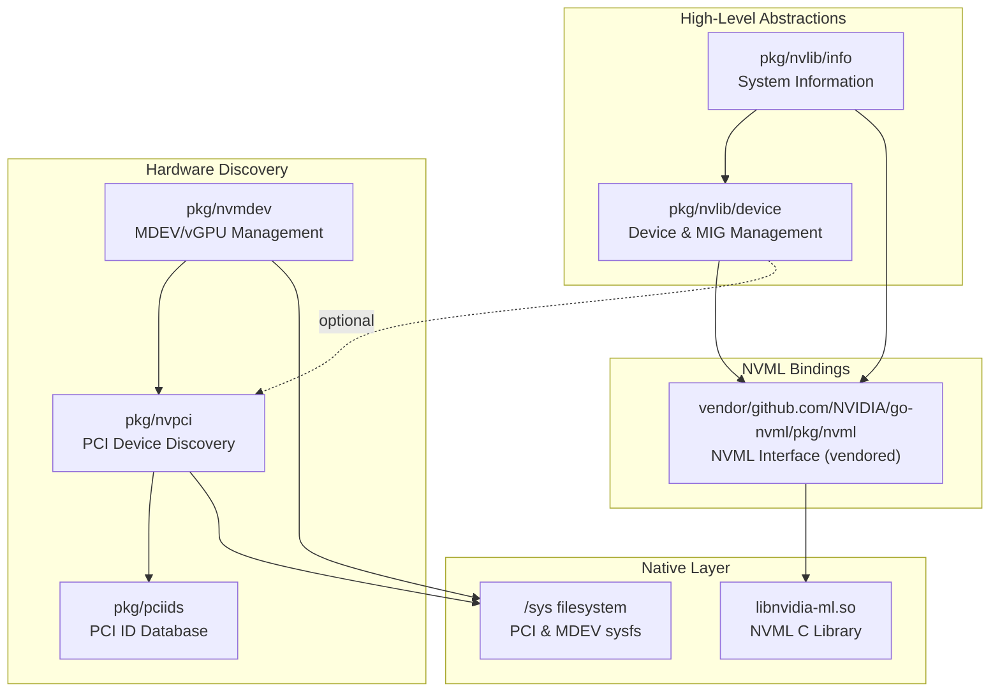
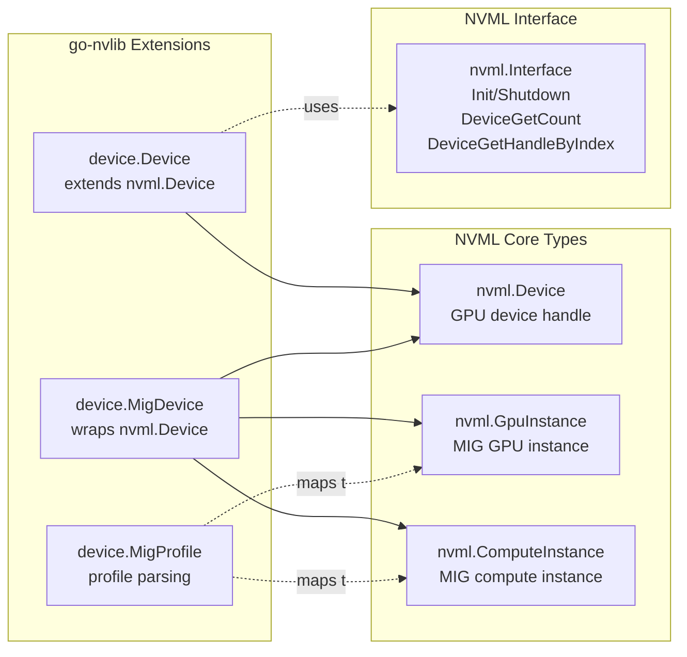
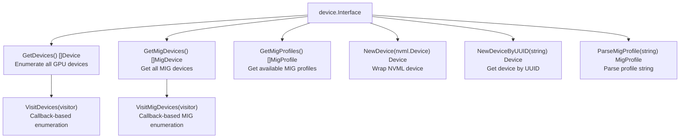
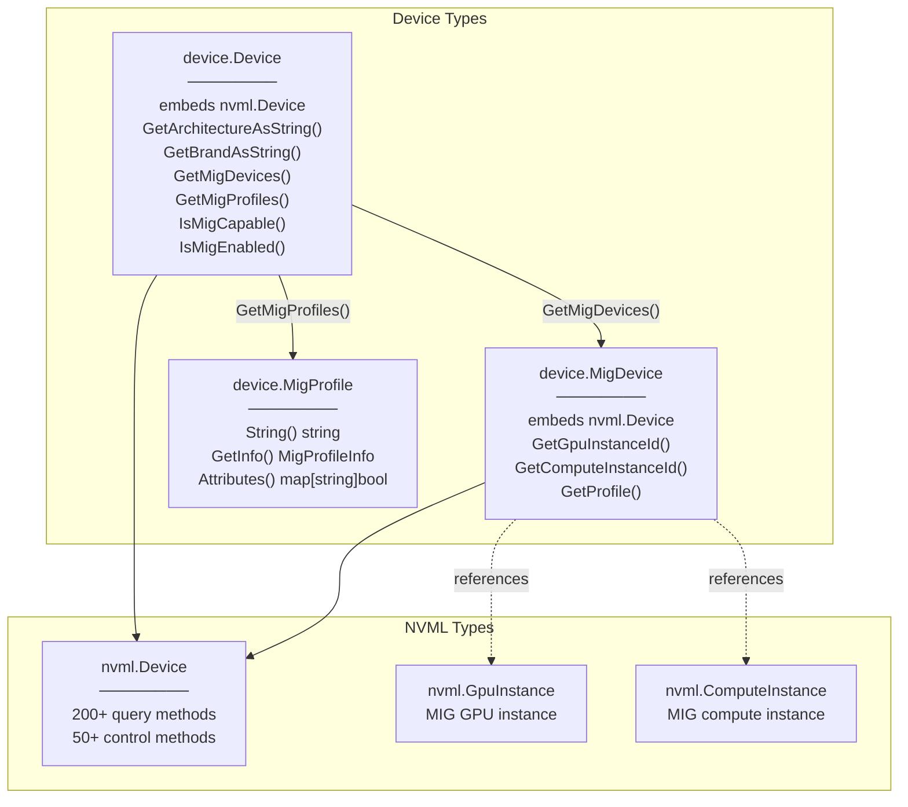
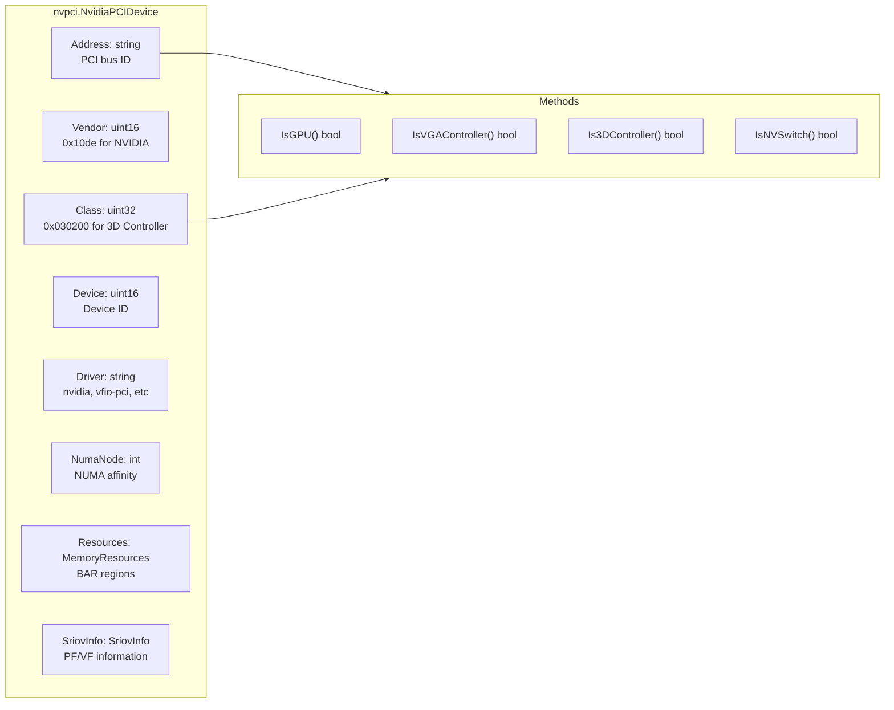
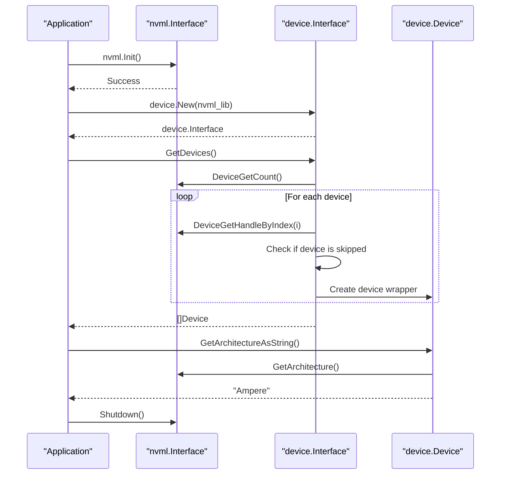
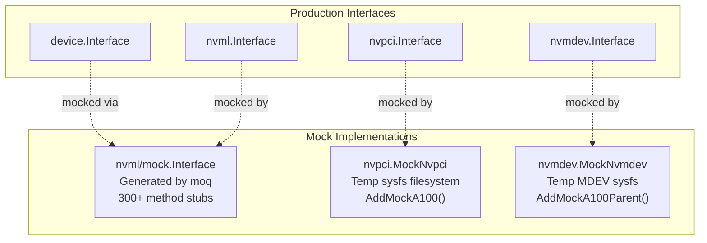

<!-- source: DeepWiki mcp.deepwiki.com · repo NVIDIA/go-nvlib · page 1 Overview · fetched 2026-10-26 -->

# Overview

Relevant source files

The following files were used as context for generating this wiki page:

- [go.mod](go.mod)
- [pkg/nvlib/device/api.go](pkg/nvlib/device/api.go)
- [pkg/nvlib/device/device.go](pkg/nvlib/device/device.go)
- [pkg/nvpci/mock.go](pkg/nvpci/mock.go)
- [pkg/nvpci/nvpci.go](pkg/nvpci/nvpci.go)
- [pkg/nvpci/nvpci_mock.go](pkg/nvpci/nvpci_mock.go)
- [pkg/nvpci/nvpci_test.go](pkg/nvpci/nvpci_test.go)
- [vendor/modules.txt](vendor/modules.txt)

## Purpose and Scope

`go-nvlib` is a Go library for managing NVIDIA GPU devices and hardware. It provides Go-native abstractions and utilities on top of NVIDIA's Management Library (NVML) for discovering, querying, and managing GPU devices, Multi-Instance GPU (MIG) configurations, PCI topology, and virtualization features.

This page provides a high-level architectural overview of the library, its relationship to NVML, and the primary packages and interfaces. For detailed information about specific functionality:
- Device management and enumeration: see [GPU Device Management](#3)
- MIG support and profiles: see [Multi-Instance GPU (MIG)](#4)
- PCI device discovery: see [PCI Device Discovery](#5.1)
- MDEV/vGPU management: see [MDEV and vGPU Management](#5.2)
- Direct NVML bindings: see [NVML Bindings Reference](#6)

Sources: [pkg/nvlib/device/device.go:1-48](), [pkg/nvlib/device/api.go:1-39](), [go.mod:1-16]()

## Library Architecture

`go-nvlib` is organized into three primary layers: high-level device abstractions, hardware topology discovery, and NVML bindings. Each layer provides increasingly lower-level access to GPU functionality.

### Package Structure

**Key Packages:**

| Package | Purpose | Primary Interface |
|---------|---------|-------------------|
| `pkg/nvlib/device` | High-level GPU device management, MIG support | `device.Interface` |
| `pkg/nvlib/info` | System-wide GPU information gathering | `info.Interface` |
| `pkg/nvpci` | PCI device enumeration via sysfs | `nvpci.Interface` |
| `pkg/nvmdev` | MDEV/vGPU creation and management | `nvmdev.Interface` |
| `pkg/pciids` | PCI vendor/device name resolution | `pciids.DB` |
| `vendor/.../go-nvml` | NVML Go bindings (vendored) | `nvml.Interface` |

Sources: [pkg/nvlib/device/device.go:1-48](), [pkg/nvpci/nvpci.go:31-62](), [go.mod:5-9](), [vendor/modules.txt:1-23]()

## Relationship to NVML

NVML (NVIDIA Management Library) is NVIDIA's C library for monitoring and managing GPU devices. `go-nvlib` builds upon the `go-nvml` bindings to provide:

1. **Higher-level abstractions**: Go-idiomatic interfaces that simplify common operations
2. **Enhanced MIG support**: Simplified MIG profile parsing and validation
3. **PCI topology discovery**: Hardware topology information not available through NVML
4. **String conversions**: Human-readable representations of device properties
5. **Testing utilities**: Mock implementations for testing without GPU hardware

### NVML Integration Points

The `device.Device` interface embeds `nvml.Device`, exposing all NVML methods while adding convenience functions. For example:

- `GetArchitectureAsString()` returns "Ampere" or "Hopper" instead of numeric constants
- `GetBrandAsString()` returns "GeForce" or "Tesla" instead of enum values  
- `GetMigProfiles()` parses and validates MIG profile configurations
- `IsMigCapable()` safely checks MIG capability with symbol verification

Sources: [pkg/nvlib/device/device.go:26-48](), [pkg/nvlib/device/device.go:70-99](), [pkg/nvlib/device/device.go:101-147]()

## Core Interfaces and Types

### Device Management Interface

The `device.Interface` is the primary entry point for GPU management operations:

**Key Methods:**

| Method | Purpose |
|--------|---------|
| `GetDevices()` | Returns all non-skipped GPU devices in the system |
| `GetMigDevices()` | Returns all configured MIG devices across all GPUs |
| `GetMigProfiles()` | Returns unique MIG profiles available on the system |
| `NewDeviceByUUID(uuid)` | Creates a Device from a GPU UUID string |
| `ParseMigProfile(profile)` | Parses MIG profile strings like "1g.5gb" or "1c.1g.5gb+me" |
| `VisitDevices(visitor)` | Iterates devices with callback pattern for error handling |

Sources: [pkg/nvlib/device/api.go:23-38](), [pkg/nvlib/device/device.go:432-463](), [pkg/nvlib/device/device.go:514-560]()

### Device Type Hierarchy

**Type Responsibilities:**

- **`device.Device`**: Extends `nvml.Device` with Go-friendly string conversions, MIG capability checks, and device filtering (skips "DGX Display" by default)
- **`device.MigDevice`**: Represents a configured MIG partition, combining GPU instance and compute instance information with profile metadata
- **`device.MigProfile`**: Parses and validates MIG profile format strings, mapping them to NVML profile IDs

Sources: [pkg/nvlib/device/device.go:26-48](), [pkg/nvlib/device/api.go:23-38]()

## PCI Device Discovery

The `nvpci` package provides hardware topology discovery independent of NVML, reading directly from Linux sysfs:

### NvidiaPCIDevice Structure

**Discovery Methods:**

| Method | Returns | Purpose |
|--------|---------|---------|
| `GetGPUs()` | `[]*NvidiaPCIDevice` | All NVIDIA GPU devices (excludes VFs) |
| `GetAllDevices()` | `[]*NvidiaPCIDevice` | All NVIDIA PCI devices |
| `GetGPUByPciBusID(addr)` | `*NvidiaPCIDevice` | Device at specific PCI address |
| `GetVGAControllers()` | `[]*NvidiaPCIDevice` | Legacy VGA devices (class 0x030000) |
| `Get3DControllers()` | `[]*NvidiaPCIDevice` | Modern GPUs (class 0x030200) |
| `GetNVSwitches()` | `[]*NvidiaPCIDevice` | NVSwitch devices (class 0x068000) |

The package reads from `/sys/bus/pci/devices` to enumerate devices and uses the `pciids` package to resolve vendor and device names to human-readable strings.

Sources: [pkg/nvpci/nvpci.go:31-62](), [pkg/nvpci/nvpci.go:107-122](), [pkg/nvpci/nvpci.go:201-235]()

## Initialization and Lifecycle

### Basic Usage Pattern

**Typical initialization sequence:**

1. Call `nvml.Init()` to initialize the NVML library
2. Create a `device.Interface` with `device.New(nvmllib)`
3. Use `GetDevices()` to enumerate GPU devices
4. Query device properties and manage configurations
5. Call `nvml.Shutdown()` to clean up

The `device` package automatically filters certain devices (e.g., "DGX Display") and can be configured with additional skip patterns via `device.WithSkippedDevices()`.

Sources: [pkg/nvlib/device/api.go:49-68](), [pkg/nvlib/device/device.go:432-463](), [pkg/nvlib/device/device.go:418-430]()

## Module Dependencies

`go-nvlib` vendors its dependencies to ensure reproducible builds. The primary dependencies are:

| Module | Version | Purpose |
|--------|---------|---------|
| `github.com/NVIDIA/go-nvml` | v0.13.0-1 | NVML Go bindings (CGO wrapper) |
| `github.com/google/uuid` | v1.6.0 | UUID generation and parsing |
| `github.com/stretchr/testify` | v1.11.1 | Testing assertions and mocking |
| `gopkg.in/yaml.v3` | v3.0.1 | YAML processing for info package |

The library requires Go 1.20 or later and is designed to run on Linux systems with NVIDIA GPU hardware and drivers installed.

Sources: [go.mod:1-16](), [vendor/modules.txt:1-23]()

## Testing Infrastructure

`go-nvlib` provides comprehensive mock implementations that enable testing without GPU hardware:

### Mock Implementations

- **`nvml/mock.Interface`**: Auto-generated mock with all NVML methods as configurable function fields
- **`nvpci.MockNvpci`**: Creates temporary sysfs directory structures to simulate PCI devices
- **`nvmdev.MockNvmdev`**: Creates temporary MDEV sysfs structures for vGPU testing

For more details on testing, see [Testing](#8) and [Mock Implementations](#8.2).

Sources: [pkg/nvpci/mock.go:29-59](), [pkg/nvpci/nvpci_test.go:29-76]()

## Design Principles

The library follows several key design principles:

1. **Interface-driven architecture**: All major components expose Go interfaces, enabling dependency injection and testing
2. **NVML extension, not replacement**: The `device.Device` embeds `nvml.Device`, making all NVML methods available while adding convenience
3. **Graceful degradation**: Optional features check for symbol availability before calling (e.g., `hasSymbol("nvmlDeviceGetMigMode")`)
4. **Visitor pattern for enumeration**: Callback-based iteration with error handling (e.g., `VisitDevices()`, `VisitMigDevices()`)
5. **Multiple abstraction layers**: Applications can work at the appropriate level: high-level device management, PCI topology, or raw NVML
6. **Testability**: Mock implementations allow testing without GPU hardware or root privileges

Sources: [pkg/nvlib/device/device.go:562-570](), [pkg/nvlib/device/device.go:432-463](), [pkg/nvlib/device/api.go:49-91]()

---

