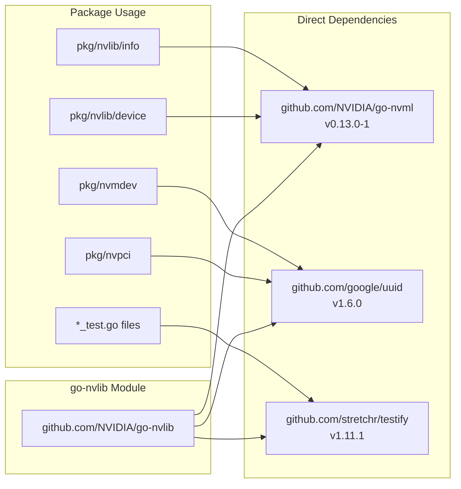
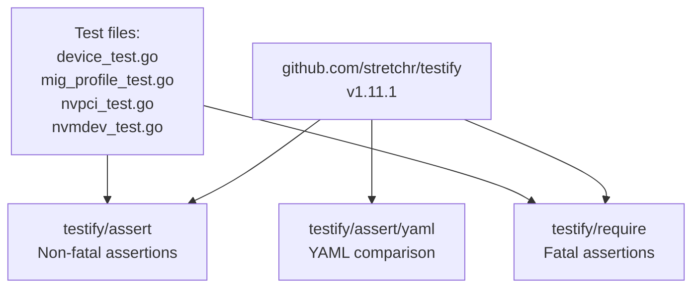
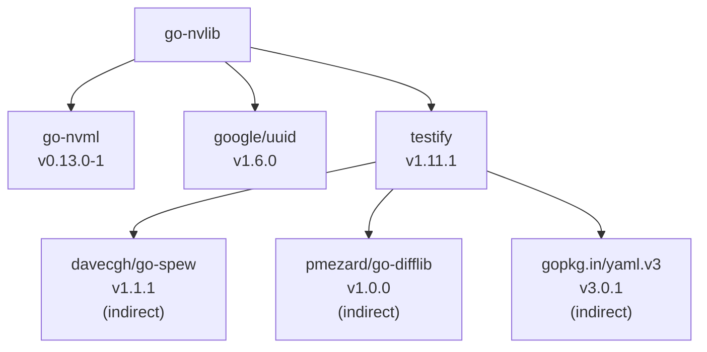
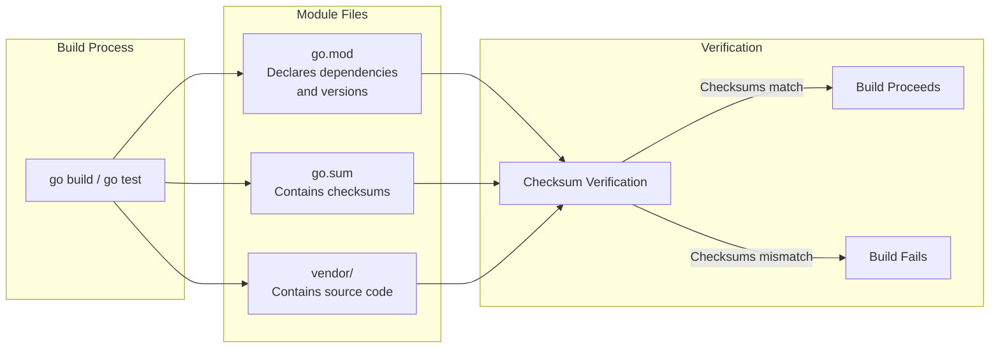
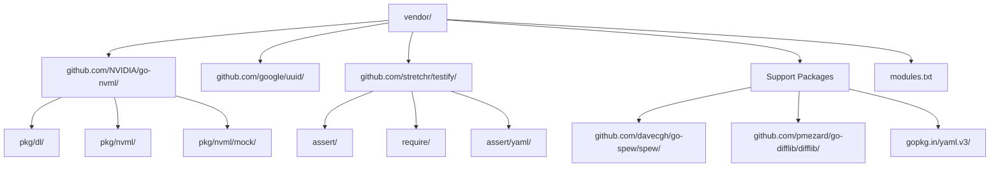
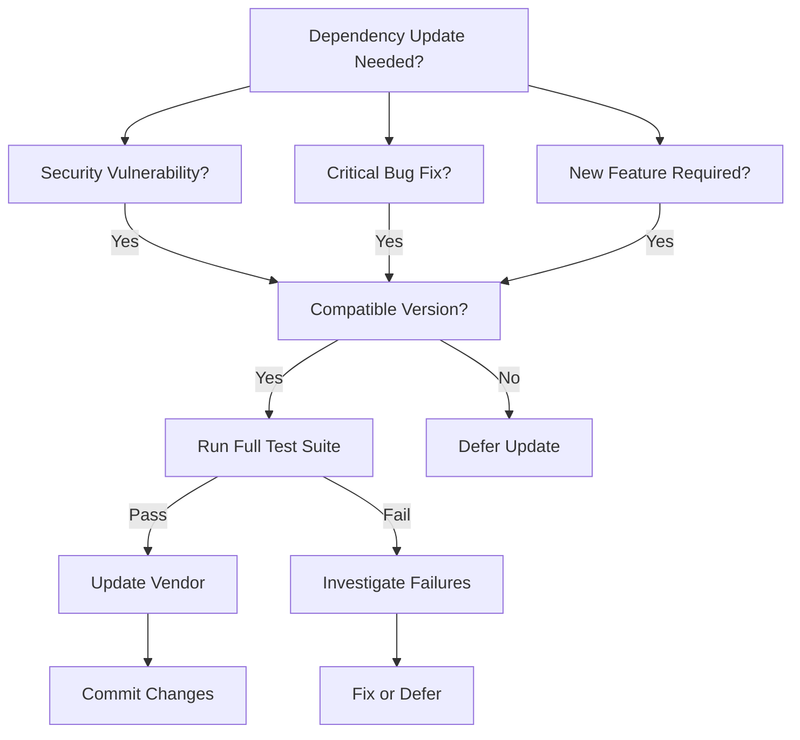
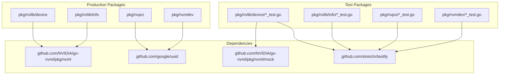
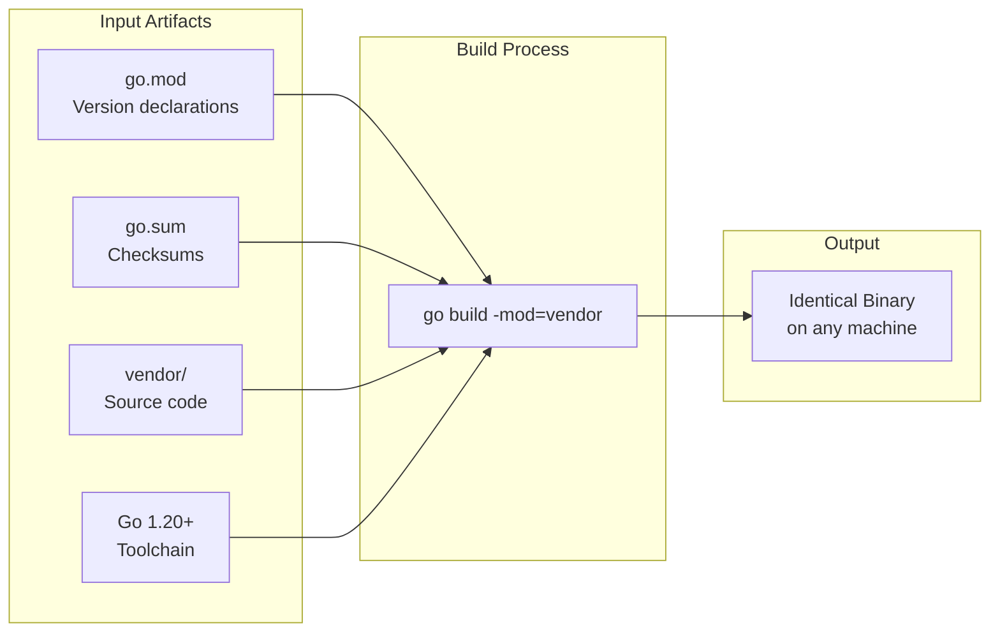
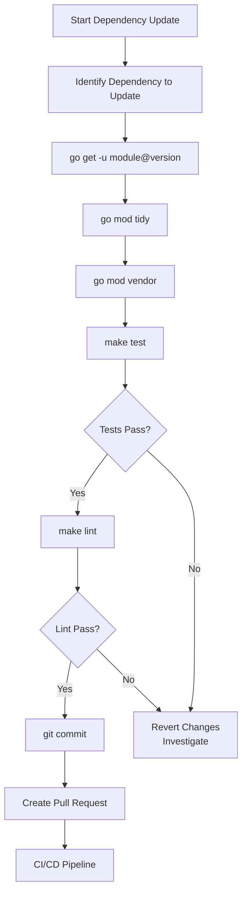

<!-- source: DeepWiki mcp.deepwiki.com · repo NVIDIA/go-nvlib · page 10 Dependencies and Module Management · fetched 2026-10-26 -->

# Dependencies and Module Management

<details>
<summary>Relevant source files</summary>

The following files were used as context for generating this wiki page:

- [go.mod](go.mod)
- [go.sum](go.sum)
- [vendor/modules.txt](vendor/modules.txt)

</details>


This document provides a comprehensive overview of `go-nvlib`'s dependency management, including the Go module structure, vendoring strategy, and version control practices. It details each external dependency, its purpose, and how it integrates with the library's architecture.

For information about building and code generation tools, see [Build System](#9.1). For CI/CD integration of dependency checking, see [CI/CD Pipeline](#9.2).

---

## Purpose and Scope

The `go-nvlib` project uses Go modules for dependency management and employs vendoring to ensure reproducible builds. This page documents:
- The module structure defined in `go.mod`
- Direct and indirect dependencies and their roles
- The vendoring strategy implemented in the `vendor/` directory
- Version constraints and update policies
- Dependency verification through `go.sum`

---

## Module Configuration

The project is defined as a Go module with a minimum Go version requirement and explicit dependency declarations.

### Module Declaration

The module is identified as `github.com/NVIDIA/go-nvlib` and requires Go 1.20 or later:

```
module github.com/NVIDIA/go-nvlib

go 1.20
```

This declaration establishes the module path used for imports and sets the minimum Go toolchain version required to build the library. The Go 1.20 requirement ensures access to modern Go features while maintaining reasonable compatibility with existing toolchains.

**Sources:** [go.mod:1-3]()

### Dependency Categories

Dependencies are organized into two categories in `go.mod`:

| Category | Purpose | Example |
|----------|---------|---------|
| `require` | Direct dependencies used by library code | `github.com/NVIDIA/go-nvml` |
| `require` (with `// indirect`) | Transitive dependencies | `gopkg.in/yaml.v3` |

The direct dependencies are explicitly imported and used by `go-nvlib` packages, while indirect dependencies are required by the direct dependencies but not directly imported by `go-nvlib` code.

**Sources:** [go.mod:5-15]()

---

## Direct Dependencies

### Dependency Overview

**Diagram: Direct Dependency Relationships**



**Sources:** [go.mod:5-9](), [vendor/modules.txt:1-22]()

### github.com/NVIDIA/go-nvml v0.13.0-1

The `go-nvml` package provides Go bindings to the NVIDIA Management Library (NVML), which is the core dependency of `go-nvlib`.

#### Vendored Packages

The following `go-nvml` packages are vendored:

| Package | Purpose |
|---------|---------|
| `github.com/NVIDIA/go-nvml/pkg/dl` | Dynamic library loading utilities |
| `github.com/NVIDIA/go-nvml/pkg/nvml` | Core NVML API bindings |
| `github.com/NVIDIA/go-nvml/pkg/nvml/mock` | Mock implementations for testing |

#### Usage Patterns

The `go-nvml` dependency is used throughout the codebase for GPU management operations:

- **Device package**: Uses `nvml.Interface` and `nvml.Device` for device enumeration and properties
- **Info package**: Uses NVML to gather system information
- **Testing**: Uses `nvml/mock` package for unit tests without GPU hardware

The version `v0.13.0-1` represents a specific release with the `-1` suffix indicating a patch or modification from the base `v0.13.0` release.

**Sources:** [go.mod:6](), [vendor/modules.txt:1-5]()

### github.com/google/uuid v1.6.0

The `uuid` package provides RFC 4122 UUID generation and parsing capabilities.

#### Usage Context

UUIDs are used in the following contexts:

| Context | Usage | Example |
|---------|-------|---------|
| GPU Identification | NVML device UUIDs | `GPU-12345678-1234-1234-1234-123456789abc` |
| MDEV Management | MDEV instance UUIDs | Created when instantiating vGPUs |
| Device Validation | UUID format validation | Checking identifier formats in device queries |

The `uuid` package is imported by packages that handle MDEV/vGPU management and PCI device discovery, where unique identifiers are essential for device tracking.

**Sources:** [go.mod:7](), [vendor/modules.txt:9-11]()

### github.com/stretchr/testify v1.11.1

The `testify` framework provides assertion and testing utilities used extensively throughout the test suite.

#### Vendored Sub-packages



#### Assertion Styles

The test suite uses two assertion styles:

| Style | Behavior | Use Case |
|-------|----------|----------|
| `assert.*` | Continues execution after failure | Multiple assertions in one test |
| `require.*` | Stops execution after failure | Prerequisites for subsequent assertions |

The `testify` framework is a testing-only dependency and does not appear in production code paths. It is marked as a direct dependency because test files in `go-nvlib` explicitly import it.

**Sources:** [go.mod:8](), [vendor/modules.txt:15-19]()

---

## Indirect Dependencies

### Transitive Dependency Chain

**Diagram: Complete Dependency Graph**



**Sources:** [go.mod:11-15](), [vendor/modules.txt:6-22]()

### github.com/davecgh/go-spew v1.1.1

The `go-spew` package provides deep pretty printing for Go data structures. It is an indirect dependency pulled in by `testify` for formatting assertion failure messages.

#### Vendored Package

- `github.com/davecgh/go-spew/spew` - Core pretty-printing functionality

This package is used internally by `testify` to format complex data structures when assertions fail, making test output more readable.

**Sources:** [go.mod:12](), [vendor/modules.txt:6-8]()

### github.com/pmezard/go-difflib v1.0.0

The `go-difflib` package provides diff algorithms for comparing text. It is an indirect dependency used by `testify` for generating diffs in assertion failures.

#### Vendored Package

- `github.com/pmezard/go-difflib/difflib` - Unified diff generation

When `testify` assertions compare strings or byte slices and find differences, this library generates unified diffs showing the exact differences, similar to Unix `diff` output.

**Sources:** [go.mod:13](), [vendor/modules.txt:12-14]()

### gopkg.in/yaml.v3 v3.0.1

The `yaml.v3` package provides YAML encoding and decoding. It is an indirect dependency used by `testify` for YAML-based assertions.

#### Vendored Package

- `gopkg.in/yaml.v3` - YAML v3 implementation

This package enables `testify` to compare YAML-formatted data structures. While it's marked as indirect in `go.mod`, the `testify/assert/yaml` sub-package uses it for YAML-specific assertion methods.

**Sources:** [go.mod:14](), [vendor/modules.txt:20-22]()

---

## Dependency Verification

### Checksum Database (go.sum)

The `go.sum` file contains cryptographic checksums for all dependencies and their `go.mod` files, ensuring integrity and preventing tampering.

**Diagram: Dependency Verification Flow**



**Sources:** [go.sum:1-15]()

### Checksum Format

Each dependency has two checksum entries in `go.sum`:

```
<module> <version> h1:<base64-checksum>
<module> <version>/go.mod h1:<base64-checksum>
```

For example:
```
github.com/NVIDIA/go-nvml v0.13.0-1 h1:OLX8Jq3dONuPOQPC7rndB6+iDmDakw0XTYgzMxObkEw=
github.com/NVIDIA/go-nvml v0.13.0-1/go.mod h1:+KNA7c7gIBH7SKSJ1ntlwkfN80zdx8ovl4hrK3LmPt4=
```

The first line contains the checksum for the module's source code, while the second line contains the checksum for its `go.mod` file. The `h1:` prefix indicates the hashing algorithm (SHA-256).

**Sources:** [go.sum:1-14]()

### Dependency Version Lock

The combination of `go.mod`, `go.sum`, and the vendored `vendor/` directory creates a complete lock on dependency versions:

| File/Directory | Purpose | Change Frequency |
|----------------|---------|------------------|
| `go.mod` | Human-readable version declarations | Manual updates |
| `go.sum` | Cryptographic verification | Updated with `go.mod` |
| `vendor/` | Vendored source code | Updated with `go mod vendor` |
| `vendor/modules.txt` | Module metadata | Generated automatically |

This three-layer approach ensures that:
1. Versions are explicitly declared (`go.mod`)
2. Content is cryptographically verified (`go.sum`)
3. Source code is available offline (`vendor/`)

**Sources:** [go.mod:1-15](), [go.sum:1-14](), [vendor/modules.txt:1-23]()

---

## Vendoring Strategy

### Vendor Directory Structure

The `vendor/` directory contains complete copies of all dependencies, enabling offline builds and ensuring the exact code used is available in the repository.

**Diagram: Vendored Package Organization**



**Sources:** [vendor/modules.txt:1-23]()

### Vendor Metadata

The `vendor/modules.txt` file is automatically generated and contains metadata about vendored modules:

```
# <module> <version>
## <flags>; go <version>
<package-path>
```

Example entry:
```
# github.com/NVIDIA/go-nvml v0.13.0-1
## explicit; go 1.20
github.com/NVIDIA/go-nvml/pkg/dl
github.com/NVIDIA/go-nvml/pkg/nvml
github.com/NVIDIA/go-nvml/pkg/nvml/mock
```

The `explicit` flag indicates that this is a direct dependency declared in `go.mod`. The `go 1.20` annotation indicates the minimum Go version required by that module.

**Sources:** [vendor/modules.txt:1-23]()

### Vendoring Benefits

The vendoring approach provides several benefits:

| Benefit | Description |
|---------|-------------|
| **Offline Builds** | Complete source code available without network access |
| **Reproducibility** | Exact dependency code frozen at specific versions |
| **Code Review** | Dependency changes visible in version control diffs |
| **Supply Chain Security** | Reduces exposure to registry compromises |
| **Build Performance** | No network latency for dependency resolution |

### Vendor Maintenance

The vendor directory is maintained through standard Go module commands:

```bash
# Update dependencies to latest versions matching go.mod constraints
go get -u ./...

# Tidy up go.mod and go.sum
go mod tidy

# Populate vendor/ directory
go mod vendor
```

The CI/CD pipeline includes a check to ensure vendored dependencies are up to date with `go.mod`. See [CI/CD Pipeline](#9.2) for details on the `check-vendor` validation.

**Sources:** [vendor/modules.txt:1-23]()

---

## Version Constraints and Update Policy

### Semantic Versioning

All dependencies follow semantic versioning (`vMAJOR.MINOR.PATCH`):

| Dependency | Current Version | Versioning Notes |
|------------|----------------|------------------|
| `go-nvml` | v0.13.0-1 | Pre-1.0, breaking changes possible in minor releases |
| `google/uuid` | v1.6.0 | Stable 1.x series |
| `testify` | v1.11.1 | Stable 1.x series |

The `go-nvml` dependency is in the 0.x series, meaning the API may change between minor versions (e.g., 0.13.x → 0.14.x could include breaking changes). Once it reaches v1.0.0, semantic versioning guarantees will apply.

**Sources:** [go.mod:6-8]()

### Version Update Criteria

Dependencies are updated based on the following criteria:



**Sources:** [go.mod:1-15]()

### Minimum Versions

The `go.mod` file specifies minimum versions, not exact versions. The Go module system will select the minimum version that satisfies all transitive dependency constraints.

For example:
- `go-nvlib` requires `go-nvml v0.13.0-1` or later
- If another dependency required `go-nvml v0.14.0`, Go would select v0.14.0
- The `go.sum` file locks the selected version for reproducibility

**Sources:** [go.mod:5-9]()

---

## Dependency Usage Mapping

### Package-Level Imports

**Diagram: Dependency Usage by Package**



**Sources:** [vendor/modules.txt:1-22]()

### Import Path Reference

| Package | Imports | Purpose |
|---------|---------|---------|
| `pkg/nvlib/device` | `github.com/NVIDIA/go-nvml/pkg/nvml` | Device enumeration and management |
| `pkg/nvlib/info` | `github.com/NVIDIA/go-nvml/pkg/nvml` | System information queries |
| `pkg/nvpci` | `github.com/google/uuid` | MDEV UUID generation and validation |
| `pkg/nvmdev` | `github.com/google/uuid` | MDEV device UUID handling |
| `*_test.go` | `github.com/stretchr/testify/assert` | Non-fatal test assertions |
| `*_test.go` | `github.com/stretchr/testify/require` | Fatal test assertions |
| `*_test.go` | `github.com/NVIDIA/go-nvml/pkg/nvml/mock` | NVML mock implementations |

**Sources:** [vendor/modules.txt:1-22]()

---

## Reproducible Builds

### Build Determinism

The combination of module management strategies ensures deterministic builds:



**Sources:** [go.mod:1-15](), [go.sum:1-14](), [vendor/modules.txt:1-23]()

### Verification Commands

To verify dependency integrity and reproducibility:

| Command | Purpose | Expected Result |
|---------|---------|-----------------|
| `go mod verify` | Verify checksums in `go.sum` | All dependencies verified |
| `go mod tidy` | Ensure `go.mod` is up to date | No changes if current |
| `go mod vendor` | Update `vendor/` directory | Matches `go.mod` exactly |
| `diff -r vendor/ <fresh-vendor>` | Compare vendor directories | No differences |

These verification steps are integrated into the CI/CD pipeline to ensure repository consistency. See [CI/CD Pipeline](#9.2) for automated verification workflows.

**Sources:** [go.mod:1-15](), [go.sum:1-14]()

---

## Dependency Update Workflow

### Manual Update Process

The typical workflow for updating dependencies:



**Sources:** [go.mod:1-15]()

### Automated Update Checks

While not currently implemented in the repository, the following automated checks are recommended:

| Check Type | Tool | Frequency |
|------------|------|-----------|
| Security vulnerabilities | `go list -m -u all` or Dependabot | Weekly |
| Outdated dependencies | `go list -m -u all` | Monthly |
| License compliance | License scanning tools | Per update |

The modular dependency structure and comprehensive test suite make it feasible to automate dependency updates with confidence.

**Sources:** [go.mod:1-15]()

---

## Summary

The `go-nvlib` dependency management strategy balances several concerns:

| Aspect | Strategy |
|--------|----------|
| **Dependency Selection** | Minimal, well-maintained packages |
| **Versioning** | Semantic versioning with locked versions |
| **Verification** | Cryptographic checksums in `go.sum` |
| **Distribution** | Vendored source code in `vendor/` |
| **Updates** | Manual with full testing |
| **Build Reproducibility** | Guaranteed through vendoring |

The core dependency on `go-nvml` provides the foundation for GPU management, while `uuid` and `testify` provide essential utilities and testing capabilities. The vendoring strategy ensures builds remain reproducible even if external repositories become unavailable.

For details on using these dependencies during development, see [Build System](#9.1). For information on the CI/CD checks that validate dependency integrity, see [CI/CD Pipeline](#9.2).

**Sources:** [go.mod:1-15](), [go.sum:1-14](), [vendor/modules.txt:1-23]()

---

