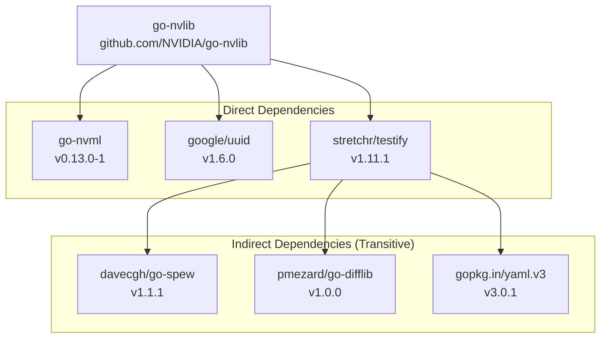
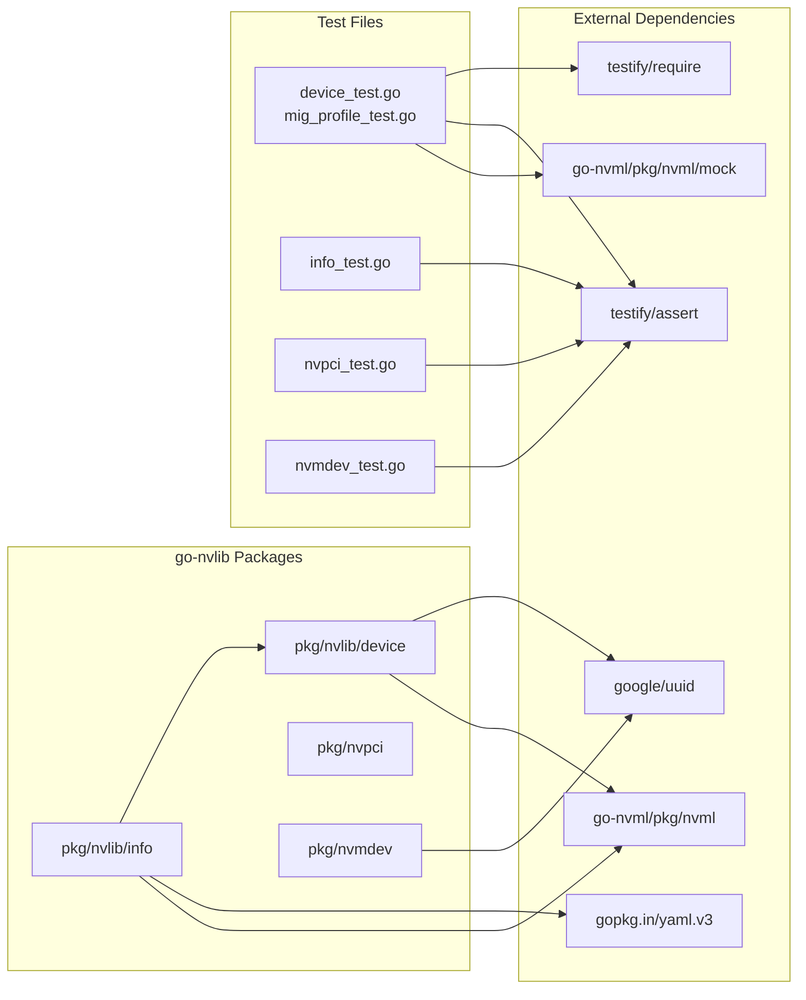

<!-- source: DeepWiki mcp.deepwiki.com · repo NVIDIA/go-nvlib · page 10.1 Module Dependencies · fetched 2026-10-26 -->

# Module Dependencies

<details>
<summary>Relevant source files</summary>

The following files were used as context for generating this wiki page:

- [go.mod](go.mod)
- [vendor/modules.txt](vendor/modules.txt)

</details>


This document describes the external dependencies declared in `go-nvlib`'s module file, their versions, and their purposes. It covers the direct dependencies required by the library, their transitive dependencies, and the specific packages vendored from each module.

For information about the vendoring strategy and ensuring reproducible builds, see [Vendoring and Reproducible Builds](#10.2). For details on the build system and dependency management commands, see [Build System](#9.1).

---

## Dependency Overview

The `go-nvlib` module declares a minimal set of direct dependencies for core functionality (NVML bindings and UUID generation) and testing infrastructure. All dependencies are vendored to ensure reproducible builds across environments.

**Module Definition**

The module is defined in [go.mod:1-3]() with a minimum Go version requirement:

```
module github.com/NVIDIA/go-nvlib
go 1.20
```

### Dependency Graph



**Sources:** [go.mod:5-15](), [vendor/modules.txt:1-22]()

---

## Direct Dependencies

### go-nvml (NVIDIA NVML Bindings)

The `github.com/NVIDIA/go-nvml` package provides CGO-based bindings to the NVIDIA Management Library (NVML). This is the most critical dependency, as it provides the bridge to native NVIDIA GPU management capabilities.

**Version:** `v0.13.0-1` [go.mod:6]()

**Vendored Packages:**
- `github.com/NVIDIA/go-nvml/pkg/dl` - Dynamic library loading utilities [vendor/modules.txt:3]()
- `github.com/NVIDIA/go-nvml/pkg/nvml` - Core NVML interface and types [vendor/modules.txt:4]()
- `github.com/NVIDIA/go-nvml/pkg/nvml/mock` - Mock NVML interface for testing [vendor/modules.txt:5]()

**Usage in Codebase:**
The `nvml` package is used throughout the `pkg/nvlib/device` and `pkg/nvlib/info` packages for GPU discovery, property queries, MIG management, and vGPU operations. The mock package is used extensively in unit tests.

**Go Version:** Requires `go 1.20` [vendor/modules.txt:2]()

### google/uuid

The `github.com/google/uuid` package provides RFC 4122 compliant UUID generation and parsing.

**Version:** `v1.6.0` [go.mod:7]()

**Vendored Package:**
- `github.com/google/uuid` [vendor/modules.txt:11]()

**Usage in Codebase:**
Used by the device package for parsing and validating device UUIDs, particularly for GPU and MIG device identifiers. Also used by the `nvmdev` package for MDEV UUID handling.

### stretchr/testify

The `github.com/stretchr/testify` package provides a comprehensive testing toolkit with assertion functions and mocking utilities.

**Version:** `v1.11.1` [go.mod:8]()

**Vendored Packages:**
- `github.com/stretchr/testify/assert` - Non-fatal assertions [vendor/modules.txt:17]()
- `github.com/stretchr/testify/assert/yaml` - YAML comparison utilities [vendor/modules.txt:18]()
- `github.com/stretchr/testify/require` - Fatal assertions [vendor/modules.txt:19]()

**Usage in Codebase:**
Used in all test files across the repository. The `assert` package provides non-fatal assertions that allow tests to continue after failures, while `require` provides fatal assertions that stop test execution immediately. See [Testing Framework](#8.1) for detailed usage patterns.

**Go Version:** Requires `go 1.17` [vendor/modules.txt:16]()

**Sources:** [go.mod:5-9](), [vendor/modules.txt:1-19]()

---

## Indirect Dependencies

Indirect dependencies are transitive dependencies pulled in by the direct dependencies. These are managed automatically by Go modules but are included in the vendored code.

### davecgh/go-spew

**Version:** `v1.1.1` [go.mod:12]()

A deep pretty printer for Go data structures. This is a transitive dependency of `testify` used for generating detailed output when assertions fail.

**Vendored Package:**
- `github.com/davecgh/go-spew/spew` [vendor/modules.txt:8]()

### pmezard/go-difflib

**Version:** `v1.0.0` [go.mod:13]()

A library for computing differences between strings and sequences. This is a transitive dependency of `testify` used for generating diffs in assertion failures.

**Vendored Package:**
- `github.com/pmezard/go-difflib/difflib` [vendor/modules.txt:14]()

### gopkg.in/yaml.v3

**Version:** `v3.0.1` [go.mod:14]()

A YAML parser and encoder. This is a transitive dependency of `testify` used for YAML comparison assertions and is also used by the `info` package for YAML output formatting.

**Vendored Package:**
- `gopkg.in/yaml.v3` [vendor/modules.txt:22]()

**Sources:** [go.mod:11-15](), [vendor/modules.txt:6-22]()

---

## Dependency Usage by Package

The following diagram maps `go-nvlib` packages to their external dependencies, showing how dependencies flow through the codebase.



**Sources:** [go.mod:1-15](), [vendor/modules.txt:1-22]()

---

## Version Constraints and Compatibility

### Go Language Version

The module requires Go 1.20 or later [go.mod:3](). This ensures compatibility with:
- Modern Go module features
- CGO improvements for NVML bindings
- Generic types (if used in future versions)

### Dependency Versions

**Semantic Versioning:**
All dependencies follow semantic versioning with the exception of `go-nvml`, which uses a special versioning scheme.

**go-nvml Version Format:**
The version `v0.13.0-1` [go.mod:6]() indicates:
- Base version: `v0.13.0` (corresponding to NVML API version)
- Patch level: `-1` (indicating the first patch release of the bindings)

This versioning scheme allows the bindings to track NVML API versions while maintaining independent patch releases for Go-specific fixes.

**Stable Versions:**
All other dependencies use stable, released versions:
- `uuid v1.6.0` - Latest stable release with improved performance
- `testify v1.11.1` - Latest stable release with Go 1.17+ support
- All indirect dependencies are pinned to specific stable versions

### Minimum Transitive Requirements

The highest minimum Go version requirement comes from `testify`, which requires Go 1.17 [vendor/modules.txt:16](). Since `go-nvlib` requires Go 1.20, all transitive requirements are satisfied.

**Sources:** [go.mod:1-15](), [vendor/modules.txt:1-22]()

---

## Dependency Table Summary

| Dependency | Version | Type | Purpose | Go Version |
|------------|---------|------|---------|------------|
| `github.com/NVIDIA/go-nvml` | v0.13.0-1 | Direct | NVML CGO bindings for GPU management | 1.20 |
| `github.com/google/uuid` | v1.6.0 | Direct | UUID parsing and generation | - |
| `github.com/stretchr/testify` | v1.11.1 | Direct | Testing assertions and utilities | 1.17 |
| `github.com/davecgh/go-spew` | v1.1.1 | Indirect | Pretty printing for test output | - |
| `github.com/pmezard/go-difflib` | v1.0.0 | Indirect | Diff generation for test failures | - |
| `gopkg.in/yaml.v3` | v3.0.1 | Indirect | YAML parsing and encoding | - |

**Sources:** [go.mod:5-15](), [vendor/modules.txt:1-22]()

---

## Vendored Package Structure

The following table shows the specific packages vendored from each dependency, as recorded in [vendor/modules.txt:1-22]():

| Module | Vendored Packages |
|--------|-------------------|
| `go-nvml` | `pkg/dl`, `pkg/nvml`, `pkg/nvml/mock` |
| `uuid` | `github.com/google/uuid` |
| `testify` | `assert`, `assert/yaml`, `require` |
| `go-spew` | `spew` |
| `go-difflib` | `difflib` |
| `yaml.v3` | `gopkg.in/yaml.v3` |

Only the necessary subpackages from each dependency are vendored, reducing the size of the vendor directory and improving build times.

**Sources:** [vendor/modules.txt:1-22]()

---

## Dependency Management Commands

Common operations for managing dependencies:

**Update dependencies:**
```bash
make vendor  # Runs go mod tidy && go mod vendor
```

**Verify vendor consistency:**
```bash
make check-vendor  # Ensures go.mod, go.sum, and vendor/ are in sync
```

**Add a new dependency:**
```bash
go get github.com/example/package@v1.2.3
make vendor
```

For detailed information about the vendoring workflow and build reproducibility, see [Vendoring and Reproducible Builds](#10.2).

**Sources:** [go.mod:1-15]()

---

