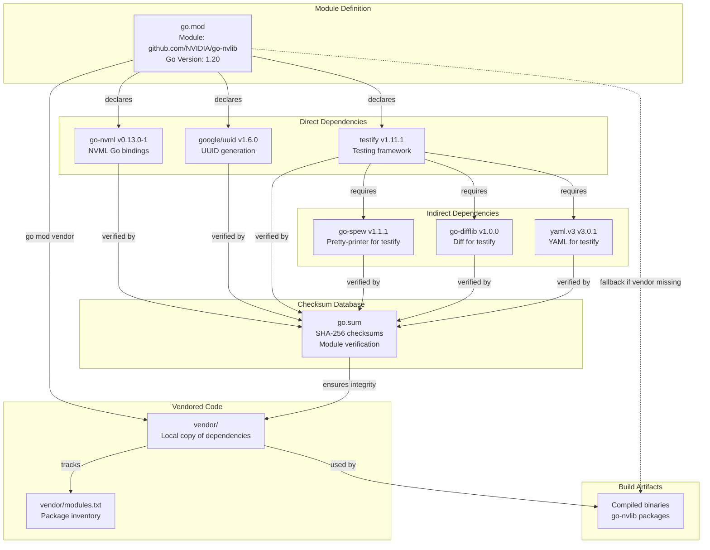
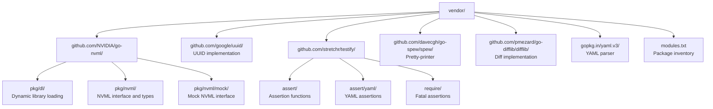
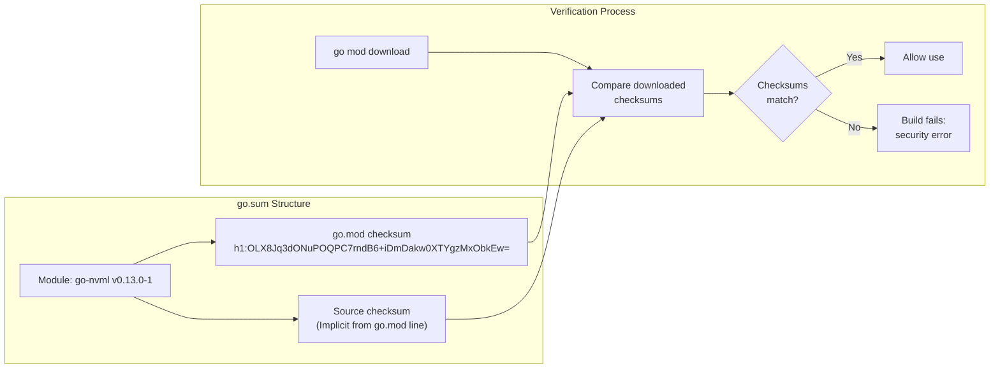
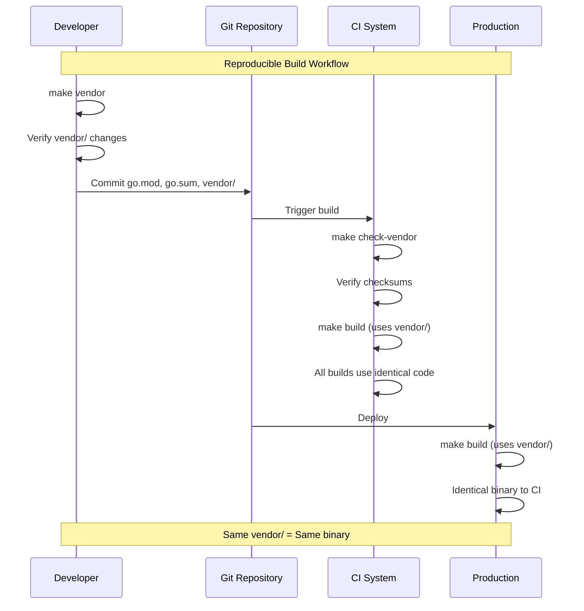
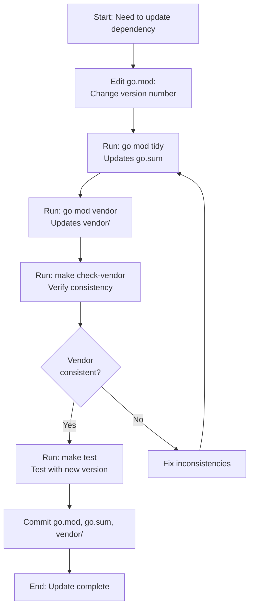
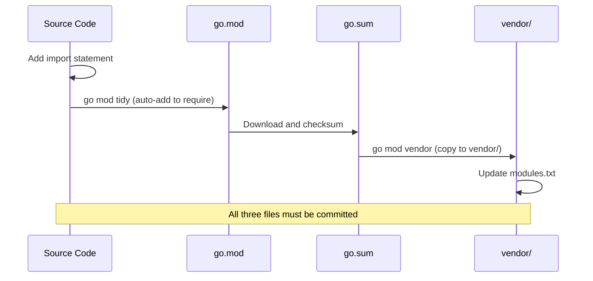
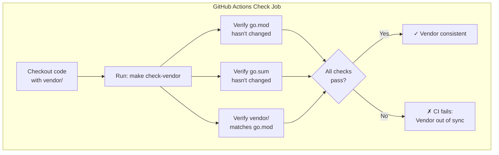
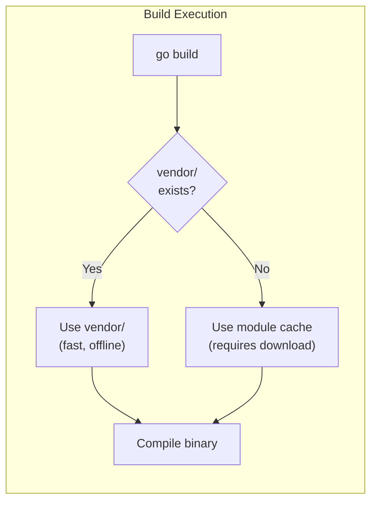
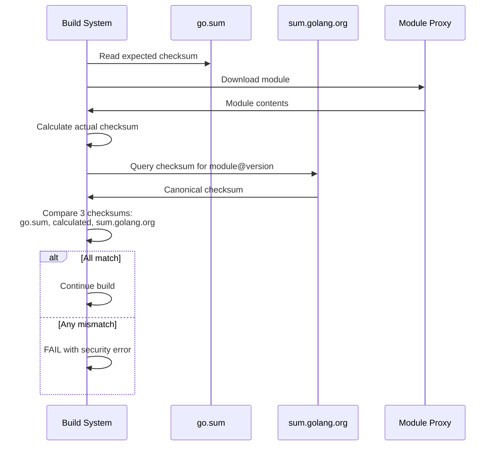

<!-- source: DeepWiki mcp.deepwiki.com · repo NVIDIA/go-nvlib · page 10.2 Vendoring and Reproducible Builds · fetched 2026-10-26 -->

# Vendoring and Reproducible Builds

<details>
<summary>Relevant source files</summary>

The following files were used as context for generating this wiki page:

- [go.mod](go.mod)
- [go.sum](go.sum)
- [vendor/modules.txt](vendor/modules.txt)

</details>


## Purpose and Scope

This document explains go-nvlib's vendoring strategy and how it ensures reproducible builds across different environments and time periods. It covers the structure of the `vendor/` directory, the role of `go.sum` checksums, and the workflow for updating and verifying vendored dependencies.

For information about which dependencies are used and why, see [Module Dependencies](#10.1). For information about build system integration and Makefile targets, see [Build System](#9.1).

---

## Vendoring Strategy Overview

go-nvlib uses **full vendoring** to ensure that all external dependencies are committed to the repository. This strategy provides:

- **Reproducibility**: Builds produce identical results regardless of when or where they are executed
- **Availability**: Builds do not depend on external module proxies or GitHub availability
- **Auditability**: All dependency code is visible in the repository for security review
- **Stability**: Builds are not affected by dependency changes, deletions, or proxy failures

The vendoring system relies on three key files:

| File | Purpose | Location |
|------|---------|----------|
| `go.mod` | Module definition and dependency versions | [go.mod:1-16]() |
| `go.sum` | Cryptographic checksums for dependency verification | [go.sum:1-15]() |
| `vendor/modules.txt` | Inventory of vendored packages and modules | [vendor/modules.txt:1-23]() |

Sources: [go.mod:1-16](), [go.sum:1-15](), [vendor/modules.txt:1-23]()

---

## Module Graph and Vendoring Architecture



**Diagram: Module dependency graph and vendoring workflow**

This diagram shows how `go.mod` declares dependencies (both direct and indirect), how `go.sum` verifies their integrity, and how `go mod vendor` populates the `vendor/` directory with a local copy. During builds, Go preferentially uses vendored code if available, falling back to the module cache only if the vendor directory is absent.

Sources: [go.mod:1-16](), [go.sum:1-15](), [vendor/modules.txt:1-23]()

---

## Vendor Directory Structure

The `vendor/` directory contains local copies of all dependencies organized by module path. The structure mirrors the module organization:



**Diagram: Vendor directory package organization**

The `vendor/modules.txt` file serves as the authoritative inventory of vendored packages:

```
# github.com/NVIDIA/go-nvml v0.13.0-1
## explicit; go 1.20
github.com/NVIDIA/go-nvml/pkg/dl
github.com/NVIDIA/go-nvml/pkg/nvml
github.com/NVIDIA/go-nvml/pkg/nvml/mock
```

Each module entry includes:
- **Module path and version**: The exact version vendored (e.g., `v0.13.0-1`)
- **Explicit marker**: Indicates whether the module is a direct (`explicit`) or indirect dependency
- **Go version requirement**: Minimum Go version required by the module
- **Package list**: All packages from the module that are actually used

Sources: [vendor/modules.txt:1-23]()

---

## Checksum Database and Integrity Verification

The `go.sum` file contains SHA-256 checksums that verify the integrity of all dependencies. Each module has two checksum entries:



**Diagram: Checksum verification workflow**

Each entry in `go.sum` follows the format:

```
<module> <version> <algorithm>:<checksum>
<module> <version>/go.mod <algorithm>:<checksum>
```

For example:
- [go.sum:1]() - Source checksum for go-nvml v0.13.0-1
- [go.sum:2]() - go.mod checksum for go-nvml v0.13.0-1

The checksum algorithm is always `h1:` (SHA-256), and the hash is base64-encoded. These checksums are:

1. **Immutable**: Once published, a version's checksum never changes
2. **Transparent**: Verified against the Go checksum database at `sum.golang.org`
3. **Mandatory**: Builds fail if checksums don't match, preventing supply chain attacks

Sources: [go.sum:1-15]()

---

## Dependency Version Constraints

The `go.mod` file declares version constraints for direct dependencies:

| Dependency | Version | Constraint Type | Purpose |
|------------|---------|----------------|---------|
| `go-nvml` | `v0.13.0-1` | Exact semantic version | NVML bindings |
| `google/uuid` | `v1.6.0` | Exact semantic version | UUID generation |
| `testify` | `v1.11.1` | Exact semantic version | Testing framework |

**Direct dependencies** ([go.mod:5-9]()):
```
require (
	github.com/NVIDIA/go-nvml v0.13.0-1
	github.com/google/uuid v1.6.0
	github.com/stretchr/testify v1.11.1
)
```

**Indirect dependencies** ([go.mod:11-15]()):
```
require (
	github.com/davecgh/go-spew v1.1.1 // indirect
	github.com/pmezard/go-difflib v1.0.0 // indirect
	gopkg.in/yaml.v3 v3.0.1 // indirect
)
```

The `// indirect` comment indicates that these are transitive dependencies not directly imported by go-nvlib code. They appear in `go.mod` because they are required by direct dependencies (specifically, `testify`).

Sources: [go.mod:5-15]()

---

## Reproducible Build Guarantees

go-nvlib provides three levels of build reproducibility:

### 1. Module-Level Reproducibility

The combination of `go.mod` version declarations and `go.sum` checksums guarantees that:
- The **same module versions** are used in every build
- The **same source code** is used (verified by checksums)
- **Transitive dependencies** are pinned to exact versions

### 2. Vendor-Level Reproducibility

The committed `vendor/` directory ensures:
- Builds work **without network access**
- Builds are **immune to module proxy failures**
- Dependencies are **frozen at commit time**
- Code review includes **all dependency changes**

### 3. Build Tool Reproducibility

The `versions.mk` file (referenced in [Build System](#9.1)) pins tool versions:
- Go compiler version
- golangci-lint version
- Other build tools



**Diagram: Reproducible build workflow across environments**

Sources: [go.mod:1-16](), [go.sum:1-15](), [vendor/modules.txt:1-23]()

---

## Vendor Management Workflow

### Updating Vendored Dependencies

To update a dependency to a new version:



**Diagram: Dependency update workflow**

The standard workflow uses these commands:

1. **Update go.mod**: Manually edit version or use `go get -u <module>`
2. **Update go.sum**: `go mod tidy` recalculates checksums
3. **Update vendor/**: `go mod vendor` copies new versions
4. **Verify consistency**: `make check-vendor` ensures synchronization

### Adding New Dependencies

When adding a new dependency:



**Diagram: Adding a new dependency**

### Verifying Vendor Consistency

The `make check-vendor` target verifies that the vendor directory matches `go.mod` and `go.sum`. This check:

1. Runs `go mod vendor` in a temporary location
2. Compares the result with the committed `vendor/` directory
3. Fails if any differences are detected

This ensures that:
- `vendor/` contains exactly what `go.mod` declares
- No manual modifications to `vendor/` have been made
- Checksums in `go.sum` match vendored code

Sources: The vendor workflow is standard Go module practice, implemented via Makefile targets in the build system.

---

## Integration with CI/CD

The CI/CD pipeline enforces vendor consistency through the `check` job:



**Diagram: CI/CD vendor verification checks**

This prevents common mistakes:
- Forgetting to run `go mod vendor` after updating `go.mod`
- Committing `go.mod` changes without updating `go.sum`
- Manual modifications to `vendor/` that diverge from declared dependencies

For more details on CI/CD configuration, see [CI/CD Pipeline](#9.2).

Sources: CI/CD integration is described in the GitHub Actions workflows referenced in section 9.2.

---

## Vendor Directory Usage During Builds

Go's build system automatically uses the `vendor/` directory when present:



**Diagram: Vendor directory usage in builds**

### Build Behavior

When `vendor/` is present:
- Go **always uses vendored code** (no network access needed)
- Build is **faster** (no module downloads)
- Build is **deterministic** (frozen dependencies)

When `vendor/` is absent:
- Go downloads modules from proxy or source
- Uses `go.sum` to verify checksums
- Populates local module cache (`$GOPATH/pkg/mod`)

### Forcing Vendor Usage

To explicitly require vendor usage (fail if vendor is missing):

```bash
go build -mod=vendor
```

The go-nvlib Makefile does not enforce this flag, allowing builds to work both with and without the vendor directory. However, the CI/CD pipeline always runs with a committed vendor directory present.

Sources: This is standard Go module behavior documented in Go's module reference.

---

## Security Considerations

Vendoring provides several security benefits:

### Supply Chain Security

| Risk | Mitigation |
|------|------------|
| **Dependency disappearance** | Code is committed in `vendor/`, build doesn't break if upstream deletes |
| **Malicious updates** | `go.sum` checksums prevent undetected changes to existing versions |
| **Compromised proxies** | Builds work offline using `vendor/`, immune to proxy compromise |
| **Typosquatting** | Review of `go.mod` and `vendor/` in PRs catches unexpected dependencies |

### Checksum Verification

The `go.sum` file is verified against the Go checksum database:



**Diagram: Multi-source checksum verification**

This three-way verification (local `go.sum`, calculated checksum, and `sum.golang.org`) prevents various attack scenarios including compromised developer machines and malicious module proxies.

Sources: Security considerations follow Go's module authentication design.

---

## Troubleshooting Vendor Issues

### Vendor Out of Sync

**Symptom**: `make check-vendor` fails with differences

**Solution**:
```bash
go mod tidy
go mod vendor
git add go.mod go.sum vendor/
git commit -m "Update vendor"
```

### Missing Packages in Vendor

**Symptom**: Build error about missing package in `vendor/`

**Solution**: The package may not be imported anywhere. Run `go mod tidy` to clean up `go.mod`, then `go mod vendor` to sync.

### Checksum Mismatch

**Symptom**: `go.sum` contains wrong checksum

**Solution**:
```bash
go clean -modcache  # Clear module cache
go mod tidy         # Redownload and verify
go mod vendor       # Update vendor
```

### Stale Vendor Directory

**Symptom**: `vendor/` contains old version after updating `go.mod`

**Solution**: Always run `go mod vendor` after any `go.mod` changes:
```bash
go mod vendor
```

---

## Summary

go-nvlib's vendoring strategy provides:

- **Reproducibility**: Identical builds across all environments and time periods
- **Reliability**: Builds work offline without module proxy access
- **Security**: Checksum verification and transparent dependency auditing
- **Maintainability**: Clear dependency updates through `go.mod`, `go.sum`, and `vendor/` changes

Key files:
- [go.mod:1-16]() - Dependency declarations and versions
- [go.sum:1-15]() - Cryptographic checksums for verification
- [vendor/modules.txt:1-23]() - Inventory of vendored packages

Key workflows:
- Update dependencies: `go mod tidy` → `go mod vendor` → commit
- Verify consistency: `make check-vendor`
- CI enforcement: Automatic validation in all pull requests

For information about specific dependencies and their purposes, see [Module Dependencies](#10.1). For information about building with vendored dependencies, see [Build System](#9.1).

Sources: [go.mod:1-16](), [go.sum:1-15](), [vendor/modules.txt:1-23]()