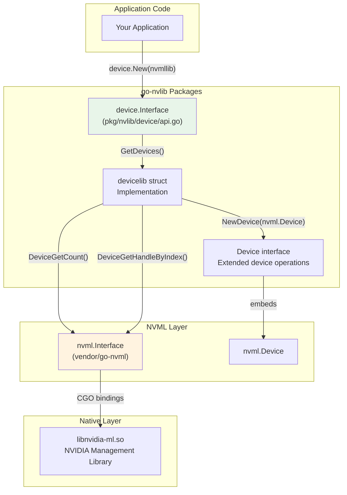
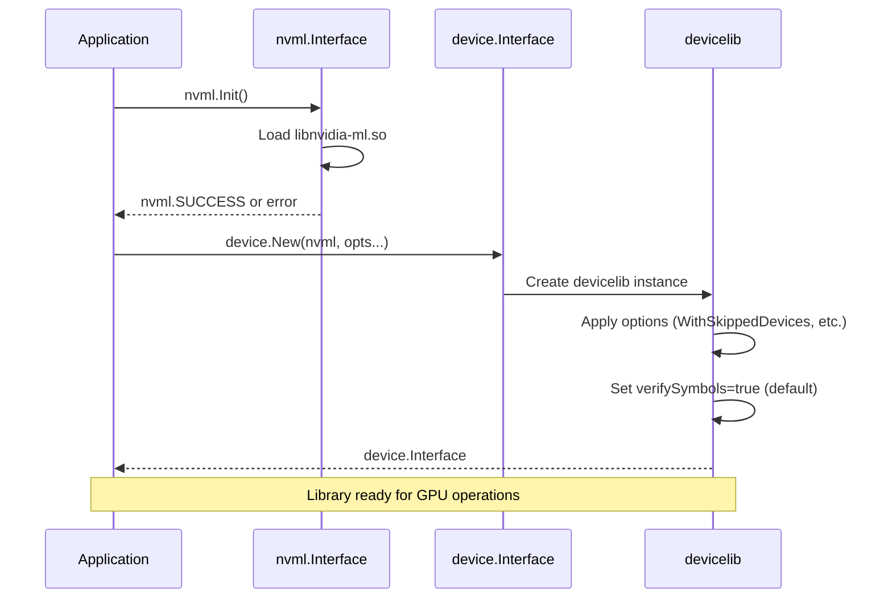
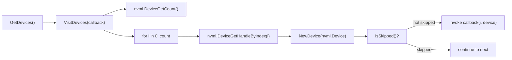
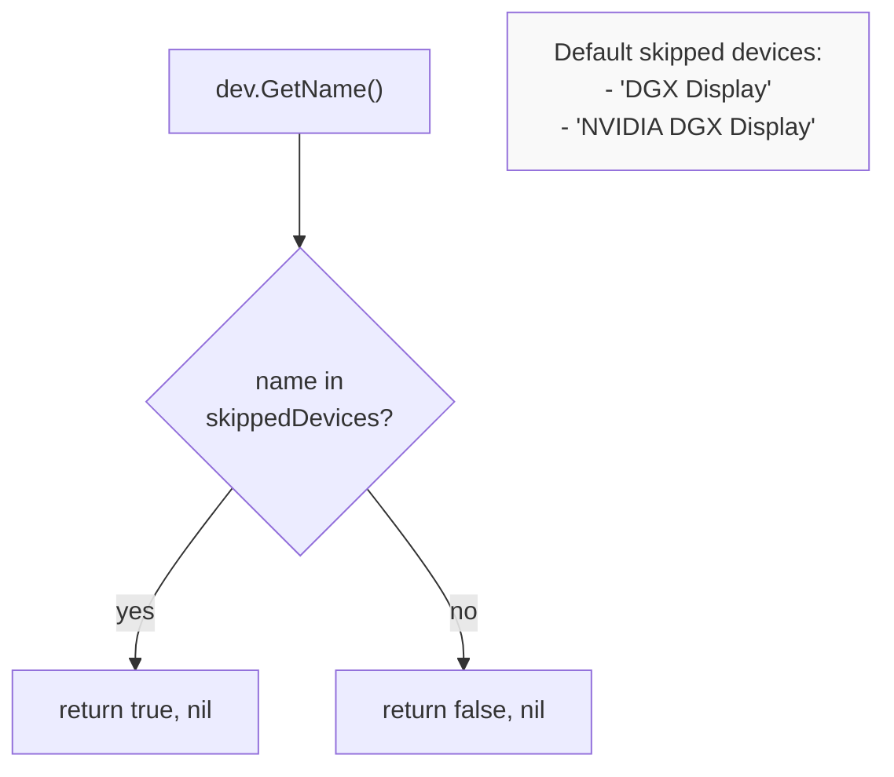
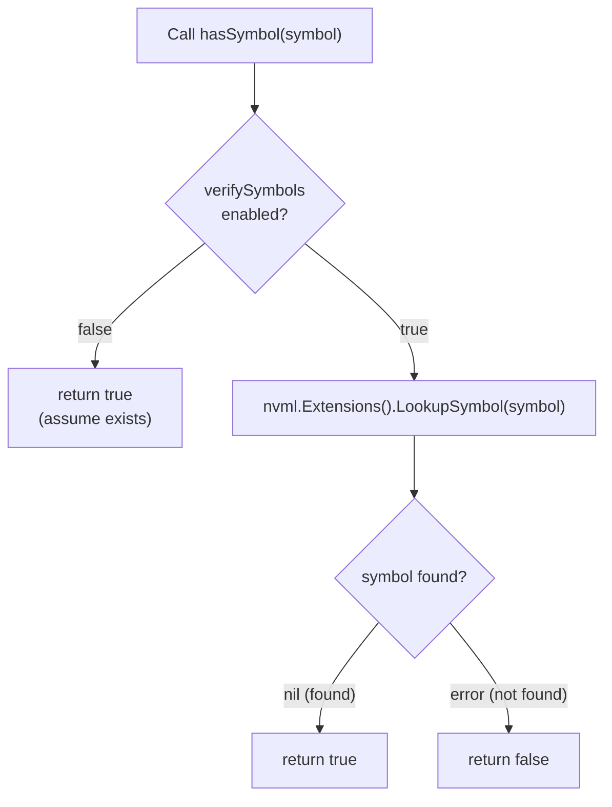

<!-- source: DeepWiki mcp.deepwiki.com · repo NVIDIA/go-nvlib · page 2 Getting Started · fetched 2026-10-26 -->

# Getting Started

<details>
<summary>Relevant source files</summary>

The following files were used as context for generating this wiki page:

- [Makefile](Makefile)
- [go.mod](go.mod)
- [pkg/nvlib/device/api.go](pkg/nvlib/device/api.go)
- [pkg/nvlib/device/device.go](pkg/nvlib/device/device.go)
- [pkg/nvlib/device/identifier.go](pkg/nvlib/device/identifier.go)
- [vendor/modules.txt](vendor/modules.txt)

</details>


This page guides you through installing go-nvlib, initializing the library, and discovering NVIDIA GPUs in your system. It covers the essential patterns for creating a device library instance and performing basic GPU enumeration.

For detailed information about GPU device management and MIG support, see [GPU Device Management](#3). For hardware topology discovery through PCI interfaces, see [Hardware Topology Discovery](#5). For comprehensive NVML binding reference, see [NVML Bindings Reference](#6).

## Prerequisites

go-nvlib requires:

- **Go 1.20 or later** - as specified in [go.mod:3]()
- **NVIDIA GPU hardware** - with drivers installed
- **NVIDIA Management Library (NVML)** - typically installed with GPU drivers as `libnvidia-ml.so`
- **Linux operating system** - the library targets Linux platforms ([Makefile:26]())

The library has minimal external dependencies:

| Dependency | Version | Purpose |
|------------|---------|---------|
| `github.com/NVIDIA/go-nvml` | v0.13.0-1 | NVML Go bindings (CGO-based) |
| `github.com/google/uuid` | v1.6.0 | UUID parsing and validation |
| `github.com/stretchr/testify` | v1.11.1 | Testing framework (dev dependency) |

**Sources:** [go.mod:1-15]()

## Installation

Install go-nvlib using Go modules:

```bash
go get github.com/NVIDIA/go-nvlib
```

The library uses vendored dependencies to ensure reproducible builds. All transitive dependencies are captured in [vendor/modules.txt:1-22]().

## Library Architecture Overview



**Sources:** [pkg/nvlib/device/api.go:23-38](), [pkg/nvlib/device/device.go:26-41]()

## Initialization Flow



**Sources:** [pkg/nvlib/device/api.go:49-68]()

## Basic Usage Example

The typical initialization sequence involves initializing NVML, creating a device library instance, and discovering GPUs:

```go
import (
    "github.com/NVIDIA/go-nvml/pkg/nvml"
    "github.com/NVIDIA/go-nvlib/pkg/nvlib/device"
)

// Initialize NVML
ret := nvml.Init()
if ret != nvml.SUCCESS {
    // Handle initialization error
}
defer nvml.Shutdown()

// Create device library with default options
deviceLib := device.New(nvml)

// Discover all GPUs in the system
devices, err := deviceLib.GetDevices()
if err != nil {
    // Handle discovery error
}

// Iterate through discovered devices
for i, dev := range devices {
    name, _ := dev.GetName()
    uuid, _ := dev.GetUUID()
    // Use device...
}
```

The `device.New()` function accepts the NVML interface and optional configuration ([pkg/nvlib/device/api.go:50-68]()):

| Option Function | Purpose | Default Behavior |
|----------------|---------|------------------|
| `WithSkippedDevices(names...)` | Exclude devices by model name | Skips "DGX Display" and "NVIDIA DGX Display" |
| `WithVerifySymbols(verify bool)` | Toggle symbol verification before calling | `true` - verifies symbols exist |

**Sources:** [pkg/nvlib/device/api.go:49-91]()

## Device Discovery Methods

The `device.Interface` provides three primary discovery methods:

### Method 1: GetDevices()

Retrieves all physical GPUs in the system:

```go
devices, err := deviceLib.GetDevices()
```

Implementation internally uses `VisitDevices()` to enumerate GPU indices from 0 to device count ([pkg/nvlib/device/device.go:514-525]()):



**Sources:** [pkg/nvlib/device/device.go:514-525](), [pkg/nvlib/device/device.go:433-463]()

### Method 2: NewDeviceByUUID()

Creates a device handle from a specific UUID:

```go
device, err := deviceLib.NewDeviceByUUID("GPU-12345678-...")
```

This method calls `nvml.DeviceGetHandleByUUID()` internally ([pkg/nvlib/device/device.go:56-63]()).

### Method 3: VisitDevices()

Provides iterator-style device enumeration with a callback function:

```go
err := deviceLib.VisitDevices(func(i int, dev device.Device) error {
    // Process device at index i
    name, _ := dev.GetName()
    // Return error to stop iteration
    return nil
})
```

**Sources:** [pkg/nvlib/device/device.go:433-463]()

## Device Filtering and Skipped Devices

By default, the library skips display-only GPUs that are not suitable for compute workloads. The filtering logic checks device names against a skip list ([pkg/nvlib/device/device.go:418-430]()):



The default skipped devices are configured in [pkg/nvlib/device/api.go:62-66]():
- `"DGX Display"`
- `"NVIDIA DGX Display"`

To customize this behavior, use the `WithSkippedDevices()` option when creating the device library.

**Sources:** [pkg/nvlib/device/device.go:418-430](), [pkg/nvlib/device/api.go:77-87]()

## Device Interface Methods

Once you have a `device.Device` instance, it provides extended functionality beyond the base `nvml.Device` interface:

| Method | Return Type | Purpose |
|--------|-------------|---------|
| `GetArchitectureAsString()` | `string` | Returns architecture name (Kepler, Maxwell, Pascal, Volta, Turing, Ampere, Ada Lovelace, Hopper, Blackwell) |
| `GetBrandAsString()` | `string` | Returns brand name (Tesla, Quadro, GeForce, etc.) |
| `GetCudaComputeCapabilityAsString()` | `string` | Returns CUDA capability version (e.g., "8.0") |
| `GetPCIBusID()` | `string` | Returns PCI bus ID with domain prefix removed |
| `IsMigCapable()` | `bool` | Checks if device supports MIG partitioning |
| `IsMigEnabled()` | `bool` | Checks if MIG mode is currently enabled |
| `IsCoherent()` | `bool` | Checks if device supports coherent memory access |
| `IsFabricAttached()` | `bool` | Checks if device is attached to GPU fabric |
| `GetMigDevices()` | `[]MigDevice` | Returns MIG instances if MIG is enabled |
| `GetMigProfiles()` | `[]MigProfile` | Returns available MIG profiles |

All methods are defined in [pkg/nvlib/device/device.go:26-41]() and implemented in [pkg/nvlib/device/device.go:70-281]().

**Sources:** [pkg/nvlib/device/device.go:26-41](), [pkg/nvlib/device/device.go:70-281]()

## Error Handling

The library follows Go error handling conventions. NVML return codes are converted to errors when they indicate failure:

```go
device, err := deviceLib.NewDeviceByUUID(uuid)
if err != nil {
    // err contains wrapped NVML return code
    // Example: "error getting device handle for uuid 'GPU-...': ErrorNotFound"
}
```

NVML return codes are checked against `nvml.SUCCESS`. Common error patterns:

| NVML Return Code | Meaning | Typical Handling |
|------------------|---------|------------------|
| `nvml.ERROR_NOT_SUPPORTED` | Feature not available | Graceful degradation (return false/nil) |
| `nvml.ERROR_NOT_FOUND` | Resource doesn't exist | Skip or report as empty |
| `nvml.ERROR_INVALID_ARGUMENT` | Invalid parameter | Skip or report as error |
| Other non-SUCCESS | Unexpected error | Propagate as error |

Examples from the codebase:

- MIG capability check returns `false` on `ERROR_NOT_SUPPORTED` ([pkg/nvlib/device/device.go:208-210]())
- MIG device iteration skips `ERROR_NOT_FOUND` ([pkg/nvlib/device/device.go:300-301]())
- Device handle retrieval propagates errors ([pkg/nvlib/device/device.go:58-61]())

**Sources:** [pkg/nvlib/device/device.go:58-61](), [pkg/nvlib/device/device.go:208-210](), [pkg/nvlib/device/device.go:300-307]()

## Symbol Verification

The library includes optional symbol verification to check that NVML functions exist before calling them. This prevents crashes when running against older NVML versions that lack newer API functions.

Symbol verification is controlled by the `verifySymbols` flag (default: `true`) and checked using the `hasSymbol()` method ([pkg/nvlib/device/device.go:562-570]()):



Example usage in `IsMigCapable()` ([pkg/nvlib/device/device.go:202-217]()):
- Checks if `nvmlDeviceGetMigMode` symbol exists
- Returns `false` if symbol not found (graceful degradation)
- Only calls the function if symbol is verified

**Sources:** [pkg/nvlib/device/device.go:562-570](), [pkg/nvlib/device/device.go:202-217](), [pkg/nvlib/device/device.go:184-200]()

## Cleanup

Always shut down NVML when finished to release resources:

```go
defer nvml.Shutdown()
```

The `nvml.Shutdown()` call should be deferred immediately after successful initialization. Device library instances (`device.Interface`) do not require explicit cleanup as they are stateless wrappers around the NVML interface.

## Complete Example

Here is a complete example demonstrating initialization, device discovery, and property queries:

```go
package main

import (
    "fmt"
    "log"
    
    "github.com/NVIDIA/go-nvml/pkg/nvml"
    "github.com/NVIDIA/go-nvlib/pkg/nvlib/device"
)

func main() {
    // Initialize NVML
    ret := nvml.Init()
    if ret != nvml.SUCCESS {
        log.Fatalf("Failed to initialize NVML: %v", ret)
    }
    defer nvml.Shutdown()
    
    // Create device library
    deviceLib := device.New(nvml)
    
    // Discover devices
    devices, err := deviceLib.GetDevices()
    if err != nil {
        log.Fatalf("Failed to get devices: %v", err)
    }
    
    fmt.Printf("Found %d GPU(s)\n", len(devices))
    
    // Query each device
    for i, dev := range devices {
        name, _ := dev.GetName()
        uuid, _ := dev.GetUUID()
        arch, _ := dev.GetArchitectureAsString()
        brand, _ := dev.GetBrandAsString()
        busID, _ := dev.GetPCIBusID()
        
        fmt.Printf("\nDevice %d:\n", i)
        fmt.Printf("  Name: %s\n", name)
        fmt.Printf("  UUID: %s\n", uuid)
        fmt.Printf("  Architecture: %s\n", arch)
        fmt.Printf("  Brand: %s\n", brand)
        fmt.Printf("  PCI Bus ID: %s\n", busID)
        
        // Check MIG capability
        migCapable, _ := dev.IsMigCapable()
        if migCapable {
            migEnabled, _ := dev.IsMigEnabled()
            fmt.Printf("  MIG: Capable (Enabled: %v)\n", migEnabled)
        }
    }
}
```

**Sources:** [pkg/nvlib/device/api.go:49-68](), [pkg/nvlib/device/device.go:514-525](), [pkg/nvlib/device/device.go:70-179]()

## Next Steps

After completing the basic setup:

- For comprehensive device operations and MIG support, see [GPU Device Management](#3)
- For MIG device enumeration and profile management, see [Multi-Instance GPU (MIG)](#4)
- For PCI-level hardware discovery, see [Hardware Topology Discovery](#5)
- For direct NVML access and low-level operations, see [NVML Bindings Reference](#6)
- For writing tests with mock implementations, see [Testing](#8)

---

