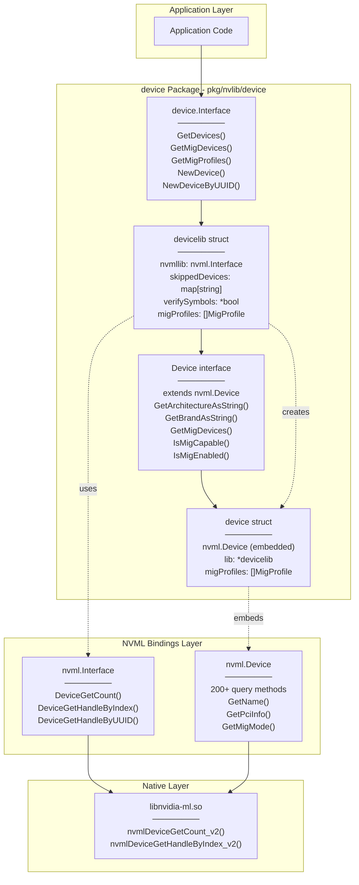
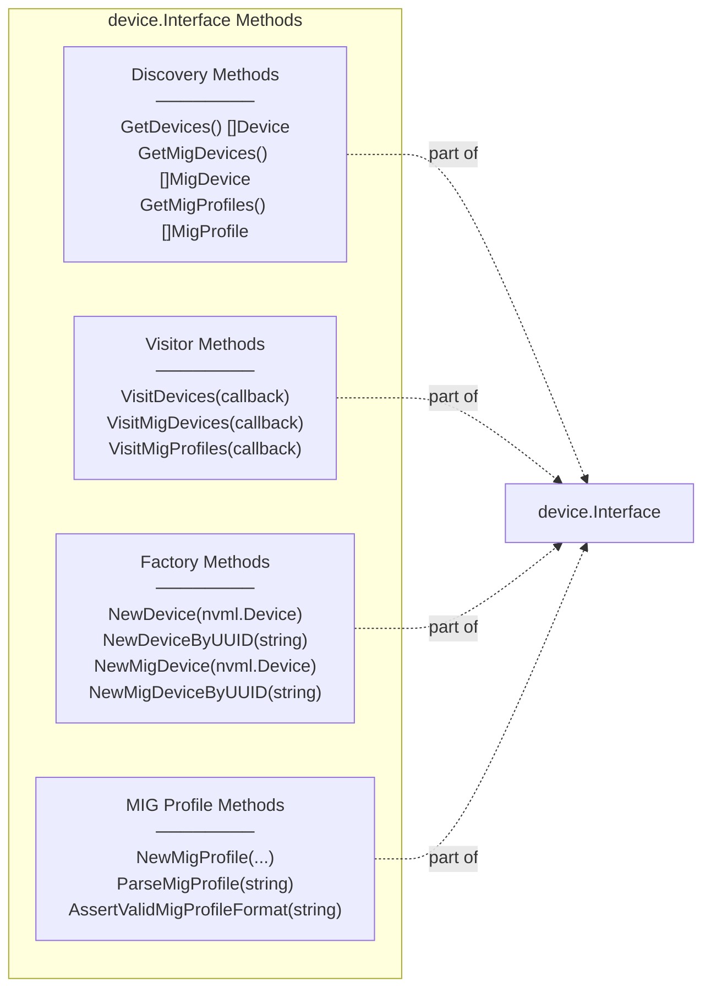
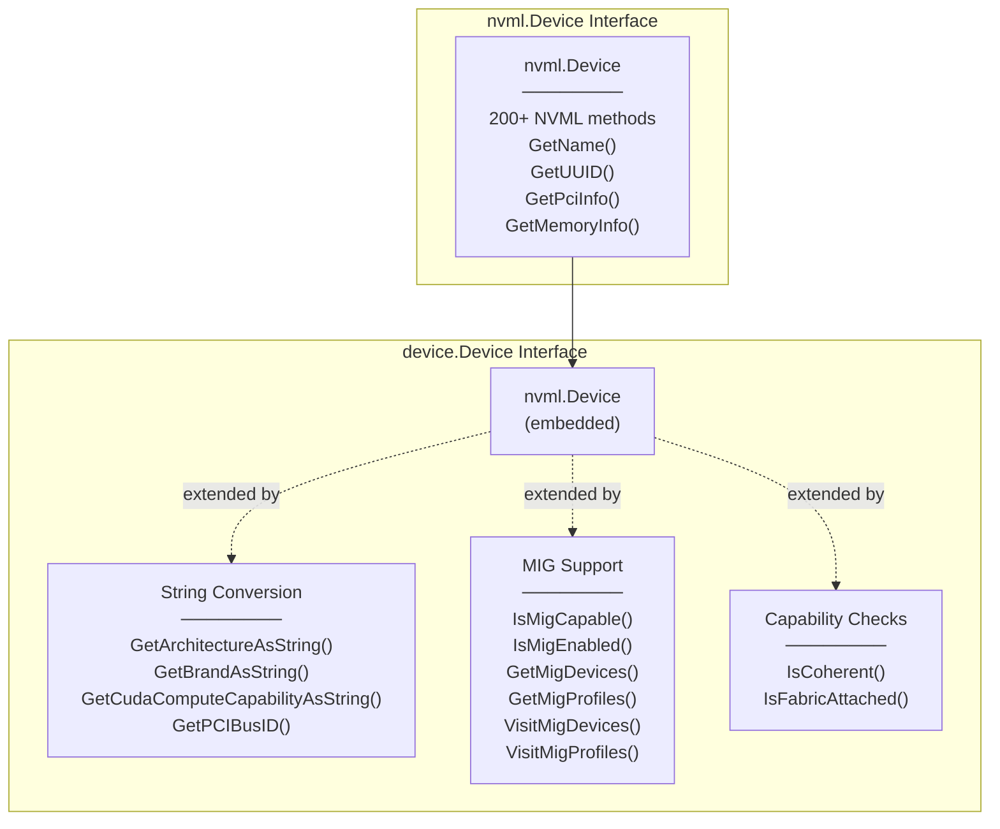
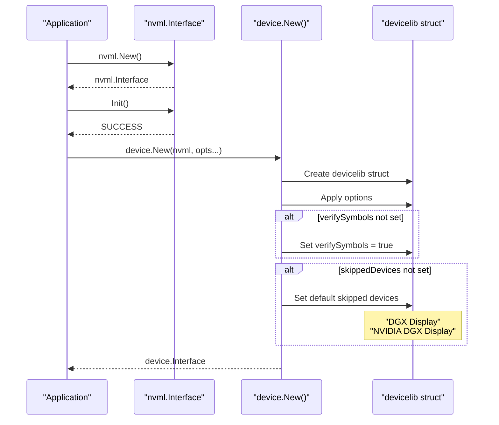
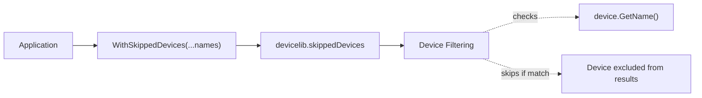
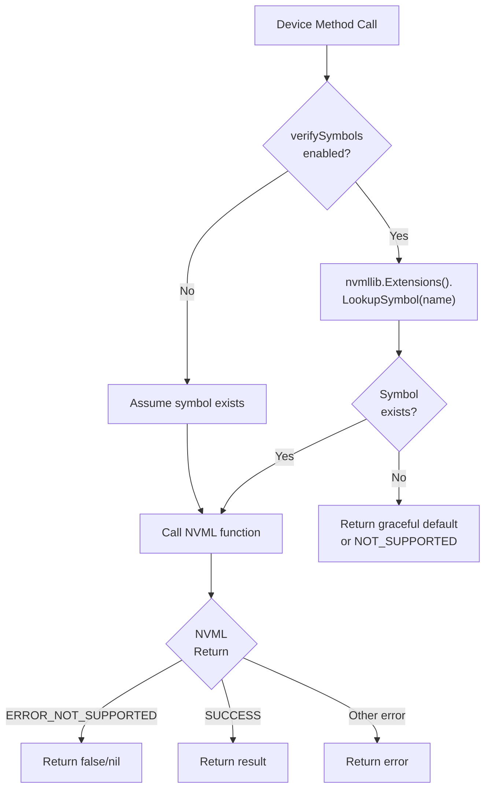
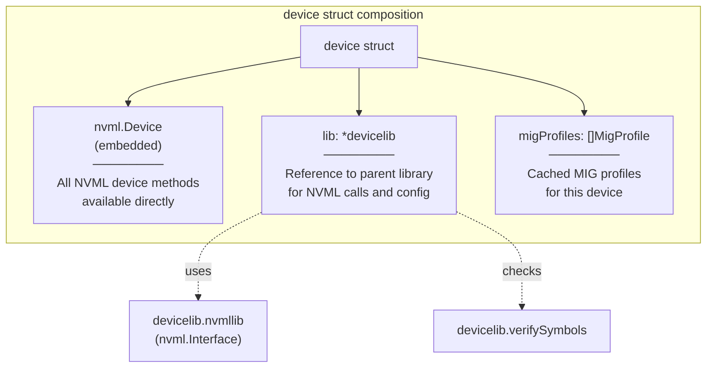
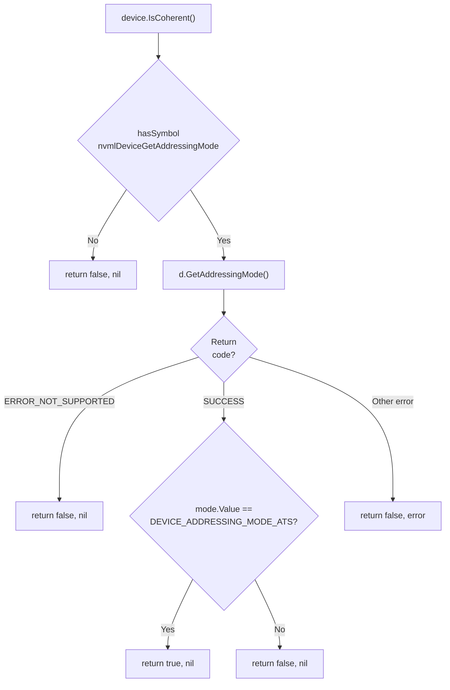
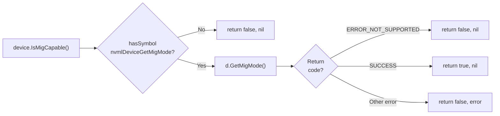
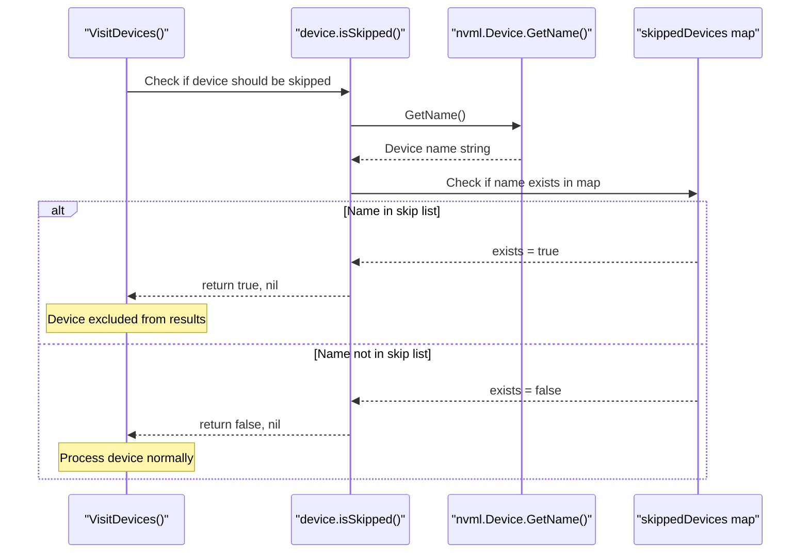

<!-- source: DeepWiki mcp.deepwiki.com · repo NVIDIA/go-nvlib · page 3 GPU Device Management · fetched 2026-10-26 -->

# GPU Device Management

<details>
<summary>Relevant source files</summary>

The following files were used as context for generating this wiki page:

- [pkg/nvlib/device/api.go](pkg/nvlib/device/api.go)
- [pkg/nvlib/device/device.go](pkg/nvlib/device/device.go)

</details>


## Purpose and Scope

The `device` package provides the primary high-level interface for discovering and managing NVIDIA GPUs in Go applications. It wraps the lower-level NVML bindings with Go-friendly abstractions, adding convenience methods for common operations and extended device information queries.

This page documents the core architecture, interfaces, and initialization patterns for the device package. For detailed information on specific topics:
- Device discovery and enumeration patterns, see [Device Discovery and Enumeration](#3.1)
- Device property queries and state information, see [Device Properties and Queries](#3.2)
- Device identifier formats and validation, see [Device Identifiers](#3.3)
- Multi-Instance GPU (MIG) support, see [Multi-Instance GPU (MIG)](#4)
- Lower-level PCI device information, see [PCI Device Discovery](#5.1)

**Sources:** [pkg/nvlib/device/device.go:1-571](), [pkg/nvlib/device/api.go:1-91]()

---

## Architecture Overview

The device package serves as the orchestration layer between applications and NVIDIA GPUs, wrapping NVML with enhanced functionality and Go idioms.



**Architecture Pattern**: The device package implements a wrapper pattern with three key components:

| Component | Type | Purpose |
|-----------|------|---------|
| `device.Interface` | Interface | Primary API contract for device operations |
| `devicelib` | Struct | Implementation holding NVML interface and configuration |
| `device.Device` | Interface | Extended device interface with convenience methods |
| `device` struct | Struct | Concrete device implementation embedding `nvml.Device` |

**Sources:** [pkg/nvlib/device/api.go:23-47](), [pkg/nvlib/device/device.go:26-47]()

---

## Core Interfaces and Types

The device package defines two primary interfaces that applications interact with: the library interface for discovery operations and the device interface for per-device queries.

### device.Interface API



The `device.Interface` provides four categories of methods:

| Category | Methods | Purpose |
|----------|---------|---------|
| **Discovery** | `GetDevices()`, `GetMigDevices()`, `GetMigProfiles()` | Enumerate all devices of each type |
| **Visitor** | `VisitDevices()`, `VisitMigDevices()`, `VisitMigProfiles()` | Iterate with callbacks for memory efficiency |
| **Factory** | `NewDevice()`, `NewDeviceByUUID()`, `NewMigDevice()`, `NewMigDeviceByUUID()` | Create device wrappers from NVML handles or identifiers |
| **MIG Profiles** | `NewMigProfile()`, `ParseMigProfile()`, `AssertValidMigProfileFormat()` | MIG profile creation and validation |

**Sources:** [pkg/nvlib/device/api.go:23-38]()

### Device Interface Extensions



The `Device` interface embeds `nvml.Device` and adds convenience methods in three categories:

| Category | Methods | Description |
|----------|---------|-------------|
| **String Conversions** | `GetArchitectureAsString()`, `GetBrandAsString()`, `GetCudaComputeCapabilityAsString()`, `GetPCIBusID()` | Convert NVML enums and raw data to human-readable strings |
| **MIG Support** | `IsMigCapable()`, `IsMigEnabled()`, `GetMigDevices()`, `GetMigProfiles()`, `VisitMigDevices()`, `VisitMigProfiles()` | Multi-Instance GPU capability and enumeration |
| **Capability Checks** | `IsCoherent()`, `IsFabricAttached()` | Advanced feature detection with symbol verification |

**Sources:** [pkg/nvlib/device/device.go:26-41]()

---

## Device Library Initialization

The device library is initialized through the `New()` function, which accepts an NVML interface and optional configuration.

### Basic Initialization Pattern



**Initialization Steps:**

1. **NVML Initialization**: Create and initialize an `nvml.Interface` instance
2. **Device Library Creation**: Call `device.New()` with the NVML interface
3. **Option Application**: Configuration options are applied in order
4. **Default Configuration**: Unset options receive sensible defaults

**Default Behavior:**
- Symbol verification is enabled by default to prevent crashes on missing NVML functions
- DGX Display devices are skipped by default as they are not compute GPUs

**Sources:** [pkg/nvlib/device/api.go:49-68]()

### devicelib Structure

The `devicelib` struct maintains the state and configuration for device operations:

| Field | Type | Purpose |
|-------|------|---------|
| `nvmllib` | `nvml.Interface` | Handle to NVML library for all device queries |
| `skippedDevices` | `map[string]struct{}` | Device model names to exclude from enumeration |
| `verifySymbols` | `*bool` | Whether to check symbol existence before calling NVML functions |
| `migProfiles` | `[]MigProfile` | Cached MIG profiles across all devices |

**Sources:** [pkg/nvlib/device/api.go:40-45]()

---

## Configuration Options

The device package supports two configuration options applied at initialization time.

### WithSkippedDevices Option



The `WithSkippedDevices` option excludes devices by model name from all enumeration operations. This is useful for filtering out non-compute devices or devices reserved for display purposes.

**Usage Pattern:**
```go
device.New(nvml, 
    device.WithSkippedDevices("DGX Display", "Custom Device Name"),
)
```

**Default Skipped Devices:**
- `"DGX Display"`
- `"NVIDIA DGX Display"`

**Implementation:** The skipped devices are checked in [pkg/nvlib/device/device.go:418-430](), where device names are queried and compared against the skip map during device enumeration.

**Sources:** [pkg/nvlib/device/api.go:77-87](), [pkg/nvlib/device/device.go:418-430]()

### WithVerifySymbols Option



The `WithVerifySymbols` option controls whether the library verifies that NVML symbols exist before calling them. This prevents crashes when running against older NVML versions that lack newer functions.

**Symbol Verification Pattern:**

The `hasSymbol()` method [pkg/nvlib/device/device.go:562-570]() checks symbol availability:

```
func (d *devicelib) hasSymbol(symbol string) bool {
    if !*d.verifySymbols {
        return true  // Assume all symbols exist
    }
    return d.nvmllib.Extensions().LookupSymbol(symbol) == nil
}
```

**Example Usage in Device Methods:**

[pkg/nvlib/device/device.go:183-200]() - `IsCoherent()` method:
- Checks if `nvmlDeviceGetAddressingMode` symbol exists
- Returns `false` gracefully if symbol is missing
- Handles `ERROR_NOT_SUPPORTED` return code for incompatible devices

[pkg/nvlib/device/device.go:236-281]() - `IsFabricAttached()` method:
- Checks for `nvmlDeviceGetGpuFabricInfo` or `nvmlDeviceGetGpuFabricInfoV` symbols
- Supports multiple NVML API versions gracefully

**Trade-off:**
- **Enabled (default)**: Safer, prevents crashes, slight overhead per call
- **Disabled**: Faster, but requires NVML version compatibility guarantees

**Sources:** [pkg/nvlib/device/api.go:70-75](), [pkg/nvlib/device/device.go:562-570](), [pkg/nvlib/device/device.go:183-200](), [pkg/nvlib/device/device.go:236-281]()

---

## Device Types and Extensions

The device package provides two concrete device implementations, both wrapping NVML device handles with extended functionality.

### Device Structure



The `device` struct [pkg/nvlib/device/device.go:43-47]() has three components:

| Component | Type | Purpose |
|-----------|------|---------|
| `nvml.Device` (embedded) | Interface | All NVML device methods accessible directly on device |
| `lib` | `*devicelib` | Reference to parent library for configuration and NVML access |
| `migProfiles` | `[]MigProfile` | Cached list of valid MIG profiles for this device |

**Embedding Pattern:** By embedding `nvml.Device`, the `device` struct automatically implements all NVML device methods without wrapping each one individually. Applications can call both extended methods (like `GetArchitectureAsString()`) and NVML methods (like `GetMemoryInfo()`) on the same device handle.

**Sources:** [pkg/nvlib/device/device.go:43-47]()

### Device Creation Methods

The device package provides multiple factory methods for creating device wrappers:

| Method | Input | Purpose | Implementation |
|--------|-------|---------|----------------|
| `NewDevice(nvml.Device)` | NVML device handle | Wrap existing NVML device | [pkg/nvlib/device/device.go:52-54]() |
| `NewDeviceByUUID(string)` | Device UUID string | Create device from UUID | [pkg/nvlib/device/device.go:56-63]() |
| Internal `newDevice(nvml.Device)` | NVML device handle | Internal factory method | [pkg/nvlib/device/device.go:65-68]() |

**UUID-based Creation Flow:**

[pkg/nvlib/device/device.go:56-63]() - `NewDeviceByUUID()`:
1. Calls `nvmllib.DeviceGetHandleByUUID(uuid)` to get NVML device handle
2. Checks NVML return code for errors
3. Delegates to internal `newDevice()` for wrapper creation

**Sources:** [pkg/nvlib/device/device.go:52-68]()

---

## String Conversion Methods

The device package provides convenience methods to convert NVML enum values and raw data into human-readable strings, eliminating the need for applications to maintain their own enum-to-string mappings.

### Architecture and Brand Mappings

**Architecture Conversion:** [pkg/nvlib/device/device.go:70-99]()

The `GetArchitectureAsString()` method maps NVML architecture constants to GPU architecture names:

| NVML Constant | String Value |
|---------------|--------------|
| `DEVICE_ARCH_KEPLER` | "Kepler" |
| `DEVICE_ARCH_MAXWELL` | "Maxwell" |
| `DEVICE_ARCH_PASCAL` | "Pascal" |
| `DEVICE_ARCH_VOLTA` | "Volta" |
| `DEVICE_ARCH_TURING` | "Turing" |
| `DEVICE_ARCH_AMPERE` | "Ampere" |
| `DEVICE_ARCH_ADA` | "Ada Lovelace" |
| `DEVICE_ARCH_HOPPER` | "Hopper" |
| `DEVICE_ARCH_BLACKWELL` | "Blackwell" |
| `DEVICE_ARCH_UNKNOWN` | "Unknown" |

**Brand Conversion:** [pkg/nvlib/device/device.go:101-147]()

The `GetBrandAsString()` method maps NVML brand constants to product line names (15+ brands supported including Quadro, Tesla, GeForce, RTX variants).

**PCI Bus ID Processing:** [pkg/nvlib/device/device.go:149-170]()

The `GetPCIBusID()` method extracts the PCI bus identifier from NVML's PCI info structure, converting it to lowercase and stripping leading zeros (except when the entire ID is "0000").

**CUDA Compute Capability:** [pkg/nvlib/device/device.go:172-179]()

The `GetCudaComputeCapabilityAsString()` method formats the major and minor compute capability versions as "X.Y" (e.g., "8.0" for Ampere).

**Sources:** [pkg/nvlib/device/device.go:70-179]()

---

## Device Capability Detection

The device package provides methods to detect advanced GPU capabilities with graceful fallbacks for older NVML versions or unsupported devices.

### Coherency Detection



**Coherency Check:** [pkg/nvlib/device/device.go:181-200]()

The `IsCoherent()` method determines if a device supports coherent access to system memory through Address Translation Services (ATS):

1. Verifies `nvmlDeviceGetAddressingMode` symbol exists
2. Calls `GetAddressingMode()` on the device
3. Returns `true` if addressing mode is `DEVICE_ADDRESSING_MODE_ATS`
4. Returns `false` for unsupported devices or non-ATS modes
5. Returns error only for unexpected failures

**Sources:** [pkg/nvlib/device/device.go:181-200]()

### Fabric Attachment Detection

**Fabric Check:** [pkg/nvlib/device/device.go:236-281]()

The `IsFabricAttached()` method detects GPU fabric connectivity by checking multiple NVML API versions:

**Version 1 (nvmlDeviceGetGpuFabricInfo):**
- Checks if symbol exists [line 238]
- Retrieves fabric info structure [line 239]
- Validates state is `GPU_FABRIC_STATE_COMPLETED` [line 246]
- Validates cluster UUID is non-zero [line 249]
- Validates status is `SUCCESS` [line 252]

**Version 2 (nvmlDeviceGetGpuFabricInfoV):**
- Falls back to versioned API [line 259]
- Same validation logic for V2 structure [lines 267-275]

**Returns `false` in these cases:**
- Symbol does not exist
- NVML returns `ERROR_NOT_SUPPORTED`
- Fabric state is not completed
- Cluster UUID is all zeros
- Status indicates failure

**Sources:** [pkg/nvlib/device/device.go:236-281]()

---

## MIG Capability and Enumeration

The device package provides comprehensive Multi-Instance GPU (MIG) support, including capability detection, mode checking, and device enumeration. For detailed MIG documentation, see [Multi-Instance GPU (MIG)](#4).

### MIG Capability Detection



**MIG Capability Check:** [pkg/nvlib/device/device.go:202-217]()

The `IsMigCapable()` method determines if a device supports MIG partitioning:
- Verifies `nvmlDeviceGetMigMode` symbol exists
- Calls `GetMigMode()` to test MIG support
- Returns `false` for `ERROR_NOT_SUPPORTED` (device doesn't have MIG hardware)
- Returns `true` if the call succeeds (device has MIG capability)

**MIG Enabled Check:** [pkg/nvlib/device/device.go:219-234]()

The `IsMigEnabled()` method checks if MIG mode is currently active:
- Performs same symbol and capability checks
- Examines the returned `mode` value
- Returns `true` only if `mode == DEVICE_MIG_ENABLE`

**Sources:** [pkg/nvlib/device/device.go:202-234]()

### MIG Device Visitor Pattern

The device package implements visitor patterns for both per-device and library-wide MIG enumeration:

**Per-Device Visitor:** [pkg/nvlib/device/device.go:283-319]()

`device.VisitMigDevices(callback)` iterates over MIG devices on a single GPU:
1. Checks if device is MIG capable
2. Queries `GetMaxMigDeviceCount()` for upper bound
3. Iterates through each index calling `GetMigDeviceHandleByIndex(i)`
4. Skips indices that return `ERROR_NOT_FOUND` or `ERROR_INVALID_ARGUMENT`
5. Wraps valid handles with `lib.NewMigDevice()`
6. Invokes callback with index and MIG device

**Library-Wide Visitor:** [pkg/nvlib/device/device.go:465-484]()

`devicelib.VisitMigDevices(callback)` iterates over all MIG devices across all GPUs:
1. Calls `VisitDevices()` to iterate each GPU
2. For each GPU, calls `device.VisitMigDevices()`
3. Invokes callback with device index, device, MIG index, and MIG device

**Collector Methods:**

[pkg/nvlib/device/device.go:383-394]() - `device.GetMigDevices()`: Collects MIG devices for a single GPU into a slice

[pkg/nvlib/device/device.go:527-538]() - `devicelib.GetMigDevices()`: Collects all MIG devices across all GPUs into a slice

**Sources:** [pkg/nvlib/device/device.go:283-319](), [pkg/nvlib/device/device.go:383-394](), [pkg/nvlib/device/device.go:465-484](), [pkg/nvlib/device/device.go:527-538]()

---

## Device Filtering

The device package implements filtering to exclude certain devices from enumeration results based on their model names.

### Skip Detection Flow



**Skip Detection:** [pkg/nvlib/device/device.go:418-430]()

The `isSkipped()` method checks if a device should be excluded:
1. Queries device name via `GetName()`
2. Checks if name exists in `lib.skippedDevices` map
3. Returns `true` if device should be skipped

**Integration in Enumeration:** [pkg/nvlib/device/device.go:432-463]()

The `VisitDevices()` method applies filtering:
1. Gets device count from NVML
2. For each device index:
   - Gets device handle
   - Creates device wrapper
   - Calls `isSkipped()` to check filter
   - Skips device if filter matches (line 449-455)
   - Invokes callback only for non-skipped devices

This filtering mechanism ensures that display-only GPUs and other excluded devices never appear in application device lists, simplifying device selection logic.

**Sources:** [pkg/nvlib/device/device.go:418-430](), [pkg/nvlib/device/device.go:432-463]()

---

## Related Pages

For more detailed information on specific device management topics:

- **[Device Discovery and Enumeration](#3.1)** - Device discovery methods, iteration patterns, and collection APIs
- **[Device Properties and Queries](#3.2)** - Detailed documentation of all device property query methods
- **[Device Identifiers](#3.3)** - Device identifier formats, UUID structure, and validation
- **[Multi-Instance GPU (MIG)](#4)** - Comprehensive MIG support documentation
- **[MIG Device Discovery](#4.1)** - MIG device enumeration and hierarchy
- **[MIG Profiles](#4.2)** - MIG profile format, parsing, and validation
- **[NVML Bindings Reference](#6)** - Lower-level NVML interface documentation
- **[System Information Package](#7)** - High-level GPU system information gathering

---

