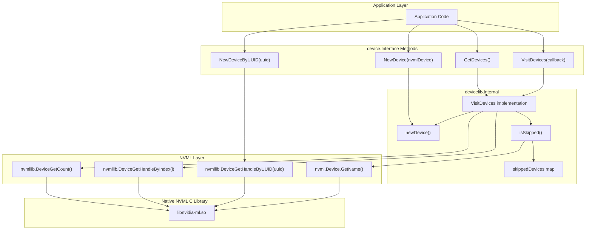
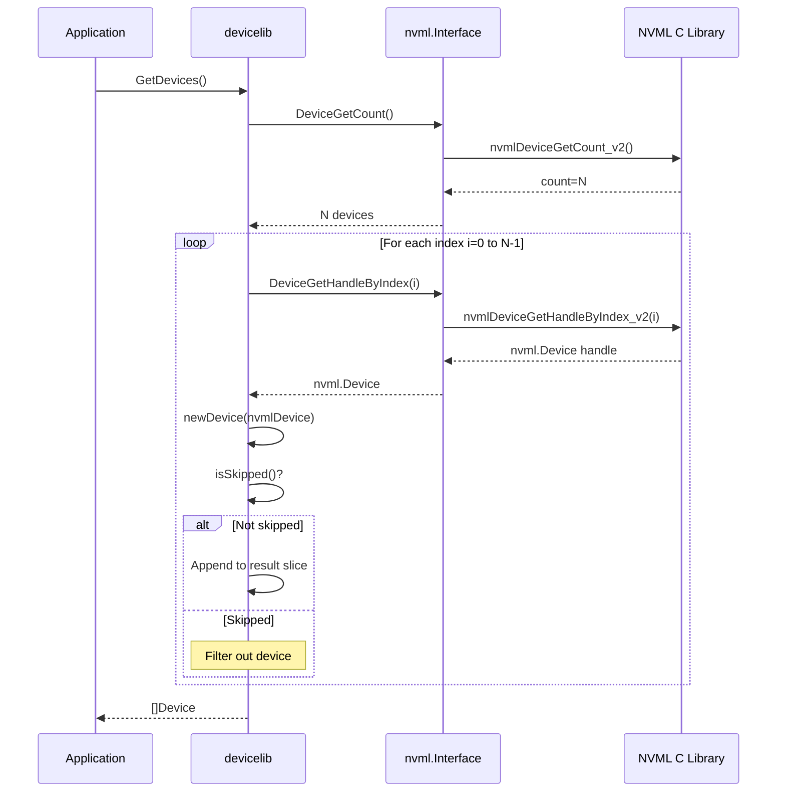
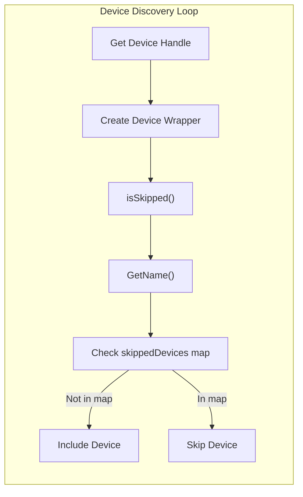
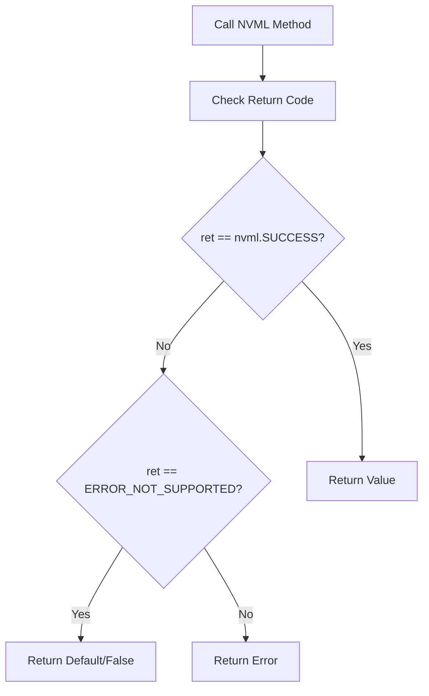

<!-- source: DeepWiki mcp.deepwiki.com · repo NVIDIA/go-nvlib · page 3.1 Device Discovery and Enumeration · fetched 2026-10-26 -->

# Device Discovery and Enumeration

<details>
<summary>Relevant source files</summary>

The following files were used as context for generating this wiki page:

- [pkg/nvlib/device/api.go](pkg/nvlib/device/api.go)
- [pkg/nvlib/device/device.go](pkg/nvlib/device/device.go)
- [vendor/github.com/NVIDIA/go-nvml/pkg/nvml/mock/interface.go](vendor/github.com/NVIDIA/go-nvml/pkg/nvml/mock/interface.go)
- [vendor/github.com/NVIDIA/go-nvml/pkg/nvml/zz_generated.api.go](vendor/github.com/NVIDIA/go-nvml/pkg/nvml/zz_generated.api.go)

</details>


## Purpose and Scope

This page documents the device discovery and enumeration mechanisms in the `pkg/nvlib/device` package. It covers how to enumerate NVIDIA GPU devices through the high-level Go API, including device filtering, identifier-based lookup, and the relationship to underlying NVML calls.

For MIG-specific device discovery, see [MIG Device Discovery](#4.1). For PCI-level hardware discovery, see [PCI Device Discovery](#5.1). For device property queries after discovery, see [Device Properties and Queries](#3.2).

## Core Interfaces and Types

The device discovery system is built around three primary types:

| Type | File | Purpose |
|------|------|---------|
| `device.Interface` | [pkg/nvlib/device/api.go:23-38]() | Public API for device management and discovery |
| `devicelib` | [pkg/nvlib/device/api.go:40-45]() | Internal implementation of `Interface` |
| `device.Device` | [pkg/nvlib/device/device.go:26-41]() | Extended device handle wrapping `nvml.Device` |

**Sources:** [pkg/nvlib/device/api.go:23-45](), [pkg/nvlib/device/device.go:26-41]()

### Interface Initialization

The `device.Interface` is created using the `New()` constructor, which requires an initialized `nvml.Interface`:

```go
// From api.go:49-68
func New(nvmllib nvml.Interface, opts ...Option) Interface
```

**Configuration Options:**

| Option | Method | Purpose |
|--------|--------|---------|
| Symbol verification | `WithVerifySymbols(bool)` | Toggle NVML symbol verification |
| Device filtering | `WithSkippedDevices(...string)` | Specify devices to skip by name |

By default, devices named `"DGX Display"` and `"NVIDIA DGX Display"` are automatically skipped during enumeration [pkg/nvlib/device/api.go:62-65]().

**Sources:** [pkg/nvlib/device/api.go:49-87]()

## Device Discovery Architecture



**Sources:** [pkg/nvlib/device/device.go:432-525](), [pkg/nvlib/device/api.go:40-45]()

## Device Enumeration Methods

### GetDevices - Batch Retrieval

The `GetDevices()` method returns all discovered devices as a slice:



**Implementation:** [pkg/nvlib/device/device.go:514-525]()

```go
// Returns all non-skipped devices
devices, err := devicelib.GetDevices()
```

**Sources:** [pkg/nvlib/device/device.go:514-525](), [pkg/nvlib/device/device.go:432-463]()

### VisitDevices - Streaming Enumeration

The `VisitDevices()` method provides a callback-based approach for memory-efficient device processing:

```go
// Visit each device with a callback function
err := devicelib.VisitDevices(func(i int, dev Device) error {
    // Process device
    return nil
})
```

**Callback Signature:** `func(index int, device Device) error`

The enumeration stops immediately if the callback returns a non-nil error [pkg/nvlib/device/device.go:457-460]().

**Implementation Details:**

| Step | Code Location | Description |
|------|---------------|-------------|
| Get count | [device.go:434-437]() | Query total device count via NVML |
| Loop indices | [device.go:439]() | Iterate from 0 to count-1 |
| Get handle | [device.go:440-443]() | Retrieve NVML device handle by index |
| Create wrapper | [device.go:444-447]() | Wrap in `device` struct |
| Filter check | [device.go:449-455]() | Skip if device name matches filter |
| Invoke callback | [device.go:457-460]() | Call user-provided function |

**Sources:** [pkg/nvlib/device/device.go:432-463]()

### Device Lookup by UUID

Devices can be retrieved directly by UUID without enumeration:

```go
// Look up specific device by UUID
device, err := devicelib.NewDeviceByUUID("GPU-12345678-1234-1234-1234-123456789abc")
```

**Implementation:** [pkg/nvlib/device/device.go:56-63]()

This method:
1. Calls `nvmllib.DeviceGetHandleByUUID(uuid)` [line 58]()
2. Returns error if UUID is invalid or device not found [lines 59-61]()
3. Creates device wrapper via `newDevice()` [line 62]()

**Note:** UUID-based lookup bypasses device filtering since it targets a specific device explicitly.

**Sources:** [pkg/nvlib/device/device.go:56-63]()

## Device Filtering Mechanism

### Skipped Devices

The device discovery system supports filtering devices by name through the `skippedDevices` map:



**Implementation:** [pkg/nvlib/device/device.go:418-430]()

```go
func (d *device) isSkipped() (bool, error) {
    name, ret := d.GetName()
    if ret != nvml.SUCCESS {
        return false, fmt.Errorf("error getting device name: %v", ret)
    }
    
    if _, exists := d.lib.skippedDevices[name]; exists {
        return true, nil
    }
    
    return false, nil
}
```

**Sources:** [pkg/nvlib/device/device.go:418-430]()

### Default Filtering

By default, the following devices are filtered out [pkg/nvlib/device/api.go:62-65]():

| Device Name | Reason |
|-------------|--------|
| `"DGX Display"` | Display-only device in DGX systems |
| `"NVIDIA DGX Display"` | Alternative name for DGX display device |

These defaults can be overridden or extended using the `WithSkippedDevices()` option during initialization.

**Sources:** [pkg/nvlib/device/api.go:62-65]()

### Custom Device Filtering

Applications can specify custom device filters during initialization:

```go
devicelib := device.New(nvmllib, 
    device.WithSkippedDevices("DeviceName1", "DeviceName2"),
)
```

The `WithSkippedDevices()` function is cumulative - it adds to the existing skip list rather than replacing it [pkg/nvlib/device/api.go:77-87]().

**Sources:** [pkg/nvlib/device/api.go:77-87]()

## Device Wrapper Creation

### From NVML Device Handle

The `NewDevice()` method wraps an existing `nvml.Device` handle:

```go
// Wrap an NVML device handle
device, err := devicelib.NewDevice(nvmlDevice)
```

**Implementation:** [pkg/nvlib/device/device.go:52-54](), [pkg/nvlib/device/device.go:66-68]()

The internal `device` struct embeds the NVML device and adds additional functionality:

```go
type device struct {
    nvml.Device              // Embedded NVML device
    lib         *devicelib   // Back-reference to library
    migProfiles []MigProfile // Cached MIG profiles
}
```

**Sources:** [pkg/nvlib/device/device.go:43-47](), [pkg/nvlib/device/device.go:52-68]()

### Device Extension Methods

The `Device` interface extends `nvml.Device` with additional methods [pkg/nvlib/device/device.go:26-41]():

| Method Category | Examples |
|----------------|----------|
| String conversions | `GetArchitectureAsString()`, `GetBrandAsString()` |
| CUDA properties | `GetCudaComputeCapabilityAsString()` |
| MIG operations | `GetMigDevices()`, `GetMigProfiles()`, `VisitMigDevices()` |
| Device capabilities | `IsMigCapable()`, `IsMigEnabled()`, `IsCoherent()`, `IsFabricAttached()` |
| Bus information | `GetPCIBusID()` |

**Sources:** [pkg/nvlib/device/device.go:26-41]()

## NVML Integration

### Symbol Verification

The devicelib can optionally verify that NVML symbols exist before calling them:

```go
func (d *devicelib) hasSymbol(symbol string) bool {
    if !*d.verifySymbols {
        return true
    }
    return d.nvmllib.Extensions().LookupSymbol(symbol) == nil
}
```

**Purpose:** Prevents runtime errors when running against older NVML versions that don't support certain functions.

**Example Usage:** [pkg/nvlib/device/device.go:184-186](), [pkg/nvlib/device/device.go:204-206]()

**Sources:** [pkg/nvlib/device/device.go:562-570]()

### NVML Call Pattern

All NVML interactions follow a consistent error-checking pattern:



**Example:** [pkg/nvlib/device/device.go:203-217]()

```go
func (d *device) IsMigCapable() (bool, error) {
    if !d.lib.hasSymbol("nvmlDeviceGetMigMode") {
        return false, nil
    }
    
    _, _, ret := nvml.Device(d).GetMigMode()
    if ret == nvml.ERROR_NOT_SUPPORTED {
        return false, nil
    }
    if ret != nvml.SUCCESS {
        return false, fmt.Errorf("error getting MIG mode: %v", ret)
    }
    
    return true, nil
}
```

**Sources:** [pkg/nvlib/device/device.go:203-217]()

## MIG Device Discovery

While full MIG device enumeration is covered in [MIG Device Discovery](#4.1), the basic discovery methods are part of the device interface:

| Method | Purpose | Returns |
|--------|---------|---------|
| `GetMigDevices()` | Get all MIG devices on a GPU | `[]MigDevice` |
| `VisitMigDevices()` | Iterate over MIG devices | Callback-based |
| `VisitMigDevices(callback)` | Library-level iteration | All GPUs + MIG devices |

**Implementation:** [pkg/nvlib/device/device.go:283-318]() (device-level), [pkg/nvlib/device/device.go:466-484]() (library-level)

**Sources:** [pkg/nvlib/device/device.go:283-394](), [pkg/nvlib/device/device.go:466-538]()

## Error Handling

Device discovery can fail at multiple points:

| Error Source | Example Error Message | Handling |
|--------------|----------------------|----------|
| Device count query | `"error getting device count: ..."` | Stop enumeration |
| Handle retrieval | `"error getting device handle for index 'X': ..."` | Stop enumeration |
| Wrapper creation | `"error creating new device wrapper: ..."` | Stop enumeration |
| Skip check | `"error checking whether device is skipped: ..."` | Stop enumeration |
| Callback error | User-defined | Stop enumeration |

All errors during enumeration cause immediate termination and propagate to the caller [pkg/nvlib/device/device.go:432-463]().

**Sources:** [pkg/nvlib/device/device.go:432-463]()

## Usage Examples

### Basic Enumeration

```go
// Initialize NVML
nvmlLib := nvml.New()
ret := nvmlLib.Init()
defer nvmlLib.Shutdown()

// Create device library
deviceLib := device.New(nvmlLib)

// Get all devices
devices, err := deviceLib.GetDevices()
if err != nil {
    // Handle error
}

for i, dev := range devices {
    name, _ := dev.GetName()
    uuid, _ := dev.GetUUID()
    fmt.Printf("Device %d: %s (%s)\n", i, name, uuid)
}
```

### Callback-Based Processing

```go
// Process devices with callback
err := deviceLib.VisitDevices(func(i int, dev Device) error {
    // Check if MIG-capable
    migCapable, err := dev.IsMigCapable()
    if err != nil {
        return err
    }
    
    if migCapable {
        // Process MIG-capable device
    }
    
    return nil
})
```

### Custom Filtering

```go
// Skip specific devices by name
deviceLib := device.New(nvmlLib,
    device.WithSkippedDevices("Tesla K80", "Quadro K420"),
)

devices, err := deviceLib.GetDevices()
// Will not include Tesla K80 or Quadro K420 devices
```

**Sources:** Based on [pkg/nvlib/device/api.go:23-91](), [pkg/nvlib/device/device.go:432-525]()

---

