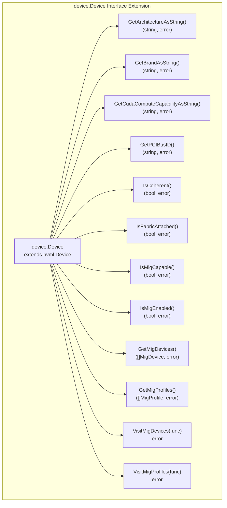
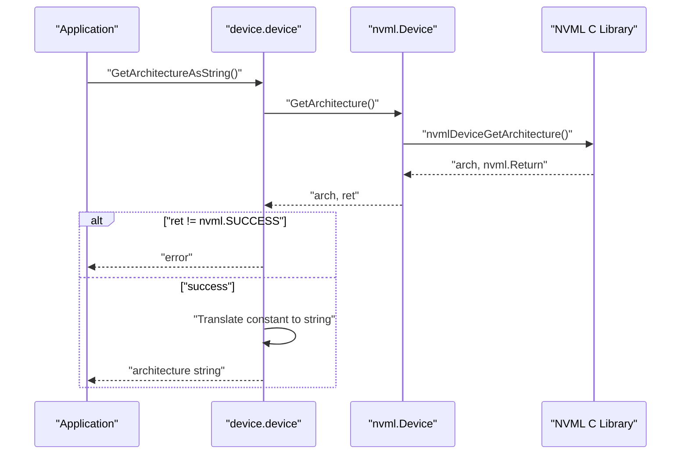
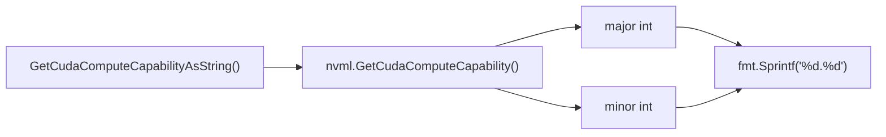
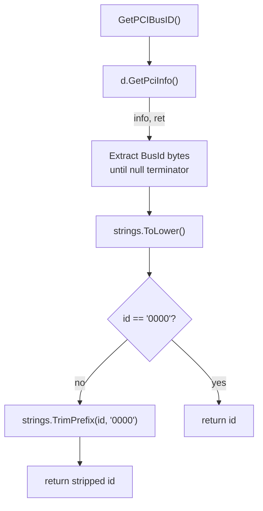
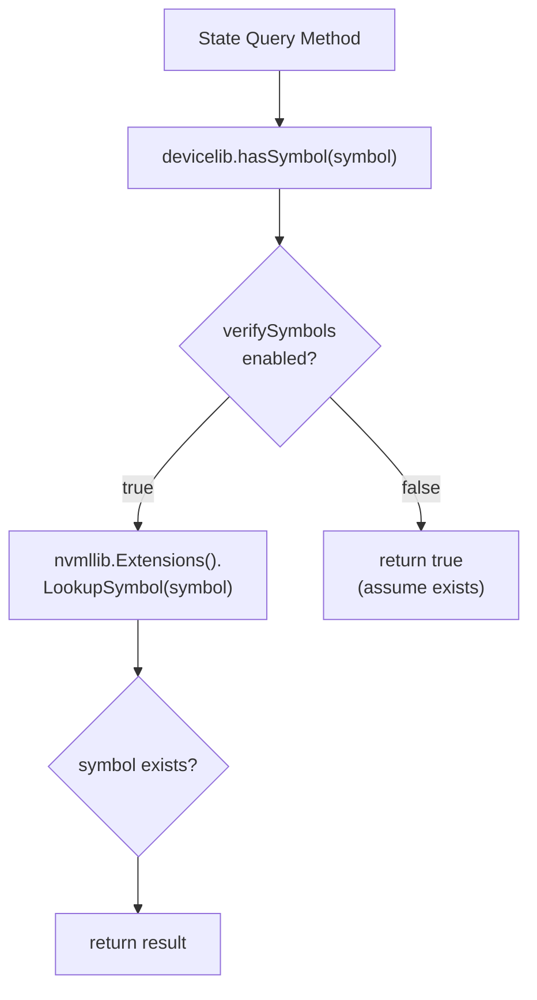
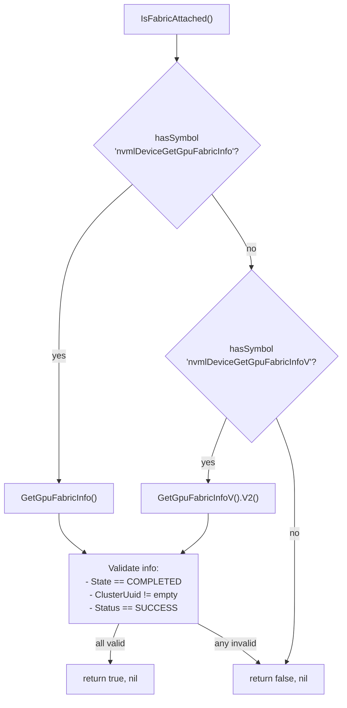
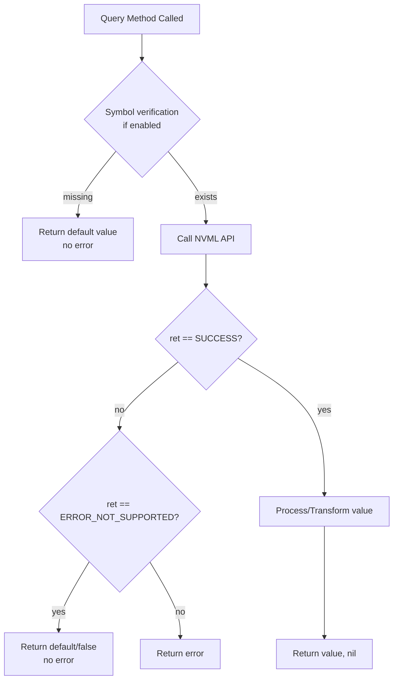
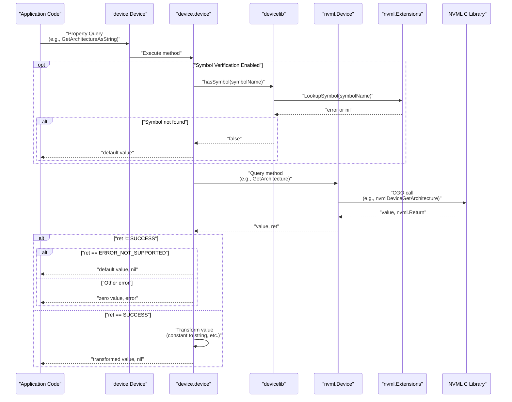

<!-- source: DeepWiki mcp.deepwiki.com · repo NVIDIA/go-nvlib · page 3.2 Device Properties and Queries · fetched 2026-10-26 -->

# Device Properties and Queries

<details>
<summary>Relevant source files</summary>

The following files were used as context for generating this wiki page:

- [pkg/nvlib/device/api.go](pkg/nvlib/device/api.go)
- [pkg/nvlib/device/device.go](pkg/nvlib/device/device.go)
- [vendor/github.com/NVIDIA/go-nvml/pkg/nvml/const.go](vendor/github.com/NVIDIA/go-nvml/pkg/nvml/const.go)
- [vendor/github.com/NVIDIA/go-nvml/pkg/nvml/nvml.go](vendor/github.com/NVIDIA/go-nvml/pkg/nvml/nvml.go)

</details>


## Purpose and Scope

This page documents the device property query methods provided by the `device.Device` interface in `pkg/nvlib/device`. These methods extend the base NVML device interface with convenient, Go-friendly accessors that return human-readable strings and boolean states instead of raw NVML enumerations.

For information about discovering and creating device instances, see [Device Discovery and Enumeration](#3.1). For MIG-specific queries, see [MIG Device Discovery](#4.1). For PCI-level hardware properties, see [PCI Device Discovery](#5.1).

## Device Interface Extension

The `device.Device` interface extends `nvml.Device` with additional query methods that provide more convenient access to device properties. The interface is defined in [pkg/nvlib/device/device.go:26-41]() and implemented by the private `device` struct.



**Sources:** [pkg/nvlib/device/device.go:26-41]()

## Architecture Queries

### GetArchitectureAsString

The `GetArchitectureAsString()` method queries the GPU architecture and returns it as a human-readable string. It wraps the NVML `GetArchitecture()` call and translates architecture constants into friendly names.

**Implementation:** [pkg/nvlib/device/device.go:70-99]()

**Architecture Mapping:**

| NVML Constant | Returned String |
|---------------|-----------------|
| `nvml.DEVICE_ARCH_KEPLER` | `"Kepler"` |
| `nvml.DEVICE_ARCH_MAXWELL` | `"Maxwell"` |
| `nvml.DEVICE_ARCH_PASCAL` | `"Pascal"` |
| `nvml.DEVICE_ARCH_VOLTA` | `"Volta"` |
| `nvml.DEVICE_ARCH_TURING` | `"Turing"` |
| `nvml.DEVICE_ARCH_AMPERE` | `"Ampere"` |
| `nvml.DEVICE_ARCH_ADA` | `"Ada Lovelace"` |
| `nvml.DEVICE_ARCH_HOPPER` | `"Hopper"` |
| `nvml.DEVICE_ARCH_BLACKWELL` | `"Blackwell"` |
| `nvml.DEVICE_ARCH_UNKNOWN` | `"Unknown"` |



**Sources:** [pkg/nvlib/device/device.go:70-99]()

## Brand Queries

### GetBrandAsString

The `GetBrandAsString()` method queries the GPU brand and returns it as a string. This is useful for identifying the product line (Tesla, Quadro, GeForce, etc.).

**Implementation:** [pkg/nvlib/device/device.go:101-147]()

**Brand Mapping:**

| NVML Constant | Returned String |
|---------------|-----------------|
| `nvml.BRAND_UNKNOWN` | `"Unknown"` |
| `nvml.BRAND_QUADRO` | `"Quadro"` |
| `nvml.BRAND_TESLA` | `"Tesla"` |
| `nvml.BRAND_NVS` | `"NVS"` |
| `nvml.BRAND_GRID` | `"Grid"` |
| `nvml.BRAND_GEFORCE` | `"GeForce"` |
| `nvml.BRAND_TITAN` | `"Titan"` |
| `nvml.BRAND_NVIDIA_VAPPS` | `"NvidiaVApps"` |
| `nvml.BRAND_NVIDIA_VPC` | `"NvidiaVPC"` |
| `nvml.BRAND_NVIDIA_VCS` | `"NvidiaVCS"` |
| `nvml.BRAND_NVIDIA_VWS` | `"NvidiaVWS"` |
| `nvml.BRAND_NVIDIA_CLOUD_GAMING` | `"NvidiaCloudGaming"` |
| `nvml.BRAND_QUADRO_RTX` | `"QuadroRTX"` |
| `nvml.BRAND_NVIDIA_RTX` | `"NvidiaRTX"` |
| `nvml.BRAND_NVIDIA` | `"Nvidia"` |
| `nvml.BRAND_GEFORCE_RTX` | `"GeForceRTX"` |
| `nvml.BRAND_TITAN_RTX` | `"TitanRTX"` |

**Sources:** [pkg/nvlib/device/device.go:101-147]()

## CUDA Compute Capability

### GetCudaComputeCapabilityAsString

The `GetCudaComputeCapabilityAsString()` method queries the CUDA compute capability and formats it as a version string (e.g., `"7.5"`, `"8.6"`). This is a key property for determining which CUDA features the device supports.

**Implementation:** [pkg/nvlib/device/device.go:172-179]()



The method calls the underlying NVML function [vendor/github.com/NVIDIA/go-nvml/pkg/nvml/nvml.go:1112-1119]() which returns separate major and minor integers, then formats them into a standard version string.

**Sources:** [pkg/nvlib/device/device.go:172-179](), [vendor/github.com/NVIDIA/go-nvml/pkg/nvml/nvml.go:1112-1119]()

## PCI Bus ID Query

### GetPCIBusID

The `GetPCIBusID()` method retrieves and formats the device's PCI bus identifier. It handles the conversion from NVML's PCI info structure to a normalized string format.

**Implementation:** [pkg/nvlib/device/device.go:149-170]()

**Processing Steps:**

1. Call `GetPciInfo()` to retrieve the PCI information structure
2. Extract the `BusId` field from the returned `nvml.PciInfo`
3. Convert the null-terminated C-style byte array to a Go string
4. Convert to lowercase
5. Strip the leading `"0000"` domain prefix (unless the entire ID is `"0000"`)



**Example Output:**
- Raw: `"0000:3B:00.0"` → Normalized: `"3b:00.0"`
- Special case: `"0000"` → Kept as: `"0000"`

**Sources:** [pkg/nvlib/device/device.go:149-170]()

## Device State Queries

The `device.Device` interface provides several boolean state query methods that check advanced device capabilities and configurations.

### Symbol Verification

All state query methods use the `hasSymbol()` helper to verify that the required NVML function exists before calling it. This ensures backward compatibility with older NVML versions.

**Implementation:** [pkg/nvlib/device/device.go:562-570]()



**Sources:** [pkg/nvlib/device/device.go:562-570](), [pkg/nvlib/device/api.go:70-75]()

### IsCoherent

The `IsCoherent()` method checks if the device supports coherent access to system memory (CPU-GPU shared memory with cache coherency).

**Implementation:** [pkg/nvlib/device/device.go:181-200]()

**Detection Logic:**
1. Check if `nvmlDeviceGetAddressingMode` symbol exists
2. Call `GetAddressingMode()` 
3. Return `true` if mode is `nvml.DEVICE_ADDRESSING_MODE_ATS`
4. Handle `nvml.ERROR_NOT_SUPPORTED` gracefully by returning `false`

**Sources:** [pkg/nvlib/device/device.go:181-200]()

### IsMigCapable

The `IsMigCapable()` method determines if the device is capable of having MIG (Multi-Instance GPU) partitions created on it.

**Implementation:** [pkg/nvlib/device/device.go:202-217]()

**Detection Logic:**
1. Check if `nvmlDeviceGetMigMode` symbol exists
2. Call `GetMigMode()` to query MIG support
3. Return `false` if `nvml.ERROR_NOT_SUPPORTED` is returned
4. Return `true` if the call succeeds (regardless of current MIG state)

**Sources:** [pkg/nvlib/device/device.go:202-217]()

### IsMigEnabled

The `IsMigEnabled()` method checks if MIG mode is currently enabled on the device.

**Implementation:** [pkg/nvlib/device/device.go:219-234]()

**Detection Logic:**
1. Check if `nvmlDeviceGetMigMode` symbol exists
2. Call `GetMigMode()` to query current and pending MIG mode
3. Return `true` if `mode == nvml.DEVICE_MIG_ENABLE`
4. Handle `nvml.ERROR_NOT_SUPPORTED` by returning `false`

**Sources:** [pkg/nvlib/device/device.go:219-234]()

### IsFabricAttached

The `IsFabricAttached()` method checks if the device is attached to a GPU fabric (NVLink network for multi-GPU communication).

**Implementation:** [pkg/nvlib/device/device.go:236-281]()

**Detection Logic:**

The method tries two different NVML functions depending on availability:



**Validation Criteria:**
- `info.State == nvml.GPU_FABRIC_STATE_COMPLETED`
- `info.ClusterUuid != [16]uint8{}` (not empty)
- `nvml.Return(info.Status) == nvml.SUCCESS`

**Sources:** [pkg/nvlib/device/device.go:236-281]()

## State Query Comparison

| Method | NVML Symbol Checked | Returns True When | Use Case |
|--------|---------------------|-------------------|----------|
| `IsCoherent()` | `nvmlDeviceGetAddressingMode` | Addressing mode is `ATS` | Detecting CPU-GPU coherent memory support |
| `IsMigCapable()` | `nvmlDeviceGetMigMode` | Query succeeds without `NOT_SUPPORTED` | Checking if MIG can be enabled |
| `IsMigEnabled()` | `nvmlDeviceGetMigMode` | Mode equals `DEVICE_MIG_ENABLE` | Checking current MIG state |
| `IsFabricAttached()` | `nvmlDeviceGetGpuFabricInfo[V]` | Fabric state is completed with valid UUID | Detecting NVLink fabric participation |

## Query Method Error Handling

All query methods follow a consistent error handling pattern:



**Error Handling Principles:**

1. **Symbol Missing**: Return sensible defaults without error (e.g., `false` for capability checks)
2. **ERROR_NOT_SUPPORTED**: Return default value without error (device doesn't support feature)
3. **Other Errors**: Return wrapped error with context
4. **SUCCESS**: Process value and return result

**Sources:** [pkg/nvlib/device/device.go:181-281]()

## Implementation Details

### Device Struct

The private `device` struct implements the `Device` interface and embeds an `nvml.Device` handle:

```
type device struct {
    nvml.Device              // Embedded NVML device handle
    lib         *devicelib   // Reference to parent library
    migProfiles []MigProfile // Cached MIG profiles
}
```

**Implementation:** [pkg/nvlib/device/device.go:43-47]()

### Device Construction

Devices are created through the `devicelib` methods:

| Method | Purpose |
|--------|---------|
| `NewDevice(nvml.Device)` | Wraps an existing NVML device handle |
| `NewDeviceByUUID(string)` | Looks up device by UUID and wraps it |
| `newDevice(nvml.Device)` | Internal constructor |

**Implementation:** [pkg/nvlib/device/device.go:52-68]()

### Skipped Devices

The device library maintains a set of device names that should be skipped during enumeration (e.g., display-only devices). The `isSkipped()` method checks if a device should be filtered out.

**Implementation:** [pkg/nvlib/device/device.go:418-430]()

**Default Skipped Devices:**
- `"DGX Display"`
- `"NVIDIA DGX Display"`

**Configuration:** [pkg/nvlib/device/api.go:62-66]()

## Query Flow Diagram



**Sources:** [pkg/nvlib/device/device.go:70-281](), [pkg/nvlib/device/device.go:562-570]()

---

