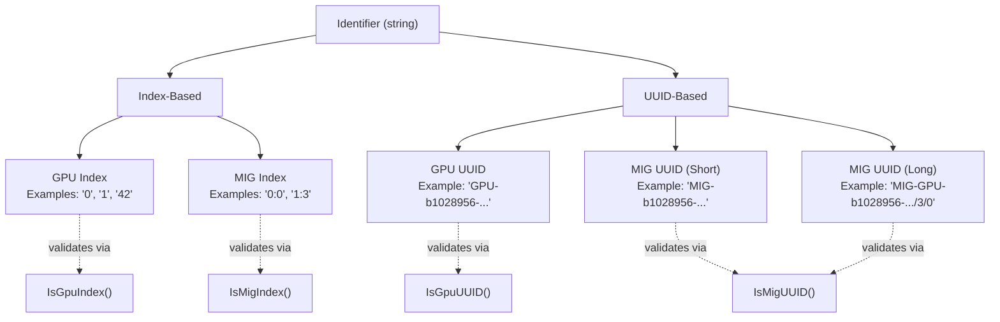
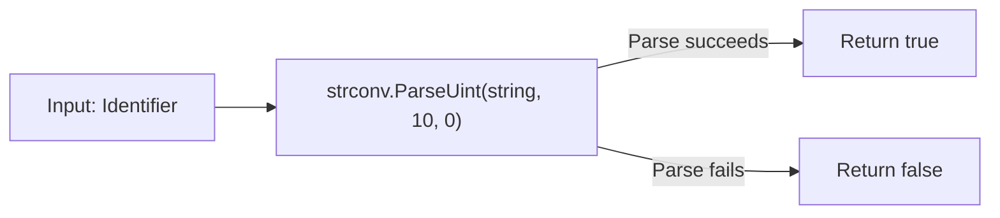
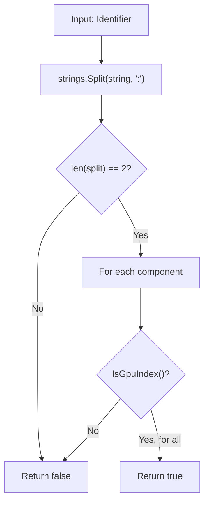
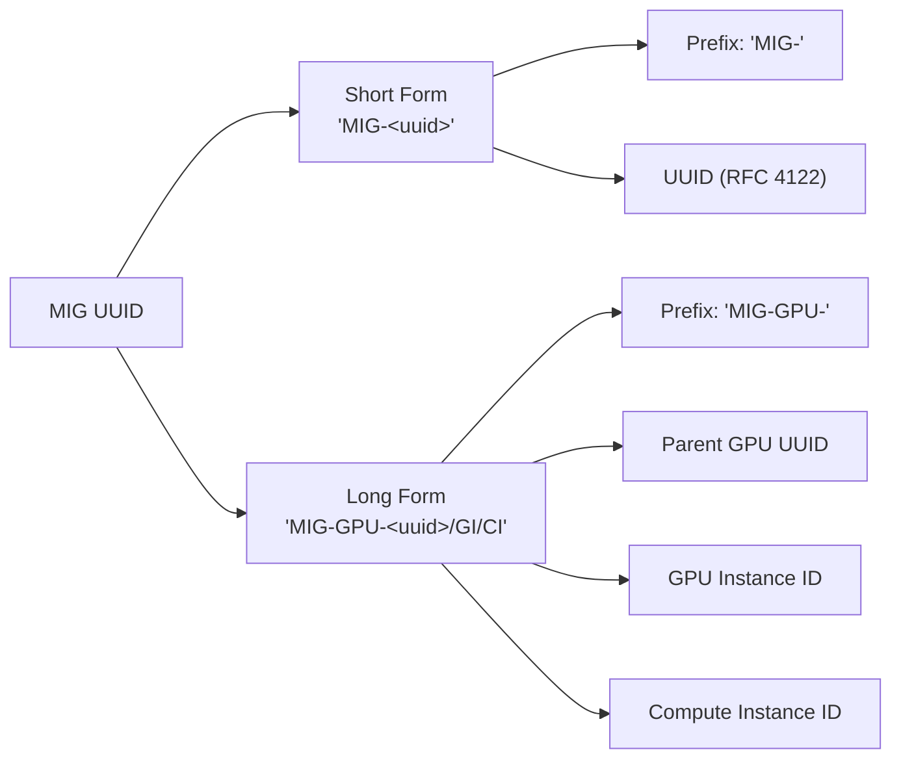
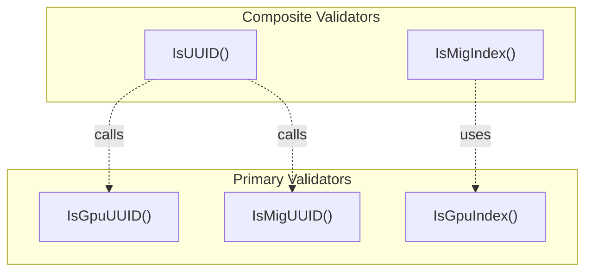
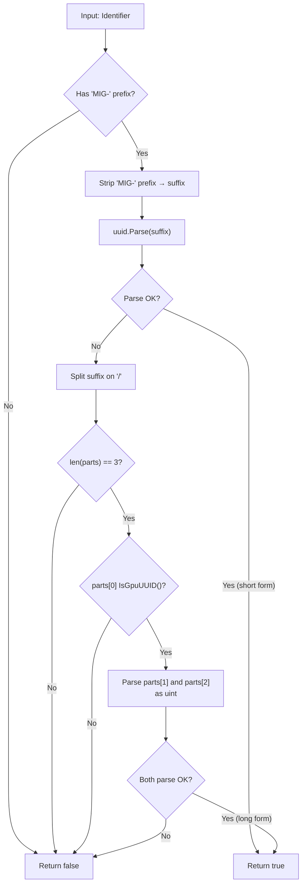
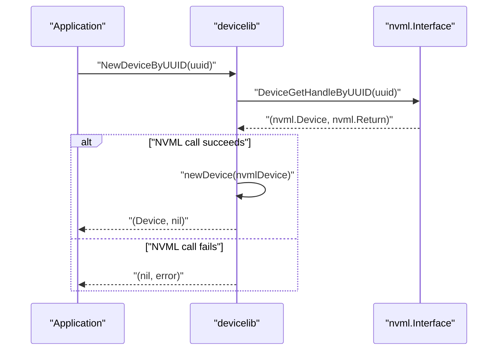

<!-- source: DeepWiki mcp.deepwiki.com · repo NVIDIA/go-nvlib · page 3.3 Device Identifiers · fetched 2026-10-26 -->

# Device Identifiers

<details>
<summary>Relevant source files</summary>

The following files were used as context for generating this wiki page:

- [Makefile](Makefile)
- [pkg/nvlib/device/api.go](pkg/nvlib/device/api.go)
- [pkg/nvlib/device/device.go](pkg/nvlib/device/device.go)
- [pkg/nvlib/device/identifier.go](pkg/nvlib/device/identifier.go)

</details>


## Purpose and Scope

This document describes the device identifier system used in go-nvlib to uniquely reference GPU and MIG devices. Device identifiers are string-based values that can take multiple formats: numeric indices, UUIDs, or MIG-specific index pairs. The `Identifier` type provides validation methods to determine which format a given identifier uses.

For information about discovering devices using these identifiers, see [Device Discovery and Enumeration](#3.1). For MIG-specific device discovery, see [MIG Device Discovery](#4.1).

**Sources:** [pkg/nvlib/device/identifier.go:1-95]()

## Overview

The device library supports multiple identifier formats to accommodate different use cases and integration scenarios. Applications can use simple numeric indices for sequential access, UUIDs for globally unique identification, or MIG-specific indices for addressing partitioned GPU resources.



**Identifier Format Types**

| Format | Example | Use Case | Validation Method |
|--------|---------|----------|-------------------|
| GPU Index | `"0"`, `"1"`, `"42"` | Sequential enumeration | `IsGpuIndex()` |
| MIG Index | `"0:0"`, `"1:3"` | MIG device on parent GPU | `IsMigIndex()` |
| GPU UUID | `"GPU-b1028956-cfa2-0990-bf4a-5da9abb51763"` | Persistent GPU identification | `IsGpuUUID()` |
| MIG UUID (Short) | `"MIG-b1028956-cfa2-0990-bf4a-5da9abb51763"` | Persistent MIG identification | `IsMigUUID()` |
| MIG UUID (Long) | `"MIG-GPU-b1028956-.../3/0"` | Hierarchical MIG identification | `IsMigUUID()` |

**Sources:** [pkg/nvlib/device/identifier.go:26-95]()

## Identifier Type Definition

The `Identifier` type is a string alias that provides type safety and validation methods for device references.

```go
type Identifier string
```

This type is defined in [pkg/nvlib/device/identifier.go:28]() and implements multiple validation methods to determine the identifier format.

**Sources:** [pkg/nvlib/device/identifier.go:26-28]()

## GPU Index Identifiers

GPU index identifiers are simple numeric strings representing the sequential position of a GPU in the system enumeration. Index `"0"` refers to the first GPU, `"1"` to the second, and so on.

### Format

A valid GPU index identifier consists of:
- One or more decimal digits
- No prefix or special characters
- Parseable as an unsigned integer

### Validation Logic

The `IsGpuIndex()` method validates GPU indices by attempting to parse the identifier as an unsigned integer:



**Implementation:** [pkg/nvlib/device/identifier.go:31-36]()

### Example Values

| Valid | Invalid | Reason |
|-------|---------|--------|
| `"0"` | `"GPU-0"` | Contains prefix |
| `"1"` | `"0:1"` | Contains colon |
| `"42"` | `"-1"` | Negative number |
| `"999"` | `"1.5"` | Contains decimal point |

**Sources:** [pkg/nvlib/device/identifier.go:30-36]()

## MIG Index Identifiers

MIG index identifiers use a colon-separated format to reference a MIG device on a specific parent GPU. The format is `"<gpu-index>:<mig-index>"` where both components are numeric.

### Format

A valid MIG index identifier consists of:
- Two numeric components separated by a colon
- Both components must be valid unsigned integers
- Format: `"<parent-gpu-index>:<mig-device-index>"`

### Validation Logic

The `IsMigIndex()` method validates by:
1. Splitting the identifier on `":"` 
2. Verifying exactly two components exist
3. Validating each component as a GPU index



**Implementation:** [pkg/nvlib/device/identifier.go:38-50]()

### Example Values

| Identifier | Parent GPU | MIG Device | Valid |
|------------|------------|------------|-------|
| `"0:0"` | 0 | 0 | ✓ |
| `"1:3"` | 1 | 3 | ✓ |
| `"42:7"` | 42 | 7 | ✓ |
| `"0"` | - | - | ✗ (not colon-separated) |
| `"0:1:2"` | - | - | ✗ (too many components) |
| `"a:b"` | - | - | ✗ (non-numeric) |

**Sources:** [pkg/nvlib/device/identifier.go:38-50]()

## UUID Identifiers

UUID identifiers provide globally unique, persistent references to GPU and MIG devices. Unlike indices, which may change across reboots or device reconfigurations, UUIDs remain stable.

### GPU UUID Format

GPU UUIDs follow the format `"GPU-<uuid>"` where `<uuid>` is a standard RFC 4122 UUID.

**Format:** `"GPU-b1028956-cfa2-0990-bf4a-5da9abb51763"`

The `IsGpuUUID()` method validates by:
1. Checking for `"GPU-"` prefix
2. Parsing the suffix as a valid UUID using `github.com/google/uuid`

**Implementation:** [pkg/nvlib/device/identifier.go:57-65]()

### MIG UUID Formats

MIG UUIDs support two distinct formats:

#### Short Form MIG UUID

The short form directly references a MIG device by its own UUID:

**Format:** `"MIG-b1028956-cfa2-0990-bf4a-5da9abb51763"`

This is structurally similar to GPU UUIDs but uses the `"MIG-"` prefix.

#### Long Form MIG UUID

The long form provides hierarchical identification showing the relationship to the parent GPU:

**Format:** `"MIG-GPU-<parent-gpu-uuid>/<gpu-instance-id>/<compute-instance-id>"`

**Example:** `"MIG-GPU-b1028956-cfa2-0990-bf4a-5da9abb51763/3/0"`

Components:
- `"MIG-GPU-"` prefix
- Parent GPU UUID (with `"GPU-"` prefix)
- GPU Instance ID (numeric)
- Compute Instance ID (numeric)



**Sources:** [pkg/nvlib/device/identifier.go:67-94]()

## Validation Methods

The `Identifier` type provides a comprehensive set of validation methods to determine the format and type of an identifier.

### Method Hierarchy



### IsGpuIndex

Validates numeric GPU indices.

**Signature:** `func (i Identifier) IsGpuIndex() bool`

**Logic:** Attempts to parse the identifier as an unsigned integer. Returns `true` if parsing succeeds, `false` otherwise.

**Implementation:** [pkg/nvlib/device/identifier.go:31-36]()

### IsMigIndex

Validates colon-separated MIG indices.

**Signature:** `func (i Identifier) IsMigIndex() bool`

**Logic:**
1. Splits identifier on `":"`
2. Verifies exactly 2 components exist
3. Validates each component using `IsGpuIndex()`

**Implementation:** [pkg/nvlib/device/identifier.go:39-50]()

### IsUUID

General UUID validator that delegates to specific validators.

**Signature:** `func (i Identifier) IsUUID() bool`

**Logic:** Returns `true` if either `IsGpuUUID()` or `IsMigUUID()` returns `true`.

**Implementation:** [pkg/nvlib/device/identifier.go:52-55]()

### IsGpuUUID

Validates GPU UUID format.

**Signature:** `func (i Identifier) IsGpuUUID() bool`

**Logic:**
1. Checks for `"GPU-"` prefix
2. Strips prefix and attempts to parse remainder as UUID
3. Returns `true` if UUID parsing succeeds

**Implementation:** [pkg/nvlib/device/identifier.go:57-65]()

### IsMigUUID

Validates both short and long form MIG UUIDs.

**Signature:** `func (i Identifier) IsMigUUID() bool`

**Logic:**
1. Checks for `"MIG-"` prefix
2. Strips prefix to get suffix
3. Attempts to parse suffix as UUID (short form)
4. If short form fails, validates long form:
   - Splits on `"/"` expecting 3 components
   - Validates first component as GPU UUID
   - Validates remaining components as numeric indices



**Implementation:** [pkg/nvlib/device/identifier.go:67-94]()

**Sources:** [pkg/nvlib/device/identifier.go:31-94]()

## Usage in Device Creation

Device identifiers are used throughout the device library to construct device references. The two primary methods that accept identifiers are `NewDeviceByUUID()` and `NewMigDeviceByUUID()`.

### NewDeviceByUUID

Creates a `Device` instance from a UUID identifier.

**Function:** `NewDeviceByUUID(uuid string) (Device, error)`

**Location:** [pkg/nvlib/device/device.go:56-63]()

**Process:**
1. Calls `nvmllib.DeviceGetHandleByUUID(uuid)` to obtain NVML device handle
2. Checks NVML return code for errors
3. Wraps the NVML device using `newDevice()`



**Sources:** [pkg/nvlib/device/device.go:56-63]()

### NewMigDeviceByUUID

Creates a `MigDevice` instance from a MIG UUID identifier. While not shown in the provided excerpts, this method follows the same pattern as `NewDeviceByUUID()` but uses NVML's MIG-specific device handle retrieval.

**Function:** Listed in interface at [pkg/nvlib/device/api.go:32]()

**Sources:** [pkg/nvlib/device/api.go:32]()

## Identifier Validation Summary

The following table summarizes the validation behavior for various identifier formats:

| Input Example | `IsGpuIndex()` | `IsMigIndex()` | `IsGpuUUID()` | `IsMigUUID()` | `IsUUID()` |
|---------------|----------------|----------------|---------------|---------------|------------|
| `"0"` | ✓ | ✗ | ✗ | ✗ | ✗ |
| `"42"` | ✓ | ✗ | ✗ | ✗ | ✗ |
| `"0:0"` | ✗ | ✓ | ✗ | ✗ | ✗ |
| `"1:3"` | ✗ | ✓ | ✗ | ✗ | ✗ |
| `"GPU-b102..."` | ✗ | ✗ | ✓ | ✗ | ✓ |
| `"MIG-b102..."` | ✗ | ✗ | ✗ | ✓ | ✓ |
| `"MIG-GPU-b102.../3/0"` | ✗ | ✗ | ✗ | ✓ | ✓ |
| `"invalid"` | ✗ | ✗ | ✗ | ✗ | ✗ |

**Sources:** [pkg/nvlib/device/identifier.go:31-94]()

## Dependencies

The identifier validation system relies on the following external packages:

| Package | Purpose | Usage |
|---------|---------|-------|
| `strconv` | String conversion | Parsing numeric indices |
| `strings` | String manipulation | Prefix checking, splitting |
| `github.com/google/uuid` | UUID parsing | Validating UUID format |

**Sources:** [pkg/nvlib/device/identifier.go:19-24]()

## Related Interfaces

The identifier system integrates with several device library interfaces:

**Interface Methods Using Identifiers:**

```go
// From device.Interface
NewDeviceByUUID(uuid string) (Device, error)
NewMigDeviceByUUID(uuid string) (MigDevice, error)
```

These methods are defined in [pkg/nvlib/device/api.go:30-32]() and implemented in [pkg/nvlib/device/device.go:56-63]().

**Sources:** [pkg/nvlib/device/api.go:24-38](), [pkg/nvlib/device/device.go:56-63]()

---

