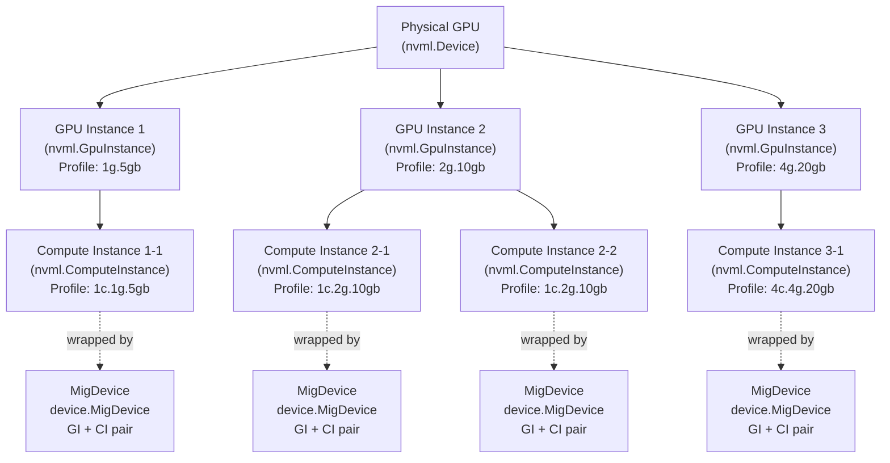
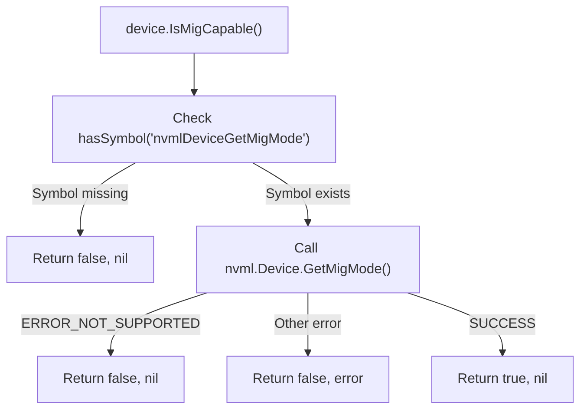
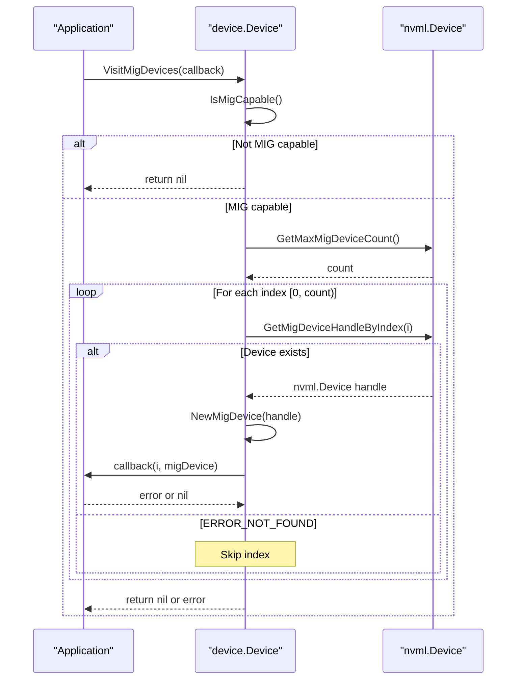
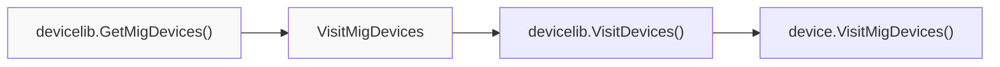
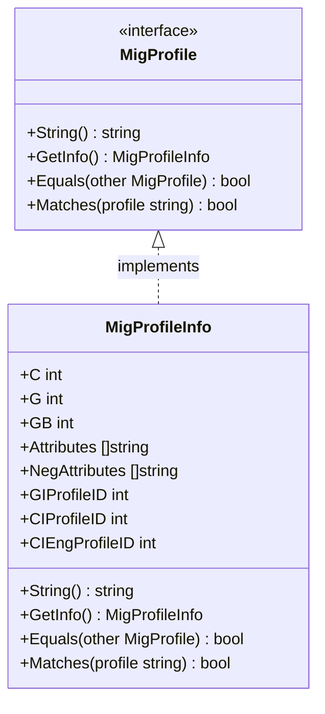
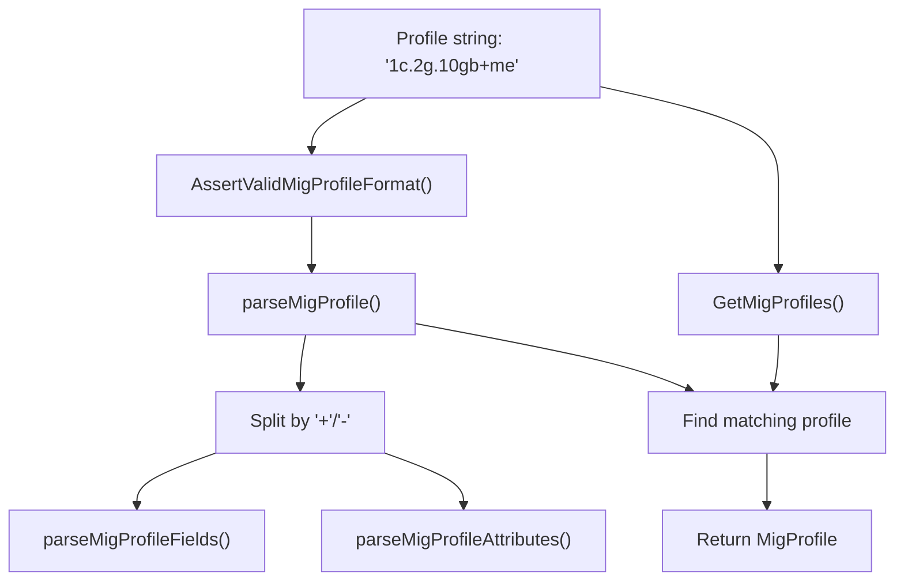
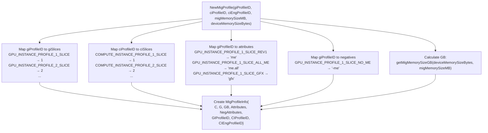
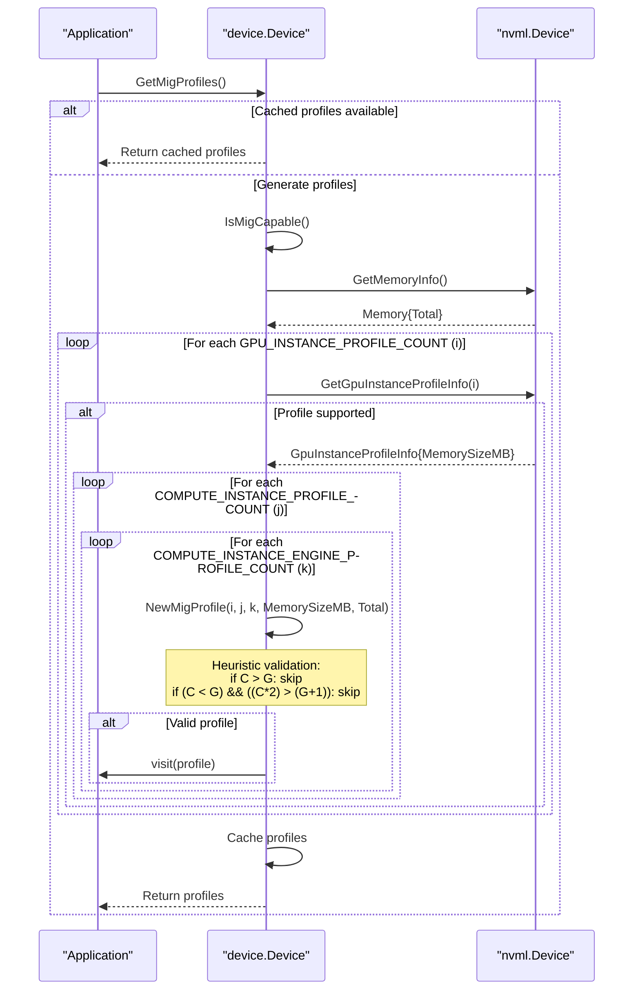

<!-- source: DeepWiki mcp.deepwiki.com · repo NVIDIA/go-nvlib · page 4 Multi-Instance GPU (MIG) · fetched 2026-10-26 -->

# Multi-Instance GPU (MIG)

Relevant source files

The following files were used as context for generating this wiki page:

- [pkg/nvlib/device/api.go](pkg/nvlib/device/api.go)
- [pkg/nvlib/device/device.go](pkg/nvlib/device/device.go)
- [pkg/nvlib/device/mig_profile.go](pkg/nvlib/device/mig_profile.go)
- [pkg/nvlib/device/mig_profile_test.go](pkg/nvlib/device/mig_profile_test.go)

## Purpose and Scope

This page provides an overview of Multi-Instance GPU (MIG) support in go-nvlib, covering capability detection, device enumeration, and profile management. MIG is a hardware feature that allows a single physical GPU to be partitioned into multiple isolated GPU instances, each with dedicated compute, memory, and cache resources.

For detailed information about MIG device discovery and enumeration patterns, see [MIG Device Discovery](#4.1). For comprehensive documentation on MIG profile formats, parsing, and validation, see [MIG Profiles](#4.2). For information about profile attributes such as media extensions and graphics capabilities, see [MIG Profile Attributes](#4.3).

## MIG Architecture Overview

MIG provides GPU partitioning through a two-level hierarchy: GPU instances divide the physical GPU, and compute instances further subdivide GPU instances.

**Sources:** [pkg/nvlib/device/device.go:283-319](), [pkg/nvlib/device/device.go:383-416]()

## Device Interface MIG Methods

The `Device` interface in go-nvlib extends the base NVML device with MIG-specific functionality.

| Method | Return Type | Purpose |
|--------|-------------|---------|
| `IsMigCapable()` | `(bool, error)` | Check if device supports MIG partitioning |
| `IsMigEnabled()` | `(bool, error)` | Check if MIG mode is currently enabled |
| `GetMigDevices()` | `([]MigDevice, error)` | Retrieve all configured MIG devices |
| `GetMigProfiles()` | `([]MigProfile, error)` | Retrieve all supported MIG profiles |
| `VisitMigDevices(func(int, MigDevice) error)` | `error` | Iterate over MIG devices with callback |
| `VisitMigProfiles(func(MigProfile) error)` | `error` | Iterate over MIG profiles with callback |

**Sources:** [pkg/nvlib/device/device.go:26-41]()

## MIG Capability Detection

The library provides two methods for checking MIG support on a device.

### IsMigCapable

Determines whether a device has the hardware capability for MIG partitioning, regardless of current mode:

**Sources:** [pkg/nvlib/device/device.go:202-217]()

### IsMigEnabled

Checks if MIG mode is currently enabled on the device:

**Sources:** [pkg/nvlib/device/device.go:219-234]()

The implementation queries the current MIG mode and compares it against `nvml.DEVICE_MIG_ENABLE`. A device can be MIG-capable but not currently enabled, requiring a system reset to change the mode.

## MIG Device Enumeration

The library provides multiple patterns for enumerating MIG devices.

### VisitMigDevices Pattern

The visitor pattern allows processing MIG devices without allocating a slice:

**Sources:** [pkg/nvlib/device/device.go:283-319]()

The method iterates through the maximum MIG device count, skipping indices where devices don't exist (returning `nvml.ERROR_NOT_FOUND` or `nvml.ERROR_INVALID_ARGUMENT`).

### GetMigDevices

For convenience, `GetMigDevices()` collects all MIG devices into a slice:

**Sources:** [pkg/nvlib/device/device.go:383-394]()

### Library-Level Enumeration

The `devicelib` provides system-wide MIG device enumeration:

**Sources:** [pkg/nvlib/device/device.go:465-484](), [pkg/nvlib/device/device.go:527-538]()

## MIG Profile Management

MIG profiles define the resource allocation for GPU and compute instances using a standardized string format.

### Profile Format

The profile string format follows the pattern: `[C]c.[G]g.[GB]gb[+/-attributes]`

| Component | Description | Example |
|-----------|-------------|---------|
| `[G]g` | Number of GPU slices (1-8) | `1g`, `2g`, `4g` |
| `[GB]gb` | Memory size in gigabytes | `5gb`, `10gb`, `20gb` |
| `[C]c` | Number of compute slices (optional) | `1c`, `2c` |
| `+[attrs]` | Positive attributes (optional) | `+me`, `+gfx` |
| `-[attrs]` | Negative attributes (optional) | `-me` |

**Sources:** [pkg/nvlib/device/mig_profile.go:36-43]()

### Profile Examples

| Profile | Description |
|---------|-------------|
| `1g.5gb` | 1 GPU slice, 5GB memory, compute slices equal GPU slices |
| `1c.1g.5gb` | 1 compute slice, 1 GPU slice, 5GB memory |
| `2c.2g.10gb` | 2 compute slices, 2 GPU slices, 10GB memory |
| `1g.5gb+me` | 1 GPU slice with media extensions |
| `1g.5gb-me` | 1 GPU slice without media extensions |
| `1g.5gb+me.all` | 1 GPU slice with all media extensions |
| `4g.20gb+gfx` | 4 GPU slices with graphics capability |

### MigProfile Interface

**Sources:** [pkg/nvlib/device/mig_profile.go:36-58]()

### Profile Parsing and Validation

The library provides methods for parsing and validating profile strings:

**Sources:** [pkg/nvlib/device/mig_profile.go:146-166](), [pkg/nvlib/device/mig_profile.go:250-297]()

#### AssertValidMigProfileFormat

Validates that a string conforms to the MIG profile format without checking if it's a valid profile for the current hardware:

**Sources:** [pkg/nvlib/device/mig_profile.go:146-150]()

#### ParseMigProfile

Parses a profile string and matches it against available profiles from the hardware:

**Sources:** [pkg/nvlib/device/mig_profile.go:152-166]()

This method retrieves all supported profiles from the device and finds one that matches the provided string.

### Profile Creation from NVML IDs

The library creates MIG profiles from NVML profile identifiers:

**Sources:** [pkg/nvlib/device/mig_profile.go:60-144]()

### Profile Discovery

The library discovers available MIG profiles by querying NVML:

**Sources:** [pkg/nvlib/device/device.go:321-381](), [pkg/nvlib/device/device.go:396-416]()

The method iterates through all possible combinations of GPU instance, compute instance, and compute engine profiles, filtering invalid combinations using heuristics since NVML does not provide an API to query valid compute instance profiles without an existing GPU instance.

## Memory Size Calculation

MIG profile memory sizes are calculated to align with hardware slice boundaries:

**Sources:** [pkg/nvlib/device/mig_profile.go:383-391]()

The calculation:
1. Computes fractional GPU memory as a ratio of MIG memory to total device memory
2. Rounds up to the nearest 1/8th slice boundary
3. Multiplies by total device memory in GB (rounded up)

This ensures profile memory sizes match the hardware's discrete slice allocations.

## Profile Attributes

MIG profiles support attributes that modify instance capabilities:

| Attribute | Constant | Description |
|-----------|----------|-------------|
| `me` | `AttributeMediaExtensions` | Media extensions enabled |
| `me.all` | `AttributeMediaExtensionsAll` | All media extensions enabled |
| `gfx` | `AttributeGraphics` | Graphics capability enabled |
| `-me` | N/A (NegAttributes) | Media extensions explicitly disabled |

**Sources:** [pkg/nvlib/device/mig_profile.go:29-34]()

Attributes are specified with `+` for positive attributes (`1g.5gb+me`) or `-` for negative attributes (`1g.5gb-me`). Multiple attributes are separated by commas, though mixing positive and negative attributes in one profile is invalid.

## Integration with NVML

The MIG implementation wraps NVML's MIG-related functions:

| go-nvlib Method | NVML Function | Purpose |
|-----------------|---------------|---------|
| `IsMigCapable()` | `nvmlDeviceGetMigMode()` | Check MIG capability |
| `IsMigEnabled()` | `nvmlDeviceGetMigMode()` | Check MIG state |
| `GetMaxMigDeviceCount()` | `nvmlDeviceGetMaxMigDeviceCount()` | Get maximum MIG devices |
| `GetMigDeviceHandleByIndex()` | `nvmlDeviceGetMigDeviceHandleByIndex()` | Get MIG device handle |
| `GetGpuInstanceProfileInfo()` | `nvmlDeviceGetGpuInstanceProfileInfo()` | Get GPU instance info |

**Sources:** [pkg/nvlib/device/device.go:202-234](), [pkg/nvlib/device/device.go:283-319]()

The library includes symbol verification to gracefully handle older NVML versions that lack MIG support, returning `false` for capability checks when the symbols are unavailable.

## Symbol Verification

MIG-related methods check for NVML symbol availability:

**Sources:** [pkg/nvlib/device/device.go:562-570]()

The `hasSymbol()` method checks if a symbol exists in the loaded NVML library. When `verifySymbols` is disabled (useful for testing), all symbols are assumed to exist. This allows the library to degrade gracefully on systems with older NVML versions.

**Sources:** [pkg/nvlib/device/api.go:70-75]()

---

