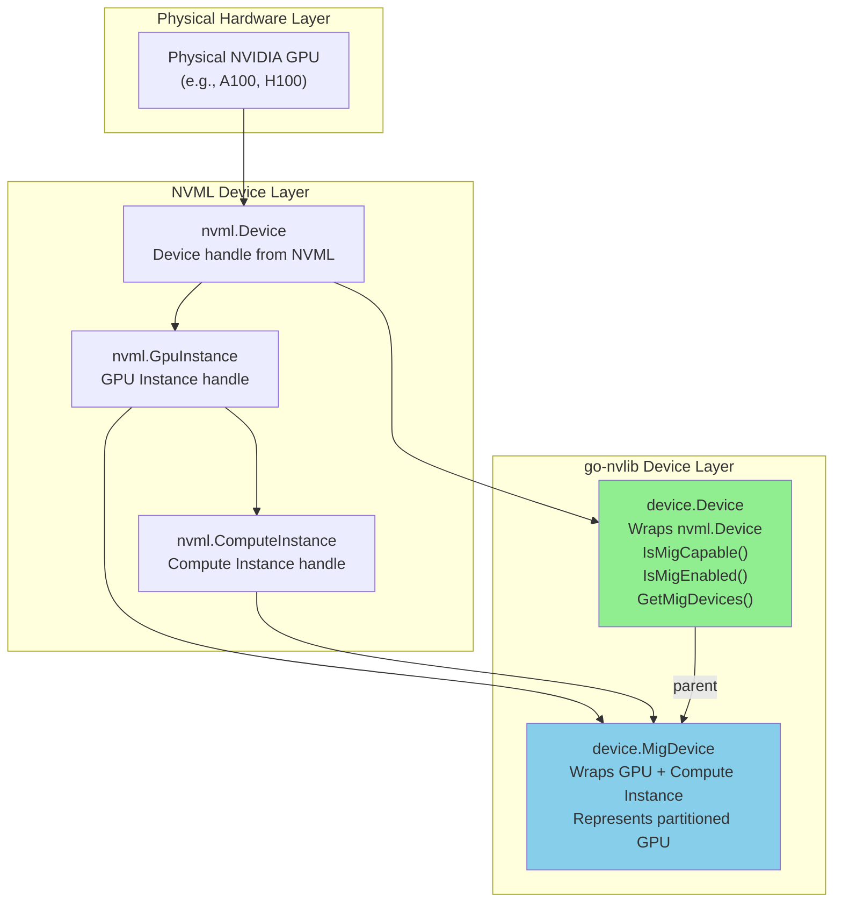
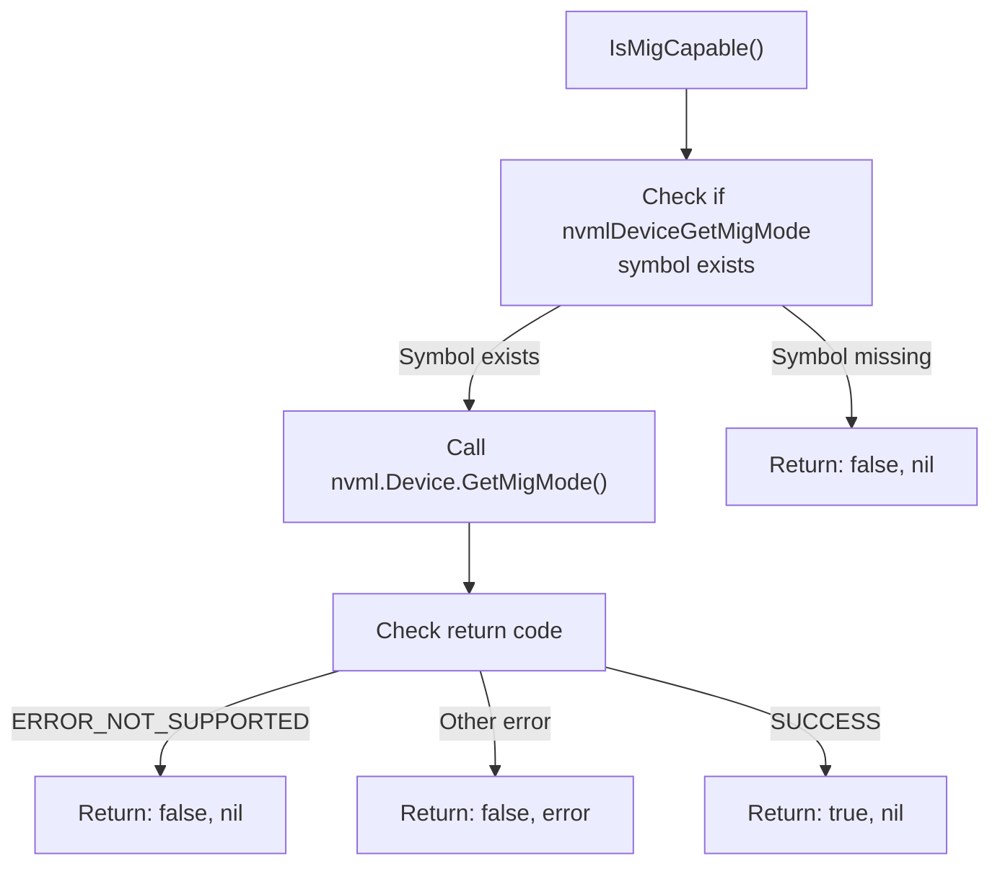
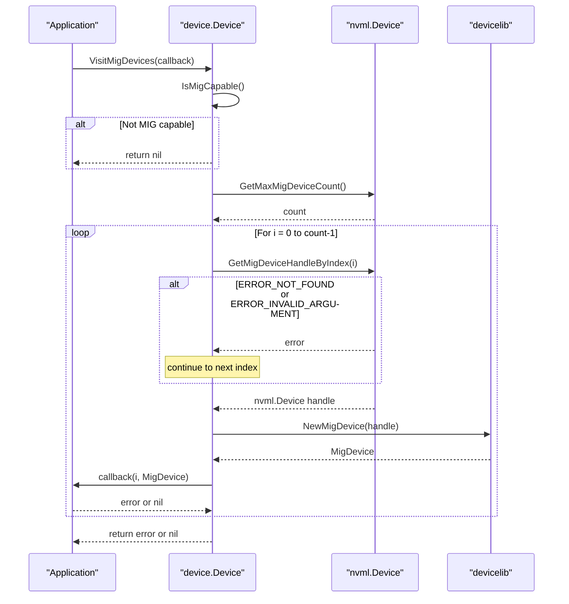
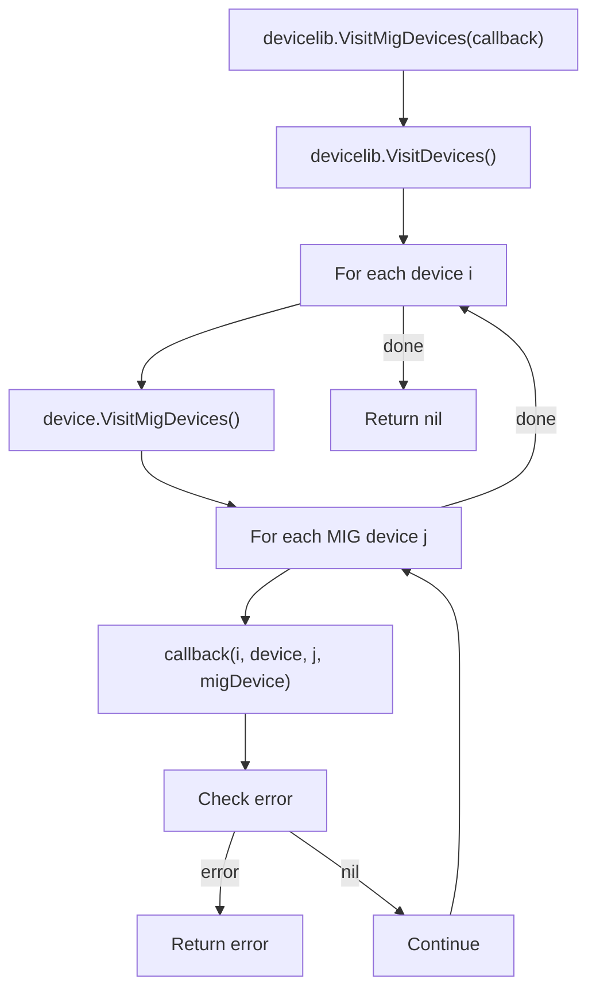
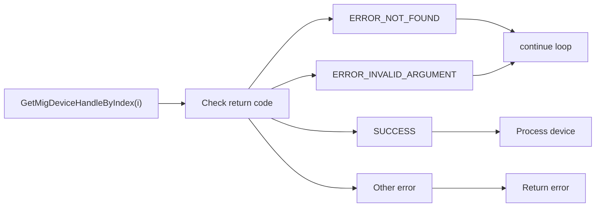
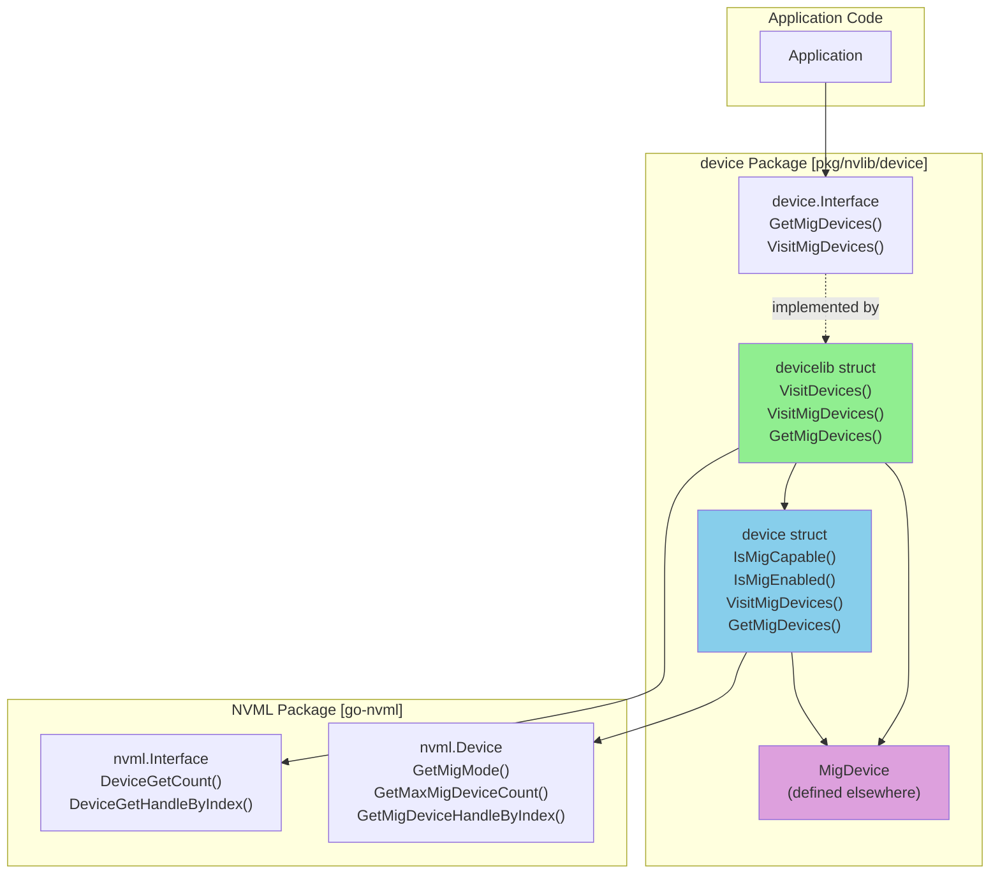

<!-- source: DeepWiki mcp.deepwiki.com · repo NVIDIA/go-nvlib · page 4.1 MIG Device Discovery · fetched 2026-10-26 -->

# MIG Device Discovery

<details>
<summary>Relevant source files</summary>

The following files were used as context for generating this wiki page:

- [pkg/nvlib/device/api.go](pkg/nvlib/device/api.go)
- [pkg/nvlib/device/device.go](pkg/nvlib/device/device.go)

</details>


This document explains how to discover and enumerate Multi-Instance GPU (MIG) devices in the go-nvlib library. It covers checking MIG capability and mode, discovering MIG devices on individual GPUs, and system-wide MIG device enumeration. For information about MIG profile management and configuration, see [MIG Profiles](#4.2). For details on profile attributes and their NVML mappings, see [MIG Profile Attributes](#4.3).

## Overview

MIG device discovery involves identifying GPU instances that have been partitioned from physical GPUs using NVIDIA's Multi-Instance GPU technology. The `device` package provides methods to check MIG capabilities, enumerate MIG devices on individual GPUs, and discover all MIG devices across the system. MIG devices are represented by the `MigDevice` type and are accessed through their parent `Device`.

Sources: [pkg/nvlib/device/device.go:26-41](), [pkg/nvlib/device/api.go:23-38]()

## MIG Device Hierarchy



**MIG Device Hierarchy**: Physical GPUs are accessed through NVML device handles, which are wrapped by `device.Device`. When MIG is enabled, GPU instances and compute instances are created in NVML, which are then wrapped as `device.MigDevice` objects. Each MIG device maintains a reference to its parent device.

Sources: [pkg/nvlib/device/device.go:43-47](), [pkg/nvlib/device/device.go:283-319]()

## MIG Capability and Mode Detection

Before discovering MIG devices, applications must verify that a GPU supports MIG and that MIG mode is enabled. The library provides two key methods for this:

### IsMigCapable()

The `IsMigCapable()` method determines whether a device supports MIG partitioning. It performs the following checks:

1. Verifies that the `nvmlDeviceGetMigMode` symbol exists in the NVML library
2. Calls `nvml.Device.GetMigMode()` on the device
3. Returns `false` if the call returns `nvml.ERROR_NOT_SUPPORTED`
4. Returns `true` if the device supports MIG



**MIG Capability Detection Flow**: The method checks for NVML symbol availability before making calls, returning false if MIG is not supported by the hardware or driver.

Sources: [pkg/nvlib/device/device.go:202-217](), [pkg/nvlib/device/device.go:564-570]()

### IsMigEnabled()

The `IsMigEnabled()` method checks whether MIG mode is currently active on a device:

1. Verifies that the `nvmlDeviceGetMigMode` symbol exists
2. Calls `nvml.Device.GetMigMode()` to retrieve the current mode
3. Compares the mode to `nvml.DEVICE_MIG_ENABLE`
4. Returns `true` only if MIG is actively enabled

Sources: [pkg/nvlib/device/device.go:219-234]()

## Single Device MIG Discovery

### VisitMigDevices Method

The `VisitMigDevices()` method provides callback-based iteration over MIG devices on a single GPU:



**VisitMigDevices Sequence**: The method queries the maximum MIG device count, then iterates through all possible indices, handling missing devices gracefully by skipping indices that return `ERROR_NOT_FOUND` or `ERROR_INVALID_ARGUMENT`.

Sources: [pkg/nvlib/device/device.go:283-319]()

### Key Implementation Details

| Aspect | Implementation |
|--------|----------------|
| **Maximum Count** | Retrieved via `nvml.Device.GetMaxMigDeviceCount()` |
| **Index Range** | 0 to (count - 1) |
| **Missing Devices** | `ERROR_NOT_FOUND` and `ERROR_INVALID_ARGUMENT` are silently skipped |
| **Device Wrapping** | NVML device handles are wrapped using `devicelib.NewMigDevice()` |
| **Non-MIG Devices** | Method returns `nil` immediately for non-MIG-capable devices |

Sources: [pkg/nvlib/device/device.go:293-318]()

### GetMigDevices Method

The `GetMigDevices()` method provides a simpler interface that returns all MIG devices as a slice:

```go
// Internally implemented as:
// 1. Create empty []MigDevice slice
// 2. Call VisitMigDevices with append callback
// 3. Return the populated slice
```

This method is a convenience wrapper around `VisitMigDevices()` for applications that prefer collecting all devices at once rather than processing them via callbacks.

Sources: [pkg/nvlib/device/device.go:383-394]()

## System-Wide MIG Discovery

The `devicelib` provides system-level methods for discovering MIG devices across all GPUs:

### devicelib.VisitMigDevices()



**System-Wide MIG Discovery Flow**: The library-level method iterates through all devices, then for each device iterates through its MIG devices, invoking the callback with both the device index and MIG device index.

Sources: [pkg/nvlib/device/device.go:465-484]()

### Callback Signature

The system-wide visitor accepts a callback with the following signature:

```
func(deviceIndex int, parentDevice Device, migIndex int, migDevice MigDevice) error
```

This provides complete context about:
- Which physical GPU the MIG device belongs to (deviceIndex, parentDevice)
- The position of the MIG device within its parent (migIndex)
- The MIG device itself (migDevice)

Sources: [pkg/nvlib/device/device.go:466]()

### devicelib.GetMigDevices()

For convenience, the library also provides `GetMigDevices()` which returns all MIG devices across all GPUs as a flat slice:

```go
// Returns []MigDevice containing all MIG devices
// from all devices in the system
```

This method is implemented by calling `VisitMigDevices()` and collecting all MIG devices into a slice.

Sources: [pkg/nvlib/device/device.go:527-538]()

## MIG Device Interface Methods

The following table summarizes the key methods for MIG device discovery:

| Method | Level | Return Type | Description |
|--------|-------|-------------|-------------|
| `IsMigCapable()` | Device | `(bool, error)` | Check if device supports MIG |
| `IsMigEnabled()` | Device | `(bool, error)` | Check if MIG is currently enabled |
| `VisitMigDevices(callback)` | Device | `error` | Iterate over MIG devices on one GPU |
| `GetMigDevices()` | Device | `([]MigDevice, error)` | Get all MIG devices from one GPU |
| `VisitMigDevices(callback)` | devicelib | `error` | Iterate over all MIG devices system-wide |
| `GetMigDevices()` | devicelib | `([]MigDevice, error)` | Get all MIG devices from all GPUs |

Sources: [pkg/nvlib/device/device.go:26-41](), [pkg/nvlib/device/api.go:24-37]()

## Error Handling

MIG device discovery handles several categories of errors:

### Missing MIG Devices

When iterating through MIG device indices, the library gracefully handles gaps in the index space:



**Error Handling for Missing Devices**: The discovery loop continues when encountering missing devices but returns errors for other failure conditions.

Sources: [pkg/nvlib/device/device.go:298-308]()

### Common Error Scenarios

| Error Code | Condition | Handling |
|------------|-----------|----------|
| `ERROR_NOT_SUPPORTED` | Device doesn't support MIG | Return `false` from capability checks |
| `ERROR_NOT_FOUND` | No MIG device at index | Skip to next index |
| `ERROR_INVALID_ARGUMENT` | Invalid index value | Skip to next index |
| Other errors | NVML failures | Propagate error to caller |

Sources: [pkg/nvlib/device/device.go:203-217](), [pkg/nvlib/device/device.go:300-308]()

## Device Filtering

The `devicelib` implementation filters out certain devices by name before processing. By default, the following device names are skipped:

- "DGX Display"
- "NVIDIA DGX Display"

This filtering applies to the top-level device iteration, meaning MIG devices are never discovered on these filtered devices. Applications can customize the skip list using the `WithSkippedDevices()` option when creating the devicelib.

Sources: [pkg/nvlib/device/api.go:62-66](), [pkg/nvlib/device/device.go:418-430]()

## Usage Patterns

### Pattern 1: Check and Discover MIG Devices on a Single GPU

```
1. Get device handle via devicelib.NewDevice() or NewDeviceByUUID()
2. Call device.IsMigCapable() to check support
3. Call device.IsMigEnabled() to check if enabled
4. Call device.GetMigDevices() to retrieve all MIG devices
```

Sources: [pkg/nvlib/device/device.go:52-63](), [pkg/nvlib/device/device.go:383-394]()

### Pattern 2: Iterate Over All System MIG Devices

```
1. Create devicelib via device.New(nvmllib)
2. Call devicelib.VisitMigDevices(callback) with processing function
3. Callback receives device index, parent device, MIG index, and MIG device
```

Sources: [pkg/nvlib/device/api.go:49-68](), [pkg/nvlib/device/device.go:465-484]()

### Pattern 3: Collect All MIG Devices

```
1. Create devicelib
2. Call devicelib.GetMigDevices()
3. Receive flat slice of all MIG devices across all GPUs
```

Sources: [pkg/nvlib/device/device.go:527-538]()

## Implementation Architecture



**MIG Discovery Architecture**: Applications interact with the `device.Interface`, which is implemented by `devicelib`. The `devicelib` coordinates device enumeration and delegates MIG-specific operations to individual `device` instances, which wrap NVML device handles.

Sources: [pkg/nvlib/device/api.go:40-68](), [pkg/nvlib/device/device.go:43-47](), [pkg/nvlib/device/device.go:283-319]()

---

