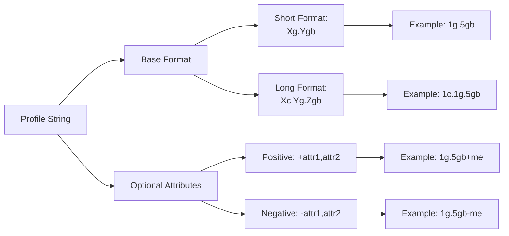
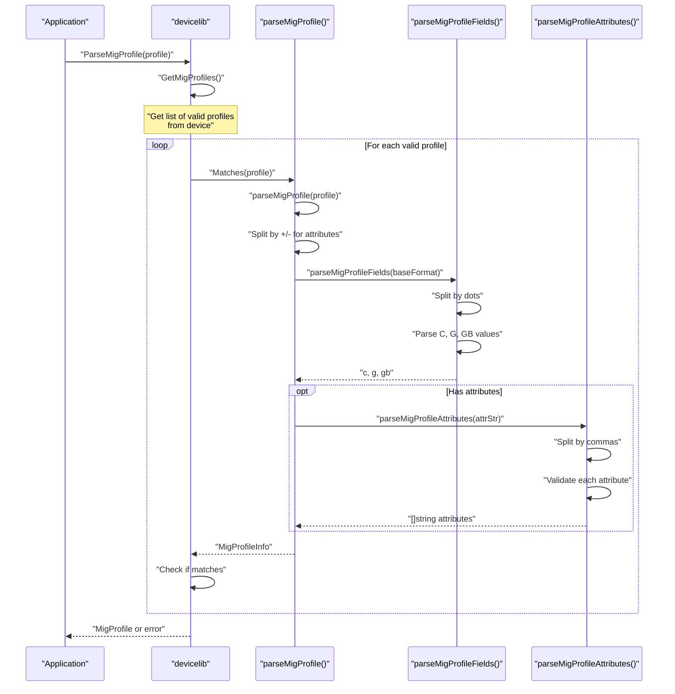
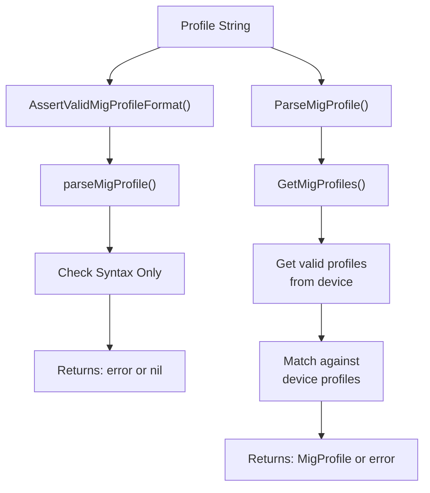
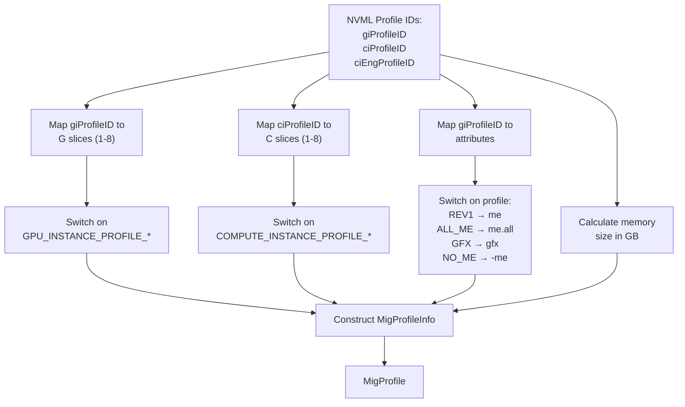
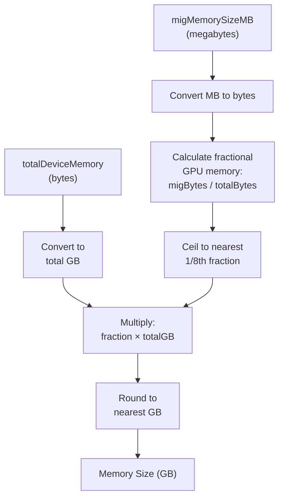

<!-- source: DeepWiki mcp.deepwiki.com · repo NVIDIA/go-nvlib · page 4.2 MIG Profiles · fetched 2026-10-26 -->

# MIG Profiles

<details>
<summary>Relevant source files</summary>

The following files were used as context for generating this wiki page:

- [pkg/nvlib/device/mig_profile.go](pkg/nvlib/device/mig_profile.go)
- [pkg/nvlib/device/mig_profile_test.go](pkg/nvlib/device/mig_profile_test.go)

</details>


## Purpose and Scope

This document describes MIG (Multi-Instance GPU) profile representation, format, parsing, validation, and matching in go-nvlib. A MIG profile is a string representation that specifies the configuration of a MIG device, including GPU and compute instance slices, memory size, and optional attributes.

For information about discovering and enumerating MIG devices using these profiles, see [MIG Device Discovery](#4.1). For detailed information about profile attributes and their mapping to NVML profile IDs, see [MIG Profile Attributes](#4.3).

**Sources:** [pkg/nvlib/device/mig_profile.go:1-392](), [pkg/nvlib/device/mig_profile_test.go:1-552]()

---

## Profile Format Overview

MIG profiles are represented as strings following a specific format that encodes:
- **G (GPU slices)**: Number of GPU instance slices (1-8)
- **C (Compute slices)**: Number of compute instance slices (1-8, defaults to G if omitted)
- **GB (Memory)**: Memory size in gigabytes
- **Attributes**: Optional attributes like `me` (media extensions), `me.all`, or `gfx` (graphics)

### Common Profile Examples

| Profile String | Description |
|----------------|-------------|
| `1g.5gb` | 1 GPU slice, 1 compute slice (implicit), 5GB memory |
| `1c.1g.5gb` | 1 compute slice, 1 GPU slice, 5GB memory (equivalent to above) |
| `2g.10gb` | 2 GPU slices, 2 compute slices (implicit), 10GB memory |
| `1g.5gb+me` | 1 GPU slice with media extensions attribute |
| `1g.5gb-me` | 1 GPU slice explicitly without media extensions |
| `1g.5gb+me.all` | 1 GPU slice with all media extensions |
| `1g.5gb+gfx` | 1 GPU slice with graphics attribute |

**Sources:** [pkg/nvlib/device/mig_profile.go:36-43](), [pkg/nvlib/device/mig_profile_test.go:92-430]()

---

## MigProfile Interface

The `MigProfile` interface defines the contract for all MIG profile implementations:

```go
type MigProfile interface {
    String() string
    GetInfo() MigProfileInfo
    Equals(other MigProfile) bool
    Matches(profile string) bool
}
```

### Interface Methods

| Method | Description |
|--------|-------------|
| `String()` | Returns the canonical string representation of the profile |
| `GetInfo()` | Returns detailed information about the profile |
| `Equals(other MigProfile)` | Checks if two profiles are identical based on all fields |
| `Matches(profile string)` | Checks if the profile matches a profile string pattern |

**Sources:** [pkg/nvlib/device/mig_profile.go:36-43]()

---

## MigProfileInfo Structure

The `MigProfileInfo` struct is the concrete implementation of the `MigProfile` interface:

```go
type MigProfileInfo struct {
    C              int      // Compute instance slices
    G              int      // GPU instance slices
    GB             int      // Memory size in gigabytes
    Attributes     []string // Positive attributes (e.g., ["me"], ["gfx"])
    NegAttributes  []string // Negative attributes (e.g., ["me"] for -me)
    GIProfileID    int      // NVML GPU Instance Profile ID
    CIProfileID    int      // NVML Compute Instance Profile ID
    CIEngProfileID int      // NVML Compute Instance Engine Profile ID
}
```

### Field Descriptions

| Field | Type | Description |
|-------|------|-------------|
| `C` | `int` | Number of compute instance slices (1-8) |
| `G` | `int` | Number of GPU instance slices (1-8) |
| `GB` | `int` | Memory size in gigabytes |
| `Attributes` | `[]string` | Positive attributes applied with `+` (e.g., `me`, `gfx`) |
| `NegAttributes` | `[]string` | Negative attributes applied with `-` (e.g., `me` in `1g.5gb-me`) |
| `GIProfileID` | `int` | NVML constant for GPU Instance profile type |
| `CIProfileID` | `int` | NVML constant for Compute Instance profile type |
| `CIEngProfileID` | `int` | NVML constant for Compute Instance Engine profile type |

**Sources:** [pkg/nvlib/device/mig_profile.go:45-55]()

---

## Profile Format Syntax

### Basic Format Structure

**Diagram: MIG Profile Format Components**



**Sources:** [pkg/nvlib/device/mig_profile.go:250-297](), [pkg/nvlib/device/mig_profile.go:316-349]()

### Syntax Rules

1. **No whitespace allowed**: Leading, trailing, or internal whitespace causes parsing failure
2. **Short form**: `Xg.Ygb` where X is GPU slices, Y is memory in GB
3. **Long form**: `Xc.Yg.Zgb` where X is compute slices, Y is GPU slices, Z is memory in GB
4. **Attribute separator**: Use `+` for positive attributes or `-` for negative attributes (not both)
5. **Multiple attributes**: Separate with commas: `+attr1,attr2`
6. **Attribute constraints**:
   - Must not start with a digit
   - Must not start or end with a dot
   - Can only contain alphanumeric characters and dots
   - Must be unique within the list
   - Cannot be empty

**Sources:** [pkg/nvlib/device/mig_profile.go:299-381](), [pkg/nvlib/device/mig_profile_test.go:184-410]()

### Valid and Invalid Examples

The following table shows valid and invalid profile strings with reasons:

| Profile String | Valid | Reason |
|----------------|-------|--------|
| `1g.5gb` | ✓ | Valid short format |
| `1c.1g.5gb` | ✓ | Valid long format |
| `1g.5gb+me` | ✓ | Valid with positive attribute |
| `1g.5gb-me` | ✓ | Valid with negative attribute |
| `1g.5gb+me.all` | ✓ | Valid with dotted attribute |
| ` 1g.5gb` | ✗ | Leading whitespace |
| `1g.5gb ` | ✗ | Trailing whitespace |
| `1 g.5gb` | ✗ | Internal whitespace |
| `1g.5gb+me-me` | ✗ | Both positive and negative attributes |
| `1g.5gb+` | ✗ | Empty attribute list |
| `1g.5gb+me,` | ✗ | Trailing comma in attributes |
| `1g.5gb+2me` | ✗ | Attribute starts with digit |
| `1g.5gb+.all` | ✗ | Attribute starts with dot |

**Sources:** [pkg/nvlib/device/mig_profile_test.go:92-430]()

---

## Profile Parsing and Validation

### Parsing Flow

**Diagram: Profile Parsing Process**



**Sources:** [pkg/nvlib/device/mig_profile.go:152-166](), [pkg/nvlib/device/mig_profile.go:250-297]()

### Format Validation

The library provides two validation methods:

1. **`AssertValidMigProfileFormat(profile string)`**: Validates only the string format without checking against device capabilities
2. **`ParseMigProfile(profile string)`**: Validates format and checks if the profile is supported by the device

**Diagram: Validation Methods**



**Sources:** [pkg/nvlib/device/mig_profile.go:146-166]()

### Parsing Implementation Details

The parsing process follows these steps:

1. **Check for empty string** [pkg/nvlib/device/mig_profile.go:252-254]()
2. **Split by attribute separator** (`+` or `-`) [pkg/nvlib/device/mig_profile.go:257-266]()
3. **Parse base format fields** (C, G, GB) [pkg/nvlib/device/mig_profile.go:269-272]()
4. **Parse attributes if present** [pkg/nvlib/device/mig_profile.go:285-296]()
5. **Construct MigProfileInfo** [pkg/nvlib/device/mig_profile.go:274-296]()

**Sources:** [pkg/nvlib/device/mig_profile.go:250-297]()

---

## Profile Matching and Comparison

### Equals Method

The `Equals()` method performs a strict comparison of two profiles, checking all fields including NVML profile IDs:

```go
func (p MigProfileInfo) Equals(other MigProfile) bool
```

**Comparison Fields:**
- Compute slices (C)
- GPU slices (G)
- Memory size (GB)
- GPU Instance Profile ID (GIProfileID)
- Compute Instance Profile ID (CIProfileID)
- Compute Instance Engine Profile ID (CIEngProfileID)

Note that `Equals()` does **not** compare the `Attributes` or `NegAttributes` fields directly, but instead relies on the profile IDs which encode this information.

**Sources:** [pkg/nvlib/device/mig_profile.go:188-210]()

### Matches Method

The `Matches()` method checks if a profile matches a profile string pattern. It compares:
- Compute slices (C)
- GPU slices (G)
- Memory size (GB)
- Attributes (using `matchAttributes()`)
- Negative attributes (using `matchAttributes()`)

This method is more lenient than `Equals()` as it doesn't require matching profile IDs, making it useful for pattern matching.

**Sources:** [pkg/nvlib/device/mig_profile.go:212-234]()

### Attribute Matching

The `matchAttributes()` helper function performs ordered comparison of attribute lists:

```go
func matchAttributes(attrs1, attrs2 []string) bool
```

1. Checks if lengths match
2. Sorts both lists
3. Compares element by element

**Sources:** [pkg/nvlib/device/mig_profile.go:236-248]()

### Equivalence Examples

The following profiles are considered equivalent when using `Equals()`:

| Profile 1 | Profile 2 | Equivalent | Reason |
|-----------|-----------|------------|--------|
| `1g.5gb` | `1c.1g.5gb` | ✓ | Short form implies C=G |
| `1g.5gb+me` | `1g.5gb+me` | ✓ | Exact match |
| `1c.2g.10gb` | `2c.2g.10gb` | ✗ | Different C values |
| `1g.5gb` | `1g.5gb+me` | ✗ | Different attributes |
| `1g.5gb+me` | `1g.5gb-me` | ✗ | Positive vs negative attribute |

**Sources:** [pkg/nvlib/device/mig_profile_test.go:432-506]()

---

## Profile Construction from NVML

### NewMigProfile Method

The `NewMigProfile()` method constructs a `MigProfile` from NVML profile IDs:

```go
func (d *devicelib) NewMigProfile(
    giProfileID, ciProfileID, ciEngProfileID int,
    migMemorySizeMB, deviceMemorySizeBytes uint64,
) (MigProfile, error)
```

**Diagram: Profile Construction Flow**



**Sources:** [pkg/nvlib/device/mig_profile.go:59-144]()

### GPU Instance Profile Mapping

The following NVML constants are mapped to GPU slice counts:

| NVML Constant | GPU Slices | Memory Variants |
|---------------|------------|-----------------|
| `GPU_INSTANCE_PROFILE_1_SLICE` | 1 | Standard |
| `GPU_INSTANCE_PROFILE_1_SLICE_REV1` | 1 | With media extensions |
| `GPU_INSTANCE_PROFILE_1_SLICE_REV2` | 1 | 10GB variant |
| `GPU_INSTANCE_PROFILE_1_SLICE_GFX` | 1 | With graphics |
| `GPU_INSTANCE_PROFILE_1_SLICE_NO_ME` | 1 | Without media extensions |
| `GPU_INSTANCE_PROFILE_1_SLICE_ALL_ME` | 1 | All media extensions |
| `GPU_INSTANCE_PROFILE_2_SLICE` | 2 | Standard |
| `GPU_INSTANCE_PROFILE_2_SLICE_REV1` | 2 | With media extensions |
| `GPU_INSTANCE_PROFILE_2_SLICE_GFX` | 2 | With graphics |
| `GPU_INSTANCE_PROFILE_2_SLICE_NO_ME` | 2 | Without media extensions |
| `GPU_INSTANCE_PROFILE_2_SLICE_ALL_ME` | 2 | All media extensions |
| `GPU_INSTANCE_PROFILE_3_SLICE` | 3 | Standard |
| `GPU_INSTANCE_PROFILE_4_SLICE` | 4 | Standard |
| `GPU_INSTANCE_PROFILE_4_SLICE_GFX` | 4 | With graphics |
| `GPU_INSTANCE_PROFILE_6_SLICE` | 6 | Standard |
| `GPU_INSTANCE_PROFILE_7_SLICE` | 7 | Standard |
| `GPU_INSTANCE_PROFILE_8_SLICE` | 8 | Standard |

**Sources:** [pkg/nvlib/device/mig_profile.go:62-89]()

### Compute Instance Profile Mapping

| NVML Constant | Compute Slices |
|---------------|----------------|
| `COMPUTE_INSTANCE_PROFILE_1_SLICE` | 1 |
| `COMPUTE_INSTANCE_PROFILE_1_SLICE_REV1` | 1 |
| `COMPUTE_INSTANCE_PROFILE_2_SLICE` | 2 |
| `COMPUTE_INSTANCE_PROFILE_3_SLICE` | 3 |
| `COMPUTE_INSTANCE_PROFILE_4_SLICE` | 4 |
| `COMPUTE_INSTANCE_PROFILE_6_SLICE` | 6 |
| `COMPUTE_INSTANCE_PROFILE_7_SLICE` | 7 |
| `COMPUTE_INSTANCE_PROFILE_8_SLICE` | 8 |

**Sources:** [pkg/nvlib/device/mig_profile.go:92-110]()

### Attribute Assignment

Profile attributes are automatically assigned based on the GPU Instance Profile ID:

| Profile ID Pattern | Attribute | Value |
|-------------------|-----------|-------|
| `*_SLICE_REV1` | `me` | Media extensions |
| `*_SLICE_ALL_ME` | `me.all` | All media extensions |
| `*_SLICE_GFX` | `gfx` | Graphics |
| `*_SLICE_NO_ME` | `-me` | Explicitly no media extensions (negative) |

**Sources:** [pkg/nvlib/device/mig_profile.go:112-130]()

---

## Memory Size Calculation

### getMigMemorySizeGB Function

The memory size calculation converts the MIG instance's memory size (in MB) to a normalized GB value that accounts for the GPU's total memory:

```go
func getMigMemorySizeGB(totalDeviceMemory, migMemorySizeMB uint64) uint64
```

**Diagram: Memory Calculation Algorithm**



**Sources:** [pkg/nvlib/device/mig_profile.go:383-391]()

### Calculation Steps

1. **Calculate fractional GPU memory**: `(migMemorySizeMB * 1MB) / totalDeviceMemory`
2. **Round to nearest 1/8th**: `ceil(fraction * 8) / 8`
3. **Convert total device memory to GB**: `(totalDeviceMemory + 1GB - 1) / 1GB`
4. **Calculate final GB**: `round(fraction * totalGB)`

This approach ensures that:
- Memory sizes are normalized to the device's total memory
- Profiles align with the 8-way MIG partitioning model
- Results are consistent across different GPU architectures

**Example:**

For a 40GB GPU with a MIG instance using 5120MB:
- Fractional memory: `(5120 * 1024 * 1024) / (40 * 1024 * 1024 * 1024) = 0.125`
- Rounded to 1/8th: `ceil(0.125 * 8) / 8 = 1/8`
- Final GB: `round(1/8 * 40) = 5GB`

**Sources:** [pkg/nvlib/device/mig_profile.go:383-391](), [pkg/nvlib/device/mig_profile_test.go:508-551]()

---

## String Representation

The `String()` method converts a `MigProfileInfo` back to its canonical string representation:

```go
func (p MigProfileInfo) String() string
```

**Formatting Rules:**

1. If `C == G`, use short form: `"{G}g.{GB}gb"`
2. Otherwise, use long form: `"{C}c.{G}g.{GB}gb"`
3. Append `+{attrs}` if `Attributes` is non-empty (comma-separated)
4. Append `-{attrs}` if `NegAttributes` is non-empty (comma-separated)

**Examples:**

| MigProfileInfo Values | String Output |
|----------------------|---------------|
| `C=1, G=1, GB=5` | `1g.5gb` |
| `C=1, G=2, GB=10` | `1c.2g.10gb` |
| `C=2, G=2, GB=10` | `2g.10gb` |
| `C=1, G=1, GB=5, Attributes=["me"]` | `1g.5gb+me` |
| `C=1, G=1, GB=5, NegAttributes=["me"]` | `1g.5gb-me` |
| `C=1, G=1, GB=5, Attributes=["me","all"]` | `1g.5gb+me,all` |

**Sources:** [pkg/nvlib/device/mig_profile.go:168-181]()

---

## Attribute Constants

The library defines constants for well-known profile attributes:

```go
const (
    AttributeMediaExtensions    = "me"
    AttributeMediaExtensionsAll = "me.all"
    AttributeGraphics           = "gfx"
)
```

These constants are used throughout the library for consistent attribute naming. For more details on how these attributes affect profile behavior and NVML mapping, see [MIG Profile Attributes](#4.3).

**Sources:** [pkg/nvlib/device/mig_profile.go:29-34]()

---

## Usage Examples

### Validating Profile Format

```go
deviceLib := device.New(nvmlLib)

// Check format only (doesn't query device)
err := deviceLib.AssertValidMigProfileFormat("1g.5gb")
if err != nil {
    // Invalid format
}

err = deviceLib.AssertValidMigProfileFormat("invalid format")
if err != nil {
    // err: parsing error
}
```

### Parsing and Validating Against Device

```go
// Parse and validate against device capabilities
profile, err := deviceLib.ParseMigProfile("1g.5gb+me")
if err != nil {
    // Either invalid format or not supported by device
}

// Access profile information
info := profile.GetInfo()
fmt.Printf("G=%d, C=%d, GB=%d\n", info.G, info.C, info.GB)
fmt.Printf("Attributes: %v\n", info.Attributes)
fmt.Printf("GI Profile ID: %d\n", info.GIProfileID)
```

### Comparing Profiles

```go
profile1, _ := deviceLib.ParseMigProfile("1g.5gb")
profile2, _ := deviceLib.ParseMigProfile("1c.1g.5gb")

// These are equivalent (short form implies C=G)
if profile1.Equals(profile2) {
    fmt.Println("Profiles are equivalent")
}

// Check if profile matches a string pattern
if profile1.Matches("1g.5gb") {
    fmt.Println("Profile matches pattern")
}
```

### Constructing from NVML IDs

```go
// From NVML profile information
giProfileID := nvml.GPU_INSTANCE_PROFILE_1_SLICE_REV1
ciProfileID := nvml.COMPUTE_INSTANCE_PROFILE_1_SLICE
ciEngProfileID := 0
migMemorySizeMB := uint64(5120)
deviceMemorySizeBytes := uint64(40 * 1024 * 1024 * 1024)

profile, err := deviceLib.NewMigProfile(
    giProfileID,
    ciProfileID, 
    ciEngProfileID,
    migMemorySizeMB,
    deviceMemorySizeBytes,
)
if err != nil {
    // Invalid profile ID
}

fmt.Println(profile.String()) // Output: "1g.5gb+me"
```

**Sources:** [pkg/nvlib/device/mig_profile.go:146-166](), [pkg/nvlib/device/mig_profile.go:59-144]()

---

