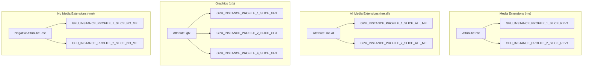
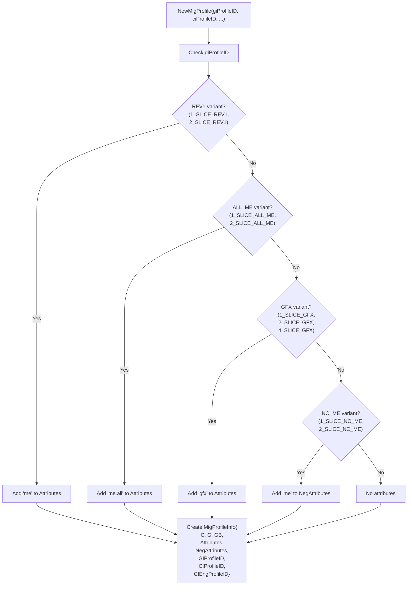
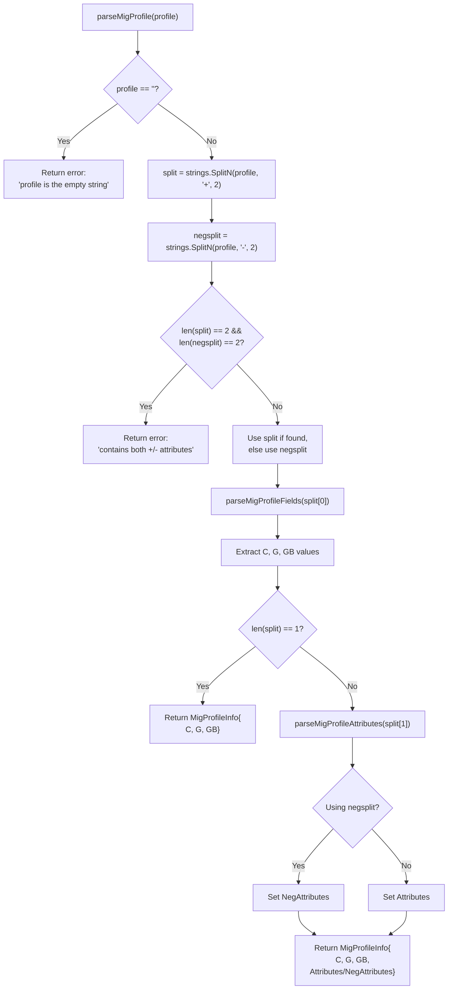
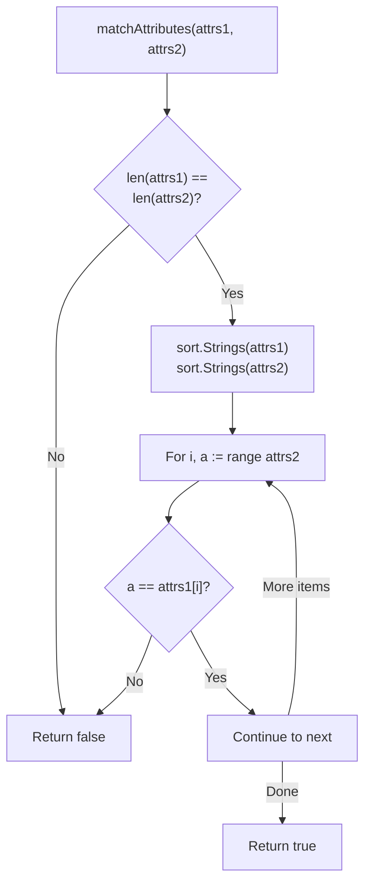

<!-- source: DeepWiki mcp.deepwiki.com · repo NVIDIA/go-nvlib · page 4.3 MIG Profile Attributes · fetched 2026-10-26 -->

# MIG Profile Attributes

<details>
<summary>Relevant source files</summary>

The following files were used as context for generating this wiki page:

- [pkg/nvlib/device/mig_profile.go](pkg/nvlib/device/mig_profile.go)
- [pkg/nvlib/device/mig_profile_test.go](pkg/nvlib/device/mig_profile_test.go)

</details>


## Purpose and Scope

This document explains MIG profile attributes, which are optional suffixes that modify MIG profile specifications to indicate specialized hardware capabilities. Attributes allow profiles to distinguish between different GPU instance configurations that have the same compute and memory slicing but differ in supported features such as media extensions or graphics capabilities.

For information about MIG profile format and parsing, see [MIG Profiles](#4.2). For information about discovering and enumerating MIG devices, see [MIG Device Discovery](#4.1).

## Overview

MIG profile attributes extend the basic profile format (`<C>c.<G>g.<GB>gb` or `<G>g.<GB>gb`) with feature indicators. Attributes are appended to the profile string using `+` or `-` operators to indicate presence or absence of specific capabilities.

The library supports three attribute types:
- **`me`** - Media Extensions enabled
- **`me.all`** - All Media Extensions enabled
- **`gfx`** - Graphics capabilities enabled

Attributes map to specific NVML GPU Instance Profile IDs, allowing applications to request MIG instances with particular hardware features.

Sources: [pkg/nvlib/device/mig_profile.go:29-34]()

## Attribute Constants

The following constants define the supported attribute strings:

| Constant | Value | Description |
|----------|-------|-------------|
| `AttributeMediaExtensions` | `"me"` | Standard media extensions |
| `AttributeMediaExtensionsAll` | `"me.all"` | All media extensions enabled |
| `AttributeGraphics` | `"gfx"` | Graphics processing capabilities |

Sources: [pkg/nvlib/device/mig_profile.go:29-34]()

## Attribute Syntax

### Positive Attributes

Positive attributes are appended using the `+` operator to indicate required capabilities:

```
<profile>+<attribute>[,<attribute>...]
```

**Examples:**
- `1g.5gb+me` - 1 GPU slice with 5GB memory and media extensions
- `2g.10gb+gfx` - 2 GPU slices with 10GB memory and graphics capabilities
- `1c.1g.5gb+me.all` - 1 compute, 1 GPU slice with 5GB and all media extensions

### Negative Attributes

Negative attributes are appended using the `-` operator to explicitly exclude capabilities:

```
<profile>-<attribute>[,<attribute>...]
```

**Examples:**
- `1g.5gb-me` - 1 GPU slice with 5GB memory, explicitly without media extensions
- `2g.10gb-me` - 2 GPU slices with 10GB memory, without media extensions

**Important:** A profile cannot contain both positive and negative attributes. Parsing will fail if both `+` and `-` operators are present.

Sources: [pkg/nvlib/device/mig_profile.go:256-262](), [pkg/nvlib/device/mig_profile_test.go:400-410]()

### Attribute Format Rules

The `parseMigProfileAttributes` function enforces strict formatting rules:

1. **Non-empty** - Empty attribute lists are invalid
2. **Unique** - Duplicate attributes are not allowed
3. **No leading/trailing spaces** - Attributes must be trimmed
4. **Alphanumeric** - Only letters, digits, and dots (`.`) permitted
5. **No numeric prefix** - Attributes cannot begin with a digit
6. **No dot prefix/suffix** - Attributes cannot begin or end with `.`

Sources: [pkg/nvlib/device/mig_profile.go:351-381]()

## Attribute to NVML Profile ID Mapping



**Diagram: Attribute to NVML Profile ID Mapping**

The `NewMigProfile` function maps NVML GPU Instance Profile IDs to attributes:

### Media Extensions (`me`)

Applied to profiles with standard media extension support:
- `nvml.GPU_INSTANCE_PROFILE_1_SLICE_REV1`
- `nvml.GPU_INSTANCE_PROFILE_2_SLICE_REV1`

### All Media Extensions (`me.all`)

Applied to profiles with all media extensions enabled:
- `nvml.GPU_INSTANCE_PROFILE_1_SLICE_ALL_ME`
- `nvml.GPU_INSTANCE_PROFILE_2_SLICE_ALL_ME`

### Graphics (`gfx`)

Applied to profiles with graphics capabilities:
- `nvml.GPU_INSTANCE_PROFILE_1_SLICE_GFX`
- `nvml.GPU_INSTANCE_PROFILE_2_SLICE_GFX`
- `nvml.GPU_INSTANCE_PROFILE_4_SLICE_GFX`

### No Media Extensions (`-me`)

Applied to profiles explicitly without media extensions:
- `nvml.GPU_INSTANCE_PROFILE_1_SLICE_NO_ME`
- `nvml.GPU_INSTANCE_PROFILE_2_SLICE_NO_ME`

Sources: [pkg/nvlib/device/mig_profile.go:112-130]()

## Profile Construction with Attributes



**Diagram: Profile Construction Flow with Attribute Assignment**

The `NewMigProfile` function determines which attributes to assign based on the NVML profile ID. The function populates the `Attributes` field for positive attributes and the `NegAttributes` field for negative attributes.

Sources: [pkg/nvlib/device/mig_profile.go:60-143]()

## Attribute Parsing



**Diagram: Attribute Parsing Flow in parseMigProfile Function**

The parsing process separates the base profile specification from attributes, validates that both `+` and `-` are not present, and populates either the `Attributes` or `NegAttributes` field accordingly.

Sources: [pkg/nvlib/device/mig_profile.go:250-297]()

## Profile Matching with Attributes

The `Matches` method on `MigProfileInfo` compares profiles including their attributes. Two profiles match if:

1. Compute slice counts (`C`) are equal
2. GPU slice counts (`G`) are equal
3. Memory sizes (`GB`) are equal
4. Attributes lists match (using `matchAttributes`)
5. Negative attributes lists match (using `matchAttributes`)

The `matchAttributes` helper function performs order-independent comparison:



**Diagram: Attribute Matching Algorithm**

This ensures that `1g.5gb+gfx` matches `1g.5gb+gfx` but not `1g.5gb+me`, and allows for future extension where multiple attributes could be specified in any order.

Sources: [pkg/nvlib/device/mig_profile.go:212-248]()

## Example Profiles with Attributes

| Profile String | C | G | GB | Attributes | NegAttributes | Valid |
|----------------|---|---|----|-----------|--------------|----|
| `1g.5gb` | 1 | 1 | 5 | [] | [] | ✓ |
| `1g.5gb+me` | 1 | 1 | 5 | ["me"] | [] | ✓ |
| `1c.1g.5gb+me` | 1 | 1 | 5 | ["me"] | [] | ✓ |
| `1g.5gb-me` | 1 | 1 | 5 | [] | ["me"] | ✓ |
| `1c.1g.5gb-me` | 1 | 1 | 5 | [] | ["me"] | ✓ |
| `1g.5gb+me.all` | 1 | 1 | 5 | ["me.all"] | [] | ✓ |
| `1c.1g.5gb+me.all` | 1 | 1 | 5 | ["me.all"] | [] | ✓ |
| `1g.5gb+gfx` | 1 | 1 | 5 | ["gfx"] | [] | ✓ |
| `2g.10gb+gfx` | 2 | 2 | 10 | ["gfx"] | [] | ✓ |
| `4g.20gb+gfx` | 4 | 4 | 20 | ["gfx"] | [] | ✓ |
| `1g.5gb+me-me` | - | - | - | - | - | ✗ (both +/-) |
| `1g.5gb-me+me` | - | - | - | - | - | ✗ (both +/-) |
| `1g.5gb+` | - | - | - | - | - | ✗ (empty attr) |
| `1g.5gb+2me` | - | - | - | - | - | ✗ (starts with digit) |
| `1g.5gb+.all` | - | - | - | - | - | ✗ (starts with dot) |

Sources: [pkg/nvlib/device/mig_profile_test.go:92-430]()

## String Representation

The `String` method on `MigProfileInfo` generates the canonical string representation including attributes:

**Logic:**
1. If `Attributes` are present, append `+` followed by comma-separated attributes
2. If `NegAttributes` are present, append `-` followed by comma-separated negative attributes
3. If `C == G`, use short form: `<G>g.<GB>gb<suffix>`
4. Otherwise, use full form: `<C>c.<G>g.<GB>gb<suffix>`

**Examples:**
- Profile with `C=1, G=1, GB=5, Attributes=["me"]` → `"1g.5gb+me"`
- Profile with `C=1, G=1, GB=5, NegAttributes=["me"]` → `"1g.5gb-me"`
- Profile with `C=2, G=2, GB=10, Attributes=["gfx"]` → `"2g.10gb+gfx"`
- Profile with `C=1, G=2, GB=10, Attributes=["me"]` → `"1c.2g.10gb+me"`

Sources: [pkg/nvlib/device/mig_profile.go:168-181]()

## Usage in Device Library

### Parsing User Input

The `ParseMigProfile` method combines parsing with validation against available profiles:

```
func (d *devicelib) ParseMigProfile(profile string) (MigProfile, error)
```

This method:
1. Gets all available MIG profiles from the device using `GetMigProfiles()`
2. Iterates through profiles calling `Matches(profile)` on each
3. Returns the matching `MigProfile` or an error if no match found

This ensures that only profiles actually supported by the hardware are accepted.

Sources: [pkg/nvlib/device/mig_profile.go:152-166]()

### Format Validation

The `AssertValidMigProfileFormat` method validates string format without checking hardware support:

```
func (d *devicelib) AssertValidMigProfileFormat(profile string) error
```

This calls `parseMigProfile` directly and returns any parsing error. Useful for validating user input before querying hardware.

Sources: [pkg/nvlib/device/mig_profile.go:146-150]()

## Test Coverage

The test file `mig_profile_test.go` includes comprehensive test cases:

- **100+ format validation tests** covering valid and invalid attribute syntax
- **Attribute matching tests** verifying positive, negative, and mixed attribute scenarios
- **Equality tests** ensuring profiles with different attributes are correctly distinguished
- **Edge cases** including empty strings, whitespace, special characters, and invalid operators

Key test scenarios:
- Valid: `1g.5gb+me`, `1c.1g.5gb+me`, `1g.5gb-me`, `1g.5gb+me.all`, `1g.5gb+gfx`
- Invalid: `1g.5gb+me-me`, `1g.5gb+`, `1g.5gb+2me`, `1g.5gb+.all`, `1g.5gb+me,me`

Sources: [pkg/nvlib/device/mig_profile_test.go:92-430]()

---

