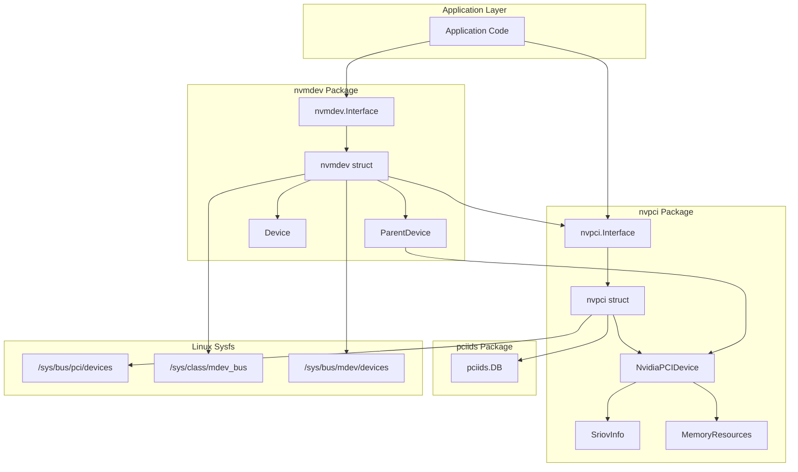
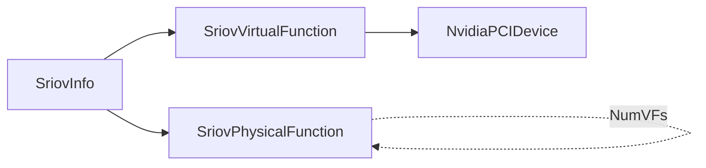
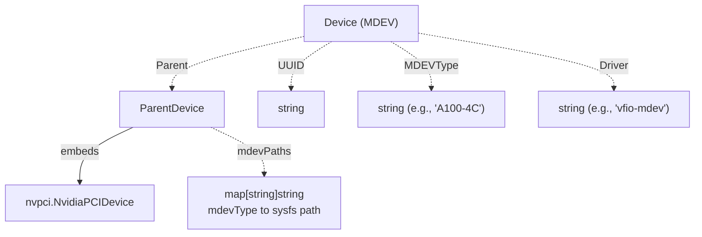
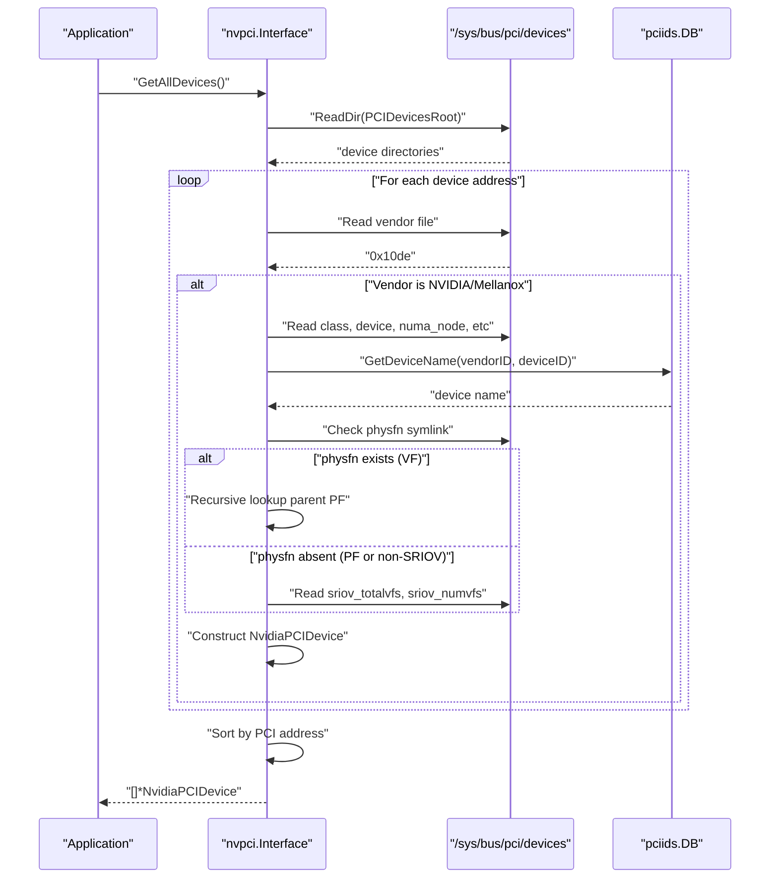
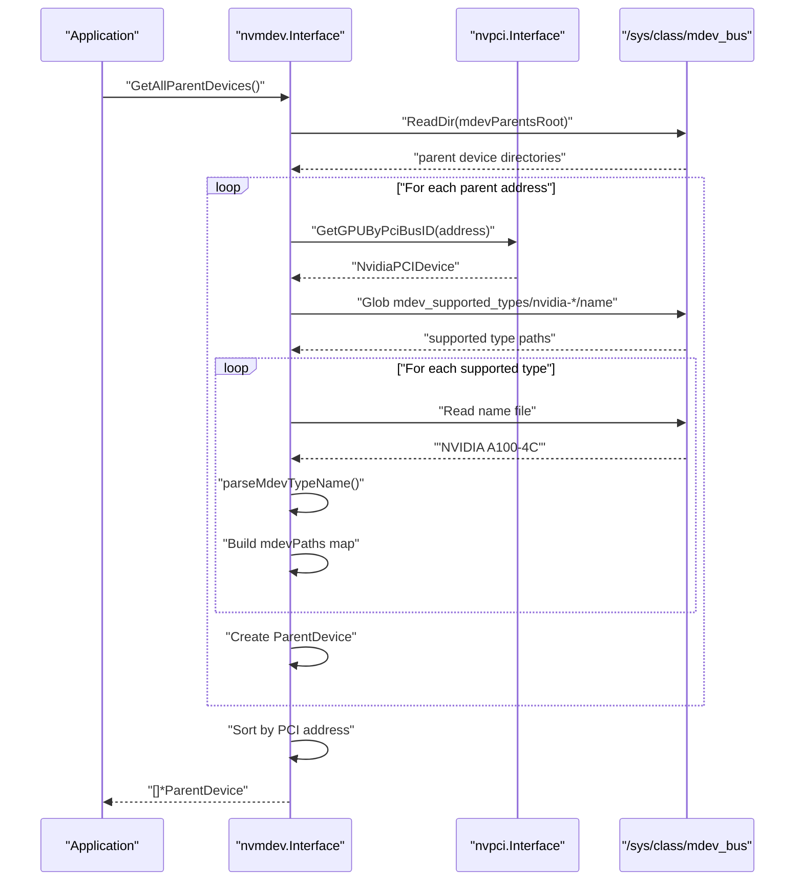
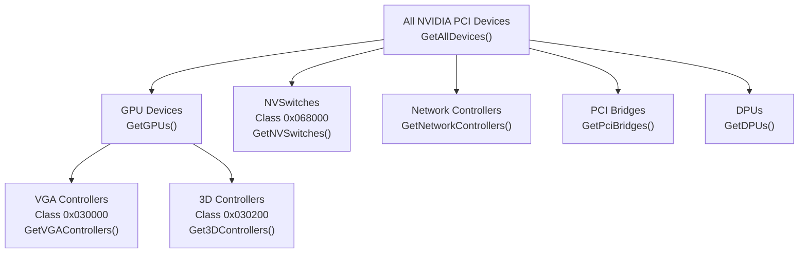
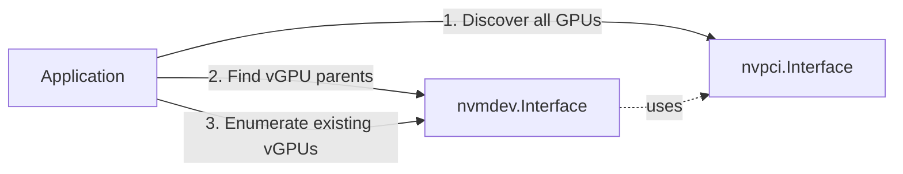

<!-- source: DeepWiki mcp.deepwiki.com · repo NVIDIA/go-nvlib · page 5 Hardware Topology Discovery · fetched 2026-10-26 -->

# Hardware Topology Discovery

<details>
<summary>Relevant source files</summary>

The following files were used as context for generating this wiki page:

- [pkg/nvmdev/mock.go](pkg/nvmdev/mock.go)
- [pkg/nvmdev/nvmdev.go](pkg/nvmdev/nvmdev.go)
- [pkg/nvmdev/nvmdev_test.go](pkg/nvmdev/nvmdev_test.go)
- [pkg/nvpci/mock.go](pkg/nvpci/mock.go)
- [pkg/nvpci/nvpci.go](pkg/nvpci/nvpci.go)
- [pkg/nvpci/nvpci_mock.go](pkg/nvpci/nvpci_mock.go)
- [pkg/nvpci/nvpci_test.go](pkg/nvpci/nvpci_test.go)

</details>


This page provides an overview of hardware topology discovery capabilities in `go-nvlib`, which enable applications to discover and manage NVIDIA GPU hardware through Linux system interfaces. The library provides two complementary packages: `nvpci` for discovering PCI devices via sysfs, and `nvmdev` for managing mediated devices (vGPUs).

For detailed information about specific device properties and queries, see [PCI Device Discovery](#5.1). For vGPU lifecycle management, see [MDEV and vGPU Management](#5.2).

## Overview

Hardware topology discovery in `go-nvlib` operates by reading structured data from the Linux sysfs filesystem. The library abstracts low-level sysfs interactions into Go interfaces, allowing applications to enumerate NVIDIA devices, query their properties, and manage virtualization features without direct filesystem manipulation.

The discovery system supports:
- Physical GPU devices (VGA and 3D controllers)
- NVSwitch interconnects
- Network controllers and DPUs
- PCI bridges
- SR-IOV physical and virtual functions
- Mediated devices (vGPUs) for virtualization

Sources: [pkg/nvpci/nvpci.go:31-46](), [pkg/nvmdev/nvmdev.go:31-34]()

## Package Architecture



**Package Dependency Architecture**

The `nvpci` package operates independently, reading device information directly from `/sys/bus/pci/devices`. The `nvmdev` package depends on `nvpci` to discover parent devices, then augments them with vGPU-specific capabilities by reading from `/sys/class/mdev_bus` and `/sys/bus/mdev/devices`.

Sources: [pkg/nvpci/nvpci.go:72-76](), [pkg/nvmdev/nvmdev.go:42-46]()

## Core Data Types

### PCI Device Representation

The `NvidiaPCIDevice` struct represents a discovered PCI device with comprehensive hardware information:

| Field | Type | Description |
|-------|------|-------------|
| `Path` | `string` | Sysfs path (e.g., `/sys/bus/pci/devices/0000:3b:00.0`) |
| `Address` | `string` | PCI bus ID (e.g., `0000:3b:00.0`) |
| `Vendor` | `uint16` | PCI vendor ID (`0x10de` for NVIDIA) |
| `Class` | `uint32` | PCI device class (e.g., `0x030200` for 3D controller) |
| `ClassName` | `string` | Human-readable class name |
| `Device` | `uint16` | PCI device ID |
| `DeviceName` | `string` | Human-readable device name |
| `Driver` | `string` | Bound kernel driver (e.g., `nvidia`, `vfio-pci`) |
| `IommuGroup` | `int` | IOMMU group number |
| `NumaNode` | `int` | NUMA node affinity |
| `Config` | `*ConfigSpace` | PCI configuration space accessor |
| `Resources` | `MemoryResources` | Memory BAR regions |
| `SriovInfo` | `SriovInfo` | SR-IOV physical/virtual function info |

Sources: [pkg/nvpci/nvpci.go:107-122]()

### SR-IOV Support

SR-IOV (Single Root I/O Virtualization) information is captured in three related types:



**SR-IOV Data Structure Relationships**

- `SriovInfo`: Contains either a `PhysicalFunction` pointer or `VirtualFunction` pointer, never both
- `SriovPhysicalFunction`: Stores `TotalVFs` (maximum VFs) and `NumVFs` (currently enabled VFs)
- `SriovVirtualFunction`: References its parent physical function via `PhysicalFunction` pointer

Sources: [pkg/nvpci/nvpci.go:81-105]()

### MDEV Device Types

The `nvmdev` package defines two primary device types:



**MDEV Type Hierarchy**

- `ParentDevice`: Embeds `NvidiaPCIDevice` and adds `mdevPaths` map for supported vGPU types
- `Device`: Represents a created vGPU with UUID, type, driver, and parent reference

Sources: [pkg/nvmdev/nvmdev.go:50-64]()

## Discovery Workflow

### PCI Device Discovery Flow



**PCI Discovery Sequence**

The discovery process reads device attributes from sysfs files, validates NVIDIA vendor ID, resolves human-readable names from the PCI database, and determines SR-IOV relationships by checking for `physfn` symlinks.

Sources: [pkg/nvpci/nvpci.go:201-235](), [pkg/nvpci/nvpci.go:243-393]()

### MDEV Parent Discovery Flow



**MDEV Parent Discovery Sequence**

Parent device discovery leverages `nvpci` for base PCI information, then augments it with MDEV capabilities by reading supported types from `mdev_supported_types` subdirectories.

Sources: [pkg/nvmdev/nvmdev.go:88-120](), [pkg/nvmdev/nvmdev.go:274-305]()

## Interface Methods

### nvpci.Interface Methods

The `nvpci.Interface` provides device enumeration and filtering:

| Method | Return Type | Description |
|--------|-------------|-------------|
| `GetAllDevices()` | `[]*NvidiaPCIDevice` | All NVIDIA PCI devices (GPUs, switches, NICs, etc.) |
| `GetGPUs()` | `[]*NvidiaPCIDevice` | GPU devices only (VGA + 3D controllers, excludes VFs) |
| `Get3DControllers()` | `[]*NvidiaPCIDevice` | Devices with class `0x030200` |
| `GetVGAControllers()` | `[]*NvidiaPCIDevice` | Devices with class `0x030000` |
| `GetNVSwitches()` | `[]*NvidiaPCIDevice` | Devices with class `0x068000` |
| `GetGPUByIndex(int)` | `*NvidiaPCIDevice` | GPU at specific index in sorted list |
| `GetGPUByPciBusID(string)` | `*NvidiaPCIDevice` | GPU by PCI address (e.g., `"0000:3b:00.0"`) |
| `GetNetworkControllers()` | `[]*NvidiaPCIDevice` | Network interface controllers |
| `GetPciBridges()` | `[]*NvidiaPCIDevice` | PCI bridge devices |
| `GetDPUs()` | `[]*NvidiaPCIDevice` | Data Processing Units |

Sources: [pkg/nvpci/nvpci.go:48-62](), [pkg/nvpci/nvpci.go:395-475]()

### nvmdev.Interface Methods

The `nvmdev.Interface` provides MDEV discovery:

| Method | Return Type | Description |
|--------|-------------|-------------|
| `GetAllDevices()` | `[]*Device` | All created MDEV (vGPU) devices |
| `GetAllParentDevices()` | `[]*ParentDevice` | All GPUs capable of hosting vGPUs |

Sources: [pkg/nvmdev/nvmdev.go:36-40]()

### ParentDevice Methods

`ParentDevice` extends `NvidiaPCIDevice` with vGPU management capabilities:

| Method | Return Type | Description |
|--------|-------------|-------------|
| `CreateMDEVDevice(mdevType, id string)` | `error` | Create vGPU instance of specified type |
| `DeleteMDEVDevice(id string)` | `error` | Delete vGPU by UUID |
| `GetPhysicalFunction()` | `*NvidiaPCIDevice` | Get backing physical GPU (resolves VF parent) |
| `IsMDEVTypeSupported(mdevType string)` | `bool` | Check if vGPU type is supported |
| `IsMDEVTypeAvailable(mdevType string)` | `(bool, error)` | Check if vGPU can be created now |
| `GetAvailableMDEVInstances(mdevType string)` | `(int, error)` | Get available instance count |

Sources: [pkg/nvmdev/nvmdev.go:307-401]()

## Device Classification



**Device Classification Hierarchy**

The `IsGPU()` method returns true for both VGA controllers (older GPUs) and 3D controllers (newer GPUs). The `GetGPUs()` method filters out SR-IOV virtual functions, returning only physical functions and non-SR-IOV devices.

Sources: [pkg/nvpci/nvpci.go:124-142](), [pkg/nvpci/nvpci.go:446-461]()

## Sysfs Path Structure

The library reads from three primary sysfs locations:

### PCI Devices Root

```
/sys/bus/pci/devices/
├── 0000:3b:00.0/
│   ├── vendor              # "0x10de"
│   ├── device              # "0x20bf"
│   ├── class               # "0x030200"
│   ├── driver -> ../../../bus/pci/drivers/nvidia
│   ├── iommu_group -> ../../../../kernel/iommu_groups/20
│   ├── numa_node           # "0"
│   ├── config              # Binary PCI config space
│   ├── resource            # Memory resource ranges
│   ├── resource0           # BAR0 memory mapping
│   ├── sriov_totalvfs      # "16" (if SR-IOV capable)
│   ├── sriov_numvfs        # "8" (number of enabled VFs)
│   └── physfn -> ../0000:3b:00.0  # (for VFs only)
```

Sources: [pkg/nvpci/nvpci.go:32-33](), [pkg/nvpci/nvpci.go:243-393]()

### MDEV Parents Root

```
/sys/class/mdev_bus/
└── 0000:3b:00.0 -> ../../devices/pci0000:00/.../0000:3b:00.0/
    └── mdev_supported_types/
        ├── nvidia-500/
        │   ├── name            # "NVIDIA A100-4C"
        │   ├── available_instances  # "1"
        │   └── create          # Write UUID to create vGPU
        └── nvidia-501/
            └── name            # "NVIDIA A100-5C"
```

Sources: [pkg/nvmdev/nvmdev.go:32](), [pkg/nvmdev/nvmdev.go:274-305]()

### MDEV Devices Root

```
/sys/bus/mdev/devices/
└── b1914f0a-15cf-416e-8967-55fc7cb68e20/
    ├── mdev_type -> ../../../0000:3b:00.0/mdev_supported_types/nvidia-500
    ├── driver -> ../../../../bus/mdev/drivers/vfio_mdev
    ├── iommu_group -> ../../../../kernel/iommu_groups/200
    └── remove              # Write "1" to delete vGPU
```

Sources: [pkg/nvmdev/nvmdev.go:33](), [pkg/nvmdev/nvmdev.go:144-187]()

## Initialization and Configuration

### Creating Interface Instances

Both packages follow the functional options pattern:

```go
// nvpci initialization
nvpciLib := nvpci.New(
    nvpci.WithLogger(logger),
    nvpci.WithPCIDevicesRoot("/custom/path"),
    nvpci.WithPCIDatabasePath("/etc/pci.ids"),
)

// nvmdev initialization
nvmdevLib := nvmdev.New(
    nvmdev.WithNvpciLib(nvpciLib),
)
```

Sources: [pkg/nvpci/nvpci.go:160-199](), [pkg/nvmdev/nvmdev.go:66-86]()

### Option Functions

| Package | Option | Purpose |
|---------|--------|---------|
| `nvpci` | `WithLogger(logger)` | Set custom logger implementation |
| `nvpci` | `WithPCIDevicesRoot(root string)` | Override sysfs PCI devices path |
| `nvpci` | `WithPCIDatabasePath(path string)` | Set custom `pci.ids` file location |
| `nvmdev` | `WithNvpciLib(nvpci.Interface)` | Inject custom nvpci implementation |

Sources: [pkg/nvpci/nvpci.go:175-199](), [pkg/nvmdev/nvmdev.go:78-86]()

## Testing Support

Both packages provide mock implementations for testing without physical hardware:

### MockNvpci

The `MockNvpci` type creates temporary sysfs structures:

```go
mock, err := nvpci.NewMockNvpci()
defer mock.Cleanup()

// Add mock devices
err = mock.AddMockA100("0000:80:05.1", numaNode, sriovInfo)

// Use standard interface methods
devices, err := mock.GetGPUs()
```

The `AddMockA100()` method creates realistic sysfs files including vendor, class, device IDs, config space, resource files, and optionally SR-IOV virtual functions.

Sources: [pkg/nvpci/mock.go:29-52](), [pkg/nvpci/mock.go:69-133]()

### MockNvmdev

The `MockNvmdev` type creates temporary MDEV sysfs structures:

```go
mock, err := nvmdev.NewMock()
defer mock.Cleanup()

// Add mock parent device
err = mock.AddMockA100Parent("0000:3b:04.1", numaNode)

// Add mock vGPU
err = mock.AddMockA100Mdev(uuid, "A100-4C", "nvidia-500", parentPath)

// Use standard interface methods
parents, err := mock.GetAllParentDevices()
mdevs, err := mock.GetAllDevices()
```

The mock creates realistic directory structures for both `/sys/class/mdev_bus` and `/sys/bus/mdev/devices`.

Sources: [pkg/nvmdev/mock.go:28-78](), [pkg/nvmdev/mock.go:87-267]()

## Integration Patterns

### Combining PCI and MDEV Discovery

Applications typically use both packages together:



**Typical Integration Pattern**

The `nvmdev` package internally uses `nvpci` for parent device discovery, ensuring consistency between PCI-level and MDEV-level device information.

Sources: [pkg/nvmdev/nvmdev.go:66-76](), [pkg/nvmdev/nvmdev.go:274-305]()

### Physical Function Resolution

Both MDEV devices and SR-IOV virtual functions need to resolve their backing physical GPU:

```go
// For MDEV devices
mdev := /* Device from GetAllDevices() */
physicalGPU := mdev.GetPhysicalFunction()

// For SR-IOV VFs
vf := /* NvidiaPCIDevice where SriovInfo.IsVF() == true */
physicalGPU := vf.SriovInfo.VirtualFunction.PhysicalFunction

// For parent devices
parent := /* ParentDevice from GetAllParentDevices() */
physicalGPU := parent.GetPhysicalFunction()  // Resolves VF parent if needed
```

Sources: [pkg/nvmdev/nvmdev.go:352-364](), [pkg/nvpci/nvpci.go:94-105]()

## Device Property Helpers

The `NvidiaPCIDevice` type provides classification methods:

```go
device := /* NvidiaPCIDevice */

if device.IsGPU() {
    // Either VGA (0x300) or 3D (0x302) controller
}

if device.Is3DController() {
    // Class 0x030200
}

if device.IsVGAController() {
    // Class 0x030000
}

if device.IsNVSwitch() {
    // Class 0x068000
}

if device.IsResetAvailable() {
    // Can be reset via sysfs
    err := device.Reset()
}
```

Sources: [pkg/nvpci/nvpci.go:124-158]()

## Error Handling

Both packages return errors for common failure scenarios:

| Scenario | Error Condition |
|----------|-----------------|
| Device not found | Invalid index or PCI bus ID |
| Insufficient permissions | Cannot read/write sysfs files (requires root for writes) |
| Device not NVIDIA | Vendor ID check fails silently (returns `nil` device) |
| MDEV type unsupported | Type not in `mdevPaths` map |
| MDEV creation failure | Cannot write to `create` file |
| Invalid sysfs structure | Symlink resolution or file parsing errors |

Sources: [pkg/nvpci/nvpci.go:201-393](), [pkg/nvmdev/nvmdev.go:88-187](), [pkg/nvmdev/nvmdev.go:307-350]()

---

