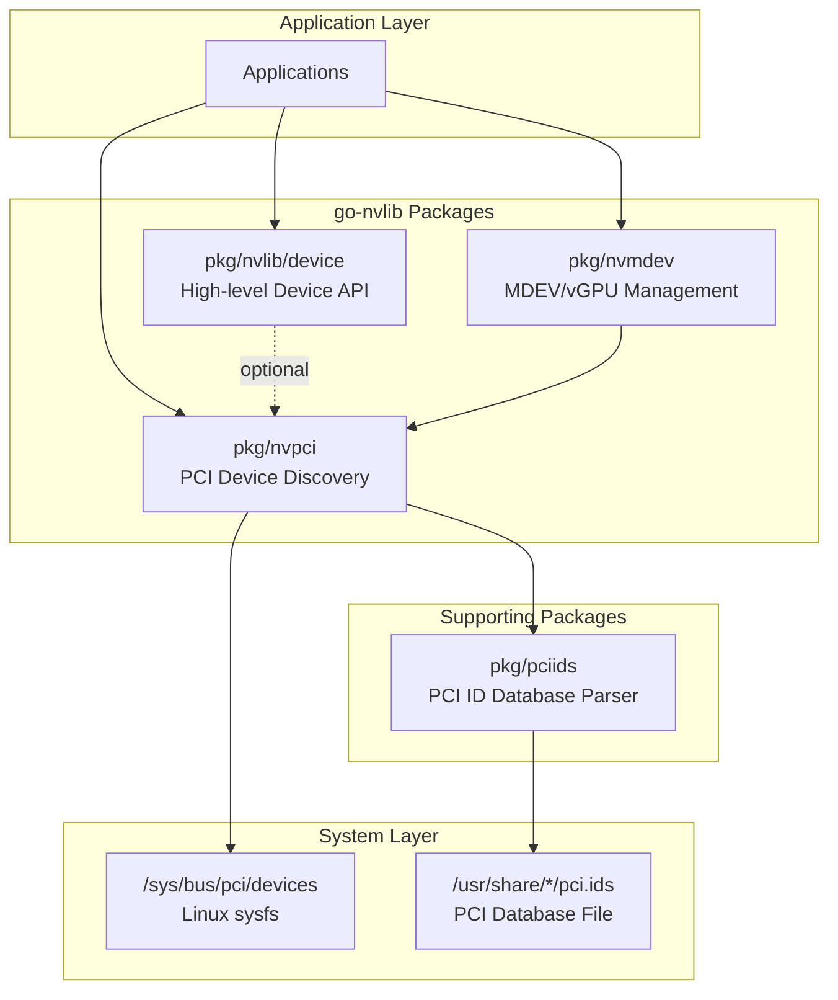
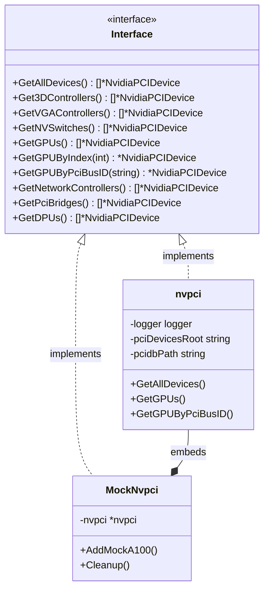
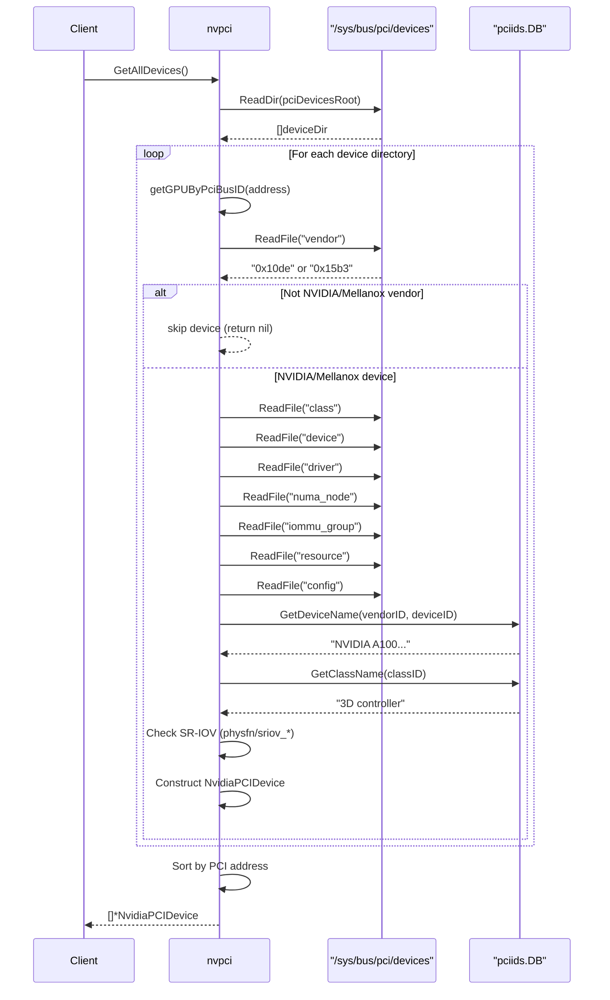
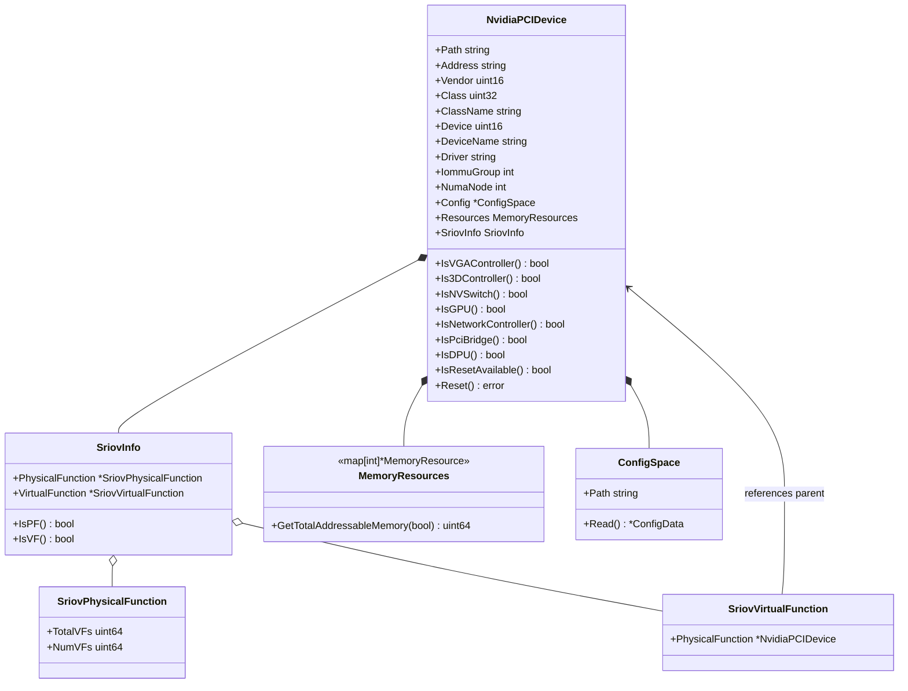
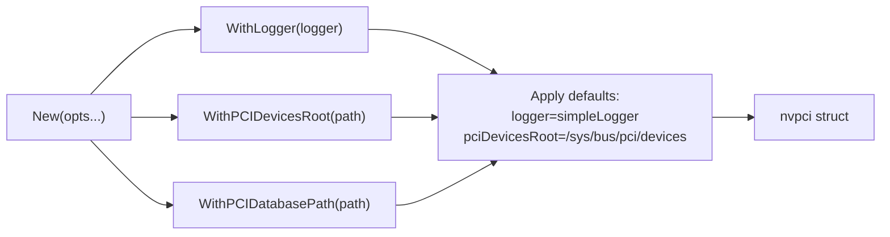
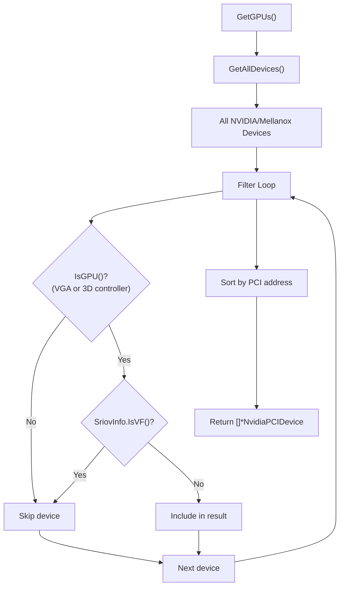
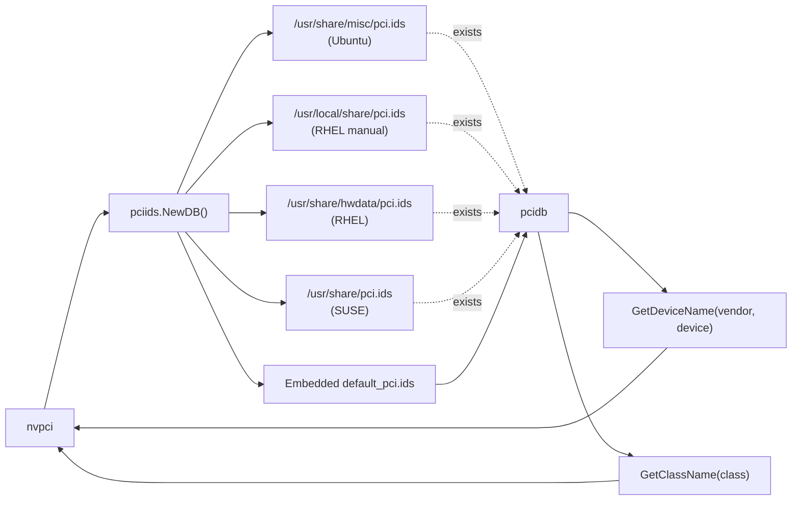
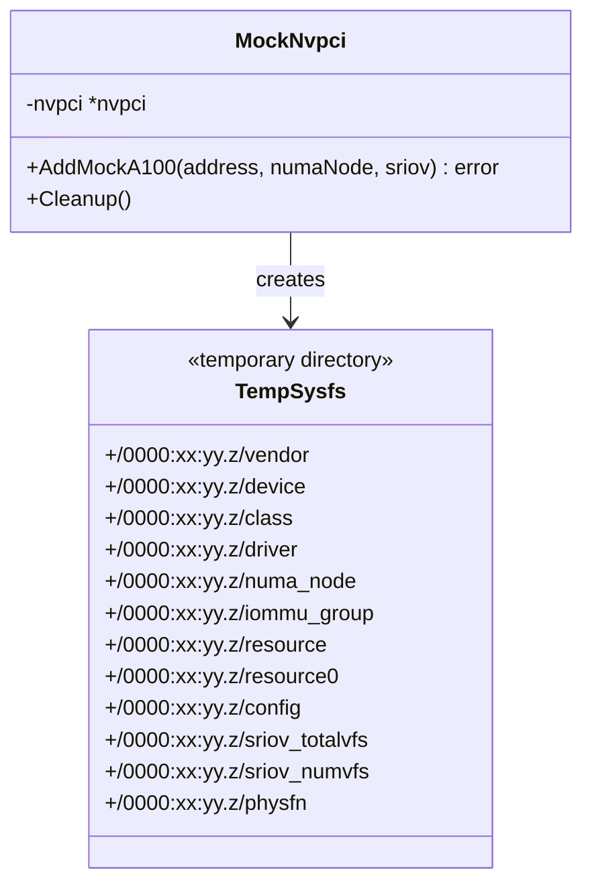

<!-- source: DeepWiki mcp.deepwiki.com · repo NVIDIA/go-nvlib · page 5.1 PCI Device Discovery · fetched 2026-10-26 -->

# PCI Device Discovery

<details>
<summary>Relevant source files</summary>

The following files were used as context for generating this wiki page:

- [NOTICE](NOTICE)
- [pkg/nvpci/mlxpci.go](pkg/nvpci/mlxpci.go)
- [pkg/nvpci/mock.go](pkg/nvpci/mock.go)
- [pkg/nvpci/nvpci.go](pkg/nvpci/nvpci.go)
- [pkg/nvpci/nvpci_mock.go](pkg/nvpci/nvpci_mock.go)
- [pkg/nvpci/nvpci_test.go](pkg/nvpci/nvpci_test.go)
- [pkg/pciids/default_pci.ids](pkg/pciids/default_pci.ids)
- [pkg/pciids/pciids.go](pkg/pciids/pciids.go)

</details>


## Purpose and Scope

The `nvpci` package provides low-level PCI device discovery capabilities for NVIDIA hardware by directly reading from the Linux sysfs filesystem. This package enumerates PCI devices, reads their configuration information, and provides filtered access to different device types (GPUs, NVSwitches, DPUs, etc.). 

For information about creating and managing mediated devices (vGPUs) on top of PCI devices, see [MDEV and vGPU Management](#5.2). For higher-level GPU management abstractions, see [GPU Device Management](#3).

**Sources:** [pkg/nvpci/nvpci.go:1-542]()

## Package Overview

The `nvpci` package sits at the lowest level of the go-nvlib hardware discovery stack, directly interfacing with the Linux kernel's sysfs representation of PCI devices. It discovers all NVIDIA and Mellanox devices by scanning `/sys/bus/pci/devices`, parsing device attributes, and enriching them with human-readable names from the PCI ID database.

**Architecture Position:**



**Sources:** [pkg/nvpci/nvpci.go:17-542](), architecture diagrams

## The nvpci Interface

The package exposes its functionality through the `Interface` type, which defines methods for discovering and filtering PCI devices.

**Interface Definition:**



**Key Methods:**

| Method | Purpose |
|--------|---------|
| `GetAllDevices()` | Returns all NVIDIA/Mellanox PCI devices on the system |
| `GetGPUs()` | Returns GPU devices (VGA and 3D controllers), excluding VFs |
| `Get3DControllers()` | Returns devices with PCI class 0x030200 |
| `GetVGAControllers()` | Returns devices with PCI class 0x030000 |
| `GetNVSwitches()` | Returns NVSwitch devices (class 0x068000) |
| `GetGPUByIndex(i)` | Returns GPU at specified index |
| `GetGPUByPciBusID(addr)` | Returns device at specified PCI address (e.g., "0000:00:1e.0") |
| `GetNetworkControllers()` | Returns Mellanox network controller devices |
| `GetDPUs()` | Returns Mellanox DPU devices |
| `GetPciBridges()` | Returns PCI bridge devices |

**Sources:** [pkg/nvpci/nvpci.go:48-62](), [pkg/nvpci/nvpci.go:395-475](), [pkg/nvpci/mlxpci.go:33-105]()

## Device Discovery Process

Device discovery operates by scanning the sysfs PCI device directory and constructing `NvidiaPCIDevice` objects from the information found in each device's sysfs entries.

**Discovery Flow:**



**Key Implementation Details:**

The discovery process implements several important optimizations and features:

1. **Vendor Filtering:** Only devices with vendor ID `0x10de` (NVIDIA) or `0x15b3` (Mellanox) are processed [pkg/nvpci/nvpci.go:261-263]()

2. **Caching:** Physical functions are cached during a single `GetAllDevices()` call to avoid redundant sysfs reads when resolving VF-to-PF relationships [pkg/nvpci/nvpci.go:209-221]()

3. **Address Sorting:** Devices are sorted by PCI address for deterministic ordering [pkg/nvpci/nvpci.go:223-232]()

4. **Name Resolution:** Human-readable device and class names are retrieved from the PCI ID database, with fallback to "UNKNOWN_DEVICE"/"UNKNOWN_CLASS" [pkg/nvpci/nvpci.go:337-346]()

**Sources:** [pkg/nvpci/nvpci.go:201-393](), [pkg/nvpci/nvpci.go:243-393]()

## NvidiaPCIDevice Structure

The `NvidiaPCIDevice` struct represents a complete view of a PCI device as discovered from sysfs.

**Structure Definition:**



**Field Descriptions:**

| Field | Type | Description |
|-------|------|-------------|
| `Path` | string | Absolute path to device in sysfs (e.g., "/sys/bus/pci/devices/0000:00:1e.0") |
| `Address` | string | PCI bus address (e.g., "0000:00:1e.0") |
| `Vendor` | uint16 | PCI vendor ID (0x10de for NVIDIA, 0x15b3 for Mellanox) |
| `Class` | uint32 | PCI device class (0x030200 for 3D controller, 0x030000 for VGA) |
| `ClassName` | string | Human-readable class name from PCI database |
| `Device` | uint16 | PCI device ID |
| `DeviceName` | string | Human-readable device name from PCI database |
| `Driver` | string | Kernel driver name (e.g., "nvidia", "vfio-pci") |
| `IommuGroup` | int | IOMMU group number, -1 if not available |
| `NumaNode` | int | NUMA node affinity, can be -1 for no affinity |
| `Config` | *ConfigSpace | PCI configuration space accessor |
| `Resources` | MemoryResources | Memory-mapped I/O resources (BARs) |
| `SriovInfo` | SriovInfo | SR-IOV information for PFs and VFs |

**Device Classification Methods:**

The struct provides convenience methods to classify device types based on PCI class codes:

- `IsGPU()`: Returns true for VGA controllers (0x030000) or 3D controllers (0x030200) [pkg/nvpci/nvpci.go:140-142]()
- `Is3DController()`: PCI class 0x030200 [pkg/nvpci/nvpci.go:130-132]()
- `IsVGAController()`: PCI class 0x030000 [pkg/nvpci/nvpci.go:125-127]()
- `IsNVSwitch()`: PCI class 0x068000 [pkg/nvpci/nvpci.go:134-137]()
- `IsNetworkController()`: PCI class 0x020000 [pkg/nvpci/mlxpci.go:68-70]()
- `IsPciBridge()`: PCI class 0x060400 [pkg/nvpci/mlxpci.go:73-75]()
- `IsDPU()`: Mellanox BlueField devices at function .0 [pkg/nvpci/mlxpci.go:78-88]()

**Device Reset Capability:**

Some devices support reset without rebooting. The `IsResetAvailable()` method checks for the presence of the `reset` file in sysfs, and `Reset()` triggers the reset by writing "1" to it [pkg/nvpci/nvpci.go:144-158]().

**Sources:** [pkg/nvpci/nvpci.go:107-158](), [pkg/nvpci/nvpci.go:81-97](), [pkg/nvpci/mlxpci.go:67-88]()

## Configuration and Initialization

The `nvpci` package uses the functional options pattern for configuration.

**Initialization:**



**Available Options:**

| Option | Purpose | Default |
|--------|---------|---------|
| `WithLogger(logger)` | Sets custom logger for warnings and errors | `simpleLogger{}` |
| `WithPCIDevicesRoot(root)` | Overrides sysfs PCI devices path | `/sys/bus/pci/devices` |
| `WithPCIDatabasePath(path)` | Sets custom PCI ID database file path | Standard system locations |

**Standard Usage:**

```go
// Use system defaults
nvpci := nvpci.New()

// Custom configuration for testing
nvpci := nvpci.New(
    nvpci.WithPCIDevicesRoot("/tmp/mock-pci"),
    nvpci.WithLogger(customLogger),
)
```

**Constants:**

The package defines important constants for device identification:

| Constant | Value | Description |
|----------|-------|-------------|
| `PCIDevicesRoot` | "/sys/bus/pci/devices" | Default sysfs PCI path |
| `PCINvidiaVendorID` | 0x10de | NVIDIA vendor ID |
| `PCIMellanoxVendorID` | 0x15b3 | Mellanox vendor ID |
| `PCIVgaControllerClass` | 0x030000 | VGA controller class |
| `PCI3dControllerClass` | 0x030200 | 3D controller class |
| `PCINvSwitchClass` | 0x068000 | NVSwitch class |
| `PCINetworkControllerClass` | 0x020000 | Network controller class |
| `PCIBridgeClass` | 0x060400 | PCI bridge class |

**Sources:** [pkg/nvpci/nvpci.go:160-199](), [pkg/nvpci/nvpci.go:31-46](), [pkg/nvpci/mlxpci.go:24-31]()

## Device Filtering Methods

The package provides several filtered views of discovered devices.

**GPU Filtering Logic:**



**Implementation Pattern:**

All filtering methods follow the same pattern:
1. Call `GetAllDevices()` to get all devices
2. Iterate and apply classification predicate (e.g., `IsGPU()`)
3. Return filtered slice

Example from `GetGPUs()`:
```go
func (p *nvpci) GetGPUs() ([]*NvidiaPCIDevice, error) {
    devices, err := p.GetAllDevices()
    if err != nil {
        return nil, fmt.Errorf("error getting all NVIDIA devices: %v", err)
    }

    var filtered []*NvidiaPCIDevice
    for _, d := range devices {
        if d.IsGPU() && !d.SriovInfo.IsVF() {
            filtered = append(filtered, d)
        }
    }

    return filtered, nil
}
```

**Important Note on Virtual Functions:**

`GetGPUs()` explicitly excludes SR-IOV Virtual Functions (`!d.SriovInfo.IsVF()`). This is because VFs are typically managed separately and applications usually work with Physical Functions when enumerating GPUs. Virtual Functions can be accessed through their parent PF via the `SriovInfo` structure.

**Sources:** [pkg/nvpci/nvpci.go:446-475](), [pkg/nvpci/nvpci.go:395-443](), [pkg/nvpci/mlxpci.go:33-105]()

## Integration with PCI ID Database

The `nvpci` package uses the `pciids` package to translate numeric PCI IDs into human-readable names.

**Name Resolution Flow:**



**Database Lookup:**

When constructing a `NvidiaPCIDevice`, the package performs two lookups:

1. **Device Name:** `pciDB.GetDeviceName(vendorID, deviceID)` returns descriptive names like "NVIDIA A100-SXM4-40GB" [pkg/nvpci/nvpci.go:337-341]()

2. **Class Name:** `pciDB.GetClassName(classID)` returns names like "3D controller" or "VGA compatible controller" [pkg/nvpci/nvpci.go:342-346]()

Both lookups gracefully handle missing entries by falling back to `UnknownDeviceString` or `UnknownClassString`.

**Database Source Priority:**

The `pciids` package searches for the PCI ID database in well-known locations across different Linux distributions. If all fail, it uses an embedded copy of the database (included at compile time via `go:embed`) [pkg/pciids/pciids.go:177-203]().

**Sources:** [pkg/nvpci/nvpci.go:335-346](), [pkg/pciids/pciids.go:189-203](), [pkg/pciids/pciids.go:256-283]()

## Testing Support

The package provides comprehensive mocking capabilities for testing without physical hardware.

**MockNvpci Structure:**



**Mock Usage Example:**

```go
// Create mock instance
nvpci, err := NewMockNvpci()
defer nvpci.Cleanup()

// Add mock A100 GPU at specific PCI address
err = nvpci.AddMockA100("0000:80:05.1", 0, nil)

// Add A100 with SR-IOV enabled
sriovInfo := &SriovInfo{
    PhysicalFunction: &SriovPhysicalFunction{
        TotalVFs: 32,
        NumVFs:   16,
    },
}
err = nvpci.AddMockA100("0000:81:00.0", 1, sriovInfo)

// Use standard Interface methods
devices, err := nvpci.GetGPUs()
```

**Mock Implementation Details:**

`MockNvpci` creates a temporary sysfs-like directory structure with files containing appropriate values:
- Vendor ID set to `0x10de` (NVIDIA)
- Device ID set to `0x20bf` (A100)
- Class set to `0x030200` (3D controller)
- PMC ID in BAR0 set to `0x170000a1` (GA100)
- Creates symlinks for `driver` and `iommu_group`
- Generates VF device directories when SR-IOV is enabled

The mock automatically creates child VF directories when SR-IOV information is provided, properly linking them to the parent PF via `physfn` symlinks [pkg/nvpci/mock.go:212-260]().

**Sources:** [pkg/nvpci/mock.go:29-261](), [pkg/nvpci/nvpci_test.go:29-174]()

---

**Related Pages:**
- [PCI Device Classification](#5.1.1) - Detailed device type identification
- [SR-IOV Support](#5.1.2) - Physical and Virtual Function management
- [PCI Resource Information](#5.1.3) - Memory resources and configuration space
- [PCI ID Database](#5.3) - PCI ID resolution details
- [MDEV and vGPU Management](#5.2) - Building vGPUs on PCI devices

---

