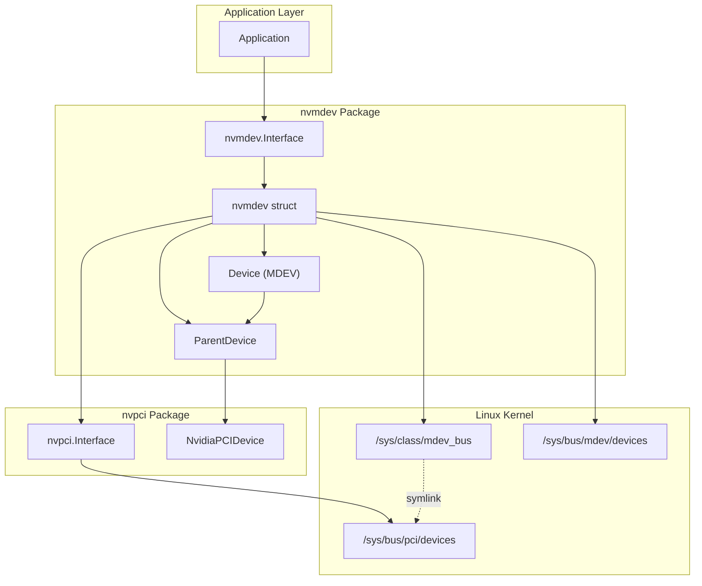
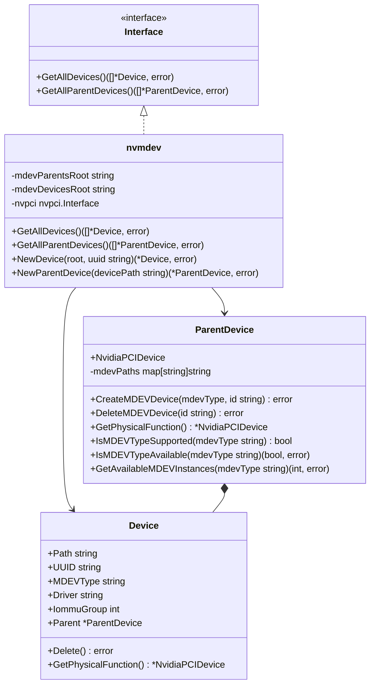
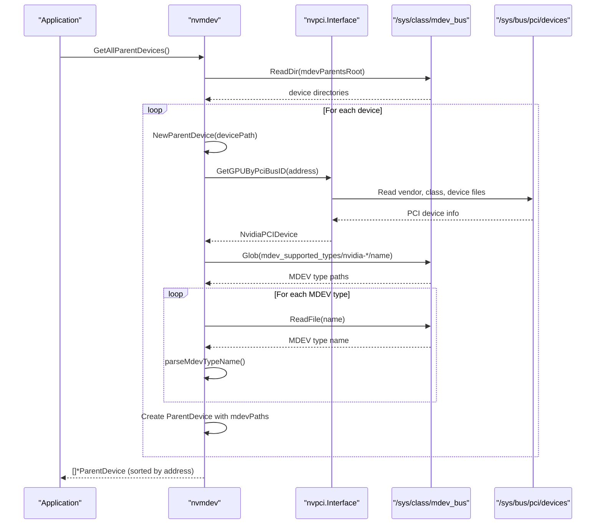
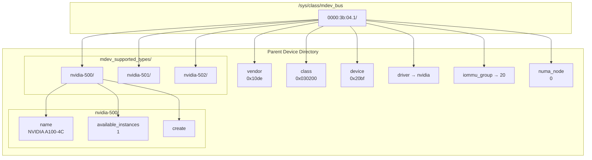
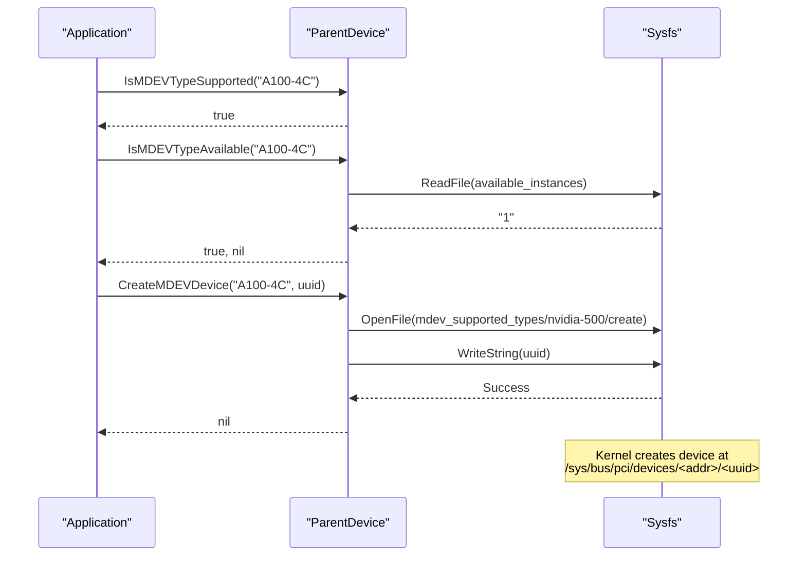
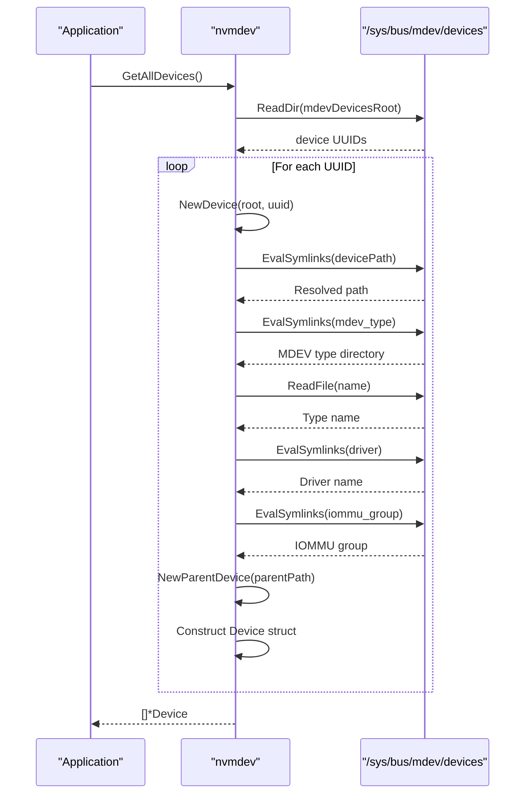
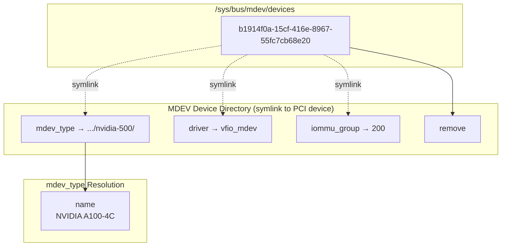
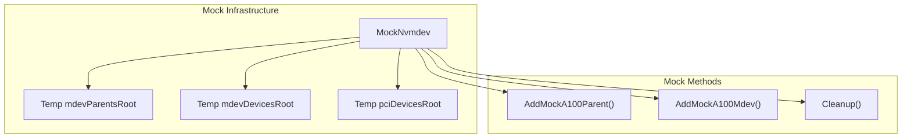
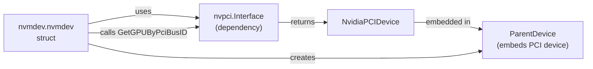

<!-- source: DeepWiki mcp.deepwiki.com · repo NVIDIA/go-nvlib · page 5.2 MDEV and vGPU Management · fetched 2026-10-26 -->

# MDEV and vGPU Management

<details>
<summary>Relevant source files</summary>

The following files were used as context for generating this wiki page:

- [pkg/nvmdev/mock.go](pkg/nvmdev/mock.go)
- [pkg/nvmdev/nvmdev.go](pkg/nvmdev/nvmdev.go)
- [pkg/nvmdev/nvmdev_test.go](pkg/nvmdev/nvmdev_test.go)
- [pkg/nvpci/mock.go](pkg/nvpci/mock.go)
- [pkg/nvpci/nvpci.go](pkg/nvpci/nvpci.go)
- [pkg/nvpci/nvpci_mock.go](pkg/nvpci/nvpci_mock.go)
- [pkg/nvpci/nvpci_test.go](pkg/nvpci/nvpci_test.go)

</details>


## Purpose and Scope

This document covers the `nvmdev` package, which provides functionality for discovering and managing NVIDIA mediated devices (MDEVs) and virtual GPUs (vGPUs). The package enables applications to enumerate parent GPU devices that support vGPU creation, query available vGPU types, create new vGPU instances, and manage their lifecycle.

For information about PCI device discovery and hardware topology, see [PCI Device Discovery](#5.1). For SR-IOV support details, see [SR-IOV Support](#5.1.2).

## Overview

The `nvmdev` package builds on top of the `nvpci` package to provide vGPU management capabilities. MDEV (mediated device) is a Linux kernel framework that enables device virtualization by allowing a single physical device to be partitioned into multiple virtual devices. In the NVIDIA context, MDEVs are used to create vGPUs that can be assigned to virtual machines.

The package interacts with two sysfs hierarchies:
- `/sys/class/mdev_bus` - Parent devices that can host MDEVs
- `/sys/bus/mdev/devices` - Active MDEV instances

### MDEV Architecture



**Sources:** [pkg/nvmdev/nvmdev.go:17-76](), [pkg/nvmdev/nvmdev.go:36-40]()

## Core Interfaces and Types

### nvmdev.Interface

The primary interface for MDEV and vGPU management operations.



**Sources:** [pkg/nvmdev/nvmdev.go:36-65](), [pkg/nvmdev/nvmdev.go:307-401]()

### Key Type Definitions

| Type | Purpose | Key Fields |
|------|---------|------------|
| `Interface` | Main package interface | `GetAllDevices()`, `GetAllParentDevices()` |
| `ParentDevice` | Physical GPU that can host vGPUs | Embeds `NvidiaPCIDevice`, `mdevPaths` map |
| `Device` | Active MDEV/vGPU instance | `UUID`, `MDEVType`, `Driver`, `Parent` |
| `nvmdev` | Implementation struct | `mdevParentsRoot`, `mdevDevicesRoot`, `nvpci` |

**Sources:** [pkg/nvmdev/nvmdev.go:36-65]()

## Parent Device Discovery

Parent devices are physical GPUs that support MDEV creation. The `nvmdev` package discovers these by scanning `/sys/class/mdev_bus` and constructing `ParentDevice` objects that include supported MDEV types and availability information.

### Discovery Process



**Sources:** [pkg/nvmdev/nvmdev.go:88-120](), [pkg/nvmdev/nvmdev.go:274-305]()

### ParentDevice Methods

The `ParentDevice` type provides methods for querying vGPU support and creating vGPU instances:

| Method | Parameters | Return | Purpose |
|--------|-----------|--------|---------|
| `IsMDEVTypeSupported` | `mdevType string` | `bool` | Checks if vGPU type is supported |
| `IsMDEVTypeAvailable` | `mdevType string` | `(bool, error)` | Checks if vGPU type has available instances |
| `GetAvailableMDEVInstances` | `mdevType string` | `(int, error)` | Returns number of available instances (or -1 if unsupported) |
| `CreateMDEVDevice` | `mdevType, id string` | `error` | Creates a new vGPU with given UUID |
| `DeleteMDEVDevice` | `id string` | `error` | Deletes an existing vGPU by UUID |
| `GetPhysicalFunction` | - | `*NvidiaPCIDevice` | Returns underlying physical device |

**Sources:** [pkg/nvmdev/nvmdev.go:307-365](), [pkg/nvmdev/nvmdev.go:366-401]()

### MDEV Type Name Parsing

The package parses MDEV type names from sysfs, which may include product prefixes:

- Input: `"NVIDIA A100-4C"` → Output: `"A100-4C"`
- Input: `"NVIDIA RTX Pro 6000 Blackwell DC-48C"` → Output: `"DC-48C"`
- Input: `"GRID V100-8Q"` → Output: `"V100-8Q"`

The parsing extracts the last space-separated token as the vGPU type name.

**Sources:** [pkg/nvmdev/nvmdev.go:237-250]()

### Sysfs Structure for Parent Devices



**Sources:** [pkg/nvmdev/nvmdev.go:286-302](), [pkg/nvmdev/mock.go:193-223]()

## MDEV Lifecycle Management

### Device Structure

The `Device` struct represents an active MDEV/vGPU instance:

```go
type Device struct {
    Path       string            // Full sysfs path to the device
    UUID       string            // Unique identifier (e.g., "b1914f0a-15cf-416e-8967-55fc7cb68e20")
    MDEVType   string            // vGPU type (e.g., "A100-4C")
    Driver     string            // Bound driver (typically "vfio_mdev")
    IommuGroup int               // IOMMU group number
    Parent     *ParentDevice     // Reference to parent GPU
}
```

**Sources:** [pkg/nvmdev/nvmdev.go:56-64]()

### Creating an MDEV Device



**Sources:** [pkg/nvmdev/nvmdev.go:307-322]()

The creation process:
1. Opens the `create` file under the appropriate MDEV type directory
2. Writes the UUID string to create the device
3. Kernel automatically creates the device structure in sysfs

**File:** [pkg/nvmdev/nvmdev.go:307-322]()

### Discovering MDEV Devices



**Sources:** [pkg/nvmdev/nvmdev.go:122-187]()

### Deleting an MDEV Device

Two methods are provided for deleting MDEV devices:

**Via ParentDevice:**
```go
err := parentDevice.DeleteMDEVDevice(uuid)
```

**Via Device:**
```go
err := mdevDevice.Delete()
```

Both methods write `"1"` to the `remove` file in the device's sysfs directory.

**Sources:** [pkg/nvmdev/nvmdev.go:324-350]()

### MDEV Device Sysfs Structure



**Sources:** [pkg/nvmdev/nvmdev.go:189-272]()

## Implementation Details

### Package Initialization

The `nvmdev` package is initialized with optional configuration:

```go
nvmdevLib := nvmdev.New(
    nvmdev.WithNvpciLib(nvpciLib),
)
```

Default paths:
- `mdevParentsRoot`: `/sys/class/mdev_bus`
- `mdevDevicesRoot`: `/sys/bus/mdev/devices`

**Sources:** [pkg/nvmdev/nvmdev.go:66-86]()

### Internal Type: mdev

The package uses an internal `mdev` type representing a device path string with helper methods:

| Method | Purpose |
|--------|---------|
| `resolve(target string)` | Resolves symlinks relative to device path |
| `parentDevicePath()` | Returns parent PCI device path |
| `Type()` | Returns MDEV type name |
| `driver()` | Returns bound driver name |
| `iommuGroup()` | Returns IOMMU group number |

**Sources:** [pkg/nvmdev/nvmdev.go:189-272]()

### Physical Function Resolution

Both `ParentDevice` and `Device` provide `GetPhysicalFunction()` methods to resolve the underlying physical device:

- For non-VF parent devices: Returns the device itself
- For VF parent devices: Returns the SR-IOV physical function
- For MDEV devices: Delegates to parent's `GetPhysicalFunction()`

**Sources:** [pkg/nvmdev/nvmdev.go:352-364]()

## Testing Support

### MockNvmdev

The package provides comprehensive mock implementations for testing without actual GPU hardware or root privileges.



**Sources:** [pkg/nvmdev/mock.go:28-78]()

### Mock Usage Example

```go
nvmdev, err := NewMock()
defer nvmdev.Cleanup()

// Add a mock parent device
err = nvmdev.AddMockA100Parent("0000:3b:04.1", 0)

// Add a mock MDEV device
err = nvmdev.AddMockA100Mdev(
    "b1914f0a-15cf-416e-8967-55fc7cb68e20",
    "A100-4C",
    "nvidia-500",
    parentDevice.Path,
)
```

**Sources:** [pkg/nvmdev/nvmdev_test.go:25-63]()

### Mock A100 Configuration

The `AddMockA100Parent` method creates a mock parent device with:
- 12 supported MDEV types: A100-4C, A100-5C, A100-8C, A100-10C, A100-20C, A100-40C, A100-1-5CME, A100-1-5C, A100-2-10C, A100-3-20C, A100-4-20C, A100-7-40C
- Each type has 1 available instance by default
- Complete sysfs structure including vendor, class, device IDs
- IOMMU group and NUMA node configuration

**Sources:** [pkg/nvmdev/mock.go:87-226]()

## Error Handling

The package returns errors in the following scenarios:

| Operation | Error Condition | Error Message |
|-----------|----------------|---------------|
| `CreateMDEVDevice` | Unsupported type | "unable to create mdev %s: mdev not supported by parent device %s" |
| `CreateMDEVDevice` | File open failure | "unable to open create file: %v" |
| `CreateMDEVDevice` | Write failure | "unable to create mdev: %v" |
| `DeleteMDEVDevice` | File open failure | "unable to open remove file: %v" |
| `DeleteMDEVDevice` | Write failure | "unable to delete mdev: %v" |
| `GetAvailableMDEVInstances` | Read failure | "unable to read available_instances file: %v" |
| `GetAvailableMDEVInstances` | Parse failure | "unable to convert available_instances to an int: %v" |

**Sources:** [pkg/nvmdev/nvmdev.go:307-401]()

## Integration with nvpci

The `nvmdev` package depends on `nvpci.Interface` for PCI device discovery:



The integration allows parent devices to inherit all PCI device properties including:
- PCI address and bus topology
- Vendor and device IDs
- Driver information
- IOMMU group
- NUMA node
- SR-IOV information
- Memory resources

**Sources:** [pkg/nvmdev/nvmdev.go:42-46](), [pkg/nvmdev/nvmdev.go:50-54](), [pkg/nvmdev/nvmdev.go:274-305]()

---

