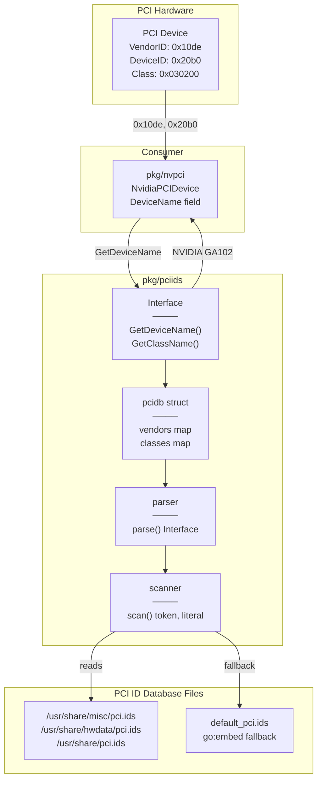
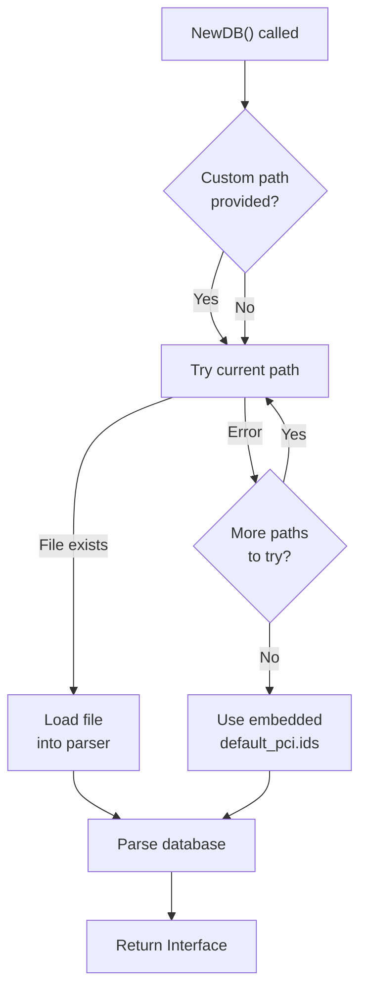
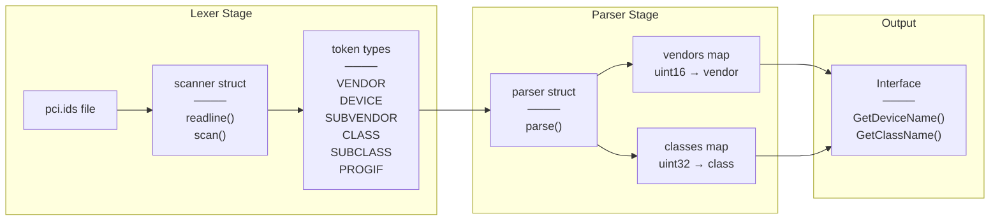
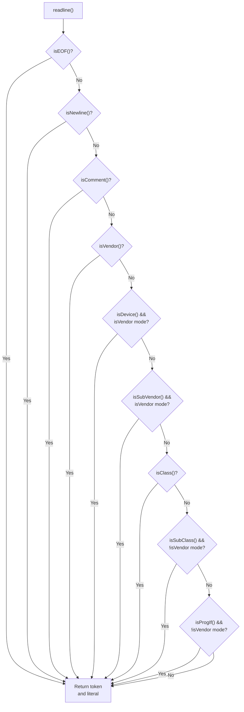
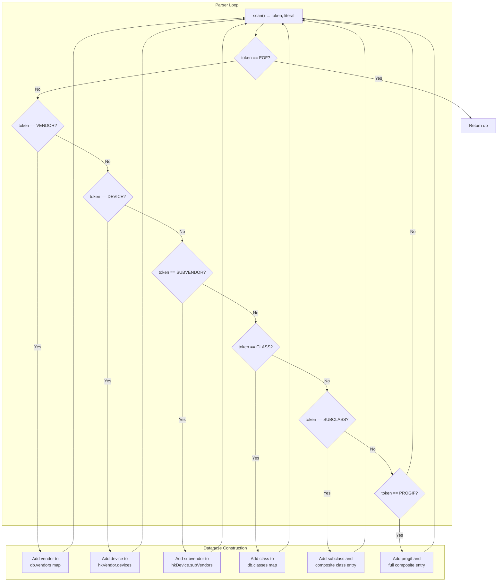
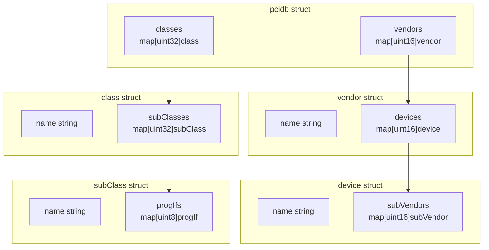
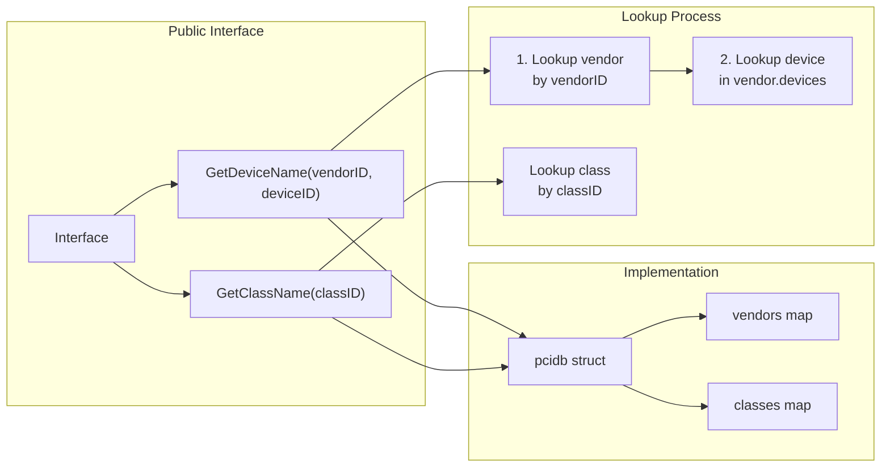
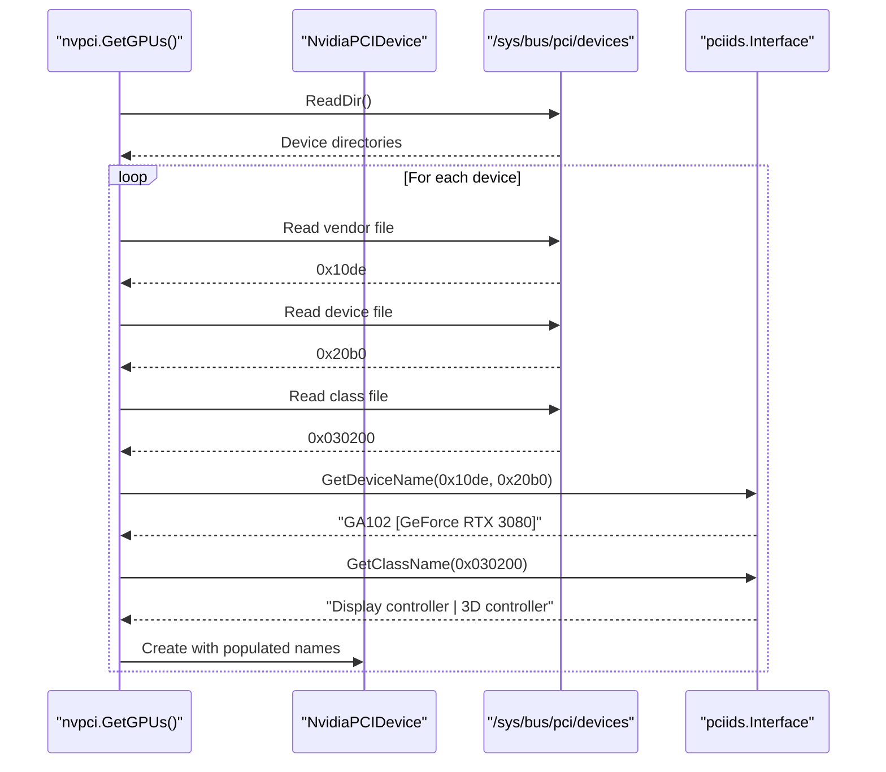

<!-- source: DeepWiki mcp.deepwiki.com · repo NVIDIA/go-nvlib · page 5.3 PCI ID Database · fetched 2026-10-26 -->

# PCI ID Database

<details>
<summary>Relevant source files</summary>

The following files were used as context for generating this wiki page:

- [NOTICE](NOTICE)
- [pkg/nvpci/mlxpci.go](pkg/nvpci/mlxpci.go)
- [pkg/pciids/default_pci.ids](pkg/pciids/default_pci.ids)
- [pkg/pciids/pciids.go](pkg/pciids/pciids.go)

</details>


## Purpose and Scope

The PCI ID Database system provides a mechanism for resolving numeric PCI vendor, device, and class identifiers to human-readable textual descriptions. This system parses the industry-standard `pci.ids` database format and exposes lookup methods for translating hexadecimal PCI identifiers into device names and class descriptions.

This page documents the implementation of the `pkg/pciids` package. For information about PCI device enumeration and discovery, see [PCI Device Discovery](#5.1). For device classification based on PCI IDs, see [PCI Device Classification](#5.1.1).

---

## Overview

The PCI ID Database system serves as a translation layer between numeric PCI identifiers and human-readable names. Every PCI device on a system has a vendor ID and device ID that uniquely identify the hardware. The `pci.ids` database, maintained by the PCI ID Project at https://pci-ids.ucw.cz/, provides canonical mappings for these identifiers.



Sources: [pkg/pciids/pciids.go:1-445](), [pkg/nvpci/mlxpci.go:77-88]()

---

## Database Loading and Fallback Mechanism

The system attempts to load the PCI ID database from multiple standard filesystem locations before falling back to an embedded version. This ensures compatibility across different Linux distributions and provides resilience when system files are unavailable.

### System Database Paths

The database loader searches the following locations in order:

| Priority | Path | Distribution |
|----------|------|--------------|
| 1 (custom) | User-provided path | Via `WithFilePath()` option |
| 2 | `/usr/share/misc/pci.ids` | Ubuntu, Debian |
| 3 | `/usr/local/share/pci.ids` | RHEL (manual update) |
| 4 | `/usr/share/hwdata/pci.ids` | RHEL, CentOS, Fedora |
| 5 | `/usr/share/pci.ids` | SUSE |
| 6 (fallback) | Embedded `default_pci.ids` | All distributions |



### Factory Function and Options

The `NewDB()` function uses the option pattern to allow custom database paths:

```go
db := pciids.NewDB()                                    // Use default paths
db := pciids.NewDB(pciids.WithFilePath("/custom/path")) // Custom path first
```

Sources: [pkg/pciids/pciids.go:177-216]()

---

## PCI IDS File Format

The `pci.ids` file uses a hierarchical text format with tab-based indentation. The parser must handle three main hierarchies: vendors/devices/subdevices and classes/subclasses/programming interfaces.

### Format Structure

```
# Comment lines start with #

<vendor_id>  <vendor_name>
	<device_id>  <device_name>
		<subvendor_id> <subdevice_id>  <subsystem_name>

C <class_id>  <class_name>
	<subclass_id>  <subclass_name>
		<prog_if_id>  <prog_if_name>
```

### Example from Database

```
10de  NVIDIA Corporation
	20b0  GA102 [GeForce RTX 3080]
		1043 8727  TUF GAMING RTX 3080 OC

C 03  Display controller
	00  VGA compatible controller
		00  VGA controller
	02  3D controller
```

Sources: [pkg/pciids/default_pci.ids:21-27]()

---

## Parsing Architecture

The PCI ID database parser implements a two-stage lexer-parser architecture that tokenizes the input file and constructs an in-memory database structure.



### Token Types

The lexer recognizes the following token types:

| Token | Description | Line Pattern |
|-------|-------------|--------------|
| `VENDOR` | Vendor entry | 4 hex digits at line start |
| `DEVICE` | Device entry | Single tab + 4 hex digits |
| `SUBVENDOR` | Subsystem entry | Two tabs + vendor/device IDs |
| `CLASS` | Class entry | `C` + 2 hex digits |
| `SUBCLASS` | Subclass entry | Single tab + 2 hex digits |
| `PROGIF` | Programming interface | Two tabs + 2 hex digits |
| `COMMENT` | Comment line | Starts with `#` |
| `NEWLINE` | Blank line | Only newline character |
| `EOF` | End of file | End of input stream |

### Lexer Implementation

The scanner processes the file line-by-line and determines token types based on leading characters and indentation:



The scanner maintains state (`isVendor` flag) to distinguish between vendor/device/subvendor entries and class/subclass/progif entries, since both hierarchies use tab-based indentation.

Sources: [pkg/pciids/pciids.go:14-163]()

### Parser Implementation

The parser consumes tokens from the scanner and builds the in-memory database structure:



The parser maintains "housekeeping" variables (`hkVendor`, `hkDevice`, `hkClass`, `hkSubClass`) to track the current context for nested entries.

Sources: [pkg/pciids/pciids.go:165-444]()

---

## Database Structure

The in-memory database uses nested map structures to provide O(1) lookup performance for vendor, device, and class queries.



### Type Definitions

| Type | Fields | Purpose |
|------|--------|---------|
| `pcidb` | `vendors map[uint16]vendor`<br/>`classes map[uint32]class` | Top-level database |
| `vendor` | `name string`<br/>`devices map[uint16]device` | Vendor information |
| `device` | `name string`<br/>`subVendors map[uint16]subVendor` | Device information |
| `subVendor` | `SubDevices map[uint16]SubDevice` | Subsystem information |
| `class` | `name string`<br/>`subClasses map[uint32]subClass` | PCI class information |
| `subClass` | `name string`<br/>`progIfs map[uint8]progIf` | PCI subclass information |
| `progIf` | `name string` | Programming interface |

### Class ID Encoding

PCI class information is stored in a 32-bit value with the following layout:

```
Bits 31-24: Reserved (0x00)
Bits 23-16: Class code
Bits 15-8:  Subclass code
Bits 7-0:   Programming interface
```

The parser creates composite class entries for all meaningful combinations:
- `0xCC0000`: Class only (e.g., `0x030000` = "Display controller")
- `0xCCSS00`: Class + Subclass (e.g., `0x030200` = "Display controller | 3D controller")
- `0xCCSSPP`: Full class ID (e.g., `0x030200` = complete class/subclass/progif)

Sources: [pkg/pciids/pciids.go:285-329](), [pkg/pciids/pciids.go:390-437]()

---

## Lookup Interface

The `Interface` type exposes two primary lookup methods for resolving PCI identifiers to textual descriptions.



### GetDeviceName Method

Resolves a vendor ID and device ID to a human-readable device name.

**Signature**: `GetDeviceName(vendorID uint16, deviceID uint16) (string, error)`

**Lookup Process**:
1. Look up vendor in `vendors` map using `vendorID`
2. If vendor not found, return error
3. Look up device in `vendor.devices` map using `deviceID`
4. If device not found, return error
5. Return `device.name`

**Example**:
```go
db := pciids.NewDB()
name, err := db.GetDeviceName(0x10de, 0x20b0)
// Returns: "GA102 [GeForce RTX 3080]"
```

Sources: [pkg/pciids/pciids.go:261-274]()

### GetClassName Method

Resolves a PCI class ID to a human-readable class description.

**Signature**: `GetClassName(classID uint32) (string, error)`

**Lookup Process**:
1. Look up class in `classes` map using full `classID`
2. If class not found, return error
3. Return `class.name`

**Example**:
```go
db := pciids.NewDB()
name, err := db.GetClassName(0x030200)
// Returns: "Display controller (03) | 3D controller (02)"
```

The method works with partial or full class IDs:
- `0x030000`: Returns class only
- `0x030200`: Returns class + subclass
- `0x030201`: Returns class + subclass + programming interface (if exists)

Sources: [pkg/pciids/pciids.go:276-283]()

---

## Integration with nvpci Package

The `pkg/nvpci` package uses the PCI ID database to populate human-readable device names when enumerating PCI devices. This integration occurs during device discovery when reading sysfs information.



### Device Name Resolution

When `nvpci` discovers a PCI device, it populates the `DeviceName` field using the PCI ID database:

| Field | Source | Example |
|-------|--------|---------|
| `Vendor` | sysfs `vendor` file | `0x10de` |
| `Device` | sysfs `device` file | `0x20b0` |
| `Class` | sysfs `class` file | `0x030200` |
| `DeviceName` | `pcidb.GetDeviceName()` | `"GA102 [GeForce RTX 3080]"` |
| `ClassName` | `pcidb.GetClassName()` | `"Display controller | 3D controller"` |

The `DeviceName` field is used throughout the nvpci package for device identification, such as in the `IsDPU()` method which checks for "BlueField" in the device name.

Sources: [pkg/nvpci/mlxpci.go:77-88]()

---

## Usage Patterns

### Basic Usage

```go
// Create database instance (searches default paths)
db := pciids.NewDB()

// Lookup NVIDIA GPU
deviceName, err := db.GetDeviceName(0x10de, 0x20b0)
if err != nil {
    // Handle lookup failure
}
// deviceName: "GA102 [GeForce RTX 3080]"

// Lookup PCI class
className, err := db.GetClassName(0x030200)
if err != nil {
    // Handle lookup failure
}
// className: "Display controller (03) | 3D controller (02)"
```

### Custom Database Path

```go
// Use custom pci.ids file location
db := pciids.NewDB(pciids.WithFilePath("/opt/custom/pci.ids"))

// Lookup proceeds as normal
deviceName, _ := db.GetDeviceName(vendorID, deviceID)
```

### Integration Pattern

The typical integration pattern is to instantiate the PCI ID database once and use it throughout device discovery:

```go
// Initialize PCI database
pciDB := pciids.NewDB()

// During device enumeration
for _, devicePath := range devicePaths {
    vendorID := readVendorID(devicePath)
    deviceID := readDeviceID(devicePath)
    
    // Resolve to human-readable name
    deviceName, err := pciDB.GetDeviceName(vendorID, deviceID)
    if err != nil {
        deviceName = "Unknown Device"
    }
    
    // Create device with populated name
    device := &NvidiaPCIDevice{
        Vendor:     vendorID,
        Device:     deviceID,
        DeviceName: deviceName,
    }
}
```

Sources: [pkg/pciids/pciids.go:189-203](), [pkg/pciids/pciids.go:255-283]()

---

## Error Handling

The lookup methods return descriptive errors when identifiers cannot be resolved:

| Error Condition | Method | Error Message |
|----------------|--------|---------------|
| Unknown vendor | `GetDeviceName()` | `"failed to find vendor with id '<vendorID>'"` |
| Unknown device | `GetDeviceName()` | `"failed to find device with id '<deviceID>'"` |
| Unknown class | `GetClassName()` | `"failed to find class with id '<classID>'"` |

Applications should handle these errors gracefully, typically by falling back to displaying the hexadecimal ID or a generic "Unknown" designation.

Sources: [pkg/pciids/pciids.go:261-283]()

---

## Database Maintenance

The embedded `default_pci.ids` file is a snapshot from the PCI ID Project (version 2025.07.11). This database should be periodically updated to include new devices and vendors.

### Update Process

1. Download latest `pci.ids` from https://pci-ids.ucw.cz/
2. Replace `pkg/pciids/default_pci.ids`
3. Update version comment in file header
4. Rebuild to embed new database

### License

The `default_pci.ids` file is distributed under the 3-clause BSD License, separate from the main go-nvlib Apache 2.0 license. The database is maintained by Albert Pool, Martin Mares, and volunteers from the PCI ID Project.

Sources: [NOTICE:1-4](), [pkg/pciids/default_pci.ids:1-20]()

---

